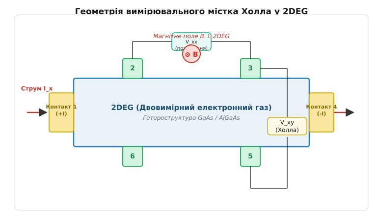
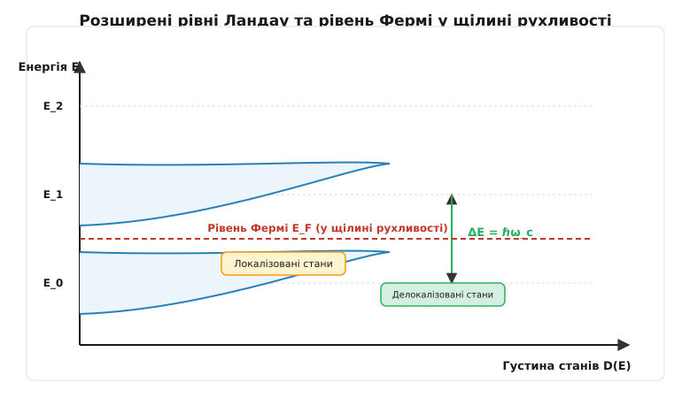
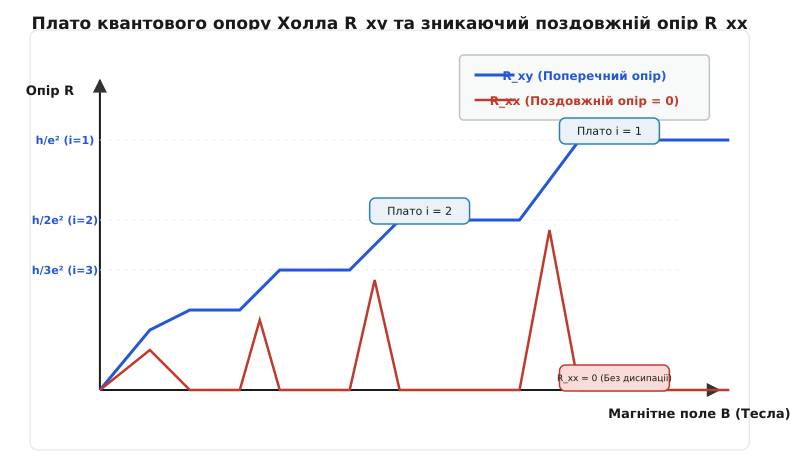
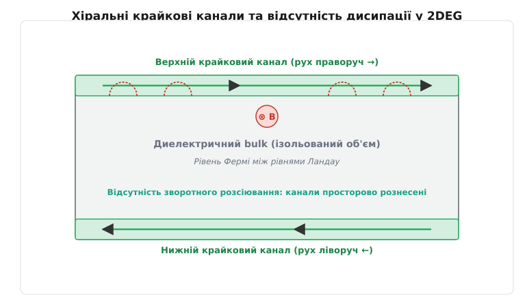

# Квантовий ефект Холла

<preknowlist>
- [Ефект Холла](root:ph-condensed/hall-effect) — виникнення поперечної різниці потенціалів у провіднику зі струмом у магнітному полі.
- [Сила Лоренца](root:ph-electromagnetism/lorentz-force) — сила, що діє на рухомий заряд у магнітному полі та закручує його в циклотронну орбіту.
- [Чотирипровідний опір](root:hw-sensing/4wire-resistance) — метод вимірювання опору з відокремленням струмових та потенціальних кіл.
- [Електричний струм](root:ph-electromagnetism/electric-current) — впорядкований рух носіїв заряду під дією електричного поля.
</preknowlist>

Якщо крізь металеву або напівпровідникову пластину пропустити електричний струм і помістити її у перпендикулярне магнітне поле, сила Лоренца відхиляє носії заряду до бічної межі. Утворюється поперечна різниця потенціалів — напруга Холла, яка в класичній фізиці прямо пропорційна величині магнітного поля та обернено пропорційна концентрації носіїв. Протягом цілого століття ця залежність вважалася неперервною лінією. Проте, якщо зрізати товщину провідника до одного атомного шару, створивши двовимірний електронний газ, охолодити зразок майже до абсолютного нуля та прикласти сильне магнітне поле у кілька Тесла, класична пряма розпадається. Поперечний опір замість плавного зростання вимальовує серію абсолютно пласких сходинок (плато), значення яких не залежать ані від матеріалу, ані від форми зразка, ані від кількості дефектів у ньому. Вони фіксуються комбінацією фундаментальних фізичних констант — сталої Планка та заряду електрона. Одночасно з появою цих квантових сходинок поздовжній електричний опір зразка падає до нуля, перетворюючи напівпровідник на ідеальний провідник без дисипації тепла. Цей феномен отримав назву **квантового ефекту Холла** (*Quantum Hall Effect*, QHE).

---

### Межа класичної теорії та криза лінійної провідності

У класичній фізиці електропровідність описується моделлю Друде-Лоренца. Електрони розглядаються як точкові частинки, що вільно розганяються електричним полем `E` та випробовують випадкові зіткнення з іонами кристалічної ґратки із середнім часом релаксації `τ`. У наявності перпендикулярного магнітного поля `B` на кожен електрон із зарядом `-e` та швидкістю `v` діє сила Лоренца `F = -e · (E + v × B)`.

У стаціонарному стані середня сила, що діє на електрон, врівноважується силою тертя (релаксації імпульсу), що дає класичне векторне рівняння руху:

```
m* · (v / τ) = -e · (E + v × B)
```

Розкладаючи це рівняння за декартовими координатами у площині `xy` (де магнітне поле спрямоване вздовж осі `z`, тобто `B = (0, 0, B)`), отримуємо систему рівнянь для компонентів дрейфової швидкості електронів:

```
v_x = - (e · τ / m*) · E_x - (e · B · τ / m*) · v_y
v_y = - (e · τ / m*) · E_y + (e · B · τ / m*) · v_x
```

Увівши циклотронну частоту `ω_c = e · B / m*` та класичну провідність Друде `σ_0 = (n_s · e² · τ) / m*`, густину електричного струму `j = -e · n_s · v` можна записати через тензор статичної провідності `j = σ · E`:

```
σ_xx = σ_yy = σ_0 / (1 + ω_c² · τ²)
σ_xy = -σ_yx = (σ_0 · ω_c · τ) / (1 + ω_c² · τ²) = (n_s · e / B) · [ ω_c² · τ² / (1 + ω_c² · τ²) ]
```

Тангенс кута між вектором повного електричного поля `E` та вектором густини струму `j` називається **кутом Холла** (*Hall angle*, `θ_H`):

```
tan(θ_H) = |σ_xy / σ_xx| = ω_c · τ = μ · B
```

де `μ = e · τ / m*` — рухливість носіїв заряду. У сильних магнітних полях, де виконується критерій сильного закручування `ω_c · τ ≫ 1` (електрон встигає зробити багато повних циклотронних обертів між двома послідовними розсіюваннями на домішках кристала), кут Холла наближається до прямого кута `θ_H → 90°`. У цьому режимі компоненти тензора провідності поводяться асимптотично:

```
σ_xx ≈ σ_0 / (ω_c · τ)² ∝ 1 / (B² · τ)  →  0  [при B → ∞]
σ_xy ≈ n_s · e / B
```

Зведення векторного рівняння руху носіїв у площині `xy` до тензора питомого опору `ρ = σ⁻¹` дає повний зв'язок між електричним полем та густиною струму `E = ρ · j`:

```
E_x = ρ_xx · j_x + ρ_xy · j_y
E_y = -ρ_xy · j_x + ρ_yy · j_y
```

Матричне обернення двовимірного тензора провідності дає точні аналітичні вирази для компонентів тензора питомого опору:

```
ρ_xx
= σ_xx / (σ_xx² + σ_xy²)             [матричне обернення 2D тензора]
= m* / (n_s · e² · τ)                [підстановка компонентів σ_xx та σ_xy]

ρ_xy
= σ_xy / (σ_xx² + σ_xy²)             [поперечна компонента тензора опору]
= B / (n_s · e)                      [підстановка компонентів σ_xx та σ_xy]
```

де `n_s` — поверхнева густина носіїв заряду, `m*` — ефективна маса електрона у кристалі, а `τ` — час вільного пробігу (релаксації імпульсу).

Тут виникає перший фундаментальний математичний парадокс двовимірного магнітотранспорту, який часто збиває з пантелику дослідників класичних ланцюгів:
- У звичайному провіднику за відсутності магнітного поля питомий опір і провідність є скалярними взаємно оберненими величинами `ρ = 1 / σ`. Якщо провідність прямує до нуля, опір зростає до нескінченності (ізолятор).
- Проте у наявності сильного магнітного поля тензорний характер зв'язку перевертає це правило: якщо поздовжня провідність `σ_xx → 0`, а поперечна провідність `σ_xy ≠ 0`, то поздовжній питомий опір `ρ_xx = σ_xx / (σ_xx² + σ_xy²) → 0` також прямує до нуля! Тобто середовище одночасно не проводить струм уздовж електричного поля (`j_x = 0` при `E_y = 0`), але не чинить жодного омічного опору (`E_x = 0` при протіканні струму `j_x`).

З класичної формули випливають два фундаментальні висновки, які десятиліттями вважалися незаперечними:
1. Поздовжній опір `ρ_xx` визначається чистотою матеріалу та часом зіткнень `τ` і не залежить від магнітного поля `B`.
2. Поперечний опір Холла `ρ_xy` строго лінійно зростає зі збільшенням індукції магнітного поля `B` і прямо міряє концентрацію носіїв `n_s`.


*Геометрія вимірювального містка Холла (Hall bar) у двовимірному електронному газі. Струм I_x проганяється між кінцевими контактами 1 та 4, поздовжня напруга V_xx знімається з контактів 2 та 3, а поперечна напруга Холла V_xy — між контактами 3 та 5 у перпендикулярному магнітному полі B.*

#### Граничні умови та чотирипровідне вимірювання

Фізична реалізація вимірювання суттєво залежить від геометричної форми зразка та його граничних умов. У практиці фізики твердого тіла використовують дві канонічні конфігурації:

1. **Місток Холла (Hall bar)**: витягнутий прямокутний канал із бічними потенціальними щупами. У цій геометрії струм подається через металеві контакти на торцях зразка, а граничні умови на бічних ізольованих гранях вимагають відсутності поперечного струму (`j_y = 0`). Під дією сили Лоренца носії відхиляються до країв доти, доки не створиться поперечне електростатичне поле Холла `E_y = - (σ_xy / σ_xx) · E_x = ρ_xy · j_x`, яке повністю врівноважує магнітну силу. У містку Холла безпосередньо вимірюються компоненти тензора питомого опору:
   ```
   V_xx = ρ_xx · (L / W) · I_x
   V_xy = ρ_xy · I_x
   ```
   де `L` — відстань між потенціальними щупами, а `W` — ширина каналу.
   На торцевих металевих контактах еквіпотенціальні лінії викривляються: оскільки метал є еквіпотенціальною поверхнею, електричне поле перпендикулярне до контакту, що змушує струм входити у зразок концентровано в діагонально протилежних кутах контактів (ефект сингулярності Вікстеда-Повела).

   Вирішальне значення має застосування **чотирипровідної схеми вимірювання**: струм подається через струмові контакти 1 та 4, тоді як напруги `V_xx` та `V_xy` вимірюються окремими потенціальними щупами 2, 3 та 5 за допомогою прецизійного електрометра з гігантським вхідним опором `R_in > 10¹²` Ом. Оскільки струм через вимірювальні щупи практично дорівнює нулю (`I_probe ≈ 0`), спад напруги на перехідному контактному опорі `R_c` контактів повністю усувається `V_drop = I_probe · R_c = 0`, що забезпечує чисте вимірювання властивостей 2DEG.

2. **Диск Корбіно (Corbino geometry)**: концентрична кільцева пластина із суцільними круглими металевими контактами на внутрішньому радіусі `r_1` та зовнішньому радіусі `r_2`. Завдяки повній осьовій симетрії поперечне (азимутальне) електричне поле Холла не може накопичуватися вздовж замкненого кола (`E_θ = 0`). У результаті носії під дією сили Лоренца вільно закручуються по спіральних траєкторіях, а радіальний струм кільця безпосередньо вимірює діагональну компоненту тензора провідності:
   ```
   I_radial = 2π · σ_xx · V_radial / ln(r_2 / r_1)
   ```
   Якщо `σ_xx = 0`, радіальний струм у геометрії Корбіно повністю блокується, перетворюючи зразок на абсолютний ізолятор.

#### Ефект Шубнікова-де Гааза як місток між класикою та квантами

При поступовому переході від помірних до сильних магнітних полів за низьких температур класична постійність `ρ_xx` порушується появою регулярних квантових коливань — **осциляцій Шубнікова-де Гааза** (*Shubnikov–de Haas effect*, SdH).
Ці осциляції виникають через періодичне проходження рівнів Ландау крізь рівень Фермі `E_F` при зміні магнітного поля. Період осциляцій за оберненим магнітним полем `Δ(1/B)` є строго постійним і прямо визначає площу екстремального перерізу поверхні Фермі `S_F` та поверхневу густину носіїв `n_s`:

```
Δ(1/B) = (2 · e) / (ℏ · S_F) = (2 · e) / (h · n_s)
```

Вимірювання періоду SdH є основним метрологічним методом незалежного визначення концентрації електронів у 2DEG перед виходом у режим квантового ефекту Холла.

Однак спроба застосувати класичну модель до новітніх напівпровідникових структур при екстремально низьких температурах виявила повне руйнування класичних передбачень. При зменшенні температури до кельвінових та мілікельвінових значень тепловий рух електронів виморожується, а довжина хвилі де Бройля для носіїв `λ_dB = h / p` стає порівнянною з характерними геометричними розмірами каналу провідності. Класична траєкторія у вигляді спіралі поступається місцем хвильовим квантовим станам.

Коли експериментатори виміряли залежність `ρ_xy` від поля `B` на надчистих напівпровідникових геометріях, на графіку замість похилої прямої з'явилися чіткі горизонтальні сходинки. Водночас поздовжній опір `ρ_xx` замість константи продемонстрував глибокі осциляції, провалюючись до точного нуля у тих самих інтервалах магнітного поля, де `ρ_xy` виходив на плато. Класична теорія Друде виявилася неспроможною пояснити ані існування сходинок, ані зникання поздовжнього опору.

Детальний аналіз хронології та драматичних обставин нічного відкриття цього ефекту Клаусом фон Клітцингом у Греноблі наведено у вставці 📜 [Історія відкриття квантового ефекту Холла](root:ph-condensed/quantum-hall-effect/hist-klitzing.md).

---

### Двовимірний електронний газ (2DEG): створення та квантова інженерія

Щоб квантовий ефект Холла став можливим, рух електронів необхідно обмежити в одному з трьох просторових вимірів. Створення двовимірного електронного газу (2DEG) стало можливим завдяки розвитку напівпровідникової гетероперехідної інженерії, зокрема на основі гетероструктур арсеніду галію та арсеніду галію-алюмінію (`GaAs / AlGaAs`), а також у кремнієвих польових транзисторах (Si-MOSFET).

У гетероструктурі `GaAs / AlGaAs` на межі поділу двох напівпровідників із різною шириною забороненої зони (`E_g ≈ 1.42` еВ для GaAs та `E_g ≈ 1.8` еВ для Al_0.3Ga_0.7As) виникає гострий вигин енергетичних зон, що утворює трикутну потенціальну яму вздовж осі `z` (перпендикулярно до площини гетеропереходу). Ширина цієї ями становить лише кілька нанометрів.

```
       Енергія E
          │
          │     AlGaAs        │        GaAs
          │                   │
  E_C     ├─────────┐         │
  (зони)  │         │         │   Потенціальна яма 2DEG
          │         └──┐      │   /
          │            │     /│  /
  E_F ────┼────────────┼────/─┼─/────── Рівень Фермі
          │            │   /  │/
          │            └───┘  │
          └───────────────────┴───────────── осі z
```

#### Селективне легування та пригнічення розсіювання

Головним технологічним проривом, що дозволив спостерігати квантовий ефект Холла у гетероструктурах, став винахід **селективного легування** (*Modulation Doping*, запропонованого Реєм Дінґлом та співробітниками у Bell Labs у 1978 році).
У звичайному об'ємному напівпровіднику введення донорних домішок (наприклад, атомів кремнію) створює вільні електрони провідності, але водночас залишає у ґратці позитивно заряджені іонізовані центри `Si⁺`. Вільні електрони зазнають сильного кулонівського розсіювання на цих центрах, що обмежує їхню рухливість величиною `μ < 10000` см²/(В·с) при низьких температурах.

При селективному легуванні донорні атоми кремнію вводяться виключно у широкозонний шар `AlGaAs`, причому не біля самої межі, а на відстані `20...80` нанометрів від неї. Простір між зоною легування та гетеропереходом залишається хімічно чистим недепованим напівпровідником — так званим **просторовим спейсером** (*undoped spacer layer*).

Електрони з донорних рівнів AlGaAs переходять у потенціальну яму GaAs, оскільки там їхня потенційна енергія є нижчою. У результаті електрони виявляються просторово відокремленими від своїх батьківських іонізованих домішок захисним спейсерним шаром. Це пригнічує кулонівське розсіювання на кілька порядків, піднімаючи низькотемпературну рухливість носіїв `μ` до астрономічних значень понад `30 000 000` см²/(В·с), а довжину вільного пробігу електронів — до сотень мікрометрів.

#### Самонаузгоджене квантування підзон у трикутній ямі

Квантово-механічний опис 2DEG вздовж осі обмеження `z` вимагає сумісного розв'язання одновимірного рівняння Шредінгера та рівняння Пуассона для електростатичного потенціалу `V(z)`:

```
[ - (ℏ² / 2m*) · (d² / dz²) + V(z) ] ψ_i(z) = E_zi · ψ_i(z)
d²V / dz² = (e / (ε · ε_0)) · [ n(z) - N_D⁺(z) ]
```

де `n(z) = ∑ |ψ_i(z)|² · n_si` — розподіл електронної густини вздовж осі `z`.

У варіаційному наближенні Фанга-Говарда (*Fang-Howard variational approach*) хвильова функція найнижчої підзони `i = 0` апроксимується аналітичним виразом:

```
ψ_0(z) = √(b³ / 2) · z · exp( - b · z / 2 )  (для z ≥ 0)
```

де параметр варіації `b` визначається поверхневою концентрацією `n_s` та густиною збідненого шару `N_depl`:

```
b = [ (12 · m* · e²) / (ε · ε_0 · ℏ²) · ( N_depl + (11/32) · n_s ) ]^(1/3)
```

Середня товщина двовимірного електронного шару в GaAs становить `⟨z⟩ = 3 / b ≈ 3...5` нанометрів. Енергетичний інтервал між першою та другою підзонами квантування розмірного руху оцінюється як:

```
ΔE_sub = E_z1 - E_z0 ≈ (ℏ² / 2m*)^(1/3) · [ (9π/8) · e · F_s ]^(2/3) ≈ 15...35 меВ
```

де `F_s` — електричне поле на межі гетеропереходу. Оскільки ця енергетична щілина `ΔE_sub` відповідає температурам `150...400` Кельвінів, при гелієвих температурах `T < 4.2` К усі електрони займають виключно найнижчий квантовий рівень `E_z0`. Рух вздовж осі `z` стає повністю «замороженим», формуючи ідеальний 2DEG.

У двовимірному просторі без магнітного поля густина станів на одиницю площі `D(E)` є постійною величиною, що не залежить від енергії:

```
D_2D(E) = (g_s · g_v · m*) / (2π · ℏ²)
```

де `g_s = 2` — спінове виродження, а `g_v` — долинне виродження зони провідності кристала (`g_v = 1` для простої зони GaAs з мінімумом у точці Γ, `g_v = 2` для площини Si(100) у польових транзисторах).

| Параметр 2DEG | Кремнієвий Si-MOSFET | Гетероструктура GaAs / AlGaAs | Моношар Графену |
| :--- | :--- | :--- | :--- |
| **Ефективна маса `m*`** | `0.19 · m_e` | `0.067 · m_e` | Безмасові діраківські (`m* = 0`) |
| **Долинне виродження `g_v`** | `2` (для площини [100]) | `1` (точка Γ) | `2` (долини K та K') |
| **Спінове виродження `g_s`** | `2` | `2` | `2` |
| **Типова рухливість `μ` при 4 K** | `10000 ... 50000` см²/(В·с) | `10⁶ ... 3 · 10⁷` см²/(В·с) | `100000 ... 10⁶` см²/(В·с) |
| **Енергетичний закон `E(k)`** | Параболічний `ℏ²k² / (2m*)` | Параболічний `ℏ²k² / (2m*)` | Лінійний релятивістський `ℏ v_F |k|` |
| **Спектр рівнів Ландау** | Еквідистантний `ℏω_c(n + 1/2)` | Еквідистантний `ℏω_c(n + 1/2)` | Нерівновіддалений `sgn(n) v_F √(2eℏB|n|)` |

---

### Квантування Ландау у 2DEG: мікроскопічний розв'язок

Якщо до 2DEG прикласти сильне магнітне поле `B` вздовж осі `z`, лоренцівське закручування електронів перетворює їхній вільний поступальний рух у площині `xy` на закриті колові циклотронні орбіти з частотою:

```
ω_c = e · B / m*
```

З точки зору квантової механіки, неперервний двовимірний енергетичний спектр розпадається на серію строго квантованих рівнів Ландау:

```
E_n = ℏ · ω_c · (n + 1/2) + g* · μ_B · B · s_z
```

де `n = 0, 1, 2...` — номер рівня Ландау, а другий член описує зееманівське розщеплення спінових станів (`s_z = ±1/2`, `g*` — ефективний g-фактор електрона у матеріалі: `g* ≈ -0.44` для GaAs, `g* ≈ +2.0` для кремнію, `μ_B = eℏ / (2m_e)` — магнетон Бора).

```
Без магнітного поля (B = 0)        У сильному магнітному полі (B > 0)
    Густина станів D(E)                 Густина станів D(E)
          │                                  │     E_0      E_1      E_2
          │                                  │      │        │        │
  D_2D ───┼───────────────                   │     ┌┴┐      ┌┴┐      ┌┴┐
          │                                  │     │ │      │ │      │ │
          └─────────────── E                 └─────┴─┴──────┴─┴──────┴─┴── E
          Неперервний спектр                      Дискретні рівні Ландау
```

Для детального квантово-механічного виведення спектра розв'яжемо стаціонарне рівняння Шредінгера для вільного електрона у площині `xy`.
Гамільтоніан системи із зарядом `-e` у векторному потенціалі `A` має вигляд:

```
H = (1 / 2m*) · (p + e · A)²
```

Вибір калібрування векторного потенціалу визначає математичну форму хвильових функцій:
1. **Калібрування Ландау**: `A = (0, B · x, 0)`. Магнітне поле `B = ∇ × A = (0, 0, B)`.
   Гамільтоніан комутує з оператором імпульсу `p_y`, тому хвильова функція розкладається як плоска хвиля вздовж `y` та хвильова функція гармонічного осцилятора вздовж `x`:
   ```
   Ψ_(n, k_y)(x, y) = (1 / √L_y) · exp(i · k_y · y) · φ_n(x - x_0)
   ```
   де `φ_n` — хвильова функція `n`-го збудженого стану одновимірного квантового гармонічного осцилятора з масою `m*` та частотою `ω_c`, а координата центра циклотронної орбіти зміщена на:
   ```
   x_0 = - (ℏ · k_y) / (e · B) = - l_B² · k_y
   ```
   Величина `l_B` є фундаментальним просторовим квантовим масштабом явища і називається **магнітною довжиною** (*magnetic length*):
   ```
   l_B = √(ℏ / (e · B))
   ```
   При типовому магнітному полі `B = 10` Тесла магнітна довжина становить `l_B ≈ 8.1` нанометрів. Вона задає характерний просторовий радіус хвильової функції електрона на нульовому рівні Ландау.

2. **Симетричне калібрування**: `A = (- (1/2) · B · y,  (1/2) · B · x,  0)`.
   У цьому калібруванні гамільтоніан комутує з оператором кутового моменту `L_z = x · p_y - y · p_x`. Власними станами є колові хвильові пакети, центровані навколо початку координат, які позначаються через комплексні координати `z = x + i · y`:
   ```
   Ψ_(n, m)(z, z̄) ∝ z^m · exp( - |z|² / (4 · l_B²) )
   ```
   де `m = 0, 1, 2...` — квантове число кутового моменту.

#### Операторний формалізм та некомутативна геометрія

Алгебра квантового руху в магнітному полі розкривається через дві незалежні пари операторів сходів:
- Оператори циклотронного руху `a` та `a^†`, де `[a, a^†] = 1`. Гамільтоніан записується як `H = ℏ · ω_c · (a^† · a + 1/2)`. Оператор `a^†` переводить електрон між різними рівнями Ландау (`n → n + 1`), змінюючи енергію на `ℏω_c`.
- Оператори ведучого центра орбіти `b` та `b^†`, де `[b, b^†] = 1`. Оператор `b^†` переміщує центр циклотронного кола `(X, Y)` у площині зразка без зміни енергії (`[H, b] = [H, b^†] = 0`), породжуючи виродження рівня.

Координати ведучого центра `X = x + v_y / ω_c` та `Y = y - v_x / ω_c` задовольняють фундаментальному комутаційному співвідношенню:

```
[X, Y] = -i · l_B²
```

Це означає, що координатна площина `xy` у сильному магнітному полі перетворюється на **некомутативний фазовий простір**. Згідно з принципом невизначеності Гейзенберга `ΔX · ΔY ≥ l_B² / 2`, мінімальна площа, яку може займати один квантовий стан у площині, строго дорівнює елементарній квантовій комірці:

```
S_cell = 2π · l_B² = h / (e · B)
```

#### Обмінне посилення спінового розщеплення та скірміони

У чистому одночастинковому наближенні зееманівське розщеплення у GaAs `ΔE_Z = |g*| · μ_B · B` є відносно малим (при `B = 10` Тл `ΔE_Z ≈ 0.25` меВ, що становить лише `1.5%` від циклотронної енергії `ℏω_c ≈ 17` меВ). Проте в експериментах спінові плато (наприклад, `ν = 1`) виявляються надзвичайно стійкими.

Причиною є **багаточастинкова обмінна взаємодія**: коли рівень із спіном «вгору» заповнений, а рівень із спіном «вниз» порожній, обмінна кулонівська енергія притягання електронів з однаковими спінами створює ефективне внутрішнє магнітне поле. Ефективний g-фактор посилюється до `g*_(enh) ≈ 5...10`, формуючи стійкий 2D квантово-холлівський феромагнетик при `ν = 1`.

Елементарними збудженнями у цьому феромагнетику є не поодинокі перевернуті спіни, а протяжні топологічні текстури — **квантові скірміони** (*Skyrmions*). Один скірміон несе електричний заряд `±e`, але повертає від 3 до 20 спінів навколишніх електронів, що було експериментально підтверджено методом ядерного магнітного резонансу (ЯМР).

#### Метелик Гофштадтера у періодичній ґратці

Коли 2DEG знаходиться не у вакуумі, а у періодичному двовимірному кристалічному потенціалі з періодом `a`, виникає квантова інтерференція між періодом ґратки та магнітною довжиною `l_B`.
Якщо відношення магнітного потоку крізь елементарну комірку до кванта потоку є раціональним дробом `Φ / Φ_0 = (B · a²) / (h / e) = p / q`, стаціонарне рівняння Шредінгера перетворюється на різницеве **рівняння Гарпера** (*Harper's equation*):

```
ψ_(n+1) + ψ_(n-1) + 2 · cos( 2π · n · (p/q) - k_y · a ) · ψ_n = (E / t) · ψ_n
```

Спектр енергетичних підзон набуває самоподібної фрактальної структури — відомої як **метелик Гофштадтера** (*Hofstadter's butterfly*). Кожна магнітна підзона несе власне цілочисельне число Черна, породжуючи багату сітку квантованих холлівських плато, які змінюються при варіації потоку `p/q`. У надґратках графену на гексагональному нітриді бору (`hBN`) із періодом `a ≈ 15` нм метелик Гофштадтера спостерігається у доступних лабораторних полях `B = 1...15` Тл.

#### Макроскопічне виродження та коефіцієнт заповнення

Оскільки енергія `E_n = ℏ · ω_c · (n + 1/2)` у калібруванні Ландау взагалі не залежить від хвильового вектора `k_y` (або квантового числа `m` у симетричному калібруванні), кожен рівень Ландау має колосальне макроскопічне виродження.

Знайдемо повну кількість квантових станів `N_L` на одному рівні Ландау для прямокутного зразка площею `A = L_x · L_y`.
Періодичні граничні умови вздовж осі `y` квантують хвильове число: `k_y = 2π · j / L_y`, де `j` — ціле число.
Оскільки центр орбіти `x_0 = - l_B² · k_y` зобов'язаний перебувати у межах зразка `0 ≤ x_0 ≤ L_x`, діапазон допустимих значень `k_y` становить:

```
Δk_y = L_x / l_B² = (e · B · L_x) / ℏ
```

Повна кількість квантових станів на одному рівні Ландау дорівнює:

```
N_L
= Δk_y / (2π / L_y)                   [кількість квантованих мод k_y]
= (L_x · L_y) / (2π · l_B²)           [підстановка виразу для Δk_y]
= A · (e · B / h)                     [використання зв'язку l_B² = ℏ/(eB) та h = 2πℏ]
= Φ / Φ_0                             [відношення повного магнітного потоку до кванта потоку]
```

де `Φ = B · A` — повний магнітний потік крізь площу зразка, а `Φ_0 = h / e ≈ 4.1357 × 10⁻¹⁵` Вб — фундаментальний квант магнітного потоку.

Густина станів на одиницю площі для одного рівня Ландау становить:

```
n_B = N_L / A = e · B / h = 1 / (2π · l_B²)
```

Це значення називається макроскопічним виродженням рівня Ландау. Воно показує, що один рівень Ландау вміщує рівно стільки електронів, скільки квантів магнітного потоку `Φ_0 = h / e` пронизує площу зразка.

Співвідношення між повною поверхневою густиною електронів `n_s` та густиною станів одного рівня Ландау `n_B` визначає **коефіцієнт заповнення** (*Filling Factor*, `ν`):

```
ν = n_s / n_B = (n_s · h) / (e · B) = 2π · l_B² · n_s
```

Коефіцієнт заповнення `ν` показує, скільки рівнів Ландау повністю заповнено електронами при даній величині магнітного поля. Якщо зміщувати поле `B` або змінювати густину електронів `n_s` за допомогою затвора, рівень Фермі `E_F` послідовно перетинає рівні Ландау та енергетичні щілини між ними.

---

### Калібрувальний аргумент Лафліна: макроскопічна квантова інваріантність

У 1981 році Роберт Лафлін (*Robert Laughlin*) запропонував елегантний термодинамічний та калібрувальний аргумент, який пояснив абсолютну точність квантування опору Холла без необхідності враховувати мікроскопічні деталі розсіювання носіїв на атомарних дефектах.

Розглянемо двовимірний електронний газ, згорнутий у циліндр (стрічку Мебіуса без перекручування або кільце Корбіно) радіуса `R` вздовж осі `y` (довжина по колу `L_y = 2π · R`) та шириною `L_x` вздовж осі `x`. Перпендикулярно до поверхні стрічки прикладено сильне магнітне поле `B`. Крізь центральну вісь циліндра пропущено додатковий регульований магнітний потік `Φ`. Оскільки магнітне поле цього потоку зосереджене суто всередині осі і дорівнює нулю на самій поверхні 2DEG, воно впливає на електрони виключно через векторний потенціал `A_y = Φ / L_y` (ефект Ааронова-Бома).

```
               Магнітний потік Φ (крізь вісь)
                        │
                        ▼
                 ┌──────────────┐
              ┌──┴──────────────┴──┐
             ╱                      ╲
            │    Циліндр 2DEG        │ ──► Струм Холла I_y
             ╲                      ╱
              └──┬──────────────┬──┘
                 └──────────────┘
                        │
      Напруга V між внутрішнім і зовнішнім краями
```

Гамільтоніан електронів у калібруванні Ландау набуває вигляду:

```
H = (1 / 2m*) · [ p_x² + ( p_y + e · B · x + e · (Φ / L_y) )² ] + V(x, y)
```

Періодична гранична умова вздовж кола циліндра `Ψ(x, y + L_y) = Ψ(x, y)` вимагає, щоб хвильове число було квантованим: `k_y = 2π · j / L_y`.
Тоді центр локалізації циклотронної орбіти `x_0` набуває вигляду:

```
x_0 = - (ℏ / eB) · ( k_y + e · Φ / (ℏ · L_y) ) = - l_B² · ( 2π · j / L_y ) - (Φ / (B · L_y))
```

Тепер почнемо нескінченно повільно (адіабатично) збільшувати магнітний потік `Φ` від `0` до одного кванта потоку `ΔΦ = Φ_0 = h / e`.
Згідно з квантово-механічною теоремою Блоха-Баєрса, додавання цілого кванта потоку `Φ_0` до замкненої системи є еквівалентним строгому калібрувальному перетворенню `Ψ → Ψ · exp(i · 2π · y / L_y)`.
Гамільтоніан системи після додавання `Φ_0` стає унітарно еквівалентним початковому гамільтоніану, а отже, його енергетичний спектр зобов'язаний повністю збігтися із вихідним спектром.

Проте індивідуальні квантові стани під час цього процесу зазнають просторового зсуву:
Кожне квантове число `j` переходить у сусідній стан `j + 1`, а центр кожної циклотронної орбіти `x_0` зміщується на фіксовану відстань:

```
Δx_0
= Φ_0 / (B · L_y)                      [зсув центру орбіти при зміні потоку на Φ_0]
= (h / e) / (B · L_y)                  [підстановка кванта потоку Φ_0 = h / e]
= (2π · ℏ / eB) · (1 / L_y)            [використання зв'язку h = 2π · ℏ]
= (2π · l_B²) / L_y                    [підстановка визначення магнітної довжини l_B]
```

Цей зсув `Δx_0` дорівнює точній середній відстані між сусідніми квантовими станами вздовж осі `x`.
Якщо `i` рівнів Ландау повністю заповнені електронами, а рівень Фермі `E_F` лежить в енергетичній щілині, то під час адіабатичного введення одного кванта потоку `Φ_0`:
1. Усі зайняті стани всередині товщі (bulk) зсуваються на один крок `Δx_0`, повністю заповнюючи місця своїх сусідів (стан bulk лишається незмінним через нестисливість).
2. На внутрішньому краї циліндра (`x = 0`) рівно `i` електронів звільняють свої стани.
3. На зовнішньому краї циліндра (`x = L_x`) рівно `i` електронів переходять на новостворені вільні стани.

Таким чином, макроскопічним результатом введення `ΔΦ = h / e` є чисте перенесення `i` електронів із внутрішнього краю зразка (де потенціал дорівнює `V_1`) на зовнішній край зразка (де потенціал `V_2`).

Повна зміна енергії системи `ΔE` при перенесенні заряду `ΔQ = i · (-e)` через різницю потенціалів `V = V_1 - V_2` дорівнює:

```
ΔE = i · (-e) · (-V) = i · e · V
```

З іншого боку, за законами класичної та квантової електродинаміки, похідна повної енергії системи за магнітним потоком визначає електричний струм Холла `I`, що циркулює навколо циліндра:

```
I
= ∂E / ∂Φ                              [термодинамічне визначення струму за калібрувальним потоком]
= ΔE / ΔΦ                              [адіабатичний приріст за один квант потоку Φ_0]
= (i · e · V) / (h / e)                [підстановка ΔE = i · e · V та ΔΦ = h / e]
= i · (e² / h) · V                     [групування фундаментальних констант]
```

Поперечна холлівська провідність `G_xy = I / V` та поперечний опір Холла `R_xy = V / I` набувають виключно квантованих значень:

```
G_xy = i · (e² / h)
R_xy = h / (i · e²)
```

Калібрувальний аргумент Лафліна доводить: квантування холлівського опору є фундаментальним наслідком **калібрувальної інваріантності електромагнетизму**, **наявності енергетичної щілини над основним станом** та **дискретності електричного заряду**. Воно не залежить ані від типу кристалічної ґратки, ані від форми випадкового потенціалу дефектів, доки рівень Фермі знаходиться в області локалізованих станів.

---

### Природа плато: локалізація станів та щілина рухливості

Якщо б напівпровідниковий кристал був абсолютним ідеалом без жодного атома домішки чи дефекту ґратки, рівні Ландау являли б собою нескінченно вузькі дельта-функції `δ(E - E_n)`. У такій ідеальній системі рівень Фермі стрибком перескакував би з одного рівня Ландау на інший при зміні поля `B`. В результаті квантові плато опору Холла мали б нульову ширину — вони існували б лише при окремих ізольованих значеннях поля `B`, де коефіцієнт заповнення `ν` строго дорівнює цілому числу.

Парадокс квантового ефекту Холла полягає у тому, що **наявність помірного безладу (дефектів ґратки та випадкового потенціалу) є необхідною умовою існування плато скінченної ширини**.


*Розширення рівнів Ландау у дисипативному 2DEG під дією флуктуацій потенціалу безладу. У центрі кожного рівня Ландау розміщені делокалізовані (прохідні) стани, а у хвостах розподілу — локалізовані стани. Плато квантового ефекту Холла виникає тоді, коли рівень Фермі E_F проходить крізь область локалізованих станів (щілину рухливості).*

Флуктуації кристалічного потенціалу, викликані випадковим розташуванням іонізованих домішок, утворюють на макроскопічному рівні плавну потенціальну рельєфну поверхню («пагорби» та «низини» потенційної енергії `V_rand(x, y)`). Цей випадковий потенціал розширює дельта-подібні рівні Ландау у енергетичні смуги скінченної ширини `Γ ≈ ℏ / τ_q` (де `τ_q` — квантовий час життя квазічастинки).

#### Короткодіючий проти далекодіючого безладу

Характер розширення рівнів Ландау залежить від просторового радіуса кореляції дефектів `d`:
- **Короткодіючий безлад (`d ≪ l_B`)**: характерний для кремнієвих MOSFET через атомарну шорсткість межі `Si / SiO₂` та точкові дефекти. Такий потенціал викликає інтенсивне розсіювання на великі кути та міждолинні переходи. Ширина розширеного рівня Ландау описується борнівським наближенням Андо:
  ```
  Γ_short = √( (2 / π) · ℏω_c · (ℏ / τ) ) ∝ √(B / τ)
  ```
- **Далекодіючий безлад (`d ≫ l_B`)**: реалізується у гетероструктурах `GaAs / AlGaAs` із селективним легуванням завдяки наявності спейсера. Іонізовані домішки створюють плавний випадковий потенціал, що змінюється на масштабах десятків нанометрів. У цьому випадку розширення рівня визначається дисперсією амплітуди потенціалу `Γ_long ≈ 2 · √( ⟨V_rand²⟩ )`, не залежачи прямо від часу релаксації за Друде.

#### Напівкласичний дрейф та квантова перколяція

Для розуміння мікроскопічної поведінки електронів у випадковому рельєфі `V_rand(x, y)` розглянемо напівкласичну границю сильного магнітного поля, де характерний просторовий масштаб зміни випадкового потенціалу `d` є значно більшим за магнітну довжину `d ≫ l_B`.

У цьому режимі електрон здійснює швидкі циклотронні оберти навколо ведучого центра (`guiding center`), тоді як сам ведучий центр повільно дрейфує під дією локального градієнта потенціалу `∇V_rand` зі швидкістю:

```
v_drift = ( -∇V_rand × B ) / (e · B²)
```

Оскільки вектор дрейфової швидкості `v_drift` є строго перпендикулярним до градієнта `∇V_rand`, електрон рухається строго вздовж ліній постійної потенційної енергії — **еквіпотенціалей** рельєфу (подібно до ізобар на географічній карті погоди).

Стани всередині кожного розширеного рівня Ландау чітко поділяються на дві фундаментальні категорії:

1. **Локалізовані стани** (*Localized states*):
   На енергіях, далеких від центра смуги (у «хвостах» рівня Ландау), еквіпотенціальні лінії являють собою замкнені изоли навколо локальних вершин (пагорбів) або заглибин (ям) потенціалу. Електрони, рухаючись цими замкненими траєкторіями, виявляються затиснутими у просторі і не можуть перетнути зразок. Їхні хвильові функції експоненціально спадають на відстанях, більших за радіус локалізації `ξ(E)`:
   ```
   |Ψ(r)| ∝ exp( - |r - r_0| / ξ(E) )
   ```
   Локалізовані стани не можуть переносити макроскопічний струм і не роблять внеску в провідність.

2. **Делокалізовані (прохідні) стани** (*Extended / Delocalized states*):
   Лише на одній виділеній критичній енергії `E_c` (у самому центрі розширеного рівня Ландау) замкнені контури зливаються між собою у сідлових точках рельєфу, утворюючи нескінченний перколяційний кластер. Еквіпотенціальні лінії на цій енергії пронизують увесь зразок від одного струмового контакту до іншого. Делокалізовані стани переносять макроскопічний струм крізь товщу зразка.

Математичний опис квантового переходу між плато базується на **моделі сітки Чалкера-Коддінгтона** (*Chalker-Coddington network model*). У сідлових точках випадкового потенціалу дві протилежно спрямовані еквіпотенціальні лінії зближуються на відстань порядку `l_B`. Електрон може тунелювати крізь потенціальний бар'єр сідлової точки з амплітудою ймовірності:

```
T(E) = 1 / √[ 1 + exp( - π · (E - E_c) / Γ_s ) ]
```

При наближенні енергії Фермі до центра рівня Ландау `E → E_c` радіус локалізації станів `ξ(E)` розбігається за степеневим законом теорії критичних явищ:

```
ξ(E) ∝ |E - E_c|^-ν_loc
```

де `ν_loc ≈ 2.35` — універсальний критичний індекс локалізації для двовимірного квантового ефекту Холла (що не залежить від матеріалу та форми потенціалу).

#### Теорія скейлінгу Прюіскена та термодинамічна формула Стріди

На макроскопічному рівні квантовий фазовий перехід між сусідніми плато описується двопараметричною нелінійною сигма-моделлю Прюіскена (*Pruisken's non-linear sigma model*).
Ренормалізаційна група визначає еволюцію ефективних провідностей `(σ_xy, σ_xx)` зі зміною просторового масштабу системи `L`:

```
d σ_xx / d ln L = β_xx(σ_xx, σ_xy)
d σ_xy / d ln L = β_xy(σ_xx, σ_xy)
```

На фазовій діаграмі Прюіскена при зменшенні температури (`L → ∞`) фазові траєкторії стікають до стабільних фіксованих точок `(σ_xy = i · e²/h, σ_xx = 0)`, які відповідають центрам плато Холла. Між ними знаходяться нестабільні сідлові точки `(σ_xy = (i + 1/2) · e²/h, σ_xx = σ_xx*)`, що керують переходами між плато.

Температурна ширина міжплатонного переходу `ΔB` звужується зі зниженням температури за степеневим законом:

```
ΔB ∝ T^κ
```

де `κ = p / (2 · ν_loc) ≈ 0.42` — універсальний критичний індекс скейлінгу, де `p ≈ 2` — показник температурного дефазування непружного розсіювання.

Глибинний термодинамічний зв'язок між холлівською провідністю та макроскопічною густиною станів дає **формула Стріди** (*Streda formula*):

```
σ_xy = -e · ( ∂n_s / ∂B )_μ
```

де похідна береться при фіксованому хімічному потенціалі `μ`. Коли рівень Фермі лежить у щілині рухливості, кількість станів нижче `E_F` на одиницю магнітного поля змінюється строго на `i · (e / h)`, що гарантує точність `σ_xy = i · e² / h`.

Енергетичний інтервал між делокалізованими станами сусідніх рівнів Ландау, заповнений локалізованими станами, називається **щілиною рухливості** (*mobility gap*).

Механізм формування плато розгортається таким чином:

```
Зміна магнітного поля B або густини n_s
                 │
                 ▼
Зміщення рівня Фермі E_F у межах щілини рухливості
                 │
                 ▼
Додані або вилучені електрони потрапляють у ЛОКАЛІЗОВАНІ стани
                 │
                 ▼
Кількість струмонесучих (делокалізованих) станів НЕ ЗМІНЮЄТЬСЯ
                 │
                 ▼
Струм I та напруга V_xy лишаються строго константними
                 │
                 ▼
Формується плато поперечного опору R_xy = h / (i · e²)
```

Коли ми плавно змінюємо магнітне поле `B` у межах плато, рівень Фермі `E_F` рухається крізь область локалізованих станів. Оскільки ці стани не проводять струм, вони працюють як «резервуар носіїв»: додавання або забрання електронів із локалізованих станів не змінює кількість носіїв, що беруть участь у провідності. В результаті макроскопічний опір Холла `R_xy` залишається абсолютно нерухомим, утворюючи плоске плато.


*Залежність поперечного опору R_xy та поздовжнього опору R_xx від магнітного поля B у квантовому ефекті Холла. На плато поперечний опір квантується за законом R_xy = h / (i · e²), а поздовжній опір R_xx точно падає до нуля. У проміжках між плато R_xx демонструє дисипативні піки.*

Одночасно з цим, коли рівень Фермі знаходиться у щілині рухливості, на рівні Фермі немає вільних делокалізованих станів для розсіювання електронів. Електрони не мають енергетичної можливості змінити свій квантовий стан чи розсіятися назад, що призводить до повного зникання поздовжнього опору:

```
R_xx = 0
```

Коли ж поле `B` змінюється настільки, що рівень Фермі `E_F` потрапляє в центр наступного рівня Ландау (де розташовані делокалізовані стани), з'являється величезна кількість вільних станів для розсіювання. Система переходить у дисипативний режим: опір Холла `R_xy` стрімко перестрибує на наступну сходинку, а поздовжній опір `R_xx` демонструє гострий пік.

---

### Хіральні крайкові канали та відсутність дисипації

Хоча картина розширення рівнів Ландау пояснює наявність плато, найглибше фізичне розуміння відсутності дисипації (`R_xx = 0`) надає картина **хіральних крайкових каналів** (*Chiral Edge Channels*), запропонована Бертрандом Гальперіним та розвинена Маркусом Бюттікером.

Уявімо фізичні межі зразка 2DEG. У товщі (bulk) зразка електрон під дією магнітного поля здійснює повні закриті циклотронні кола. Проте поблизу межі зразка електрон під час руху по колу наражається на високий потенціальний бар'єр межі кристала та відбивається від нього.

В результаті послідовних відбитків від межі електрон рухається вздовж краю зразка по так званій стрибаючій траєкторії (*skipping orbit*).


*Схема хіральних крайкових каналів у 2DEG. Завдяки перпендикулярному магнітному полю B електрони на верхньому краї зразка рухаються виключно праворуч, а на нижньому краї — виключно ліворуч. Просторове відокремлення каналів протилежного напрямку робить зворотне розсіювання неможливим, забезпечуючи нульовий поздовжній опір R_xx = 0.*

#### Дисперсія рівнів Ландау біля краю та групова швидкість

Математичний опис крайкового руху випливає з рівняння Шредінгера у присутності обмежуючого потенціалу стінки зразка `V_conf(x)`.
У калібруванні Ландау хвильова функція зміщена на центр орбіти `x_0 = -l_B² · k_y`. У глибині зразка енергія не залежить від `k_y`, утворюючи пласкі рівні Ландау `E_n = ℏω_c(n + 1/2)`. Проте біля межі зразка (`x → 0` або `x → W`) наявність стінки піднімає потенційну енергію, змушуючи енергетичні рівні параболічно загинатися вгору:

```
E_n(k_y) ≈ ℏ · ω_c · (n + 1/2) + V_conf( - l_B² · k_y )
```

Звідси квантово-механічна групова швидкість електрона на краю становить:

```
v_edge
= (1 / ℏ) · ( ∂E_n / ∂k_y )            [визначення групової швидкості хвильового пакета]
= - (l_B² / ℏ) · ( ∂V_conf / ∂x )      [диференціювання за координатою центра орбіти x_0 = -l_B² · k_y]
= - (1 / (e · B)) · ( ∂V_conf / ∂x )   [використання зв'язку l_B² = ℏ / (eB)]
```

Оскільки градієнт обмежуючого потенціалу `∂V_conf / ∂x` має строго протилежні знаки на лівому та правому краях зразка, групова швидкість `v_edge` має **строго протилежні напрямки** на двох протилежних межах!

Цей крайковий рух має дві вирішальні властивості:

1. **Строга хіральність (однонаправленість)**:
   Завдяки фіксованому напрямку сили Лоренца електрони на верхньому краї зразка можуть рухатися **виключно в один бік** (наприклад, праворуч). На нижньому краї зразка ті самі циклотронні орбіти відбиваються від межі у протилежному геометричному напрямку, змушуючи електрони рухатися **виключно в протилежний бік** (ліворуч).

2. **Захищеність від зворотного розсіювання (Absence of Backscattering)**:
   У звичайному металевому провіднику опір виникає через те, що електрон, зіткнувшись із дефектом або домішкою, розсіюється назад (на кут `180°`), втрачаючи свій імпульс напрямку струму та перетворюючи кінетичну енергію на тепло.
   У квантово-холлівському зразку на даному краї просто **не існує квантових станів, які рухаються у зворотний бік**. Всі квантові стани протилежного напрямку фізично відсунуті на протилежний край зразка — на відстань сотень мікрометрів або міліметрів.

Щоб електрон на верхньому краї розсіявся назад, йому довелося б перестрибнути через увесь діелектричний bulk зразка на протилежний край, що при низьких температурах має практично нульову ймовірність `exp(-L_x / l_B) → 0`.

Отже, електрон, рухаючись уздовж верхнього краю, просто «обтікає» будь-які локальні дефекти, бруд, відколи межі чи геометричні звуження зразка, подібно до надплинної рідини. Немає зворотного розсіювання — немає втрат імпульсу — немає спаду напруги вздовж руху — поздовжній опір ідеально дорівнює нулю:

```
R_xx = 0
```

#### Електростатична структура краю: компресивні та нестисливі смуги

Реальна мікроскопічна будова країв у 2DEG є значно багатшою за просту модель жорсткої стінки. Завдяки кулонівському відштовхуванню електрони перерозподіляються біля межі, створюючи плавний електростатичний потенціал.
Відповідно до теорії Чулкова, Глейзера та Шкловського (1992), край зразка розділяється на смуги двох типів:
- **Компресивні (стисливі) смуги** (*Compressible strips*): області, де рівень Ландау перетинає рівень Фермі. Тут є частково заповнені стани, тому електронний газ поводиться як ідеальний двовимірний метал, екрануючи зовнішнє електричне поле. Електростатичний потенціал у компресивній смузі є постійним, а густина електронів змінюється плавно.
- **Інкомпресивні (нестисливі) смуги** (*Incompressible strips*): області, де рівні Ландау або повністю заповнені, або порожні, а рівень Фермі лежить в енергетичній щілині `ℏω_c`. Тут немає вільних станів на рівні Фермі, тому електронний газ не здатний екранувати поля і поводиться як локальний діелектрик. У нестисливій смузі густина носіїв строго квантована `ν = i`, а електростатичний потенціал зазнає плавного перепаду (стрибка напруги).

Саме вузькі нестисливі смуги виконують роль ідеальних квантових ізоляторів, що відокремлюють сусідні струмопровідні компресивні канали та забезпечують квантування макроскопічної провідності.

Математичний апарат опису транспорту через хіральні крайкові канали за допомогою матриць трансмісії Бюттікера та виведення квантування провідності `G = i · e² / h` детально розібрано у вставці 🧮 [Формалізм Ландауера-Бюттікера та математика крайкових каналів](root:ph-condensed/quantum-hall-effect/math-landauer-buttiker.md).

---

### Топологічна інваріантність та числа Черна

Дивовижний факт, який початково вразив фізиків: квантування опору Холла `R_xy = h / (i · e²)` виконується із запаморочливою точністю — краще ніж `1` частина на `10⁹` (дев'ять значущих цифр після коми). Це число є однаковим для зразків із кремнію, арсеніду галію чи графену, незалежно від того, чи зразок має прямокутну, круглу чи неправильну форму, і скільки в ньому міститься дефектів.

Така абсолютна точність не може бути випадковим результатом збігу матеріальних параметрів. Вона свідчить про **топологічну природу квантового ефекту Холла**.

У 1982 році Девід Таулесс (*David Thouless*), Махіто Комото (*Mahito Kohmoto*), Пітер Найтінгейл (*M. Peter Nightingale*) та Марсель ден Найс (*Marcel den Nijs*) (група TKNN) опублікували фундаментальну працю, яка пов'язала квантування холлівської провідності з топологією електронних хвильових функцій у просторі імпульсів (зоні Бріллюена).

#### Геометрія розшарування Блоха та кривина Беррі

Розглянемо систему 2DEG у періодичному кристалічному потенціалі. Згідно з теоремою Блоха, власні стани гамільтоніана мають вигляд `Ψ_(n, k)(r) = exp(i · k · r) · u_(n, k)(r)`, де `u_(n, k)(r)` — періодична частина блохівської хвильової функції, а `k = (k_x, k_y)` — квазіімпульс, визначений у замкненій двовимірній зоні Бріллюена (яка топологічно є тором `T² = S¹ × S¹`).

При зміні квазіімпульса `k` хвильова функція `|u_n(k)⟩` набуває не лише динамічної фази, а й геометричної фази Беррі.
Векторний зв'язок Беррі (*Berry connection*) у просторі квазіімпульсів визначається як:

```
A_n(k) = i · ⟨u_n(k) | ∇_k u_n(k)⟩
```

Величина `A_n(k)` відіграє роль ефективного векторного потенціалу в імпульсному просторі. Її ротор визначає **кривину Беррі** (*Berry curvature*):

```
Ω_n(k) = ∇_k × A_n(k) = i · ⟨∇_k u_n(k) | × |∇_k u_n(k)⟩
```

Кривина Беррі є локальним інваріантом хвильової функції та поводиться як ефективне «магнітне поле» у просторі імпульсів `k`.

Згідно з формулою лінійного відгуку Кубо, недіагональна компонента тензора статичної провідності `σ_xy` за нульової температури виражається як інтеграл від кривини Беррі по всій зоні Бріллюена:

```
σ_xy = (e² / h) · ∑_n C_n
```

де `C_n` — топологічний інваріант, відомий у диференціальній геометрії та теорії розшарувань як **перше число Черна** (*first Chern number*) для `n`-ї заповненої підзони.

Число Черна дорівнює повному інтегралу від кривини Беррі по замкненій поверхні двовимірного тора Бріллюена `T²`, поділеному на квантуючий множник `2π`:

```
C_n = (1 / 2π) · ∬_BZ Ω_n(k) d²k  ∈  ℤ  (..., -2, -1, 0, 1, 2, ...)
```

```
       Топологічний рід g = 0                   Топологічний рід g = 1
              (Сфера)                                   (Тор)
               ┌───┐                                    ┌───┐
              │     │                                  │  O  │
               └───┘                                    └───┘
       Неперервна деформація                   Потрібен топологічний розріз
```

Геометрична аналогія числа Черна добре відома з топології поверхонь (теорема Гаусса-Бонне): інтеграл від гаусової кривини `K` по будь-якій замкненій двовимірній поверхні `M` дорівнює ейлеровій характеристиці `χ = 2 · (1 - g)`, де `g` — кількість ручок (рід поверхні: сфера `g=0`, тор `g=1`, подвійний тор `g=2`). Кількість дірок є строго цілим числом. Ви не можете плавно деформувати сферу у тор без розриву тканини.

Аналогічно, поки рівень Фермі лежить у щілині рухливості між рівнями Ландау, сумарне число Черна `i = ∑ C_n` усіх заповнених станів є топологічно захищеним інваріантом. Будь-які неперервні збурення системного потенціалу — додавання дефектів, зміна геометрії зразка, варіація ефективної маси електронів чи деформація кристалічної ґратки — лише зміщують хвильові функції всередині зони Бріллюена, але **не здатні змінити цілочисельне значення числа Черна**.

#### Принцип відповідності об'єму та краю (Bulk-Boundary Correspondence)

Між топологією електронного спектра в глибині зразка (bulk) та властивостями межі існує фундаментальний зв'язок — **принцип відповідності об'єму та краю**:
Якщо у глибині двовимірного ізолятора сумарне число Черна заповнених зон дорівнює цілому числу `C_total = i`, а зовнішнє середовище (вакуум або звичайний діелектрик) має тривіальну топологію `C = 0`, то на фізичній межі між ними енергетична щілина зобов'язана закритися.

На межі неминуче виникає рівно `i` безщілинних хіральних крайкових каналів:

```
N_edge = ∑_(n=1)^i C_n = i
```

Кожен крайковий канал є одновимірним квантовим дротом з ідеальною провідністю `e² / h`. Сумарна провідність містка Холла дорівнює `G_xy = i · (e² / h)`.

Зміна числа Черна на одиницю можлива лише тоді, коли енергетична щілина між рівнями Ландау повністю закривається (що відбувається у центрі рівнів Ландау при переході між плато під час квантового фазового переходу).

Саме ця топологічна захищеність робить квантовий ефект Холла найточнішим квантовим еталоном у фізиці. За відкриття топологічних фазових переходів та топологічних фаз матерії Девід Таулесс разом із Данканом Галдейном та Майклом Костерліцом були нагороджені Нобелівською премією з фізики 2016 року.

---

### Дробовий квантовий ефект Холла: нестислива квантова рідина Лафліна

Усі попередні міркування базувалися на одночастинковій картині, де електрони вважалися незалежними частинками, що рухаються у зовнішньому магнітному полі. Ця модель чудово пояснює цілочисельний квантовий ефект Холла (IQHE).

Проте у 1982 році під час експериментів на надчистих гетероструктурах `GaAs / AlGaAs` при наднизьких температурах `T < 0.4` К та полях `B > 10` Тл Денієл Цуї та Хорст Штьормер виявили нові плато Холла при **дробових коефіцієнтах заповнення**:

```
ν = 1/3,  2/3,  2/5,  3/7,  4/9,  5/2 ...
```

На цих плато поперечний опір квантується за законом:

```
R_xy = h / (ν · e²)
```

Цей феномен отримав назву **дробового квантового ефекту Холла** (*Fractional Quantum Hall Effect*, FQHE).

```
Класичний ефект Холла   ──►   Цілочисельний ефект (IQHE)   ──►   Дробовий ефект (FQHE)
(Неперервна пряма)            (Одночастинкове квантування)       (Сильні кулонівські кореляції)
R_xy ∝ B                      R_xy = h / (i · e²)                R_xy = h / (p/q · e²)
                              i ∈ ℤ                              p/q ∈ ℚ
```

Дробовий ефект неможливо пояснити у моделі незалежних електронів. У FQHE найнижчий рівень Ландау заповнений лише частково (наприклад, на `ν = 1/3`), тож усередині рівня є колосальна кількість вільних квантових станів з однаковою кінетичною енергією `E_0 = (1/2) · ℏω_c`. Кінетична енергія електронів є повністю виродженою («замороженою»), і головну роль починає відігравати **міжчастинкова кулонівська відштовхувальна взаємодія**:

```
V_coulomb = ∑_(j < k) e² / (4π · ε · ε_0 · |r_j - r_k|)
```

#### Багаточастинкова хвильова функція Лафліна та плазмова аналогія

У 1983 році Роберт Лафлін запропонував аналітичну форму багаточастинкової хвильової функції, яка геніально врахувала кулонівські кореляції між електронами.
Використовуючи комплексні координати електронів у площині `z_j = x_j - i · y_j`, **хвильова функція Лафліна** для стану із заповненням `ν = 1/m` має вигляд:

```
Ψ_m(z_1, z_2, ..., z_N) = ∏_(j < k) (z_j - z_k)^m · exp( - ∑_(i=1)^N |z_i|² / (4 · l_B²) )
```

де `m` — ціле число.

Аналіз математичної структури функції Лафліна розкриває її фундаментальні фізичні властивості:
1. **Принцип нерозрізненості та статистика Фермі**:
   При перестановці двох електронів `z_j ↔ z_k` множник `(z_j - z_k)^m` набуває фази `(-1)^m`. Оскільки електрони є ферміонами, хвильова функція зобов'язана бути антисиметричною, що вимагає, щоб показник **`m` був строго непарним числом**: `m = 1, 3, 5, 7...`.
   - При `m = 1` функція Лафліна перетворюється на детермінант Слейтера для повністю заповненого першого рівня Ландау IQHE (`ν = 1`).
   - При `m = 3` вона описує стан дробового ефекту `ν = 1/3`.
   - При `m = 5` — стан `ν = 1/5`.

2. **Кулонівська кореляція через нулі хвильової функції**:
   Множник `(z_j - z_k)^m` означає, що при наближенні будь-яких двох електронів один до одного `z_j → z_k` ймовірність знайти їх у тій самій точці спадає як `|z_j - z_k|^(2m)`. Електрон буквально несе навколо себе «квантову дірку відштовхування» (`m`-кратний квантовий нуль), мінімізуючи кулонівську енергію відштовхування краще за будь-яку іншу конфігурацію.
   Галдейн показав, що двочастинкову взаємодію у 2DEG можна розкласти за проєкторами кутового моменту пари `V = ∑ V_m · P_m` (псевдопотенціали Галдейна). Хвильова функція Лафліна для `ν = 1/3` є точним основним станом гамільтоніана, для якого ненульовим є лише перший псевдопотенціал `V_1 > 0`, що повністю усуває найближче кулонівське відштовхування.

3. **Плазмова аналогія Лафліна**:
   Квадрат модуля хвильової функції `|Ψ_m|²` математично ізоморфний класичному розподілу Гіббса для двовимірної однокомпонентної плазми точкових частинок із зарядом `q = m`:
   ```
   |Ψ_m|² = exp( - β · U_plasma )
   U_plasma = - 2 · m² · ∑_(j < k) ln|z_j - z_k| + (m / (2 · l_B²)) · ∑_i |z_i|²
   ```
   де `β = 1/m`. Перший член відповідає 2D логарифмічному кулонівському відштовхуванню частинок, а другий — взаємодії з однорідним нейтралізуючим позитивним фоном густини `n_back = 1 / (2π · m · l_B²)`.
   Оскільки класична плазма прагне до ідеальної електронейтральності та рівномірності, електронний розподіл у стані Лафліна має абсолютно однорідну густину `n_s = n_back`, що забезпечує нестисливість рідини.

4. **Нестисливість квантової рідини**:
   Лафлінівський стан є не газом, а **нестисливою квантовою рідиною** (*incompressible quantum liquid*). Будь-яка спроба стиснути цю рідину (змінити густину) вимагає переходу через скінченну енергетичну щілину `Δ_m ∝ e² / (4πε · l_B)`.
   Дисперсійний спектр колективних збуджень рідини Лафліна має характерний «магніторотонний мінімум» на скінченному хвильовому векторі `k · l_B ≈ 1` (теорія Гірвіна-Макдональда-Плацмана, GMP), що є прямим квантовим аналогом ротонного спектра у надплинному рідкому гелії-4.

#### Гідродинамічна теорія Черна-Саймонса

У макроскопічному наближенні рідина Лафліна описується калібрувальною теорією поля Черна-Саймонса з топологічним лагранжіаном:

```
L_CS = - (m / 4π) · ε^(μνλ) · a_μ · ∂_ν a_λ - (e / 2π) · ε^(μνλ) · A_μ · ∂_ν a_λ
```

де `a_μ` — гідродинамічне калібрувальне поле електромагнітного відгуку рідини, а `A_μ` — зовнішнє електромагнітне поле. Варіація дії за зовнішнім потенціалом `A_0` прямо відтворює квантований холлівський струм `j_x = (e² / mh) · E_y`.

#### Квазічастинки з дробовим зарядом та аніонна статистика

Елементарними збудженнями над основним станом рідини Лафліна є не електрони, а вихрові топологічні дефекти — **квазічастинки** (квазідирки та квазіелектрони).
Створення квазідирки у точці `z_0` відповідає адіабатичному введенню додаткового кванта магнітного потоку `Φ_0` у цю точку, що описується оператором:

```
Ψ_(квазідирка) = ∏_(j=1)^N (z_j - z_0) · Ψ_m(z_1, ..., z_N)
```

Оскільки для заповнення одного кванта потоку в стані `ν = 1/m` потрібно лише `1/m` частки заряду електрона, введення додаткового вузла виштовхує з околиці `z_0` рівно `1/m` електронного заряду.
Кожна квазічастинка несе **точний дробовий електричний заряд**:

```
e* = ± e / m
```

Для стану `ν = 1/3` заряд квазічастинки дорівнює `e* = e / 3`.
Пряме експериментальне підтвердження існування квазічастинок із зарядом `e/3` та `e/5` було отримано у 1997 році групами Резнікова у Вейцманівському інституті (Ізраїль) та Ґлаттлі у Сакле (Франція) за допомогою прецизійного вимірювання дробового шуму Шотткі (*shot noise*) на наноструктурних тунельних контактах.

У двовимірному просторі 2DEG ці квазічастинки мають **дробову квантову статистику** — вони є **аніонами** (*Anyons*, від англ. *any* — будь-який, термін Френка Вільчека 1982 року).
При просторовому обході однієї квазічастинки навколо іншої багаточастинкова хвильова функція набуває фазового множника `exp(i · θ)`:

```
Ψ(r_1, r_2) = exp(i · θ) · Ψ(r_2, r_1)
```

Для квазічастинок стану `ν = 1/m` фаза перестановки дорівнює `θ = π / m`, що є проміжним значенням між ферміонами (`θ = π`) та бозонами (`θ = 0`).

---

### Теорія композитних ферміонів Джайна та ієрархія дробових плато

Рідина Лафліна бездоганно пояснює стани з коефіцієнтами `ν = 1/m` (`1/3, 1/5, 1/7`). Проте в експериментах було виявлено десятки інших плато: `ν = 2/3, 2/5, 3/7, 4/9, 5/9, 6/11, 2/7...`.

Універсальне пояснення всієї зоопарку дробових плато дав у 1989 році Джаіндра Джайн (*Jainendra Jain*), сформулювавши теорію **композитних ферміонів** (*Composite Fermions*, CF).

#### Калібрувальне зв'язування квантів потоку

Ідея Джайна полягає у математичному перетворенні Черна-Саймонса: кожен електрон у двовимірному газі можна подумки зв'язати з парним числом `2p` (`2p = 2, 4, 6...`) квантів магнітного потоку `Φ_0`.
Оскільки перестановка двох однакових об'єктів переставляє як самі електрони (даючи знак мінус за статистикою Фермі), так і їхні приєднані вихори потоку (даючи фазу `exp(i · 2p · π) = +1`), результуючий зв'язаний об'єкт залишається **ферміоном**. Ця нова квазічастинка отримала назву композитного ферміона.

```
        Електрон                +     2 кванти потоку Φ_0   ──►     Композитний ферміон
           e⁻                                ⊗ ⊗                              CF
    (рухається у полі B)             (калібрувальні вихори)          (рухається у полі B*)
```

У наближенні середнього поля (*mean field theory*) приєднані кванти магнітного потоку розмазуються по площині зразка і частково компенсують зовнішнє магнітне поле `B`.
Композитні ферміони відчувають значно ослаблене **ефективне магнітне поле `B*`**:

```
B* = B - 2p · n_s · Φ_0
```

де `n_s` — поверхнева концентрація електронів.

Підставляючи співвідношення для вихідного коефіцієнта заповнення `ν = (n_s · Φ_0) / B`, знаходимо зв'язок між коефіцієнтом заповнення для композитних ферміонів `p*` та вихідним електронним фактором `ν`:

```
ν = p* / ( 2p · p* ± 1 )
```

Звідси випливає грандіозний теоретичний висновок:
**Дробовий квантовий ефект Холла для взаємодіючих електронів є точним еквівалентом цілочисельного квантового ефекту Холла для невзаємодіючих композитних ферміонів!**

Композитні ферміони заповнюють ціле число `p* = 1, 2, 3, 4...` власних квантових рівнів Ландау (які в літературі називають **рівнями `Λ`** або лямбда-рівнями).
- При `p* = 1` та `2p = 2`: `ν = 1 / (2 · 1 + 1) = 1/3` (стан Лафліна).
- При `p* = 2` та `2p = 2`: `ν = 2 / (2 · 2 + 1) = 2/5`.
- При `p* = 3` та `2p = 2`: `ν = 3 / (2 · 3 + 1) = 3/7`.
- При `p* = 4` та `2p = 2`: `ν = 4 / (2 · 4 + 1) = 4/9`.
- Знаки мінус у знаменнику відповідають випадкам, коли ефективне поле `B*` спрямоване протилежно до зовнішнього поля `B` (наприклад, `ν = 2/3` при `p* = 2, 2p = 2`).

#### Стан заповнення ν = 1/2 та композитна фермі-рідина

Найбільш вражаючим передбаченням теорії Джайна став стан із коефіцієнтом заповнення `ν = 1/2` (а також `ν = 1/4`).
При `ν = 1/2` та зв'язуванні двох квантів потоку (`2p = 2`) ефективне магнітне поле стає точно рівним нулю:

```
B* = B - 2 · (1/2 · B / Φ_0) · Φ_0 = B - B = 0
```

У сильному зовнішньому магнітному полі `B ≈ 15` Тесла композитні ферміони поводяться так, ніби вони рухаються у вільному просторі за повної відсутності магнітного поля!

У 1993 році Бертранд Гальперін, Патрік Лі та Ніколас Рід (теорія HLR) показали, що при `ν = 1/2` система утворює **композитну фермі-рідину** (*composite Fermi liquid*) з чіткою поверхнею Фермі радіуса `k_F = √(4π · n_s)`.
Цей стан є не діелектриком Холла, а металом: опір `R_xx ≠ 0` не зникає, а на графіку спостерігаються характерні осциляції Шубнікова-де Гааза та геометричні магнітні резонанси для композитних ферміонів при відхиленні поля від точки `ν = 1/2`.

---

### Парні знаменники, стан ν = 5/2 та неабелеві аніони

Усі розглянуті вище стани FQHE мають непарні знаменники (`3, 5, 7, 9...`). Проте у 1987 році Роберт Віллетт (*Robert Willett*) та співробітники виявили надзвичайно слабке, але чітке плато Холла при коефіцієнті заповнення з парним знаменником:

```
ν = 5/2 = 2 + 1/2
```

(повністю заповнено два нижні спінові підрівні нульового рівня Ландау, а перший рівень Ландау заповнений рівно наполовину).

Звичайні ферміони при напівзаповненні утворюють металеву фермі-рідину без плато (як при `ν = 1/2`). Чому ж при `ν = 5/2` виникає нестислива рідина з плато `R_xy = (2/5) · (h / e²)` та нульовим опором `R_xx = 0`?

#### Пфаффіанний стан Мура-Ріда та куперівське парування

У 1991 році Грегорі Мур (*Gregory Moore*) та Ніколас Рід (*Nicholas Read*) запропонували революційне пояснення: на першому рівні Ландау (`N = 1`) кулонівський потенціал має дещо іншу просторову форму, ніж на нульовому (`N = 0`). Це викликає слабке ефективне притягання між композитними ферміонами.

У результаті композитні ферміони об'єднуються у куперівські пари з непарним кутовим моментом — утворюючи стан, аналогічний **`p_x + i · p_y` надпровідності** для квазічастинок!
Багаточастинкова хвильова функція цього стану описується математичною конструкцією — **пфаффіаном** (*Pfaffian*):

```
Ψ_(5/2) = Pf( 1 / (z_j - z_k) ) · ∏_(j < k) (z_j - z_k)² · exp( - ∑_i |z_i|² / (4 · l_B²) )
```

де `Pf(M_jk)` — пфаффіан антисиметричної матриці `M`, що описує конденсацію пар ферміонів.

#### Майоранівські нульові моди та неабелева статистика

Куперівське парування `p_x + i · p_y` надає квантовим вихорам у стані `ν = 5/2` феноменальних топологічних властивостей:
1. Кожен квантовий вихор несе точний електричний заряд `e* = e / 4`.
2. У серцевині кожного вихору локалізується ізольований **майоранівський нульовий стан** (*Majorana zero mode*) — самоспряжений оператор квазічастинки `γ_i = γ_i^†`, який є власною античастинкою.
3. Окремий комплексний ферміон утворюється лише парою просторово рознесених майоранівських мод: `c = (γ_1 + i · γ_2) / 2`.

Завдяки цьому система з `2N` майоранівських вихорів має `2^(N-1)`-кратне виродження основного стану при фіксованих координатах усіх квазічастинок. Квантова інформація закодована не локально в одному вихорі, а розподілена по всій системі.

Квазічастинки стану `ν = 5/2` підпорядковуються **неабелевій статистиці** (*Non-Abelian Statistics*).
При перестановці (плетінні, *braiding*) двох неабелевих аніонів хвильова функція системи не просто множиться на числову фазу, а зазнає матричного унітарного перетворення `Ψ_a → ∑_b U_ab · Ψ_b` у багатовимірному виродженому просторі станів:

```
Операція перестановки (Braiding):   B_1 · B_2 ≠ B_2 · B_1   [некомутативна алгебра]
```

```
       Світова лінія 1       Світова лінія 2       Світова лінія 3
             │                     │                     │
             │                      ╲                   ╱
             │                       ╲                 ╱   Плетіння кіс
              ╲                     ╱ ╲               ╱    (Braiding)
               ╲                   ╱   │             │
                │                 │    │             │
             [Вхідні кубіти]                    [Квантовий гейт]
```

#### Топологічні квантові обчислення

Неабелеві аніони становлять основу концепції **топологічного квантового комп'ютера**, запропонованої Олексієм Китаєвим у 1997 році:
- Квантові кубіти кодуються у топологічно вироджених станах майоранівських вихорів. Локальні теплові флуктуації, дефекти ґратки чи електромагнітні наведення не здатні змінити стан кубіта, оскільки вони не можуть одночасно подіяти на два просторово рознесені вихори.
- Квантові логічні вентилі (гейти) виконуються шляхом фізичного переміщення вихорів один навколо одного — плетіння просторово-часових кіс (*braiding world lines*). Результат обчислення залежить виключно від топологічного класу сплетіння кіс і має абсолютний апаратний імунітет до помилок декогеренції.

---

### Родина квантових ефектів Холла: аномальний та спіновий ефекти

Квантовий ефект Холла започаткував ціле сімейство споріднених топологічних феноменів, у яких квантування провідності реалізується за рахунок внутрішніх властивостей кристала навіть без прикладання зовнішнього магнітного поля.

#### Квантовий аномальний ефект Холла (QAHE)

У 1988 році Данкан Галдейн (*F. Duncan M. Haldane*) запропонував теоретичну модель двовимірного напівпровідника на стільниковій ґратці (типу графену), у якій квантований холлівський опір `R_xy = h / (C · e²)` виникає при **строго нульовому зовнішньому магнітному полі (`B = 0`)**.

У моделі Галдейна симетрія щодо обернення часу (`T`-симетрія) порушується не зовнішнім полем `B`, а внутрішнім магнітним упорядкуванням — наявністю локальних магнітних потоків усередині кожної елементарної комірки кристала, сумарний потік яких через комірку точно дорівнює нулю. Комплексні перескоки електронів між другими сусідами по ґратці відкривають топологічну енергетичну щілину з ненульовим числом Черна `C = ±1`.

Експериментальна реалізація **квантового аномального ефекту Холла** (*Quantum Anomalous Hall Effect*, QAHE) була здійснена у 2013 році групою Цікуня Сюе (*Qikun Xue*) в Університеті Цінхуа.
Дослідники синтезували надтонкі плівки магнітного топологічного ізолятора `(Bi_x Sb_(1-x))_2 Te_3`, леговані атомами хрому (`Cr`) та ванадію (`V`). Внутрішній феромагнетизм у поєднанні з гігантським спін-орбітальним зв'язком утворив хіральний крайковий канал без жодного зовнішнього магнітного поля, забезпечивши квантування холлівського опору `R_xy = h / e²` при температурі `T < 50` мК.

З фундаментальної точки зору QAHE пов'язаний з **аксіонною електродинамікою** у тривимірних топологічних ізоляторах. Топологічний член Вілчека `L_axion = (θ · e² / (4π² · ℏ)) · E · B` при `θ = π` породжує квантований магнітоелектричний ефект: прикладання електричного поля генерує паралельну магнітну індукцію `M = (C + 1/2) · (e² / h) · E`.

#### Квантовий спіновий ефект Холла (QSHE / 2D топологічні ізолятори)

Якщо в системі зберігається симетрія щодо обернення часу (`T² = -1` для ферміонів, теорема Крамерса), сумарне число Черна зобов'язане дорівнювати нулю `C_total = 0`, що виключає звичайний ефект Холла.
Проте у 2005 році Чарльз Кейн (*Charles Kane*) та Юджин Меле (*Eugene Mele*), а також незалежно Андрій Берневіг, Тейлор Хьюз та Шоучжен Чжан (*SC Zhang*, 2006) показали, що сильний спін-орбітальний зв'язок може відігравати роль спін-залежного магнітного поля.

У **квантовому спіновому ефекті Холла** (*Quantum Spin Hall Effect*, QSHE):
- Електрони зі спіном «вгору» (`s_z = +1/2`) відчувають ефективне поле одного знака і рухаються вздовж краю праворуч.
- Електрони зі спіном «вниз» (`s_z = -1/2`) відчувають поле протилежного знака і рухаються вздовж того самого краю ліворуч.

Утворюються **гелікоїдні крайкові канали** (*Helical Edge States*). На кожному краї існують зустрічні потоки носіїв із протилежними спінами.
Зворотне розсіювання електрона назад на кут `180°` вимагає одночасного перевороту його спіна. Якщо дефекти ґратки є немагнітними (зберігають `T`-симетрію), квантово-механічна інтерференція траєкторій розсіювання повністю пригнічує переходи назад (топологічний захист Крамерса).

Топологічна класифікація 2D топологічних ізоляторів описується не цілими числами Черна `ℤ`, а **інваріантом `ℤ_2`** (`ν_top = 0` для звичайного діелектрика, `ν_top = 1` для топологічного ізолятора).
Експериментально QSHE було відкрито у 2007 році групою Лоренса Моленкампа у квантових ямах `HgTe / CdTe` товщиною понад критичну `d_c ≈ 6.3` нм, де відбувається інверсія енергетичних зон `s`-типу (`Γ_6`) та `p`-типу (`Γ_8`).

---

### Квантовий ефект Холла у графені: релятивістські ферміони

Моноатомний шар вуглецю — графен — являє собою унікальну двовимірну систему, де квантовий ефект Холла набуває принципово нової релятивістської форми.

У графені атоми вуглецю утворюють пласку стільникову ґратку з двома нееквівалентними трикутними підґратками `A` та `B`. Поблизу кутів зони Бріллюена (долин `K` та `K'`) енергетичний спектр електронів є строго лінійним і описується ефективним безмасовим рівнянням Дірака:

```
H = v_F · ( σ_x · p_x + σ_y · p_y )
```

де `v_F ≈ 10⁶` м/с — швидкість Фермі (яка відіграє роль швидкості світла `c`), а `σ_x, σ_y` — матриці Паулі, що діють у просторі підґраток (псевдоспін).

#### Релятивістські рівні Ландау у графені

У перпендикулярному магнітному полі `B` розв'язання рівняння Дірака дає нерівновіддалений релятивістський спектр рівнів Ландау:

```
E_n = sgn(n) · v_F · √( 2 · e · ℏ · B · |n| )
```

де `n = 0, ±1, ±2, ±3...` — ціле квантове число (додатні значення відповідають електронам, від'ємні — діркам).

```
Звичайний напівпровідник (GaAs)              Моношар Графену (Діраківські ферміони)
      Енергія E                                    Енергія E
          │                                            │
          │   ─── E_3 = 7/2 ℏω_c                       │   ─── E_3 = v_F √(6eℏB)
          │                                            │
          │   ─── E_2 = 5/2 ℏω_c                       │   ─── E_2 = v_F √(4eℏB)
          │                                            │
          │   ─── E_1 = 3/2 ℏω_c                       │   ─── E_1 = v_F √(2eℏB)
          │                                            │
          │   ─── E_0 = 1/2 ℏω_c                       └────── E_0 = 0 (Точка Дірака)
          └─────────────────────                       │   ─── E_-1 = -v_F √(2eℏB)
          Еквідистантні рівні                          Нерівновіддалені рівні (√|n|)
```

Цей спектр має дві фундаментальні особливості:
1. **Існування нульового рівня Ландау (`E_0 = 0`)**:
   Енергія нульового рівня строго дорівнює нулю і не залежить від величини магнітного поля `B`. Цей рівень лежить точно на точці стикання конусів Дірака і ділиться порівну між електронними та дірковими станами. Кожен стан на рівні `E_0` є топологічно захищеною нульовою модою індексу Атьї-Зінгера.
2. **Нерівновіддаленість рівнів**:
   Відстань між сусідніми рівнями зменшується зі зростанням номера `n` як `√(n+1) - √n`. Проте енергетична щілина між нульовим та першим рівнями `ΔE_(0→1) = v_F · √(2eℏB)` є колосальною: при `B = 20` Тесла вона становить близько `1400` Кельвінів (понад `120` меВ), що на порядок перевищує циклотронну щілину у GaAs!

#### Напівцілий аномальний ефект Холла

Враховуючи чотирикратне виродження кожного стану за спіном (`g_s = 2`) та долинами (`g_v = 2`), а також те, що нульовий рівень `E_0` ділиться навпіл, холлівська провідність у моношарі графену квантується за **напівцілим релятивістським законом**:

```
σ_xy = ± 4 · (n + 1/2) · (e² / h) = ± 2, ± 6, ± 10, ± 14 ... · (e² / h)
```

Плато поперечного опору виникають при значеннях:

```
R_xy = h / ( 4 · (n + 1/2) · e² )
```

Завдяки гігантській енергетичній щілині нульового рівня Ландау, у 2007 році Андрій Гейм та Костянтин Новосьолов продемонстрували **квантовий ефект Холла при кімнатній температурі (`T = 300` К = 27 °C)** у сильних магнітних полях `B > 20` Тл, що стало історичним рекордом для фізики макроскопічних квантових явищ.

#### Двошаровий графен та муарові надґратки

У двошаровому графені з берналівським чергуванням шарів (Bernal AB-stacking) електронний спектр стає квадратичним `E(k) ≈ ℏ²k² / (2m*)`, але хвильові функції зберігають хіральність 2 (псевдоспін повертається на кут `4π` при обході точки Дірака).
У результаті нульовий рівень Ландау набуває подвійного орбітального виродження, що веде до послідовності плато з цілими множниками четвірки: `σ_xy = ± 4, ± 8, ± 12 ... · (e² / h)`.

У скрученому двошаровому графені (*Twisted Bilayer Graphene*, TBG) при «магічному куті» `θ ≈ 1.1°` інтерференція двох шарів утворює муарову надґратку з періодом близько `15` нанометрів. Енергетичні зони стають майже ідеально плоскими (*flat bands*). У цих умовах електронна кореляція різко посилюється, дозволяючи спостерігати дробовий чернівський ізолятор (*Fractional Chern Insulator*, FCI) — повний аналог дробового квантового ефекту Холла за нульового зовнішнього магнітного поля `B = 0`.

---

### Експериментальні методи дослідження крайових та дробових станів

Розвиток експериментальної техніки дозволив вийти за межі простих вимірювань макроскопічного опору та безпосередньо візуалізувати й дослідити мікроскопічну структуру квантово-холлівського стану на нанометрових масштабах.

#### 1. Скануюча одноелектронна транзисторна мікроскопія (SET)
Скануючий одноелектронний транзистор (*Scanning Single-Electron Transistor*, SET), розміщений на кінчику кварцового зонда оптичного волокна на відстані кількох десятків нанометрів над поверхнею 2DEG, вимірює локальну термодинамічну стисливість електронного газу `dn / dμ` та локальний електростатичний потенціал.
За допомогою SET-мікроскопії (дослідження Аміра Якобі та Раймона Ашурі) було прямо візуалізовано чергування компресивних (металевих) та нестисливих (ізолюючих) смуг вздовж фізичного краю містка Холла, а також підтверджено стрибкоподібну зміну хімічного потенціалу при переході через квантовані плато.

#### 2. Нано-SQUID та скануюча магнітометрія крайових струмів
Використання надпровідних квантових інтерферометрів субмікронного розміру (нано-SQUID на вістрі капіляра) дозволило безпосередньо виміряти розподіл магнітного поля, створюваного електричним струмом у зразку Холла.
Експерименти показали, що на плато квантового ефекту Холла струм протікає виключно у вузьких смугах шириною кілька сотень нанометрів біля самих країв зразка, тоді як уся внутрішня товща (bulk) 2DEG лишається повністю знеструмленим квантовим діелектриком.

#### 3. Інтерферометрія Фабрі-Перо та Маха-Цендера для детектування аніонів
Для прямого спостереження квантової фази плетіння аніонів створюють електронні інтерферометри на базі балістичних крайкових каналів, розділених квантовими точковими контактами (QPC, *Quantum Point Contacts*), які відіграють роль напівпрозорих дзеркал для електронних хвиль:
- **Інтерферометр Маха-Цендера**: крайковий канал розділяється першим QPC на два просторово розділені шляхи та зводиться разом другим QPC. Вимірювання диференціальної провідності дозволяє спостерігати чисту інтерференцію Ааронова-Бома та детектувати когерентність хіральних станів.
- **Інтерферометр Фабрі-Перо**: квантова точка утворюється двома послідовними QPC. Коли всередину інтерферометра потрапляє одинична квазічастинка FQHE з дробовим зарядом `e*`, інтерференційна картина зазнає дискретного фазового стрибка `Δθ = 2π · e* / e`. У 2020 році в Університеті Пердью за допомогою ультрачистого інтерферометра Фабрі-Перо на гетероструктурі GaAs/AlGaAs було отримано пряме експериментальне підтвердження аніонної статистики плетіння для квазічастинок стану `ν = 1/3`.

---

### Межі стійкості: критичний струм та електричний пробій плато

Квантове плато Холла із нульовим опором `R_xx = 0` існує лише доти, доки вимірювальний струм `I` не перевищує критичного значення `I_crit`. При досягненні критичної густини струму настає **руйнування (пробій) квантового ефекту Холла** (*QHE Breakdown*): поздовжній опір `R_xx` раптово зростає від нуля до великих дисипативних значень, а поперечний опір `R_xy` збивається з плато.

Основними мікроскопічними механізмами пробою є:

1. **Міжрівневе тунелювання, індуковане полем (Zener Tunneling)**:
   Поперечний струм Холла створює у 2DEG макроскопічне поперечне електричне поле `E_y = R_xy · I / w` (де `w` — ширина канала). Коли це поле перевищує критичне значення `E_crit ≈ 10...30` кВ/м, нахил рівнів Ландау стає настільки крутим, що електрон із заповненого нижнього рівня Ландау може тунелювати скрізь міжрівневу щілину `ℏ · ω_c` на порожній верхній рівень Ландау на відстані діаметра циклотронної орбіти `2 · l_B`.
2. **Лавинна електронна іонізація (Bootstrap Avalanche)**:
   Поодинокі електрони, перестрибнувши на верхній рівень Ландау під дією сильного поля, прискорюються та ударно іонізують сусідні електрони, запускаючи лавинну генерацію вільних носіїв.
3. **Черенковське випромінювання фононів**:
   Коли швидкість поперечного дрейфу електронів `v_drift = E_y / B` перевищує швидкість поширення звуку в напівпровідниковому кристалі `v_s` (близько `3000` м/с для звукових хвиль у GaAs), виникає черенковське випромінювання акустичних фононів. Електрони лавиноподібно скидають кінетичну енергію в ґратку, що руйнує нестисливий стан.
4. **Електронний розігрів**:
   При великому струмі коефіцієнт передачі енергії від електронів до фононів кристалічної ґратки сповільнюється. Електронна температура `T_e` стає значно вищою за температуру ґратки `T_lattice`, що руйнує стан нестисливої квантової рідини.

Для метрологічних застосувань робочий струм обирають у 2–3 рази нижчим за критичну межу (зазвичай `10...30` мкА для GaAs та до `100...200` мкА для високоякісного графену).

---

### Практична метрологія та фундаментальний еталон опору

Відкриття квантового ефекту Холла призвело до справжньої революції у сучасній метрології. Константа фон Клітцинга `R_K = h / e² ≈ 25812.807` Ом забезпечує природний еталон опору, який відтворюється у будь-якій точці планети з відносною невизначеністю менше `10⁻⁹` без прив'язки до фізичних артефактів.

Для практичної чисельної симуляції транспортних характеристик Hall bar, розрахунку заповнення рівнів Ландау та побудови плато створено програмний модуль, розбір якого наведено у вставці ⚙️ [Моделювання електронного транспорту у 2DEG](root:ph-condensed/quantum-hall-effect/proj-hall-simulation.md).

З ухваленням нової редакції Міжнародної системи одиниць (SI) у 2019 році стали Планка `h` та заряд електрона `e` отримали фіксовані точні числові значення. Відповідно, константа фон Клітцинга `R_K` стала точною фундаментальною константою у міжнародній системі:

```
R_K = 25812.8074593045... Ом
```

У квантовій електродинаміці константа фон Клітцинга пов'язана зі **сталою тонкої структури** `α`, яка задає силу електромагнітної взаємодії у Всесвіті:

```
α = (μ_0 · c · e²) / (2 · h) = (μ_0 · c) / (2 · R_K)
```

де `μ_0` — магнітна стала, а `c` — швидкість світла у вакуумі. Завдяки цьому вимірювання опору квантового плато Холла служить незалежним методом високоточного визначення `α`, результати якого зіставляються із квантово-електродинамічними розрахунками аномального магнітного моменту електрона `(g - 2)`.

Для порівняння квантового опору `R_H(2) = R_K / 2 ≈ 12906.40` Ом із традиційними десятковими еталонами (наприклад, `100` Ом або `10000` Ом) у національних метрологічних інститутах використовують **кріогенний компаратор струму** (*Cryogenic Current Comparator*, CCC) на основі надпровідних трансформаторів та СКВІД-магнітометрів.

#### Еталони змінного струму та графен у метрології

У сучасній вимірювальній техніці розвиваються квантові стандарти опору на змінному струмі (*AC Quantum Hall Effect*). Вимірювання на частотах `1...5` кГц дозволяють безпосередньо калібрувати стандарти ємності та індуктивності, спираючись на константу `R_K` та фазочутливі мостові схеми.
Використання епітаксійного графену на підкладках карбіду кремнію (`4H-SiC`) дозволило створити компактні настільні квантові еталони, які працюють у слабких магнітних полях `B = 3.5...5` Тл та при температурах `T = 4.2` К у замкнених кріокулерах без потреби у рідкому гелії.

Повний огляд апаратного влаштування вимірювальних систем, специфікації кріогенного обладнання та процедури перевірки квантових плато міститься у вставці 📋 [Метрологічний специфікат еталона опору](root:ph-condensed/quantum-hall-effect/api-metrology-standard.md).

> 🔧 **Навіщо це.** Без квантового ефекту Холла фундаментальна метрична система не мала б точного природного еталона опору, а метрологічні інститути мусили б зберігати артефактні дротові резистори, які схильні до старіння та температурного дрейфу. У сучасній фізиці конденсованого стану квантовий ефект Холла започаткував цілий напрямок **топологічних ізоляторів** та **топологічних напівметалів** — матеріалів, які є ізоляторами всередині об'єму, але мають ідеально провідні поверхневі чи крайкові стани, захищені топологією.

---

### Підсумковий синтез: фізична архітектура ефекту

Квантовий ефект Холла демонструє унікальний синтез квантової механіки, електродинаміки та диференціальної геометрії.

| Різновид ефекту | Носії та ґратка | Магнітне поле `B` | Квантовані значення `σ_xy` | Топологічний захист | Крайкові стани |
| :--- | :--- | :--- | :--- | :--- | :--- |
| **Цілочисельний (IQHE)** | 2DEG (GaAs, Si) | Сильне (`B > 5` Тл) | `i · (e² / h)`, `i ∈ ℤ` | Перше число Черна `C ∈ ℤ` | Хіральні крайкові канали |
| **Дробовий (FQHE)** | Квазічастинки (CF) | Сильне (`B > 10` Тл) | `(p/q) · (e² / h)` | Топологічний порядок | Аніонні хіральні моди |
| **Аномальний (QAHE)** | Магнітний ТІ | Строго нуль (`B = 0`) | `C · (e² / h)` | Число Черна (T-breaking) | Хіральний крайковий канал |
| **Спіновий (QSHE)** | Квантові ями HgTe | Строго нуль (`B = 0`) | `2 · (e² / h)` (спін) | Інваріант `ℤ_2` (TRS) | Гелікоїдні Крамерсові пари |
| **Графеновий QHE** | Діраківські ферміони | Від слабкого до 300 К | `±4(n + 1/2) · (e²/h)` | Топологічний індекс Дірака | Релятивістські нульові моди |

Його причинно-наслідкова структура зводиться до п'яти нерозривних ланок:

```
Двовимірність (2DEG) + Сильне магнітне поле B
                 │
                 ▼
Квантування циклотронних орбіт у дискретні рівні Ландау E_n
                 │
                 ▼
Безлад фіксує рівень Фермі у щілині рухливості (локалізовані стани)
                 │
                 ▼
Формування хіральних крайкових каналів (просторове розділення потоків)
                 │
                 ▼
Повне пригнічення зворотного розсіювання (R_xx = 0)
та топологічне квантування опору Холла R_xy = h / (i · e²)
```

Отже, квантовий ефект Холла перетворює макроскопічний вимірювальний зразок на квантовий інтерферометр, у якому фундаментальна стала Планка та заряд електрона диктують макроскопічні електричні властивості матерії.
