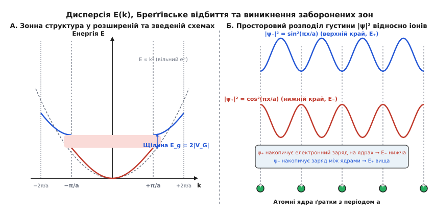
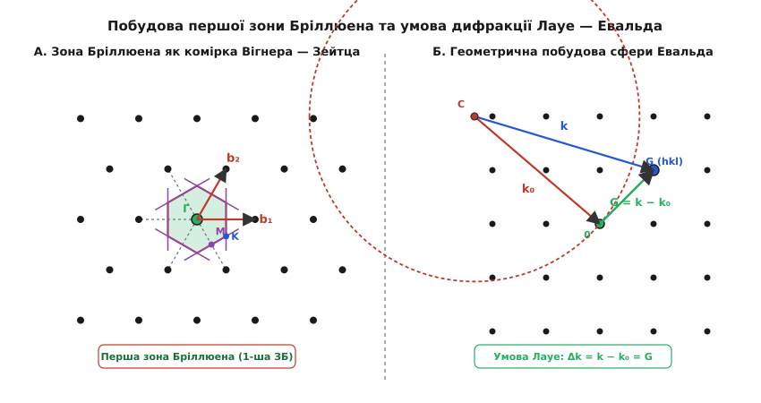

# Обернена ґратка та зони Бріллюена

<preknowlist>
- [Зонна теорія твердого тіла](root:ph-condensed/band-theory) — формування електронних енергетичних зон у періодичному потенціалі кристала.
- [Дифракція Бреґґа](root:ph-condensed/bragg-diffraction) — умова когерентного відбиття хвиль від періодичних атомних площин кристала.
- [Корпускулярно-хвильовий дуалізм](root:ph-quantum/wave-particle-duality) — зв'язок між імпульсом частинки та її хвильовим вектором `p = ℏ · k`.
</preknowlist>

Коли пучок рентгенівських променів з довжиною хвилі 0.154 нм або електронна хвиля з імпульсом `p` розсіюється на монокристалі кремнію з реберним параметром ґратки 0.543 нм, амплітуда інтерференційного сигналу визначається просторовим інтегралом від розсіювальної здатності атомів. Опис цього процесу у звичайній системі декартових координат через вектори атомних позицій `r = u·a₁ + v·a₂ + w·a₃` потребує розв'язання нескінченних систем просторових рівнянь для кожної можливої сім'ї паралельних атомних площин. Перехід у прямий простір обернених хвильових векторів перетворює складну просторову геометрію на дискретну точкову ґратку, де кожна точка відповідає цілій сім'ї паралельних площин кристала.

Обернена ґратка та зони Бріллюена є базовою мовою фізики конденсованого стану. Без цього математичного апарату неможливо описати рух електронів у напівпровідниках, пояснити виникнення дифузійних зонних щілин, розрахувати ефективну масу носіїв заряду або інтерпретувати рентгенівські та нейтронографічні дифрактограми.

[📜 Історія розробки концепції оберненого простору](root:ph-condensed/reciprocal-lattice/hist-brillouin-reciprocal.md)

## Від просторової періодичності до Фурьє-спектра кристала

Будь-який ідеальний монокристал володіє строгою трансляційною симетрією. Це означає, що електронна густина `n(r)` або внутрішній кристалічний потенціал `V(r)` інваріантні відносно зсуву на довільний вектор трансляції реальної ґратки `T`:

```
T = u · a₁ + v · a₂ + w · a₃
```

де `a₁`, `a₂`, `a₃` — примітивні вектори трансляції кристалографічного базису, а `u`, `v`, `w` — довільні цілі числа. Умова періодичності густини в кожній точці простору записується як:

```
n(r + T) = n(r)
```

Оскільки електронна густина є періодичною функцією просторових координат `r`, її можна розкласти у тривимірний ряд Фурьє. Для того щоб кожен гармонічний доданий член ряду `n_K · e^(i K · r)` задовольняв умову періодичності `e^(i K · (r + T)) = e^(i K · r)`, хвильові вектори розкладу `K` повинні задовольняти тотожність:

```
e^(i K · T) = 1
```

Оскільки `e^(i x) = 1` лише тоді, коли аргумент `x` є кратним `2π`, це означає, що скалярний добуток вектора `K` на будь-який вектор трансляції ґратки `T` має бути цілим числом, помноженим на `2π`:

```
K · T = 2π · N
```

де `N` — ціле число. Сукупність усіх векторів `K`, які задовольняють цю умову для всіх векторів реальної ґратки `T`, утворює точкову ґратку в просторі хвильових векторів. Ця ґратка називається **оберненою ґраткою** (*reciprocal lattice*), а її вектори позначають символом `G`.

Електронну густину кристала у кожній точці `r` можна подати у вигляді точної суми за всіма векторами оберненої ґратки `G`:

```
n(r) = ∑ n_G · e^(i G · r)
```

де `n_G` — комплексні амплітуди Фурьє, які визначають інтенсивність розсіювання хвилі відповідною гармонікою електронної густини. Коефіцієнт Фурьє `n_G` обчислюється шляхом інтегрування по об'єму примітивної елементарної комірки `V_cell`:

```
n_G = (1 / V_cell) · ∫ n(r) · e^(-i G · r) d³r
```

Аналогічно, внутрішній кристалічний потенціал `V(r)`, у якому рухаються валентні електрони, розкладається у ряд Фурьє за векторами оберненої ґратки:

```
V(r) = ∑ V_G · e^(i G · r)
```

де коефіцієнти `V_G` являють собою матричні елементи розсіювання електрона на періодичному кулонівському потенціалі атомних ядер та остовних електронних оболонок:

```
V_G = (1 / V_cell) · ∫ V(r) · e^(-i G · r) d³r
```

Перехід від неперервних функцій координат `n(r)` та `V(r)` до дискретних наборів гармонік `n_G` та `V_G` перетворює складні диференціальні рівняння квантової механіки та електродинаміки на дискретні алгебраїчні системи у хвильовому просторі.

### Граничні умови Борна — фон Кармана та дискретизація k-простору

У реальному макроскопічному кристалі скінченних розмірів кількість атомів надзвичайно велика (порядку `10²³` на кубічний сантиметр). Щоб коректно описати хвильові стани в об'ємі без урахування збурень на краях зразка, застосовують періодичні **граничні умови Борна — фон Кармана** (Born-von Kármán boundary conditions). Нехай кристал містить `N₁` примітивних комірок уздовж напрямку `a₁`, `N₂` вздовж `a₂` та `N₃` вздовж `a₃`. Загальна кількість примітивних комірок у кристалі дорівнює `N = N₁ · N₂ · N₃`, а повний об'єм кристала становить `V = N · V_cell`.

Умова циклічності для хвильової функції або електронної густини вимагає незмінності стану при просторовому зміщенні на повну довжину кристала в будь-якому з трьох напрямків:

```
ψ(r + N₁ · a₁) = ψ(r)
ψ(r + N₂ · a₂) = ψ(r)
ψ(r + N₃ · a₃) = ψ(r)
```

Якщо хвильова функція має вигляд блохівської хвилі `ψ_k(r) = e^(i k · r) · u_k(r)`, де функція `u_k(r)` володіє періодичністю примітивної комірки `u_k(r + aᵢ) = u_k(r)`, то з умови циклічності випливає:

```
e^(i N₁ (k · a₁)) = 1
e^(i N₂ (k · a₂)) = 1
e^(i N₃ (k · a₃)) = 1
```

Це означає, що проєкції хвильового вектора `k` на базисні вектори реальної ґратки дискретизуються:

```
k · a₁ = 2π · m₁ / N₁
k · a₂ = 2π · m₂ / N₂
k · a₃ = 2π · m₃ / N₃
```

де `m₁`, `m₂`, `m₃` — довільні цілі числа. Розкладаючи хвильовий вектор `k` за базисними векторами оберненої ґратки `b₁`, `b₂`, `b₃`, отримуємо явний дискретний вираз для дозволених квантових значень:

```
k = (m₁ / N₁) · b₁ + (m₂ / N₂) · b₂ + (m₃ / N₃) · b₃
```

Кожен дозволений хвильовий стан займає в `k`-просторі елементарний комірковий об'єм `δV_k`:

```
δV_k
= (b₁ / N₁) · ((b₂ / N₂) × (b₃ / N₃))   [об'єм паралелепіпеда елементарних кроків сітки]
= (1 / (N₁ · N₂ · N₃)) · (b₁ · (b₂ × b₃)) [винесення скалярних множників за векторний добуток]
= (1 / N) · ((2π)³ / V_cell)             [підстановка об'єму примітивної комірки k-простору]
= (2π)³ / (N · V_cell)                   [перемноження скалярних знаменників]
= (2π)³ / V                              [підстановка повного об'єму кристала V = N · V_cell]
```

Звідси випливає фундаментальний висновок: густина квантових станів в оберненому `k`-просторі є абсолютно однорідною і дорівнює `V / (2π)³` для одного спінового стану. З урахуванням двох можливих проєкцій спіну електрона (`s = ±1/2`) кількість квантових станів в елементі об'єму `d³k` дорівнює:

```
dN = 2 · (V / (2π)³) · d³k
```

Кількість дозволених хвильових векторів `k` у межах першої зони Бріллюена (об'єм якої дорівнює `(2π)³ / V_cell`) точно дорівнює кількості примітивних елементарних комірок `N` у кристалі. Кожна енергетична зона кристала здатна вмістити рівно `2N` електронів. Цей фундаментальний закон лежить в основі класифікації твердих тіл на метали, діелектрики та напівпровідники за ступенем заповнення енергетичних зон.

## Базисні вектори Евальда та геометричні властивості

Для практичного побудування оберненого простору необхідно за відомим базисом прямої ґратки `a₁`, `a₂`, `a₃` знайти вектори базису оберненої ґратки `b₁`, `b₂`, `b₃`. Об'єм примітивної елементарної комірки прямого простору обчислюється як мішаний скалярно-векторний добуток:

```
V_cell = a₁ · (a₂ × a₃)
```

За формулами Пауля Евальда вектори оберненого базису визначаються векторними добутками векторів реального базису:

```
b₁ = 2π · (a₂ × a₃) / V_cell
b₂ = 2π · (a₃ × a₁) / V_cell
b₃ = 2π · (a₁ × a₂) / V_cell
```

З цих формул безпосередньо випливає фундаментальне співвідношення дуальності між прямим та оберненим базисами, яке виражається через символ Кронекера `δᵢⱼ`:

```
aᵢ · bⱼ = 2π · δᵢⱼ
```

Це означає, що вектор `b₁` завжди строго перпендикулярний до плоскої грані, утвореної векторами `a₂` та `a₃`, а його довжина обернено пропорційна висоті паралелепіпеда комірки, опущеної на цю грань.

[🧮 Математична алгебра та розрахунок ґраток SC, BCC та FCC](root:ph-condensed/reciprocal-lattice/math-reciprocal-vectors.md)

Довільний вектор оберненої ґратки `G` розкладається за векторами базису `bᵢ` з цілочисельними коефіцієнтами `h`, `k`, `l`:

```
G[hkl] = h · b₁ + k · b₂ + l · b₃
```

Коефіцієнти `(hkl)` є індексами Міллера. Вектор `G[hkl]` володіє двома фундаментальними геометричними властивостями, які поєднують алгебру `k`-простору з реальною кристалографією:

1. **Ортогональність**: вектор `G[hkl]` строго перпендикулярний до сім'ї паралельних атомних площин кристала, які мають індекси Міллера `(hkl)`.
2. **Міжплощинна відстань**: довжина вектора `G[hkl]` зв'язана з відстанню `d[hkl]` між сусідніми паралельними площинами сім'ї `(hkl)` співвідношенням:

```
d[hkl] = 2π / |G[hkl]|
```

Чим щільніше розташовані атомні площини у реальному просторі (більше `d`), тим коротшим є відповідний вектор оберненої ґратки `G`, і навпаки. Це фундаментальне правило оберненості дало назву всьому математичному апарату.

### Геометричний зв'язок з індексами Міллера та розрахунок d[hkl]

Розглянемо сім'ю кристалографічних площин з індексами Міллера `(hkl)`. За класичним означенням Міллера, перша площина сім'ї, яка не проходить через початок координат, відтинає на осях прямої ґратки відрізки довжиною `a₁ / h`, `a₂ / k` та `a₃ / l`. Точки перетину осей мають радіус-вектори `r₁ = a₁ / h`, `r₂ = a₂ / k`, `r₃ = a₃ / l`.

Побудуємо два вектори, які повністю лежать у цій кристалографічній площині:

```
v₁₂ = r₂ − r₁ = a₂ / k − a₁ / h
v₂₃ = r₃ − r₂ = a₃ / l − a₂ / k
```

Обчислимо скалярний добуток вектора оберненої ґратки `G[hkl] = h·b₁ + k·b₂ + l·b₃` на внутрішньоплощинний вектор `v₁₂`:

```
G[hkl] · v₁₂
= (h·b₁ + k·b₂ + l·b₃) · (a₂ / k − a₁ / h)
= (k / k) · (b₂ · a₂) − (h / h) · (b₁ · a₁)    [ураховано bᵢ · aⱼ = 0 при i ≠ j]
= 1 · 2π − 1 · 2π                             [ураховано bᵢ · aᵢ = 2π]
= 0
```

Аналогічно переконуємося, що `G[hkl] · v₂₃ = 0`. Оскільки вектор `G[hkl]` ортогональний до двох непаралельних векторів, що лежать у площині, він є строгим вектором нормалі до всієї сім'ї площин `(hkl)`.

Рівняння `m`-ї площини цієї сім'ї в прямому просторі має вигляд:

```
r · G[hkl] = 2π · m
```

де `m` — довільне ціле число. Для площини `m = 0`, що проходить через початок координат, `r · G = 0`. Для першої сусідньої площини `m = 1` маємо `r · G = 2π`.

Міжплощинна відстань `d[hkl]` є найкоротшою відстанню від початку координат до площини `m = 1`. Спроектуємо радіус-вектор точки `r₁ = a₁ / h` на одиничний вектор нормалі `n = G[hkl] / |G[hkl]|`:

```
d[hkl]
= r₁ · n                                        [проєкція на одиничний вектор нормалі n]
= (a₁ / h) · (G[hkl] / |G[hkl]|)                [підставлено радіус-вектор точки перетину осі]
= (1 / h) · (a₁ · (h·b₁ + k·b₂ + l·b₃)) / |G[hkl]| [розкладено вектор G[hkl] за оберненим базисом]
= (1 / h) · (h · 2π) / |G[hkl]|                 [ураховано скалярний добуток a₁ · b₁ = 2π]
= 2π / |G[hkl]|                                 [скорочено коефіцієнт h]
```

### Формули міжплощинних відстаней для семи кристалографічних сингоній

Оскільки `d[hkl] = 2π / |G[hkl]|`, обчислення міжплощинної відстані зводиться до знаходження квадрата довжини вектора `|G[hkl]|² = G[hkl] · G[hkl]`. Через контраваріантні компоненти метричного тензора оберненої ґратки `g^ij = bᵢ · bⱼ` квадрат модуля дорівнює:

```
|G[hkl]|² = h² · (b₁ · b₁) + k² · (b₂ · b₂) + l² · (b₃ · b₃) + 2 h k · (b₁ · b₂) + 2 h l · (b₁ · b₃) + 2 k l · (b₂ · b₃)
```

Підставляючи параметри елементарних комірок для різних кристалографічних сингоній (де `a, b, c` — довжини ребер прямої комірки, а `α, β, γ` — кути між осями), отримуємо точні формули:

1. **Кубічна сингонія** (`a = b = c`, `α = β = γ = 90°`):
```
1 / (d[hkl])² = (h² + k² + l²) / a²
```

2. **Тетрагональна сингонія** (`a = b ≠ c`, `α = β = γ = 90°`):
```
1 / (d[hkl])² = (h² + k²) / a² + l² / c²
```

3. **Орторомбічна сингонія** (`a ≠ b ≠ c`, `α = β = γ = 90°`):
```
1 / (d[hkl])² = h² / a² + k² / b² + l² / c²
```

4. **Гексагональна сингонія** (`a = b ≠ c`, `α = β = 90°`, `γ = 120°`):
```
1 / (d[hkl])² = (4 / 3) · (h² + h · k + k²) / a² + l² / c²
```

5. **Ромбоедрична (тригональна) сингонія** (`a = b = c`, `α = β = γ ≠ 90°`):
```
1 / (d[hkl])² = ((h² + k² + l²) · sin²(α) + 2 (h k + k l + h l) · (cos²(α) − cos(α))) / (a² · (1 − 3 cos²(α) + 2 cos³(α)))
```

6. **Моноклінна сингонія** (`a ≠ b ≠ c`, `α = γ = 90°`, `β ≠ 90°`):
```
1 / (d[hkl])² = (1 / sin²(β)) · (h² / a² + (k² · sin²(β)) / b² + l² / c² − (2 h l · cos(β)) / (a · c))
```

7. **Триклінна сингонія** (`a ≠ b ≠ c`, `α ≠ β ≠ γ ≠ 90°`):
```
1 / (d[hkl])² = (1 / V_cell²) · (S₁₁ h² + S₂₂ k² + S₃₃ l² + 2 S₁₂ h k + 2 S₂₃ k l + 2 S₁₃ h l)
```
де `S_ij` — алгебраїчні доповнення до елементів матриці прямого метричного тензора `g_ij = aᵢ · aⱼ`.

## Дифракційні умови Лауе, сфера Евальда та експериментальні методи

Розглянемо пружне розсіювання монохроматичної хвилі з початковим хвильовим вектором `k₀` на періодичному кристалі. Після розсіювання хвильовий вектор стає дорівнювати `k`. Оскільки розсіювання є пружним (без зміни енергії та довжини хвилі), модулі векторів залишаються однаковими: `|k| = |k₀| = 2π / λ`. Вектор зміни хвильового вектора (вектор переданого імпульсу) дорівнює:

```
Δk = k − k₀
```

Умова конструктивної інтерференції вторинних хвиль, розсіяних усіма атомами ґратки, полягає у тому, що різниця фаз між хвилями від сусідніх вузлів має бути кратною `2π`. Це приводить до **умови дифракції Макса фон Лауе**: інтерференційний максимум виникає тоді і тільки тоді, коли вектор переданого імпульсу `Δk` збігається з одним із векторів оберненої ґратки `G`:

```
k − k₀ = G
```

Перепишемо це рівняння, виразивши `k = k₀ + G`, і піднесемо обидві частини до квадрата:

```
|k|²
= |k₀ + G|²
= |k₀|² + 2 k₀ · G + |G|²      [розкриття квадрата суми векторів]
```

Ураховуючи умову пружного розсіювання `|k|² = |k₀|²`, отримуємо векторне рівняння:

```
2 k₀ · G + |G|² = 0
```

Змінивши знак або перейшовши до вектора падаючої хвилі `k` (замінивши `k₀` на `-k`), це рівняння записують у симетричній формі:

```
k · (1/2 · G) = (1/2) · |G|²
```

Геометричний зміст цього рівняння надзвичайно простий: скалярний добуток вектора `k` на одиничний напрямок вектора `G` дорівнює половині довжини вектора `G`. У трьохвимірному `k`-просторі це рівняння задає площину, яка проходить через середину вектора `G` перпендикулярно до нього.

Ці площини у просторі хвильових векторів називаються **площинами Бреґґа** (або бреґґівськими площинами відбиття / площинами Вайтмана). Коли кінчик хвильового вектора `k` торкається бреґґівської площини, хвиля зазнає когерентного дзеркального відбиття від відповідної сім'ї атомних площин кристала.

Проєкція вектора `k` на напрямок `G` дорівнює `|k| · sin(θ)`, де `θ` — кут ковзання (кут Бреґґа) між хвильовим вектором та атомною площиною. Підставляючи `|k| = 2π / λ` та `|G| = 2π / d`, отримуємо:

```
(2π / λ) · sin(θ) = (1/2) · (2π / d)
```

Після скорочення `2π` отримана рівність перетворюється на класичний **закон дифракції Бреґґа — Вульфа**:

```
2 · d · sin(θ) = λ
```

Рівняння Лауе у просторі оберненої ґратки та закон Бреґґа у реальному просторі описують абсолютно тотожні фізичні явища. Проте обернена ґратка дозволяє узагальнити бреґґівське відбиття на довільні тривимірні структури без необхідності складної тригонометричної геометрії.

### Структурний фактор та правила згасання дифракційних рефлексів

Інтенсивність розсіяного рентгенівського або нейтронного випромінювання визначається не лише просторовою ґраткою Браве, але й внутрішньою будовою елементарної комірки — взаємним розташуванням атомів у базисі.

Амплітуда розсіювання від однієї примітивної комірки пропорційна **геометричному структурному фактору** `F[hkl]`:

```
F[hkl] = ∑_j f_j · e^(i G[hkl] · r_j)
```

де `r_j = x_j · a₁ + y_j · a₂ + z_j · a₃` — відносні координати `j`-го атома у комірці (`0 ≤ x_j, y_j, z_j < 1`), а `f_j` — атомний фактор розсіювання, що є перетворенням Фурьє від електронної густини ізольованого атома `f_j = ∫ ρ_j(r) e^(-i Δk · r) d³r`.

Оскільки `G[hkl] · r_j = 2π · (h x_j + k y_j + l z_j)`, структурний фактор записується як:

```
F[hkl] = ∑_j f_j · e^(i 2π (h x_j + k y_j + l z_j))
```

Інтенсивність дифракційного рефлексу пропорційна квадрату модуля структурного фактора: `I[hkl] ∝ |F[hkl]|²`. Якщо для певної трійки індексів `(hkl)` вторинні хвилі від різних атомів базису інтерферують у протифазі, виникає тотальне деструктивне гасіння рефлексу (`F[hkl] = 0`).

Розглянемо фундаментальні правила систематичних згасань для основних кристалографічних структур:

#### 1. Об'ємноцентрована кубічна ґратка (BCC)
Комірка містить два однакових атоми з координатами `(0, 0, 0)` та `(1/2, 1/2, 1/2)`:
```
F[hkl] = f · (1 + e^(i π (h + k + l))) = f · (1 + (−1)^(h + k + l))
```
- Якщо `h + k + l` є **парним**: `F[hkl] = 2 f` (рефлекс дозволений, наприклад, {110}, {200}, {211}, {220}).
- Якщо `h + k + l` є **непарним**: `F[hkl] = 0` (рефлекс повністю заборонений, наприклад, {100}, {111}, {210}).

#### 2. Гранецентрована кубічна ґратка (FCC)
Комірка містить чотири однакових атоми з координатами `(0, 0, 0)`, `(1/2, 1/2, 0)`, `(1/2, 0, 1/2)`, `(0, 1/2, 1/2)`:
```
F[hkl] = f · (1 + e^(i π (h + k)) + e^(i π (h + l)) + e^(i π (k + l)))
```
- Якщо індекси `h, k, l` є **однорідними** (усі парні або усі непарні): `F[hkl] = 4 f` (інтенсивний рефлекс, наприклад, {111}, {200}, {220}, {311}).
- Якщо індекси `h, k, l` є **змішаними** (різної парності): `F[hkl] = 0` (рефлекс повністю гасне).

#### 3. Ґратка алмазу (Si, Ge, C-алмаз)
Ґратка алмазу складається з двох взаємопроникних FCC-підґраток, зміщених одна відносно одної на вектор `(1/4, 1/4, 1/4)`. Комірка містить 8 атомів:
```
F_diamond[hkl] = F_FCC[hkl] · (1 + e^(i (π / 2) (h + k + l)))
```
Аналіз добутку дає наступні правила дифракції для кремнію та алмазу:
- Якщо `h, k, l` змішаної парності: `F = 0`.
- Якщо `h, k, l` усі непарні: `|F| = 4 √2 · f` (інтенсивні рефлекси {111}, {311}, {331}, {511}).
- Якщо `h, k, l` усі парні і `h + k + l = 4n` (кратне 4): `|F| = 8 f` (найсильніші рефлекси {220}, {400}, {422}, {440}).
- Якщо `h, k, l` усі парні і `h + k + l = 4n + 2` (не кратне 4): `F = 0` (заборонені рефлекси, наприклад, {200}, {222}, {420}).

### Температурний фактор Дебая — Валлера та дифузне розсіювання

У реальному кристалі за скінченної температури `T > 0` атоми здійснюють теплові коливання навколо положень рівноваги з середньоквадратичним зміщенням `⟨u²⟩`. Теплове тремтіння розмиває періодичну електронну густину кристала.

Унаслідок цього інтенсивність когерентних бреґґівських рефлексів послаблюється на експоненціальний **фактор Дебая — Валлера**:

```
I[hkl](T) = I₀[hkl] · e^(-2 M)
```

де показник експоненти дорівнює:

```
2 M = (1 / 3) · |G[hkl]|² · ⟨u²⟩ = (4 π² / 3) · (⟨u²⟩ / (d[hkl])²)
```

Чим вища температура зразка і чим більший модуль вектора оберненої ґратки `G` (вищі індекси Міллера, менша міжплощинна відстань `d`), тим сильніше згасає бреґґівський рефлекс.

Енергія випромінювання, втрачена когерентними рефлексами, не зникає: вона перерозподіляється у фонове **дифузне теплове розсіювання** (*Thermal Diffuse Scattering, TDS*). Дослідження візерунків дифузного розсіювання в оберненому просторі між вузлами ґратки дає змогу експериментально відновлювати міжвузлові силові константи та фононні спектри коливань монокристалів.

### Геометрична побудова сфери Евальда

Пауль Евальд запропонував елегантну геометричну інтерпретацію умови Лауе `k − k₀ = G` у просторі оберненої ґратки:

1. У просторі оберненої ґратки обирають початок координат — вузол `(0, 0, 0)`.
2. Будують вектор падаючої хвилі `k₀` таким чином, щоб його кінець упирався точно в початок координат `(0, 0, 0)` оберненої ґратки.
3. З початку вектора `k₀` (як із геометричного центра) проводять сферу радіуса `R = |k₀| = 2π / λ`. Ця сфера називається **сферою Евальда**.
4. Сфера за побудовою завжди проходить через вузол `(0, 0, 0)`. Якщо сфера Евальда перетинає будь-який інший вузол оберненої ґратки `G[hkl]`, вектор, проведений із центра сфери до цього вузла, є хвильовим вектором розсіяної хвилі `k = k₀ + G`.
5. Довжина вектора `k` автоматично дорівнює радіусу сфери `|k| = |k₀|`, що задовольняє умову пружного розсіювання, а різниця `k − k₀ = G` задовольняє умову Лауе.

Якщо жоден вузол оберненої ґратки (крім початку відліку) не потрапляє на поверхню сфери Евальда, дифракційне відбиття повністю відсутнє. Для того щоб реалізувати дифракцію на практиці, експериментатори застосовують кілька класичних підходів.

### Методи рентгеноструктурного аналізу

У рентгенівській дифракції (X-ray Diffraction, XRD) використовуються три основні схеми експерименту, кожна з яких має пряме геометричне відображення в оберненому просторі:

1. **Метод Лауе (поліхроматичне випромінювання на нерухомому монокристалі)**:
   - Використовується неперервний рентгенівський спектр у діапазоні довжин хвиль від `λ_min` до `λ_max`.
   - В оберненому просторі це відповідає сукупності концентричних сфер Евальда з радіусами від `2π / λ_max` до `2π / λ_min`.
   - Усі вузли оберненої ґратки `G`, які потрапляють у простір між мінімальною та максимальною сферами Евальда, дають дифракційні рефлекси. Метод Лауе застосовується для швидкого визначення кристалографічної орієнтації та точкової симетрії монокристалів.

2. **Метод обертання та коливання кристала (монохроматичне випромінювання на рухомому монокристалі)**:
   - Довжина хвилі фіксована (`λ = \text{const}`), тому радіус сфери Евальда є сталим.
   - Монокристал обертається навколо однієї з кристалографічних осей. В оберненому просторі точкова ґратка обертається навколо тієї самої осі.
   - Під час обертання вузли оберненої ґратки перетинають фіксовану поверхню сфери Евальда, послідовно породжуючи спалахи дифракційних рефлексів. Рефлекси розташовуються на рентгенограмі вздовж паралельних ліній (шарових ліній), відстань між якими визначає період трансляції вздовж осі обертання.

3. **Метод порошкової дифракції Дебая — Шеррера (полікристалічні зразки)**:
   - Зразок складається з мільйонів мікроскопічних хаотично орієнтованих кристалітів.
   - Унаслідок хаотичної орієнтації кожен вузол оберненої ґратки `G[hkl]` розмивається у концентричну сферу оберненої ґратки радіуса `|G[hkl]| = 2π / d[hkl]`.
   - Перетин фіксованої сфери Евальда зі сферами оберненої ґратки утворює систему коаксіальних дифракційних кілець і конусів Дебая. Кут розкриття конуса дорівнює `4θ`, де `θ` — бреґґівський кут.
   - Розширення дифракційних піків дозволяє оцінити середній розмір областей когерентного розсіювання (кристалітів) за формулою Поля Шеррера `D = K · λ / (β · cos(θ))`, де `β` — фізичне розширення рефлексу на піввисоті, а `K ≈ 0.9` — форм-фактор частинок.

### Електронна дифракція: TEM, RHEED та LEED

Дифракція швидких електронів у просвічуючому електронному мікроскопі (Transmission Electron Microscopy, TEM SAED) та дифракція на поверхнях принципово відрізняються від рентгенівської дифракції масштабом довжини хвилі.

Релятивістська довжина хвилі електрона, прискореного високою напругою `V_acc` (типово 100–300 кВ), обчислюється як:

```
λ = h / √(2 m₀ e V_acc · (1 + (e V_acc) / (2 m₀ c²)))
```

Для напруги 200 кВ довжина хвилі електрона дорівнює `λ ≈ 0.00251` нм (2.51 пм), що майже у 100 разів менше за міжатомні відстані у кристалі (`a ≈ 0.3–0.5` нм). Радіус сфери Евальда `R = 2π / λ ≈ 2500` нм⁻¹ є велетенським у порівнянні з відстанню між вузлами оберненої ґратки (`|G| ≈ 15–20` нм⁻¹).

Через це в масштабі перших зон Бріллюена сфера Евальда є **практично плоскою поверхнею**. Електронна дифрактограма у ПЕМ являє собою прямий плоский переріз оберненої ґратки кристала площиною, перпендикулярною до напрямку електронного променя (зонної осі кристала).

При дослідженні двовимірних поверхонь та моноатомних шарів у вакуумі методами **дифракції повільних електронів (LEED)** та **дифракції швидких електронів на відбиття (RHEED)** трансляційна періодичність у напрямку, перпендикулярному до поверхні, зникає. Унаслідок цього вузли оберненої ґратки вироджуються у нескінченні тонкі стрижні, перпендикулярні до поверхні зразка (так звані *relrods* — reciprocal lattice rods).

У методі RHEED пучок швидких електронів падає під дуже малим ковзним кутом (1–3°) до поверхні. Сфера Евальда великого радіуса перетинає стрижні оберненої ґратки під гострим кутом, утворюючи систему дифракційних смуг і плям на флуоресцентному екрані.

Інтенсивність дзеркального рефлексу `(00)` у RHEED періодично осцилює в процесі молекулярно-променевої епітаксії (MBE): один повний період осциляції відповідає заповненню рівно одного моноатомного шару. Це дає змогу контролювати товщину напівпровідникових гетероструктур з точністю до одного атома безпосередньо під час росту.

### Нейтронна дифракція та магнітна обернена ґратка

Теплові нейтрони з ядерних реакторів або імпульсних джерел сколювання (spallation sources) мають кінетичну енергію порядка `E_kin ≈ 25` меВ при кімнатній температурі, що відповідає довжині хвилі де Бройля `λ = h / √(2 m_n E_kin) ≈ 0.18` нм.

На відміну від рентгенівських променів, які розсіюються електронними оболонками атомів, нейтрони не мають електричного заряду і розсіюються безпосередньо атомними ядрами за рахунок сильної ядерної взаємодії. Це надає нейтронній дифракції дві вирішальні переваги:
1. **Чутливість до легких елементів**: довжина ядерного розсіювання для водню, дейтерію, вуглецю та літію порівнянна з довжиною розсіювання для важких металів (урану, свинцю). Це дозволяє точно локалізувати атоми водню у білкових молекулах та іони літію в акумуляторних катодах.
2. **Магнітне розсіювання**: нейтрон має власний спіновий магнітний момент `μ_n = −1.913 μ_N`. Магнітний момент нейтрона взаємодіє з неспареними спінами електронів магнітних іонів (Fe, Co, Ni, Mn, рідкісноземельних елементів).

Якщо в кристалі виникає антиферомагнітне впорядкування, магнітні моменти сусідніх атомів орієнтуються антипаралельно. Період магнітної ґратки у реальному просторі подвоюється (`a_mag = 2 · a_cryst`). В оберненому просторі період зменшується вдвічі: між основними ядерними рефлексами оберненої ґратки з'являються додаткові **магнітні надструктурні рефлекси** з напівцілими індексами `(1/2, 1/2, 1/2)`. Нейтронна дифракція в оберненому просторі є єдиним прямим методом експериментального розшифрування просторової конфігурації спінів в антиферомагнетиках та спінових спіралях.

## Перша зона Бріллюена та побудова Вігнера — Зейтца

Умова бреґґівського відбиття `k · (1/2 · G) = (1/2) · |G|²` визначає у `k`-просторі сімейство перпендикулярних площин, які розбивають увесь обернений простір на окремі багатогранні області.


*А. Побудова першої зони Бріллюена у 2D оберненій ґратці як комірки Вігнера — Зейтца навколо центральної точки Г (k=0). Б. Геометрична побудова сфери Евальда для визначення умов дифракції Лауе k - k₀ = G.*

**Перша зона Бріллюена (1-ша ЗБ)** визначається як мінімальний замкнений об'єм у `k`-просторі навколо початку координат `k = 0` (точки `Γ`), обмежений площинами Бреґґа, які ділять навпіл відрізки до найближчих вузлів оберненої ґратки `G`.

Геометричний алгоритм побудови першої зони Бріллюена строго повторює побудову примітивної комірки Вігнера — Зейтца у прямому просторі:
1. За початок координат обирають вузол оберненої ґратки `G = 0` (точка `Γ`).
2. Проводять вектори `G` до всіх сусідніх вузлів оберненої ґратки.
3. Через середину кожного вектора `G` проводять перпендикулярну площину (площину Бреґґа).
4. Найменший випуклий багатогранник, обмежений цими площинами, який містить точку `k = 0`, і є першою зоною Бріллюена.

Будь-яка точка всередині першої зони Бріллюена розташована ближче до початку координат `k = 0`, ніж до будь-якого іншого вузла оберненої ґратки `G`.

### Вищі зони Бріллюена та їх геометричне зведення

Якщо продовжити проведення бреґґівських площин для наступних, більш віддалених вузлів оберненої ґратки `G`, вони розіб'ють весь `k`-простір на концентричні шари багатогранників:
- **Друга зона Бріллюена**: множина точок `k`, для яких початок координат `Γ` є другим за відстанню вузлом оберненої ґратки (щоб потрапити з точки `k` у `Γ`, треба перетнути рівно одну бреґґівську площину).
- **`n`-та зона Бріллюена**: множина точок `k`, щоб потрапити з яких у початок координат `Γ`, необхідно перетнути рівно `n − 1` бреґґівську площину.

Вищі зони Бріллюена мають складну фрагментовану форму. Проте діє фундаментальна топологічна теорема: **фрагменти будь-якої `n`-ї зони Бріллюена можна розрізати вздовж бреґґівських площин і зсунути на відповідні вектори оберненої ґратки `G` так, що вони ідеально, без перекриттів і порожнин, заповнять першу зону Бріллюена**.

Усі зони Бріллюена мають строго однаковий об'єм, який дорівнює об'єму примітивної комірки оберненого простору:

```
V_BZ = (2π)³ / V_cell
```

### Форма зон Бріллюена для кубічних та гексагональних ґраток

Форма першої зони Бріллюена визначається просторовою симетрією оберненої ґратки:

#### 1. Проста кубічна ґратка (SC)
- Пряма ґратка: проста кубічна з ребром `a`.
- Обернена ґратка: проста кубічна з ребром `2π / a`.
- Перша зона Бріллюена: правильний **куб** з довжиною ребра `2π / a` та об'ємом `(2π / a)³`.
- Точки високої симетрії:
  - `Γ = (0, 0, 0)` — центр зони Бріллюена.
  - `X = (π/a) · (1, 0, 0)` — центр квадратної грані куба (напрямок `[100]`).
  - `M = (π/a) · (1, 1, 0)` — середина ребра куба (напрямок `[110]`).
  - `R = (π/a) · (1, 1, 1)` — вершина куба (напрямок `[111]`).

#### 2. Гранецентрована кубічна ґратка (FCC)
- Пряма ґратка: гранецентрована кубічна з параметром `a` (Si, Ge, GaAs, Al, Cu, Au).
- Обернена ґратка: об'ємноцентрована кубічна (BCC) з базисними векторами `(2π/a)(−1, 1, 1)`, `(2π/a)(1, −1, 1)`, `(2π/a)(1, 1, −1)`.
- Перша зона Бріллюена: **зрізаний октаедр** (*truncated octahedron*). Це 14-гранник, утворений перетином площин Бреґґа для 8 найближчих вузлів оберненої ґратки типу `{111}` (вони формують 8 правильних шестикутних граней) та 6 вузлів типу `{200}` (формують 6 квадратних граней).
- Точки високої симетрії:
  - `Γ = (0, 0, 0)` — центр зони.
  - `X = (2π/a) · (1, 0, 0)` — центр квадратної грані `{100}` на відстані `2π / a`.
  - `L = (2π/a) · (1/2, 1/2, 1/2)` — центр шестикутної грані `{111}` на відстані `(π√3) / a`.
  - `W = (2π/a) · (1, 1/2, 0)` — вершина на перетині двох шестикутників і одного квадрата.
  - `K = (2π/a) · (3/4, 3/4, 0)` — середина ребра між двома шестикутними гранями.
  - `U = (2π/a) · (1, 1/4, 1/4)` — середина ребра між шестикутною та квадратною гранями.
  - Лінії високої симетрії: `Δ` (напрямок від `Γ` до `X`), `Λ` (напрямок від `Γ` до `L`), `Σ` (напрямок від `Γ` до `K`).

#### 3. Об'ємноцентрована кубічна ґратка (BCC)
- Пряма ґратка: об'ємноцентрована кубічна з параметром `a` (Fe, W, Cr, Na, K).
- Обернена ґратка: гранецентрована кубічна (FCC) з базисними векторами `(2π/a)(0, 1, 1)`, `(2π/a)(1, 0, 1)`, `(2π/a)(1, 1, 0)`.
- Перша зона Бріллюена: **ромбододекаедр** (*rhombic dodecahedron*). Це 12-гранник, утворений перетином площин Бреґґа для 12 найближчих вузлів оберненої ґратки типу `{110}` (усі 12 граней є однаковими ромбами).
- Точки високої симетрії:
  - `Γ = (0, 0, 0)` — центр зони.
  - `H = (2π/a) · (0, 1, 0)` — вершина, де сходяться 4 ромбічні грані (напрямок `[100]`).
  - `P = (2π/a) · (1/2, 1/2, 1/2)` — вершина, де сходяться 3 ромбічні грані (напрямок `[111]`).
  - `N = (2π/a) · (1/2, 1/2, 0)` — центр ромбічної грані (напрямок `[110]`).

#### 4. Гексагональна щільноупакована ґратка (HCP) та гексагональна сингонія
- Пряма ґратка: гексагональна з параметрами `a` та `c` (Mg, Zn, Ti, графен).
- Обернена ґратка: гексагональна, повернута на 30° навколо осі `z` відносно прямої ґратки, з базисними векторами довжиною `4π / (a√3)` у площині та `2π / c` вздовж осі `z`.
- Перша зона Бріллюена: **правильна шестикутна призма** (*hexagonal prism*) з двома шестикутними основами та шістьма прямокутними бічними гранями.
- Точки високої симетрії:
  - `Γ = (0, 0, 0)` — центр зони.
  - `M = (0, 2π/(a√3), 0)` — центр бічної прямокутної грані.
  - `K = (2π/(3a), 2π/(a√3), 0)` — кутова вершина шестикутної основи в площині `k_z = 0`.
  - `A = (0, 0, π/c)` — центр верхньої шестикутної основи.
  - `L = (0, 2π/(a√3), π/c)` — центр верхнього ребра бічної грані.
  - `H = (2π/(3a), 2π/(a√3), π/c)` — верхня вершина призми.

### Незвідна частина зони Бріллюена (IBZ)

Кристалічні структури володіють не лише трансляційною, але й точковою симетрією (обертання навколо осей, площини дзеркального відбиття, інверсія). Точкова група симетрії кристала повністю зберігається у структурі першої зони Бріллюена.

Завдяки симетрії фізичні характеристики кристала (енергія електронів `E(k)`, частоти фононів `ω(k)`, хвильові функції) є однаковими у всіх симетрично еквівалентних точках зони Бріллюена:

```
E(R · k) = E(k)
```

де `R` — матриця довільної операції точкової групи симетрії кристала.

Мінімальний об'єм усередині першої зони Бріллюена, дією операцій точкової групи на який можна відтворити всю зону цілком, називається **незвідною зоною Бріллюена** (*Irreducible Brillouin Zone, IBZ*).

Для кубічних кристалів (точкової групи `O_h`, що містить 48 операцій симетрії) об'єм IBZ становить рівно `1/48` від об'єму першої зони Бріллюена. Для гексагональної групи `D_6h` (24 операції) об'єм IBZ дорівнює `1/24` зони Бріллюена.

Використання IBZ є ключовим оптимізаційним фактором у комп'ютерному матеріалознавстві: інтегрування електронних станів за методом спеціальних точок Монкхорста — Пака (Monkhorst-Pack grid) виконується лише у межах незвідного клина, що скорочує час квантовомеханічних розрахунків у десятки разів.

## Обернена ґратка двовимірних матеріалів: графен і дихалькогеніди

Двовимірні кристали являють собою особливий клас конденсованих систем, де трансляційна періодичність існує лише у площині `(x, y)`. Найвідомішим прикладом є **графен** — моноатомний шар вуглецю зі стільниковою (*honeycomb*) структурою.

Стільникова ґратка графену не є ґраткою Браве. Вона складається з двох еквівалентних трикутних підґраток `A` і `B`, зміщених одна відносно одної на вектор міжатомного зв'язку `τ = (a_CC, 0)`, де `a_CC ≈ 0.142` нм — відстань між сусідніми атомами вуглецю.

Примітивні вектори трансляції прямої трикутної ґратки Браве мають вигляд:

```
a₁ = (a / 2) · (√3, 1)
a₂ = (a / 2) · (√3, −1)
```

де `a = √3 · a_CC ≈ 0.246` нм — постійна двовимірної ґратки. Площа примітивної комірки у реальному просторі дорівнює `S_cell = |a₁ × a₂| = (√3 / 2) · a² ≈ 0.0524` нм².

Вектори оберненого базису обчислюються за формулами двовимірної дуальності `aᵢ · bⱼ = 2π · δᵢⱼ`:

```
b₁ = (2π / a) · (1 / √3, 1)
b₂ = (2π / a) · (1 / √3, −1)
```

Модулі векторів оберненого базису дорівнюють `|b₁| = |b₂| = 4π / (a√3)`. Кут між базисними векторами прямої ґратки дорівнює 60°, а кут між векторами оберненого базису становить 60° (вони утворюють гексагональну обернену ґратку, повернуту на 30° відносно атомних зв'язків у прямому просторі).

### Точки Дірака K та K' і релятивістська дисперсія

Перша зона Бріллюена графену є правильним **шестикутником** із площею `S_BZ = (2π)² / S_cell = 8π² / (a²√3)`.

Високосиметричні точки 2D зони Бріллюена:
- `Γ = (0, 0)` — центр зони.
- `M = (2π / (a√3), 0)` — середина грані шестикутника.
- `K` та `K'` — шість кутових вершин шестикутної зони Бріллюена.

Хоча вершин у шестикутника шість, лише дві з них є незалежними та нееквівалентними відносно трансляцій оберненої ґратки. Їх позначають як долини `K` і `K'`:

```
K  = ((4π) / (3 a), 0)
K' = (-(4π) / (3 a), 0) = ((2π) / (3 a), (2π) / (a √3))
```

У наближенні сильного зв'язку (*tight-binding*) з урахуванням перескоків електронів між найближчими атомами підґраток `A` і `B` енергетичний спектр `π`-електронів графену має вигляд:

```
E(k) = ± t · √(1 + 4 cos(√3 k_x a / 2) · cos(k_y a / 2) + 4 cos²(k_y a / 2))
```

де `t ≈ 2.8` еВ — резонансний інтеграл перескоку між сусідніми вуглецевими атомами.

У точках `K` та `K'` вираз під коренем строго перетворюється на нуль: валентна зона та зона провідності дотикаються в одній точці, утворюючи так звані **конуси Дірака** (*Dirac cones*). Поблизу точок `K` і `K'` при малому відхиленні хвильового вектора `q = k − K` спектр стає строго лінійним:

```
E(q) = ± ℏ · v_F · |q|
```

де `v_F = (3 / 2) · (t · a_CC / ℏ) ≈ 10⁶` м/с — фермієвська швидкість електронів у графені (приблизно в 300 разів менша за швидкість світла у вакуумі).

Лінійний закон дисперсії описується ефективним двовимірним безмасовим квантовим рівнянням Дірака — Вейля:

```
H_K = ℏ · v_F · (σ_x · q_x + σ_y · q_y)
H_K' = ℏ · v_F · (−σ_x · q_x + σ_y · q_y)
```

де `σ_x`, `σ_y` — матриці Паулі, які діють не на реальний спін електрона, а на **псевдоспін** (квантову амплітуду ймовірності знаходження електрона на підґратці `A` або `B`).

Хвильова функція електрона набуває фази Беррі `π` при повному обході навколо точки `K` у `k`-просторі. Це зумовлює відсутність зворотного розсіювання електронів на гладких потенціальних бар'єрах (клейнівське тунелювання) та унікальний непарний аномальний квантовий ефект Холла з рівнями енергії Ландау `E_N = ± v_F √(2 e ℏ B |N|)`.

### Долинна електроніка (Valleytronics) та дихалькогеніди перехідних металів


*Ілюстрація: Zone Boundary Reflection.*



*Ілюстрація: Brillouin Zone Construction.*


У моношарах дихалькогенідів перехідних металів (Transition Metal Dichalcogenides, TMD — `MoS₂`, `WS₂`, `MoSe₂`, `WSe₂`) структура ґратки подібна до графену, проте атоми підґратки `A` (метал Mo, W) та `B` (халькоген S, Se) є різними. Це призводить до порушення просторової інверсійної симетрії.

Унаслідок порушення інверсії виникає пряма оптична заборонена зона `E_g ≈ 1.5–2.0` еВ безпосередньо у точках `K` і `K'` 2D зони Бріллюена. Одночасна наявність сильної спін-орбітальної взаємодії в атомах важких металів зумовлює велетенське спін-орбітальне розщеплення валентної зони (`Δ_SO ≈ 150–450` меВ) з протилежним знаком у долинах `K` та `K'`.

Це явище отримало назву **блокування спіну та долини** (*spin-valley locking*):
- У долині `K` стан на стелі валентної зони має спін «вгору».
- У долині `K'` стан на стелі валентної зони має спін «вниз».

Завдяки оптичним правилам відбору світло з правою коловою поляризацією `σ⁺` селективно збуджує електронні переходи лише у долині `K`, а світло з лівою поляризацією `σ⁻` — виключно у долині `K'`. Це відкрило новий напрямок наноелектроніки — **валітроніку** (*valleytronics*), де інформація кодується номером долини в оберненому просторі.

## Теорема Блоха та трансляційна симетрія у k-просторі

У квантовій механіці рух електрона описується одночастинковим рівнянням Шредінгера з періодичним потенціальним рельєфом ґратки `V(r + T) = V(r)`:

```
H · ψ(r) = (−(ℏ² / 2m) · ∇² + V(r)) · ψ(r) = E · ψ(r)
```

Оператор трансляції `T_a`, визначений як `T_a ψ(r) = ψ(r + a)`, комутує з гамільтоніаном `H`: `[H, T_a] = 0`. З алгебри квантової механіки випливає, що `H` та `T_a` мають спільні власні функції. З огляду на це власні значення оператора трансляції мають модуль 1 і записуються у формі `e^(i k · a)`.

Згідно з теоремою Фелікса Блоха, хвильова функція електрона `ψ_k(r)` у періодичному потенціалі `V(r)` являє собою плоску хвилю, модульовану блохівською функцією `u_k(r)`, яка володіє періодичністю реальної ґратки:

```
ψ_k(r) = e^(i k · r) · u_k(r)
```

де `u_k(r + T) = u_k(r)`.

Розглянемо зсув хвильового вектора `k` на довільний вектор оберненої ґратки `G`: `k' = k + G`. Підставимо новий вектор у вираз для хвильової функції:

```
ψ_{k+G}(r)
= e^(i (k + G) · r) · u_{k+G}(r)              [підставлено хвильовий вектор k' = k + G]
= e^(i k · r) · (e^(i G · r) · u_{k+G}(r))    [розкладено показник експоненти e^(i (k+G)·r)]
```

Функція `u'_k(r) = e^(i G · r) · u_{k+G}(r)` також володіє періодичністю реальної ґратки, оскільки для довільного вектора трансляції `T` маємо `e^(i G · (r + T)) = e^(i G · r) · e^(i G · T) = e^(i G · r)`.

Це означає, що стан з хвильовим вектором `k + G` описує **абсолютно той самий фізичний квантовий стан**, що й стан із вектором `k`. Враховуючи це, енергія електрона є періодичною функцією в оберненому просторі:

```
E_n(k + G) = E_n(k)
```

де `n` — номер енергетичної зони (зоновий індекс).

Трансляційна періодичність `E(k)` дозволяє використовувати три еквівалентні методи представлення спектра енергії:

1. **Розширена схема зон** (*extended zone scheme*): кожен квантовий стан зображується при своєму фізичному значенні хвильового вектора `k` у нескінченному `k`-просторі. У цій схемі розриви енергії виникають на межах відповідних зон Бріллюена.
2. **Зведена схема зон** (*reduced zone scheme*): за допомогою додавання або віднімання відповідного вектора оберненої ґратки `G` усі квантові стани з вищих зон Бріллюена транслюються (зводяться) у межі **першої зони Бріллюена**. У цій схемі хвильовий вектор `k` завжди лежить у 1-й ЗБ, а багатозначність енергії описується індексом зони `n = 1, 2, 3...`.
3. **Періодична схема зон** (*periodic zone scheme*): перша зона Бріллюена трансляційно розмножується по всьому `k`-простору, утворюючи періодичний рельєф енергетичних поверхонь Фермі.

Завдяки зведеній схемі зон для повного розрахунку електронної та коливальної (фононної) структури монокристала достатньо обчислити спектр енергії `E_n(k)` лише у межах першої зони Бріллюена (а з урахуванням точкової симетрії кристала — лише у межах її незвідної частини, *irreducible Brillouin zone*).

### Квазіімпульс проти справжнього імпульсу та напівкласична динаміка

Вектор `p_k = ℏ · k` називається **кристалічним квазіімпульсом** електрона. Він принципово відрізняється від справжнього механічного імпульсу вільної частинки `p = m · v`:
- Справжній імпульс пов'язаний із неперервною просторовою трансляційною інваріантністю однорідного вакууму (за теоремою Нетер).
- У кристалі неперервна симетрія зруйнована до дискретної ґраткової симетрії `r → r + T`. Тому закон збереження звичайного імпульсу не виконується: кристал може поглинати або передавати імпульс кратними порціями `ℏ · G`.
- Квазіімпульс зберігається лише з точністю до довільного вектора оберненої ґратки `ℏ · G`.

Рух хвильового пакета блохівських електронів під дією зовнішніх макроскопічних електричного `E_ext` та магнітного `B_ext` полів описується системою **напівкласичних рівнянь руху**:

1. **Групова швидкість** хвильового пакета дорівнює градієнту енергії у `k`-просторі:
```
v_n(k) = (1 / ℏ) · ∇_k E_n(k)
```

2. **Зміна квазіімпульсу** під дією сили Лоренца:
```
ℏ · (dk / dt) = −e · (E_ext + v_n(k) × B_ext)
```

3. **Прискорення електрона та тензор ефективної маси**:
Диференціюючи групову швидкість за часом, отримуємо:
```
dv_i / dt
= (1 / ℏ) · (d / dt) (∂E_n / ∂k_i)              [диференціювання швидкості за часом]
= (1 / ℏ) · ∑ (∂²E_n / ∂k_i ∂k_j) · (dk_j / dt) [ланцюгове диференціювання через компоненти k]
= ∑ (1 / m*)_ij · F_j                           [підстановка сили ℏ·(dk/dt)=F та тензора маси]
```

де `(1 / m*)_ij` — компоненти симетричного **тензора оберненої ефективної маси**:

```
(1 / m*)_ij = (1 / ℏ²) · (∂²E_n / ∂k_i ∂k_j)
```

Ефективна маса `m*` є мірою кривизни енергетичної поверхні `E(k)` в оберненому просторі:
- На дні зони провідності кривизна додатна (`∂²E/∂k² > 0`), маса `m* > 0`, і електрон прискорюється протилежно до електричного поля як звичайна негативно заряджена частинка.
- На стелі валентної зони кривизна від'ємна (`∂²E/∂k² < 0`), маса `m* < 0`. Рух такого стану зручно описувати як рух квазічастинки з додатною масою та додатним зарядом `+e` — **дірки** (*hole*).

## Межі зон, Бреґґівське відбиття та виникнення заборонених зон

Найважливішим фізичним наслідком існування оберненої ґратки є виникнення **заборонених енергетичних зон** (зонних щілин `E_g`) в електронному спектрі кристалів.


*А. Розриви дисперсійної кривої E(k) на межах зон Бріллюена k = ±π/a утворюють заборонену зону E_g. Б. Стоячі хвилі ψ₊ та ψ₋ мають різний просторовий розподіл електронної густини відносно позитивно заряджених іонів ґратки.*

Розглянемо одновимірну кристалічну ґратку з періодом `a`. Вектор оберненої ґратки дорівнює `G = 2π / a`. Межі першої зони Бріллюена розташовані в точках:

```
k = ± (1/2) · G = ± π / a
```

Коли хвильовий вектор електрона наближається до межі зони `k = +π / a`, вектор переданого імпульсу при відбитті від потенціалу ґратки стає дорівнювати `G = 2π / a`. Хвиля, що біжить праворуч `e^(i (π/a) x)`, піддається бреґґівському відбиттю і породжує хвилю такої самої амплітуди, яка біжить ліворуч `e^(-i (π/a) x)`.

Суперпозиція двох зустрічних біжучих хвиль з однаковими амплітудами утворює **стоячі хвилі**. Існує дві незалежні комбінації прямих та відбитих хвиль:

1. **Симметрична стояча хвиля `ψ₊`**:
```
ψ₊(x)
= (1 / √2) · (e^(i (π/a) x) + e^(-i (π/a) x))   [симетрична сума прямих та відбитих хвиль]
= √(2) · cos(π · x / a)                          [формула Ейлера: e^(ix) + e^(-ix) = 2 cos(x)]
```
Густина ймовірності знаходження електрона для цієї хвилі дорівнює:
```
|ψ₊(x)|² = 2 · cos²(π · x / a)
```
Ця функція має максимуми у точках `x = 0, ±a, ±2a...`, тобто **безпосередньо на позитивно заряджених атомних ядрах (іонах) ґратки**.

2. **Антисиметрична стояча хвиля `ψ₋`**:
```
ψ₋(x)
= (1 / (i · √2)) · (e^(i (π/a) x) − e^(-i (π/a) x))   [антисиметрична різниця прямих та відбитих хвиль]
= √(2) · sin(π · x / a)                                [формула Ейлера: e^(ix) - e^(-ix) = 2i sin(x)]
```
Густина ймовірності для цієї хвилі дорівнює:
```
|ψ₋(x)|² = 2 · sin²(π · x / a)
```
Ця функція має вузли (нулі) на атомних ядрах і максимуми у точках `x = ±a/2, ±3a/2...`, тобто **в проміжках між атомними ядрами**.

У вільному просторі (без потенціалу ґратки) обидва стани мали б однакову кінетичну енергію `E₀ = ℏ² k² / (2 m) = ℏ² π² / (2 m a²)`. Проте у кристалі існує періодичний кулонівський потенціал атомних ядер `V(x) < 0`.

Оскільки електрон у стані `ψ₊` сконцентрований поблизу позитивних ядер, його потенціальна енергія притягання є мінімальною, і загальна енергія стану `E⋋` знижується відносно рівня вільного електрона. Натомість електрон у стані `ψ₋` локалізований між ядрами, його притягання до ядер є слабшим, і його енергія `E₊` підвищується.

З точки зору квантовомеханічної теорії збурень для вироджених станів `|k⟩` та `|k − G⟩` при `k = G / 2`, гамільтоніан має світловий секулярний вираз:

```
det [
  E₀(k) - E      V_G
  V_G*           E₀(k - G) - E
] = 0
```

Розв'язок цього секулярного рівняння на межі зони `k = G / 2` дає два вироджені корені: `E = E₀(G/2) ± |V_G|`.

У результаті на межі зони Бріллюена `k = ±π/a` енергетичний спектр зазнає розриву. Виникає **заборонена енергетична зона** `E_g`, ширина якої дорівнює подвоєному модулю Фурьє-компоненти кристалічного потенціалу `V_G`:

```
E_g = E₊ − E⋋ = 2 · |V_G|
```

де `V_G = (1/a) ∫ V(x) · e^(-i G x) dx`.

Таким чином, саме бреґґівська дифракція електронних хвиль на межах зон Бріллюена та виникнення стоячих хвиль із різним просторовим розподілом заряду є фізичною причиною розділення енергетичного спектра кристала на дозволені та заборонені зони.

[⚙️ Симуляція зон Бріллюена та межових площин у C++ та Python](root:ph-condensed/reciprocal-lattice/proj-brillouin-zone-builder.md)

## Наближення майже вільних електронів та сильного зв'язку

Для розрахунку зонного спектра в реальних тривимірних кристалах використовують два фундаментальні граничні наближення.

### 1. Наближення майже вільних електронів (NFE)

У моделі майже вільних електронів (*Nearly Free Electron model, NFE*) періодичний потенціал ґратки `V(r)` розглядається як мале збурення вільного руху електронів. Хвильова функція розкладається у тривимірний ряд за плоськими хвилями:

```
ψ_k(r) = ∑ C_{k - G} · e^(i (k - G) · r)
```

Підставляючи цей розклад у рівняння Шредінгера та проектуючи на хвилю з вектором `k − G`, отримуємо нескінченну систему лінійних однорідних алгебраїчних рівнянь, відому як **центральне рівняння** (*Central Equation*):

```
((ℏ² / 2m) · |k − G|² − E) · C_{k - G} + ∑_{G'} V_{G - G'} · C_{k - G'} = 0
```

де `V_{G - G'}` — матричний елемент Фурьє кристалічного потенціалу.

Якщо хвильовий вектор `k` знаходиться далеко від бреґґівських площин, усі недіагональні члени малі, і спектр близький до параболічного `E ≈ ℏ² k² / (2m)`. Проте коли вектор `k` наближається до межі зони Бріллюена, енергії двох станів з хвильовими векторами `k` та `k − G` стають майже однаковими: `E₀(k) ≈ E₀(k − G)`.

Обмежуючись у центральному рівнянні двома домінуючими гармоніками `C_k` та `C_{k - G}`, секулярний детермінант набуває вигляду:

```
(E₀(k) − E) · (E₀(k − G) − E) − |V_G|² = 0
```

Розв'язок цього квадратного рівняння дає точний закон дисперсії поблизу бреґґівської площини:

```
E_±(k) = (1/2) · (E₀(k) + E₀(k − G)) ± √ [ ((E₀(k) − E₀(k − G)) / 2)² + |V_G|² ]
```

На самій межі зони, де `E₀(k) = E₀(k − G)`, різниця занулюється, і розщеплення зон становить рівно `E_g = 2 |V_G|`. При віддаленні від межі зони розв'язок плавно переходить у закон дисперсії вільного електрона.

### 2. Наближення сильного зв'язку (LCAO)

Протилежним підходом є **наближення сильного зв'язку** (*Tight-Binding Approximation* або LCAO — лінійна комбінація атомних орбіталей). Воно базується на припущенні, що електрони міцно зв'язані зі своїми атомами, а взаємодія між сусідніми вузлами є слабкою і розглядається як тунелювання (перескоки) електрона з вузла на вузол.

Блохівська хвильова функція формується як фазова сума ізольованих атомних орбіталей `ϕ(r − R)`:

```
ψ_k(r) = (1 / √N) · ∑_R e^(i k · R) · ϕ(r − R)
```

де сумування ведеться за всіма вузлами ґратки Браве `R`.

Обчислюючи середнє значення гамільтоніана `E(k) = ⟨ψ_k| H |ψ_k⟩`, закон дисперсії у наближенні перескоків лише між найближчими сусідами набуває форми:

```
E(k) = E₀ − α − ∑_δ t_δ · e^(i k · δ)
```

де `E₀` — енергія рівня в ізольованому атомі, `α` — кулонівський інтеграл зсуву рівня, `t_δ` — резонансний інтеграл перескоку (*hopping parameter*), а вектори `δ` з'єднують обраний вузол із його найближчими сусідами.

Для **простої кубічної ґратки** (6 найближчих сусідів на відстані `a` вздовж осей `±x, ±y, ±z`) закон дисперсії має вигляд:

```
E(k) = E₀ − α − 2 t · (cos(k_x · a) + cos(k_y · a) + cos(k_z · a))
```

Ширина дозволеної енергетичної зони становить `W = E_max − E_min = (E₀ − α + 6t) − (E₀ − α − 6t) = 12 t`. Ширина зони прямо пропорційна інтегралу перескоку `t`: чим сильніше перекриваються хвильові функції сусідніх атомів, тим ширшою є зона.

Поблизу центру зони Бріллюена (`k → 0`) розкладаємо косинуси в ряд Тейлора `cos(x) ≈ 1 − x²/2`:

```
E(k)
≈ E₀ − α − 2 t · (3 − (k_x² a² + k_y² a² + k_z² a²) / 2) [розклад косинусів у ряд Тейлора]
= (E₀ − α − 6 t) + t · a² · k²                           [зведення подібних доданків]
```

Порівнюючи з параболічним законом `E(k) = E_min + ℏ² k² / (2 m*)`, отримуємо вираз для ефективної маси електрона на дні зони:

```
m* = ℏ² / (2 · t · a²)
```

Чим більший інтеграл перескоку `t` (легше тунелювання між атомами), тим меншою є ефективна маса електрона і тим вищою є його рухливість.

### Густина електронних станів (DOS) та сингулярності Ван Хова

Кількість квантових станів на одиничний інтервал енергії називається **густиною електронних станів** (*Density of States, DOS*) `g(E)`. Густина станів обчислюється як інтеграл по ізоенергетичній поверхні `E(k) = E` в оберненому просторі:

```
g(E) = (2 · V / (2π)³) · ∬_{E(k)=E} (d²S_k / |∇_k E|)
```

де `d²S_k` — елемент площі ізоенергетичної поверхні у `k`-просторі, а `|∇_k E| = ℏ · |v_g(k)|` — модуль градієнта енергії (пропорційний груповій швидкості).

У точках, де градієнт енергії занулюється `∇_k E = 0` (екстремуми та сідлові точки зонного рельєфу), підінтегральний вираз зазнає розриву. Ці точки називаються **критичними точками Ван Хова** (*Van Hove singularities*).

Форма сингулярностей Ван Хова кардинально залежить від просторової розмірності системи `d`:

1. **Одновимірні кристали (1D, квантові дроти, вуглецеві нанотрубки)**:
   - У точках екстремуму `dE/dk = 0` густина станів прямує до нескінченності за законом оберненого кореня:
   ```
   g(E) ∝ 1 / √(E − E_c)
   ```
   - На графіку DOS виникають гострі інтегровні піки Ван Хова.

2. **Двовимірні кристали (2D, графен, TMD, квантові ями)**:
   - На дні та стелі зони виникають сходинкові стрибки густини станів `g(E) = \text{const} \cdot \Theta(E − E_c)`.
   - У сідлових точках (наприклад, у точках `M` для 2D квадратної або гексагональної ґраток) градієнт `∇_k E = 0`, що породжує **логарифмічну сингулярність**:
   ```
   g(E) ∝ ln |E − E_c|
   ```

3. **Тривимірні кристали (3D, об'ємні напівпровідники та метали)**:
   - Густина станів залишається скінченною неперервною функцією, однак її похідна `dg/dE` зазнає розривів і стрибків кореневого типу:
   ```
   g(E) ∝ √(E − E_c)
   ```

Сингулярності Ван Хова прямо проявляються в оптичних спектрах поглинання, комбінаційного розсіювання світла та тунельної мікроскопії.

### Зонна структура напівпровідників: кремній (Si), германій (Ge) та GaAs

Реальний енергетичний спектр напівпровідників суттєво багатший за прості ізотропні моделі:

1. **Кремній (Si)**:
   - Непрямозонний напівпровідник із шириною забороненої зони `E_g = 1.12` еВ при 300 K.
   - Максимум валентної зони розташований строго в центрі зони Бріллюена — точці `Γ [000]`.
   - Мінімум зони провідності знаходиться не в точці `Γ`, а на осі `Δ [100]` на відстані `k_0 ≈ 0.85 · (2π / a)` від центру ЗБ.
   - У кубічній симетрії існує 6 еквівалентних долин провідності вздовж осей `[100], [-100], [010], [0-10], [001], [00-1]`. Ізоенергетичні поверхні являють собою 6 витягнутих еліпсоїдів обертання з поздовжньою масою `m_l ≈ 0.98 m_0` та поперечною масою `m_t ≈ 0.19 m_0`.
   - Оптичне поглинання або випромінювання світла на краю зони вимагає обов'язкової участі фонона для передачі квазіімпульсу `Δk ≈ k_0`, що знижує ймовірність радіаційної рекомбінації у мільйони разів і робить кремній непридатним для ефективних світлодіодів та лазерів.

2. **Германій (Ge)**:
   - Непрямозонний напівпровідник із забороненою зоною `E_g = 0.66` еВ.
   - Максимум валентної зони знаходиться в точці `Γ`.
   - Мінімум зони провідності розташований точно на межі зони Бріллюена в точках `L [111]`. Зона Бріллюена містить 8 половинних еліпсоїдів провідності (еквівалентних 4 повним долинам) з поздовжньою масою `m_l ≈ 1.64 m_0` та надзвичайно легкою поперечною масою `m_t ≈ 0.082 m_0`.

3. **Арсенід галію (GaAs)**:
   - Прямозонний напівпровідник із забороненою зоною `E_g = 1.42` еВ.
   - Мінімум зони провідності та максимум валентної зони розташовані в одній точці `Γ [000]`.
   - Електронні ізоенергетичні поверхні біля точки `Γ` є ідеальними сферами з дуже малою ефективною масою `m* ≈ 0.067 m_0`.
   - Прямі оптичні переходи відбуваються без участі фононів з надзвичайно високим квантовим виходом, що робить GaAs основою оптоелектроніки (лазерів, високоефективних сонячних елементів та швидкісних HEMT-транзисторів). Супутні долини `L` та `X` розташовані вище за енергією на 0.29 еВ та 0.48 еВ, забезпечуючи ефект Ганна (міждолинне розсіювання у сильних електричних полях).

## Фононні дисперсійні криві в оберненому просторі

Концепція оберненої ґратки та зон Бріллюена однаково фундаментальна як для ферміонів (електронів), так і для бозонів — квантів коливань ґратки (**фононів**).

Розглянемо малі коливання атомів кристала навколо положень рівноваги. Зсув `j`-го атома в `l`-й елементарній комірці розкладається за плоскими хвилями з хвильовим вектором `q`:

```
u_j(R_l, t) = e_j(q) · e^(i (q · R_l − ω · t))
```

де `e_j(q)` — вектор поляризації коливання.

Підстановка цього виразу в класичні рівняння руху Ньютона приводить до матричного світлового рівняння для власних частот:

```
det [ D(q) − ω² · M ] = 0
```

де `D(q)` — **динамічна матриця ґратки** розміру `3s × 3s` (де `s` — кількість атомів у примітивній елементарній комірці), а `M` — діагональна матриця мас атомів.

Для кожного значення хвильового вектора `q` існує рівно `3s` незалежних розв'язків — **фононних гілок**:
- **3 акустичні гілки** (1 поздовжня LA та 2 поперечні TA): відповідають коливанням усіх атомів примітивної комірки в одній фазі. При `q → 0` частота акустичних фононів прямує до нуля за лінійним законом:
```
ω(q) = v_s · |q|
```
де `v_s` — швидкість звуку в кристалі.
- **`3s − 3` оптичних гілок** (поздовжні LO та поперечні TO): існують лише у ґратках із двома і більше атомами в комірці (`s ≥ 2`, наприклад, Si, GaAs, NaCl). Вони відповідають коливанням різних підґраток у протифазі. При `q → 0` частота оптичних фононів залишається скінченною `ω(0) = ω_opt > 0`.

### Періодичність фононного спектра та LO-TO розщеплення

Як і електронний спектр, частота фононів є строго періодичною функцією в оберненому просторі:

```
ω_j(q + G) = ω_j(q)
```

Тому повний коливальний спектр кристала достатньо обчислити лише всередині першої зони Бріллюена.

У полярних кристалах (наприклад, GaAs, ZnS, NaCl), де атоми несуть ефективні електричні заряди `±e*`, поздовжні оптичні коливання (LO) створюють макроскопічне внутрішнє електричне поле поляризації, яке протидіє зміщенню іонів і підвищує пружну силу. Поперечні коливання (TO) макроскопічного поля поляризації не створюють.

У результаті виникає **LO-TO розщеплення** оптичних мод, яке зв'язане зі статичною `ε_0` та високочастотною `ε_∞` діелектричними проникностями кристала знаменитим **співвідношенням Лідана — Сакса — Теллера** (*Lyddane-Sachs-Teller, LST*):

```
(ω_LO / ω_TO)² = ε_0 / ε_∞
```

Експериментальне вимірювання фононних дисперсійних кривих `ω(q)` по високосиметричних напрямках зони Бріллюена здійснюється методом **непружного розсіювання теплових нейтронів (INS)** та **непружного рентгенівського розсіювання (IXS)**. У цих експериментах одночасно фіксуються закони збереження енергії та квазіімпульсу з урахуванням оберненої ґратки:

```
k' − k = q + G
E' − E = ± ℏ · ω_j(q)
```

де знак «`+`» відповідає поглинанню фонона, а знак «`−`» — народженню фонона в кристалі.

## Процеси перекидання (Umklapp-процеси) та перенесення тепла й заряду

При взаємодії квазічастинок у кристалі (фонон-фононних, електрон-фононних або електрон-електронних зіткненнях) закон збереження квазіімпульсу записується з точністю до вектора оберненої ґратки `G`:

```
k₁ + k₂ = k₃ + G
```

Залежно від значення вектора `G` усі процеси розсіювання поділяються на два класи:

### 1. Нормальні процеси (N-процеси, G = 0)

У нормальних процесах (*Normal processes*) сума хвильових векторів частинок, що вступають у взаємодію, не виходить за межі першої зони Бріллюена:

```
k₁ + k₂ = k₃
```

У N-процесах повний квазіімпульс системи зберігається строго. Якщо в кристалі існує сумарний тепловий потік фононів або спрямований електричний струм електронів, нормальні зіткнення лише перерозподіляють енергію та квазіімпульс між модами, не змінюючи загального вектора потоку.

Якби в кристалі відбувалися виключно нормальні процеси, бездефектний діелектричний кристал володів би **нескінченно великою теплопровідністю** (відсутністю теплового опору).

### 2. Процеси перекидання (U-процеси або Umklapp-процеси, G ≠ 0)

Якщо сума хвильових векторів взаємодіючих частинок `k₁ + k₂` перевищує розміри першої зони Бріллюена, результуючий вектор виходить за межі 1-ї ЗБ. Щоб повернути стан у зведену зону Бріллюена, необхідно відняти відповідний вектор оберненої ґратки `G ≠ 0`:

```
k₃ = k₁ + k₂ − G
```

Такі процеси Рудольф Пайєрлс назвав **процесами перекидання** (*Umklapp processes*, від нім. *umklappen* — перекидати).

При U-процесі квазіімпульс системи змінюється на величину `ℏ · G`. Цей імпульс передається кристалічній ґратці як єдиному цілому. Оскільки вектор `G` направлений протилежно до початкового сумарного імпульсу, напрямок сумарного потоку квазічастинок різко змінюється (часто на протилежний).

Саме процеси перекидання є головною фізичною причиною виникнення скінченного внутрішнього **теплового опору** ідеальних кристалічних ґраток за помірних і високих температур.

### Температурна залежність ґраткової теплопровідності κ(T)

Для того щоб відбувся трифононний Umklapp-процес `q₁ + q₂ = q₃ + G`, модулі хвильових векторів фононів повинні бути достатньо великими, щоб їхня сума досягла межі зони Бріллюена:

```
|q₁| + |q₂| ≥ (1/2) · |G|
```

Це означає, що щонайменше один із фононів повинен мати хвильовий вектор порядку `q ≈ |G| / 2` та енергію порядку `ℏ ω ≈ k_B · Θ_D / 2`, де `Θ_D` — температура Дебая кристала.

Розглянемо два температурні режими теплопровідності діелектриків:

1. **Низькі температури (`T ≪ Θ_D`)**:
   - Кількість високоенергетичних фононів з енергією `ℏ ω ≥ k_B Θ_D / 2`, здатних брати участь в U-процесах, експоненціально падає за розподілом Планка — Бозе:
   ```
   n_U ∝ e^(-Θ_D / (b · T))
   ```
   де `b ≈ 2`.
   - Довжина вільного пробігу фононів відносно U-процесів експоненціально зростає: `l_U ∝ e^(Θ_D / (b · T))`.
   - Ультрачисті монокристали за низьких температур демонструють гігантський експоненціальний сплеск теплопровідності. При подальшому охолодженні довжина пробігу фононів сягає геометричних розмірів самого зразка (режим Казимира), і теплопровідність падає за кубічним законом теплоємності Дебая `κ ∝ T³`.

2. **Високі температури (`T ≫ Θ_D`)**:
   - Усі фононні моди збуджені. Загальна кількість фононів пропорційна температурі `N_ph ∝ T`.
   - Ймовірність трифононних зіткнень з перекиданням зростає пропорційно кількості фононів, а довжина вільного пробігу падає як `l ∝ 1 / T`.
   - Оскільки за високих температур теплоємність ґратки є сталою (закон Дюлонга — Пті), теплопровідність кристала падає обернено пропорційно абсолютній температурі:
   ```
   κ(T) ∝ 1 / T
   ```

### Електрон-фононні U-процеси та електричний опір металів

В електронному транспорті металів розсіювання електронів провідності на фононах також розділяється на N- та U-процеси:

```
k' = k + q + G
```

При низьких температурах нормальне розсіювання електронів на фононах відбувається лише на малі кути `θ_scat ≈ T / Θ_D`, що слабко змінює напрямок електричного струму. Натомість Umklapp-процеси змінюють хвильовий вектор електрона на величину `G`, що відповідає розсіюванню на великі кути (близько 180°).

Урахування U-процесів у теорії Блоха — Грюнайзена пояснює експериментальну температурну залежність питомого електричного опору чистих металів:
- При низьких температурах `T ≪ Θ_D`: опір зростає як `ρ(T) ∝ T⁵` (закон Блоха `T⁵`).
- При високих температурах `T ≫ Θ_D`: опір зростає лінійно `ρ(T) ∝ T`.

## Топологічні матеріали та фази в оберненому просторі

Останні десятиліття відкрили глибокий зв'язок між глобальною топологією хвильових функцій в оберненому просторі та квантовими станами речовини.

### 1. Топологічні ізолятори та спін-імпульсне блокування

Тривимірні топологічні ізолятори (`Bi₂Se₃`, `Bi₂Te₃`, `Sb₂Te₃`) є діелектриками в об'ємі, але володіють провідними металевими станами на своїх поверхнях.

Фізична причина виникнення топологічних станів полягає в явищі **інверсії зон** під дією сильної спін-орбітальної взаємодії. В атомах важких елементів (вісмут, телур) спін-орбітальне розщеплення настільки велике, що в центрі зони Бріллюена (точці `Γ`) енергетичний рівень валентної зони з непарною просторовою парністю підіймається вище рівня зони провідності з парною парністю.

Ця інверсія змінює топологічний квантовий інваріант Гамільтоніана — індекс `Z₂ = 1`. На межі між топологічним ізолятором та вакуумом (де `Z₂ = 0`) заборонена зона зобов'язана закритися, породжуючи на поверхні непарну кількість діраківських конусів.

Поверхневі стани топологічних ізоляторів володіють **спін-імпульсним блокуванням** (*spin-momentum locking*): спін електрона жорстко зафіксований перпендикулярно до його хвильового вектора `k_||`. Це унеможливлює пружне розсіювання назад на немагнітних домішках (кут 180° вимагає перевороту спіну), забезпечуючи надвисоку провідність поверхневих каналів.

### 2. Напівметали Вейля та Дірака

У напівметалах Вейля (наприклад, TaAs, NbAs) неперервна заборонена зона відсутня, а валентна зона та зона провідності дотикаються в дискретних точках зони Бріллюена — **вузлах Вейля** (*Weyl nodes*).

Кожен вузол Вейля є топологічним монополем кривизни Беррі `Ω(k)` в оберненому просторі з цілочисельним топологічним зарядом (хіральністю) `C = ±1`:

```
(1 / (2π)) · ∬ Ω(k) · d²S_k = C = ±1
```

Вузли Вейля з протилежною хіральністю завжди народжуються парами. На поверхні кристала проекції об'ємних вузлів Вейля з'єднуються незамкненими лініями станів Фермі — **дугами Фермі** (*Fermi arcs*). У сильних паралельних електричному та магнітному полях `E || B` напівметали Вейля демонструють явище **хіральної аномалії** — перекачування електронів між долинами протилежної хіральності, що викликає гігантський від'ємний поздовжній магнетоопір.

### 3. Муарові надґратки та магічний кут у скрученому двошаровому графені

Коли два моноатомні шари графену накладаються один на один з відносним кутом скручування `θ`, інтерференція двох періодичних ґраток утворює періодичний макроскопічний візерунок — **муарову надґратку** (*Moiré superlattice*).

Період муарової комірки в реальному просторі дорівнює:

```
L_M = a / (2 · sin(θ / 2))
```

В оберненому просторі конуси Дірака двох шарів зміщуються на хвильовий вектор `ΔK = 2 |K| · sin(θ / 2)`. Перетин зміщених конусів породжує мініатюрну **муарову зону Бріллюена** (*moiré Brillouin zone, mBZ*).

При досягненні так званого **магічного кута** `θ ≈ 1.1°` міжшарове тунелювання повністю компенсує кінетичну енергію електронів: ширина енергетичної зони стискається до кількох міліелектронвольт, утворюючи **надплоскі зони** (*flat bands*).

У надплоских зонах фермієвська швидкість прямує до нуля `v_F → 0`, а кулонівська енергія міжелектронного відштовхування стає домінуючою. Це призводить до виникнення сильнокорельованих станів речовини: діелектричних фаз Мотта, орбітального феромагнетизму та високотемпературної нетрадиційної надпровідності.

### 4. Квазікристали та аперіодичні структури в оберненому просторі

Окремим тріумфом теорії оберненого простору стало відкриття **квазікристалів** Даном Шехтманом у 1982 році (Нобелівська премія 2011 року). У металевих сплавах системи `Al-Mn` та `Al-Pd-Mn` дифракційні картини демонстрували чіткі точкові рефлекси з 5-кратною, 10-кратною або 12-кратною поворотними симетріями, які строго заборонені класичною тривимірною кристалографією для періодичних ґраток Браве.

Квазікристали позбавлені просторової трансляційної періодичності в реальному 3D-просторі: відстані між атомами підпорядковані аперіодичним послідовностям Фібоначчі або мозаїкам Пенроуза з ірраціональним масштабуванням золотого перетину `τ = (1 + √5) / 2 ≈ 1.618`.

Проте в оберненому просторі квазікристал утворює строгий дискретний Фурьє-спектр. Обернена ґратка квазікристала описується не тривимірним базисом, а проекцією регулярної гіперкубічної ґратки із простору вищої розмірності (наприклад, 6D-простору для ікосаедричних квазікристалів) на наш тривимірний фізичний підпростір (метод *cut-and-project*). Дискретні вузли оберненої ґратки щільно заповнюють увесь `k`-простір, пояснюючи гострі дифракційні піки Лауе без наявності звичайної періодичності ґратки.

## Геометричний аналіз поверхонь Фермі у 3D Зонах Бріллюена

У металах за абсолютного нуля температур `T = 0 K` електрони заповнюють квантові стани в оберненому `k`-просторі аж до певної граничної енергії `E_F` (енергія Фермі). Поверхня у `k`-просторі, яка відокремлює зайняті електронні стани від вільних, називається **поверхнею Фермі**.

Форма поверхні Фермі визначається ізоенергетичним рівнянням `E_n(k) = E_F`:

1. **Модель вільних електронів**: якщо потенціал ґратки `V(r) = 0`, енергія `E = ℏ² k² / (2 m)`, і поверхня Фермі являє собою ідеальну сферу радіуса `k_F = (3 π² n_e)^(1/3)`, де `n_e` — концентрація вільних електронів.
2. **Вплив меж зони Бріллюена**: у реальному кристалі при наближенні поверхні Фермі до бреґґівських площин градієнт енергії `∇_k E` прагне до нуля перпендикулярно до межі ЗБ (оскільки групова швидкість `v_g = (1/ℏ) ∇_k E` на межі ЗБ дорівнює нулю через бреґґівське відбиття). Через це поверхня Фермі деформується і вигинається так, щоб перетинати межі зони Бріллюена під прямим кутом `90°`.
3. **Шийки поверхонь Фермі (Fermi Necks)**: у благородних металах із гранецентрованою кубічною ґраткою (Cu, Ag, Au) сфера Фермі дотикається до 8 шестикутних граней першої зони Бріллюена у точках `L` `[111]`. У місцях дотику сфера витягується, утворюючи відкриті «шийки», що з'єднують поверхні Фермі у сусідніх зонах Бріллюена в періодичній схемі.
4. **Полівалентні метали та складні топології**: у металах із валентністю `Z ≥ 2` (Al, Pb, Sn) поверхня Фермі перетинає кілька зон Бріллюена. У розширеній та періодичній схемах зон вона розпадається на закриті електронні та діркові «кишені» (*pockets*), трубчасті структури типу «монстрів» (*monsters*) та відкриті нескінченні гофровані циліндри.

### Квантові магнітні осциляції та формула Онсагера

Прямим експериментальним методом картографування форми поверхні Фермі у тривимірному `k`-просторі є вимірювання квантових магнітних осциляцій при низьких температурах у сильних магнітних полях:
- **Ефект де Хааза — ван Альфена (dHvA)**: періодичні осциляції магнітної сприйнятливості `M(B)`.
- **Ефект Шубнікова — де Хааза (SdH)**: періодичні осциляції електроопору `ρ(B)`.

У зовнішньому магнітному полі `B` рух електронів квантується в площині, перпендикулярній до вектора `B`. Неперервні квантові стани в `k`-просторі групуються на поверхнях коаксіальних циліндрів — **трубках Ландау** (*Landau tubes*).

Період квантових осциляцій за оберненим магнітним полем `1/B` строго визначається **формулою Ларса Онсагера**:

```
Δ(1 / B) = (2π · e) / (ℏ · S_ext)
```

де `S_ext` — **екстремальна площа перерізу поверхні Фермі** площиною, перпендикулярною до вектора магнітної індукції `B` (тобто максимальний або мінімальний переріз `∂S/∂k_z = 0`).

Обертаючи монокристал у магнітному полі та фіксуючи періоди осциляцій `Δ(1/B)` для різних просторових кутів, фізики відновлюють точну тривимірну форму поверхні Фермі з точністю до десятих часток відсотка.

## Сучасні експериментальні методи дослідження k-простору

Сучасна фізика конденсованого стану володіє потужним арсеналом спектроскопічних методів, які дозволяють безпосередньо візуалізувати електронну та фононну структуру в оберненому просторі.

### 1. Фотоелектронна спектроскопія з кутовим розділенням (ARPES)

Метод ARPES (*Angle-Resolved Photoemission Spectroscopy*) базується на зовнішньому фотоефекті. Монохроматичний фотон ультрафіолетового або рентгенівського діапазону з енергією `hν` поглинається електроном кристала, внаслідок чого електрон вилітає у вакуум з кінетичною енергією `E_kin` під полярним кутом `θ` та азимутальним кутом `ϕ`.

У процесі фотоемісії діють закони збереження:

1. **Закон збереження енергії**:
```
E_kin = hν − Φ − |E_B|
```
де `Φ` — робота виходу матеріалу, а `E_B` — енергія зв'язку електрона у твердому тілі відносно рівня Фермі.

2. **Закон збереження паралельного квазіімпульсу**:
Оскільки поверхня зразка зберігає 2D трансляційну періодичність, проекція хвильового вектора на площину поверхні `k_||` зберігається при переході через поверхневий бар'єр:
```
k_|| = (1 / ℏ) · √(2 m_e E_kin) · sin(θ)
```

Двовимірний детектор ARPES одночасно реєструє енергію та кут вильоту електронів, генеруючи пряму візуальну карту дисперсійних кривих `E(k_||)` уздовж обраного перерізу зони Бріллюена.

Інтенсивність сигналу ARPES пропорційна спектральній функції одноелектронної функції Гріна `A(k, ω) = −(1/π) · \text{Im} G(k, ω)`:

```
I(k, ω) = I₀ · |M_{f,i}|² · f(ω) · A(k, ω)
```

де `f(ω)` — розподіл Фермі — Дірака, а `M_{f,i}` — матричний елемент оптичного переходу.

Функція Гріна враховує міжелектронні та електрон-фононні взаємодії через комплексну власну енергію `Σ(k, ω) = \text{Re} Σ + i \text{Im} Σ`:

```
A(k, ω) = (1 / π) · ( | \text{Im} Σ(k, ω) | / ((ω − E₀(k) − \text{Re} Σ(k, ω))² + (\text{Im} Σ(k, ω))²) )
```

Дійсна частина власної енергії `\text{Re} Σ` викликає перенормування енергетичного спектра (характерні «кінки» або перегини дисперсійних кривих при енергіях оптичних фононів `~ 40–70` меВ у купратах), а уявна частина `\text{Im} Σ` визначає зворотний час життя квазічастинок та ширину ліній у `k`-просторі.

ARPES став головним інструментом для:
- Вимірювання конусів Дірака у графені та топологічних ізоляторах (`Bi₂Se₃`, `Bi₂Te₃`).
- Картографування куперовської надпровідної щілини `Δ(k)` та псевдощілини у високотемпературних купратних надпровідниках (YBCO, BSCCO).
- Дослідження розщеплення Рашби та долинної поляризації у 2D напівпровідниках.

### 2. Квазічастинкова інтерференція у тунельній мікроскопії (QPI / FT-STM)

Сканувальна тунельна мікроскопія та спектроскопія (STM/STS) вимірюють локальну густину станів (LDOS) у реальному просторі з атомною роздільною здатністю.

Коли блохівські електрони розсіюються на точкових дефектах, домішках або сходинках поверхні, падаюча та розсіяна хвилі інтерферують, утворюючи стоячі просторові осциляції електронної густини навколо дефекту — **осциляції Фріделя** (*Friedel oscillations*).

Виконуючи двовимірне швидке перетворення Фурьє (2D-FFT) від карти тунельної провідності `dI/dV(x, y, V)`, отримують спектр квазічастинкової інтерференції в оберненому просторі:

```
q = k_f − k_i
```

Вектори інтерференції `q(E)` з'єднують точки поверхні Фермі з однаковою енергією та протилежною груповою швидкістю (точки найвищої густини станів). Метод FT-STM дозволяє досліджувати електронну зонну структуру наноструктур, топологічні крайові стани та спінову поляризацію при наднизьких температурах у сильних магнітних полях.

## Практичне значення та застосування у фізиці твердого тіла

Концепція оберненої ґратки та зон Бріллюена є фундаментальною робочою платформою для багатьох сучасних розділів фізики та інженерії матеріалів:

> 🔧 **Навіщо це.**
> - **Інженерія зонної структури напівпровідників**: проектування світлодіодів, лазерних діодів та сонячних елементів спирається на розрахунок зонної структури у `k`-просторі. Обернена ґратка дозволяє чітко розділити **прямозонні напівпровідники** (наприклад, GaAs, де мінімум зони провідності та максимум валентної зони лежать в одній точці `Γ` при `k = 0`) та **непрямозонні напівпровідники** (наприклад, Si та Ge, де мінімум зони провідності зсунутий до меж зони Бріллюена в точках `X` або `L`).
> - **Рентгеноструктурний аналіз та електронна мікроскопія**: кожна точка на дифракційній картині (дифрактограмі) є прямою фотографією або електронним знімком вузла оберненої ґратки. Відновлення тривимірної структури білків, фармацевтичних сполук чи нових надпровідників виконується шляхом математичного оберненого перетворення Фурьє від точок оберненої ґратки до координат атомів у прямому просторі.
> - **Фотоелектронна спектроскопія з кутовим розділенням (ARPES)**: метод ARPES дозволяє безпосередньо вимірювати енергію та імпульс електронів, експериментально візуалізуючи дисперсійні криві `E(k)` та поверхню Фермі всередині першої зони Бріллюена для 2D-матеріалів (графенових шарів, дихалькогенідів перехідних металів) та топологічних ізоляторів.
> - **Тензор ефективної маси носіїв заряду**: динаміка електрона у кристалі під дією зовнішнього електричного поля описується рівнянням `m* · (dv/dt) = −e · E`, де ефективна маса `m*` виражається через другу похідну енергії за хвильовим вектором у `k`-просторі:
>   ```
>   (1 / m*)ᵢⱼ = (1 / ℏ²) · (∂²E_n / ∂kᵢ ∂kⱼ)
>   ```
>   Анізотропія кривизни поверхні `E(k)` поблизу екстремумів зони Бріллюена визначає рухливість електронів та дірок у напівпровідникових мікросхемах.

### Інженерія зонної структури та деформаційні ефекти у мікроелектроніці

У сучасних кремнієвих транзисторах техпроцесів нижче 10 нм (FinFET та GAAFET) активно застосовується **деформаційна інженерія** (*strain engineering*).

У ненапруженому кремнії зона провідності має 6 еквівалентних мінімумів (долин), розташованих уздовж напрямків `Δ [100]` на відстані `k_0 ≈ 0.85 · (2π / a)` від точки `Γ`. Електронні ізоенергетичні поверхні являють собою 6 витягнутих еліпсоїдів обертання з поздовжньою ефективною масою `m_l ≈ 0.98 m_0` та поперечною масою `m_t ≈ 0.19 m_0`.

Прикладання одновісного або двовісного механічного напруження (наприклад, шляхом епітаксійного вирощування кремнію на підкладці кремній-германію `Si_{1-x}Ge_x` з більшим параметром ґратки) призводить до тетрагонального спотворення кубічної ґратки.

В оберненому просторі це викликає зняття виродження між шістьма долинами:
- Енергія двох долин уздовж осі деформації `z` знижується.
- Енергія чотирьох долин у площині `(x, y)` підвищується.

Електрони переходять у дві нижчі долини, де в площині провідності діє легка поперечна маса `m_t = 0.19 m_0`. Одночасно суттєво пригнічуються міждолинні Umklapp-процеси розсіювання на фононах. Це підвищує дрейфову рухливість електронів на 50–100%, дозволяючи сучасним мікропроцесорам досягати вищих тактових частот при зниженому енергоспоживанні.

Обернена ґратка та зони Бріллюена залишаються універсальним теоретичним каркасом, що пов'язує фундаментальну симетрію атомної структури з макроскопічними електричними, магнітними, оптичними та тепловими властивостями матеріалів.
