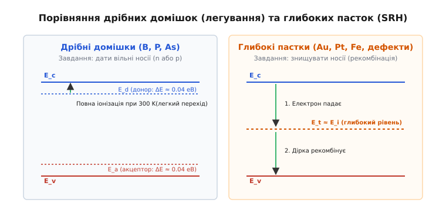
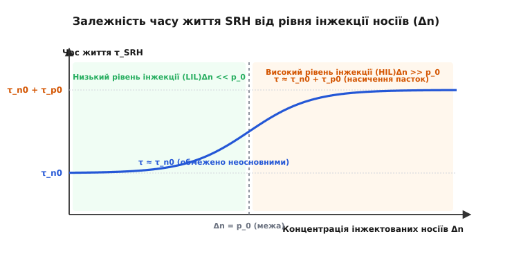
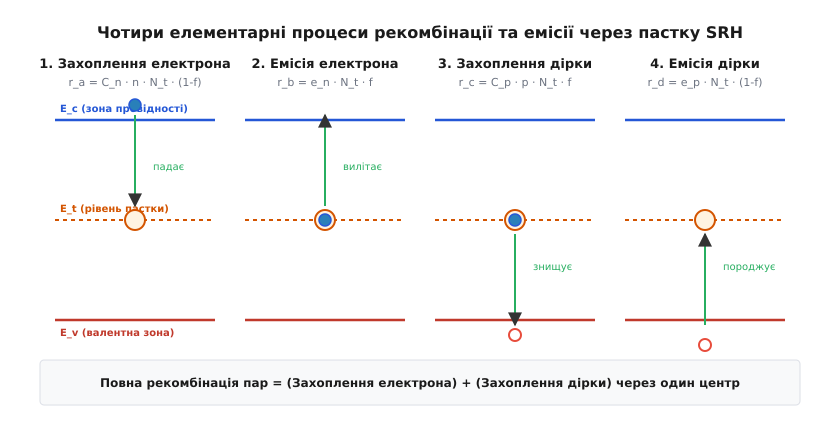
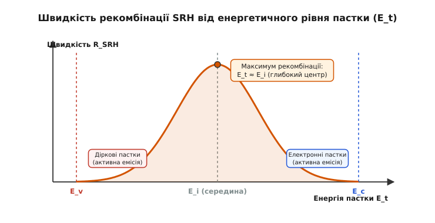

# Рекомбінація Шокли — Рида — Холла (SRH)

<preknowlist>
- [Напівпровідник](root:ph-condensed/semiconductor) — зонна структура, валентна зона, зона провідності, заборонена зона та теплова генерація пар.
- [Легування](root:ph-condensed/doping) — n- і p-тип, донори, акцептори, основні та неосновні носії заряду.
- [PN-перехід](root:ph-condensed/pn-junction) — збіднена область, дрейфовий і дифузійний струми, прямо й зворотна напруга.
</preknowlist>

Квантова розрахункова модель ідеального кристала кремнію передбачає, що вільний електрон із зони провідності має випромінити фотон із енергією 1.12 еВ для рекомбінації (лат. *re-* — знову, *combinare* — з'єднувати) з діркою у валентній зоні, що дає теоретичний час життя носіїв близько однієї секунди. За такого часу життя діод p-n переходу перемикався б зі стану провідності у запертий стан секундами, унеможливлюючи роботу будь-яких високочастотних транзисторів та імпульсних джерел живлення. Однак реальні вимірювання на надчистих кремнієвих пластинах показують час життя від десятків наносекунд до кількох мікросекунд — на шість-дев'ять порядків швидше за теоретичну межу випромінювального міжзонного переходу.

Причиною цього розходження є **рекомбінація Шокли — Рида — Холла** (*Shockley-Read-Hall recombination*, SRH) — безвипромінювальний процес винищення електронів і дірок через дефекти кристалічної ґратки та домішкові атоми, які утворюють глибокі енергетичні рівні (пастки) всередині забороненої зони.

> 📜 **Історія до теми:** [Як тріо фізиків розгадало таємницю пасток у кремнії](root:ph-condensed/shockley-read-hall-recombination/hist-shockley-read-hall.md). Про те, як у 1952 році Вільям Шокли, Волтер Рид та Роберт Холл незалежно пояснили роль глибоких центрів і створили базову математичну модель кінетики носіїв.

---

### Чому пряма рекомбінація настільки малоімовірна

Щоб зрозуміти, чому безвипромінювальна рекомбінація через пастки панує у кремнії, германії та карбіді кремнію, треба зіставити три фундаментальні механізми винищення носіїв заряду в напівпровідниках:

```
1. Пряма міжзонна випромінювальна рекомбінація (Band-to-Band Radiative):
   Електрон (E_c) ───[ фотон hν ]───> Дірка (E_v)
   Домінує у прямозонних матеріалах (GaAs, InP). У кремнії пригнічена законом збереження імпульсу.

2. Оже-рекомбінація (Auger Recombination):
   Електрон + Дірка ───[ передача енергії 3-й частинці ]───> Гарячий носій
   Домінує лише при надвисоких концентраціях носіїв (n, p > 10¹⁸ см⁻³).

3. Рекомбінація Шокли — Рида — Холла (SRH):
   Електрон (E_c) ──> Пастка (E_t) ──> Дірка (E_v)  [енергія іде у фонони/тепло ґратки]
   Домінує при низьких та помірних концентраціях у непрямозонних напівпровідниках (Si, Ge, SiC).
```

У прямозонних напівпровідниках (таких як арсенід галію GaAs чи нітрид галію GaN) мінімум зони провідності та максимум валентної зони розташовані при одному й тому самому значенні хвильового вектора (імпульсу) `k`. Там електрон падає у валентну зону напряму, миттєво випромінюючи квант світла (фотон). Швидкість такого процесу описується коефіцієнтом випромінювальної рекомбінації `B_{rad}` через співвідношення Ван Русбрука — Шоклі: для GaAs `B_{rad} ≈ 7·10⁻¹⁰` см³/с, що забезпечує швидкий міжзонний оптичний перехід.

Кристалічний кремній є **непрямозонним** напівпровідником (*indirect bandgap semiconductor*). Мінімум зони провідності у кремнію зсунутий уздовж кристалографічного напрямку [100] на 85% від межі зони Бріллюена, тоді як максимум валентної зони перебуває у центрі зони Бріллюена (`k = 0`). Для рекомбінації електрона з діркою потрібна одночасна участь не лише фотона (для відбору енергії 1.12 еВ), а й **фонона** (грец. *phone* — звук, квант коливань кристалічної ґратки), який візьме на себе великий хвильовий вектор `Δk ≈ 0.85 · (2π / a)`.

Імовірність того, що в одній точці простору в один момент часу зіткнуться три квазічастинки — електрон, дірка та відповідний акустичний чи оптичний фонон потрібної енергії та імпульсу, надзвичайно мала. Внаслідок цього коефіцієнт прямої випромінювальної рекомбінації для кремнію становить усього `B_{rad} ≈ 1.5·10⁻¹⁵` см³/с — майже на шість порядків менше, ніж у GaAs.


*Ліворуч: дрібні домішки бору чи фосфору розташовані біля меж зон (ΔE ≈ 0.04 еВ) і слугують джерелом вільних носіїв. Праворуч: глибокі пастки золота чи дефектів розміщені поблизу середини забороненої зони E_i й працюють як дворівневий ескалатор для рекомбінації.*

Якщо ж у забороненій зоні існує глибокий енергетичний рівень `E_t`, електрон не повинен здійснювати один гігантський малоімовірний стрибок. Він розбиває процес на два послідовних кроки: спершу електрон падає на рівень пастки `E_t`, а потім пастка захоплює дірку (або віддає електрон у валентну зону). Кожен із цих двох кроків супроводжується випромінюванням сітки дрібних фононів (тепла), що робить загальний процес у мільйони разів імовірнішим.

Оже-рекомбінація (названа на честь французького фізика П'єра Оже), яка є іншим безвипромінювальним процесом, передає енергію рекомбінації третій вільній частинці (електрону або дірці), перетворюючи її на високоенергетичний «гарячий» носій, який згодом релаксує, віддаючи енергію ґратці. Швидкість Оже-рекомбінації пропорційна кубу концентрації носіїв:

```
R_{Auger} = C_n · n² · p + C_p · n · p²
```

Для кремнію коефіцієнти Оже становлять `C_n ≈ 2.8·10⁻³¹` см⁶/с та `C_p ≈ 0.99·10⁻³¹` см⁶/с. При типових робочих концентраціях носіїв у базових областях напівпровідникових приладів (10¹⁴–10¹⁶ см⁻³) Оже-рекомбінація є нехтувано малою (час життя за Оже перевищує мілісекунди). Лише при надвисоких рівнях інжекції або важкому легуванні (`n, p > 10¹⁷` см⁻³) Оже-механізм починає конкурувати із SRH. Отже, у діапазоні концентрацій, типовому для більшості діодів, транзисторів і сонячних елементів, саме механізм SRH повністю визначає ефективний час життя носіїв заряду.

---

### Дрібні домішки проти глибоких рівнів

Для розуміння природи рекомбінаційних центрів необхідно чітко розрізняти два класи дефектів у кристалічній ґратці напівпровідника: дрібні домішки та глибокі рівні.

#### Дрібні домішки (Shallow Impurities)
Дрібні домішки (група III для акцепторів — бор B, галій Ga; група V для донорів — фосфор P, миш'як As) заміщують атоми кремнію у вузлах ґратки. Оскільки їхня валентність відрізняється від кремнію на одиницю, вони утворюють воднеподібний зв'язаний стан із кулонівським потенціалом `V(r) = -q² / (4πε · r)`.

Завдяки високій діелектричній проникності кремнію (`ε_r ≈ 11.7`) та малій ефективній масі носіїв (`m* < m_0`) радіус Бора такого стану є макроскопічним:


*Ілюстрація: Srh Shallow Vs Deep.*

```
a_B* = (4πε · ħ²) / (m* · q²) ≈ 30...40 Å (3...4 нм)
```
Хвильова функція електрона або дірки розмазана по сотнях елементарних комірок кристала. Енергія зв'язку становить усього `ΔE ≈ 0.04...0.05` еВ відносно найближчої зони. При кімнатній температурі (`k_B · T ≈ 0.0259` еВ) практично всі дрібні домішки є термічно іонізованими, створюючи вільні носії заряду для провідності. Через малу глибину залягання вони не можуть слугувати ефективними центрами рекомбінації.

#### Глибокі рівні (Deep Levels)
Глибокі центри створюються атомами перехідних і важких металів (Au, Fe, Pt, Cu, Ni, Ti), точковими дефектами ґратки (вакансії, міжвузлові атоми, бівакансії) або комплексами дефектів із домішками (наприклад, пара залізо-бор `Fe-B`, комплекс вакансія-кисень `A-центр`).

Такі дефекти створюють сильно локалізований потенціал із радіусом дії порядку одного міжатомного інтервалу (`r_t ≈ 1...3 Å`). Воднеподібна модель ефективної маси тут повністю втрачає силу; домінує потенціал центральної комірки (*central cell potential*) та локальна квантовохімічна перебудова хімічних зв'язків.


*Ілюстрація: Srh Injection Level.*


Глибокі рівні розташовані в глибині забороненої зони (на відстані понад 0.1–0.2 еВ від меж зон, часто поблизу середини `E_i`). Хвильова функція носія на глибокому рівні є суперпозицією хвильових функцій як зони провідності, так і валентної зони. Завдяки цій локалізації квантовий стан глибокого рівня може ефективно взаємодіяти як з електронами зони провідності, так і з дірками валентної зони, функціонуючи як міст для їхнього взаємного знищення.

---

### Мікроскопічна фізика захоплення: модель конфігураційних координат

Коли електрон падає з зони провідності на глибокий рівень, йому необхідно позбутися надлишкової енергії близько 0.5–0.6 еВ. Енергія одного оптичного фонона у кремнії становить `ħω_0 ≈ 0.063` еВ. Отже, за один квантовий перехід кристал має згенерувати одночасно пакет із 8–10 фононів. Прямий оптичний або одноелектронний процес такого масштабу має зникаюче малу ймовірність.

Механізм багатофононного випромінювання пояснюється **моделлю конфігураційних координат** (*configuration coordinate model*), запропонованою Кубо та Хуангом.

Розглянемо локальну конфігурацію дефекту: положення атома домішки та оточуючих його атомів кремнію описується узагальненою координатою коливань `Q` (зміщення ядер від положення рівноваги).

Повна енергія системи «електрон + ґратка» складається з електронної енергії та пружної енергії деформації ґратки. В гармонічному наближенні адіабатичний потенціал описується параболою:

```
U(Q) = (1 / 2) · M · ω² · Q²
```
де `M` — ефективна маса коливальної моди, `ω` — частота локальних коливань дефекту.


*Конфігураційна координатна діаграма. Вільний стан (електрон у зоні провідності + нейтральний дефект) описується верхньою параболою з мінімумом при Q = 0. Зв'язаний стан (електрон на пастці) описується нижньою параболою, зміщеною по координаті на ΔQ внаслідок релаксації ґратки. Точка перетину парабол визначає енергетичний бар'єр активації захоплення E_B.*

Коли електрон захоплюється на пастку, локальний розподіл заряду змінюється. Це викликає кулонівське зміщення та поляризацію сусідніх атомів ґратки — явище **релаксації ґратки** (*lattice relaxation*). Внаслідок цього мінімум параболи для зв'язаного стану зміщується на величину `ΔQ` по осі координат, а енергія мінімуму опускається на величину енергії зв'язку `E_t`.

Енергія релаксації ґратки `E_{rel}` (енергія Франка — Кондона) пов'язана з фактором Хуанга — Ріса `S`:
```
E_{rel} = (1 / 2) · M · ω² · (ΔQ)² = S · ħω
```
Фактор Хуанга — Ріса `S` показує середню кількість фононів, що виділяються під час релаксації ґратки після переходу електрона на пастку. Для глибоких центрів у напівпровідниках типові значення `S` становлять від 5 до 30 (сильний електрон-фононний зв'язок).

Перехід електрона з вільного стану на пастку підпорядковується **принципу Франка — Кондона**: електронні переходи відбуваються практично миттєво (за час порядка 10⁻¹⁵ с) порівняно з повільним рухом масивних ядер атомів ґратки (період коливань ґратки 10⁻¹³ с). Тому на діаграмі перехід є строго вертикальним при фіксованому значенні координати `Q`.

Процес захоплення відбувається в два кроки:
1. За рахунок теплових флуктуацій атоми навколо дефекту зміщуються в точку перетину двох парабол `Q_c`. Для досягнення цієї конфігурації система повинна подолати класичний термоактиваційний бар'єр `E_B`.
2. У точці перетину електрон без зміни положення ядер переходить із зони провідності на локалізований рівень пастки.
3. Опинившись у зв'язаному стані при конфігурації `Q_c`, система перебуває у високозбудженому коливальному стані. За кілька періодів коливань (близько 10⁻¹² с) надлишкова енергія релаксації `E_{rel}` дисипує у навколишню кристалічну ґратку у вигляді каскаду фононів (тепла), і атом дефекту займає новий рівноважний стан `Q = ΔQ`.

Внаслідок наявності бар'єра `E_B` переріз захоплення носія для багатьох глибоких центрів експоненційно зростає з температурою:
```
σ(T) = σ_∞ · exp(-E_B / (k_B · T))
```
де `σ_∞` — високотемпературний асимптотичний переріз захоплення.

---

### Механізми каскадного та оже-захоплення

Окрім багатофононного випромінювання, захоплення носіїв дефектами може відбуватися за іншими фізичними сценаріями залежно від зарядного стану центру:

#### 1. Каскадне захоплення Лакса (Lax Cascade Capture)
Якщо дефект має заряд, протилежний до знаку носія (наприклад, позитивно заряджений донорний центр `D⁺` захоплює електрон `e⁻`), кулонівське поле далекої дії створює навколо дефекту нескінченну послідовність квазінеперервних високозбуджених гідрогеноподібних рівнів біля дна зони провідності.

Згідно з теорією Мелвіна Лакса, електрон спершу захоплюється на один із найвищих збуджених рівнів із радіусом орбіти в десятки ангстрем, де енергія зв'язку менша за теплову енергію `k_B · T`. Відстань між сусідніми рівнями тут менша за енергію акустичного фонона. Електрон спускається по цих рівнях донизу («каскад Лакса»), на кожному кроці випромінюючи по одному акустичному фонону, доки не опуститься нижче рівня `k_B · T`, звідки зворотна теплова іонізація стає малоімовірною.

Каскадний механізм забезпечує гігантські перерізи захоплення приваблюючими центрами:
```
σ_{attr} ≈ 10⁻¹²...10⁻¹⁴ см²
```
Оскільки зі зростанням температури тепловий розпад збуджених рівнів посилюється, переріз каскадного захоплення падає з температурою за степеневим законом:
```
σ(T) ∝ T⁻³ ... T⁻¹
```

#### 2. Захоплення відштовхуючими центрами (Repulsive Centers)
Якщо дефект має той самий заряд, що й набігаючий носій (наприклад, негативно заряджений акцепторний центр `A⁻` захоплює електрон), носій відчуває далекодійне кулонівське відштовхування. Для захоплення електрон повинен тунелювати крізь кулонівський бар'єр дефекту.

Імовірність такого процесу описується квантовомеханічним фактором Зоммерфельда. Переріз захоплення для відштовхуючих центрів є надзвичайно малим:
```
σ_{rep} ≈ 10⁻¹⁸...10⁻²² см²
```
Він експоненційно зростає з температурою в міру того, як носії набувають вищої кінетичної енергії для подолання бар'єра.

#### 3. Оже-захоплення на глибокі пастки (Trap-Auger Capture)
При підвищених концентраціях вільних носіїв (`n > 10¹⁷` см⁻³) надлишок енергії при захопленні електрона пасткою може передаватися не фононам, а іншому вільному електрону чи дірці, що пролітає поруч. Коефіцієнт захоплення в такому разі стає залежним від концентрації вільних носіїв:
```
C_n = C_{n,phonon} + T_n · n
```
де `T_n` — коефіцієнт трьохчастинкового Оже-захоплення (см⁶/с).

---

### Анатомія пастки: чотири елементарні процеси та їхні швидкості

Центр рекомбінації характеризується трьома параметрами: енергетичним рівнем `E_t`, перерізами захоплення `σ_n`, `σ_p` та зарядним станом.


*Чотири базові квантові процеси центру SRH: r_a — захоплення вільного електрона із зони провідності; r_b — теплова емісія електрона назад у зону провідності; r_c — захоплення дірки з валентної зони (рекомбінація пари); r_d — емісія дірки (генерація пари).*

Позначимо через `N_t` концентрацію пасток в одиниці об'єму (см⁻³), а через `f` — імовірність того, що пастка зайнята електроном. Відповідно, імовірність того, що пастка порожня (здатна прийняти електрон), дорівнює `1 - f`.

Швидкості чотирьох елементарних процесів в одиниці об'єму (см⁻³·с⁻¹) записуються так:

#### 1. Захоплення електрона із зони провідності (`r_a`)
Вільний електрон стикається з порожньою пасткою і сідає на неї:
```
r_a = C_n · n · N_t · (1 - f)
```
де `C_n = σ_n · v_{th,n}` — коефіцієнт захоплення електронів (см³/с), а `v_{th,n} = √(3 · k_B · T / m_n*) ≈ 10⁷` см/с — середня теплова швидкість електронів при 300 K.

#### 2. Теплова емісія електрона у зону провідності (`r_b`)
Фонони кристалічної ґратки передають енергію електрону на пастці, викидаючи його назад у зону провідності:
```
r_b = e_n · N_t · f
```
де `e_n` — коефіцієнт емісії електронів (с⁻¹).

#### 3. Захоплення дірки з валентної зони (`r_c`)
Зайнята електроном пастка захоплює дірку з валентної зони. З позиції зонної діаграми це означає, що електрон із рівня пастки падає на вільний рівень у валентній зоні, знищуючи дірку. Це завершальний акт винищення електрон-діркової пари:
```
r_c = C_p · p · N_t · f
```
де `C_p = σ_p · v_{th,p}` — коефіцієнт захоплення дірок (см³/с), `v_{th,p} = √(3 · k_B · T / m_p*)` — теплова швидкість дірок.

#### 4. Теплова емісія дірки у валентну зону (`r_d`)
Електрон із валентної зони термічно збуджується на порожню пастку, залишаючи у валентній зоні нову незаповнену вакансію — вільну дірку. Це елементарний акт генерації носія:
```
r_d = e_p · N_t · (1 - f)
```
де `e_p` — коефіцієнт емісії дірок (с⁻¹).

---

### Принцип детальної рівноваги та зв'язок коефіцієнтів

Коефіцієнти емісії `e_n` та `e_p` залежать від внутрішньої будови дефекту. Зв'язати їх із вимірюваними коефіцієнтами захоплення `C_n` та `C_p` дозволяє **принцип детальної рівноваги** (*principle of detailed balance*).

У стані повної термодинамічної рівноваги (без зовнішнього світла, випромінювання чи напруги) концентрації носіїв дорівнюють рівноважним значенням `n_0` та `p_0`. При цьому кожен прямий мікроскопічний процес строго врівноважується зворотним процесом:
```
r_{a0} = r_{b0}  =>  C_n · n_0 · N_t · (1 - f_0) = e_n · N_t · f_0
r_{c0} = r_{d0}  =>  C_p · p_0 · N_t · f_0 = e_p · N_t · (1 - f_0)
```

Звідси виражаємо невідомі коефіцієнти емісії:
```
e_n = C_n · n_0 · (1 - f_0) / f_0
e_p = C_p · p_0 · f_0 / (1 - f_0)
```

У стані термодинамічної рівноваги імовірність заповнення пастки `f_0` підпорядковується статистиці Фермі — Дірака з єдиним рівнем Фермі `E_F`:
```
f_0 = 1 / (1 + exp((E_t - E_F) / (k_B · T)))
```
Звідси відношення порожніх і зайнятих пасток дорівнює:
```
(1 - f_0) / f_0 = exp((E_t - E_F) / (k_B · T))
```

Рівноважні концентрації вільних електронів і дірок через власну концентрацію `n_i` та рівень Фермі власного напівпровідника `E_i` виражаються як:
```
n_0 = n_i · exp((E_F - E_i) / (k_B · T))
p_0 = n_i · exp((E_i - E_F) / (k_B · T))
```

Підставляючи ці вирази у формули для коефіцієнтів емісії, рівень Фермі `E_F` строго скорочується:

```
e_n = C_n · n_i · exp((E_t - E_i) / (k_B · T)) = C_n · n_1
e_p = C_p · n_i · exp((E_i - E_t) / (k_B · T)) = C_p · p_1
```

де введено характерні статистичні концентрації `n_1` та `p_1`:
```
n_1 = N_c · exp(-(E_c - E_t) / (k_B · T)) = n_i · exp((E_t - E_i) / (k_B · T))
p_1 = N_v · exp(-(E_t - E_v) / (k_B · T)) = n_i · exp((E_i - E_t) / (k_B · T))
```

#### Фізичний зміст параметрів n_1 та p_1
Параметри `n_1` та `p_1` мають наочну фізичну інтерпретацію:
- `n_1` — це концентрація електронів у зоні провідності, яка встановилася б у напівпровіднику, якби рівень Фермі `E_F` точно збігався з енергетичним рівнем пастки `E_t`.
- `p_1` — це концентрація дірок у валентній зоні, якби рівень Фермі точно збігався з рівнем пастки `E_t`.
- Добуток цих двох параметрів завжди строго дорівнює квадрату власної концентрації носіїв за будь-якої енергії пастки:
```
n_1 · p_1 = n_i²
```

> 🧮 **Математичний вивід до теми:** [Строге математичне виведення рівняння рекомбінації SRH](root:ph-condensed/shockley-read-hall-recombination/math-srh-derivation.md). Детальний покроковий математичний вивід стаціонарного ступеня заповнення пастки `f` та чистої швидкості рекомбінації з кінетичних рівнянь балансу.

---

### Стаціонарна швидкість рекомбінації SRH

У нерівноважному стаціонарному стані (наприклад, під безперервним освітленням чи постійним прямим струмом) концентрації носіїв набувають значень `n` та `p`. Швидкість накопичення заряду на пастках повинна дорівнювати нулю:

```
d(N_t · f) / dt = (r_a - r_b) - (r_c - r_d) = 0
```

Це вимагає точної рівності результуючого потоку електронів із зони провідності на пастки та результуючого потоку дірок із валентної зони на пастки:

```
U_n = r_a - r_b = C_n · N_t · [ n · (1 - f) - n_1 · f ]
U_p = r_c - r_d = C_p · N_t · [ p · f - p_1 · (1 - f) ]
```

Прирівнюючи `U_n = U_p`, знаходимо стаціонарний ступінь заповнення пасток електронами:

```
f = (C_n · n + C_p · p_1) / (C_n · (n + n_1) + C_p · (p + p_1))
```

Підставляючи цей вираз для `f` у рівняння потоку `U_n`, отримуємо швидкість рекомбінації SRH:

```
R_{SRH} = (C_n · C_p · N_t · (n · p - n_i²)) / (C_n · (n + n_1) + C_p · (p + p_1))
```

Введемо характеристичні часи життя неосновних носіїв:
```
τ_{n0} = 1 / (C_n · N_t) = 1 / (σ_n · v_{th,n} · N_t)   [час життя електронів у p-матеріалі]
τ_{p0} = 1 / (C_p · N_t) = 1 / (σ_p · v_{th,p} · N_t)   [час життя дірок у n-матеріалі]
```

Отримуємо класичну формулу Шокли — Рида — Холла:

```
R_{SRH} = (n · p - n_i²) / (τ_{p0} · (n + n_1) + τ_{n0} · (p + p_1))
```

#### Термодинамічна рушійна сила рекомбінації
Чисельник формули `n · p - n_i²` виражає термодинамічний відхил системи від рівноваги. Якщо ввести квазірівні Фермі для електронів `E_{Fn}` та дірок `E_{Fp}`:
```
n = n_i · exp((E_{Fn} - E_i) / (k_B · T))
p = n_i · exp((E_i - E_{Fp}) / (k_B · T))
```
то їхній добуток прямо пропорційний розщепленню квазірівнів Фермі:
```
n · p = n_i² · exp((E_{Fn} - E_{Fp}) / (k_B · T))
```
Чисельник формули SRH набуває вигляду:
```
n · p - n_i² = n_i² · [ exp((E_{Fn} - E_{Fp}) / (k_B · T)) - 1 ]
```
- Якщо `E_{Fn} > E_{Fp}` (інжекція носіїв або освітлення), `n · p > n_i²`, відбувається чиста **рекомбінація** (`R_{SRH} > 0`).
- Якщо `E_{Fn} = E_{Fp}` (термодинамічна рівновага), `n · p = n_i²`, швидкість перетворюється на нуль (`R_{SRH} = 0`).
- Якщо `E_{Fn} < E_{Fp}` (збіднена область під зворотною напругою), `n · p < n_i²`, відбувається чиста **теплова генерація** пар (`R_{SRH} < 0`).

---

### Чому найефективніші пастки лежать поблизу середини забороненої зони

Дослідимо, як залежить швидкість рекомбінації `R_{SRH}` від положення енергетичного рівня дефекту `E_t`.


*Залежність ефективності рекомбінації SRH від положення енергетичного рівня пастки E_t. Максимум швидкості винищення пар досягається строго поблизу середини забороненої зони (E_t ≈ E_i). При зміщенні рівня до країв зон (E_c або E_v) швидкість рекомбінації спадає на багато порядків через домінування зворотної теплової емісії.*

Знайдемо максимум швидкості `R_{SRH}`, що еквівалентно мінімізації знаменника `D(E_t) = τ_{p0} · n_1(E_t) + τ_{n0} · p_1(E_t)`. Підставимо вирази для `n_1` та `p_1`:

```
D(E_t) = τ_{p0} · n_i · exp((E_t - E_i) / (k_B · T)) + τ_{n0} · n_i · exp((E_i - E_t) / (k_B · T))
```

Диференціюючи `D(E_t)` по `E_t` та прирівнюючи похідну до нуля:
```
dD / dE_t = (n_i / (k_B · T)) · [ τ_{p0} · exp((E_t - E_i) / k_B T) - τ_{n0} · exp((E_i - E_t) / k_B T) ] = 0
```
Отримуємо аналітичний вираз для оптимального положення рівня найефективнішої рекомбінаційної пастки:

```
E_t^{opt} = E_i + (1 / 2) · k_B · T · ln(τ_{n0} / τ_{p0}) = E_i + (1 / 2) · k_B · T · ln(σ_p / σ_n)
```

Якщо перерізи захоплення для електронів і дірок одного порядку (`σ_n ≈ σ_p`), то логарифм перетворюється на нуль, і максимальна швидкість рекомбінації досягається **строго посередині забороненої зони** (`E_t = E_i`).

#### Фізика поведінки крайніх випадків

```
┌────────────────────────────────────────────────────────────────────────┐
│               ПОВЕДІНКА ПАСТКИ ЗАЛЕЖНО ВІД ЕНЕРГЕТИЧНОГО РІВНЯ         │
├────────────────────────────────────────────────────────────────────────┤
│ 1. Дрібний рівень біля E_c (E_t - E_i >> 0):                           │
│    n_1 >> n, p. Захоплений електрон термічно вилітає назад у зону      │
│    провідності за час ~10⁻¹⁰ с, не дочекавшись дірки.                  │
│    => Пастка прилипання електронів (Electron Trap / Sticking Center).  │
│                                                                        │
│ 2. Дрібний рівень біля E_v (E_i - E_t >> 0):                           │
│    p_1 >> n, p. Захоплена дірка миттєво викидається у валентну зону.   │
│    => Пастка прилипання дірок (Hole Trap).                             │
│                                                                        │
│ 3. Глибокий рівень поблизу E_i (E_t ≈ E_i):                            │
│    n_1, p_1 ≈ n_i << n, p. Зворотна теплова емісія заблокована        │
│    високим бар'єром. Захоплений носій надійно утримується до приходу    │
│    носія протилежного знаку.                                           │
│    => Повноцінний рекомбінаційний центр максимальної ефективності.     │
└────────────────────────────────────────────────────────────────────────┘
```

Цей результат пояснює, чому найнебезпечнішими «убивцями» часу життя в кремнії є саме домішки важких і перехідних металів (золото, залізо, платина), які утворюють стани майже точно поблизу 0.55 еВ від країв зон.

---

### Детальний каталог глибоких центрів у кремнії

Розглянемо параметри, фізичну природу та поведінку основних глибоких центрів, що визначають кінетику рекомбінації в технологічному кремнії:

```
┌──────────────┬──────────────┬──────────────────┬──────────────────┬──────────────────────────────────────┐
│ Домішка /    │ Рівень E_t   │ Переріз σ_n      │ Переріз σ_p      │ Фізична природа та зарядний стан     │
│ Дефект       │ (еВ)         │ (см²)            │ (см²)            │                                      │
├──────────────┼──────────────┼──────────────────┼──────────────────┼──────────────────────────────────────┤
│ Золото (Au)  │ E_c - 0.54   │ 1.7 · 10⁻¹⁶      │ 1.0 · 10⁻¹⁵      │ Акцептор Au⁻/Au⁰ (поблизу E_i)       │
│ Золото (Au)  │ E_v + 0.35   │ 1.7 · 10⁻¹⁶      │ 1.1 · 10⁻¹⁴      │ Донор Au⁰/Au⁺                        │
├──────────────┼──────────────┼──────────────────┼──────────────────┼──────────────────────────────────────┤
│ Платина (Pt) │ E_c - 0.23   │ 5.0 · 10⁻¹⁵      │ 1.0 · 10⁻¹⁶      │ Акцептор Pt⁻/Pt⁰                     │
│ Платина (Pt) │ E_v + 0.32   │ 2.0 · 10⁻¹⁴      │ 1.5 · 10⁻¹⁵      │ Донор Pt⁰/Pt⁺                        │
├──────────────┼──────────────┼──────────────────┼──────────────────┼──────────────────────────────────────┤
│ Залізо Fe_i  │ E_v + 0.38   │ 5.0 · 10⁻¹⁴      │ 7.0 · 10⁻¹⁶      │ Міжвузловий донор Fe_i⁰/Fe_i⁺        │
│ Пара Fe_i-B_s│ E_v + 0.10   │ 3.0 · 10⁻¹⁴      │ 2.0 · 10⁻¹⁵      │ Донорний рівень пари тригональної    │
│ Пара Fe_i-B_s│ E_c - 0.26   │ 5.0 · 10⁻¹⁵      │ 3.0 · 10⁻¹⁶      │ Акцепторний рівень пари              │
├──────────────┼──────────────┼──────────────────┼──────────────────┼──────────────────────────────────────┤
│ A-центр (V-O)│ E_c - 0.17   │ 1.5 · 10⁻¹⁴      │ 3.0 · 10⁻¹⁶      │ Радіаційний комплекс Вакансія-Кисень │
│ E-центр (V-P)│ E_c - 0.44   │ 4.0 · 10⁻¹⁵      │ 9.0 · 10⁻¹⁶      │ Радіаційний комплекс Вакансія-Фосфор │
│ Бівакансія V₂│ E_c - 0.42   │ 2.0 · 10⁻¹⁵      │ 4.0 · 10⁻¹⁶      │ Стан V₂⁻/V₂⁰                         │
│ Бівакансія V₂│ E_v + 0.25   │ 4.0 · 10⁻¹⁶      │ 2.0 · 10⁻¹⁴      │ Стан V₂⁰/V₂⁺                         │
└──────────────┴──────────────┴──────────────────┴──────────────────┴──────────────────────────────────────┘
```

#### 1. Золото (Au) у кремнії: класичний амфотерний рекомбінатор
Золото займає переважно вузли ґратки (`Au_s`) і є класичним амфотерним дефектом, тобто може перебувати у трьох зарядних станах: позитивному `Au⁺`, нейтральному `Au⁰` та негативному `Au⁻`.

Акцепторний рівень золота `E_c - 0.54` еВ лежить майже точно посередині забороненої зони кремнію (`E_i = E_v + 0.56` еВ при 300 K). Нейтральний атом золота `Au⁰` притягує дірку через дипольні флуктуації (`σ_p = 1.0·10⁻¹⁵` см²), а негативно заряджений `Au⁻` притягує дірку кулонівським полем. Введення золота у концентрації лише `N_t = 10¹⁴` см⁻³ (один атом Au на 500 мільйонів атомів кремнію!) зменшує час життя носіїв до:
```
τ_{n0} = 1 / (σ_n · v_{th} · N_t) ≈ 1 / (1.7·10⁻¹⁶ · 10⁷ · 10¹⁴) ≈ 5.8 нс
```
Це робить золото потужним легуючим елементом для виготовлення надшвидких імпульсних діодів.

#### 2. Залізо (Fe) та комплекси залізо-бор (Fe-B)
Залізо є найпоширенішим небажаним технологічним забруднювачем у виробництві кремнію (через використання сталевого обладнання та графітових тиглів). Залізо дифундує у кремній як міжвузловий атом `Fe_i` і залишається рухливим навіть при кімнатній температурі.

У кремнії p-типу, легованому бором, позитивно заряджений міжвузловий донор `Fe_i⁺` притягується до негативно зарядженого вузлового акцептора бору `B_s⁻`, утворюючи електростатичну пару `(Fe_i-B_s)`.

Пара `FeB` має дивовижну властивість бістабільності та фотодисоціації:
- При кімнатній температурі у темряві залізо зв'язане у пари `FeB`.
- Під дією підсвічування спалахом світла або нагрівання до 200 °C надлишкові носії змінюють зарядний стан заліза на нейтральний `Fe_i⁰`, кулонівське притягання зникає, і пари `FeB` розпадаються на ізольовані атоми `Fe_i` та `B_s`.
- Оскільки міжвузлове залізо `Fe_i` має гігантський переріз захоплення електронів (`σ_n = 5·10⁻¹⁴` см²), час життя неосновних електронів після дисоціації пар падає у 5–10 разів!

Цей ефект слугує основою безконтактного методу спектроскопічного виявлення слідів заліза в сонячних пластинах: вимірюючи відношення часу життя до і після оптичної дисоціації `τ_{after} / τ_{before}`, розраховують концентрацію заліза аж до рівня 10¹⁰ см⁻³ (одна частина на трильйон!).

#### 3. Платина (Pt) проти золота у силових приладах
Платина, як і золото, утворює глибокі рівні, проте її акцепторний рівень розташований вище середини зони (`E_c - 0.23` еВ), а донорний — на `E_v + 0.32` еВ. Завдяки значному відхиленню від `E_i`, швидкість теплової генерації у збіднених областях для платини є значно меншою, ніж для золота:

```
G_{Pt} / G_{Au} ≈ exp(- (0.54 - 0.32) / (k_B · T)) << 1
```

Тому легування платиною дозволяє скоротити час життя носіїв у відкритому стані силового діода до 50–100 нс, уникаючи при цьому катастрофічного зростання струму зворотного витоку при робочих температурах 125–150 °C.

#### 4. Радіаційні дефекти
При опроміненні кремнію швидкими електронами (1–10 МеВ), протонами або гамма-квантами первинні зміщення атомів утворюють пари Френкеля (вакансія `V` + міжвузловий атом `Si_i`). Рухливі вакансії об'єднуються з домішками кисню та фосфору:
- **A-центр (`V-O`):** комплекс вакансії з атомом кисню у міжвузлі. Створює акцепторний рівень `E_c - 0.17` еВ.
- **E-центр (`V-P`):** комплекс вакансії з донорним атомом фосфору. Рівень `E_c - 0.44` еВ, що робить його потужним рекомбінатором у кремнії n-типу.
- **Бівакансія (`V₂`):** комплекс із двох сусідніх порожніх вузлів. Стабільна до температури 300–350 °C, створює три глибокі рівні.

---

### Аналіз режимів інжекції: низький проти високого

У практичних умовах концентрації носіїв описуються через рівноважні значення та надлишкові концентрації:
```
n = n_0 + Δn,    p = p_0 + Δp
```
В силу умови локальної квазінейтральності для монополярних пасток малої концентрації надлишкові концентрації строго рівні між собою: `Δn = Δp`.


*Залежність ефективного часу життя носіїв від рівня інжекції Δn. В області низької інжекції (LIL) час життя стабільний і лімітується захопленням неосновних носіїв. В області високої інжекції (HIL) пастки насичуються, і час життя зростає до асимптоти τ_{n0} + τ_{p0}.*

Підставимо ці концентрації у формулу SRH:

```
R_{SRH} = ( (n_0 + Δn) · (p_0 + Δn) - n_i² ) / ( τ_{p0} · (n_0 + Δn + n_1) + τ_{n0} · (p_0 + Δn + p_1) )
```

Враховуючи, що в рівновазі `n_0 · p_0 = n_i²`, чисельник перетворюється на:
```
(n_0 + Δn) · (p_0 + Δn) - n_i² = Δn · (n_0 + p_0 + Δn)
```

Визначаємо ефективний час життя носіїв `τ_{SRH} = Δn / R_{SRH}`:

```
τ_{SRH} = ( τ_{p0} · (n_0 + n_1 + Δn) + τ_{n0} · (p_0 + p_1 + Δn) ) / ( n_0 + p_0 + Δn )
```

#### 1. Низький рівень інжекції у напівпровіднику p-типу (p-Si, LIL)
У матеріалі p-типу `p_0 >> n_0` та `p_0 >> Δn`. Для глибоких пасток `p_0 >> n_1, p_1`.

Знаменник спрощується до `p_0`, а у чисельнику домінує доданок `τ_{n0} · p_0`:

```
τ_{SRH}^{p-LIL} ≈ (τ_{n0} · p_0) / p_0 = τ_{n0} = 1 / (σ_n · v_{th,n} · N_t)
```

Швидкість рекомбінації:
```
R_{SRH} ≈ Δn / τ_{n0}
```

#### 2. Низький рівень інжекції у напівпровіднику n-типу (n-Si, LIL)
Аналогічно, для n-типу `n_0 >> p_0` та `n_0 >> Δn`:

```
τ_{SRH}^{n-LIL} ≈ (τ_{p0} · n_0) / n_0 = τ_{p0} = 1 / (σ_p · v_{th,p} · N_t)
```

Швидкість рекомбінації:
```
R_{SRH} ≈ Δp / τ_{p0}
```

**Фундаментальний закон низької інжекції:** Час життя носіїв повністю визначається часом захоплення **неосновних носіїв** (електронів у p-базі або дірок у n-базі). Основних носіїв навколо настільки багато, що після того, як пастка вловила рідкісний неосновний носій, вона миттєво захоплює основний носій і повертається у вихідний стан.

#### Чому сонячні елементи n-типу перевершують p-тип
Більшість металевих домішок (зокрема `Fe_i`) мають `σ_n >> σ_p` (переріз захоплення електронів у 50–100 разів більший за переріз для дірок).
- У кремнії p-типу неосновними носіями є електрони, тому час життя `τ_n = τ_{n0} = 1 / (σ_n · v_{th} · N_t)` є надзвичайно коротким.
- У кремнії n-типу неосновними носіями є дірки, і час життя `τ_p = τ_{p0} = 1 / (σ_p · v_{th} · N_t)` виявляється у 50–100 разів довшим при тій самій концентрації заліза!
Саме тому світова фотовольтаїчна індустрія перейшла з пластин p-типу (PERC) на високотолерантні пластини n-типу (технології TOPCon та гетероструктури HJT).

#### 3. Високий рівень інжекції (High Injection Level, HIL)
Коли концентрація інжектованих носіїв перевищує рівноважну концентрацію легування (`Δn = Δp >> n_0, p_0`), наприклад, у відкритому силовому p-i-n діоді, IGBT при робочому струмі або під концентрованим сонячним світлом:

```
n ≈ p ≈ Δn >> n_0, p_0, n_1, p_1
```

Підставляючи ці значення у вираз для часу життя:
```
τ_{HIL} = ( τ_{p0} · Δn + τ_{n0} · Δn ) / Δn = τ_{n0} + τ_{p0}
```

Під високою інжекцією виникає **насичення пасток**: концентрації вільних електронів і дірок зрівнюються, і пастка змушена послідовно очікувати на підхід спочатку електрона, а потім дірки. Час життя носіїв зростає до суми двох характеристичних часів.

#### Спектроскопія часу життя, залежного від інжекції (IDLS)
Вимірюючи форму кривої `τ_{eff}(Δn)`, визначають фактор асиметрії пастки:
```
k = τ_{p0} / τ_{n0} = σ_n / σ_p
```
- Якщо `k > 1` (`σ_n > σ_p`), крива часу життя монотонно зростає з інжекцією `Δn`.
- Якщо `k < 1` (`σ_n < σ_p`), крива часу життя монотонно спадає з інжекцією `Δn`.
Форма та нахил кривої `τ(Δn)` є унікальним «відбитком пальця» конкретного хімічного дефекту в кристалі.

---

### Статистика Са — Шоклі для амфотерних та багаторівневих центрів

Класична теорія SRH розглядає пастку як дворівневу квантову систему з одним нейтральним та одним зарядженим станом. Проте багато реальних домішок перехідних металів (золото Au, платина Pt) та поверхневі дефекти кремнію (обірвані зв'язки `P_b`-центрів) є **амфотерними центрами** (грец. *amphoteros* — і той, і інший).



*Ілюстрація: Srh 4steps.*



*Ілюстрація: Srh Energy Dependence.*

Амфотерний дефект може приєднувати як електрон, так і дірку, перебуваючи у трьох зарядних станах:
1. Позитивно заряджений стан `D⁺` (пастка віддала електрон або захопила дірку).
2. Нейтральний стан `D⁰` (основний стан пастки).
3. Негативно заряджений стан `D⁻` (пастка захопила додатковий електрон).

Така система описується двома сполученими енергетичними рівнями у забороненій зоні:
- **Донорний рівень `E_{tD}`** (перехід `D⁺ ⇄ D⁰`): розташований ближче до валентної зони (для золота `E_v + 0.35` еВ).
- **Акцепторний рівень `E_{tA}`** (перехід `D⁰ ⇄ D⁻`): розташований вище донорного рівня (для золота `E_c - 0.54` еВ).

Різниця між цими рівнями `U_{eff} = E_{tA} - E_{tD}` називається ефективною кореляційною енергією Хаббарда (кулонівське відштовхування двох електронів на одному локалізованому дефекті).

Позначимо частки дефектів у кожному зарядному стані через `f⁺`, `f⁰`, `f⁻`, де сума часток строго нормована на одиницю:
```
f⁺ + f⁰ + f⁻ = 1
```

Кінетична схема рекомбінації через амфотерний дефект включає чотири прямі та чотири зворотні переходи:
```
1. Електронний перехід на донорному рівні:
   D⁺ + e⁻ ⇄ D⁰  [швидкість захоплення r_{a1} = C_{n⁺} · n · N_t · f⁺, емісія r_{b1} = e_{n0} · N_t · f⁰]

2. Дірковий перехід на донорному рівні:
   D⁰ + h⁺ ⇄ D⁺  [швидкість захоплення r_{c1} = C_{p0} · p · N_t · f⁰, емісія r_{d1} = e_{p⁺} · N_t · f⁺]

3. Електронний перехід на акцепторному рівні:
   D⁰ + e⁻ ⇄ D⁻  [швидкість захоплення r_{a2} = C_{n0} · n · N_t · f⁰, емісія r_{b2} = e_{n⁻} · N_t · f⁻]

4. Дірковий перехід на акцепторному рівні:
   D⁻ + h⁺ ⇄ D⁰  [швидкість захоплення r_{c2} = C_{p⁻} · p · N_t · f⁻, емісія r_{d2} = e_{p0} · N_t · f⁰]
```

Згідно з узагальненою моделлю Са — Шоклі (*Sah-Shockley model*), у стаціонарному стані баланс потоків для кожного рівня записується системою алгебраїчних рівнянь:
```
d f⁺ / dt = (r_{c1} - r_{d1}) - (r_{a1} - r_{b1}) = 0
d f⁻ / dt = (r_{a2} - r_{b2}) - (r_{c2} - r_{d2}) = 0
```

Розв'язуючи цю систему відносно часток `f⁺`, `f⁰`, `f⁻`, знаходять повну швидкість рекомбінації:

```
R_{amphoteric} = N_t · (n · p - n_i²) · [ (C_{n⁺} · C_{p0}) / D_1 + (C_{n0} · C_{p⁻}) / D_2 ]
```
де знаменники `D_1` та `D_2` є функціями концентрацій носіїв та параметрів емісії обох рівнів.

#### Ефект кореляційного прискорення рекомбінації
Фізична сутність амфотерної кінетики полягає в ефекті «кулонівського човника»:
1. Нейтральний дефект `D⁰` захоплює електрон із зони провідності з помірним перерізом нейтрального захоплення `σ_{n0} ≈ 10⁻¹⁶` см², перетворюючись на негативно заряджений іон `D⁻`.
2. Опинившись у стані `D⁻`, дефект набуває далекодійного кулонівського притягання до дірок валентної зони. Переріз захоплення дірки `σ_{p⁻}` підскакує до `10⁻¹⁴` см² (кулонівське захоплення за Лаксом).
3. Пастка майже миттєво захоплює дірку, скидаючи заряд назад до `D⁰`.
4. Якщо ж дефект спершу захопить дірку, він переходить у стан `D⁺`, де його переріз до електронів `σ_{n⁺}` зростає на два порядки.

Цей циклічний процес кулонівського притягання робить амфотерні дефекти (золото у кристалі та `P_b`-центри на межі з оксидом) набагато потужнішими центрами рекомбінації, ніж ізольовані монополярні пастки.

---

### Польове підсилення рекомбінації: ефект Пуля — Френкеля та модель Шенка

У сильних електричних полях `F > 10⁴` В/см (які виникають у збіднених шарах p-n переходів, під затворами MOSFET або в області просторового заряду силових діодів) класична формула SRH недооцінює швидкість генерації та рекомбінації у десятки й сотні разів.

Зростання швидкості перебігу процесів SRH у сильному полі зумовлене двома квантовими механізмами:

```
┌────────────────────────────────────────────────────────────────────────┐
│                   ПОЛЬОВІ ЕФЕКТИ ПРИСКОРЕННЯ SRH                       │
├────────────────────────────────────────────────────────────────────────┤
│ 1. Ефект Пуля — Френкеля (Poole-Frenkel Barrier Lowering):             │
│    Зниження висоти класичного кулонівського бар'єра пастки зовнішнім    │
│    електричним полем.                                                 │
│                                                                        │
│ 2. Фононно-асистоване тунелювання (Trap-Assisted Tunneling, TAT):      │
│    Квантовомеханічне тунелювання носія крізь звужений бар'єр дефекту   │
│    із одночасним випромінюванням фононів (модель Шенка та Хуркса).     │
└────────────────────────────────────────────────────────────────────────┘
```

#### 1. Класичне зниження бар'єра Пуля — Френкеля
Для приваблюючого кулонівського центру потенціал у присутності зовнішнього однорідного поля `F` вздовж осі `x` має вигляд:
```
V(x) = - (q / (4πε · x)) - F · x
```
Максимум потенціального бар'єра зміщується і знижується на величину:
```
ΔE_{PF} = √( (q³ · F) / (π · ε_r · ε_0) )
```
Для кремнію (`ε_r = 11.7`) при напруженості поля `F = 10⁵` В/см зниження бар'єра становить:
```
ΔE_{PF} = √( (1.6·10⁻¹⁹ · 10⁵) / (π · 11.7 · 8.85·10⁻¹⁴) ) ≈ 0.07 еВ
```
Швидкість теплової емісії з пастки зростає в експоненційній пропорції:
```
e_n(F) = e_n(0) · exp(ΔE_{PF} / (k_B · T))
```
При кімнатній температурі (`k_B · T ≈ 0.0259` еВ) коефіцієнт прискорення становить `exp(0.07 / 0.0259) ≈ 15` разів!

#### 2. Квантовомеханічна модель Шенка (Phonon-Assisted Tunneling)
При вищих полях `F > 2·10⁵` В/см електрон тунелює безпосередньо з рівня пастки у зону провідності через трикутний бар'єр. Модель Андреаса Шенка об'єднує квантове тунелювання носія крізь бар'єр дефекту з багатофононним випромінюванням ґратки.

Польовий фактор підсилення Шенка `Γ_n(F, T)` вводиться як безрозмірна поправка до швидкості емісії та захоплення:
```
e_n(F) = e_n(0) · [ 1 + Γ_n(F, T) ]
```
Інтегральний вираз для фактора Шенка має вигляд:
```
Γ_n(F, T) = ∫ [ exp( - (4/3) · ( (2 m*)^{1/2} · E^{3/2} ) / (q · ħ · F) ) · f_{phonon}(E, T) ] dE
```

У результаті характеристичні часи життя SRH у сильному електричному полі скорочуються:
```
τ_n(F) = τ_{n0} / [ 1 + Γ_n(F, T) ]
τ_p(F) = τ_{p0} / [ 1 + Γ_p(F, T) ]
```

Це явище лежить в основі так званого «м'якого» пробою зворотно зсунутих p-n переходів, зумовлює паразитний підпороговий струм витоку в нанометрових польових транзисторах і враховується у промислових симуляторах TCAD як обов'язкова польова поправка до моделі SRH.

---

### Температурна спектроскопія часу життя (TDLS)

Дослідження залежності часу життя носіїв від температури `τ_{eff}(T)` у діапазоні від 100 K до 450 K — метод **спектроскопії часу життя, залежної від температури** (*Temperature-Dependent Lifetime Spectroscopy*, TDLS).

В аналітичному виразі для часу життя SRH від температури одночасно залежать кілька фізичних параметрів:
1. **Теплова швидкість носіїв:** `v_{th}(T) ∝ T^{1/2}`.
2. **Ефективна густина станів зон:** `N_c(T) ∝ T^{3/2}`, `N_v(T) ∝ T^{3/2}`.
3. **Власна концентрація носіїв:** `n_i(T) ∝ T^{3/2} · exp(-E_g(T) / (2 k_B T))`.
4. **Ширина забороненої зони:** за формулою Варшні `E_g(T) = E_g(0) - (α · T²) / (T + β)`.
5. **Перерізи захоплення багатофононного випромінювання:** `σ(T) = σ_∞ · exp(-E_B / (k_B · T))`.

На графіку залежності `τ_{SRH}(T)` виділяють три характерні температурні області:

```
┌────────────────────────────────────────────────────────────────────────┐
│              ТЕМПЕРАТУРНІ РЕЖИМИ ЧАСУ ЖИТТЯ SRH                        │
├────────────────────────────────────────────────────────────────────────┤
│ 1. Низькотемпературна область (T < 200 K):                             │
│    Теплова емісія n_1, p_1 зникає (n_1, p_1 << n, p).                  │
│    Час життя визначається суто температурною залежністю перерізу       │
│    захоплення: τ ∝ 1 / (σ(T) · v_{th}(T)).                             │
│                                                                        │
│ 2. Область плато кімнатної температури (250 K < T < 350 K):            │
│    Час життя стабільний і наближається до τ_{n0} (у p-Si) або τ_{p0}   │
│    (у n-Si).                                                          │
│                                                                        │
│ 3. Високотемпературна область (T > 380 K):                             │
│    Параметри n_1(T) або p_1(T) експоненційно зростають, перевищуючи   │
│    концентрацію основних носіїв p_0. Знаменник формули SRH росте:      │
│    τ_{SRH}(T) ≈ τ_{n0} · (p_1(T) / p_0) ∝ exp((E_i - E_t) / (k_B · T)).│
│    З нахилу прямої в координатах Арреніуса знаходять глибину рівня E_t.│
└────────────────────────────────────────────────────────────────────────┘
```

#### Метод поверхонь розв'язку параметрів дефектів (DPSS)
Об'єднання двох методів — спектроскопії за інжекцією IDLS (`τ(Δn)`) та спектроскопії за температурою TDLS (`τ(T)`) дозволяє побудувати тривимірну поверхню відгуку дефекту:
```
τ = f(Δn, T)
```
Це дає змогу однозначно розділити три взаємопов'язані параметри пастки (`E_t`, `σ_n`, `σ_p`) без потреби виготовлення металевих контактів чи діодних структур, здійснюючи повну характеризацію дефектів безпосередньо на необроблених кремнієвих злитках і пластинах.

---

### Глибокі центри у широкозонних напівпровідниках (SiC та GaN)

З розвитком силової електроніки на зміну кремнію приходять широкозонні матеріали: **карбід кремнію** (4H-SiC, `E_g = 3.26` еВ) та **нітрид галію** (GaN, `E_g = 3.4` еВ). Завдяки великій ширині забороненої зони власна концентрація носіїв у них є мізерною (`n_i ≈ 10⁻⁸` см⁻³ для SiC при 300 K проти `10¹⁰` см⁻³ для Si).

Проте рекомбінація SRH відіграє в широкозонних напівпровідниках критичну роль, визначаючи робочі характеристики високовольтних приладів:

#### 1. Карбід кремнію (4H-SiC): домінуючі пастки Z_{1/2} та EH_{6/7}
У монокристалах 4H-SiC головними рекомбінаційними центрами є власні точкові дефекти ґратки:
- **Центр `Z_{1/2}`:** розташований на глибині `E_c - 0.65` еВ. Це точкова вакансія вуглецю `V_C`. Центр `Z_{1/2}` має гігантський переріз захоплення дірок (`σ_p ≈ 10⁻¹⁴` см²) і є головним «убивцею» часу життя в епітаксійних шарах 4H-SiC, обмежуючи час життя носіїв значеннями `τ ≈ 0.5...1.5` мкс.
- **Центр `EH_{6/7}`:** комплекс вакансії вуглецю, розташований на глибині `E_c - 1.55` еВ (поблизу середини зони SiC).

Для високовольтних силових діодів і MOSFET на напругу 10–20 кВ товщина слаболегованої дрейфової бази становить 100–150 мкм. Щоб забезпечити модуляцію провідності бази прямим струмом, час життя дірок повинен перевищувати 10–20 мкс.

Для знищення центрів `Z_{1/2}` у технології SiC застосовують метод **термічного окиснення або імплантації вуглецю**:
1. Поверхню кристала окиснюють у сухій атмосфері кисню при 1300–1400 °C.
2. Окиснення генерує потік надлишкових міжвузлових атомів вуглецю `C_i`, які дифундують у глибину кристала.
3. Міжвузловий вуглець зустрічає вуглецеві вакансії (`Z_{1/2}`) і рекомбінує з ними за реакцією `C_i + V_C -> SiC_{ґратка}`.
Ця обробка повністю пасивує дефекти `Z_{1/2}`, збільшуючи час життя носіїв у 4H-SiC з 1 мкс до рекордних 30–40 мкс!

#### 2. Нітрид галію (GaN): паразитні дефекти C_N та жовта люмінесценція
У транзисторах високої рухливості електронів (GaN HEMT) для силових адаптерів живлення та радарів фоновою домішкою є вуглець, який заміщує азот `C_N`.

Вуглець утворює глибокий акцепторний рівень `E_v + 0.9` еВ, який бере участь у повільній рекомбінації SRH і спричиняє паразитне оптичне свічення — смугу «жовтої люмінесценції» (2.2 еВ). Захоплення електронів на ці пастки під час роботи транзистора при високих напругах викликає колапс струму стоку (*current collapse*) та зростання динамічного опору відкритого каналу `R_{DS(on)}`.

---

### Теплова генерація у збідненій області та струм темряви

У збідненій області зворотно зсунутого p-n переходу або під затвором пікселя сенсора зображення сильне електричне поле миттєво виносить вільні носії заряду за межі переходу. Внаслідок цього концентрації електронів і дірок падають практично до нуля: `n ≈ 0` та `p ≈ 0`.

Підставимо ці умови у формулу SRH:

```
R_{SRH} = (0 - n_i²) / (τ_{p0} · n_1 + τ_{n0} · p_1) = - G_{SRH}
```

Виникає від'ємна рекомбінація — тобто чиста **теплова генерація пар** із постійною швидкістю:

```
G_{SRH} = n_i² / (τ_{p0} · n_1 + τ_{n0} · p_1)
```

Підставляючи вирази для `n_1` та `p_1`:

```
G_{SRH} = n_i / [ τ_{p0} · exp((E_t - E_i) / (k_B · T)) + τ_{n0} · exp((E_i - E_t) / (k_B · T)) ]
```

Якщо пастка розташована посередині забороненої зони (`E_t = E_i`) і `τ_{n0} = τ_{p0} = τ_0`:

```
G_{SRH} = n_i / (2 · τ_0)
```

#### Густина струму генерації збідненого шару
Інтегруючи швидкість генерації по ширині збідненої області `W_{dep}`:

```
J_{gen} = q · G_{SRH} · W_{dep} = (q · n_i · W_{dep}) / (2 · τ_0)
```

Оскільки ширина збідненого шару залежить від зворотної напруги як `W_{dep} ∝ √(V_{bi} + V_R)`, зворотний струм діода, зумовлений генерацією SRH, не насичується, а монотонно зростає з напругою як `J_R ∝ √(V_R)`.

```
┌────────────────────────────────────────────────────────────────────────┐
│             ПОРІВНЯННЯ СТРУМІВ ДИФУЗІЇ ТА ГЕНЕРАЦІЇ У PN-ПЕРЕХОДІ      │
├────────────────────────────────────────────────────────────────────────┤
│ 1. Дифузійний струм витоку з нейтральної бази (Шоклі):                 │
│    J_{diff} ∝ n_i² ∝ exp(-E_g / (k_B · T))                             │
│    Переважає при високих температурах (T > 100 °C у кремнії) та у     │
│    вузькозонних матеріалах (Ge).                                      │
│                                                                        │
│ 2. Струм генерації SRH у збідненому шарі (Са — Нойс — Шоклі):         │
│    J_{gen} ∝ n_i ∝ exp(-E_g / (2 · k_B · T))                           │
│    Переважає при кімнатній температурі (300 K) у кремнії та широ-     │
│    козонних матеріалах (SiC, GaN).                                    │
└────────────────────────────────────────────────────────────────────────┘
```

#### Вплив на сенсори зображення КМОН (CMOS Image Sensors)
У сучасних сенсорах зображення піксель є фотодіодом із пінованою структурою (*Pinned Photodiode*, PPD). Головним джерелом шуму в сенсорах є темновий струм генерації SRH на межі кремнію з діоксидом кремнію `Si/SiO₂`, де густина поверхневих пасток `D_{it}` є найвищою.

У структурі PPD поверхню світлочутливої `n`-області покривають ультратонким високолегованим шаром `p⁺` (*pinning layer*), підключеним до підкладки. Цей шар виконує дві функції:
1. Забезпечує надвисоку концентрацію дірок біля поверхні (`p_s ≈ 10¹⁸` см⁻³), що зміщує поверхневий ступінь заповнення пасток і практично повністю блокує генерацію пар: у знаменнику швидкості генерації `G_{SRH}` з'являється велетенський доданок `p_s`, який зводить швидкість генерації до нуля.
2. Відтискає область просторового заряду від дефектної межі з оксидом у глибину високочистого кристалічного об'єму кремнію, де концентрація металевих пасток мінімальна.

Якщо ж у глибині об'єму просторового заряду пікселя випадково опиниться навіть **одиночний атом домішки заліза або золота**, швидкість генерації `G_{SRH}` у цьому мікрооб'ємі різко зростає. Під час експозиції цей дефект безперервно генерує паразитні електрони, які накопичуються у потенціальній ямі пікселя навіть за повної відсутності світла. На зображенні такий піксель виглядає яскравою білою точкою незалежно від сцени — виникає дефект **«гарячого пікселя»** (*hot pixel / white spot*).

---

### Поверхнева рекомбінація та фізика діелектричної пасивації

На поверхні кристала напівпровідника періодичність кристалічної ґратки різко обривається. Кожен поверхневий атом кремнію має нескомпенсовані валентні орбіталі — **обірвані зв'язки** (*dangling bonds*, так звані `P_b`-центри на межі `Si/SiO₂`).

Ці дефекти утворюють квазінеперервний енергетичний розподіл пасток у забороненій зоні з поверхневою густиною `D_{it}(E)` (см⁻²·еВ⁻¹).

Кінетика поверхневої рекомбінації описується узагальненим інтегралом SRH:

```
R_s = (n_s · p_s - n_i²) · ∫ [ v_{th} · D_{it}(E) ] / [ σ_p⁻¹ · (n_s + n_1(E)) + σ_n⁻¹ · (p_s + p_1(E)) ] dE
```
де `n_s` та `p_s` — концентрації носіїв безпосередньо на поверхні напівпровідника.

Поверхневу рекомбінацію характеризують **швидкістю поверхневої рекомбінації `S`** (см/с):

```
R_s = S · Δn_s
```

На свіжозрізаній непасивованій поверхні кремнію `S` сягає `10⁴...10⁵` см/с. Це означає, що будь-який носій, який підійшов до поверхні на довжину дифузії, практично миттєво гине.

Для пластини товщиною `W` ефективний час життя носіїв `τ_{eff}` визначається сумою об'ємного та поверхневого внесків:

```
1 / τ_{eff} = 1 / τ_{bulk} + (2 · S) / W
```
Якщо `W = 150` мкм, а `S = 10⁴` см/с, то навіть при ідеальному об'ємному часі життя `τ_{bulk} = 10` мс виміряний час життя становитиме всього:
```
τ_{eff} ≈ W / (2 · S) = 150·10⁻⁴ / (2 · 10⁴) = 0.75 мкс
```

Для пригнічення поверхневого SRH застосовують дві взаємодоповнюючі стратегії:

```
1. Хімічна пасивація (Chemical Passivation):
   Зменшення густини станів D_{it} шляхом насичення обірваних зв'язків.
   - Термічний оксид SiO₂ з високотемпературним водневим відпалом (Forming Gas Anneal, H₂/N₂):
     атоми водню зв'язуються з обірваними орбіталями (Si-H), знижуючи D_{it} з 10¹² до < 10⁹ см⁻²·еВ⁻¹.
   - Плівки аморфного гідрогенізованого кремнію (a-Si:H) у гетероструктурних сонячних елементах (HJT).

2. Польова пасивація (Field-Effect Passivation):
   Створення вбудованого електричного поля діелектриком із фіксованим зарядом Q_f.
   - Нітрид кремнію (SiN_x:H) має позитивний заряд Q_f ≈ +10¹² см⁻². Він притягує електрони й відштовхує
     дірки, зводячи p_s майже до нуля. Оскільки R_s ∝ n_s · p_s, швидкість рекомбінації падає.
   - Оксид алюмінію (Al₂O₃), нанесений методом атомно-шарового осадження (ALD), має велетенський негативний
     заряд Q_f ≈ -5·10¹² см⁻². Він відштовхує електрони від поверхні p-бази, зменшуючи S до рекордних < 1 см/с!
```

#### Сучасні технології пасивації у фотовольтаїці (TOPCon та Heterojunction)
У сучасному виробництві кремнієвих сонячних елементів найвищий ККД (> 25–26%) досягається завдяки технологіям пасивованих контактів, які повністю усувають прямий контакт металу з кремнієм:

1. **Технологія TOPCon (Tunnel Oxide Passivated Contact):**
   - На поверхню кремнію наносять ультратонкий шар діоксиду кремнію `SiO₂` товщиною всього 1.2–1.6 нм (приблизно 4–6 атомних шарів), вирощений хімічним шляхом або методом атомно-шарового осадження (ALD).
   - Зверху оксид покривають шаром сильнолегованого полікристалічного кремнію (`n⁺ poly-Si` або `p⁺ poly-Si`) товщиною 20–50 нм.
   - Завдяки малій товщині оксиду основні носії легко тунелюють крізь квантовомеханічний бар'єр, тоді як неосновні носії блокуються потужним енергетичним бар'єром зонного зміщення (`ΔE_v ≈ 4.5` еВ).
   - Швидкість поверхневої рекомбінації знижується до рекордних значень `S_0 < 0.5` см/с, а напруга холостого ходу елемента зростає до `V_{oc} > 735` мВ.

2. **Кремнієві гетероструктури SHJ (Silicon Heterojunction / HJT):**
   - На обидва боки пластини монокристалічного кремнію n-типу наносять тонкі плівки аморфного гідрогенізованого кремнію: спочатку надчистий власний шар `a-Si:H(i)` товщиною 4–6 нм, а поверх нього — леговані шари `a-Si:H(p)` (емітер) та `a-Si:H(n)` (фронтальне поле BSF).
   - Атоми водню з шару `a-Si:H` проникають на міжфазну межу і насичують практично 100% обірваних зв'язків кремнію, знижуючи густину пасток `D_{it}` нижче 10⁸ см⁻²·еВ⁻¹.
   - Це дозволяє досягти часу життя носіїв у готовому сонячному елементі понад 5–10 мілісекунд і граничного ККД близько 26.8%.

3. **Гідрогенізація об'ємних дефектів під час швидкого термообпалу:**
   - Під час формування металевих контактів сонячного елемента у конвеєрній печі пластина нагрівається до 750–850 °C протягом кількох секунд.
   - При цій температурі плівки `SiN_x:H` та `Al_2O_3:H` виділяють атомарний водень `H⁰`, `H⁺` та `H⁻`.
   - Водень дифундує вглиб кремнію і хімічно зв'язується з глибокими пастками — міжфазними границями зерен у мультикристалічному кремнії, дислокаціями та комплексами металів (`Fe-H`, `Cu-H`, `B-O-H`), пасивуючи їхні рекомбінаційні властивості.

---

### Експериментальні методи діагностики дефектів SRH

Для контролю технологічних процесів та дослідження фізики пасток використовують комплекс електричних та безконтактних оптичних методів.

#### 1. Релаксаційна спектроскопія глибоких рівнів (DLTS)
Метод DLTS (запропонований Д. В. Лангом у 1974 році) є найчутливішим інструментом для визначення енергії залягання `E_t`, перерізів захоплення `σ` та концентрації дефектів `N_t`.

Метод базується на аналізі перехідних процесів високочастотної ємності зворотно зсунутого бар'єра Шотткі або p-n переходу:
1. До діода прикладають зворотну напругу `V_R`, утворюючи збіднену область із порожніми пастками.
2. Подають короткий імпульс прямої напруги (заповнюючий імпульс тривалістю `t_p ≈ 1...100` мкс), який інжектує носії та заповнює пастки.
3. Повертають напругу до значення `V_R`. Захоплені носії термічно емітують у зону зі швидкістю `e_n(T)`.
4. Звільнення пасток змінює густину об'ємного заряду і викликає експоненційну релаксацію ємності переходу:
```
C(t) = C_0 · [ 1 - (N_t / (2 · N_d)) · exp(-e_n · t) ]
```

Вимірюючи різницю ємностей `ΔC = C(t_1) - C(t_2)` у фіксованому часовому вікні (*rate window*) під час повільного нагрівання зразка від 77 K до 400 K, отримують спектр із піками. Температура максимуму піку `T_{max}` відповідає збігу швидкості емісії з вікном приладу:
```
e_n(T_{max}) = ln(t_2 / t_1) / (t_2 - t_1)
```

Будуючи графік Арреніуса `ln(e_n / T²)` як функцію `1000 / T`:
```
ln(e_n / T²) = ln(γ_n · σ_n) - (E_c - E_t) / (k_B · T)
```
де `γ_n = 2 · √3 · (2π · m_n* · k_B² / h³)` — фундаментальна константа матеріалу, за нахилом прямої знаходять точну енергію активації дефекту `E_c - E_t`, а за точкою перетину з віссю — переріз захоплення `σ_n`.

#### Оптична спектроскопія O-DLTS (MCTS)
Для бар'єрів Шотткі на p- або n-підкладках пряма інжекція неосновних носіїв неможлива через уніполярний характер струму. У таких випадках застосовують **оптичний DLTS** (*Optical DLTS* / *Minority Carrier Transient Spectroscopy*, MCTS):
- Замість електричного імпульсу використовують імпульс світла з енергією квантів `hν ≥ E_g`.
- Світло генерує пари електрон-дірка безпосередньо біля поверхні, дозволяючи пасткам захоплювати неосновні носії.
- Це уможливлює точне вимірювання параметрів пасток для обох типів носіїв на простих тестових діодах Шотткі без необхідності формування складного p-n переходу.

#### 2. Квазістаціонарна фотопровідність (QSSPC)
Метод QSSPC (розроблений Р. Сінтоном) — промисловий стандарт вимірювання часу життя в сонячній енергетиці:
- Кремнієву пластину опромінюють спалахом світла, що повільно згасає протягом 2–5 мс (час спаду довший за час життя носіїв).
- Безконтактний високочастотний індуктивний датчик реєструє надлишкову провідність пластини `Δσ(t) = q · (μ_n + μ_p) · Δn(t) · W`.
- Одночасно еталонний калібрований фотоелемент вимірює миттєву інтенсивність генерації `G(t)`.
- Ефективний час життя обчислюється з квазістаціонарного балансу:
```
τ_{eff}(Δn) = Δn(t) / [ G(t) - dΔn(t) / dt ]
```
Метод дозволяє за кілька секунд отримати повну криву `τ_{eff}(Δn)` у діапазоні інжекції від 10¹² до 10¹⁶ см⁻³.

#### Графічний аналіз Кейна — Свонсона (Розділення SRH, Оже та випромінювальних втрат)
Повна швидкість рекомбінації у кристалі є сумою трьох незалежних каналів:
```
1 / τ_{eff} = 1 / τ_{SRH}(Δn) + 1 / τ_{rad}(Δn) + 1 / τ_{Auger}(Δn)
```
Згідно з методом Кейна — Свонсона, виміряну обернену величину часу життя `1 / τ_{eff}` будують як функцію рівня інжекції `Δn`:
- При низькій інжекції (`Δn < 10¹⁵` см⁻³) крива визначається лінійним внеском SRH-рекомбінації `1 / τ_{SRH}`.
- При високій інжекції (`Δn > 10¹⁶` см⁻³) крива загинається вгору за квадратичним законом `1 / τ_{Auger} ≈ C_{Auger} · Δn²`.
Екстраполюючи квадратичну ділянку до нуля інжекції, експериментатор отримує точне значення фундаментального коефіцієнта Оже, а з нахилу лінійної ділянки — параметри пасток SRH.

#### 3. Мікрохвильовий спад фотопровідності (μ-PCD)
У методі μ-PCD носії генеруються коротким лазерним імпульсом (тривалістю 10–100 нс, довжина хвилі 904 нм). Спад концентрації фіксується за зміною коефіцієнта відбиття мікрохвильового випромінювання (частота 10–30 ГГц). Сканування поверхні пластини лазерним променем дає двовимірну просторову карту дефектів і дислокацій по всій площі 300-мм пластини.

---

### Практичне застосування та інженерія часу життя

Уміння цілеспрямовано маніпулювати механізмом SRH є фундаментом сучасної напівпровідникової технології.

> 🔧 **Навіщо це.** Без точного керування SRH неможливо створити ні швидкодіючий інвертор для електротранспорту, ні високоефективний сонячний модуль, ні надчутливу матрицю цифрової камери. Інженери використовують SRH як для радикального прискорення рекомбінації (зниження комутаційних втрат), так і для її максимального придушення (збільшення ККД).

#### 1. Силова електроніка: контроль зворотного відновлення діодів та IGBT
У силових p-i-n діодах при проходженні прямого струму в базовій n⁻-області накопичується висока концентрація електрон-діркової плазми (`Δn ≈ 10¹⁶...10¹⁷` см⁻³).

При різкому вимиканні діода цей накопичений заряд повинен розсмоктатися, перш ніж перехід зможе витримати зворотну напругу. Виникає короткочасний сплеск **зворотного струму відновлення** `I_{rr}` з часом протікання `t_{rr}`.

Втрати енергії при вимиканні пропорційні добутку зворотного струму на напругу:
```
E_{off} = ∫ V_R(t) · I_{rr}(t) dt ∝ Q_{rr} · V_R
```
де `Q_{rr} = I_F · τ_{eff}` — заряд зворотного відновлення.

Якщо час життя великий (`τ ≈ 10` мкс), комутаційні втрати перегрівають і руйнують кристал на частотах понад кілька кілогерц.

```
┌────────────────────────────────────────────────────────────────────────┐
│                   МЕТОДИ ІНЖЕНЕРІЇ ЧАСУ ЖИТТЯ У СИЛОВИХ ПРИЛАДАХ       │
├────────────────────────────────────────────────────────────────────────┤
│ 1. Об'ємне легування золотом (Au) або платиною (Pt):                   │
│    Дифузія при 800–900 °C. Скорочує τ по всьому кристалу до 20–50 нс.  │
│    Недолік: високий струм витоку при T = 150 °C через рівні біля E_i.  │
│                                                                        │
│ 2. Опромінення електронами (Electron Irradiation):                     │
│    Опромінення на прискорювачі електронів (1–4 МеВ) з дозою 10¹³–10¹⁵  │
│    см⁻². Створює однорідні A-центри та бівакансії. Дефекти легко       │
│    піддаються точному дозуванню та термічній стабілізації при 350 °C.   │
│                                                                        │
│ 3. Локальне опромінення протонами (H⁺) або альфа-частинками (He²⁺):    │
│    Іони мають фіксований пробіг у кристалі й утворюють вузький пік      │
│    Брегга дефектів на заданій глибині (наприклад, строго на межі        │
│    p-n переходу). Це дозволяє прискорити розсмоктування заряду біля     │
│    анода, зберігаючи високий час життя в товщі n-бази для низького      │
│    прямого падіння напруги V_F та м'якого вимикання (Soft Recovery).   │
└────────────────────────────────────────────────────────────────────────┘
```

#### Осьове профілювання часу життя та усунення «жорсткого» відновлення (Snappy Recovery)
При вимиканні силового діода спад зворотного струму `di/dt` взаємодіє з паразитною індуктивністю монтажу `L_σ`, генеруючи сплеск перенапруги:
```
V_{peak} = V_R + L_σ · (di / dt)
```
Якщо плазма в n-базі зникає раптово («жорстке відновлення» / *snappy recovery*), `di/dt` сягає тисяч ампер на мікросекунду, викликаючи лавинний пробій та електромагнітні завади (EMI).

Для досягнення **м'якого відновлення** (*soft recovery*) застосовують технологію локального профілювання часу життя:
- Протони з енергією 2–5 МеВ імплантують крізь анод, створюючи пік радіаційних дефектів (SRH-рекомбінаторів) на глибині 10–30 мкм біля p-n переходу.
- В області анода час життя скорочується до 20–50 нс, забезпечуючи швидке розсмоктування анодного заряду та зниження пікового струму `I_{rr}`.
- У глибині n⁻-бази та біля катода час життя залишається довгим (5–10 мкс). Залишковий хвіст плазми біля катода плавно підтримує провідність на завершальній фазі вимикання, обмежуючи швидкість спаду струму `di/dt` і забезпечуючи ідеально м'яке перемикання без стрибків напруги.

#### Керування хвостовим струмом у біполярних транзисторах з ізольованим затвором (IGBT)
У транзисторах IGBT при знятті напруги з затвора МОН-канал перекривається практично миттєво, проте струм колектора не спадає до нуля відразу. У широкій n⁻-базі дрейфу залишається нерозсмоктана діркова плазма, яка повільно виноситься під дією електричного поля, утворюючи тривалий паразитний **хвостовий струм** (*tail current*):
```
I_{tail}(t) = q · A · ∫ [ p(x, t) / τ_p ] dx
```
Цей хвіст струму протікає при повній напрузі на колекторі (600–1700 В), викликаючи основну частку динамічних втрат вимикання `E_{off}`.

У сучасних транзисторах структури Field-Stop (FS-IGBT) для придушення хвостового струму застосовують комбінацію:
1. Тонкого сильнолегованого n-буферного шару (Field Stop), який зупиняє розширення області просторового заряду.
2. Локалізованого радіаційного опромінення легкими іонами гелію `He²⁺` або електронами низьких енергій (300–500 кеВ) безпосередньо в зоні інжектуючого `p⁺`-колектора.
Створені центри SRH миттєво винищують надлишкові дірки на межі колектора в момент вимикання, скорочуючи тривалість хвостового струму з 1.5 мкс до менш ніж 80 нс і знижуючи втрати енергії вимикання `E_{off}` у 3–4 рази при збереженні низького прямого падіння напруги `V_{CE,sat}`.

#### 2. Оптоелектроніка та світлодіоди: ABC-модель рекомбінації
В оптоелектронних приладах (світлодіодах LED на основі `InGaN/GaN` та напівпровідникових лазерах) квантовий вихід випромінювання описується феноменологічною **ABC-моделлю**:
```
R_{total} = A · n + B · n² + C · n³
```
де:
- `A = 1 / τ_{SRH}` — коефіцієнт безвипромінювальної рекомбінації Шокли — Рида — Холла (с⁻¹);
- `B` — коефіцієнт корисної міжзонної випромінювальної рекомбінації (см³/с);
- `C` — коефіцієнт безвипромінювальної Оже-рекомбінації (см⁶/с).

Внутрішній квантовий вихід світлодіода (*Internal Quantum Efficiency*, IQE) визначається як відношення корисної випромінювальної швидкості до повної швидкості рекомбінації:
```
IQE = (B · n²) / (A · n + B · n² + C · n³)
```

При малих густинах струму (`n < 10¹⁶` см⁻³) у знаменнику домінує лінійний доданок SRH `A · n`. ККД світлодіода на мікрострумах прямує до нуля, оскільки практично всі інжектовані носії винищуються на дефектах (дислокаціях невідповідності та вакансіях галію `V_{Ga}`).

Лише коли концентрація інжекції зростає настільки, що `B · n² >> A · n`, квантовий вихід сягає свого максимуму (80–90%). Зниження густини точкових центрів SRH за рахунок оптимізації епітаксії MOCVD дозволяє зсунути пік ККД світлодіода в область наднизьких струмів, що критично для автономних microLED дисплеїв та оптичних сенсорів.

#### 3. Фотовольтаїка: боротьба за мілісекундні часи життя та гетерування
У кремнієвих сонячних елементах фотони сонця генерують носії на глибині до 100–150 мкм. Щоб дійти до p-n переходу й створити струм, носії мають дифундувати на відстань `L_n = √(D_n · τ_n)`.

Якщо пластина забруднена залізом у концентрації `N_t = 10¹³` см⁻³, час життя падає до `τ_n ≈ 0.3` мкс, а довжина дифузії скорочується до:
```
L_n = √(36 · 0.3·10⁻⁶) ≈ 33 мкм << W (150 мкм)
```
Більшість фотогенерованих носіїв рекомбінують у товщі пластини, не дійшовши до контактів, і ККД сонячного елемента падає з 24% до 8%.

Для очищення пластин застосовують **фосфорне гетерування** (*Phosphorus Diffusion Gettering*, PDG):
- Під час створення n⁺-емітера шляхом високотемпературної дифузії фосфору (850–900 °C) біля поверхні утворюється шар із надвисокою концентрацією фосфору (`> 10²⁰` см⁻³).
- Розчинність міжвузлових металів (Fe, Cu, Ni) у цьому шарі на 4–5 порядків вища, ніж у слаболегованому об'ємі.
- Атоми металів швидко дифундують з усього об'єму пластини у поверхневий фосфорний шар і надійно зв'язуються там. Після дифузії дефектний поверхневий шар частково стравлюють або пасивують.
Гетерування дозволяє збільшити час життя носіїв у промисловому кремнії з 20 мкс до 2–5 мс.

#### 3. Світлова деградація сонячних елементів (LID та LeTID)
- **Деградація під дією світла (LID):** У традиційному кремнії p-типу, легованому бором і вирощеному за методом Чохральського (Cz-Si), розчинений кисень утворює комплекс із бором — пару `(B_s-O_{2i})`. Під дією сонячного світла цей комплекс переходить у метастабільний активний стан з рівнем `E_c - 0.41` еВ, скорочуючи час життя у 10 разів за перші години роботи модуля. Розв'язанням проблеми став перехід на легування галієм (Ga) або пластини n-типу.
- **Високотемпературна світлова деградація (LeTID):** Виникає при температурах 50–80 °C внаслідок взаємодії надлишкового водню з дефектами кристала під час роботи в польових умовах.

> ⚙️ **Практичний розрахунок до теми:** [Симулятор часу життя носіїв та швидкості SRH](root:ph-condensed/shockley-read-hall-recombination/proj-srh-calculator.md). Готовий чисельний модуль мовами Python, C та C++ для розрахунку `R_{SRH}`, темного струму генерації та залежності `τ_{eff}` від рівня інжекції.

---

### Підсумковий синтез

Рекомбінація Шокли — Рида — Холла — це фундаментальний безвипромінювальний квантовий механізм взаємодії носіїв заряду в напівпровідниках через локалізовані глибокі енергетичні рівні дефектів і домішок.

```
┌────────────────────────────────────────────────────────────────────────┐
│                   КЛЮЧОВІ ПРИНЦИПИ МЕХАНІЗМУ SRH                       │
├────────────────────────────────────────────────────────────────────────┤
│ 1. Двокроковий каскадний процес: електрон падає з зони провідності на  │
│    пастку E_t, після чого пастка захоплює дірку з валентної зони.      │
│    Енергія дефекту дисипує в кристалічну ґратку у вигляді багатофонон- │
│    ного випромінювання (тепла).                                        │
│                                                                        │
│ 2. Максимальна ефективність посередині зони: глибокі пастки поблизу    │
│    E_i мають мінімальну швидкість зворотної теплової емісії n_1 та p_1,│
│    забезпечуючи максимальну швидкість винищення пар.                   │
│                                                                        │
│ 3. Залежність від інжекції: при LIL (Δn << p_0) час життя константний   │
│    і лімітується захопленням неосновних носіїв (τ ≈ τ_{n0}); при HIL    │
│    пастки насичуються, і час життя зростає до суми τ_{n0} + τ_{p0}.    │
│                                                                        │
│ 4. Генерація у збідненій зоні: при n, p ≈ 0 пастки генерують темний     │
│    струм витоку G = n_i / (2 · τ_0), що створює шум і гарячі пікселі   │
│    в сенсорах зображення.                                              │
│                                                                        │
│ 5. Технологічний дуалізм: силова електроніка вимагає навмисного        │
│    скорочення τ_SRH для швидкодії діодів та IGBT, тоді як сонячна     │
│    енергетика потребує його максимального збільшення шляхом гетерування│
│    та діелектричної пасивації Al₂O₃/SiN_x.                             │
└────────────────────────────────────────────────────────────────────────┘
```

Модель SRH поєднує мікроскопічну фізику квантових станів дефектів із макроскопічними електричними характеристиками напівпровідникових приладів, визначаючи граничні робочі частоти, комутаційні втрати, коефіцієнт корисної дії та рівень шумів у всій сучасній мікроелектроніці.

