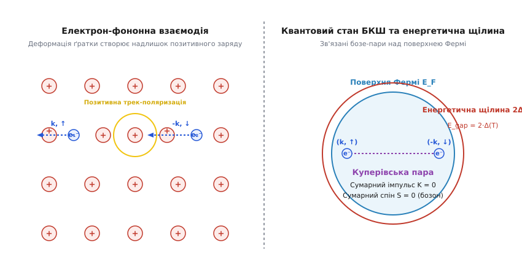
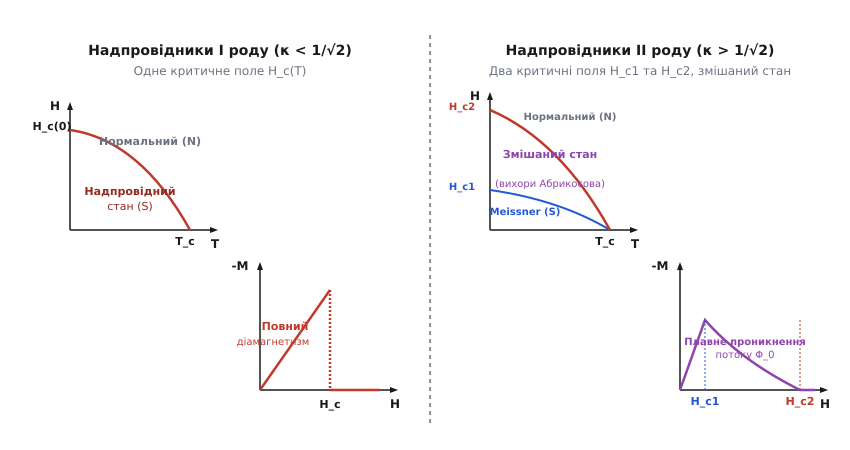
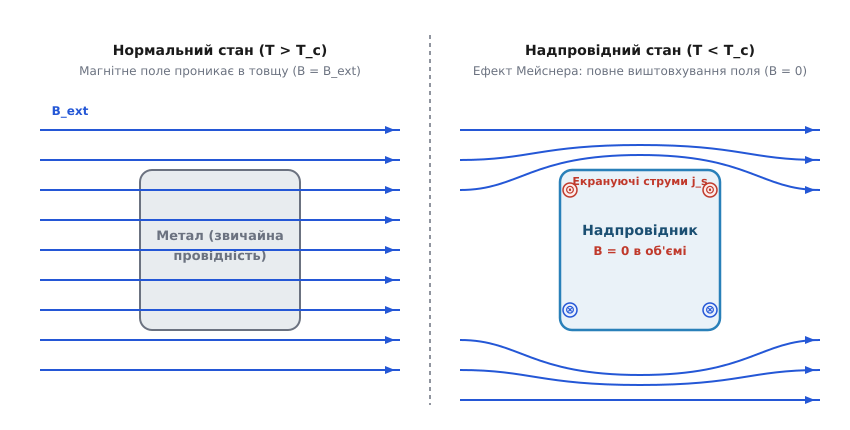
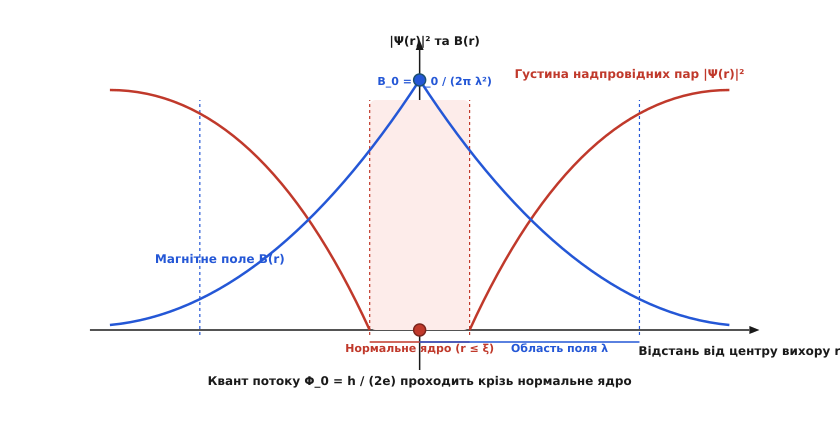

# Надпровідність

<preknowlist>
- [Провідність](root:ph-condensed/conductivity) — механізм розсіювання носіїв заряду на фононах та дефектах решітки.
- [Зонна теорія твердого тіла](root:ph-condensed/band-theory) — валентна зона, зона провідності, енергія Фермі та поверхня Фермі.
- [Опір і температура](root:ph-condensed/resistance-temperature) — залежність питомого опору металів від температури.
- [Феромагнетизм](root:ph-condensed/ferromagnetism) — магнітна проникність, вектори B та H, намагніченість речовини.
</preknowlist>

Охолодження звичайного металевого провідника зменшує амплітуду теплових коливань кристалічної ґратки, що приводить крізь розсіювання електронів до плавного зниження питомого опору. Однак навіть біля абсолютного нуля опір звичайного металу не стає нульовим: він виходить на залькове значення, зумовлене розсіюванням на домішках, вакансіях та межах зерен. У надпровідниках відбувається якісний стрибок: при досягненні критичної температури `T_c` електричний опір раптово падає до строгого нуля — вимірюваного значення менше `10⁻²³ Ом·м`. Електричний струм у замкненому надпровідному кільці здатний циркулювати без найменшого згасання десятки років без будь-якого зовнішнього джерела енергії.

Однак стрибок провідності є лише однією з двох невід'ємних граней явища. Якби надпровідник був лише ідеальним провідником з нескінченною провідністю (`σ → ∞`), то за законами класичної електродинаміки магнітне поле, присутнє всередині зразка до охолодження, замерзало б у ньому навалом. Натомість реальний надпровідник при перетині `T_c` повністю виштовхує зовнішнє магнітне поле зі свого об'єму, виявляючи властивості ідеального діамагнетика з магнітною сприйнятливістю `χ = -1`. Природа цього подвійного ефекту полягає в макроскопічній квантовій фазовій когерентності електронного конденсату.

Для детальнішого ознайомлення з хронологією наукових перегонів, зрідженням гелію та відкриттям високотемпературних купратів перегляньте [📜 Відкриття та еволюція теорій надпровідності](root:ph-condensed/superconductivity/hist-superconductivity-discovery.md).

## Феноменологія: Ефект Мейснера — Оксенфельда та термодинаміка фазового переходу

Розрізнення між гіпотетичним ідеальним провідником та реальним надпровідником є принциповим. У матеріалі з нескінченною провідністю, за рівнянням індукції Фарадея `∇ × E = - ∂ B / ∂ t` та законом Ома `E = j / σ`, електричне поле в об'ємі дорівнює нулю (`E = 0`), що дає `∂ B / ∂ t = 0`. Це означає, що кінцевий стан ідеального провідника в магнітному полі залежить від історії: якщо охолодити зразок у зовнішньому полі `B_ext`, то після переходу в стан `σ → ∞` поле залишиться всередині.


*Ефект Мейснера — Оксенфельда. У нормальному стані (ліворуч) магнітне поле вільно проникає в зразок. У надпровідному стані (праворуч) поверхневі струми повністю виштовхують внутрішнє магнітне поле (B = 0).*

У надпровіднику індукція `B` всередині масивного зразка завжди дорівнює нулю (`B = 0`), незалежно від того, чи було магнітне поле увімкнене до охолодження, чи після нього (режим охолодження в полі Field-Cooled проти охолодження в нульовому полі Zero-Field-Cooled). Це явище виштовхування поля називається ефектом Мейснера — Оксенфельда. 

Оскільки `B = μ_0 · (H + M) = 0`, намагніченість надпровідника `M` строго компенсує напруженість зовнішнього поля `H`:

```
M = - H
[ідеальний діамагнетизм: вектор намагніченості протилежний зовнішньому полю]
```

Виштовхування поля забезпечується незагасаючими поверхневими надструмами (струмами Мейснера `j_s`), які самоорганізуються у вузькому приповерхневому шарі й створюють внутрішнє індуковане поле `B_ind = - B_ext`.

### Термодинаміка та критичне магнітне поле

Залишаючись термодинамічно рівноважним станом, надпровідність може бути зруйнована не лише підвищенням температури, а й накладенням зовнішнього магнітного поля чи пропусканням струму великої густини. Мінімальне магнітне поле, яке руйнує надпровідний стан при даній температурі, називається критичним полем `H_c(T)`.

Температурна залежність критичного поля добре описується емпіричним співвідношенням:

```
H_c(T) = H_c(0) · [ 1 - (T / T_c)² ]
[параболічна залежність критичного поля від температури]
```

Функція відхилення експериментального критичного поля від простої параболи `D(t) = [H_c(t) / H_c(0)] - (1 - t²)`, де `t = T / T_c`, несе інформацію про мікроскопічну силу зв'язку: для слабкого зв'язку БКШ функція `D(t)` є від'ємною (мінімум близько `-0.04` при `t² ≈ 0.5`), а для матеріалів із сильним електрон-фононним зв'язком (свинець, ртуть) стає додатною (`+0.02 ... +0.05`).

З термодинамічної точки зору, стан речовини в зовнішньому магнітному полі описується термодинамічним потенціалом Гіббса `G(T, H) = F - μ_0 · ∫ M dH`. Зв'язок вільних енергій Гіббса визначається енергією конденсації надпровідного стану:

```
G_s(T, H) = G_s(T, 0) - μ_0 · ∫_0^H M dH' = G_s(T, 0) + (μ_0 / 2) · H²
[вільна енергія надпровідного стану в магнітному полі з урахуванням M = -H]
```

Для нормального немагнітного стану намагніченість практично дорівнює нулю (`M_n ≈ 0`), тому `G_n(T, H) ≈ G_n(T, 0) = G_n(T)`. На межі фазового переходу при `H = H_c(T)` вільні енергії двох фаз зрівнюються (`G_s(T, H_c) = G_n(T)`):

```
G_s(T, 0) + (μ_0 / 2) · H_c²(T) = G_n(T)
G_n(T) - G_s(T, 0) = (μ_0 / 2) · H_c²(T)
[енергія конденсації надпровідного стану на одиницю об'єму]
```

Енергія конденсації показує, на скільки надпровідний стан енергетично вигідніший за нормальний стан при нульовому магнітному полі.

Диференціюючи вільну енергію за температурою (`S = - (∂G / ∂T)_H`), знаходимо різницю питомих ентропій нормального `S_n` та надпровідного `S_s` станів:

```
S_n(T) - S_s(T) = - μ_0 · H_c(T) · (d H_c / d T)
[різниця ентропій двох фаз]
```

Оскільки критичне поле монотонно зменшується з ростом температури (`d H_c / d T < 0`), ентропія надпровідного стану завжди менша за ентропію нормального стану (`S_s < S_n`). Це означає, що перехід у надпровідний стан супроводжується спонтанним квантовим упорядкуванням електронної системи.

При `T = T_c` критичне поле перетворюється на нуль (`H_c(T_c) = 0`), тому різниця ентропій зникає: `S_s(T_c) = S_n(T_c)`. Відсутність стрибка ентропії означає, що фазовий перехід за відсутності магнітного поля (`H = 0`) є фазовим переходом другого роду і не супроводжується виділенням чи поглинанням прихованої теплоти (`Q = T · ΔS = 0`).

Якщо ж фазовий перехід здійснюється зміною магнітного поля при `T < T_c`, то при досягненні `H = H_c(T)` виникає ненульовий стрибок ентропії. Перехід стає фазовим переходом першого роду з поглинанням прихованої теплоти:

```
Q = T · (S_n - S_s) = - T · μ_0 · H_c(T) · (d H_c / d T) > 0
[прихована теплота фазового переходу в магнітному полі]
```

Цей ефект лежить в основі магнітокалоричного охолодження: якщо ізольований зразок адіабатично перевести з надпровідного стану в нормальний збільшенням магнітного поля, його температура знижується через поглинання тепла переходу.

Диференціювання ентропії за температурою (`C_v = T · (∂S / ∂T)`) дає зв'язок питомих теплоємностей двох фаз. При переході через `T_c` у нульовому полі виникає характерний стрибок теплоємності, який описується співвідношенням Рутгерса:

```
Δ C_v = C_s(T_c) - C_n(T_c) = T_c · μ_0 · (d H_c / d T)² |_(T=T_c)
[співвідношення Рутгерса для стрибка теплоємності]
```

Підставляючи похідну емпіричного параболічного закону `(d H_c / d T)|_(T_c) = - 2 · H_c(0) / T_c`, отримуємо безпосередній зв'язок стрибка теплоємності з параметрами критичного поля:

```
Δ C_v = 4 · μ_0 · H_c²(0) / T_c
[величина стрибка теплоємності за параболічною моделлю]
```

У нормальному металі електронна теплоємність при низьких температурах лінійно залежить від температури за законом Зоммерфельда `C_en(T) = γ · T`, де `γ = (π² / 3) · k_B² · N(E_F)` — коефіцієнт Зоммерфельда, пропорційний густині електронних станів на рівні Фермі `N(E_F)`. 

У надпровідному стані при низьких температурах `T << T_c` електронна теплоємність демонструє експоненційний спад:

```
C_es(T) = A · exp( - Δ(0) / (k_B · T) )
[експоненційне вимерзання електронної теплоємності]
```

Експоненційний характер теплоємності історично став першим вирішальним експериментальним доказом того, що в спектрі елементарних електронних збуджень надпровідника існує енергетична щілина `Δ`. За теорією БКШ, відносний стрибок електронної теплоємності при `T = T_c` дорівнює універсальній константі:

```
(C_es(T_c) - C_en(T_c)) / C_en(T_c) = 1.43
[універсальний безрозмірний стрибок електронної теплоємності БКШ]
```

### Баричний ефект та співвідношення Еренфеста

Критична температура надпровідника чутлива до зовнішнього всебічного гідростатичного або одновісного механічного тиску `P`. Оскільки фазовий перехід при `H = 0` є переходом другого роду, зміна критичної температури з тиском `d T_c / d P` описується термодинамічним співвідношенням Еренфеста:

```
d T_c / d P = V_m · T_c · ( Δ α_p / Δ C_p )
[співвідношення Еренфеста для баричного коефіцієнта критичної температури]
```

де `V_m` — молярний об'єм речовини, `Δ α_p = α_p,s - α_p,n` — стрибок коефіцієнта об'ємного теплового розширення при переході, а `Δ C_p` — стрибок молярної теплоємності при сталому тиску.

Для більшості простих металів (свинцю, олова, алюмінію, ртуті) баричний коефіцієнт є від'ємним (`d T_c / d P < 0`), оскільки стискання ґратки збільшує дебаївську частоту фононів, але водночас зменшує густину станів на рівні Фермі `N(0)`. Натомість для шаруватих купратів, пніктидів та гідридів тиск суттєво деформує міжатомні зв'язки вздовж проводячих площин, зміщуючи рівень Фермі та збільшуючи електрон-фононний або спін-флуктуаційний зв'язок, що приводить до колосального зростання `T_c` (наприклад, у `La_3Ni_2O_7` від відсутності надпровідності при нормальному тиску до `80 K` при `14 ГПа`).

### Парамагнітна межа Паулі (межа Клогстона — Чандрасекара)

Термодинамічне поле `H_c` або верхнє критичне поле `H_c2` визначаються енергетичним виграшем від орбітального екранування струмів. Проте магнітне поле взаємодіє не лише з орбітальним рухом електронів, а й з їхніми магнітними спіновими моментами (зеєманівське розщеплення `g · μ_B · H`).

У синглетному надпровіднику куперівська пара складається з двох електронів з протилежними спінами (`↑` та `↓`), тому її сумарний магнітний момент дорівнює нулю (`μ_pair = 0`). Парамагнітна сприйнятливість синглетного конденсату при `T → 0` дорівнює нулю (`χ_s = 0`). 

У нормальному стані метал має кінцеву парамагнітну сприйнятливість Паулі `χ_P = μ_B² · N(E_F)`. Зовнішнє магнітне поле знижує вільну енергію нормального металу на величину зеєманівського поляризаційного виграшу `- (1/2) · χ_P · H²`. Коли цей виграш перевищує енергію конденсації надпровідника `(1/2) · N(E_F) · Δ²(0)`, синглетний надпровідний стан стає термодинамічно невигідним і руйнується переворотом одного зі спінів пари.

Критичне магнітне поле, при якому настає цей розрив, називається **парамагнітною межею Паулі (межею Клогстона — Чандрасекара)**:

```
B_P(0) = Δ(0) / ( √2 · μ_B ) ≈ 1.84 · T_c    [Тесла / Кельвін]
[парамагнітна межа Паулі для синглетних БКШ надпровідників]
```

Для багатьох матеріалів (купрати, важкі ферміони, халькогеніди заліза) експериментальне верхнє критичне поле `B_c2(0)` значно перевищує парамагнітну межу `B_P`. Це є прямим свідченням або сильного спін-орбітального розсіювання, або несинглетного (триплетного) парування електронів, або переходу в неоднорідну фазу FFLO.

### Неоднорідний стан Фульде — Феррелла — Ларкіна — Овчинникова (FFLO)

У 1964 році Пітер Фульде, Річард Феррелл, Анатолій Ларкін та Юрій Овчинников теоретично передбачили, що в чистих надпровідниках у сильних магнітних полях поблизу межі Паулі (`B ≈ B_P`) надпровідний конденсат не руйнується повністю, а перебудовується у новий просторово-модульований квантовий стан — **стан FFLO**.

Через зеєманівське розщеплення поверхні Фермі для електронів зі спіном угору та вниз мають різні радіуси: `k_F↑ ≠ k_F↓`. Створення куперівських пар з протилежними імпульсами `(k, -k)` стає неможливим без затрати енергії. Натомість парі енергетично вигідно утворитися зі скінченним сумарним імпульсом центру мас:

```
q = k_F↑ - k_F↓ ≈ 2 · μ_B · B / ( ℏ · v_F )
[ненульовий хвильовий вектор пари у стані FFLO]
```

Це приводить до просторової модуляції макроскопічного параметра порядку:
- У варіанті Фульде — Феррелла: `Ψ(r) = Ψ_0 · exp(i · q · r)` (модуляція квантової фази з виникненням спонтанного надструму);
- У варіанті Ларкіна — Овчинникова: `Ψ(r) = Ψ_0 · cos(q · r)` (амплітудна стояча хвиля з періодичною системою площин, де параметр порядку обертається в нуль і де накопичуються неспарені нормальні електрони).

Фаза FFLO експериментально спостерігається у шаруватих органічних надпровідниках та важкоферміонних системах (наприклад, `CeCoIn_5`).

### Проміжний стан у надпровідниках I роду

Якщо надпровідник помістити у зовнішнє магнітне поле, розподіл поля біля його поверхні залежить від форми тіла через коефіцієнт розмагнічування `N`. Для поперечно намагніченого циліндра `N = 1/2`, для кулі `N = 1/3`, а для тонкої пластини, перпендикулярної до поля, `N → 1`.

Через викривлення силових ліній на екваторі надпровідної кулі напруженість поля зростає:

```
H_eq = H_ext / (1 - N) = (3 / 2) · H_ext
[магнітне поле на екваторі кулі]
```

Коли зовнішнє поле досягає значення `H_ext = (1 - N) · H_c` (для кулі `(2/3) · H_c`), на екваторі поле зрівнюється з критичним `H_c`. Зразок не може повністю перейти в нормальний стан (оскільки середнє поле менше за `H_c`) і водночас не може залишатися повністю надпровідним (оскільки на екваторі поле перевищує `H_c`).

У результаті виникає **проміжний стан Ландау**: надпровідник розпадається на макроскопічні домени — систему паралельних надпровідних та нормальних ламелей або ниток. У нормальних шарах напруженість поля підтримується рівною строго `H_c`, а в надпровідних шарах поле дорівнює нулю (`B = 0`). Товщина доменів визначається мінімізацією суми об'ємної магнітної енергії та додатної поверхневої енергії межі фаз `σ_ns`.

### Руйнування надпровідності в тонких плівках

У тонких надпровідних плівках товщиною `d << λ_L` зовнішнє магнітне поле, паралельне поверхні плівки, не виштовхується повністю, а майже безперешкодно пронизує об'єм. Внаслідок цього кінетична енергія екрануючих струмів є малою, і паралельне критичне поле тонкої плівки `H_c,film` суттєво перевищує критичне поле масивного зразка `H_c`:

```
H_c,film = H_c · √24 · (λ_L / d) >> H_c
[критичне поле тонкої надпровідної плівки]
```

Цей ефект дозволяє використовувати тонкоплівкові надпровідники у сильних паралельних магнітних полях, значно перевершуючи термодинамічну межу масивного матеріалу.

## Феноменологічна теорія Лондонів

Для пояснення відсутності опору та виштовхування магнітного поля німецькі фізики Фріц та Хайнц Лондон у 1935 році запропонували феноменологічне розширення електродинаміки Максвелла.

Замість стандартного закону Ома `j = σ · E`, брати Лондон сформулювали два фундаментальні рівняння для густини надструму `j_s`:

Перше рівняння Лондонів пов'язує часову похідну струму з електричним полем:

```
d j_s / d t = (n_s · e² / m) · E
[перше рівняння Лондонів: бездисипативне прискорення носіїв]
```

Друге рівняння Лондонів пов'язує просторові зміни надструму з магнітною індукцією:

```
∇ × j_s = - (n_s · e² / m) · B
[друге рівняння Лондонів: геометрія виштовхування поля]
```

де `n_s` — об'ємна густина надпровідних електронів, `e` — заряд електрона, `m` — ефективна маса.

Ввівши фундаментальний масштаб довжини — лондонівську глибину проникнення `λ_L`:

```
λ_L = √( m / (μ_0 · n_s · e²) )
[лондонівська глибина проникнення магнітного поля]
```

перше і друге рівняння записуються у компактній векторній формі:

```
E = μ_0 · λ_L² · (d j_s / d t)
B = - μ_0 · λ_L² · (∇ × j_s)
[рівняння Лондонів у термінах глибини проникнення λ_L]
```

Підстановка другого рівняння Лондонів у квазістаціонарне рівняння Максвелла `∇ × B = μ_0 · j_s` приводить до гельмогольцівського рівняння екранування:

```
∇² B = B / λ_L²
∇² j_s = j_s / λ_L²
[диференціальні рівняння екранування магнітного поля та надструму]
```

Для плоскої межі надпровідника (`x ≥ 0`) розв'язок показує експоненційне згасання поля вглиб матеріалу:

```
B(x) = B_ext · exp(-x / λ_L)
j_s(x) = (B_ext / (μ_0 · λ_L)) · exp(-x / λ_L)
[експоненційний розподіл поля та струму вглиб надпровідника]
```

Для типових чистих металевих надпровідників глибина проникнення при `T → 0` становить `λ_L ≈ 30–100 нм`. Магнітне поле не обривається миттєво на анатомічній поверхні, а плавно згасає у приповерхневому шарі товщиною `λ_L`, де й циркулюють мейснерівські струми.

У калібруванні Лондонів (кулонівське калібрування `∇ · A = 0` з нульовою нормальною складовою на поверхні `A_n = 0`) друге рівняння Лондонів записується як локальний зв'язок між надструмом та векторним потенціалом `A`:

```
j_s = - (1 / (μ_0 · λ_L²)) · A = - (n_s · e² / m) · A
[калібрувально-інваріантний зв'язок надструму та векторного потенціалу]
```

### Ефект Літтла — Паркса в тонкостінних циліндрах

Квантовомеханічна фазова когерентність макроскопічного конденсату проявляється в **ефекті Літтла — Паркса (1962 рік)**. 

Якщо виготовити тонкостінний надпровідний циліндр радіуса `R` та товщиною `d << λ_L` і помістити його в паралельне магнітне поле `B`, то квантування флюксоїда вимагає, щоб при зміні магнітного потоку `Φ = π · R² · B` у стінках циліндра виникав екрануючий циркулюючий надструм зі швидкістю `v_s(Φ) = (ℏ / (m · R)) · [ n - (Φ / Φ_0) ]`, де `n` — ціле число квантів потоку, найближче до значення `Φ / Φ_0`.

Кінетична енергія цього надструму зменшує енергію конденсації, викликаючи періодичні осциляції критичної температури переходу `T_c` як функції зовнішнього магнітного потоку:

```
Δ T_c(Φ) = - ( (m · v_s²(Φ)) / (4 · k_B) ) ∝ - [ n - (Φ / Φ_0) ]²
[періодичні осциляції критичної температури в ефекті Літтла — Паркса]
```

Період осциляцій `T_c` точно дорівнює елементарному кванту магнітного потоку `Φ_0 = h / (2e)`, що стало незаперечним експериментальним доказом парування електронів з подвійним елементарним зарядом `q* = 2e`.

### Правило Сілсбі та розподіл струму в круглому провіднику

Якщо по циліндричному надпровідному дроту радіуса `R` пропустити постійний струм `I`, надструм зосереджується у тонкому приповерхневому шарі товщиною `λ_L`. Розподіл густини струму описується функціями Бесселя першого роду уявного аргументу:

```
j_z(r) = j_surf · [ I_0(r / λ_L) / I_0(R / λ_L) ]
[радіальний розподіл густини струму у круглому дроті]
```

Згідно з правилом Сілсбі (Silsbee's rule), надпровідність у дроті руйнується тоді, коли сумарне магнітне поле на його зовнішній поверхні, створене власним струмом, досягає критичного значення `H_c`. Звідси критичний струм круглого дроту радіуса `R >> λ_L` дорівнює:

```
I_c = 2π · R · H_c
[критичний струм за правилом Сілсбі]
```

### Кінетична індуктивність надпровідних смужок

Оскільки носії надструму мають скінченну масу `m`, вони мають кінетичну енергію впорядкованого руху `E_k = ∫ (1/2) · n_s · m · v_s² dV`. Кінетична енергія може бути переписана через індуктивність `(1/2) · L_k · I²`.

Для тонкої надпровідної смужки товщиною `d << λ_L`, шириною `w` та довжиною `l` кінетична індуктивність дорівнює:

```
L_k = μ_0 · λ_L² · (l / (w · d)) = (m / (n_s · e²)) · (l / (w · d))
[кінетична індуктивність тонкої плівки]
```

На відміну від геометричної індуктивності магнітного поля, кінетична індуктивність визначається безпосередньо інерцією електронів і залежить від концентрації надпровідних носіїв `n_s(T)`. 

### Дворідинна модель Гортера — Казимира

Зі зростанням температури тепловий рух переводить частину надпровідних електронів у нормальний стан. У феноменологічній дворідинній моделі Гортера — Казимира загальна густина електронів провідності `n` розглядається як сума надпровідної фракції `n_s(T)` та нормальної фракції `n_n(T)`:

```
n = n_s(T) + n_n(T)
[баланс двох компонент електронної рідини]
```

Температурна залежність надпровідної компоненти підкоряється закону четвертого степеня:

```
n_s(T) = n_s(0) · [ 1 - (T / T_c)⁴ ]
[температурна залежність концентрації надпровідних носіїв]
```

Підставляючи це значення у вираз для `λ_L`, отримуємо залежність глибини проникнення від температури:

```
λ_L(T) = λ_L(0) / √( 1 - (T / T_c)⁴ )
[температурне розширення лондонівського шару]
```

При наближенні до критичної температури (`T → T_c`) надпровідна густина зникає (`n_s → 0`), внаслідок чого глибина екранування прямує до нескінченності (`λ_L(T) → ∞`), і магнітне поле повністю пронизує весь об'єм провідника.

### Нелокальне узагальнення Піппарда

Теорія Лондонів є строго локальною: густина надструму `j_s(r)` у точці `r` визначається значенням векторного потенціалу `A(r)` у тій самій точці. У 1953 році Браян Піппард експериментально встановив, що для чистих металів (свинцю, олова, алюмінію) лондонівська глибина проникнення виявляється більшою за теоретичне значення, а додавання мізерних концентрацій домішок суттєво збільшує `λ`.

Піппард пояснив це тим, що хвильова функція надпровідних носіїв має скінченний просторовий розмір — довжину когерентності `ξ_0 ≈ 100–1000 нм`. Якщо довжина когерентності перевищує лондонівську глибину (`ξ_0 > λ_L`), електрон відчуває дію векторного потенціалу не в одній точці, а інтегрально по всій області розміром `ξ_0`.

Піппард сформулював нелокальне інтегральне рівняння:

```
j_s(r) = - (3 / (4π · ξ_0 · μ_0 · λ_L²)) · ∫ [ R · (R · A(r')) / R⁴ ] · exp(-R / ξ) dV'
[нелокальний зв'язок струму і поля за Піппардом; R = r - r']
```

де ефективна довжина когерентності `ξ` враховує довжину вільного пробігу електронів `l` при розсіюванні на домішках:

```
1 / ξ = 1 / ξ_0 + 1 / (α · l)
[вплив довжини вільного пробігу на розмір області когерентності]
```

У «брудній» границі (`l << ξ_0`) нелокальне співвідношення знову вироджується у локальне, але з перенормованою ефективною глибиною проникнення:

```
λ_eff = λ_L · √( ξ_0 / l ) >> λ_L
[глибина проникнення у брудному надпровіднику]
```

Детальні математичні кроки виведення рівнянь Лондонів, їхній одновимірний розв'язок, дворідинну модель Гортера — Казимира та нелокальне рівняння Піппарда наведено у [🧮 Математичне виведення рівнянь Лондонів та квантування магнітного потоку](root:ph-condensed/superconductivity/math-london-equations.md).

## Теорія Гінзбурга — Ландау: Комплексний параметр порядку

Феноменологічна теорія Лондонів була лінійною і не враховувала квантовомеханічну природу змінення густини надпровідних електронів `n_s` у просторі та сильних полях. У 1950 році Віталій Гінзбург та Лев Ландау розробили напівмікроскопічну теорію, засновану на загальній теорії фазових переходів Ландау.

У теорії Гінзбурга — Ландау (ГЛ) стан надпровідних носіїв описується комплексним параметром порядку `Ψ(r)`:

```
Ψ(r) = |Ψ(r)| · exp(i · φ(r))
[комплексний параметр порядку Гінзбурга — Ландау]
```

Квадрат модуля параметра порядку дорівнює густині надпровідних пар: `|Ψ(r)|² = n_s(r) / 2`, а `φ(r)` являє собою макроскопічну квантову фазу.

Поблизу критичної температури `T_c` густина вільної енергії надпровідника `f_s` розкладається в ряд за ступенями `|Ψ|²` та його градієнта:

```
f_s = f_n + α(T) · |Ψ|² + (β / 2) · |Ψ|⁴ + (1 / (2·m*)) · |(-i·ℏ·∇ - q*·A) Ψ|² + B² / (2·μ_0)
[розклад густини вільної енергії в теорії Гінзбурга — Ландау]
```

де `α(T) = α_0 · (T - T_c)` змінює знак при `T = T_c`, `β > 0` — константа самовзаємодії, `q* = 2e` та `m* = 2m` — ефективний заряд і маса куперівської пари, `A` — векторний потенціал.

За відсутності магнітного поля та градієнтів вільна енергія мінімізується при рівноважному значенні модуля параметра порядку `|Ψ_0|²`:

```
|Ψ_0|² = - α(T) / β = (α_0 / β) · (T_c - T)
[рівноважна густина надпровідного конденсату нижче T_c]
```

Підставляючи `|Ψ_0|²` назад у розклад енергії, знаходимо енергію конденсації:

```
f_n - f_s = α²(T) / (2·β) = (μ_0 / 2) · H_c²(T)
[зв'язок коефіцієнтів теорії ГЛ з термодинамічним критичним полем]
```

Звідси випливає термодинамічне критичне поле:

```
H_c(T) = |α(T)| / √( μ_0 · β ) = (α_0 / √(μ_0 · β)) · (T_c - T)
[лінійний спад критичного поля поблизу T_c]
```

Варіювання функціонала повної вільної енергії `F = ∫ f_s dV` за спряженою функцією `Ψ*` та векторним потенціалом `A` приводить до фундаментальної системи рівнянь Гінзбурга — Ландау:

Перше рівняння Гінзбурга — Ландау (нелінійне рівняння типу Шредінгера для амплітуди конденсату):

```
α · Ψ + β · |Ψ|² · Ψ + (1 / (2·m*)) · (-i·ℏ·∇ - q*·A)² Ψ = 0
[перше рівняння Гінзбурга — Ландау для параметра порядку]
```

Друге рівняння Гінзбурга — Ландау (квантовомеханічний вираз для густини надструму):

```
j_s = (q*·ℏ / (2·m*·i)) · [ Ψ* · ∇Ψ - Ψ · ∇Ψ* ] - (q*² / m*) · |Ψ|² · A
[друге рівняння Гінзбурга — Ландау для густини струму]
```

При підстановці `Ψ(r) = |Ψ(r)| · exp(i · φ(r))` друге рівняння набуває наочного гідродинамічного вигляду:

```
j_s = (q* / m*) · |Ψ|² · ( ℏ · ∇φ - q* · A ) = q* · |Ψ|² · v_s
[струм як добуток густини заряду на швидкість надпровідного конденсату]
```

### Граничні умови та поверхнева надпровідність (`H_c3`)

Для розв'язання рівнянь Гінзбурга — Ландау необхідні граничні умови на поверхні надпровідника з вектором нормалі `n`:
- На межі з вакуумом або ідеальним діелектриком струм через поверхню дорівнює нулю:

```
n · (-i·ℏ·∇ - q*·A) Ψ = 0
[гранична умова Гінзбурга — Ландау на межі з діелектриком]
```

- На межі з нормальним металом хвильова функція зазнає пригнічення внаслідок тунелювання куперівських пар у метал (ефект близькості де Женна):

```
n · (-i·ℏ·∇ - q*·A) Ψ = (i·ℏ / b) · Ψ
[гранична умова де Женна; b — довжина екстраполяції]
```

Аналіз граничної задачі, виконаний Сен-Жеймсом та де Женном (1963 рік), привів до відкриття **поверхневої надпровідності**. Коли зовнішнє магнітне поле перевищує верхнє критичне поле `H_c2`, об'ємна надпровідність повністю зникає, проте у тонкому приповерхневому шарі товщиною порядку `ξ(T)` вздовж поверхні, паралельної полю, зароджується стійкий надпровідний шар аж до **третього критичного поля `H_c3`**:

```
H_c3 = 1.695 · H_c2 = 1.695 · √2 · κ · H_c ≈ 2.40 · κ · H_c
[третє критичне поле поверхневої надпровідності Сен-Жеймса — де Женна]
```

### Граничний струм депарування

Максимальна густина струму, яку може підтримувати надпровідник у тонкому каналі (наприклад, у нанодроті чи тонкій плівці поперечним перерізом менше `ξ` та `λ`), визначається межею депарування (розриву куперівських пар кінетичною енергією). 

Якщо конденсат рухається зі швидкістю `v_s`, параметр порядку однорідно зменшується відповідно до першого рівняння ГЛ: `|Ψ|² = |Ψ_0|² · [ 1 - (m* · v_s² / (2 · |α|)) ]`. Густина струму `j_s = q* · |Ψ|² · v_s` досягає максимуму при швидкості `v_s = √( 2·|α| / (3·m*) )`:

```
j_dep = (2 / (3 · √3)) · (q* · ℏ / m*) · (|Ψ_0|² / ξ) = (2 / (3 · √3)) · (H_c / (μ_0 · λ))
[теоретична межа струму депарування БКШ — Гінзбурга — Ландау]
```

При перевищенні `j_dep` надпровідний стан стає термодинамічно нестійким і руйнується кінетичною енергією надструму.

### Дві характерні довжини та параметр Гінзбурга — Ландау `κ`

Теорія Гінзбурга — Ландау вводить дві фундаментальні просторові шкали:

1. **Глибина проникнення магнітного поля `λ(T)`:** масштаб екранування магнітної індукції:

```
λ(T) = √( m* / (μ_0 · q*² · |Ψ_0|²) ) = √( m* · β / (μ_0 · q*² · |α(T)|) ) ∝ (1 - T / T_c)^(-1/2)
[температурна залежність глибини проникнення за ГЛ]
```

2. **Довжина кореляції (когерентності) Гінзбурга — Ландау `ξ(T)`:** характерна відстань, на якій параметр порядку `Ψ(r)` відновлюється до рівноважного об'ємного значення:

```
ξ(T) = ℏ / √( 2 · m* · |α(T)| ) ∝ (1 - T / T_c)^(-1/2)
[температурна залежність довжини когерентності за ГЛ]
```

Обидві довжини розбігаються при `T → T_c` за однаковим кореневим законом `(T_c - T)^(-1/2)`. Безрозмірне відношення цих двох довжин називається **параметром Гінзбурга — Ландау `κ`**:

```
κ = λ(T) / ξ(T) = (m* / (q* · ℏ)) · √( β / μ_0 )
[параметр Гінзбурга — Ландау]
```

Оскільки температурні множники скорочуються, параметр `κ` для даного матеріалу практично не залежить від температури поблизу `T_c` і є фундаментальною характеристикою речовини.

## Надпровідники I та II роду та вихори Абрикосова

Взаємодія між нормальними та надпровідними областями на плоскій межі розділу фаз супроводжується специфічною поверхневою енергією `σ_ns`. Фізично ця енергія складається з двох конкуруючих внесків:
- **Втрата енергії конденсації:** на відстані порядка `ξ` параметр порядку падає від `Ψ_0` до нуля. Це збільшує вільну енергію системи на величину `+ (μ_0 / 2) · H_c² · ξ`.
- **Виграш магнітної енергії:** магнітне поле проникає вглиб надпровідного шару на відстань `λ`, зменшуючи затрати на екранування на величину `- (μ_0 / 2) · H_c² · λ`.

Інтегрування різниці вільних енергій дає аналітичну оцінку поверхневої густини енергії фазової межі:

```
σ_ns ≈ (μ_0 / 2) · H_c² · ( ξ - λ )
[наближена оцінка поверхневої енергії межі нормальної та надпровідної фаз]
```

Точний математичний розрахунок із чисельним розв'язанням системи рівнянь Гінзбурга — Ландау показав, що знак поверхневої енергії визначається пороговим значенням параметра `κ`:

```
σ_ns > 0   при   κ < 1 / √2 ≈ 0.707  (Надпровідники I роду)
σ_ns < 0   при   κ > 1 / √2 ≈ 0.707  (Надпровідники II роду)
[критерій поділу надпровідників за знаком поверхневої енергії]
```


*Порівняння надпровідників I та II роду. Надпровідники I роду (ліворуч) розпадаються стрибком при H_c. Надпровідники II роду (праворуч) переходять у змішаний стан між H_c1 та H_c2.*

### Надпровідники I роду (`κ < 0.707`)

До цього класу належить більшість чистих металів (алюміній, свинець, олово, ртуть, цинк, кадмій). Оскільки поверхнева енергія `σ_ns` додатна, утворення внутрішніх меж розділу фаз є енергетично невигідним. 

При збільшенні зовнішнього магнітного поля надпровідник I роду підтримує повний діамагнетизм (`B = 0`) аж до досягнення термодинамічного критичного поля `H_c`. У точці `H = H_c` надпровідність стрибком руйнується по всьому об'єму матеріалу. Значення `H_c` для надпровідників I роду невеликі (зазвичай менше `0.1 Тл`, для свинцю `0.08 Тл`), що унеможливлює їхнє використання для створення потужних магнітних котушок.

### Надпровідники II роду (`κ > 0.707`)

До цього класу належать перехідні метали з малою довжиною вільного пробігу (ніобій, ванадій), металеві сплави (`NbTi`, `Nb_3Sn`, `Nb_3Al`, `Nb_3Ge`), диборид магнію `MgB_2`, керамічні купрати, залізовмісні пніктиди та гідриди. Оскільки поверхнева енергія `σ_ns` є від'ємною, системі вигідно максимізувати площу поверхні розділу фаз.

Надпровідники II роду характеризуються двома критичними полями:

1. **Нижнє критичне поле `H_c1`:** поле, при якому в об'єм енергетично вигідно впустити перший квантований вихор:

```
H_c1 = (Φ_0 / (4π · μ_0 · λ²)) · ln(λ / ξ) = (H_c / (√2 · κ)) · ln(κ)
[нижнє критичне магнітне поле]
```

2. **Верхнє критичне поле `H_c2`:** поле, при якому нормальні ядра вихорів починають щільно перекриватися (`ξ`), руйнуючи об'ємну надпровідність:

```
H_c2 = Φ_0 / (2π · μ_0 · ξ²) = √2 · κ · H_c
[верхнє критичне магнітне поле]
```

Термодинамічне поле `H_c` є середнім геометричним між двома полями: `H_c ≈ √( H_c1 · H_c2 / ln κ )`.

У діапазоні полів `H_c1 < H < H_c2` надпровідник перебуває у **змішаному стані (стані Шубникова — Абрикосова)**.

### Структура вихору Абрикосова та спектр Каролі — де Женна — Матрікона

У 1957 році Олексій Абрикосов розв'язав рівняння Гінзбурга — Ландау для області `κ > 1/√2` і довів, що у змішаному стані магнітне поле пронизує надпровідник у вигляді регулярного масиву квантованих ниток — **вихорів Абрикосова**.


*Структура окремого квантованого вихору Абрикосова. Нормальне ядро радіуса ξ оточене коловими надструмами, які екранують квант потоку Φ_0 на відстані λ.*

Кожен вихор Абрикосова складається з двох областей:
- **Нормальне ядро:** циліндрична область радіуса близько `ξ(T)`, всередині якої параметр порядку спадає до нуля за законом `|Ψ(r)| = Ψ_0 · (r / √(r² + 2ξ²))`. У 1964 році Каролі, де Женн та Матрікон довели, що всередині ядра вихору існують дискретні квантові рівні зв'язаних квазічастинок (рівні КДЖМ) з надмалим розщепленням:

```
E_μ = μ · ( Δ² / E_F )       (де μ = ± 1/2, ± 3/2, ± 5/2, ...)
[дискретний спектр зв'язаних станів всередині ядра вихору Абрикосова]
```

- **Область колових екрануючих надструмів:** простягається на відстань лондонівської глибини `λ(T)`. Розподіл магнітного поля навколо осі вихору описується модифікованою функцією Бесселя нульового порядку другого роду `K_0`:

```
B(r) = (Φ_0 / (2π · λ²)) · K_0(r / λ)
[радіальний розподіл магнітної індукції окремого вихору]
```

При малих відстанях (`ξ << r << λ`) поле спадає логарифмічно `B(r) ≈ (Φ_0 / (2π · λ²)) · ln(λ / r)`, а на великих відстанях (`r >> λ`) згасає експоненційно `B(r) ∝ exp(-r / λ) / √r`.

Кожен вихор несе рівно один елементарний квант магнітного потоку `Φ_0`:

```
Φ_0 = h / (2e) ≈ 2.067833848 × 10⁻¹⁵ Вб (Тл · м²)
[квант магнітного потоку]
```

Сила відштовхування між двома паралельними вихорами на відстані `r` дорівнює:

```
f_int(r) = (Φ_0² / (2π · μ_0 · λ³)) · K_1(r / λ)
[сила взаємного відштовхування двох вихорів Абрикосова]
```

Під дією сил взаємного відштовхування вихори утворюють трикутну решітку Абрикосова. Період решітки `a` пов'язаний із середньою магнітною індукцією `B`:

```
a = √( 2 · Φ_0 / (√3 · B) ) ≈ 1.075 · √( Φ_0 / B )
[період трикутної вихорної решітки Абрикосова]
```

### Динаміка вихорної матерії, пінінг та модель критичного стану Біна

Коли через надпровідник у змішаному стані протікає транспортний струм густиною `j`, на кожен вихор діє об'ємна сила Лоренца на одиницю довжини:

```
f_L = j × Φ_0
[сила Лоренца на одиницю довжини вихору]
```

Якщо кристал ідеальний і не містить структурних дефектів, сила Лоренца змушує вихори рухатися в поперечному напрямку зі швидкістю `v_v`. Рух вихорів супроводжується рухом нормальних ядер крізь електронний газ, що створює дисипативне в'язке тертя Бардіна — Стефена `f_visc = - η · v_v`, де коефіцієнт в'язкості дорівнює `η = Φ_0 · B_c2 / (ρ_n)`.

За законом Фарадея, рух магнітних вихорів зі швидкістю `v_v` індукує макроскопічне електричне поле:

```
E = B × v_v = (ρ_n · B / B_c2) · j
[генерація електричного поля при русі вихорів]
```

Це явище називається **резистивною течією потоку (Flux Flow)**. У матеріалі виникає диференціальний питомий опір `ρ_ff = ρ_n · (B / B_c2)`. Отже, ідеально чистий надпровідник II роду у змішаному стані втрачає нульовий опір при будь-якому ненульовому струмі.

Щоб запобігти руху вихорів і зберегти нульовий опір, у матеріал штучно вводять мікроскопічні дефекти (центри пінінгу): виділення другої фази (наприклад, частинки α-титану в сплаві `Nb-Ti`), межі зерен (в `Nb_3Sn`), радіаційні нанодефекти, штучні колоноподібні пори або наноінклюзії `Y_2BaCuO_5` (фаза 211 в YBCO). 

Якщо нормальне ядро вихору сідає на ненадпровідний дефект розміром порядка `ξ`, система виграє енергію конденсації `(μ_0 / 2) · H_c² · (π · ξ² · L)`. Виникає сила закріплення — **сила пінінгу `f_p`**. Вихори залишаються нерухомими, доки сила Лоренца не перевищить силу пінінгу:

```
| j × Φ_0 | ≤ f_p
[умова утримання вихорів на центрах пінінгу]
```

Максимальна густина струму, за якої вихори ще утримуються пінінгом, називається **критичною густиною струму `j_c`**:

```
j_c = f_p / Φ_0
[визначення критичної густини струму через силу пінінгу]
```

Розподіл магнітного поля та струму всередині технічного надпровідника описується **моделлю критичного стану Біна (Bean's Critical State Model)**. За моделлю Біна, у кожній області, куди проникло магнітне поле, густина струму приймає граничне значення `j = ± j_c`. 

З рівняння Максвелла `∇ × B = μ_0 · j` для одновимірної пластини отримуємо сталий градієнт магнітної індукції:

```
d B / d x = ± μ_0 · j_c
[градієнт магнітного поля у моделі Біна]
```

Модель Біна пояснює походження широких петель магнітного гістерезису `M(H)` у надпровідниках II роду. Різниця намагніченостей при прямому та зворотному ході поля `ΔM = M^+ - M^-` дозволяє розрахувати експериментальне значення `j_c` зразка прямокутної форми перерізом `a × b` (`a < b`):

```
j_c = 20 · ΔM / [ a · ( 1 - a / (3·b) ) ]
[формула Біна для розрахунку критичного струму за петлею гістерезису]
```

### Пружні властивості та пік-ефект вихорної решітки

Решітка вихорів Абрикосова характеризується трьома пружними модулями Лабуша:
- `C_11` — модуль об'ємного стиску (пружність при зміні густини вихорів);
- `C_44` — модуль поздовжнього нахилу (пружність ниток на вигин);
- `C_66` — модуль поперечного зсуву (пружність на деформацію зсуву шарів решітки).

Поруч із верхнім критичним полем `H_c2` модуль зсуву спадає до нуля швидше, ніж сила пінінгу: `C_66 ∝ (1 - B / B_c2)²`. Решітка вихорів розм'якшується і стає надзвичайно піддатливою, завдяки чому вихори отримують здатність локально деформуватися і щільно сідати на кожен центр пінінгу. Це викликає аномальний сплеск критичного струму безпосередньо перед руйнуванням надпровідності — **пік-ефект (Peak Effect)**.

### Фазові стани вихорної матерії

Залежно від температури, магнітного поля та сили пінінгу, ансамбль вихорів Абрикосова демонструє складну фазову поведінку:
- **Решітка Брегга (Bragg Glass):** пружно деформована трикутна решітка вихорів при слабкому безладі та низьких температурах.
- **Вихорне скло (Vortex Glass):** топологічно невпорядкований заморожений стан вихорів при сильному пінінгу; характеризується строго нульовим лінійним опором.
- **Термічна повзучість потоку (Flux Creep, закон Андерсона — Кіма):** при `T > 0` теплові флуктуації допомагають вихорам долати потенціальні бар'єри пінінгу `U_0`, спричиняючи повільну релаксацію захопленого магнітного потоку:

```
v_v = v_0 · exp( - (U_0 - j · Φ_0 · L · X) / (k_B · T) )
[термічно активована швидкість дрейфу вихорів]
```

- **Вихорна рідина (Vortex Liquid):** лінія плавлення вихорної решітки `T_m(B)`. При високих температурах у високотемпературних купратах вихори плавляться у рідину, що призводить до виникнення скінченного опору задовго до досягнення верхнього поля `H_c2`.

## Мікроскопічна теорія Бардіна — Купера — Шріффера (БКШ)

Попри феноменологічні успіхи теорій Лондонів та Гінзбурга — Ландау, мікроскопічна природа притягання між однаково зарядженими електронами у металі залишалася загадкою майже пів століття. Прорив стався у 1956–1957 роках завдяки роботам Леона Купера, Джона Бардіна та Роберта Шріффера.

### Електрон-фононний механізм та куперівське парування

Кулонівське відштовхування між двома вільними електронами у вакуумі описується потенціалом `V_C(r) = e² / (4πε_0 r) > 0`. Однак у кристалічному металі електрон рухається крізь ґратку позитивних іонів.

Рухаючись зі швидкістю Фермі `v_F ≈ 10⁶ м/с`, електрон кулонівськи притягує оточуючі позитивні іони. Оскільки маса іона у `10⁴–10⁵` разів перевищує масу електрона, іони зміщуються повільно з характерною дебаївською частотою `ω_D ≈ 10¹³ рад/с`.


*Мікроскопічний механізм теорії БКШ. Електрон створює трек позитивної поляризації ґратки, що притягує другий електрон з протилежним імпульсом та спіном, формуючи енергетичну щілину Δ.*

Електрон пролітає повз іони за час `τ_el ≈ a / v_F ≈ 10⁻¹⁵ с`, тоді як деформована іонна ґратка повертається у рівноважний стан за час `τ_lat ≈ 2π / ω_D ≈ 10⁻¹³ с`. За першим електроном утворюється просторовий слід із надлишковою густиною позитивного заряду довжиною `L ≈ v_F · τ_lat ≈ 100–1000 Å`. 

Другий електрон, що летить слідом, притягується до цього надлишкового позитивного заряду. На квантовому рівні цей процес являє собою обмін віртуальним фононом із хвильовим вектором `q = k_1 - k_1'`. Якщо передана енергія `|ε_1 - ε_1'|` менша за енергію дебаївського фонона `ℏ ω_D`, ефективна діелектрична проникність стає від'ємною, і кулонівське відштовхування перетворюється на ефективне притягання.

### Теорема Купера (1956)


*Ілюстрація: Cooper Pair Phonon.*



*Ілюстрація: Type1 Vs Type2.*



*Ілюстрація: Meissner Effect.*



*Ілюстрація: Abrikosov Vortex.*


Леон Купер розглянув квантовомеханічну задачу про два електрони з протилежними імпульсами та спінами `(k, ↑)` та `(-k, ↓)`, додані до заповненої сфери Фермі радіуса `k_F`. Електрони взаємодіють через спрощений притягальний потенціал:

```
V(k, k') = - V_0   при   E_F < ε_k, ε_k' < E_F + ℏ·ω_D
V(k, k') = 0       в інших випадках
[модельний потенціал взаємодії Купера; V_0 > 0]
```

Хвильова функція пари описується рівнянням Шредінгера. Інтегрування по енергіях дає рівняння для енергії зв'язаного стану `E = 2·E_F - E_b`:

```
1 / V_0 = ∫_{E_F}^{E_F + ℏ·ω_D} [ N(ε) / (2·ε - E) ] dε
[інтегральне рівняння зв'язаного стану Купера]
```

Вважаючи густину станів на рівні Фермі сталою `N(ε) ≈ N(0)`, інтегрування дає точний розв'язок для енергії зв'язку куперівської пари `E_b`:

```
E_b = 2 · ℏ · ω_D · [ exp( 2 / (N(0) · V_0) ) - 1 ]⁻¹
[енергія зв'язку пари Купера]
```

У границі слабкого зв'язку (`N(0) · V_0 << 1`) вираз спрощується:

```
E_b ≈ 2 · ℏ · ω_D · exp( - 2 / (N(0) · V_0) )
[енергія зв'язку у наближенні слабкого зв'язку БКШ]
```

Фундаментальний висновок теореми Купера: **за наявності як завгодно слабкого притягання `V_0 > 0` сфера Фермі стає нестійкою щодо утворення зв'язаних пар електронів**. Присутність експоненціальної неаналітичності `exp(-2 / N(0)V)` доводить, що надпровідний стан неможливо отримати за допомогою стандартної теорії збурень за потенціалом `V_0`.

### Хвильова функція БКШ та перетворення Боголюбова — Валатіна

У 1957 році Бардін, Купер та Шріффер узагальнили ідею парування на весь макроскопічний ансамбль електронів провідності. Варіаційна хвильова функція основного стану БКШ має вигляд:

```
|Ψ_BCS⟩ = ∏_k [ u_k + v_k · c_{k,↑}⁺ · c_{-k,↓}⁺ ] |0⟩
[основний квантовий стан теорії БКШ]
```

де `c_{k,σ}⁺` — ферміонні оператори народження електрона зі станом `(k, σ)`, `|0⟩` — стан вакууму, а варіаційні амплітуди `u_k` та `v_k` визначають ймовірності:
- `v_k²` — ймовірність того, що стан `(k↑, -k↓)` зайнятий парою;
- `u_k² = 1 - v_k²` — ймовірність того, що стан вільний.

Канонічне перетворення Боголюбова — Валатіна вводить оператори квазічастинкових збуджень `γ_{k,σ}` (боголюбонів), які поєднують у собі оператори народження та знищення електронів:

```
γ_{k,↑} = u_k · c_{k,↑} - v_k · c_{-k,↓}⁺
γ_{-k,↓}⁺ = v_k · c_{k,↑} + u_k · c_{-k,↓}⁺
[перетворення Боголюбова — Валатіна]
```

Гамільтоніан БКШ діагоналізується у формі газу незалежних ферміонних квазічастинок:

```
H_BCS = E_0 + ∑_{k,σ} E_k · γ_{k,σ}⁺ · γ_{k,σ}
[діагоналізований гамільтоніан боголюбовських збуджень]
```

де дисперсійний закон квазічастинок має фундаментальний вигляд:

```
E_k = √( (ε_k - E_F)² + Δ² )
[спектр енергій елементарних збуджень у теорії БКШ]
```

Тут `ε_k` — енергія електрона у нормальному металі, а `Δ` — параметр надпровідної енергетичної щілини. Амплітуди Боголюбова виражаються через енергії:

```
v_k² = (1 / 2) · [ 1 - (ε_k - E_F) / E_k ]
u_k² = (1 / 2) · [ 1 + (ε_k - E_F) / E_k ]
[коефіцієнти Боголюбова через енергію квазічастинок]
```

### Інтегральне рівняння енергетичної щілини `Δ(T)`

Енергетична щілина `Δ(T)` визначається із самоузгодженого інтегрального рівняння БКШ при скінченній температурі:

```
1 / (N(0) · V_0) = ∫_0^{ℏ·ω_D} [ tanh( √(ε² + Δ²) / (2·k_B·T) ) / √(ε² + Δ²) ] dε
[самоузгоджене інтегральне рівняння щілини БКШ]
```

При `T = 0 K` функція `tanh(x) = 1`, що дозволяє точно взяти інтеграл і знайти величину енергетичної щілини при нулі температур:

```
Δ(0) = ℏ · ω_D / sinh( 1 / (N(0) · V_0) ) ≈ 2 · ℏ · ω_D · exp( - 1 / (N(0) · V_0) )
[ширина енергетичної щілини при абсолютному нулю]
```

Критична температура `T_c` визначається з умови закриття енергетичної щілини (`Δ(T_c) = 0`):

```
k_B · T_c = 1.13 · ℏ · ω_D · exp( - 1 / (N(0) · V_0) )
[формула БКШ для критичної температури]
```

Ділення `Δ(0)` на `k_B · T_c` приводить до знаменитого **універсального співвідношення БКШ для ізотропних s-хвильових надпровідників**:

```
2 · Δ(0) / (k_B · T_c) = 2 / 1.133 ≈ 3.528
[універсальне безрозмірне відношення теорії БКШ]
```

Поблизу критичної температури (`T → T_c`) чисельне розкладання інтегрального рівняння дає універсальну температурну залежність:

```
Δ(T) ≈ 3.06 · k_B · T_c · √( 1 - T / T_c ) ≈ 1.74 · Δ(0) · √( 1 - T / T_c )
[кореневе згасання щілини поблизу T_c]
```

### Густина станів та когерентні фактори БКШ

Густина одноелектронних квазічастинкових станів `N_s(E)` розраховується через збереження числа станів `N_s(E) dE = N_n(ε) dε`:

```
N_s(E) = N(0) · [ |E| / √( E² - Δ² ) ]     при |E| > Δ
N_s(E) = 0                                 при |E| < Δ
[густина квазічастинкових станів Боголюбова]
```

При `E → Δ+` густина станів зазнає сингулярного зростання (піки Боголюбова). Наявність енергетичного зазору шириною `2Δ` навколо енергії Фермі повністю забороняє пружне розсіювання куперівських пар, якщо швидкість струму не перевищує критичну швидкість Ландау `v_L = Δ / p_F`.

Ймовірності квантових переходів у теорії БКШ визначаються інтерференцією амплітуд `u_k` та `v_k`, яка формалізується через **когерентні фактори**:
- **Випадок I (Case I, `(u u' - v v')²`):** парні щодо звернення часу збудження (поглинання ультразвуку). Швидкість поглинання ультразвуку падає круто вниз одразу нижче `T_c`:

```
α_s / α_n = 2 / [ exp(Δ(T) / (k_B · T)) + 1 ]
[поглинання ультразвуку за теорією БКШ]
```

- **Випадок II (Case II, `(u u' + v v')²`):** непарні щодо звернення часу збудження (ядерний магнітний резонанс, ядерна спін-ґраткова релаксація Коррінги). Швидкість релаксації `1 / T_1` спочатку різко зростає одразу нижче `T_c`, утворюючи характерний максимум — **пік Хебеля — Сліхтера**, після чого експоненційно падає. Спостереження піку Хебеля — Сліхтера стало вирішальним тріумфом теорії БКШ.

### Теорема Андерсона та магнітні домішки (теорія Абрикосова — Горькова)

Вплив дефектів та домішок на надпровідність залежить від їхньої магнітної природи:
- **Немагнітні домішки (Теорема Андерсона, 1959 рік):** пружне розсіювання електронів на немагнітних атомах домішок або дефектах кристалічної ґратки зберігає симетрію квантових станів щодо інверсії часу (`T-інваріантність`). Куперівське парування відбувається між точними одночастинковими хвильовими функціями `ψ_n(r)` та їхніми часово-спряженими партнерами `ψ_n*(r)`. Внаслідок цього критична температура `T_c` ізотропного s-хвильового надпровідника практично не чутлива до немагнітного безладу.
- **Магнітні домішки (Теорія Абрикосова — Горькова, 1960 рік):** локалізовані спіни парамагнітних іонів взаємодіють з електронами через обмінний контактний потенціал `J_ex · S · s`. Обмінна взаємодія порушує симетрію звернення часу, розсіюючи електрони зі зміною спіну (`spin-flip scattering`). Це спричиняє депарування куперівських пар і катастрофічне пригнічення критичної температури:

```
ln( T_c / T_c0 ) = ψ( 1/2 ) - ψ( 1/2 + ℏ / (2π · k_B · T_c · τ_s) )
[рівняння Абрикосова — Горькова; τ_s — час спін-фліп релаксації, ψ — дигамма-функція]
```

При критичній концентрації магнітної домішки (зазвичай всього `~ 1%` для іонів гадолінію чи мангану) критична температура падає до нуля (`T_c → 0`), а безпосередньо перед цим виникає фаза **безщілинної надпровідності** (стан, у якому параметр порядку `Ψ ≠ 0` та опір дорівнює нулю, але енергетична щілина в спектрі квазічастинок уже закрита `Δ_gap = 0`).

### Формула Еліашберга — Макміллана та спектроскопія Макміллана — Роуелла

У реальних металах із сильним електрон-фононним зв'язком (свинець `Pb`, олово `Sn`, ртуть `Hg`) енергетична щілина залежить від частоти `Δ(ω)`. У теорії сильного зв'язку Еліашберга взаємодія визначається спектральною функцією фононів `α²F(ω)`:

```
λ_ep = 2 · ∫_0^∞ [ α²F(ω) / ω ] dω
[безрозмірна константа електрон-фононного зв'язку]
```

У 1965 році Макміллан та Роуелл розробили метод тунельної спектроскопії (інверсія тунельної провідності `dI/dV` S-I-N переходів), що дозволило з надзвичайною точністю виміряти спектральну функцію `α²F(ω)` і безпосередньо побачити фононні піки ґратки свинцю в тунельному струмі.

Критична температура у наближенні Макміллана виражається формулою:

```
T_c = (Θ_D / 1.45) · exp( - [ 1.04 · (1 + λ_ep) ] / [ λ_ep - μ* · (1 + 0.62 · λ_ep) ] )
[формула Макміллана для критичної температури]
```

де `μ* ≈ 0.1–0.15` — екранований кулонівський псевдопотенціал Мореля — Андерсона. Для класичних металів `λ_ep ≤ 1.5`, що обмежує критичну температуру фононного механізму значенням близько `30–40 K` (межа Макміллана).

## Ефекти Джозефсона та Андрєєвське відбивання

У 1962 році 22-річний аспірант Браян Джозефсон передбачив, що якщо розділити два надпровідники ультратонким шаром діелектрика (структура S-I-S товщиною `1–2 нм`), макроскопічні квантові хвильові функції обох надпровідників перекриваються в бар'єрі, що дозволяє куперівським парам тунелювати без дисипації енергії.

Для детального ознайомлення з прикладними типами переходів, технологією мікрофабрикації та аналогією «пральної дошки» перегляньте [🔌 Джозефсонівський перехід та СКВІД: квантові пристрої на надпровідниках](root:ph-condensed/superconductivity/comp-josephson-junction.md).

### Квантові рівняння Джозефсона

Нехай `Ψ_1 = √n_1 · exp(i·φ_1)` та `Ψ_2 = √n_2 · exp(i·φ_2)` — хвильові функції лівого та правого надпровідників. Система зв'язаних рівнянь Шредінгера має вигляд:

```
i · ℏ · (∂ Ψ_1 / ∂ t) = E_1 · Ψ_1 + K · Ψ_2
i · ℏ · (∂ Ψ_2 / ∂ t) = E_2 · Ψ_2 + K · Ψ_1
[рівняння Шредінгера для слабкозв'язаних конденсатів; K — коефіцієнт тунельного зв'язку]
```

де різниця енергій рівнів визначається прикладеною електричною напругою `E_2 - E_1 = q* · V = 2e · V`.

Виділення дійсної та уявної частин приводить до двох фундаментальних рівнянь Джозефсона:

#### 1. Стаціонарний ефект Джозефсона
При проходженні струму, меншого за критичний струм переходу `I_c`, падіння напруги на бар'єрі строго дорівнює нулю (`V = 0`). Струм визначається фазовим зсувом `Δφ = φ_2 - φ_1`:

```
I = I_c · sin(Δφ)
[перше рівняння Джозефсона]
```

Критичний струм тунельного переходу пов'язаний з його нормальним опором `R_N` формулою Амбегаокара — Баратова:

```
I_c · R_N = (π · Δ(T) / (2e)) · tanh( Δ(T) / (2 · k_B · T) )
[формула Амбегаокара — Баратова]
```

При `T = 0 K` маємо універсальне співвідношення `I_c · R_N = π · Δ(0) / (2e) ≈ 1.57 · Δ(0) / e`.

#### 2. Нестаціонарний ефект Джозефсона
Якщо до переходу прикласти постійну напругу `V ≠ 0`, квантова різниця фаз лінійно еволюціонує з часом:

```
d (Δφ) / d t = (2e / ℏ) · V = (2π / Φ_0) · V
[друге рівняння Джозефсона: часова еволюція фази]
```

Інтегрування дає струм, що осцилює з надвисокою частотою Джозефсона `f_J`:

```
I(t) = I_c · sin( Δφ_0 + 2π · f_J · t )
f_J = (2e / h) · V = K_J · V
[частота джозефсонівських осциляцій; K_J ≈ 483597.8484 ГГц / В]
```

Кожен мікровольт постійної напруги (`1 мкВ`) генерує електромагнітне випромінювання частотою `483.597 МГц`.

### Сходинки Шапіро та еталон вольта

Якщо на джозефсонівський контакт подати комбіновану напругу `V(t) = V_0 + V_ac · cos(ω_rf · t)`, фаза захоплюється гармоніками високочастотного випромінювання. На вольт-амперній характеристиці виникають сходинки постійного струму при строго квантованих значеннях напруги — **сходинки Шапіро**:

```
V_n = n · (h / (2e)) · f_rf = n · Φ_0 · f_rf      (n = 1, 2, 3, ...)
[квантовані сходинки напруги Шапіро]
```

Завдяки тому що частота `f_rf` вимірюється з точністю атомних стандартів часу (`10⁻¹⁴`), послідовні інтегральні схеми з масивів у `10 000–20 000` джозефсонівських переходів слугують сучасним первинним квантовим еталоном вольта.

### Модель RCSJ та макроскопічне квантове тунелювання

Реальний джозефсонівський перехід має власну геометричну ємність `C` та опір квазічастинкового витоку `R`. У моделі резистивно-ємнісного шунтованого переходу (RCSJ, Resistively and Capacitively Shunted Junction) повний струм складається з трьох паралельних гілок:

```
I_ext = C · (d V / d t) + V / R + I_c · sin(φ)
[рівняння динаміки переходу за моделлю RCSJ]
```

Підставляючи `V = (ℏ / 2e) · (dφ / dt)`, отримуємо рівняння руху нелінійного затухаючого осцилятора:

```
(ℏ·C / 2e) · (d²φ / dt²) + (ℏ / (2e·R)) · (dφ / dt) + I_c · sin(φ) = I_ext
[динамічне рівняння фази Джозефсона]
```

Це рівняння еквівалентне руху частинки з координатою `φ` та масою `M = (ℏ/2e)² · C` у нахиленому періодичному потенціалі «пральної дошки»:

```
U(φ) = - E_J · cos(φ) - (ℏ · I_ext / 2e) · φ
[потенціал пральної дошки; E_J = ℏ · I_c / 2e — енергія Джозефсона]
```

Динаміка системи повністю визначається безрозмірним параметром Стюарта — Маккамбера `β_c`:

```
β_c = (2e / ℏ) · I_c · R² · C = 2π · I_c · R² · C / Φ_0
[параметр Стюарта — Маккамбера]
```

- Якщо `β_c << 1` (сильне затухання, S-N-S переходи або шунтовані контакти): рух безінерційний, вольт-амперна характеристика є однозначною без гістерезису.
- Якщо `β_c >> 1` (слабке затухання, тунельні S-I-S переходи): частинка має значну інерцію. При зниженні струму перехід залишається у резистивному стані аж до струму повернення `I_r ≈ (4 / π) · I_c / √β_c << I_c`, формуючи широкий гістерезис.

При наднизьких температурах (досліди Деворе, Мартініса та Кларка, 1985 рік) макроскопічна координата фази `φ` виявляє квантові властивості: замість термоактивованого перекидання через бар'єр фаза зазнає **макроскопічного квантового тунелювання (MQT)** крізь потенціальний бар'єр з частотою плазмових коливань `ω_p = √( 2e · I_c / (ℏ · C) )`.

Джозефсонівський перехід володіє нелінійною кінетичною індуктивністю:

```
L_J(φ) = (ℏ / 2e) · (d I / d φ)⁻¹ = Φ_0 / (2π · I_c · cos φ)
[нелінійна індуктивність Джозефсона]
```

У квантових обчисленнях ця консервативна нелінійна індуктивність дозволяє створювати ангармонічні багаторівневі системи, два нижчих рівні яких слугують надпровідними кубітами (трансмонами та флюксоніумами).

### Джозефсонівські `π`-переходи та надпровідна спінтроніка

У гетероструктурах надпровідник-феромагнетик-надпровідник (S-F-S переходи) обмінне магнітне поле феромагнетика `E_ex` викликає просторові осциляції надпровідної хвильової функції куперівських пар у феромагнітному шарі товщиною `d_F` з характерним періодом:

```
ξ_F = √( ℏ · D / E_ex )
[довжина квантових осциляцій хвильової функції у феромагнетику]
```

При зміні товщини прошарку `d_F` хвильова функція змінює свій квантовий знак. Це приводить до того, що основний рівноважний стан переходу (мінімум вільної енергії при відсутності зовнішнього струму) відповідає різниці фаз `Δφ = π` (замість стандартного `Δφ = 0`).

Такі **`π`-переходи Джозефсона** мають спонтанну внутрішню фазову закрутку на `180°`, що дозволяє будувати пасивні фазові інвертори для надпровідної цифрової логіки RSFQ та створювати енергонезалежні елементи кріогенної квантової пам'яті (кріо-MRAM).

### Андрєєвське відбивання (Andreev Reflection) та зв'язані стани Андрєєва

На плоскій межі між нормальним металом і надпровідником (N-S інтерфейс) виникає унікальний квантовий механізм перенесення заряду, відкритий у 1964 році Олександром Андрєєвим.

Якщо електрон з енергією `E < Δ` налітає з металу на межу надпровідника, він не може увійти в нього як вільна квазічастинка через наявність енергетичної щілини `Δ`. Натомість падаючий електрон зі станом `(k↑)` підхоплює з металу другий електрон з протилежним імпульсом та спіном `(-k↓)`, формуючи куперівську пару в конденсаті надпровідника.

У нормальний метал назад вилітає **дірка** зі збереженням фазової пам'яті за точно зворотною просторовою траєкторією падаючого електрона (ретро-відбивання):

```
e⁻ (імпульс +k, спін ↑)  →  Куперівська пара (в S)  +  h⁺ (імпульс +k, спін ↓, летить назад)
[механізм Андрєєвського відбивання на N-S межі]
```

У нормальному шарі, затиснутому між двома надпровідниками (структура S-N-S), багаторазові андрєєвські відбивання формують квантові дискретні **зв'язані стани Андрєєва (Andreev Bound States, ABS)**. Енергія цих станів безпосередньо залежить від квантової різниці фаз `Δφ`:

```
E_ABS(Δφ) = ± Δ · √( 1 - D · sin²(Δφ / 2) )
[енергія зв'язаних станів Андрєєва; D — прозорість бар'єра]
```

Саме струм, що переноситься станами Андрєєва у слабкому зв'язку, формує мікроскопічну основу джозефсонівського надструму у будь-яких типах контактів.

Детальний аналіз квантової інтерференції в кільцях із джозефсонівськими переходами та будови магнітометрів наведено у [🔌 Надопровідні прилади: Квантовий інтерферометр (SQUID)](root:ph-condensed/superconductivity/comp-squid-sensor.md).

## Високочастотна електродинаміка: НВЧ-опір та поверхневий імпеданс

Поширена уява про те, що опір надпровідника є строго нульовим за будь-яких умов, справедлива лише для постійного струму (`ω = 0`). На високих частотах (НВЧ, терагерцовий діапазон) надпровідник виявляє скінченний активний опір та дисипацію енергії.

### Дворідинна електродинаміка змінних полів

Фізична причина високочастотних втрат полягає в інерції надпровідних куперівських пар. З першого рівняння Лондонів надструм має кінетичну індуктивність на одиницю площі:

```
L_k = μ_0 · λ_L² = m* / (n_s · q*²)
[питома кінетична індуктивність надпровідного конденсату]
```

При проходженні змінного струму високої частоти `j(t) = j_0 · exp(i·ω·t)` індуктивний імпеданс надпровідної фракції `i · ω · L_k` перестає бути нульовим. Внаслідок цього вздовж провідника виникає високочастотне електричне поле:

```
E = μ_0 · λ_L² · (∂ j_s / ∂ t) = i · ω · μ_0 · λ_L² · j_s
[високочастотне електричне поле в приповерхневому шарі]
```

Це змінне електричне поле проникає вглиб лондонівського шару `λ_L` і діє на нормальні неспарені електрони (квазічастинки з густиною `n_n(T)`), прискорюючи їх і спричиняючи дисипативне джоулеве розсіювання на кристалічній ґратці.

Комплексна провідність надпровідника на частоті `ω` за дворідинною моделлю має вигляд:

```
σ(ω) = σ_1(ω) - i · σ_2(ω)
[комплексна високочастотна провідність]
```

де активна компонента описує нормальні квазічастинки:

```
σ_1(ω) = n_n(T) · e² · τ / ( m · (1 + ω²·τ²) )
[активна провідність втрат]
```

а реактивна компонента описує екрануючий надпровідний конденсат:

```
σ_2(ω) = n_s(T) · e² / (m · ω) = 1 / (μ_0 · ω · λ_L²)
[реактивна надпровідна провідність]
```

Оскільки при `T < T_c` та помірних частотах надпровідна реактивна провідність набагато більша за нормальну (`σ_2 >> σ_1`), поверхневий імпеданс провідника `Z_s = R_s + i · X_s = √( i · ω · μ_0 / σ )` розкладається у вираз:

```
Z_s = (1 / 2) · μ_0² · ω² · λ_L³ · σ_1(T)  +  i · ω · μ_0 · λ_L
[поверхневий імпеданс надпровідника]
```

### Теорія Меттіса — Бардіна та поріг оптичного розриву пар

Мікроскопічний опис високочастотної провідності за теорією БКШ розробили Деніел Меттіс та Джон Бардін (1958 рік). Вони розрахували комплексний відгук `σ_1(ω) / σ_n` та `σ_2(ω) / σ_n` з урахуванням когерентних факторів БКШ.

Коли енергія кванта змінного поля `ℏ ω` перевищує енергію зв'язку куперівської пари `2Δ(T)`:

```
ℏ · ω ≥ 2 · Δ(T)
[поріг фотодисоціації куперівських пар Меттіса — Бардіна]
```

фотон безпосередньо поглинається з розривом куперівської пари на дві вільні квазічастинки. Активна провідність `σ_1` різко зростає до значень нормального стану `σ_n`, і надпровідник втрачає свої унікальні низькодисипативні властивості. 

Для ніобію порогова частота становить `f_gap = 2Δ / h ≈ 700 ГГц`, а для свинцю `~ 650 ГГц`.

### Поверхневий опір `R_s(T, ω)` та надпровідні ВЧ-резонатори

Активний поверхневий опір `R_s`, що визначає тепловтрати у надпровідних НВЧ-структурах, складається з двох доданків:

```
R_s(T, ω) = R_BCS(T, ω) + R_res
[поверхневий опір]
```

Теоретичний опір БКШ спадає пропорційно квадрату частоти та експоненційно з температурою:

```
R_BCS(T, ω) = A · (ω² / T) · exp( - Δ / (k_B · T) )
[поверхневий опір за теорією БКШ]
```

Залишковий опір `R_res` не залежить від температури і визначається дефектами поверхні, вкрапленнями оксидів, домішками гідридів та захопленим залишковим магнітним потоком (пінінгованими вихорами).

Надвисокочастотні надпровідні резонатори (Superconducting RF Cavities, SRF) із надчистого ніобію, охолоджені до надтекучого гелію `T = 1.8–2.0 K`, на частотах `1.3–1.5 ГГц` досягають поверхневого опору `R_s ≈ 5–10 нОм` (що у `10⁵–10⁶` разів менше за опір надчистої безкисневої міді при кімнатній температурі).

Це забезпечує отримання безпрецедентної добротності резонаторів:

```
Q_0 = G / R_s > 10¹⁰–10¹¹
[власна добротність надпровідного об'ємного резонатора; G — геометричний фактор]
```

Абсолютна магнітна межа роботи резонаторів задається полем надвисокочастотного перегріву (RF Superheating limit `H_sh ≈ 1.2 · H_c` для ніобію `B_sh ≈ 240 мТл`), що відповідає теоретичній межі максимального прискорюючого електричного градієнта `E_acc ≈ 50 МеВ / м`.

Такі надпровідні резонатори є серцем сучасних лінійних прискорювачів електронів та іонів, включаючи Європейський рентгенівський лазер на вільних електронах European XFEL у Гамбурзі, прискорювач LCLS-II у Стенфорді та Великий адронний колайдер LHC у CERN.

## Багатощілинна, високотемпературна та топологічна надпровідність

Класична теорія БКШ передбачала, що максимальна критична температура для фононного механізму зв'язування обмежена величиною близько `30–40 K` (межа Макміллана). Відкриття у 1986 році Георгом Беднорцем та Карлом Мюллером надпровідності у шаруватих купратах `La-Ba-Cu-O` розбило цей бар'єр.

### Багатощілинна надпровідність (`MgB_2`)

У 2001 році було відкрито надпровідність у дибориді магнію `MgB_2` з `T_c = 39 K`. `MgB_2` виявився першим підтвердженим двощілинним надпровідником БКШ-типу: у ньому одночасно існують дві енергетичні щілини у двох різних електронних зонах:
- Двовимірна ковалентна **σ-зона:** локалізована в площинах бору, має сильний електрон-фононний зв'язок та велику енергетичну щілину `Δ_σ(0) ≈ 7.2 меВ`.
- Тривимірна **π-зона:** має значно слабший зв'язок та меншу енергетичну щілину `Δ_π(0) ≈ 2.3 меВ`.

Міжзонне тунелювання куперівських пар вирівнює фази двох конденсатів і забезпечує єдину критичну температуру переходу `39 K`.

### Високотемпературні купрати (Cuprates)

Основою високотемпературних надпровідників (ВТНП) є квазідвовимірні мідно-кисневі площини `CuO_2`, розділені діелектричними шарами резервуарів заряду:
- **YBCO (`YBa_2Cu_3O_{7-δ}`):** `T_c = 93 K` (перший надпровідник, що подолав точку кипіння рідкого азоту `77.4 K`).
- **BSCCO (`Bi_2Sr_2Ca_2Cu_3O_{10}`, Bi-2223):** `T_c = 110 K`.
- **Tl-2223 (`Tl_2Ba_2Ca_2Cu_3O_{10}`):** `T_c = 125 K`.
- **Hg-1223 (`HgBa_2Ca_2Cu_3O_{8+δ}`):** `T_c = 135 K` при нормальному тиску та до `164 K` під квазігідростатичним тиском `30 ГПа`.

#### Електронні кореляції та синглети Чжанга — Райса
Материнські сполуки купратів (наприклад, `La_2CuO_4` або `YBa_2Cu_3O_6`) є діелектриками з переносом заряду. У площині `CuO_2` кожен іон міді `Cu²⁺` має один неспарений електрон на `3d_{x²-y²}`-орбіталі (спін `S = 1/2`), який через сильне одноцентрове кулонівське відштовхування Хаббарда `U ≈ 8–10 еВ` не може перескакувати на сусідні вузли.

Між спінами сусідніх іонів міді діє сильна антиферомагнітна суперобмінна взаємодія через проміжні `2p`-орбіталі кисню з обмінним інтегралом `J = 4 t² / U ≈ 130–150 меВ`.

При допуванні дірками (заміщення `La³⁺` на `Sr²⁺` або введення надлишкового кисню в YBCO) дірки сідають переважно на `2p_\sigma`-орбіталі кисню. У 1988 році Френсіс Чжанг та Моріс Райс довели, що спін дірки кисню утворює зв'язаний квантовий синглетний стан (`S = 0`) зі спіном локалізованого електрона міді — **синглет Чжанга — Райса**. Цей синглет вільно рухається по ґратці, що описується ефективною `t-J` моделлю сильнокорельованих електронів.

Антиферомагнітні спінові флуктуації (парамагнони) забезпечують ефективне притягання між синглетами Чжанга — Райса, що приводить до `d_{x²-y²}`-парування куперівських пар з високою критичною температурою `T_c`.

#### Фазова діаграма купратів
Фазова діаграма купратів будується як функція концентрації дірок `p` на один атом міді в площині `CuO_2`:
1. **Батьківська фаза (`p = 0`):** моттівський діелектрик з антиферомагнітним упорядкуванням спінів міді (`Cu²⁺`, спін `S = 1/2`) з температурою Нееля `T_N ≈ 300–500 K`.
2. **Недодопована область (Underdoped, `0.05 < p < 0.16`):** антиферомагнетизм пригнічується, виникає **псевдощілинна фаза (Pseudogap)** при температурі `T* > T_c`, у якій спостерігається часткове пригнічення густини станів задовго до виникнення фазової когерентності надпровідності.
3. **Оптимальне легування (`p ≈ 0.16`):** досягається максимальна критична температура `T_c,max`.
4. **Передопована область (Overdoped, `p > 0.16`):** `T_c` поступово спадає, і при `p > 0.27` матеріал переходить у фазу звичайної фермі-рідини.
5. **Дивний метал (Strange Metal):** в області температур вище надпровідного купола над оптимальним легуванням опір демонструє строгу лінійну температурну залежність `ρ(T) ∝ T` від `T_c` до точки плавлення кристала без виходу на насичення (планківське розсіювання з часом релаксації `τ = ℏ / (k_B · T)`).

#### d-хвильова симетрія параметра порядку
На відміну від класичних надпровідників БКШ з ізотропною s-хвильовою щілиною, купрати мають `d_{x²-y²}`-хвильову симетрію параметра порядку:

```
Δ(k) = Δ_0 · [ cos(k_x · a) - cos(k_y · a) ]
[d-хвильова залежність надпровідної щілини від квазіімпульсу]
```

Щілина обертається в нуль уздовж вузлових ліній (`k_x = ± k_y`), де змінює свій квантовий знак. Наявність ліній занулення щілини зумовлює степеневі (а не експоненційні) температурні залежності термодинамічних параметрів при низьких температурах:
- Електронна теплоємність змінюється квадратично: `C_es(T) ∝ T²`;
- Глибина проникнення змінюється лінійно: `Δλ(T) = λ(T) - λ(0) ∝ T`.

Купрати мають екстремальну анізотропію: коефіцієнт маси `γ_ani = √(m_c / m_ab) = λ_c / λ_ab` становить від `5–7` (для YBCO) до `50–150` (для BSCCO). Через це вихори у шаруватих купратах розпадаються на двовимірні млинцеві вихори (Pancake Vortices) у площинах `CuO_2`, слабко зв'язані між собою джозефсонівськими струмами.

### Залізовмісні надпровідники (Пніктиди та халькогеніди)

У 2008 році група Гідео Хосоно виявила надпровідність у `LaO_{1-x}F_xFeAs` з `T_c = 26 K`. Незабаром критичну температуру було піднято до `56 K` у сполуці `SmFeAsO_{1-x}F_x`.

Основні класи залізовмісних надпровідників:
- **Родина 1111:** `ReFeAsO` (`Re = La, Ce, Pr, Nd, Sm`), `T_c` до `56 K`.
- **Родина 122:** `Ba_{1-x}K_xFe_2As_2`, `T_c` до `38 K`.
- **Родина 11:** тетрагональний селенід заліза `FeSe` (`T_c = 8 K` у масиві, понад `40 K` під тиском і до `65–100 K` у моношарах на підкладці `SrTiO_3`).

Пніктиди є багатозонними напівметалами. Спарювання здійснюється за рахунок антиферомагнітних спінових флуктуацій і має `s_±`-симетрію: параметр порядку ізотропний у межах окремої кишені Фермі, але має протилежні знаки на діркових кишенях у центрі зони Бріллюена та електронних кишенях на її краях.

### Гідридна надпровідність під мегабарними тисками

З 2015 року відкрився напрям гідридних надпровідників під надвисоким тиском у камерах з алмазними ковадлами:
- **Сірководень `H_3S`:** `T_c = 203 K` (`-70 °C`) під тиском `150 ГПа` (1.5 мільйона атмосфер).
- **Декагідрид лантану `LaH_{10}`:** `T_c = 250–260 K` (`-23 ... -13 °C`) під тиском `170 ГПа`.
- **Гідрид ітрію `YH_9`:** `T_c = 243 K` під тиском `200 ГПа`.

Гідриди є звичайними БКШ-надпровідниками з сильним електрон-фононним зв'язком (`λ_ep > 2`). Високі значення `T_c` досягаються завдяки надзвичайно малій масі ядер водню (висока частота Дебая `ω_D ∝ M^(-1/2)`) та утворенню симетричних клатратних водневих каркасів з високою густиною станів на рівні Фермі під гігантським тиском.

### Нікелатні надпровідники

У 2019 році було виявлено надпровідність у плівках нескінченношарових нікелатів `Nd_{0.8}Sr_{0.2}NiO_2` з `T_c = 15 K`. У 2023–2024 роках у двошарових нікелатах `La_3Ni_2O_7` під тиском понад `14 ГПа` було зафіксовано перехід до надпровідного стану при `T_c = 80 K`, що вивело нікелати в розряд другого за температурою класу оксидних ВТНП після купратів.

### Системи з важкими ферміонами та муарові 2D-структури

У сполуках рідкісноземельних елементів та актинідів (наприклад, `CeCu_2Si_2`, `UPt_3`, `URu_2Si_2`, `UTe_2`) гібридизація локалізованих f-електронів з електронами провідності призводить до формування важкої фермі-рідини з ефективною масою носіїв `m* ≈ 100–1000 m_e`. Надпровідність у важких ферміонах часто межує з квантовими критичними точками магнітного порядку і має нетривіальну спін-триплетну симетрію (`S = 1`, p- або f-хвильове спарювання).

У 2018 році Пабло Харільо-Ерреро виявив надпровідність у скрученому двошаровому графені під магічним кутом `θ ≈ 1.1°` (Magic-Angle Twisted Bilayer Graphene, MATBG) з `T_c ≈ 1.7–3 K`. Формування муарової надґратки призводить до виникнення ультраплоских зон з високою густиною станів, де електронні кореляції домінують навіть при мізерній концентрації носіїв (`~ 10¹¹ см⁻²`).

### Топологічна надпровідність та нульові моди Майоріани

Топологічні надпровідники характеризуються нетривіальним топологічним інваріантом хвильової функції у фазовому просторі та існуванням безщілинних майоранівських крайових станів. 

У ядрах вихорів або на кінцях квазіодновимірних напівпровідникових нанодротів (наприклад, `InAs` або `InSb` із сильним спін-орбітальним зв'язком Рашби, поміщених у магнітне поле в контакті зі звичайним надпровідником алюмінієм) локалізуються **нульові моди Майоріани (Majorana Zero Modes, MZM)**.

Оператор майоранівського ферміона задовольняє умові самоспряженості `γ⁺ = γ` (частинка є власною античастинкою). Сукупність просторово розділених майоранівських мод підкоряється неабелевій квантовій статистиці: операція їхнього просторового переставляння (плетіння, Braiding) змінює глобальний квантовий стан системи не на фазовий множник, а діє як унітарний матричний оператор у виродженому підпросторі станів. 

Це відкриває шлях до побудови топологічно захищених квантових комп'ютерів, інформація в яких кодується нелокально і захищена від будь-яких локальних теплових та магнітних флуктуацій середовища.

## Експериментальні методи діагностики надпровідного стану

Ідентифікація та дослідження надпровідних матеріалів вимагає вимірювання взаємодоповнюючого комплексу транспортних, магнітних, термодинамічних та спектроскопічних властивостей.

### 1. Чотиризондовий резистивний метод (DC Resistivity)
Для виключення опору вимірювальних контактів та підвідних дротів застосовують чотириконтактну схему: через два зовнішні зонди пропускається калібрований струм `I`, а на двох внутрішніх вимірюється спад напруги `V`. 

Критерієм надпровідного переходу є одночасне виконання трьох умов:
- Падіння опору нижче порогу чутливості нановольтметра (`R < 10⁻⁸ Ом`);
- Зсув температури переходу `T_c(H)` у бік нижчих температур при накладенні магнітного поля;
- Наявність чітко визначеної критичної густини струму `j_c`, вище якої з'являється падіння напруги за степеневим законом `V ∝ (I - I_c)^n` (`n ≈ 10–50`).

### 2. Магнітна сприйнятливість на змінному струмі (AC Susceptibility)
Зразок поміщають у слабке змінне поле `H(t) = H_ac · cos(ω·t)`. Комплексна сприйнятливість `χ = χ' - i · χ''` несе подвійну інформацію:
- **Дійсна частина `χ'(T)`:** діамагнітний відгук. При `T < T_c` значення `χ'` падає до `-1` (з урахуванням коефіцієнта розмагнічування), що дозволяє визначити об'ємну частку надпровідної фази у зразку (екранування Мейснера).
- **Уявна частина `χ''(T)`:** вимірює дисипацію енергії на вихрових струмах та русі вихорів Абрикосова. За моделлю Клема — Брандта пік втрат на кривій `χ''(T)` виникає тоді, коли змінне магнітне поле проникає на половину товщини пластини або радіуса циліндра (`d / δ_ac ≈ 1`), що дозволяє безконтактно визначити критичну густину струму `j_c(T)` та температуру незворотності `T_irr(B)`.

### 3. СКВІД-магнітометрія та вібраційна магнітометрія (VSM)
Вимірювання петель намагніченості `M(H)` у режимах Zero-Field-Cooled (ZFC) та Field-Cooled (FC):
- У режимі ZFC зразок охолоджують без поля, після чого вмикають поле і вимірюють сигнал при нагріванні: реєструється повне діамагнітне екранування.
- У режимі FC зразок охолоджують увімкненому полі: реєструється справжнє виштовхування Мейснера, яке у надпровідниках II роду є меншим за ZFC через захоплення магнітних вихорів пінінгом.

### 4. Сканувальна тунельна мікроскопія та спектроскопія (STM / STS)
Атомно-гостра металева голка підводиться до поверхні надпровідника на відстань `~ 1 нм`. Вимірювання диференціальної тунельної провідності `dI / dV` як функції прикладеної напруги дає прямий локальний зліпок квазічастинкової густини станів `N_s(E)`:
- Відстань між симетричними піками провідності точно дорівнює подвоєній енергетичній щілині `2Δ`;
- Просторова розгортка `dI / dV(r)` у магнітному полі дозволяє безпосередньо візуалізувати решітку вихорів Абрикосова та будову їхніх нормальних ядер з атомною просторовою роздільною здатністю.

### 5. Мюонний спіновий резонанс (μSR)
Спін-поляризовані позитивні мюони `μ⁺` імплантуються в об'єм зразка і зупиняються у міжвузлях кристалічної ґратки. Прецесія спіна мюона у локальному магнітному полі та фіксація напрямку вильоту позитрона при розпаді дозволяє відновити точний просторовий розподіл локальної магнітної індукції `p(B)` всередині вихорної решітки Абрикосова. Це найточніший прямий метод вимірювання лондонівської глибини проникнення `λ(T)` та довжини когерентності `ξ(T)` у масиві зразка.

### 6. Фотоелектронна спектроскопія з кутовим розділенням (ARPES)
Зразок опромінюється ультрафіолетовими або рентгенівськими фотонами. Вимірювання кінетичної енергії та кута вильоту вибитих електронів дозволяє напряму реконструювати зонну структуру металу `E(k)` у просторі квазіімпульсів, візуалізувати форму поверхні Фермі та безпосередньо виміряти кутову анізотропію енергетичної щілини `Δ(k)` (наприклад, вузлові точки d-хвильової щілини в купратах).

### 7. Теплоємнісна мікрокалориметрія (Specific Heat Calorimetry)
Вимірювання питомої теплоємності `C_p(T)` методом релаксаційної мікрокалориметрії або диференціальної сканувальної калориметрії (DSC) є найбільш строгим термодинамічним критерієм об'ємної природи надпровідності. На відміну від резистивних вимірювань, які можуть показати `R = 0` навіть при наявності тонкої надпровідної нитки або плівки на межах зерен, стрибок теплоємності `Δ C_p` фіксує лише фазовий перехід у всьому термодинамічному об'ємі. 

Аналіз кривої `C_p(T) / T` дозволяє розрахувати:
- Зоммерфельдівський коефіцієнт нормального стану `γ_n` та густину станів на рівні Фермі `N(E_F)`;
- Безрозмірну величину стрибка `Δ C_p / (γ_n · T_c)`, яка відрізняє слабкий зв'язок (`1.43`) від сильного зв'язку (`> 2.0` у свинці та гідридах);
- Залишковий коефіцієнт `γ_res` при `T → 0`, що вказує на частку залишкового нормального металу чи наявність безщілинних ділянок поверхні Фермі.

## Практичні застосування та інженерні обмеження

> 🔧 **Навіщо це у розробці.**
> Розуміння тріади критичних параметрів (`T_c`, `H_c2`, `j_c`) є обов'язковим для проектування надпровідних магнітів медичних томографів (МРТ), прискорювачів частинок (LHC в CERN), термоядерних реакторів (ITER), а також квантових процесорів на трансмонних кубітах.

Використання надпровідних матеріалів обмежується тріадою критичних параметрів, які утворюють у тривимірному просторі `(T, H, j)` граничну критичну поверхню стійкості надпровідного стану. Перетин будь-якої з трьох меж повертає матеріал у нормальний стан із миттєвим виділенням тепла Джоуля:

```
T < T_c(H, j)       (Критична температура)
H < H_c2(T, j)      (Критичне магнітне поле)
j < j_c(T, H)       (Критична густина струму)
```

Зведена характеристика ключових надпровідних матеріалів, їхніх квантових довжин та технічних меж наведена у [📋 Довідник параметрів надпровідних матеріалів](root:ph-condensed/superconductivity/api-superconductor-parameters.md).

### Технічні провідники та запобігання нестабільностям

Створення потужних надпровідних кабелів вимагає розв'язання проблеми електромагнітної та теплової стійкості:
1. **Стрибки магнітного потоку (Flux Jumps):** локальний рух вихорів виділяє тепло `Q`, що знижує критичний струм `j_c(T)`, викликаючи лавиноподібний прорив нових вихорів і тепловий колапс. Критерій адіабатичної стійкості обмежує максимальний діаметр надпровідної жили `d_fil`:

```
d_fil ≤ π · √( C_v · T_0 / (μ_0 · j_c²) )
[критерій адіабатичної стійкості жили від стрибків потоку]
```

Для сплаву `Nb-Ti` цей критичний діаметр становить близько `20–50 мкм`.
2. **Багатожильні кручені проводи (Multifilamentary Twisted Wires):** надпровідник розділяють на тисячі ультратонких жил діаметром менше `20–50 мкм` (для `Nb-Ti` менше `5 мкм`), впресованих у високочисту мідну або алюмінієву матрицю. Мідна матриця забезпечує високу теплопровідність для швидкого відведення тепла та шунтує струм у разі локальної втрати надпровідності. Скручування жил уздовж осі кабелю (Twisting) запобігає замиканню міжжильних вихрових струмів при зміні магнітного поля.
3. **Високотемпературні стрічки 2-го покоління (2G HTS REBCO Tapes):** створюються методом пошарового осадження: міцна немагнітна підкладка з нікелевого сплаву (Hastelloy) товщиною `50 мкм`, двовимірно текстуровані буферні наношари оксидів (`IBAD MgO`, `CeO_2`) для орієнтації зерен під кутом менше `3–5°`, шар `YBa_2Cu_3O_{7-δ}` товщиною `1–2 мкм` та зовнішня мідна стабілізуюча оболонка.

### Процес квенчингу (Quench) та системи захисту

**Квенч (Quench)** — аварійний перехід надпровідного магніту в нормальний стан внаслідок локального перегріву, механічного мікророзтріскування компаунду або перевищення критичних параметрів. 

При виникненні нормальної зони величезна енергія магнітного поля, запасена в індуктивності котушки `E_mag = (1/2) · L · I²` (у магнітах томографів сотні кілоджоулів, у токамаку ITER — до `41 ГДж`), починає розсіюватися у вигляді тепла на активному опорі нормальної зони. Швидкість поздовжнього поширення нормальної фази (NZPV, Normal Zone Propagation Velocity) становить від одиниць до десятків метрів на секунду:

```
v_nz = (j / C_v) · √( ρ_n · k / (T_c - T_0) )
[швидкість поширення нормальної зони вздовж кабелю]
```

Без систем активного захисту це призводить до вибухового випаровування рідкого гелію, прогорання обмоток та механічного руйнування магнітної системи.

Системи захисту від квенчу включають:
- Неперервний моніторинг мостових напруг на секціях обмоток для детектування появи резистивної зони мікровольтного рівня;
- Спрацьовування швидкісних тиристорних ключів, які скидають струм на зовнішній масивний охолоджуваний водою баластний резистор (Dump Resistor);
- Примусове спрацьовування стрічкових підігрівачів (Quench Heaters), які миттєво переводять у нормальний стан весь об'єм магніту, щоб рівномірно розподілити виділення тепла по всій масі металу й уникнути локального прогорання.

### Обмежувачі струму короткого замикання на ВТНП (SFCL)

У сучасних високовольтних електричних мережах однією з критичних інженерних проблем є аварійні струми короткого замикання (КЗ), які за мілісекунди досягають сотень кілоампер, руйнуючи трансформатори та комутаційні апарати.

**Надпровідні обмежувачі струму короткого замикання (Superconducting Fault Current Limiters, SFCL)** забезпечують миттєвий захист енергосистеми без розриву електричного кола:
- **Резистивний SFCL:** ВТНП стрічки YBCO вмикаються безпосередньо у високовольтну лінію передачі. У штатному режимі робочий струм мережі менший за критичний (`I < I_c`), тому спад напруги та втрати на SFCL дорівнюють строго нулю. При аварійному КЗ струм перевищує `I_c`, переводячи стрічки у нормальний стан за час менше `1–2 мс`. Питомий опір матеріалу миттєво зростає на багато порядків, обмежуючи піковий струм КЗ у 3–5 разів. Після відключення аварійної ділянки мережі лінійним вимикачем стрічки охолоджуються рідким азотом і самостійно повертаються у надпровідний стан за 1–2 секунди без необхідності заміни плавких вставок.
- **Індуктивний SFCL із насиченим осердям:** містить звичайну мідну котушку змінного струму в лінії та надпровідну керуючу обмотку постійного струму, яка вводить феромагнітне осердя в глибоке магнітне насичення (індуктивний опір для змінного струму близький до нуля). При сплеску струму КЗ осердя виходить із насичення, його магнітна проникність різко зростає в тисячі разів, і великий індуктивний імпеданс обмежує аварійний струм.

### Кріогенні лінії передачі електроенергії

Використання ВТНП кабелів дозволяє транспортувати гігаватні потужності електроенергії при низьких та середніх напругах (`10–22 кВ` замість `330–750 кВ`), що усуває необхідність будівництва громіздких високовольтних підстанцій та підземних кабельних колекторів у мегаполісах.

Типовий трифазний коаксіальний надпровідний кабель містить:
- Центральний гнучкий гофрований сердечник із потоком рідкого азоту (`65–77 K`);
- Три концентричні шари ВТНП стрічок YBCO або BSCCO, розділені шарами кріогенної полімерної ізоляції;
- Зовнішній зворотний надпровідний шар екранування, струм у якому повністю компенсує зовнішнє магнітне поле, забезпечуючи нульове електромагнітне випромінювання назовні;
- Двостінний гнучкий вакуумний кріостат із багатошаровою суперекранною ізоляцією (MLI).

### Кріогенне забезпечення та безгелієві кріокулери

Експлуатація сучасних надпровідних установок спирається на два підходи до кріогенного охолодження:
1. **Рідкі кріоагенти:** рідкий гелій (`4.2 K` при атмосферному тиску та `1.8–2.0 K` при відкачуванні пари нижче лямбда-точки `2.17 K` у фазі надтекучого He-II для магнітів LHC та резонаторів SRF) та рідкий азот (`77.4 K` для ВТНП систем).
2. **Безгелієві замкнені кріокулери (Cryocoolers):** рефрижератори замкненого циклу Гіффорда — Макмагона (GM) або пульсаційні трубки (Pulse Tube Cryocoolers). Вони дозволяють охолоджувати надпровідні пристрої безпосередньо за рахунок теплопровідності твердотільних мідних шин без витрати рідкого гелію, що зробило комерційні томографи МРТ та надпровідні квантові процесори повністю автономними.

### Розрахунковий приклад: проектування надпровідного соленоїда

**Умова:** Необхідно створити однорідне магнітне поле індукцією `B_0 = 5.0 Тл` у центрі довгого соленоїда довжиною `L = 0.5 м` та внутрішнім радіусом `R = 0.05 м` при температурі рідкого гелію `T = 4.2 K`. Використовується багатожильний дріт `Nb-47wt%Ti` у мідній матриці (співвідношення Cu/SC = 1.5). Критичний струм дроту діаметром `d = 1.0 мм` у полі `5 Тл` становить `I_c = 300 А`.

**Розрахунок:**

```
1. Вибір робочого струму:
   I_op = 0.70 · I_c = 0.70 · 300 А = 210 А
   [запас по струму 30% для гарантування стабільності]

2. Необхідне лінійне число витків на метр:
   B_0 = μ_0 · n · I_op  =>  n = B_0 / (μ_0 · I_op)
   n = 5.0 / (4π × 10⁻⁷ · 210) ≈ 18947 витків / м
   [густина намотки для отримання 5 Тесла]

3. Загальна кількість витків соленоїда:
   N = n · L = 18947 · 0.5 м ≈ 9474 витки

4. Індуктивність магнітної системи:
   L_mag = μ_0 · n² · (π · R²) · L
   L_mag = (4π × 10⁻⁷) · (18947)² · (π · 0.05²) · 0.5 ≈ 1.77 Гн
   [індуктивність котушки соленоїда]

5. Запасена магнітна енергія:
   E_mag = (1 / 2) · L_mag · I_op²
   E_mag = 0.5 · 1.77 Гн · (210 А)² ≈ 39028 Дж ≈ 39.0 кДж
   [енергія, яку необхідно безпечно розсіяти при квенчі]

6. Опір баластного резистора та пікова напруга:
   Приймаємо максимальну допустиму напругу розряду V_max = 500 В
   R_dump = V_max / I_op = 500 В / 210 А ≈ 2.38 Ом
   Стала часу розряду: τ_dump = L_mag / R_dump = 1.77 / 2.38 ≈ 0.74 с
   [безпечний розряд за час менше однієї секунди]
```

### Основні сфери застосування:

1. **Сильнострумова магнітна інженерія:**
   - **Медична діагностика:** магнітно-резонансні томографи (МРТ) з полями `1.5–3 Тл` на основі `Nb-Ti` та дослідницькі системи надвисокого поля `7–11.7 Тл` на основі `Nb_3Sn`.
   - **Ядерний магнітний резонанс (ЯМР):** спектрометри високої роздільної здатності для біомолекулярної хімії з частотами до `1.2 ГГц` (магнітні поля `28.2 Тл` на основі гібридних обмоток `Nb_3Sn / HTS`).
   - **Фізика високих енергій:** дипольні та квадрупольні магніти прискорювачів частинок (Великий адронний колайдер LHC у CERN використовує 1232 надпровідні диполі довжиною 15 метрів з полем `8.3 Тл` при `1.9 K`).
   - **Керований термоядерний синтез:** магнітні пастки типу токамак (ITER, SPARC) та стеларатори (Wendelstein 7-X) використовують гігантські надпровідні котушки тороїдального та полоїдального полів для утримання високотемпературної плазми.
   - **Транспорт:** високошвидкісні поїзди на магнітній левітації (Maglev SCMaglev у Японії, рекорд швидкості `603 км/год`).

2. **Квантова мікроелектроніка та квантові комп'ютери:**
   - **Кубіти:** надпровідні квантові процесори (IBM Quantum, Google Sycamore, Rigetti) на основі трансмонних кубітів, де джозефсонівські переходи формують нелінійний квантовий дворівневий осцилятор.
   - **Швидка одноквантова логіка (RSFQ, Rapid Single Flux Quantum):** цифрова логіка на пікосекундних імпульсах напруги `∫ V dt = Φ_0` з тактовими частотами до `100–700 ГГц` при мізерному енергоспоживанні.

3. **Надчутлива метрологія та давачі:**
   - **СКВІД-магнітометрія:** вимірювання надслабких магнітних полів серця (магнітокардіографія) та нейронної активності мозку (магнітоенцефалографія, МЕГ) на рівні `10⁻¹⁴–10⁻¹⁵ Тл / √Гц`.
   - **Однофотонні детектори (SNSPD):** надпровідні нанодротові детектори одиночних фотонів з квантовою ефективністю понад `98%` та пікосекундною часовою роздільною здатністю для квантового розподілу криптографічних ключів та оптичного зв'язку в космосі.
   - **Кінетико-індуктивні детектори (MKID):** матричні болометричні приймачі міліметрового та субміліметрового діапазону для астрофізичних радіотелескопів (ALMA, James Webb Space Telescope instruments).
   - **Болометри з переходом на краю надпровідності (TES, Transition Edge Sensors):** надчутливі детектори для вимірювання реліктового випромінювання (CMB) та прямого пошуку частинок темної матерії.
