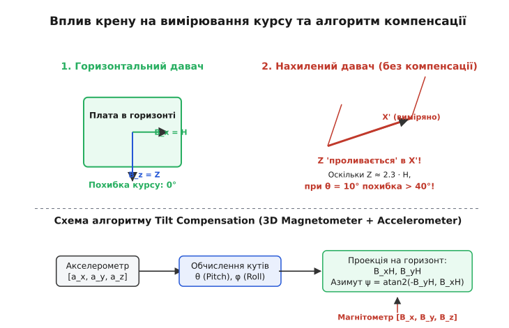

### Чому звичайний магнітометр помиляється при нахилі

3-осьовий електронний магнітометр (наприклад, QMC5883L, HMC5883L або LSM303D) вимірює три прямокутні складові вектора магнітного поля `B = [B_x, B_y, B_z]` у власній зв'язаній системі координат корпусу мікросхеми.

Якщо пристрій розташований ідеально горизонтально відносно землі (кут тангажу `θ = 0` та кут крену `ϕ = 0`), вимірювальні осі `B_x` та `B_y` знаходяться строго в площині горизонту, а магнітний азимут (курс відносно магнітної півночі) обчислюється за простою двовимірною тригонометричною формулою:

```
ψ = arctan2(-B_y, B_x)
```

Проте в реальних умовах експлуатації (на мобільному роботі, БПЛА чи в руках користувача) плата пристрою майже завжди нахилена. В середніх широтах (зокрема в Україні) вертикальна складова `Z` геомагнітного поля перевищує горизонтальну `H` більш ніж удвічі (`Z ≈ 2.36 · H`). 

Коли пристрій нахиляється хоча б на 10 градусів, величезне вертикальне поле `Z` проєкціюється у виміряні осі `B_x` та `B_y`. Без математичної компенсації крену це «проливання» спричиняє похибку курсу від 30° до 60°, роблячи компас повністю непридатним для автономного утримання траєкторії.


*Принцип проливання вертикальної складової Z у горизонтальні осі при крені та загальна схема компенсації.*

При високих кутах крену (понад 20°) або у високих геомагнітних широтах (де нахил `I > 75°`), нескомпенсований 2D-компас дає похибку азимута, що наближається до 90°, через що система автоматичного керування польотом починає повертати апарат у протилежний бік від заданої мети.

---

### Калібрування завад твердого та м'якого заліза (Hard-Iron & Soft-Iron)

Перш ніж передавати сирі дані магнітометра `[B_raw.x, B_raw.y, B_raw.z]` до алгоритму компенсації нахилу, їх необхідно очистити від власних магнітних завад пристрою. Усі завади поділяють на два класи:

1. **Тверде залізо (*Hard-Iron*)** — власне магнітне поле від намагнічених металевих деталей плати, сталевих гвинтів або постійних магнітів динамів. Це поле створює сталий вектор зсуву `V_hard_iron = [V_x, V_y, V_z]`, який зсуває центр сфер вимірювань від початку координат `(0,0,0)`.
2. **М'яке залізо (*Soft-Iron*)** — спотворення ліній геомагнітного поля феромагнітною масою поблизу давача (феритові дроселі, сталеві екрани). Воно деформує сферичний розподіл вимірювань у тривісний еліпсоїд.

Загальне рівняння компенсації виражається матричним перетворенням:

```
B_calibrated = S_soft_iron · (B_raw - V_hard_iron)
```

де `V_hard_iron` — вектор зсуву 3x1, а `S_soft_iron` — симетрична матриця масштабу й повороту 3x3. Отриманий вектор `B_calibrated` є чистою індукцією геомагнітного поля в системі координат давача.

---

### Об'єднання даних у комплементарному фільтрі IMU/AHRS

У динамічних умовах польоту БПЛА чи руху робота акселерометр вимірює не лише прискорення вільного падіння `g`, а й кінематичне прискорення пристрою (лінійне прискорення від моторів та центробіжне прискорення при поворотах):

```
a_measured = g + a_kinematic + a_centrifugal
```

Під час інтенсивних маневрів вектор `a_measured` відхиляється від напрямку вертикалі `g`, через що обчислені кути тангажу `θ` та крену `ϕ` отримують динамічну похибку.

Щоб усунути цей ефект, в автопілотах (наприклад, PX4 або ArduPilot) використовують **комплексний фільтр IMU/AHRS** (Extended Kalman Filter — EKF):
* Поточну кутову швидкість `[ω_x, ω_y, ω_z]` інтегрують від 3-осьового гіроскопа на високій частоті (400–1000 Гц) для відстеження швидких кутових переміщень;
* Акселерометр використовують для повільного корегування дрейфу гіроскопа на низьких частотах (10–50 Гц), коли модуль прискорення близький до `1g`;
* Магнітометр дає абсолютну прив'язку азимута після компенсації нахилу скомплексованими кутами `θ` та `ϕ`.

---

### Математичний алгоритм компенсації нахилу

Алгоритм відновлення справжнього азимута та кута магнітного нахилу складається з чотирьох послідовних математичних кроків:

#### Крок 1. Обчислення кутів тангажу (Pitch, θ) та крену (Roll, ϕ)
За допомогою 3-осьового акселерометра вимірюють вектор прискорення `a = [a_x, a_y, a_z]`. У статичному стані вектор `a` дорівнює прискоренню вільного падіння `g`. Після нормалізації вектора кути нахилу обчислюють як:

```
ϕ (Roll)  = arctan2(a_y, a_z)
θ (Pitch) = arctan2(-a_x, √(a_y² + a_z²))
```

#### Крок 2. Проєкція магнітного поля на горизонтальну площину
Використовуючи обчислені кути `θ` та `ϕ`, повертають вектор виміряного магнітного поля `[B_x, B_y, B_z]` назад у горизонтальну площину `[B_xH, B_yH]`:

```
B_xH = B_x · cos(θ) + B_y · sin(ϕ) · sin(θ) + B_z · cos(ϕ) · sin(θ)
B_yH = B_y · cos(ϕ) - B_z · sin(ϕ)
```

#### Крок 3. Обчислення скомпенсованого азимута (Heading, ψ)
Магнітний курс `ψ` відносно магнітної півночі:

```
ψ_mag = arctan2(-B_yH, B_xH)
```

Для отримання справжнього (географічного) азимута додають місцеве магнітне схилення `D`:

```
ψ_true = ψ_mag + D
```

#### Крок 4. Обчислення кута магнітного нахилу (Inclination, I)
Відновлюють вертикальну складову `B_zH` та обчислюють кут магнітного нахилу `I`:

```
B_zH = -B_x · sin(θ) + B_y · sin(ϕ) · cos(θ) + B_z · cos(ϕ) · cos(θ)
B_total = √(B_x² + B_y² + B_z²)
I = arcsin(B_zH / B_total)
```

---

### Практична реалізація коду

Нижче наведено робочий алгоритм обчислення азимута та кута нахилу мовами C та C++.

:::tabs
:::code proj-tilt-compensated-compass/c/main.c
:::code proj-tilt-compensated-compass/cpp/main.cpp
:::

---

### Типові інженерні пастки

1. **Ігнорування калібрування твердої й м'якої завади (*Hard-Iron / Soft-Iron*):** Магнітометр вимірює не лише поле Землі, а й власні магніти деталей плати. Перед викликом алгоритму сирі вимірювання `[B_raw.x, B_raw.y, B_raw.z]` **обов'язково** мають бути очищені векторною компенсацією `B_calib = S · (B_raw - V_bias)`.
2. **Динамічне прискорення руху:** При прискорені чи віражі автопілота акселерометр вимірює не тільки вектор `g`, а й центробіжне прискорення `a_centrifugal`. У таких умовах кути `θ` та `ϕ` слід брати з комплементарного фільтра чи фільтра Калмана (AHRS/IMU), який об'єднує акселерометр із гіроскопом.
3. **Неузгодженість осей давачів:** Якщо акселерометр і магнітометр розміщені на платі під різними кутами (наприклад, осі `X` розвернуті на 90° один від одного), перед обчисленням необхідно привести вимірювання до єдиного залізобетонного координатного фрейму плати.
