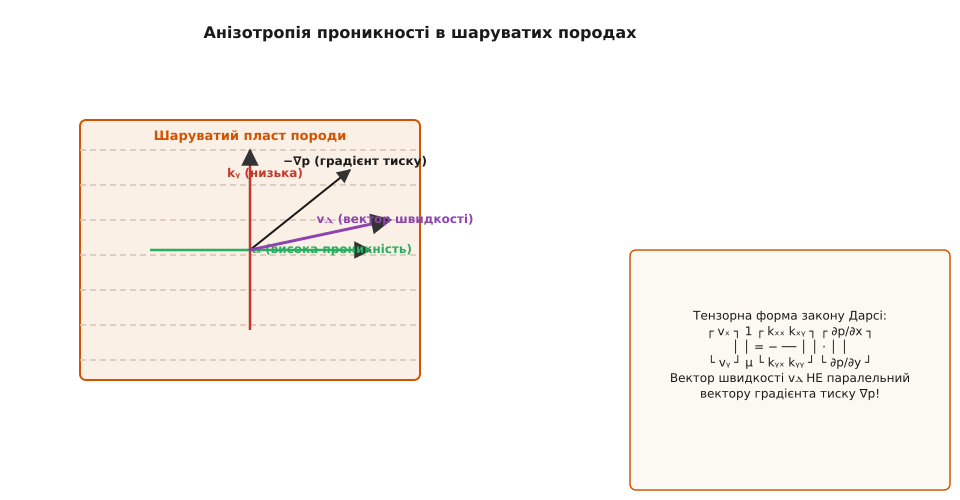

# 📋 Довідник одиниць проникності та програмний інтерфейс

Цей довідник містить фундаментальний аналіз систем одиниць вимірювання проникності, розширений теоретичний опис методів лабораторного вимірювання та перерахунку фільтраційних параметрів, порівняльний фізичний опис різних типів гірських порід і штучних матеріалів, а також повну специфікацію програмного інтерфейсу (C/C++ API) для обчислювальної гідродинаміки пористих середовищ.


*Тензорний характер проникності в анізотропних шаруватих породах: взаємозв'язок векторів швидкості фільтрації та градієнта тиску.*

## 1. Фізична природа та системи одиниць вимірювання

У гідромеханіці пористих середовищ, підземній гідравліці, геофізиці та нафтогазовому інжинірингу застосовують три базові фізичні величини, кожна з яких описує здатність середовища пропускати флюїд під дією зовнішніх сил. Розуміння відмінностей між цими величинами є критично важливим, оскільки плутанина між ними призводить до помилок на кілька порядків при розрахунках дебіту свердловин або оцінці фільтрації під гідротехнічними спорудами.

### Внутрішня (абсолютна) проникність `k`

Внутрішня проникність є чисто геометричною характеристикою пористого твердого каркаса. Вона вимірює ефективну площу порових каналів, відкритих для ламінарного протікання флюїду, і не залежить від того, який саме флюїд тече крізь пори — вода, нафта, природний газ, вуглекислий газ чи рідкий гелій.

- **Основна одиниця SI**: квадратний метр (м²).
- **Позасистемна одиниця (нафтова інженерія та гірнича справа)**: Дарсі (D) та мілідарсі (mD).

Фізичний зміст одиниці **1 Дарсі** визначається з емпіричного стандарту: це проникність такого пористого зразка циліндричної форми площею поперечного перерізу 1 см² та завдовжки 1 см, крізь який при перепаді тиску в 1 атмосферу (101 325 Па) проходить об'ємна витрата в 1 кубічний сантиметр за секунду флюїду з динамічною в'язкістю 1 сантипуаз (1 сП = 10⁻³ Па·с, що відповідає в'язкості чистої води при температурі 20 °C).

```
1 D  = (1 см³/с · 1 сП · 1 см) / (1 см² · 1 атм)
     = (10⁻⁶ м³/с · 10⁻³ Па·с · 10⁻² м) / (10⁻⁴ м² · 101 325 Па)
     = 0.9869233 · 10⁻¹² м²  ≈  10⁻¹² м²
```

Оскільки 1 Дарсі — це дуже висока проникність, притаманна лише грубозернистим піскам та високопористим пісковикам, у практичній геології та розробці родовищ частіше використовують дрібніші похідні одиниці:

```
1 D   = 0.9869233 · 10⁻¹² м²  ≈  10⁻¹² м²   (1 м² ≈ 1.01325 · 10¹² D)
1 mD  = 10⁻³ D  = 0.9869233 · 10⁻¹⁵ м²  ≈  10⁻¹⁵ м²  (мілідарсі, стандартні нафтові колектори)
1 μD  = 10⁻⁶ D  = 0.9869233 · 10⁻¹⁸ м²  (мікродарсі, щільні алевроліти та сланці)
1 nD  = 10⁻⁹ D  = 0.9869233 · 10⁻²¹ м²  (нанодарсі, сланцеві матриці та материнські породи)
```

### Коефіцієнт фільтрації (гідравлічна провідність) `K`

На відміну від проникності `k`, коефіцієнт фільтрації `K` є комбінованою характеристикою системи «пористе середовище + конкретний флюїд» за заданих термобаричних умов. Він показує лінійну швидкість фільтрації флюїду під дією одиничного гідравлічного градієнта напору (`∇h = 1`).

- **Основна одиниця SI**: метр за секунду (м/с).
- **Практична одиниця у гідрогеології та меліорації**: метр за добу (м/добу).

Математичний зв'язок між коефіцієнтом фільтрації `K` та внутрішньою проникністю `k` виражається формулою:

```
K = k · (ρ · g / μ)
```

де `ρ` — густина флюїду (кг/м³), `g` — прискорення вільного падіння (`9.80665` м/с²), `μ` — динамічна в'язкість флюїду (Па·с). Співвідношення `ρ g / μ` називають *флюїдовим коефіцієнтом провідності*.

Для прісної води при стандартній температурі 20 °C (`ρ = 998.2` кг/м³, `μ = 1.002 · 10⁻³` Па·с):

```
(ρ · g / μ)_вода ≈ (998.2 · 9.80665) / (1.002 · 10⁻³) ≈ 9.773 · 10⁶ м⁻¹·с⁻¹
```

Отже, для чистої води при 20 °C зв'язок між `K` та `k` має вигляд:

```
K [м/с] ≈ 9.773 · 10⁶ · k [м²]
K [м/добу] ≈ 8.444 · 10¹¹ · k [м²]
1 D (водний еквівалент при 20°C) ≈ 9.64 · 10⁻⁶ м/с  ≈  0.833 м/добу
1 м/добу (для води при 20°C)     ≈ 1.185 · 10⁻¹² м²   ≈  1.201 D
```

Якщо температура води зростає від 0 °C до 80 °C, її в'язкість `μ` зменшується в 5 разів (з `1.79` сП до `0.35` сП). Це означає, що коефіцієнт фільтрації гарячої води `K` у тому самому піску зростає в 5 разів, хоча геометрична проникність пласта `k` залишається абсолютно незмінною!

### Водопровідність (п'єзопровідність) пласта `T` (Transmissivity)

Водопровідність описує загальну пропускну здатність всього водоносного пласта товщиною `b` (потужність пласта в метрах). Вона розраховується як інтеграл коефіцієнта фільтрації по товщині пласта:

- **Одиниця SI**: квадратний метр за секунду (м²/с).
- **Практична одиниця**: м²/добу.

```
T = K · b = (k · ρ · g / μ) · b
```

Водопровідність є ключовим параметром при розрахунку зниження рівня підземних вод під час роботи потужних водозабірних свердловин та оцінки депресійних лійок.

---

## 2. Матриця перерахунку одиниць (Conversion Matrix)

Для зручності інженерних та геофізичних розрахунків нижче наведено точні коефіцієнти переведення між основними одиницями проникності та коефіцієнта фільтрації.

| Вхідна величина | Множник для переведення в м² (SI) | Множник для переведення в Дарсі (D) | Множник для переведення в мілідарсі (mD) | Множник для K води при 20°C (м/с) | Множник для K води при 20°C (м/добу) |
| :--- | :--- | :--- | :--- | :--- | :--- |
| **1 м²** | `1.0` | `1.01325 · 10¹²` | `1.01325 · 10¹⁵` | `9.773 · 10⁶` | `8.444 · 10¹¹` |
| **1 cm²** | `1.0 · 10⁻⁴` | `1.01325 · 10⁸` | `1.01325 · 10¹¹` | `9.773 · 10²` | `8.444 · 10⁷` |
| **1 D (Дарсі)** | `9.86923 · 10⁻¹²` | `1.0` | `1000.0` | `9.645 · 10⁻⁶` | `0.8333` |
| **1 mD (мілідарсі)** | `9.86923 · 10⁻¹⁵` | `0.001` | `1.0` | `9.645 · 10⁻⁹` | `8.333 · 10⁻⁴` |
| **1 μD (мікродарсі)**| `9.86923 · 10⁻¹⁸` | `1.0 · 10⁻⁶` | `0.001` | `9.645 · 10⁻¹²` | `8.333 · 10⁻⁷` |
| **1 м/добу (вода)** | `1.1843 · 10⁻¹²` | `1.1999` | `1199.9` | `1.1574 · 10⁻⁵` | `1.0` |
| **1 м/с (вода)** | `1.0232 · 10⁻⁷` | `1.0368 · 10⁵` | `1.0368 · 10⁸` | `1.0` | `86400.0` |

---

## 3. Таблична класифікація проникності гірських порід та матеріалів

Фільтраційні властивості природних матеріалів варіюються у фантастичному діапазоні — понад 15 порядків величини. Ничже подано докладний фізичний опис різних груп порода та середовищ.

### Грубоуламкові та піщані ґрунти (Первинна пористість)
У цих матеріалах проникність визначається розміром міжзернових пор. Великі гранульовані зерна утворюють широкі порові канали з мінімальним в'язким опором.
- **Гравій чистий валунний**: Penetration `k = 10⁻⁹...10⁻⁷ м²` (`10³...10⁵ D`). Надзвичайно висока провідність, течія часто виходить за межі закону Дарсі у режим Форхгеймера.
- **Пісок грубий річковий**: `k = 10⁻¹¹...10⁻⁹ м²` (`10...1000 D`). Ідеальний колектор для підземних питних вод.
- **Пісок дрібний кар'єрний / пылеватый**: `k = 10⁻¹²...10⁻¹¹ м²` (`1...10 D`). Помірна фільтрація, легко ущільнюється при механічному навантаженні.

### Зцементовані осадові породи (Пісковики, алевроліти, карбонати)
Проникність залежить не лише від розміру зерен, але й від ступеня цементації (наявності кальцитового, силікатного чи глинистого цементу між зернами) та наявності трещин і каверн.
- **Пісковики високопористі (нафтові колектори)**: `k = 10⁻¹⁴...2·10⁻¹² м²` (`10...2000 mD`). Основний тип порід-колекторів для видобутку вуглеводнів у світі.
- **Алевроліти та тонкошаруваті глинисті пісковики**: `k = 10⁻¹⁵...10⁻¹³ м²` (`1...100 mD`). Низькопроникні колектори, що потребують гідророзриву пласта.
- **Карбонати (вапняки, доломіти) кавернозні**: `k = 10⁻¹⁵...10⁻¹² м²` (`1...1000 mD`). Характеризуються сильною гетерогенністю та наявністю розчинних каверн (карст).

### Глинисті та сланцеві водоупори (Нанопориста матриця)
Дрібні глинисті мінерали (монтморилоніт, іліт, каолініт) мають розмір лусочок менше 2 мікрометрів. Пори між ними мають нанометрові розміри, а електричний заряд поверхні глини утримує міцно зв'язану воду.
- **Глини пластичні незатверділі**: `k = 10⁻¹⁹...10⁻¹⁶ м²` (`0.1...100 μD`). Практично непроникні водоупори, які слугують природними покришками для нафтогазових покладів.
- **Газоносні сланці (*Gas Shales*)**: `k = 10⁻²⁰...10⁻¹⁷ м²` (`10...10000 nD`). Фільтрація газу відбуватися лише за рахунок ефекту ковзання Клінкенберга та штучних тріщин гідророзриву.

### Масивні кристалічні породи (Матриця проти тріщин)
- **Граніт / базальт монолітний**: `k = 10⁻²²...10⁻²⁰ м²` (`0.1...10 nD`). Абсолютно непроникний матричний матеріал, який використовують для підземного захоронення токсичних та радіоактивних відходів.
- **Граніт тріщинуватий (тектонічні зони)**: `k = 10⁻¹⁶...10⁻¹³ м²` (`0.1...100 mD`). Проникність забезпечується не порами, а мережею макроскопічних тріщин. Згідно з кубічним законом для тріщин, проникність одиночної тріщини з розкриттям `e` дорівнює `k_frac = e² / 12`.

---

## 4. Специфікація програмного інтерфейсу (C/C++ API Reference)

Для інтеграції гідродинамічних розрахунків за законом Дарсі у сторонній розрахунковий код, фізичні двигуни або симулятори пластів розроблено стандартизований заголовочний файл `darcy_api.h`. Він підтримує сумісність із мовою C (ANSI C99) та надає сучасну об'єктно-орієнтовану обгортку для C++17/C++20.

:::code api-permeability-units/cpp/4-spetsyfikatsiia.hpp

## Інженерний приклад використання C++ API

Нижче наведено практичний приклад інтеграції розробленого C++ API для обчислення швидкостей фільтрації води та нафти крізь зразок пісковику з проникністю 250 мілідарсі та пористістю 22%:

:::code api-permeability-units/cpp/inzhenernyi-pryklad.cpp

Використання стандартизованого API усуває помилки конвертації одиниць та забезпечує повне фізичне узгодження між лабораторними вимірюваннями кернів та тривимірними симуляторами родовищ.
