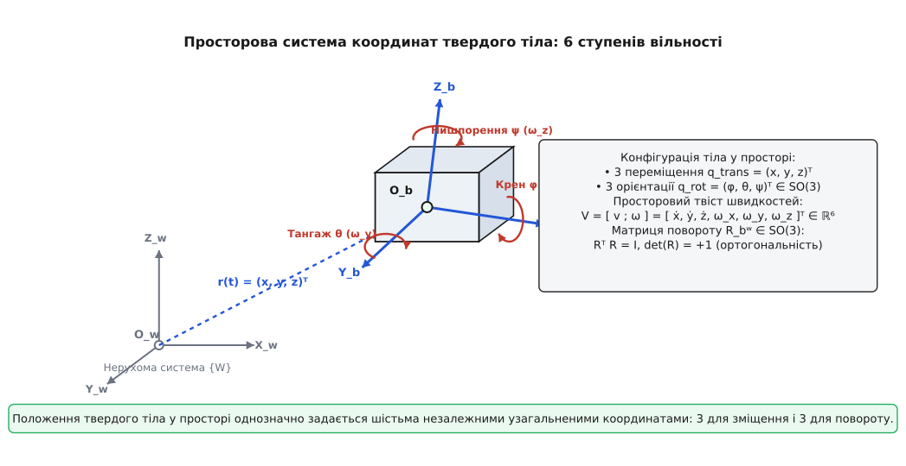
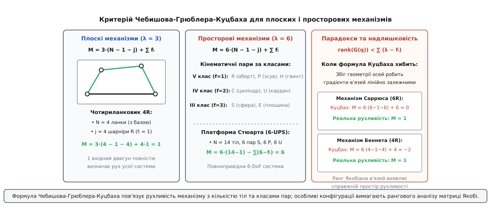

# Ступені вільності у класичній та аналітичній механіці

<preknowlist>
- [Положення точки](root:ph-mechanics/position) — координати та радіус-вектор точки у тривимірному евклідовому просторі.
- [Абсолютно тверде тіло](root:ph-mechanics/rigid-body) — модель незмінної системи матеріальних точок із фіксованими взаємними відстанями.
- [Кутова швидкість](root:ph-mechanics/angular-velocity) — векторний та матричний опис просторового обертання твердого тіла.
- [Ранг матриці](root:math-algebra/matrix-rank) — розмірність образу та ядра лінійного відображення, критерій лінійної незалежності зв'язків.
- [Принцип найменшої дії](root:ph-mechanics/least-action-principle) — варіаційні принципи та формування рівнянь руху Лагранжа.
</preknowlist>

Рух механічної системи в просторі починається з визначення мінімальної кількості незалежних числових параметрів, необхідних для однозначного опису просторового положення кожної її матеріальної точки у будь-який момент часу. Якщо вільна матеріальна точка в тривимірному евклідовому просторі володіє трьома поступальними координатами, то абсолютно тверде тіло — нескінченна сукупність жорстко зв'язаних між собою точок — має рівно шість ступенів вільності: три координати фіксують положення обраного полюса (центра мас), а три кутові змінні задають його просторову орієнтацію.

Накладання геометричних або кінематичних обмежень — в'язей — зменшує кількість незалежних напрямків руху системи. Визначення фактичної кількості ступенів вільності реального просторового механізму, шарнірного робота чи системи взаємодіючих твердих тіл є першим і фундаментальним кроком для побудови рівнянь динаміки Лагранжа, проектування приводів та синтезу алгоритмів автоматичного керування. Повний математичний апарат розрахунку та лінійного виключення в'язей наведено у вставці [математика підрахунку в'язей](root:ph-mechanics/degrees-of-freedom/math-counting-constraints.md).

```
          z
          ▲
          │    .───────.
          │   /         \
          │  │     C     │ ◄─── Полюс (Центр мас): r = (x, y, z)ᵀ
          │   \         /
          │    '───────'
          │        \  Орієнтація: (yaw ψ, pitch θ, roll ϕ)
          │         \
          └───────────► y
         /
        ▼
       x
```


*Шість просторових ступенів вільності твердого тіла: три поступальні координати центра мас та три кути орієнтації головних осей інерції*

---

## 1. Просторова кінематика абсолютно твердого тіла та шість ступенів вільності

Розглянемо абсолютно тверде тіло, що складається з довільної кількості `N` матеріальних точок із радіус-векторами `r_i` (`i = 1, 2, …, N`) у нерухомій інерціальній системі координат `{W}` (World frame). Умова абсолютної твердості означає незмінність евклідової відстані між будь-якою парою точок під час довільного руху:

```
‖ r_i(t) − r_j(t) ‖ = d_{ij} = const,    ∀ i, j ∈ {1, …, N}
```

Для системи з трьох точок, що не лежать на одній прямій, початкова кількість декартових координат становить `3 × 3 = 9`. Між ними діють три взаємні жорсткі відстані:

```
‖ r₁ − r₂ ‖ = d₁₂
‖ r₂ − r₃ ‖ = d₂₃
‖ r₃ − r₁ ‖ = d₃₁
```

Ці три незалежні рівняння зв'язку віднімають три ступені вільності, залишаючи `9 − 3 = 6` незалежних параметрів. Додавання четвертої та будь-якої наступної точки тіла `r_k` (`k ≥ 4`) вимагає фіксації трьох відстаней до вже визначених базових точок (`d_{1k}, d_{2k}, d_{3k}`), що накладає рівно 3 нових скалярних рівняння на 3 нові координати. Отже, додавання нових точок не змінює рухливості системи: довільне просторове тверде тіло незмінно володіє шістьма ступенями вільності (`6 DoF`).

### Теорема Шаля-Моцці та просторовий гвинтовий рух

Відповідно до класичної кінематичної теореми Шаля-Моцці, довільне неперервне просторове переміщення абсолютно твердого тіла в евклідовому просторі еквівалентне миттєвому гвинтовому руху — повороту навколо деякої прямої (миттєвої осі гвинта) з кутовою швидкістю `ω` та одночасному поступальному зсуву вздовж цієї ж прямої з лінійною швидкістю `v_∥`.

Співвідношення між поступальною швидкістю вздовж осі та кутовою швидкістю визначає крок гвинта (pitch) `h`:

```
h = (v · ω) / ‖ω‖²
```

Якщо `h = 0`, рух тіла є чистим миттєвим обертанням навколо осі; якщо `‖ω‖ = 0`, рух є чисто поступальним переміщенням.

Якщо зв'язати з тілом власну рухому систему координат `{B}` (Body frame) з початком у полюсі `p` (зазвичай у центрі мас `C`), положення будь-якої точки тіла `r_i` в інерціальній системі відліку `{W}` визначається афінним відображенням:

```
r_i(t) = p(t) + R(t) · ρ_i
```

де:
- `p(t) = (x(t), y(t), z(t))ᵀ ∈ ℝ³` — радіус-вектор полюса у системі `{W}` (3 поступальні ступені вільності);
- `ρ_i ∈ ℝ³` — постійний радіус-вектор точки у власній системі координат тіла `{B}`;
- `R(t) ∈ SO(3)` — спеціальна ортогональна матриця орієнтації розмірності `3×3` (3 обертальні ступені вільності).

Матриця повороту `R` задовольняє умови ортогональності та збереження правої орієнтації базису:

```
Rᵀ R = I₃,    det(R) = +1
```

Множина всіх таких матриць утворює дійсну компактну групу Лі `SO(3)` (Special Orthogonal Group). Матриця `3×3` містить 9 дійсних елементів, проте умова ортогональності `Rᵀ R = I₃` є матричною рівністю розміру `3×3`, яка є симетричною і містить 6 незалежних скалярних рівнянь (3 на головній діагоналі та 3 позадіагональні). Кількість вільних параметрів матриці орієнтації дорівнює:

```
dim(SO(3)) = 9 − 6 = 3
```

Сукупність просторового положення та орієнтації утворює спеціальну евклідову групу перетворень `SE(3) = ℝ³ ⋊ SO(3)`, яка є напівпрямим добутком групи трансляцій та групи обертань. Її розмірність строго дорівнює:

```
dim(SE(3)) = dim(ℝ³) + dim(SO(3)) = 3 + 3 = 6
```

### Алгебри Лі `𝔰𝔬(3)` та `𝔰𝔢(3)`: Твісти та просторові швидкості

Диференціюючи умову ортогональності `R(t)ᵀ R(t) = I₃` за часом, отримуємо:

```
Ṙᵀ R + Rᵀ Ṙ = 0  ⇒  (Rᵀ Ṙ)ᵀ + (Rᵀ Ṙ) = 0
```

Це доводить, що матриця `[ω_b] = Rᵀ Ṙ` (або у світовій системі `[ω_s] = Ṙ Rᵀ`) є кососиметричною: `[ω]ᵀ = −[ω]`. Множина кососиметричних матриць `3×3` утворює алгебру Лі `𝔰𝔬(3)`, яка є дотичним простором до групи Лі `SO(3)` в одиничному елементі `I₃`.

Кососиметрична матриця `[ω] ∈ 𝔰𝔬(3)` однозначно відповідає 3-вектору кутової швидкості `ω = (ω_x, ω_y, ω_z)ᵀ ∈ ℝ³`:

```
[ω] = |   0   −ω_z   ω_y |
      |  ω_z    0   −ω_x |
      | −ω_y   ω_x    0  |
```

Дія матриці `[ω]` на будь-який вектор `v ∈ ℝ³` еквівалентна стандартному векторному добутку: `[ω] v = ω × v`.

Просторовий рух твердого тіла в цілому описується 6-вимірним просторовим вектором швидкості — твістом (spatial twist) `𝒱 = (ωᵀ, vᵀ)ᵀ ∈ ℝ⁶`, що належить алгебрі Лі `𝔰𝔢(3)`. Матричне представлення твісту розмірності `4×4` має вигляд:

```
[𝒱] = | [ω]   v |
      |  0    0 |
```

Експоненційне відображення `exp: 𝔰𝔢(3) → SE(3)` переводить елемент алгебри Лі у відповідне скінченне просторове перетворення твердого тіла.

---

## 2. Конфігураційний многовид та узагальнені координати Лагранжа

Для механічної системи, що складається з `N` матеріальних точок або твердих тіл, конфігурацією називається сукупність миттєвих просторових положень усіх її елементів.

Простір усіх можливих геометрично допустимих положень системи утворює конфігураційний многовид `𝒬`. Якщо на систему не накладено в'язей, розмірність конфігураційного простору дорівнює:
- Для системи з `N` точок: `dim(𝒬) = 3 N`;
- Для системи з `N` вільних твердих тіл: `dim(𝒬) = 6 N`.

### Узагальнені координати Лагранжа

Узагальненими координатами Лагранжа називається будь-який набір з `n` незалежних скалярних змінних `q = (q₁, q₂, …, q_n)ᵀ ∈ 𝒬`, які однозначно визначають просторове положення всіх точок системи відносно базової інерціальної системи відліку:

```
r_i = r_i(q₁, q₂, …, q_n, t),    i = 1, 2, …, N
```

Кількість узагальнених координат `n` визначає розмірність конфігураційного многовиду:

```
n = dim(𝒬)
```

Узагальнені координати не обов'язково мають розмірність довжини: це можуть бути декартові координати, полярні чи сферичні кути, відносні кути повороту в шарнірах або квазікоординати.

### Дотичний простір та узагальнені швидкості

Швидкість зміни конфігурації в часі визначається вектором узагальнених швидкостей `q̇ = (q̇₁, q̇₂, …, q̇_n)ᵀ`. У математичному сенсі вектор `q̇` належить дотичному простору `T_q 𝒬` до конфігураційного многовиду в точці `q`.

Повна сукупність усіх можливих конфігурацій та відповідних швидкостей утворює дотичне розшарування (фазовий простір швидкостей):

```
T𝒬 = ⋃_{q ∈ 𝒬} T_q 𝒬,    dim(T𝒬) = 2 n
```

Швидкість будь-якої точки системи `ṙ_i` лінійно виражається через вектор узагальнених швидкостей `q̇`:

```
ṙ_i = ∑_{j=1}^n (∂r_i / ∂q_j) · q̇_j + (∂r_i / ∂t)
```

Частинні похідні `∂r_i / ∂q_j` задають геометричні напрямки дотичних векторів координатних ліній у просторі конфігурацій.

### Віртуальні переміщення та принцип д'Аламбера-Лагранжа

Віртуальним переміщенням `δr_i` називається нескінченно мале уявне зміщення точки системи, яке допускається накладеними голономними в'язями при «замороженому» часі (`δt = 0`). Віртуальні переміщення виражаються через варіації узагальнених координат `δq_j`:

```
δr_i = ∑_{j=1}^n (∂r_i / ∂q_j) · δq_j
```

Для ідеальних в'язей сумарна віртуальна робота сил реакції в'язей `R_i` дорівнює нулю:

```
∑_{i=1}^N R_i · δr_i = 0
```

Відповідно до фундаментального принципу д'Аламбера-Лагранжа, для дійсної динамічної траєкторії механічної системи сума елементарних робіт активних прикладених сил `F_i` та сил інерції `−m_i r̈_i` на будь-якому віртуальному переміщенні дорівнює нулю:

```
∑_{i=1}^N ( m_i r̈_i − F_i ) · δr_i = 0
```

Підставляючи вираз для `δr_i` через незалежні варіації `δq_j`, отримуємо класичні диференціальні рівняння руху Лагранжа другого роду:

```
d/dt ( ∂L / ∂q̇_j ) − ( ∂L / ∂q_j ) = Q_j,    j = 1, 2, …, n
```

де `L(q, q̇, t) = T − V` — функція Лагранжа (лагранжіан), а `Q_j` — узагальнені непотенціальні сили. Перевага цього підходу полягає в тому, що кількість рівнянь руху строго дорівнює кількості ступенів вільності `n`, а всі невідомі сили реакцій ідеальних зв'язків автоматично виключаються з рівнянь.

---

## 3. Гамільтонів формалізм, кодотичне розшарування та фазовий простір

Альтернативним фундаментальним формулюванням аналітичної механіки є гамільтонів підхід. Якщо у лагранжевій механіці стан системи описується на дотичному розшаруванні `T𝒬` координатами та швидкостями `(q, q̇)`, то в гамільтоновій механіці опис переноситься на кодотичне розшарування `T*𝒬` — фазовий простір канонічних змінних `(q, p)`.

Канонічні імпульси `p_j` визначаються через перетворення Лежандра лагранжіана за узагальненими швидкостями:

```
p_j = ∂L(q, q̇, t) / ∂q̇_j,    j = 1, 2, …, n
```

Функція Гамільтона (гамільтоніан) `H(q, p, t)` визначається як:

```
H(q, p, t) = ∑_{j=1}^n p_j q̇_j − L(q, q̇, t)
```

Для натуральних механічних систем, у яких кінетична енергія є квадратичною формою швидкостей `T = 1/2 q̇ᵀ M(q) q̇`, канонічні імпульси дорівнюють `p = M(q) q̇`, а гамільтоніан точно дорівнює повній енергії системи:

```
H(q, p) = 1/2 pᵀ M(q)⁻¹ p + V(q) = T + V = E
```

### Канонічні рівняння Гамільтона та симплектична геометрія

Диференціальні рівняння руху в гамільтоновій формі розпадаються на симетричну систему `2 n` диференціальних рівнянь першого порядку:

```
q̇_j = + ∂H / ∂p_j
ṗ_j = − ∂H / ∂q_j,    j = 1, 2, …, n
```

Фазовий простір `T*𝒬` наділений природною симплектичною 2-формою:

```
ω = ∑_{j=1}^n dp_j ∧ dq_j
```

Відповідно до теореми Ліувілля, фазовий потік гамільтонової системи зберігає симплектичну структуру та фазовий об'єм:

```
d/dt [ ∫_{D(t)} dq₁ … dq_n dp₁ … dp_n ] = 0
```

Це означає, що ступені вільності у фазовому просторі не можуть стискатися чи розширюватися у сукупному об'ємі під дією консервативних сил.

### Інтегровність за Ліувіллем-Арнольдом та тори Ліувілля

Гамільтонова система з `n` ступенями вільності називається цілком інтегровною за Ліувіллем, якщо вона володіє `n` незалежними першими інтегралами руху `F₁, F₂, …, F_n` (`F₁ = H`), які перебувають у попарній інволюції (їхні дужки Пуассона дорівнюють нулю):

```
{ F_i, F_j } = ∑_{k=1}^n ( (∂F_i / ∂q_k)(∂F_j / ∂p_k) − (∂F_i / ∂p_k)(∂F_j / ∂q_k) ) = 0
```

Відповідно до теореми Ліувілля-Арнольда:
1. Спільний рівень інтегралів руху `M_f = { (q, p) | F_i(q, p) = f_i }` є гладким `n`-вимірним многовидом, дифеоморфним `n`-вимірному тору `𝕋ⁿ = S¹ × S¹ × … × S¹`.
2. Існує канонічна заміна змінних до змінних «дія-кут» `(I, θ)`, де змінні дій `I_j = 1/(2π) ∮_{γ_j} p dq` є константами руху (`İ_j = 0`), а кутові змінні `θ_j` змінюються строго лінійно з часом:
   ```
   θ_j(t) = ω_j(I) · t + θ_j(0)
   ```
3. Рух системи з `n` ступенями вільності є умовно-періодичною обмоткою `n`-вимірного тора Ліувілля з частотами `ω_j = ∂H(I) / ∂I_j`. Якщо частоти несумірні, траєкторія всюди щільно заповнює поверхню тора.

---

## 4. Класифікація механічних в'язей

В'яззю називається будь-яке фізичне або геометричне обмеження, що накладається на положення, швидкості або прискорення точок механічної системи і зменшує свободу її руху.

Класифікація в'язей має вирішальне значення для вибору математичного апарату: від неї залежить, чи можна безпосередньо застосувати рівняння Лагранжа другого роду, чи необхідно використовувати невизначені множники Лагранжа, псевдоінверсію Якобіана або рівняння Аппеля/Маджі.

```
                         ┌────────────────────────┐
                         │   Механічні в'язі      │
                         └───────────┬────────────┘
                                     │
            ┌────────────────────────┴────────────────────────┐
            ▼                                                 ▼
┌────────────────────────┐                       ┌────────────────────────┐
│  Голономні в'язі       │                       │  Неголономні в'язі     │
│  f(r_1, ..., r_N, t)=0 │                       │  A(q, t) q̇ + B(t) = 0   │
└───────────┬────────────┘                       └───────────┬────────────┘
            │                                                 │
     ┌──────┴──────┐                                   ┌──────┴──────┐
     ▼             ▼                                   ▼             ▼
┌──────────┐ ┌──────────┐                         ┌──────────┐ ┌──────────┐
│Склероном-│ │Реономні  │                         │Склероном-│ │Реономні  │
│ні (df/dt │ │(df/dt    │                         │ні        │ │          │
│= 0)      │ │≠ 0)      │                         │          │ │          │
└──────────┘ └──────────┘                         └──────────┘ └──────────┘
```

### 1. Голономні проти неголономних в'язей

**Голономні (геометричні) в'язі** залежать виключно від просторових координат точок системи та часу:

```
f_k(r₁, r₂, …, r_N, t) = 0,    k = 1, 2, …, m
```

Якщо на систему з `N` вільних точок (початкова розмірність `3 N`) накладено `m` функціонально незалежних голономних зв'язків, то кількість ступенів вільності системи строго зменшується на `m`:

```
DoF = 3 N − m
```

У цьому випадку конфігураційний многовид `𝒬` є гладким підмноговидом евклідового простору `ℝ³ᴺ` розмірності `n = 3 N - m`, і рух системи повністю описується `n` незалежними узагальненими координатами `q₁, …, q_n`.

**Неголономні (кінематичні) в'язі** задаються диференціальними співвідношеннями на швидкості, які принципово не можуть бути проінтегровані до кінцевих рівнянь на координати:

```
∑_{j=1}^n A_{kj}(q, t) · q̇_j + B_k(q, t) = 0,    k = 1, 2, …, p
```

або у векторно-матричній формі Пфаффа:

```
A(q, t) · q̇ + B(q, t) = 0
```

*Ключова властивість неголономних в'язей:* Вони обмежують простір дозволених миттєвих швидкостей `T_q 𝒬`, але **не зменшують розмірності простору досяжних конфігурацій `𝒬`**.

```
Кількість конфігураційних координат: n
Кількість ступенів вільності за швидкістю (mobility): DoF_vel = n − p
```

#### Критерій інтегровності та теорема Фробеніуса

Диференціальна форма Пфаффа `ω = ∑ a_i(q) dq_i = 0` є інтегровною (голономною) тоді й лише тоді, коли задовольняється умова Фробеніуса:

```
ω ∧ dω = 0
```

Для розподілу допустимих векторних полів швидкостей `Δ = span{g₁, g₂, …, g_k}` умова інтегровності вимагає інволютивності: комутатор (дужка Лі) будь-якої пари базисних векторних полів повинен знову належати цьому ж розподілу:

```
[g_i, g_j](q) = (∂g_j / ∂q) · g_i(q) − (∂g_i / ∂q) · g_j(q) ∈ Δ
```

Якщо комутатори векторних полів виходять за межі `Δ`, в'язь є строго неголономною.

#### Детальний фізичний розбір неголономної системи: Кочення диска по площині

Розглянемо вертикальний тонкий диск радіуса `R`, що котиться без проковзування по горизонтальній площині `xy`. Конфігурація диска описується чотирма координатами `q = (x, y, θ, ϕ)ᵀ`, де `(x, y)` — декартові координати точки контакту, `θ` — кут орієнтації площини диска відносно осі `x`, а `ϕ` — кут власного обертання диска навколо осі.

Умова відсутності поздовжнього та поперечного проковзування точки контакту дає два диференціальні рівняння зв'язку:

```
ẋ − R ϕ̇ cos(θ) = 0
ẏ − R ϕ̇ sin(θ) = 0
```

Ці рівняння записуються у формі Пфаффа `A(q) q̇ = 0`:

```
| 1   0   0   −R cos(θ) | | ẋ | = | 0 |
| 0   1   0   −R sin(θ) | | ẏ |   | 0 |
                          | θ̇ |
                          | ϕ̇ |
```

Простір дозволених швидкостей має розмірність `4 − 2 = 2` і натягнутий на два базисні векторні поля:
- Поле повороту на місці: `g₁(q) = (0, 0, 1, 0)ᵀ` (зміна кута `θ`);
- Поле кочення вперед: `g₂(q) = (R cos(θ), R sin(θ), 0, 1)ᵀ` (обертання диска `ϕ̇` з одночасним переміщенням).

Обчислимо комутатор (дужку Лі) цих векторних полів:

```
g₃(q) = [g₁, g₂](q) = (∂g₂ / ∂θ) · 1 = (−R sin(θ), R cos(θ), 0, 0)ᵀ
```

Вектор `g₃` відповідає бічному зсуву диска перпендикулярно до його площини! Цей напрямок швидкості був строго заборонений миттєвими кінематичними зв'язками, проте він породжується комутатором полів. Наступна дужка Лі дає:

```
g₄(q) = [g₁, g₃](q) = (−R cos(θ), −R sin(θ), 0, 0)ᵀ
```

Чотири вектори `{g₁, g₂, g₃, g₄}` є лінійно незалежними в кожній точці, утворюючи повний базис простору `ℝ⁴`. Відповідно до теореми Рашевського-Чоу, система є повністю керованою у конфігураційному просторі: диск здатний потрапити у довільну точку `(x, y)` з довільною орієнтацією `(θ, ϕ)`, виконуючи періодичні маневри повороту та руху вперед/назад (як при паралельному паркуванні автомобіля). Отже, кількість ступенів вільності за конфігурацією дорівнює 4, тоді як миттєва рухливість за швидкістю дорівнює 2.

### 2. Склерономні проти реономних в'язей

- **Склерономні (стаціонарні) в'язі:** рівняння в'язей не містять явної залежності від часу `t`:
  ```
  f_k(r₁, …, r_N) = 0  ⇒  ∂f_k / ∂t = 0
  ```
  Для склерономних систем радіус-вектори точок `r_i = r_i(q)` не залежать явно від часу, тому кінетична енергія є строго однорідною квадратичною формою узагальнених швидкостей `T = 1/2 q̇ᵀ M(q) q̇`, а повна механічна енергія зберігається: `E = T + V = const`.

- **Реономні (нестаціонарні) в'язі:** геометрія в'язей змінюється з часом за заданим зовнішнім законом:
  ```
  f_k(r₁, …, r_N, t) = 0  ⇒  ∂f_k / ∂t ≠ 0
  ```
  Приклад: матеріальна точка на обручі, який примусово обертається електродвигуном із заданою кутовою швидкістю `ω(t)`. У реономних системах сили реакції в'язей виконують роботу над системою, і повна механічна енергія не зберігається. Замість неї зберігається узагальнений інтеграл енергії Якобі:
  ```
  h = ∑_{j=1}^n q̇_j (∂L / ∂q̇_j) − L = T₂ − T₀ + V = const
  ```
  де `T₂` — квадратична частина кінетичної енергії за швидкостями, а `T₀` — складова, зумовлена примусовим рухом в'язі.

### 3. Двобічні (утримувальні) проти однобічних (неутримувальних) в'язей

- **Двобічні (Bilateral):** задаються рівностями `f(r, t) = 0`. Точка зобов'язана строго належати заданій поверхні чи кривій. Сила реакції в'язі `N` може бути спрямована в будь-який бік вздовж нормалі.
- **Однобічні (Unilateral):** задаються нерівностями `f(r, t) ≥ 0`. Точка може рухатися у напівпросторі або відриватися від поверхні (наприклад, кулька на поверхні стола або колесо, що може відірватися від ґрунту при підскоку). Сили реакції задовольняють умови взаємодоповнюваності Каруша-Куна-Такера (KKT):
  ```
  f(r) ≥ 0,    N_n ≥ 0,    f(r) · N_n = 0
  ```

---

## 5. Теорія гвинтів, системи взаємних гвинтів та сили реакції зв'язків

Геометричний апарат теорії гвинтів сера Роберта Болла дозволяє досліджувати ступені вільності та сили реакції в механізмах без використання локальних систем координат.

### Просторові гвинти Плюккера та силові гвинти (Вренчі)

Довільний одиничний кінематичний гвинт `𝒮 = (s, r × s + h s) ∈ ℝ⁶` визначається одиничним вектором осі `s ∈ ℝ³` (`‖s‖ = 1`), радіус-вектором точки на осі `r ∈ ℝ³` та кроком гвинта `h ∈ ℝ`.

Аналогічно, статичне силове навантаження на тверде тіло описується 6-вимірним силомоментним гвинтом (вренчем) `𝒲 = (mᵀ, fᵀ)ᵀ ∈ ℝ⁶`, де `f` — головний вектор прикладених сил, а `m` — головний момент відносно початку координат.

### Взаємний добуток Клейна (Klein Form)

Взаємним добутком (reciprocal product) твісту `𝒱 = (ωᵀ, vᵀ)ᵀ` та вренча `𝒲 = (mᵀ, fᵀ)ᵀ` називається скалярна величина віртуальної миттєвої потужності:

```
𝒲 ⊙ 𝒱 = m · ω + f · v
```

Твіст `𝒱` та вренч `𝒲` називаються взаємними, якщо їхній взаємний добуток строго дорівнює нулю: `𝒲 ⊙ 𝒱 = 0`.

### Теорема взаємності для кінематичних зв'язків

Нехай кінематична пара дозволяє підпростір миттєвих рухів `V_{allow} = span{𝒮₁, 𝒮₂, …, 𝒮_f} ⊂ 𝔰𝔢(3)` розмірності `f`.

Тоді сили та моменти реакції, які ця пара здатна передавати між тілами без виконання роботи, утворюють підпростір взаємних гвинтів `W_{reac} = V_{allow}^⊥` розмірності `c = 6 − f`:

```
𝒲_{reac} ⊙ 𝒮_i = 0,    ∀ i = 1, 2, …, f
```

| Кінематична пара | Рухливість `f` | Базис дозволених твістів `V_{allow}` | Базис реактивних вренчів `W_{reac}` (`c = 6 − f`) |
|:---|:---:|:---|:---|
| **Обертальна (R)** | 1 | Поворот навколо осі `z` | 3 взаємні сили вздовж `x, y, z` + 2 моменти навколо `x, y` |
| **Поступальна (P)** | 1 | Зсув вздовж осі `z` | 3 моменти навколо `x, y, z` + 2 сили вздовж `x, y` |
| **Гвинтова (H)** | 1 | Гвинтовий рух `(z, h z)` | 5 взаємних вренчів зв'язку |
| **Циліндрична (C)** | 2 | Поворот + зсув вздовж `z` | 2 сили вздовж `x, y` + 2 моменти навколо `x, y` |
| **Сферична (S)** | 3 | 3 повороти навколо точки `C` | 3 сили реакції, що проходять через точку `C` |
| **Площинна (E)** | 3 | 2 зсуви в площині + 1 поворот | 1 нормальна сила + 2 моменти перекидання |

Теорія взаємних гвинтів дозволяє миттєво обчислювати рухливість паралельних платформ: рухливість рухомої платформи є ортогональним доповненням до суми підпросторів реактивних вренчів усіх опорних ніжок.

---

## 6. Підрахунок ступенів вільності шарнірних механізмів: Критерій Чебишова-Грюблера-Куцбаха

У машинобудуванні, робототехніці та теорії машин і механізмів просторові системи формуються з `n_links` твердих ланок, з'єднаних кінематичними парами (шарнірами).


*Критерій Чебишова-Грюблера-Куцбаха: підрахунок ступенів вільності для плоских (λ = 3) та просторових (λ = 6) механізмів за класами кінематичних пар*

### Класи кінематичних пар за І. І. Артоболевським

Кінематична пара накладає `c_i` геометричних обмежень на відносний рух двох суміжних ланок, залишаючи їм `f_i = λ − c_i` відносних ступенів вільності (де `λ = 6` для просторових механізмів і `λ = 3` для плоских):

| Клас пари | Обмежень `c_i` | Рухливість `f_i` | Позначення | Тип шарніра та дозволені рухи |
|:---|:---:|:---|:---|
| **V клас** | 5 | 1 | **R** | Обертальний (Revolute) — 1 поворот |
| **V клас** | 5 | 1 | **P** | Поступальний (Prismatic) — 1 зсув |
| **V клас** | 5 | 1 | **H** | Гвинтовий (Helical) — поворот зв'язаний зі зсувом кроком `h` |
| **IV клас** | 4 | 2 | **C** | Циліндричний (Cylindrical) — 1 поворот + 1 незалежний зсув |
| **IV клас** | 4 | 2 | **U** | Універсальний Кардана (Universal) — 2 незалежні повороти |
| **III клас** | 3 | 3 | **S** | Сферичний (Spherical) — 3 просторові повороти |
| **III клас** | 3 | 3 | **E** | Площинний (Planar) — 2 зсуви на площині + 1 поворот |

### Загальна формула Чебишова-Грюблера-Куцбаха

Нехай механізм містить `N` ланок (включаючи 1 нерухому станину) та `j` кінематичних пар. Кількість рухомих ланок становить `n_links − 1`.

До з'єднання кожна рухома ланка має `λ` ступенів вільності (`λ = 6` у просторі, `λ = 3` на площині). Кожна пара `i` накладає `c_i = λ − f_i` обмежень. Загальна кількість ступенів вільності механізму (рухливість `M` або `DoF`) виражається фундаментальною формулою:

```
M = λ (N − 1) − ∑_{i=1}^j (λ − f_i) = λ (N − 1 − j) + ∑_{i=1}^j f_i
```

Для просторових механізмів (`λ = 6`):

```
M = 6 (N − 1 − j) + ∑_{i=1}^j f_i = 6 (N − 1) − 5 j₁ − 4 j₂ − 3 j₃ − 2 j₄ − j₅
```

Для плоских механізмів (`λ = 3`):

```
M = 3 (N − 1 − j) + ∑_{i=1}^j f_i = 3 (N − 1) − 2 j₁ − j₂
```

де `j_k` — кількість пар із `k` ступенями вільності.

### Приклади підрахунку рухливості

1. **Серійний 6-осьовий промисловий робот (типу KUKA, Fanuc, UR5):**
   - Кількість ланок: `N = 7` (станина + 6 ланок);
   - Кількість шарнірів: `j = 6` одноосьових обертальних пар V класу (`f_i = 1`);
   - Рухливість: `M = 6 (7 − 1 − 6) + 6 × 1 = 6 (0) + 6 = 6 DoF`.
   Маніпулятор повністю керований у просторі `SE(3)`.

2. **Плоский шарнірний чотириланковик (Four-bar linkage):**
   - Простір руху: плоский (`λ = 3`);
   - Кількість ланок: `N = 4` (станина + кривошип + шатун + коромисло);
   - Кількість обертальних пар: `j = 4` (`f_i = 1`);
   - Рухливість: `M = 3 (4 − 1 − 4) + 4 × 1 = 3 (−1) + 4 = 1 DoF`.
   Рух одного кривошипа однозначно визначає рух усіх ланок.

3. **Просторова паралельна платформа Стюарта-Гоуфа (6-UPS Hexapod):**
   - Базова станина та верхня рухома платформа (`N_base = 2`);
   - 6 телескопічних ніжок, кожна з яких містить 2 рухомі ланки (циліндр і шток): `6 × 2 = 12` ланок;
   - Загальна кількість ланок: `N = 2 + 12 = 14`;
   - Шарніри на кожній ніжці: універсальний шарнір `U` на базі (`f_U = 2`), циліндричний привод `P` (`f_P = 1`), сферичний шарнір `S` на платформі (`f_S = 3`);
   - Загальна кількість пар: `j = 6 × 3 = 18`;
   - Сума рухливостей шарнірів: `∑ f_i = 6 × (2 + 1 + 3) = 36`;
   - Рухливість: `M = 6 (14 − 1 − 18) + 36 = 6 (−5) + 36 = −30 + 36 = 6 DoF`.
   Платформа здійснює повний 6-осьовий просторовий рух.

4. **Просторовий маніпулятор Дельта (Clavel Delta robot):**
   - Складається з нерухомої бази, рухомої платформи схоплювача та 3 ідентичних кінематичних ланцюгів.
   - Кожен ланцюг містить активне плече, кероване серводвигуном (`R`-шарнір), та просторовий паралелограм, сформований двома тонкими тягами зі сферичними шарнірами `S` на обох кінцях (конфігурація `R-2SS` або `R-Pa-S`).
   - Завдяки паралелограмній структурі тяг рухома платформа завжди залишається строго паралельною базовій станині: усі 3 обертальні ступені вільності блокуються, і робот володіє рівно 3 просторовими поступальними ступенями вільності `(x, y, z)` з рухливістю `M = 3 DoF`.

---

## 7. Парадоксальні механізми та аналіз рангу матриці зв'язків

Формула Чебишова-Грюблера-Куцбаха є чисто топологічним критерієм: вона враховує лише кількість ланок і типи з'єднань, але повністю ігнорує особливі геометричні співвідношення — паралельність, співвісність або перпендикулярність осей шарнірів.

Через це для цілого класу механізмів формула Куцбаха дає помилковий результат (`M ≤ 0`, передбачаючи жорстку нерухому ферму), тоді як у реальності механізм має рухливість `M = 1` або більше. Такі системи називаються **надлишково зв'язаними (overconstrained) або парадоксальними механізмами**.

```
                        ┌───────────────────────────────┐
                        │ Рівняння зв'язків: Φ(q) = 0   │
                        └───────────────┬───────────────┘
                                        │
                               Диференціювання d/dt
                                        │
                                        ▼
                        ┌───────────────────────────────┐
                        │   Матриця Якобі: G(q) q̇ = 0   │
                        └───────────────┬───────────────┘
                                        │
                         Сингулярний розклад SVD: G = U Σ Vᵀ
                                        │
                                        ▼
                        ┌───────────────────────────────┐
                        │ Ранг r = rank(G(q))           │
                        │ Істинна рухливість:           │
                        │ DoF(q) = n - rank(G(q))       │
                        └───────────────────────────────┘
```

### Знамениті парадоксальні просторові механізми

1. **Механізм Саррюса (1853):**
   Перший в історії просторовий механізм, здатний перетворювати обертальний рух на строго прямолінійний без напрямних.
   - Складається з `N = 6` ланок, з'єднаних `j = 6` обертальними шарнірами `R` (`f_i = 1`), осі яких розбиті на дві групи взаємно перпендикулярних прямих.
   - За формулою Куцбаха: `M = 6 (6 − 1 − 6) + 6 × 1 = 6 (−1) + 6 = 0` (система повинна бути статично невизначеною нерухомою фермою).
   - Фактична рухливість: `M = 1 DoF`. Механізм вільно рухається завдяки точній паралельності шарнірних осей у кожній із двох складених пластин.

2. **Просторовий чотириланковик Беннетта (1903):**
   Просторовий замкнений 4-ланковий ланцюг із 4 обертальними шарнірами `4R`.
   - За формулою Куцбаха: `M = 6 (4 − 1 − 4) + 4 × 1 = 6 (−1) + 4 = −2` (надлишковість у 2 зв'язки).
   - Фактична рухливість: `M = 1 DoF`, якщо довжини ланок `a_i` та кути перекосу осей `α_i` задовольняють спеціальні пропорції Беннетта:
     ```
     a₁ / sin(α₁) = a₂ / sin(α₂) = a₃ / sin(α₃) = a₄ / sin(α₄)
     ```

3. **Шестиланковик Брікара (Bricard 6R):**
   Замкнений просторовий механізм із 6 ланок та 6 обертальних шарнірів із перехресними осями, що має `1 DoF` при нульовому прогнозі класичної формули.

### Математичне розв'язання парадоксу через ранг матриці Якобі зв'язків

Істинна кількість ступенів вільності довільної механічної системи з вектором координат `q ∈ ℝⁿ` та системою рівнянь геометричних зв'язків `Φ(q) = 0` (`Φ: ℝⁿ → ℝᵐ`) визначається рангом матриці Якобі зв'язків `G(q)`:

```
G(q) = ∂Φ(q) / ∂q ∈ ℝᵐˣⁿ
```

Диференціюючи рівняння зв'язків за часом, отримуємо умову на дозволені швидкості:

```
G(q) · q̇ = 0
```

Простір миттєвих допустимих швидкостей є ядром (нуль-простором) матриці `G(q)`. Відповідно до теореми про ранг та дефект матриці, точна кількість ступенів вільності у точці `q` дорівнює розмірності ядра:

```
DoF(q) = dim(ker(G(q))) = n − rank(G(q))
```

- Якщо всі `m` рівнянь функціонально незалежні, то `rank(G(q)) = m`, і `DoF = n − m` (збігається з формулою Куцбаха).
- У парадоксальних механізмах через особливу геометрію рядки матриці `G(q)` стають лінійно залежними:
  ```
  rank(G(q)) = r < m  ⇒  DoF = n − r > n − m
  ```
  Саме це зменшення рангу градієнтної матриці зв'язків і відкриває приховані ступені вільності.

---

## 8. Кінематика паралельних маніпуляторів та нелінійні системи замикання контурів

Паралельні кінематичні структури (Parallel Kinematic Manipulators, PKM) забезпечують високу швидкість, жорсткість та вантажопідйомність завдяки розподілу корисного навантаження між кількома паралельними ніжками.

### Плоский паралельний маніпулятор 3-RRR

Розглянемо плоский маніпулятор 3-RRR, що складається з трикутної рухомої платформи, з'єднаної зі станиною трьома ніжками, кожна з яких містить два шарнірні плеча.

Конфігурація кінцевої платформи задається 3 декартовими координатами `x = (x_p, y_p, ϕ)ᵀ ∈ ℝ³` (2 трансляції + 1 поворот). Приводи розташовані на базових шарнірах: `q = (θ₁, θ₂, θ₃)ᵀ`.

Для кожної з трьох ніжок `i = 1, 2, 3` геометричне рівняння довжини пасивного шатуна `l₂` записується як:

```
‖ p + R(ϕ) · r_{Bi} − A_i(θ_i) ‖² = l₂²
```

де `A_i(θ_i) = O_i + l₁ (cos(θ_i), sin(θ_i))ᵀ` — положення ліктьового шарніра, а `r_{Bi}` — координати кріплення ніжки на платформі.

### Пряма та непряма матриці Якобі паралельних структур

Диференціюючи рівняння замкненості за часом, отримуємо матричне співвідношення між декартовими швидкостями платформи `ẋ` та швидкостями приводів `q̇`:

```
J_x(x, q) · ẋ = J_q(x, q) · q̇
```

де:
- `J_x ∈ ℝ³ˣ³` — матриця прямих зв'язків (прямий Якобіан);
- `J_q ∈ ℝ³ˣ³` — діагональна матриця приводів (обернений Якобіан).

Повний геометричний Якобіан платформи:

```
J(x, q) = J_x⁻¹ · J_q
```

- Якщо `det(J_q) = 0`, маніпулятор втрачає ступінь вільності у декартовому просторі (сингулярність I типу, кінцева точка досягає межі робочої зони);
- Якщо `det(J_x) = 0`, рухома платформа набуває неконтрольованої миттєвої внутрішньої рухливості при нерухомих моторах (сингулярність II типу). Зусилля в шарнірах при цьому прямують до руйнівних значень.

---

## 9. Кінематика просторових перетворень за допомогою дуальних кватерніонів

Унітарні дуальні кватерніони (Dual Quaternions, DQ) представляють елементи групи `SE(3)` у вигляді 8-вимірного гіперкомплексного числа:

```
q̂ = q_r + ε q_d
```

де `q_r, q_d ∈ ℍ` — звичайні кватерніони Гамільтона, а `ε` — дуальна одиниця Кліффорда з алгебраїчною властивістю `ε² = 0` (`ε ≠ 0`).

### Зв'язок дуального кватерніона з обертанням та трансляцією

Нехай тверде тіло повертається на одиничний кватерніон `q_r = (cos(θ/2), u sin(θ/2))` та одночасно зміщується на радіус-вектор трансляції `p = (0, p_x, p_y, p_z) ∈ ℍ`. Тоді дуальна частина `q_d` визначається добутком Грассмана:

```
q_d = 1/2 p ⊗ q_r
```

Умова унітарності дуального кватерніона `q̂ ⊗ q̂* = 1` еквівалентна двом дійсним скалярним умовам:

```
‖q_r‖² = q_r · q_r = 1  (унітарність обертання)
q_r · q_d = 0           (ортогональність трансляції та орієнтації)
```

### Переваги дуальних кватерніонів над матрицями `4×4`

1. **Компактність зберігання:** 8 дійсних чисел `double` (64 байти) замість 16 чисел матриці `4×4` (128 байтів).
2. **Швидкість обчислень:** композиція перетворень `q̂_res = q̂₁ ⊗ q̂₂` вимагає 48 операцій множення проти 64 операцій у матричному множенні `4×4`.
3. **Чисельна стабільність та інтерполяція ScLERP:** нормалізація `q̂` вимагає лише одного обчислення `1 / ‖q_r‖`, що повністю виключає дрейф ортогональності без трудомісткої ортогоналізації Грама-Шмідта.
4. **Алгоритм ScLERP (Screw Linear Interpolation):** забезпечує неперервну гладку інтерполяцію просторового положення та орієнтації за найкоротшою геодезичною лінією на многовиді `SE(3)` без артефактів координатних систем.

---

## 10. Топологія робочого простору, Cusp Points та безсингулярні переходи

Робочий простір маніпулятора володіє складною топологічною структурою, яка не вичерпується лише простим підрахунком кількості ступенів вільності.

### Многозначність оберненої кінематики та аспекти конфігураційного простору

Для серійного 6-осьового промислового маніпулятора одне й те саме положення робочого органа в декартовому просторі `T ∈ SE(3)` може бути реалізовано до 8 або 16 різних дискретних векторів шарнірних кутів `q ∈ 𝒬`:
- Лікоть вгору проти ліктя вниз (Elbow up / down);
- Плече вперед проти плеча назад (Shoulder forward / backward);
- Пряме зап'ястя проти перевернутого на 180° (Wrist flip / no-flip).

Кожна така область називається кінематичним аспектом (aspect). Традиційно вважалося, що перехід між різними аспектами вимагає обов'язкового перетину кінематичної сингулярності (`det(J(q)) = 0`).

### Точки повернення (Cusp Points) та безсингулярні зміни конфігурації

Фундаментальні дослідження Філіппа Венжерона (Philippe Wenger) довели існування точок повернення (cusp points) на поверхнях сингулярностей конфігураційного многовиду.

Точка каспа є особливою точкою біфуркації корозмірності 2, в околі якої сходяться три дійсні гілки розв'язків оберненої кінематики. Якщо замкнена декартова траєкторія охоплює проекцію точки каспа на робочий простір, маніпулятор здатний плавно змінити позу (наприклад, перейти з конфігурації «лікоть вгору» в конфігурацію «лікоть вниз»), зберігаючи `det(J(q)) ≠ 0` протягом усієї траєкторії руху!

---

## 11. Динаміка систем із зв'язками: Фундаментальне рівняння Удвадії-Калаби

Класичний лагранжів підхід до моделювання систем зі зв'язками вимагає розв'язання змішаних систем рівнянь із невідомими множниками Лагранжа. У 1992 році Фірдаус Удвадія та Роберт Калаба вивели пряме аналітичне рівняння динаміки для довільних систем із загальними зв'язками.

### Формулювання рівняння Удвадії-Калаби

Нехай незв'язана механічна система описується диференціальним рівнянням:

```
M(q, t) · q̈ = Q(q, q̇, t)
```

де `M(q, t) > 0` — симетрична додатно визначена матриця мас, а `Q` — вектор активних сил.

Нехай на систему накладено `m` довільних сумісних зв'язків (голономних або неголономних), продиференційованих за часом до рівня прискорень:

```
A(q, q̇, t) · q̈ = b(q, q̇, t)
```

Тоді дійсне прискорення зв'язаної системи описується замкненим аналітичним виразом:

```
q̈ = a + M^{-1/2} · ( A M^{-1/2} )⁺ · ( b − A a )
```

де:
- `a = M⁻¹ Q` — вектор прискорень вільної системи за відсутності зв'язків;
- `( A M^{-1/2} )⁺` — псевдоінверсія Мура-Пенроуза матриці розмірності `m × n`.

Сили реакції зв'язків виражаються явно:

```
Q_c = M^{1/2} · ( A M^{-1/2} )⁺ · ( b − A a )
```

Ця формула строго задовольняє принцип д'Аламбера-Лагранжа, забезпечує мінімізацію примусу Гаусса на кожному кроці та повністю усуває необхідність чисельного розв'язання систем лінійних алгебраїчних рівнянь для множників Лагранжа.

---

## 12. Кінематичне калібрування та поширення похибок геометричних параметрів

У реальних роботах дійсні геометричні розміри ланок відрізняються від номінальних значень через виробничі допуски, похибки збирання та нульові зміщення енкодерів.

### Модель параметризації Хаяті-Робертса (Hayati-Roberts Model)

Класичні параметри DH володіють математичною сингулярністю для суміжних шарнірів із паралельними або майже паралельними осями `z_{i-1} ∥ z_i`. Нескінченно мале кутове відхилення осей викликає стрибкоподібне переміщення спільного перпендикуляра `x_i` на нескінченну відстань, роблячи параметри `d_i` та `θ_i` нестійкими під час чисельної оптимізації.

Модель Хаяті-Робертса замінює зсув `d_i` додатковим малим кутом нахилу `β_i` навколо осі `y_i`:

```
T_{i-1}ⁱ = Rot(z, θ_i) · Trans(x, a_i) · Rot(x, α_i) · Rot(y, β_i)
```

Ця 4-параметрична модифікація повністю усуває сингулярність градієнтів для паралельних ланок робота.

### Диференціальна матриця калібрування

Похибка декартового положення кінцевого органа `Δx ∈ ℝ⁶` лінійно залежить від вектора геометричних варіацій `Δξ ∈ ℝ^{4n}` через матрицю чутливості калібрування `J_{calib}(q) ∈ ℝ^{6 × 4n}`:

```
Δx_k = J_{calib}(q_k) · Δξ,    k = 1, 2, …, N_{meas}
```

Вимірюючи декартові координати робота у `N_{meas}` позах за допомогою лазерного трекера (Laser Tracker), формують перевизначену систему рівнянь, розв'язок якої методом зважених найменших квадратів (WLS) дозволяє зменшити абсолютну похибку позиціонування робота з 5–10 мм до 0.1–0.2 мм.

---

## 13. Кооперативне маніпулювання двома роботами та внутрішні сили зв'язку

При спільному переміщенні великогабаритного жорсткого об'єкта двома 6-осьовими маніпуляторами (Dual-arm manipulation) утворюється замкнений просторовий кінематичний ланцюг.

### Кінематичні в'язі замкненого контуру двох роботів

Нехай конфігурації першого та другого роботів задаються векторами `q₁ ∈ ℝ⁶` та `q₂ ∈ ℝ⁶` (загалом 12 конфігураційних координат). Якщо обидва схоплювачі жорстко затискають спільний вантаж, накладається 6 просторових геометричних зв'язків:

```
Φ(q₁, q₂) = T₁(q₁) · T_{grasp1} − T₂(q₂) · T_{grasp2} = 0
```

Відповідно до критерію рухливості, кількість ступенів вільності системи дорівнює `12 − 6 = 6 DoF`. Вантаж може вільно переміщатися у просторі `SE(3)`, але відносне взаємне положення схоплювачів строго зафіксоване.

### Декомпозиція на рушійні та внутрішні стискальні сили

Сили та моменти, що діють на вантаж від обох роботів `𝒲₁` та `𝒲₂`, розкладаються на дві ортогональні складові:
1. **Рушійний вренч (Motion wrench):** `𝒲_{ext} = G_1 𝒲₁ + G_2 𝒲₂` — забезпечує прискорення центра мас вантажу та подолання сили тяжіння.
2. **Внутрішній вренч зв'язку (Internal wrench):** `𝒲_{int} = ( I − G⁺ G ) [ 𝒲₁ᵀ, 𝒲₂ᵀ ]ᵀ` — сили взаємного стиснення, розтягу або скручування об'єкта.

Внутрішні сили зв'язку не виконують механічної роботи над рухом вантажу, проте їхнє неконтрольоване зростання призводить до розчавлення крихкого вантажу або спрацьовування аварійного захисту приводів за струмом. Для стабілізації застосовується гібридне позиційно-силове керування Райберта-Мейсона.

---

## 14. Диференціальна геометрія конфігураційного многовиду та геодезичні траєкторії

Конфігураційний многовид механічної системи `𝒬` наділений природною рімановою метрикою, яка індукується додатно визначеною симетричною матрицею мас (тензором інерції) `M(q)`:

```
ds² = ∑_{i=1}^n ∑_{j=1}^n M_{ij}(q) dqⁱ dqʲ = 2 T dt²
```

### Символи Крістоффеля та коваріантне прискорення

Зміна метричного тензора `M(q)` у просторі описується символами Крістоффеля першого та другого роду:

```
Γ_{jk}^i = 1/2 ∑_{l=1}^n M^{il} ( ∂M_{lj}/∂q^k + ∂M_{lk}/∂q^j − ∂M_{jk}/∂q^l )
```

Коваріантна похідна швидкості (коваріантне прискорення) визначається як:

```
( ∇_{q̇} q̇ )ⁱ = q̈ⁱ + ∑_{j=1}^n ∑_{k=1}^n Γ_{jk}^i(q) q̇ʲ q̇ᵏ
```

Якщо на консервативну систему не діють зовнішні сили (`V(q) = 0`, рух за інерцією), класичні рівняння Лагранжа набувають строго геометричної форми рівнянь геодезичних ліній на рімановому многовиді:

```
∇_{q̇} q̇ = 0  ⇒  q̈ⁱ + ∑_{j=1}^n ∑_{k=1}^n Γ_{jk}^i(q) q̇ʲ q̇ᵏ = 0,    i = 1, …, n
```

Відповідно до варіаційного принципу Мопертюї-Якобі, дійсна траєкторія вільного руху механічної системи є найкоротшою геодезичною лінією у просторі конфігурацій із метрикою Якобі `g*_{ij} = 2 (E − V(q)) M_{ij}(q)`.

---

## 15. Динамічні еліпсоїди маніпулятивності та інерційні властивості

Кінематичний еліпсоїд швидкостей показує геометричні можливості робота, проте при швидкісному маніпулюванні ключовим фактором стає динамічна інерція ланок.

### Рівняння динамічного еліпсоїда Йошікави-Хатамури

Рівняння динаміки робота має вигляд `M(q) q̈ + C(q, q̇) q̇ + g(q) = τ`. Нехай вектор шарнірних моментів обмежений одиничною сферою: `‖τ‖² = τᵀ τ ≤ 1`.

Якщо розглянути миттєвий рух із стану спокою (`q̇ = 0`) без урахування сили тяжіння, декартове прискорення робочого органа дорівнює `𝒱̇_e = J(q) q̈ = J(q) M(q)⁻¹ τ`.

Множина досяжних просторових прискорень утворює динамічний еліпсоїд маніпулятивності:

```
𝒱̇_eᵀ ( J(q) · M(q)⁻¹ · M(q)⁻ᵀ · J(q)ᵀ )⁻¹ 𝒱̇_e ≤ 1
```

Матриця динамічної маніпулятивності `N(q) = J M⁻¹ M⁻ᵀ Jᵀ` визначає напрямки у просторі, вздовж яких робот здатний розвивати максимальне лінійне чи кутове прискорення при заданому обмеженні на струми приводів.

---

## 16. Багаторівнева ієрархія завдань у нуль-просторі для надлишкових маніпуляторів

Для високонадлишкових роботів (наприклад, 7-осьових маніпуляторів або гуманоїдних торсів із 14 DoF) алгоритм керування реалізує каскадну ієрархію одночасних цілей (Task-Priority Inverse Kinematics):

1. **Пріоритет 1 (Найвищий — Безпека):** Уникнення зіткнень із людиною та перешкодами робочої зони.
2. **Пріоритет 2 (Основна задача):** Точне просторове відстеження 6-DoF траєкторії кінцевого інструмента.
3. **Пріоритет 3 (Вторинна оптимізація):** Максимізація міри маніпулятивності Йошікави `w(q)`.
4. **Пріоритет 4 (Енергоефективність):** Мінімізація швидкостей важких базових суглобів.

### Каскад проекцій Сициліано-Слотіна

Для `K` пріоритетних завдань рекурентний розв'язок швидкостей у шарнірах має вигляд:

```
q̇_k = q̇_{k-1} + ( J_k · P_{k-1} )⁺ · ( ẋ_{k,cmd} − J_k · q̇_{k-1} ),    k = 1, 2, …, K
```

де `P_{k-1} = I − J_{1..k-1}⁺ J_{1..k-1}` — ортогональний проєктор у спільний нуль-простір усіх попередніх високорівневих завдань. Ця схема гарантує, що виконання низькорівневих цілей ніколи не спотворює і не погіршує виконання першочергових завдань безпеки та позиціонування.

---

## 17. Неповнопривідні механічні системи (Underactuated Systems)

Механічна система з `n` ступенями вільності називається неповнопривідною (underactuated), якщо кількість незалежних керуючих приводів (актуаторів) `m` строго менша за кількість конфігураційних ступенів вільності:

```
m < n
```

### Динамічні моделі неповнопривідних систем

Класичними прикладами таких систем є маятник на рухомому візку (Inverted Cart-Pole: `2 DoF`, 1 мотор на візку), дволанковий маятник Акробот (Acrobot: `2 DoF`, привод лише у другому ліктьовому шарнірі) та Пендубот (Pendubot: привод лише у плечовому шарнірі).

Рівняння руху розбиваються на два векторні блоки координат: активні `q_a ∈ ℝᵐ` та пасивні `q_u ∈ ℝ^{n-m}`:

```
| M_{aa}(q)   M_{au}(q) | | q̈_a | + | h_a(q, q̇) | = | τ |
| M_{ua}(q)   M_{uu}(q) | | q̈_u |   | h_u(q, q̇) |   | 0 |
```

Другий блок рівнянь є динамічним диференціальним зв'язком другого порядку на прискорення пасивних координат:

```
M_{ua}(q) q̈_a + M_{uu}(q) q̈_u + h_u(q, q̇) = 0
```

Оскільки пасивні координати `q_u` не мають власних двигунів, керування їхнім просторовим рухом здійснюється виключно через динамічні сили інерції та Коріоліса, що генеруються рухом активних координат `q_a`. Керування неповнопривідними системами базується на методах часткової лінеаризації зворотним зв'язком за станом (Partial Feedback Linearization) та синтезі орбітально стійких циклів Пуанкаре.

Поняття нульової динаміки (Zero Dynamics) визначає поведінку неповнопривідної системи на внутрішньому підмноговиді конфігурацій, де виходи керування тотожно дорівнюють нулю. Асимптотична фазова стійкість нульової динаміки є обов'язковою фундаментальною умовою для стійкої вертикальної стабілізації та синтезу стійких граничних циклів ходи сучасних двоногих крокуючих антропоморфних роботів.

---

## 18. Топологічні нульові моди, Орігамі та механічні метаматеріали

У сучасній фізиці конденсованих середовищ та матеріалознавстві концепція ступенів вільності вийшла за межі поодиноких твердих тіл і стала основою проектування механічних метаматеріалів із надзвичайними фізичними властивостями.

### Ґратки Кане-Любенського та топологічні нульові моди

Розглянемо періодичну механічну ґратку з твердих стержнів та шарнірів, що перебуває на межі механічної стійкості за критерієм Максвелла-Куцбаха (ізостатичні ферми, де середня координаційна кількість сусідів `z = 2 d`).

Чарльз Кане та Том Любенський виявили, що локальна модифікація кутів шарнірів переводить таку ґратку в топологічно нетривіальну фазу:
- Усередині об'єму матеріалу всі ступені вільності повністю заблоковані (`DoF = 0`, нескінченна локальна жорсткість).
- На одній із граней (крайовій межі) виникає локалізований 1-DoF рух (топологічна нульова мода деформації), який захищений топологічним індексом і не може бути знищений жодними дефектами чи похибками виготовлення окремих комірок.

### Метаматеріали на основі згинів Орігамі (Miura-ori)

Складна просторова поверхня Міура-орі (Miura fold) утворена періодичним масивом жорстких чотирикутних пластин, з'єднаних шарнірними лініями згину.
- Попри наявність сотень окремих пластин та ліній згину, уся просторова сітка володіє строго **одним глобальним ступенем вільності** (`1 DoF`).
- Зміна кута одного згину призводить до строго синхронного двовісного розгортання всієї поверхні. Цей кінематичний ефект використовується для миттєвого розгортання сонячних панелей та дзеркал космічних телескопів на навколоземній орбіті.

### Ауксетичні структури з від'ємним коефіцієнтом Пуассона

Традиційні матеріали при поздовжньому розтягу зазнають поперечного стиснення (коефіцієнт Пуассона `ν > 0`). Механічні метаматеріали з внутрішніми шарнірними механізмами типу «метелика» (re-entrant auxetic cells) реалізують узгоджений внутрішній рух ланок:
- При прикладанні розтягувального зусилля внутрішні шарнірні кути розкриваються, змушуючи матеріал одночасно розширюватися у поперечному напрямку (`ν < 0`).
- Ця властивість забезпечує надвисоке поглинання енергії ударів та стійкість до локальних пробоїв у бронежилетах та аерокосмічних обтічниках.

---

## 19. Сингулярності біфуркацій, втрата стійкості та ферма фон Мізеса

Підрахунок ступенів вільності визначає кількість незалежних геометричних рухів, проте при врахуванні пружних сил та зовнішніх навантажень механічна система може втрачати стійкість і здійснювати раптові динамічні переходи між різними станами рівноваги.

### Стрибок конфігурації (Snap-through Buckling) у фермі фон Мізеса

Розглянемо класичну ферму фон Мізеса (Mises truss), що складається з двох шарнірних балок довжини `L`, з'єднаних у вершині з пружиною жорсткості `k` та навантажених вертикальною силою `F`.

Положення вершини описується однією узагальненою координатою прогину `x`. Повна потенціальна енергія системи має вигляд:

```
V(x) = 1/2 k x² + 2 · 1/2 c ( √(L² − 2 h x + x²) − L )² − F x
```

де `h` — початкова висота підйому вершини, а `c` — осьова жорсткість балок.

1. При малих силах `F` вершина зазнає малого пружного зміщення, а друга похідна потенціальної енергії `∂²V / ∂x² > 0` (стійкий стан рівноваги, локальний мінімум).
2. При досягненні критичного навантаження `F_{crit}` виникає біфуркація типу «складка» (fold / limit point bifurcation): `∂²V / ∂x² = 0`. Механічна жорсткість у напрямку ступеня вільності обнуляється.
3. Нескінченно мале подальше збільшення сили викликає катастрофічний динамічний стрибок (snap-through) системи у нове стійке положення рівноваги з вивернутими вниз балками.
4. Цей ефект лежить в основі роботи бістабільних мікроелектромеханічних реле (MEMS switches), клавіатурних мембран та надшвидких схоплювачів для захоплення мікрооб'єктів без постійної витрати електроенергії.

---

## 20. Кінематика ланцюгів: Конвенція Денавіта-Хартенберга (DH) та формула добутку експонент (PoE)

Для серійних шарнірних маніпуляторів пряма кінематика пов'язує вектор шарнірних змінних `q = (q₁, …, q_n)ᵀ` з просторовим положенням кінцевого інструмента.

### Параметризація Денавіта-Хартенберга (Standard & Modified DH)

Класична схема DH зіставляє кожній ланці `i` ортогональну систему координат `{i}` за чотирма геометричними параметрами:
1. `a_i` (довжина ланки): відстань між осями `z_{i-1}` та `z_i` вздовж спільного перпендикуляра `x_i`;
2. `α_i` (кут закрутки ланки): кут між осями `z_{i-1}` та `z_i` навколо осі `x_i`;
3. `d_i` (зсув ланки): відстань між осями `x_{i-1}` та `x_i` вздовж осі `z_{i-1}`;
4. `θ_i` (кут шарніра): кут між осями `x_{i-1}` та `x_i` навколо осі `z_{i-1}`.

Однорідна матриця перетворення між суміжними системами координат `T_{i-1}ⁱ` має вигляд:

```
T_{i-1}ⁱ = Rot(z, θ_i) · Trans(z, d_i) · Trans(x, a_i) · Rot(x, α_i)
```

У явному матричному вигляді:

```
T_{i-1}ⁱ = | cos(θ_i)   −sin(θ_i) cos(α_i)    sin(θ_i) sin(α_i)   a_i cos(θ_i) |
           | sin(θ_i)    cos(θ_i) cos(α_i)   −cos(θ_i) sin(α_i)   a_i sin(θ_i) |
           |    0            sin(α_i)             cos(α_i)             d_i     |
           |    0               0                    0                  1      |
```

### Формула добутку експонент (Product of Exponentials, PoE)

Головний недолік параметрів DH — сингулярність параметризації при майже паралельних осях шарнірів (нестійкість положення спільного перпендикуляра під час калібрування).

Сучасна геометрія роботів базується на формулі добутку експонент у групі Лі `SE(3)`. Нехай `M = T(0) ∈ SE(3)` — початкове положення кінцевого органа при нульових кутах `q = 0`, а `𝒮_i = (ω_iᵀ, v_iᵀ)ᵀ ∈ ℝ⁶` — гвинтові координати (твісти) осей шарнірів, визначені у базовій системі координат:

```
T(q) = e^{[𝒮₁] q₁} · e^{[𝒮₂] q₂} · … · e^{[𝒮_n] q_n} · M
```

Ця формула є абсолютно гладкою, глобальною та повністю вільною від сингулярностей вибору осей координат.

---

## 21. Диференціальна кінематика та геометричний Якобіан ланцюгів

Швидкість робочого органа маніпулятора описується просторовим твістом `𝒱_e = (ωᵀ, vᵀ)ᵀ ∈ ℝ⁶`, що об'єднує вектор кутової швидкості `ω ∈ ℝ³` та лінійну швидкість кінцевої точки `v ∈ ℝ³`.

Диференціальний зв'язок між шарнірними швидкостями `q̇` та твістом робочого органа задається геометричною матрицею Якобі `J(q) ∈ ℝ⁶ˣⁿ`:

```
𝒱_e = | ω | = J(q) · q̇ = [ J₁(q)   J₂(q)   …   J_n(q) ] · q̇
      | v |
```

### Векторна побудова стовпчиків Якобіана

Кожен стовпчик `J_i(q)` описує рух кінцевого органа при одиничній швидкості `i`-го шарніра `q̇_i = 1` та нерухомих інших. Нехай `z_{i-1}` — одиничний вектор осі `i`-го шарніра, а `p_{i-1}` — положення початку його системи координат у базовому базисі:

1. **Для обертального шарніра (Revolute joint):**
   ```
   J_i(q) = |       z_{i-1}       |
            | z_{i-1} × (p_e − p_{i-1}) |
   ```

2. **Для поступального шарніра (Prismatic joint):**
   ```
   J_i(q) = |    0    |
            | z_{i-1} |
   ```

---

## 22. Кінематичні сингулярності та міра маніпулятивності Йошікави

Кінематичною сингулярністю маніпулятора називається така конфігурація `q*`, в якій геометрична матриця Якобі `J(q*)` втрачає свій максимальний ранг:

```
rank(J(q*)) < min(6, n)
```

У сингулярному положенні:
1. Кінцевий орган втрачає здатність генерувати швидкість у певному просторовому напрямку (кількість миттєво доступних декартових ступенів вільності зменшується).
2. Обернена кінематична задача стає некоректною: нескінченно мале бажане декартове переміщення у заблокованому напрямку вимагає нескінченно великих швидкостей приводів `‖q̇‖ → ∞`.
3. Механічна жорсткість у напрямку втраченого руху прямує до нескінченності, що загрожує зламом редукторів при зовнішньому навантаженні.

### Класифікація сингулярностей серійних маніпуляторів

Для класичного 6-осьового маніпулятора з трьома позиціонуючими шарнірами та сферичним зап'ястям виникають три типові види сингулярностей:
1. **Сингулярність зап'ястя (Wrist singularity):** осі 4 та 6 стають колінеарними (кут `θ₅ = 0`). Робот втрачає один обертальний ступінь вільності (обертання навколо нормалі до площини зап'ястя).
2. **Сингулярність ліктя (Elbow singularity):** ліктьовий шарнір повністю випрямлений або складений (`θ₃ = 0` або `π`). Центр зап'ястя досягає межі робочої зони, втрачається радіальний рух.
3. **Сингулярність плеча (Shoulder singularity):** центр зап'ястя перетинає вісь обертання базової колони `z₀`. Поворот зап'ястя вимагає нескінченної кутової швидкості першого двигуна.

### Класифікація сингулярностей паралельних маніпуляторів за Госселіном та Енджелсом

Диференціальна кінематика замкнених паралельних маніпуляторів пов'язує швидкості активних приводів `q̇_act` та твіст рухомої платформи `𝒱_p` через дві матриці Якобі:

```
J_dir(q) · 𝒱_p = J_inv(q) · q̇_act
```

1. **Сингулярності I типу (граничні, `det(J_inv) = 0`):** ланки однієї з ніжок випрямляються; платформа втрачає рухливість за певним напрямком.
2. **Сингулярності II типу (паралельні, `det(J_dir) = 0`):** виникають всередині робочого простору; рухома платформа набуває паразитної миттєвої рухливості навіть при повністю заблокованих приводах (`q̇_act = 0`, але `𝒱_p ≠ 0`). При цьому зусилля в ланках прямують до нескінченності.
3. **Сингулярності III типу (`det(J_dir) = det(J_inv) = 0`):** одночасне виродження обох матриць, повна втрата керованості.

### Еліпсоїд швидкостей та міра маніпулятивності

Нехай вектор швидкостей у шарнірах обмежений одиничною сферою: `‖q̇‖² = q̇ᵀ q̇ ≤ 1`. Тоді образ цієї сфери у декартовому просторі швидкостей утворює гіпереліпсоїд:

```
𝒱_eᵀ (J Jᵀ)⁻¹ 𝒱_e ≤ 1
```

Півосі цього еліпсоїда збігаються з напрямками лівих сингулярних векторів `u_i` матриці Якобі, а їхні довжини дорівнюють сингулярним числам `σ_i(J)`.

Міра маніпулятивності Йошікави (Yoshikawa manipulability measure) характеризує об'єм еліпсоїда швидкостей:

```
w(q) = √( det( J(q) · J(q)ᵀ ) ) = σ₁ · σ₂ · … · σ_m
```

- У несингулярній конфігурації `w(q) > 0`;
- На межі або всередині сингулярності щонайменше одне сингулярне число обнуляється `σ_min = 0`, тому `w(q) = 0`.

Число обумовленості матриці Якобі показує ступінь витягнутості еліпсоїда (ізотропність руху):

```
κ(J) = σ_max / σ_min ∈ [1, ∞)
```

При `κ(J) = 1` рух робота є повністю ізотропним (однаково ефективним за всіма просторовими напрямками).

### Взаємність кінематичного та силового еліпсоїдів

Відповідно до принципу віртуальної роботи, статичний зв'язок між вектором узагальнених сил/моментів у шарнірах `τ ∈ ℝⁿ` та декартовим силомоментним гвинтом (wrench) на кінцевому органі `𝒲_e = (mᵀ, fᵀ)ᵀ ∈ ℝ⁶` визначається транспонованою матрицею Якобі:

```
τ = J(q)ᵀ · 𝒲_e
```

Якщо вектор шарнірних моментів обмежений одиничною сферою `‖τ‖² ≤ 1`, допустимі декартові зусилля формують силовий еліпсоїд маніпулятивності:

```
𝒲_eᵀ (J Jᵀ) 𝒲_e ≤ 1
```

Півосі силового еліпсоїда пропорційні величинам `1 / σ_i(J)`. Це встановлює фундаментальний фізичний закон дуальності кінематики та статики: напрямок у просторі, вздовж якого маніпулятор має найменшу швидкість (мале `σ_min`), є напрямком, у якому він здатний розвивати максимальне статичне зусилля (`1 / σ_min ≫ 1`), і навпаки.

---

## 23. Регуляризована обернена кінематика та розв'язання надлишковості

У робототехніці задача оберненої кінематики на рівні швидкостей вимагає знаходження швидкостей у шарнірах `q̇` за заданим бажаним декартовим твістом `𝒱_cmd`:

```
J(q) · q̇ = 𝒱_cmd
```

Для маніпулятора з `n = 6` без сингулярностей розв'язок знаходиться прямою інверсією: `q̇ = J⁻¹ 𝒱_cmd`.

### Метод демпфованих найменших квадратів (DLS / Levenberg-Marquardt)

Поблизу сингулярностей пряма псевдоінверсія `J⁺ = Jᵀ(J Jᵀ)⁻¹` призводить до нескінченних швидкостей. Метод DLS регуляризує задачу оптимізацією компромісу між точністю та обмеженням енергії швидкостей:

```
min_{q̇} [ ‖ J(q) q̇ − 𝒱_cmd ‖² + λ² ‖ q̇ ‖² ]
```

Аналітичний розв'язок має вигляд:

```
q̇_dls = Jᵀ · ( J Jᵀ + λ² I₆ )⁻¹ · 𝒱_cmd
```

де `λ` — коефіцієнт демпфування, який адаптивно зростає при наближенні маніпулятивності `w(q)` до нуля:

```
λ² = { λ_max² · ( 1 − w(q) / w_thresh )²,  якщо w(q) < w_thresh
     { 0,                                 якщо w(q) ≥ w_thresh
```

### Проєкція у нуль-простір для надлишкових маніпуляторів (`n > 6`)

Якщо маніпулятор має понад 6 ступенів вільності (наприклад, 7-осьовий робот KUKA LBR iiwa), у нього з'являється внутрішній саморух (nullspace motion). Загальний розв'язок оберненої кінематики записується у вигляді:

```
q̇ = J⁺ 𝒱_cmd + ( I_n − J⁺ J ) · q̇_null
```

де `( I_n − J⁺ J )` — ортогональний проєктор на ядро матриці Якобі `ker(J)`. Вектор `q̇_null = −k_null · ∇ H(q)` використовується для оптимізації вторинних критеріїв:
- Уникнення механічних упорів шарнірів: `H(q) = 1/4 ∑ ((q_i - q_mid,i)/(q_max,i - q_min,i))⁴`;
- Максимізація віддаленості від сингулярностей: `H(q) = −w(q)`.

Рух у нуль-просторі змінює конфігурацію ліктя маніпулятора, абсолютно не зміщуючи і не похитуючи кінцевий робочий орган у просторі.

---

## 24. Багатозвенні шарнірні структури та топологія кінематичних графів

Складні багатотілові механічні системи (промислові екзоскелети, гуманоїдні крокуючі роботи, космічні ферми) описуються топологічними кінематичними графами `G = (V, E)`, де множина вершин `V` відповідає твердим тілам (ланкам), а ребра `E` — кінематичним парам (шарнірам).

### Серійні, деревоподібні та замкнені топології

1. **Послідовні (серійні) ланцюги:** граф є простою лінією. Кількість ступенів вільності дорівнює сумі рухливостей усіх шарнірів: `DoF = ∑_{i=1}^n f_i`.
2. **Деревоподібні структури (Tree-like structures):** граф не містить замкнених циклів (наприклад, корпус гуманоїдного робота, від якого відходять дві руки, дві ноги та голова). Кількість ступенів вільності також дорівнює прямій сумі рухливостей усіх шарнірів дерева: `DoF = ∑_{e ∈ E} f_e`.
3. **Замкнені контури (Closed-loop kinematic graphs):** граф містить один або кілька незалежних замкнених циклів. Кількість незалежних кінематичних циклів `N_loops` визначається цикломатичним числом графа:
   ```
   N_loops = |E| − |V| + 1
   ```
   Кожен незалежний просторовий цикл накладає 6 скалярних рівнянь замкненості векторного контуру:
   ```
   Φ_k(q) = ∏_{i ∈ Loop_k} T_{i-1}ⁱ(q_i) − I₄ = 0,    k = 1, …, N_loops
   ```

### Метод розмикання контурів (Spanning Tree Method)

Для моделювання динаміки замкнених систем застосовується метод остовного дерева:
1. Замкнений граф розрізається по віртуальних шарнірах (cut-joints) для утворення відкритого остовного дерева `Tree`.
2. Рух дерева описується повним вектором узагальнених координат `q ∈ ℝ^{n_tree}`.
3. У місцях розрізів накладаються векторні алгебраїчні рівняння замикання `Φ(q) = 0`.
4. Динаміка системи формується за допомогою диференціально-алгебраїчних рівнянь індексу 1 або 2 (DAE) з невизначеними множниками Лагранжа `λ_mult`:
   ```
   M(q) q̈ + C(q, q̇) q̇ + g(q) = τ + G(q)ᵀ · λ_mult
   G(q) q̈ + Ġ(q, q̇) q̇ = 0
   ```
   де `G(q) = ∂Φ / ∂q` — матриця Якобі зв'язків розімкнених контурів.

---

## 25. Неголономна динаміка: Рівняння Аппеля, Чаплигіна та квазікоординати

Для систем із неголономними в'язями класичні рівняння Лагранжа другого роду не можуть застосовуватися безпосередньо, оскільки віртуальні варіації координат `δq_j` не є незалежними.

### Рівняння Лагранжа з невизначеними множниками

Якщо на систему діють `p` неголономних зв'язків вигляду `∑ A_{kj}(q) q̇_j = 0`, рівняння руху записуються введенням `p` множників Лагранжа `λ_k`:

```
d/dt ( ∂L / ∂q̇_j ) − ( ∂L / ∂q_j ) = Q_j + ∑_{k=1}^p λ_k A_{kj}(q),    j = 1, 2, …, n
```

Ця система містить `n + p` невідомих: `n` узагальнених координат `q(t)` та `p` функцій реакцій `λ_k(t)`.

### Енергія прискорень Аппеля та квазішвидкості

Пауль Аппель запропонував універсальний підхід для неголономної механіки на основі функції енергії прискорень (енергії Гіббса-Аппеля) `S`:

```
S = 1/2 ∑_{i=1}^N m_i ‖ r̈_i ‖²
```

Введемо систему `n` незалежних квазішвидкостей `π_s` (`s = 1, …, n`), з яких перші `k = n - p` є вільними, а останні `p` обнуляються рівняннями в'язей:

```
π_s = ∑_{j=1}^n Ψ_{sj}(q) · q̇_j
```

Тоді диференціальні рівняння Аппеля мають винятково компактну форму:

```
∂S(q, π, π̇) / ∂π̇_s = Π_s,    s = 1, 2, …, k
```

де `Π_s` — узагальнені сили, що відповідають квазікоординатам. Рівняння Аппеля містять рівно `k = n - p` рівнянь (строго за кількістю ступенів вільності за швидкістю) і повністю вільні від множників Лагранжа.

---

## 26. Пружні ступені вільності та редукція динамічних моделей

У класичній теоретичній механіці тверде тіло розглядається як абсолютно незмінне геометричне тіло з 6 ступенями вільності. Проте в реальних інженерних системах (великогабаритні маніпулятори космічних станцій типу Canadarm, лопаті вітрогенераторів, крила надзвукових літаків) матеріал деформується під дією динамічних навантажень.

Пружне тіло є системою з нескінченною кількістю ступенів вільності (континуумом). Для практичного моделювання застосовується метод суперпозиції форм (Floating Frame of Reference Formulation, FFRF):

```
r(x, y, z, t) = p(t) + R(t) · [ ρ₀(x, y, z) + ∑_{k=1}^{n_modes} Φ_k(x, y, z) · η_k(t) ]
```

де:
- `p(t)` та `R(t)` описують 6 твердотільних ступенів вільності плаваючого базису ланки;
- `Φ_k(x, y, z)` — власні просторові форми коливань (моди), розраховані методом скінченних елементів (МСЕ);
- `η_k(t)` — узагальнені модальні координати деформації (пружні ступені вільності).

Завдяки модальній редукції Крайга-Бемптона нескінченновимірна система деформацій зводиться до скінченної кількості домінуючих пружних ступенів вільності `n_modes` (зазвичай від 3 до 20 коливальних мод), що дозволяє будувати точні моделі високошвидкісного руху гнучких роботів.

---

## 27. Чисельне моделювання замкнених систем: Стабілізація Баумгарте та метод проєкцій

При прямому чисельному інтегруванні диференціально-алгебраїчних рівнянь динаміки систем із в'язями на рівні прискорень:

```
| M(q)   G(q)ᵀ | | q̈ | = | Q(q, q̇) |
| G(q)     0   | | λ |   | −Ġ(q, q̇) q̇ |
```

виникає ефект чисельного дрейфу зв'язків. Оскільки рівняння інтегруються чисельними методами (типу Рунге-Кутти або Верле), похибки апроксимації накопичуються, і через деякий час вихідні геометричні умови зв'язку порушуються: `‖Φ(q(t))‖ > 0`, а ланки механізму візуально розриваються.

### Стабілізація Баумгарте

Метод стабілізації Баумгарте модифікує рівняння прискорень зв'язків, додаючи лінійний зворотний зв'язок за швидкістю та положенням помилки зв'язку (аналог PD-регулятора):

```
G(q) q̈ + Ġ(q, q̇) q̇ + 2 α Φ̇(q) + β² Φ(q) = 0
```

де `α = ω_n`, `β = ω_n` — коефіцієнти власної частоти та критичного демпфування. Це перетворює помилку порушення зв'язку `Φ(t)` на асимптотично стійку динамічну систему:

```
Φ̈ + 2 α Φ̇ + β² Φ = 0  ⇒  lim_{t → ∞} Φ(t) = 0
```

### Метод координатних проєкцій (Coordinate Projection Method)

Альтернативний високоточний метод полягає в проєкції стану після кожного кроку інтегрування на допустимий многовид зв'язків:

```
q_{proj} = q − G(q)ᵀ · ( G(q) G(q)ᵀ )⁻¹ · Φ(q)
```

Цей метод гарантує збереження зв'язків з машиною точністю `10⁻¹²` без введення евристичних коефіцієнтів демпфування.

---

## 28. Інженерні пастки реалізації ступенів вільності у промисловій робототехніці

При практичному проектуванні та програмній реалізації систем керування механізмами з багатьма ступенями вільності інженери стикаються з критичними явищами:

1. **Люфти зубчастих передач (Backlash):** нелінійний розрив кінематичного кола при реверсі швидкості, що створює некерований миттєвий «мертвий» ступінь вільності в редукторі.
2. **Пружність хвильових редукторів (Harmonic Drive Compliance):** деформація гнучкого вінця перетворює жорстку ланку на коливальну систему 2-го порядку.
3. **Чисельний дрейф ортогональності матриць орієнтації:** накопичення похибок округлення `float/double` руйнує умову `Rᵀ R = I₃`, вимагаючи періодичної ортогоналізації методом Грама-Шмідта або нормалізації кватерніонів.
4. **Сингулярності представлення орієнтації (Gimbal Lock):** використання кутів Ейлера при куті тангажа `θ = ±π/2` призводить до втрати обертального ступеня вільності та ділення на нуль в алгоритмах керування.
5. **Теплове розширення конструкції:** температурні деформації алюмінієвих ланок змінюють довжини `a_i`, призводячи до похибки позиціонування в соті частки міліметра.

---

## 29. Програмна реалізація прямої кінематики та обчислення Якобіана на C99 та C++20

Нижче наведено самодостатню програму для обчислення прямої просторової кінематики, формування геометричного Якобіана та аналізу сингулярностей маніпулятора з 6 ступенями вільності. Повна практична реалізація чисельного розв'язувача з алгоритмом SVD та методом демпфованих найменших квадратів (DLS) представлена у вставці [чисельний розв'язувач просторових ланцюгів](root:ph-mechanics/degrees-of-freedom/proj-multibody-dof-solver.md).

:::tabs
:::code degrees-of-freedom-d/c/dof_kinematics.c
:::code degrees-of-freedom-d/cpp/dof_kinematics.cpp
:::

---

## 30. Квантовомеханічне вимерзання ступенів вільності

У класичній статистичній фізиці закон рівнорозподілу енергії Больцмана-Максвелла стверджує, що на кожен поступальний, обертальний та коливальний ступінь вільності молекули газу в термодинамічній рівновазі припадає середня кінетична енергія `1/2 k_B T`.

Проте експериментальні вимірювання теплоємності двоатомних газів (наприклад, водню H₂ та азоту N₂) при низьких температурах показали глибоку суперечність із класичною механікою: при зниженні температури теплоємність стрибкоподібно падає, демонструючи послідовне «вимикання» коливальних, а потім і обертальних ступенів вільності.

Цей фундаментальний ефект отримав назву квантового вимерзання ступенів вільності: якщо характерна теплова енергія `k_B T` стає меншою за квантовий інтервал між сусідніми енергетичними рівнями `ΔE = ℏ ω` (або `ΔE = ℏ² / I`), термодинамічна система не може збудити даний ступінь вільності, і він повністю вилучається з теплоємності. Детальний історичний та фізичний опис цього явища викладено у вставці [квантове вимерзання ступенів вільності](root:ph-mechanics/degrees-of-freedom/hist-freezing-out.md).
