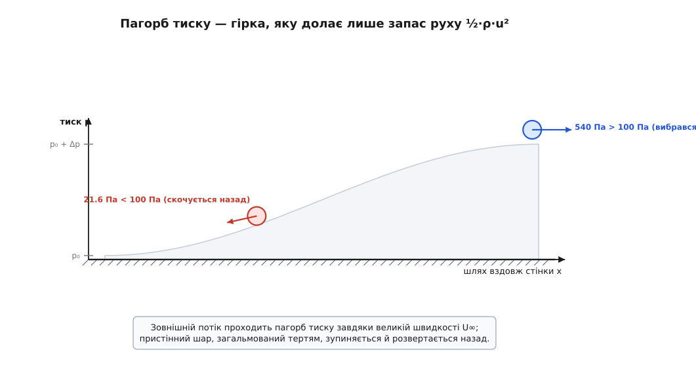
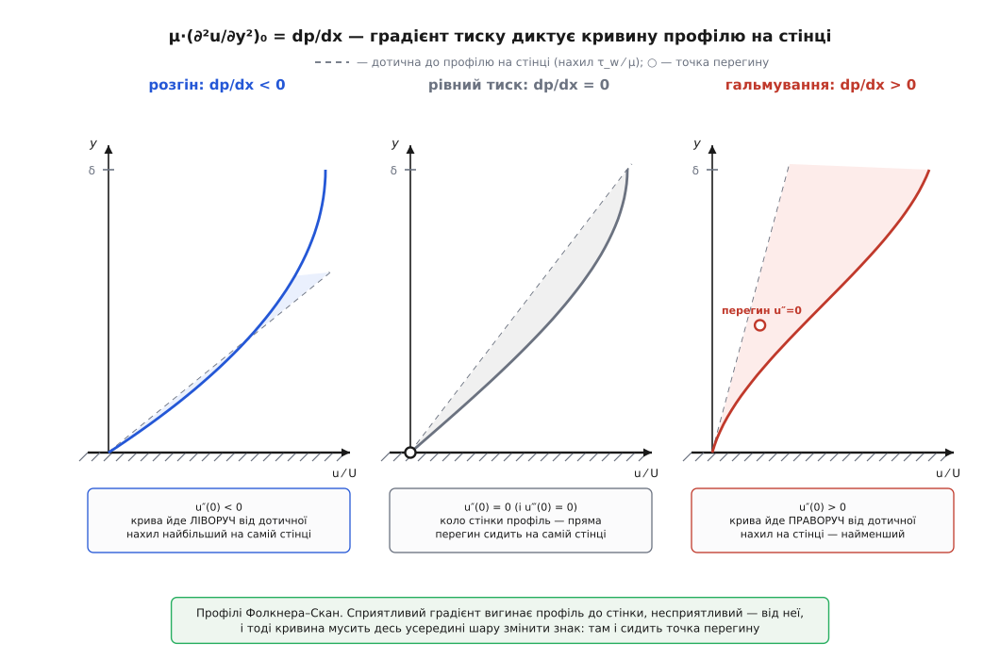
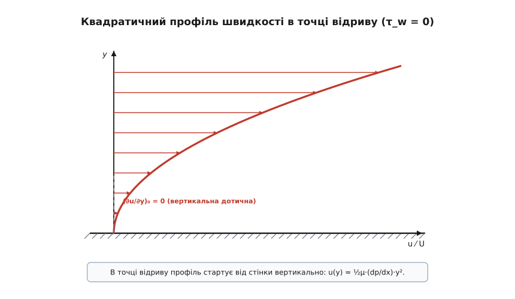
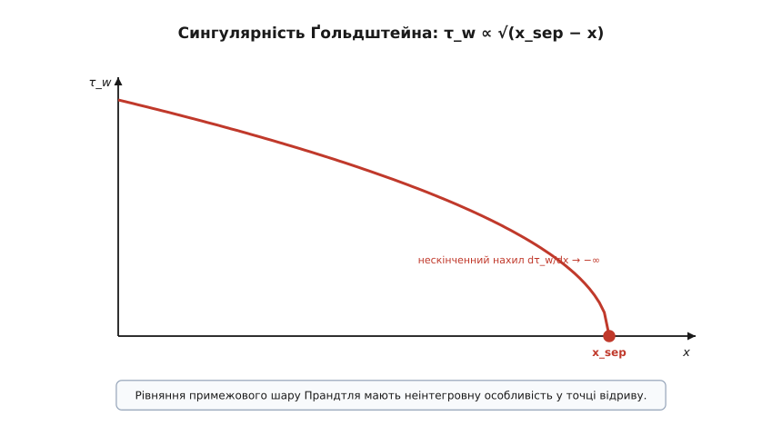
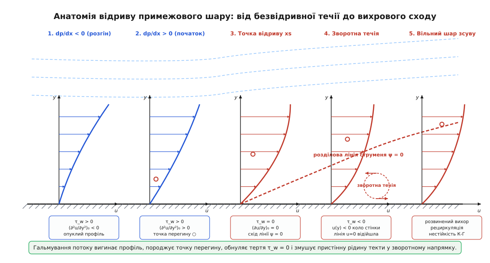
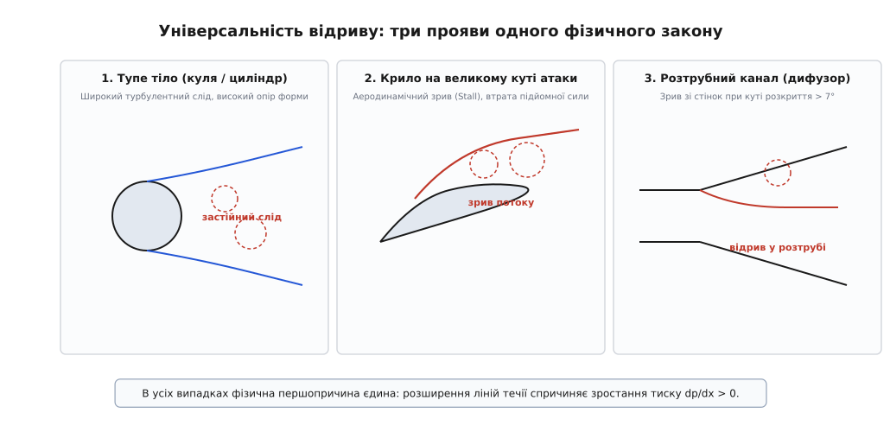
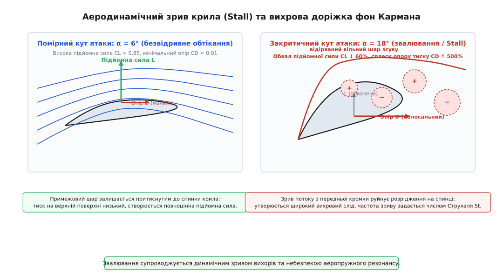

# Відрив потоку

<preknowlist>
- [Примежовий шар](root:ph-mechanics/boundary-layer) — тонка пристінна зона в'язкого гальмування рідини, у якій швидкість зростає від нуля на стінці до швидкості вільного потоку.
- [В'язкість](root:ph-mechanics/viscosity) — внутрішнє тертя рідини; динамічна в'язкість μ та кінематична ν = μ/ρ, що дифундують імпульс між сусідніми шарами.
- [Динамічний тиск і закон Бернуллі](root:ph-mechanics/dynamic-pressure) — перетворення кінетичної енергії струменя ½·ρ·u² на статичний тиск p при сповільненні течії.
- [Інтегральне рівняння імпульсу](root:ph-mechanics/momentum-integral) — співвідношення Кармана між зміною товщини втрати імпульсу θ, форм-параметром H і напруженням тертя на стінці τ_w.
- [Число Рейнольдса](root:ph-mechanics/reynolds-number) — безрозмірне відношення інерційних сил до сил в'язкості Re = U·L/ν.
- [Профіль крила](root:ph-mechanics/profil-kryla) — формування підіймальної сили та розподілу тиску на несиметричних поверхнях.
- [Аеродинамічний опір](root:ph-mechanics/aerodynamic-drag) — поділ сумарного опору тіла на поверхневе тертя та опір форми (тиску).
</preknowlist>

Коли потік повітря зі швидкістю 30 м/с огинає плавно звужену корму обтічного тіла або верхню поверхню крила, тиск уздовж його шляху неминуче зростає. Зовнішній потік, що володіє динамічним напором 540 Па, спокійно долає цей пагорб тиску завдяки значному запасу кінетичної енергії. Проте пристінна рідина в глибині примежового шару, знесилена в'язким тертям до швидкостей менше 4 м/с, несе в собі динамічний напір лише близько 10 Па. Зустрівши зустрічний градієнт тиску величиною 50 Па на довжині кількох сантиметрів, пристінний шар повністю вичерпує свій запас руху, зупиняється і розвертається назад. У точці, де дотичне напруження на стінці спадає до нуля, потік відривається від твердої поверхні, викидаючи вільний шар зсуву у вільний простір і залишаючи під собою широку застійну зону низького тиску.

Цей перехід — відрив потоку — є центральною проблемою гідроаеромеханіки. Саме він обмежує максимальну підйомну силу крила літака, зумовлює виникнення катастрофічного явища звалювання (Stall), генерує понад вісімдесят відсотків повного опору тупих тіл, збуджує небезпечні автоколивання мостових конструкцій та обмежує граничний ККД дифузорів, компресорів і вітрових турбін.

## Гідродинамічна природа примежового шару та масштабування Прандтля

Щоб зрозуміти, чому рідина відривається від поверхні, необхідно звернутися до фізики примежового шару, сформульованої Людвігом Прандтлем 1904 року. За умови прилипання в'язкої рідини до нерухомої твердої стінки швидкість часток на самій поверхні строго дорівнює нулю:

```
на стінці (y = 0):   u(x, 0) = 0,   v(x, 0) = 0
```

На мікроскопічному молекулярному рівні умова прилипання зумовлена тим, що молекули газу або рідини зазнають багаторазових хаотичних зіткнень із мікронерівностями твердої поверхні, повністю релаксуючи свій середній макроскопічний тангенціальний імпульс. Для повітря за нормальних атмосферних умов середня довжина вільного пробігу молекул становить приблизно 68 нанометрів. Оскільки характерний лінійний масштаб макроскопічного обтікання тіл вимірюється сантиметрами та метрами, безрозмірне число Кнудсена `Kn = λ_mfp / L ∼ 10⁻⁷ ≪ 10⁻³`, що гарантує абсолютну неперервність середовища та суворе виконання граничної умови прилипання без будь-якого пристінного ковзання.

У міру віддалення від стінки по нормалі `y` швидкість `u(x, y)` плавно зростає, досягаючи на зовнішній межі примежового шару `y = δ(x)` швидкості зовнішнього безвихрового потоку `U(x)`. Усередині цього тонкого шару товщиною `δ ≪ L` поперечний градієнт швидкості `∂u/∂y` набуває величезних значень, породжуючи значні в'язкі зсувні напруження тертя за законом Ньютона:

```
τ(x, y) = μ · (∂u/∂y)
```

Для стаціонарної плоскої двовимірної течії нестисливої рідини рівняння руху Прандтля виражають локальний баланс трьох фундаментальних факторів: конвективного прискорення, поздовжнього градієнта тиску та дифузії в'язкого імпульсу поперек шару:

```
u·(∂u/∂x) + v·(∂u/∂y) = −(1/ρ)·(dp/dx) + ν·(∂²u/∂y²)
```

де `ν = μ/ρ` — кінематична в'язкість середовища.

Масштабний аналіз повних диференціальних рівнянь Нав'є — Стокса при великих числах Рейнольдса `Re = U_∞·L / ν ≫ 1` дозволяє оцінити порядки величин окремих членів:
- Поздовжня координата `x` змінюється на масштабі довжини тіла `L`, тоді як поперечна координата `y` змінюється на масштабі товщини примежового шару `δ ≪ L`.
- Поздовжня швидкість `u` має порядок швидкості вільного потоку `U_∞`.
- З рівняння нерозривності нестисливої рідини `∂u/∂x + ∂v/∂y = 0` випливає порядок поперечної швидкості `v`:

```
∂u/∂x ∼ U_∞ / L
∂v/∂y ∼ v / δ
v / δ ∼ U_∞ / L   ⇒   v ∼ U_∞ · (δ / L) ≪ U_∞
```

Порівняння конвективних сил `u·(∂u/∂x) ∼ U_∞² / L` та сил в'язкої дифузії `ν·(∂²u/∂y²) ∼ ν·U_∞ / δ²` визначає товщину примежового шару:

```
U_∞² / L ∼ ν·U_∞ / δ²
δ² ∼ ν·L / U_∞ = L² / Re
δ / L ∼ 1 / √Re
```

Оцінимо порядок членів у рівнянні руху вздовж поперечної осі `y`:

```
u·(∂v/∂x) + v·(∂v/∂y) = −(1/ρ)·(∂p/∂y) + ν·(∂²v/∂x² + ∂²v/∂y²)
```

Конвективні доданки мають порядок `U_∞ · (U_∞·δ / L²) ∼ (U_∞² / L) · (δ / L)`. В'язкі члени мають аналогічний порядок `ν · (U_∞·δ / L) / δ² ∼ (U_∞² / L) · (δ / L)`.
Отже, поперечний градієнт тиску має порядок:

```
(1/ρ)·(∂p/∂y) ∼ (U_∞² / L) · (δ / L) = O(δ/L) ≈ 0
```

Це означає, що зміна тиску поперек примежового шару мізерно мала: `Δp_поперечний ∼ ρ·U_∞² · (δ/L)² ≪ ρ·U_∞²`. Статичний тиск передається крізь усю товщину примежового шару від зовнішнього потоку до самої стінки практично без змін:

```
p(x, y) ≈ p_зовнішній(x)   ⇒   ∂p/∂y = 0,   dp/dx = dp_зовнішній/dx
```

У зовнішньому безв'язковому ядрі течії тиск і швидкість пов'язані диференціальною формою інтеграла Бернуллі:

```
dp/dx = −ρ · U(x) · (dU/dx)
```

Таким чином, знак і величина градієнта тиску `dp/dx` визначаються виключно тим, розганяється чи сповільнюється зовнішня течія:
1. **Сприятливий градієнт тиску (`dp/dx < 0, dU/dx > 0`):** зовнішній потік прискорюється (наприклад, у звужуваній частині каналу або на лобовій поверхні тіла від носка до точки максимальної товщини). Тиск попереду нижчий, ніж позаду, що додатково підштовхує рідину вперед і стабілізує пристінний шар.
2. **Несприятливий (конфузорно-дифузорний) градієнт тиску (`dp/dx > 0, dU/dx < 0`):** зовнішній потік сповільнюється (у розширюваному дифузорі або на кормовій частині крила за точкою мінімуму тиску). Тиск попереду вищий, ніж позаду. Цей градієнт діє як гальмівна сила, спрямована назустріч рухові рідини.

## Пагорб тиску та виснаження кінетичної енергії

Розглянемо рух двох рідких часток: однієї — у зовнішньому ядрі потоку, іншої — у пристінному шарі на відстані `y = 0.05·δ`. Нехай обидві частки входять у зону дифузорного відновлення тиску, де статичний тиск зростає на величину `Δp = p_задня − p_передня > 0`.

Зміна кінетичної енергії одиниці об'єму рідини вздовж лінії течії описується теоремою про кінетичну енергію з урахуванням втрат на в'язке тертя:

```
½·ρ·u_кінцева² = ½·ρ·u_початкова² − Δp − W_в'язких_втрат
```

Для частки вільного потоку в'язкі втрати мізерні (`W_в'язких_втрат ≈ 0`), а її початкова кінетична енергія (динамічний тиск `q_∞ = ½·ρ·U_∞²`) значно перевищує перепад тиску `Δp`. Вона долає цей пагорб, лише незначно сповільнюючись до кінцевої швидкості:

```
u_зовнішня,кінцева = √( U_зовнішня,початкова² − 2·Δp / ρ ) > 0
```

Для частки всередині примежового шару ситуація принципово інша:
- Вона вже втратила значну частину своєї механічної енергії на шляху від носка тіла через невпинну роботу сил молекулярного або турбулентного тертя.
- Її локальний запас динамічного напору `½·ρ·u²(y)` значно менший за необхідну величину подолання пагорба `Δp`.

Коли локальний динамічний тиск вичерпується до нуля (`½·ρ·u² ≤ Δp`), частка більше не може рухатися вперед проти наростаючого тиску. Сила зустрічного градієнта тиску `−dp/dx` починає штовхати зупинену рідину у зворотному напрямку — назад, у бік нижчого тиску. Коло стінки народжується зворотна течія, а набігаючий примежовий шар витісняється геть від поверхні.

Поки зовнішній транзитний потік конвертує частину свого кінетичного напору в статичний тиск згідно з оборотним співвідношенням Бернуллі, пристінний шар зазнає незворотної дисипації механічної енергії в тепло:

```
дисипація енергії на одиницю об'єму:   Φ = μ · (∂u/∂y)²
```

Оскільки градієнт швидкості `∂u/∂y` біля стінки надзвичайно великий, саме пристінні шари втрачають найбільше механічної енергії на одиницю пройденого шляху. Підійшовши до ділянки відновлення тиску, вони виявляються повністю знекровленими енергетично.


*Зовнішній потік долає пагорб тиску завдяки великому запасу динамічного напору ½·ρ·U∞²; пристінна рідина, виснажена тертям, зупиняється на підйомі й скочується назад.*

## Інтеграл енергії та дисипація механічного напору

Еволюція кінетичної енергії в примежовому шарі описується інтегральним рівнянням механічної енергії, отриманим інтегруванням добутку рівняння Прандтля на швидкість `u` від стінки до вільного потоку:

```
d( U³ · δ₃ ) / dx = 2 · ∫₀^δ [ τ · (∂u/∂y) ] dy
```

де `δ₃` — товщина втрати енергії примежового шару:

```
δ₃ = ∫₀^δ [ (u/U) · ( 1 − (u/U)² ) ] dy
```

Введемо безрозмірний коефіцієнт об'ємної дисипації `D_D` та енергетичний форм-параметр `H₃₂`:

```
D_D = (1 / (ρ·U³)) · ∫₀^δ [ τ · (∂u/∂y) ] dy
H₃₂ = δ₃ / θ
```

Інтегральне рівняння енергії перетворюється на співвідношення:

```
(1 / U³) · d( U³ · H₃₂ · θ ) / dx = 2 · D_D
```

У міру просування у зону несприятливого градієнта тиску форм-параметр швидкості `H₁₂ = δ*/θ` стрімко зростає (від 2.59 до 3.5...4.0 для ламінарного шару і від 1.35 до 2.4 для турбулентного). Навпаки, енергетичний форм-параметр `H₃₂` монотонно падає до свого критичного мінімуму `H₃₂,sep ≈ 1.515` (ламінарний) або `H₃₂,sep ≈ 1.45` (турбулентний).

Падіння `H₃₂` відображає вичерпання перенесення кінетичної енергії від верхніх шарів до стінки: коли генерація дисипації `D_D` перестає компенсуватися припливом енергії з вільного потоку, пристінний шар неминуче відривається.

## Автомодельні розв'язки Фолкнера — Скан для градієнтних течій

Щоб математично дослідити вплив градієнта тиску на форму профілю швидкості безпосередньо з рівнянь руху, розглянемо класичне сімейство автомодельних течій В. М. Фолкнера та С. Скан (1930). Розглянемо обтікання нескінченного клина з кутом розхилу `π·β`. Зовнішня нев'язка швидкість на межі примежового шару змінюється за степеневим законом:

```
U(x) = C · xᵐ
```

де показник степеня `m` пов'язаний із безрозмірним параметром градієнта тиску `β` співвідношенням:

```
β = 2·m / (m + 1),       m = β / (2 − β)
```

Введемо автомодельну безрозмірну координату `η` та функцію струму `ψ(x, y)`:

```
η = y · √( (m + 1)/2 · U(x) / (ν·x) )
ψ(x, y) = √( 2/(m + 1) · ν·x·U(x) ) · f(η)
```

Поздовжня та поперечна швидкості виражаються через похідні безрозмірної функції `f(η)`:

```
u(x, y) = ∂ψ/∂y = U(x) · f′(η)
v(x, y) = −∂ψ/∂x = −√( ν·U(x) / (2·x) · (m + 1) ) · [ f(η) + (m − 1)/(m + 1) · η · f′(η) ]
```

Підстановка цих виразів у рівняння руху Прандтля зводить диференціальне рівняння в частинних похідних до звичайного нелінійного диференціального рівняння третього порядку — **рівняння Фолкнера — Скан**:

```
f‴ + f · f″ + β · ( 1 − (f′)² ) = 0
```

з граничними умовами прилипання на стінці та виходу на зовнішній потік на нескінченності:

```
f(0) = 0,   f′(0) = 0,   f′(∞) = 1
```

Безрозмірне дотичне напруження на стінці визначається другою похідною на стінці:

```
τ_w(x) = μ · (∂u/∂y)₀ = μ · U(x) · √( (m + 1)/2 · U(x) / (ν·x) ) · f″(0)
```

Аналіз розв'язків рівняння Фолкнера — Скан для різних значень параметра `β` демонструє фундаментальну картину:

1. **`β > 0` (`m > 0`, сприятливий градієнт тиску):**
Потік прискорюється уздовж поверхні. Для `β = 1.0` (`m = 1.0`), що відповідає околу критичної точки гальмування (течія Гіменца), маємо `f″(0) = 1.23259`. Профіль швидкості є опуклим на всій товщині шару (`f″(η) > 0` для всіх `η`), точка перегину відсутня, шар має високу стійкість до збурень.

2. **`β = 0` (`m = 0`, нульовий градієнт тиску):**
Рівняння Фолкнера — Скан перероджується в класичне рівняння Блазіуса для обтікання плоскої пластини: `f‴ + ½·f·f″ = 0`. Чисельне значення тертя становить `f″(0) = 0.33206` (або `0.46960` у нормуванні Блазіуса). Профіль стартує від стінки прямолінійно (`f‴(0) = 0`).

3. **`−0.19884 < β < 0` (`−0.0904 < m < 0`, помірне гальмування):**
Потік сповільнюється уздовж поверхні. На самій стінці `f‴(0) = −β < 0`, тобто кривина на стінці змінює знак на додатний. На зовнішній межі `f″(∞) → 0` знизу. Отже, усередині шару обов'язково виникає точка перегину `f″(η_infl) = 0`. Напруження на стінці монотонно спадає зі збільшенням гальмування.

4. **`β = −0.19884` (`m = −0.0904`, граничний стан відриву):**
Напруження на стінці строго обнуляється: `f″(0) = 0` (`τ_w = 0`). Це відповідає точній автомодельній точці відриву примежового шару. Профіль швидкості біля стінки має суто квадратичний вигляд `f′(η) ≈ ½·|β|·η²`.

5. **`β < −0.19884`:**
Класичних невідривних прямих розв'язків із додатним прямим потоком не існує. Рівняння допускає лише розв'язки зі зворотною течією (`f′(η) < 0` біля стінки), що відповідає розвиненому відриву.

## Кривина профілю швидкості й точка перегину Релея

Математичний механізм відриву безпосередньо випливає з аналізу поведінки профілю швидкості `u(y)` безпосередньо на твердій стінці. Застосуємо рівняння руху Прандтля для точки `y = 0`. Оскільки швидкість на стінці строго дорівнює нулю (`u = 0, v = 0`), конвективні похідні повністю зникають:

```
u·(∂u/∂x)|₀ + v·(∂u/∂y)|₀ = 0
0 = −(1/ρ)·(dp/dx) + ν·(∂²u/∂y²)|₀
```

Звідси випливає фундаментальне пристінне співвідношення:

```
μ · (∂²u/∂y²)|₀ = dp/dx
```

Ця рівність означає, що **знак і величина кривини профілю швидкості на самій стінці строго задаються поздовжнім градієнтом тиску**:

```
1. Сприятливий градієнт (dp/dx < 0):   (∂²u/∂y²)|₀ < 0
   Кривина від'ємна, профіль усюди опуклий, нахил ∂u/∂y максимальний на стінці.

2. Нульовий градієнт (dp/dx = 0):      (∂²u/∂y²)|₀ = 0
   Профіль стартує від стінки прямолінійно (профіль Блазіуса для пластини).

3. Несприятливий градієнт (dp/dx > 0):  (∂²u/∂y²)|₀ > 0
   Кривина на стінці додатна: перша похідна ∂u/∂y спочатку зростає з віддаленням від стінки.
```

З іншого боку, на зовнішній межі примежового шару (`y → δ`) швидкість асимптотично наближається до зовнішньої `U(x)`, що вимагає затухання нахилу `∂u/∂y → 0` знизу. Це означає, що коло зовнішньої межі друга похідна завжди є строго від'ємною:

```
при y → δ:   ∂²u/∂y² < 0
```

Якщо на стінці `(∂²u/∂y²)|₀ > 0`, а на зовнішній межі `∂²u/∂y²|δ < 0`, то за теоремою про проміжне значення неперервної функції всередині примежового шару обов'язково існує висота `y_infl ∈ (0, δ)`, у якій друга похідна перетворюється на нуль:

```
існує y_infl:   (∂²u/∂y²)|_{y = y_infl} = 0        ← точка перегину профілю
```

Наявність точки перегину має визначальне значення для стійкості течії. За теоремою лорда Релея (1880) та уточненим критерієм Раґнара Фьортофта (1950), **наявність точки перегину є необхідною та достатньою умовою лінійної гідродинамічної нестійкості зсувної течії до безв'язкових хвильових збурень**. Докладне аналітичне виведення наведено у вставці [математика несприятливого градієнта](root:ph-mechanics/flow-separation/math-adverse-gradient.md). Профіль із точкою перегину стає внутрішньо нестабільним, у ньому починають лавиноподібно наростати хвилі Толміна — Шліхтінга, провокуючи перехід у турбулентність або згортання відірваного шару у дискретні вихори.


*Профілі швидкості Фолкнера — Скан: сприятливий градієнт формує опуклий профіль без перегину; несприятливий градієнт неминуче породжує точку перегину u″ = 0 всередині шару.*

## Стійкість зсувних течій: рівняння Орра — Зоммерфельда

Щоб зрозуміти, чому точка перегину викликає катастрофічну дестабілізацію потоку, розглянемо класичну гідродинамічну теорію стійкості. Накладемо на стаціонарний профіль швидкості `u_0(y)` малі двовимірні хвильові збурення швидкості та тиску:

```
u(x, y, t) = u_0(y) + u′(x, y, t)
v(x, y, t) = v′(x, y, t)
p(x, y, t) = p_0(x) + p′(x, y, t)
```

Запишемо збурення через функцію струму `ψ′(x, y, t) = φ(y) · exp( i·(α·x − ω·t) )`, де `α` — дійсне хвильове число, `ω = ω_r + i·ω_i` — комплексна частота, а `c = ω / α = c_r + i·c_i` — комплексна фазова швидкість. Амплітуда збурення змінюється в часі як `exp(α·c_i·t)`. Якщо `c_i > 0`, амплітуда експоненціально зростає, що свідчить про гідродинамічну нестійкість.

Підстановка у лінеаризовані рівняння Нав'є — Стокса дає фундаментальне **рівняння Орра — Зоммерфельда**:

```
( u_0 − c ) · ( φ″ − α²·φ ) − u_0″ · φ = −( i / (α·Re) ) · ( φ⁗ − 2·α²·φ″ + α⁴·φ )
```

У граничному випадку великих чисел Рейнольдса (`Re → ∞`) праві в'язкі доданки прямують до нуля, і рівняння редукується до нев'язкого **рівняння Релея**:

```
( u_0 − c ) · ( φ″ − α²·φ ) − u_0″ · φ = 0
```

Помножимо рівняння Релея на комплексно-спряжену амплітуду `φ*` та проінтегруємо поперек примежового шару від `y = 0` до `y = δ`:

```
∫₀^δ [ |φ′|² + α²·|φ|² ] dy + ∫₀^δ [ u_0″ / (u_0 − c) ] · |φ|² dy = 0
```

Виділимо уявну частину цього комплексного виразу:

```
c_i · ∫₀^δ [ u_0″ / |u_0 − c|² ] · |φ|² dy = 0
```

Для нестійких зростаючих мод (`c_i > 0`) цей інтеграл мусить строго дорівнювати нулю. Оскільки множник `|φ|² / |u_0 − c|²` є строго додатним у всій області течії, інтеграл може обнулитися лише за умови, що друга похідна швидкості `u_0″(y)` змінює знак на проміжку `(0, δ)`.

Це строге математичне доведення **теореми Релея**: наявність точки перегину `u_0″(y_infl) = 0` є абсолютно необхідною умовою для виникнення безв'язкової нестійкості зсувної течії.

Раґнар Фьортофт (1950) посилив цю умову, довівши, що для нестійкості необхідно також виконання нерівності:

```
u_0″(y) · ( u_0(y) − u_0(y_infl) ) < 0
```

для деякої області всередині примежового шару. Профілі з несприятливим градієнтом тиску завжди задовольняють обидва критерії. Внаслідок цього критичне число Рейнольдса втрати стійкості для потоку з гальмуванням падає з `Re_crit ≈ 520` (для пластини Блазіуса) до мізерних значень `Re_crit ≈ 50...80`. Примежовий шар стає вкрай чутливим до будь-яких зовнішніх акустичних або турбулентних шумів.

## Критерій відриву Прандтля та сингулярність Ґольдштейна

У міру просування потоку вздовж ділянки гальмування нахил швидкості на стінці `(∂u/∂y)₀` безперервно спадає. Точка `x_sep`, у якій зсувне напруження на поверхні вперше стає рівним нулю, визначає **точку відриву потоку за Прандтлем**:

```
умова відриву:   τ_w(x_sep) = μ · (∂u/∂y)_{y=0, x=x_sep} = 0
```

У точці відриву:
- Дотичне тертя рідини об поверхню зникає (`τ_w = 0`), внаслідок чого локальний коефіцієнт тертя `c_f = 2·τ_w / (ρ·U²) = 0`.
- Дотична до профілю швидкості на стінці стає строго перпендикулярною до поверхні: `(∂u/∂y)₀ = 0`.
- Розклад швидкості в ряд Тейлора біля стінки починається відразу з квадратичного члена:

```
u(y) = u(0) + (∂u/∂y)₀·y + ½·(∂²u/∂y²)₀·y² + ⅙·(∂³u/∂y³)₀·y³ + O(y⁴)
     = 0    + 0·y        + ½·(1/μ)·(dp/dx)·y² + ⅙·(∂³u/∂y³)₀·y³ + O(y⁴)
u(y) ≈ ½·(1/μ)·(dp/dx)·y²
```

За точкою відриву (`x > x_sep`) нахил на стінці стає від'ємним `(∂u/∂y)₀ < 0`, а швидкість рідини біля поверхні набуває від'ємних значень (`u < 0`) — виникає зворотна течія. Лінія нульової поздовжньої швидкості `u(x, y) = 0` відривається від стінки й підіймається вглиб потоку.


*У точці нульового тертя τ_w = 0 профіль швидкості стартує від стінки параболою u(y) ≈ ½μ·(dp/dx)·y². Вона описує дійсний рух рідини вперед лише за умови несприятливого градієнта dp/dx > 0.*

Від стінки під кутом `θ_sep` сходить розділова лінія струменя `ψ = 0` (dividing streamline), яка відокремлює зовнішній транзитний потік від замкненої застійної рециркуляційної каверни. Кут сходу струменя визначається локальним темпом зміни напруження тертя та градієнтом тиску:

```
tan(θ_sep) = −3 · ( (dτ_w/dx) / (dp/dx) )
```

При спробі чисельного інтегрування класичних рівнянь Прандтля з наперед заданим розподілом тиску `p(x)` розрахунок зазнає неминучої катастрофи в точці відриву. Сідні Ґольдштейн (1948) математично довів, що розв'язок рівнянь примежового шару має неінтегровну алгебраїчну сингулярність:

```
τ_w(x) ∝ √( x_sep − x )           при x → x_sep
dτ_w/dx ∝ −1 / √( x_sep − x ) → −∞
v(x, δ) ∝ 1 / √( x_sep − x ) → +∞
```


*Спад напруження на стінці до нуля відбувається за кореневим законом τ_w ∝ √(x_sep − x) із нескінченним нахилом у точці відриву.*

Фізична причина цієї особливості полягає в тому, що класична теорія вважає примежовий шар пасивним (зовнішній потік диктує тиск, а шар підлаштовується). У точці відриву потовщений шар різко відтискає зовнішні лінії течії, внаслідок чого сам примежовий шар починає активно деформувати зовнішнє поле тиску. Коректний розрахунок зони відриву вимагає використання інтегральних моделей або теорії потрійної палуби (Triple-Deck Theory), де поле тиску й еволюція шару розв'язуються взаємоузгоджено. Для швидкої оцінки точки відриву безпосередньо за кривою швидкості застосовують [інтегральний метод Твейтса](root:ph-mechanics/flow-separation/proj-thwaites-separation.md).


*Еволюція профілю швидкості при переході від прискореної течії до зони несприятливого градієнта: поява точки перегину, досягнення нульового зсувного напруження на стінці (τ_w = 0) та формування рециркуляційної зони зворотної течії під лінією нульового струменя ψ = 0.*

## Теорія потрійної палуби (Triple-Deck Theory)

Щоб математично усунути сингулярність Ґольдштейна та описати реальну фізику взаємодії в'язкого шару із зовнішнім потоком у зоні відриву, В. Ніланд, К. Стюартсон та П. Вільямс (1969) розробили **теорію потрійної палуби** (Triple-Deck Theory).

При числах Рейнольдса `Re ≫ 1` в околі точки відриву розміром `Δx ∼ L · Re⁻³/⁸` течія природно розшаровується на три вертикальні масштаби:

```
1. Нижня палуба (Lower Deck, y ∼ L · Re⁻⁵/⁸):
   Тонкий пристінний шар, де діють сили молекулярної в'язкості та самоіндукований градієнт
   тиску. Описується спрощеними рівняннями примежового шару з невідомим заздалегідь тиском P(X).

2. Основна палуба (Main Deck, y ∼ L · Re⁻¹/⁸ ∼ δ):
   Вся основна товща примежового шару. Тут сили в'язкості несуттєві, а шар поводиться як
   нев'язкий зсувний потік, що пасивно вигинається вгору на функцію витіснення A(X).

3. Верхня палуба (Upper Deck, y ∼ L · Re⁻³/⁸):
   Зовнішній безвихровий потік. Описується лінеаризованими рівняннями потенціальної течії.
```

Зв'язок між функцією витіснення основної палуби `A(X)` та самоіндукованим тиском `P(X)` у верхній палубі задається сингулярним інтегралом Гільберта:

```
P(X) = −(1/π) · ∫_{−∞}^{+∞} [ (dA/dξ) / (X − ξ) ] dξ
```

Цей механізм замкненого зворотного зв'язку (Viscous-Inviscid Interaction) пом'якшує несприятливий градієнт тиску безпосередньо перед точкою нульового тертя. В результаті сингулярність Ґольдштейна зникає: напруження на стінці плавно перетинає нуль, а вертикальна швидкість `v` на межі шару залишається строго скінченною.

## Топологія тривимірного відриву: лінії тертя та особливі точки

На реальних просторових тілах (стрілоподібних крилах, фюзеляжах, підводних човнах, автомобілях) відрив потоку має тривимірний характер і суттєво відрізняється від плоского випадку. На 3D поверхні локальне зсувне напруження є двовимірним вектором:

```
τ⃗_w(x, z) = ( τ_x(x, z),  τ_z(x, z) )
```

Головна відмінність просторового відриву полягає в тому, що **модуль вектора тертя |τ⃗_w| у зоні відриву зовсім не обов'язково перетворюється на нуль**. Рідина може безперервно рухатися вздовж розмаху, відриваючись від поверхні у формі вихрових поверхонь.

Структура просторової течії досліджується за допомогою **ліній поверхневого тертя** (Skin Friction Lines) — інтегральних кривих векторного поля `τ⃗_w`, до яких вектор тертя є дотичним у кожній точці:

```
dx / τ_x(x, z) = dz / τ_z(x, z)
```

Точки поверхні, де вектор тертя строго обнуляється (`τ_x = 0, τ_z = 0`), називаються **особливими (критичними) точками**. За класифікацією Анрі Пуанкаре та Р. Лежандра, характер критичної точки визначається власними значеннями матриці Якобі градієнтів тертя `J = ∇τ⃗_w`:

1. **Вузли (Nodes):**
Точки розтікання (вузол приєднання — лінії тертя виходять з точки в усіх напрямках) або стікання (вузол відриву — лінії тертя сходяться в точку з поверхні й підіймаються струменем у вільний простір).

2. **Фокуси (Foci):**
Точки закручування ліній тертя у спіраль навколо єдиного центра. Фокус відриву є місцем зародження потужного торнадоподібного вихрового джгута, що підіймається перпендикулярно до стінки (наприклад, вихори над напливами дельтоподібного крила літака Concorde або винищувачів на великих кутах атаки).

3. **Сідла (Saddles):**
Точки сходження двох зустрічних ліній тертя з подальшим їхнім розходженням у перпендикулярних напрямках. Сепаратриса сідлової точки утворює чітку **лінію відриву** (Separation Line), уздовж якої лінії тертя з обох боків асимптотично зливаються і сходять у потік у формі вільного шару зсуву.

Для будь-якої замкненої гладкої поверхні тіла топологічна кількість особливих точок підпорядковується теоремі Ейлера — Пуанкаре:

```
∑ ( Вузли + Фокуси ) − ∑ Сідла = 2
```

Розрізняють **закритий відрив** (Closed Separation), коли лінія відриву починається і закінчується у сідлових точках або утворює замкнений контур, та **відкритий відрив** (Open Separation), коли шар сходить уздовж регулярної плавної лінії сходження тертя без наявності локальних нулів `|τ⃗_w| = 0`.

## Ламінарний проти турбулентного шару: криза опору та структура перед відривом

Здатність примежового шару протистояти несприятливому градієнту тиску кардинально залежить від режиму течії — ламінарного чи турбулентного.

У **ламінарному примежовому шарі** перенесення імпульсу між сусідніми рідкими шарами здійснюється виключно молекулярною в'язкістю `μ`. Профіль швидкості (розв'язок Блазіуса) є пологим, а форм-параметр становить `H = δ*/θ ≈ 2.59`. Пристінні частки слабко пов'язані з швидким зовнішнім потоком, тому ламінарний шар є надзвичайно чутливим до гальмування: падіння швидкості зовнішнього потоку всього на 6–8% від максимальної здатне призвести до повного ламінарного відриву.

У **турбулентному примежовому шарі** хаотичні вихрові пульсації швидкостей `u'` та `v'` породжують додаткові турбулентні напруження Рейнольдса `τ_t = −ρ·⟨u'v'⟩ = ρ·ν_t·(∂u/∂y)`. Турбулентна в'язкість `ν_t` у ядрі шару перевищує молекулярну на 2–3 порядки величини. Це спричиняє інтенсивне неперервне перемішування: високошвидкісні порції рідини з вільного потоку переносяться вниз, безпосередньо до в'язкого підшару.

```
Профіль швидкості:
- Ламінарний (Блазіус):   u/U ≈ 2·(y/δ) − 2·(y/δ)³ + (y/δ)⁴,    H ≈ 2.59
- Турбулентний (закон 1/7): u/U ≈ (y/δ)¹/⁷,                      H ≈ 1.28...1.40
```

За універсальним законом Коулза профіль швидкості турбулентного шару описується суперпозицією закону стінки та закону сліду:

```
u / u_τ = (1/κ) · ln( y·u_τ / ν ) + B + (2·Π / κ) · sin²( π·y / (2·δ) )
```

де `u_τ = √(τ_w / ρ)` — динамічна швидкість тертя, `κ ≈ 0.41` — стала Кармана, `B ≈ 5.0`, а `Π` — параметр сліду Коулза.

У зоні безградієнтного обтікання `Π ≈ 0.55`. Однак при наближенні до точки турбулентного відриву відбуваються драматичні зміни:
- Напруження тертя `τ_w` прямує до нуля, внаслідок чого `u_τ → 0`.
- Параметр сліду `Π` катастрофічно зростає до значень `Π = 5.0...10.0`.
- Логарифмічний пристінний підшар стискається, а весь профіль швидкості перетворюється на профіль вільного струменя.
- Форм-параметр `H = δ*/θ` зростає від звичайних значень `1.3...1.4` до критичного порогу турбулентного відриву `H_sep ≈ 2.2...2.6`.

Завдяки наповненості турбулентного профілю рідина на відстані `y = 0.05·δ` у турбулентному шарі володіє швидкістю `u ≈ 0.65·U` (динамічний напір `q ≈ 0.42·q_∞`), тоді як у ламінарному — лише `u ≈ 0.10·U` (динамічний напір `q ≈ 0.01·q_∞`). Турбулентний шар несе в сорок разів більше кінетичної енергії біля стінки і здатний долати значно більші перепади тиску без відриву.

Яскравою ілюстрацією цієї відмінності є **криза опору** (Drag Crisis) при обтіканні сфери або поперечного циліндра.
- При докритичних числах Рейнольдса (`Re < 3·10⁵`) примежовий шар на лобовій частині сфери є ламінарним. Зустрівши несприятливий градієнт на кормовій поверхні, він відривається вже при полярному куті `φ ≈ 82°` (до міделя). За сферою утворюється широкий слід, тиск на кормі падає, і коефіцієнт лобового опору становить `C_D ≈ 0.47`.
- При надкритичних числах Рейнольдса (`Re > 3.5·10⁵`) шар турбулізується до точки відриву. Завдяки інтенсивному вихровому перемішуванню турбулентний шар утримується на поверхні сфери аж до `φ ≈ 120°`. Точка відриву зміщується далеко назад, ширина застійного вихрового сліду зменшується в кілька разів, а коефіцієнт опору падає майже уп'ятеро — до `C_D ≈ 0.08...0.10`.

Саме цим пояснюється нанесення лунок (димплів) на поверхню м'ячів для гольфу: штучна шорсткість збурює ламінарний шар у турбулентний при менших швидкостях польоту, затримує відрив і дозволяє м'ячу летіти вдвічі далі.


*Три прояви єдиного закону відриву: широкий слід за тупим тілом, звалювання крила під великим кутом атаки та зрив потоку зі стінок дифузора.*

## Аеродинамічний зрив крила (Stall) і режими звалювання

Коли профіль крила рухається під додатним кутом атаки `α`, обтікання верхньої поверхні (спинки) вимагає інтенсивного розгону рідини над носком крила. Виникає виражений пік розрідження (Suction Peak), за яким слідує протяжна область несприятливого градієнта тиску `dp/dx > 0` у напрямку до задньої кромки.

Зі збільшенням кута атаки `α`:
1. Пік розрідження біля носка крила стає вищим і вужчим, а коефіцієнт тиску досягає значень `C_p_min = −3.0 ... −8.0`.
2. Несприятливий градієнт тиску за піком стає дедалі крутішим.
3. Точка нульового тертя `τ_w = 0` переміщується проти течії, скорочуючи довжину безвідривної ділянки.
4. При досягненні критичного кута атаки `α_crit` (зазвичай `12° ... 18°`) потік масивно відривається від спинки крила — настає **аеродинамічний зрив** (Stall).


*Порівняння обтікання профілю крила: при помірному куті атаки (α = 6°) примежовий шар плавно обгинає спинку, забезпечуючи високу підйомну силу; при закритичному куті (α = 18°) виникає зрив потоку з утворенням когерентних вихорів і широкого сліду фон Кармана.*

Залежно від геометричних параметрів профілю (насамперед відносної товщини `t/c` та радіуса скруглення носка `r_LE`) розрізняють три класичні типи зриву крила:

| Тип зриву | Геометрія профілю | Фізичний механізм зриву | Характер поляри C_L(α) |
|---|---|---|---|
| **Зрив із задньої кромки** (Trailing-Edge Stall) | Товсті профілі (`t/c ≥ 15%`, NACA 4418, NACA 63-418) | Турбулентний відрив зароджується на задній кромці й плавно просувається вперед до носка | М'який платоподібний спад `C_L`, збереження керованості, відсутність різкого звалювання |
| **Зрив із передньої кромки** (Leading-Edge Stall) | Профілі середньої товщини (`9% ≤ t/c ≤ 15%`, NACA 0012, NACA 2412) | Ламінарний відрив на носку формує коротку бульбашку (LSB), яка раптово розривається (Bursting) | Катастрофічний обвал підйомної сили (`ΔC_L ↓ 50%`), різкий пікіруючий момент |
| **Тонкопрофільний зрив** (Thin-Airfoil Stall) | Надтонкі профілі (`t/c < 6%`, плоскі пластини, надзвукові крила) | Відрив відбувається на гострому носку при малих `α` з утворенням довгої бульбашки, яка росте до корми | Монотонне уповільнення росту `C_L`, низький `C_L,max`, високий профільний опір |

### Гістерезис звалювання та динамічний зрив

Зрив крила супроводжується вираженим явищем **аеродинамічного гістерезису**: кут атаки зворотного приєднання потоку при зменшенні кута атаки `α_reatt` завжди помітно менший за критичний кут початку зриву `α_stall` (`α_reatt < α_stall`). Пояснення полягає в тому, що після формування масивної відривної каверни зовнішній потік відхилений далеко від профілю, і для ліквідації застійної зони потрібен більший запас енергії струменя, ніж для її підтримки.

Для профілів, що здійснюють нестаціонарні гармонічні коливання за тангажем (лопаті вертольотів, вітрогенераторів або махаюче крило), виникає явище **динамічного зриву** (Dynamic Stall). Коли кут атаки швидко зростає (`dα/dt > 0`), затримка розвитку примежового шару дозволяє крилу короткочасно досягати кутів `α`, що значно перевищують статичний поріг `α_crit`. На носку крила формується потужний когерентний **вихір динамічного зриву** (Dynamic Stall Vortex), який рухається вздовж спинки до задньої кромки, генеруючи короткочасний сплеск надвисокої підйомної сили (`C_L,max` зростає на 40–80%). Коли вихір сходить у слід, підйомна сила раптово падає до нуля, а на профіль діє потужний пікіруючий момент (`ΔC_m ≈ −0.4`), що викликає небезпечний крутильний флатер конструкції.

## Відрив потоку в турбомашинах: обертовий зрив і помпаж

У проточних частинах осьових і відцентрових компресорів авіаційних газотурбінних двигунів відрив потоку на решітках робочих лопаток переростає у складні просторові нестаціонарні автоколивання:

1. **Обертовий зрив (Rotating Stall):**
Коли на одній із лопаток компресора через локальну нерівномірність набігаючого потоку виникає відрив, застійна зона перекриває міжлопатковий канал. Набігаючий потік обтікає застійну зону, що збільшує кут атаки на сусідній лопатці, розташованій проти напрямку обертання ротора, та зменшує кут атаки на лопатці за напрямком обертання. У результаті відривна зона перескакує на сусідню лопатку. Формується стійка **відривна комірка** (Stall Cell), яка обертається по колу решітки компресора зі швидкістю `30% ... 50%` від частоти обертання вала двигуна, створюючи сильну втомну вібрацію лопаток.

2. **Аеродинамічний помпаж (Surge):**
Якщо обертовий зрив поширюється на всі ступені компресора, напірний тракт повністю втрачає здатність підтримувати високий ступінь підвищення тиску `π_k`. Високий тиск у камері згоряння долає опір компресора, і гаряче повітря з громоподібним ударом викидається назустріч руху літака у вхідний повітрозабірник (зворотний прорив полум'я). Виникають гігантські низькочастотні коливання витрати газу (`1 ... 5 Гц`), які здатні зруйнувати двигун за кілька секунд.

## Вихрові доріжки фон Кармана та явище VIV

Коли потік відривається з двох протилежних боків обтічного тіла (циліндра, призми, троса чи зірваного крила), дві відірвані поверхні розриву швидкості — вільні шари зсуву — несуть завихреність протилежного знака:

```
верхній шар:   ω_z = (∂v/∂x − ∂u/∂y) < 0       (обертання за годинниковою стрілкою)
нижній шар:    ω_z = (∂v/∂x − ∂u/∂y) > 0       (обертання проти годинникової стрілки)
```

Вільні шари зсуву є нестійкими і під дією взаємного індукованого поля швидкостей починають періодично згортатися у дискретні вихрові скупчення. Верхній вихір затягує протилежний вільний шар поперек сліду, відтинаючи живлення нижнього вихору. Потім процес повторюється у дзеркальному порядку. У сліді формується регулярна подвійна шахова послідовність вихорів — **вихрова доріжка фон Кармана** (1911).

Теодор фон Карман математично довів, що шахова вихрова доріжка є динамічно стійкою до малих просторових збурень лише при єдиному фіксованому відношенні ширини доріжки `h` до поздовжнього кроку між однойменними вихорами `l`:

```
h / l = (1/π) · arsinh(1) = (1/π) · ln( 1 + √2 ) ≈ 0.28055
```

Частота періодичного зриву вихорів `f` однозначно визначається безрозмірним **числом Струхаля** `St`:

```
St = ( f · D ) / U_∞
```

де `D` — характерний поперечний розмір тіла (діаметр циліндра або товщина відривного сліду).

Для кругового циліндра в широкому діапазоні чисел Рейнольдса `300 < Re < 1.5·10⁵` число Струхаля залишається практично незмінним: `St ≈ 0.20...0.21`.

Періодичне сходження вихорів породжує знакозмінну циркуляцію швидкості навколо тіла, що за теоремою Жуковського призводить до виникнення нестаціонарної поперечної сили (Lift Oscillation) з амплітудою `C_L(t) = C_L,0 · sin(2π·f·t)` та пульсацій поздовжнього опору з подвоєною частотою `2f`.

Якщо частота вихрового зриву `f` збігається з власною частотою пружних коливань конструкції `f_0`, виникає явище **аеропружного резонансного захоплення частоти** (Lock-in або Vortex-Induced Vibrations, VIV). Тіло починає інтенсивно коливатися впоперек потоку, амплітуда коливань зростає, а вихровий зрив синхронізується з рухом тіла в широкому діапазоні швидкостей вітру. Це явище стало причиною руйнування мосту Такома-Нерроуз у США (1940), вібрацій промислових димарів, підводних нафтових райзерів та високовольтних ліній передач.

### Математичне моделювання VIV осцилятором Ван дер Поля

Для розрахунку динаміки коливань тіла у вихровому сліді застосовують зв'язану систему рівнянь осцилятора Блевінса — Хартлена:

```
механічна підсистема:   m·ÿ + 2·m·ζ·ω₀·ẏ + m·ω₀²·y = ½·ρ·U_∞²·D · C_L(t)
гідродинамічний слід:  C̈_L + ε·ω_s·(C_L² − 1)·Ċ_L + ω_s²·C_L = (A / D) · ÿ
```

де `m` — маса одиниці довжини конструкції, `ζ` — коефіцієнт механічного демпфування, `ω₀ = 2π·f₀` — власна кругова частота, `ω_s = 2π·St·U_∞ / D` — частота вільного зриву вихорів Струхаля, а `ε, A` — емпіричні коефіцієнти зв'язку.

Аналіз розв'язків цієї нелінійної системи виявляє три характерні діапазони:
1. **Дорезонансна зона (`U_r = U_∞ / (f₀·D) < 4.5`):** частота зриву вихорів відрізняється від `f₀`, амплітуда коливань конструкції мізерна (`y_max / D < 0.02`), поперечна сила слабко корельована вздовж довжини тіла.
2. **Зона резонансного захоплення Lock-in (`4.5 ≤ U_r ≤ 8.0`):** гідродинамічна частота `ω_s` насильно притягується до власної частоти тіла `ω₀`. Пульсації тиску синхронізуються по всій довжині споруди. Амплітуда коливань сягає `y_max / D ≈ 0.5...1.2`, що загрожує втомним руйнуванням опорних балок і тросів.
3. **Післярезонансна зона (`U_r > 8.0`):** зрив вихорів зривається з синхронізації й повертається до закону Струхаля, амплітуда коливань різко спадає.

## Аероакустика відривних течій: дипольні джерела Лігтхілла

Відрив потоку завжди супроводжується інтенсивною генерацією акустичного шуму. За акустичною аналогією Джеймса Лігтхілла (1952) та теорією Н. Керла (1955) для обтікання тіл із твердими границями, нестаціонарне поле тиску на поверхні утворює просторово розподілену систему акустичних диполів.

Хвильове рівняння густини збурень середовища `ρ′` у присутності твердого тіла має вигляд:

```
∂²ρ′/∂t² − c₀²·∇²ρ′ = ∇·( ∇·T_ij ) − ∇·F⃗_поверхнева
```

де `T_ij = ρ·u_i·u_j + p_ij − c₀²·ρ·δ_ij` — тензор напружень Лігтхілла (квадрупольні об'ємні джерела), а `F⃗_поверхнева` — нестаціонарна сила тиску на стінці (дипольні джерела).

У дозвукових течіях дипольний шум відриву домінує над квадрупольним шумом вільної турбулентності на кілька порядків величини. Сумарна випромінювана акустична потужність `W_акустична` масштабується пропорційно шостому степеню швидкості набігаючого потоку:

```
W_акустична ∝ ( ρ_∞ · U_∞⁶ · L² ) / c₀³
```

де `c₀` — швидкість звуку в середовищі.

Саме цим пояснюється виникнення сильного свисту вітрових турбін, гуркоту шасі літаків при випуску перед посадкою та еолових тонів на проводах ліній електропередач при сильному вітрі.

## Методи керування та затримки відриву потоку

Боротьба з відривом потоку ведеться двома основними шляхами: оптимізацією форми тіла для пом'якшення градієнта тиску та застосуванням спеціальних систем активного чи пасивного керування примежовим шаром.

### 1. Пасивні методи керування (без витрат енергії)

1. **Вихрогенератори (Vortex Generators, VG):**
Малі пластини-крильця висотою `h ≈ 0.8...1.2·δ`, встановлені на поверхні крила під кутом `12° ... 15°` до набігаючого потоку. Кожен вихрогенератор утворює стійкий поздовжній вихір, що обертається навколо осі течії. Ці вихори активно захоплюють швидке повітря з ядра зовнішнього потоку й затягують його безпосередньо до стінки, наповнюючи пристінний шар кінетичною енергією. Встановлення вихрогенераторів на 15–20% хорди дозволяє збільшити критичний кут атаки крила на `3° ... 5°` та підвищити `C_L,max` на 15–25%.

2. **Турбулізатори (Turbulator Strips / Zig-Zag Tape):**
Зигзагоподібні смужки, шорсткі стрічки або виступи висотою менше товщини шару, розміщені перед розрахунковою точкою ламінарного відриву. Вони примусово переводять ламінарний шар у турбулентний стан, запобігаючи формуванню довгих відривних бульбашок на планерах, легких літаках і лопатях безпілотників.

3. **Щілинна механізація крила (Slats та Slotted Flaps):**
Передкрилки та закрилки мають профільовані щілини між своїми елементами. Завдяки природному перепаду тиску між нижньою поверхнею крила (де тиск високий) та верхньою (де тиск низький), свіже повітря крізь щілину розганяється у високошвидкісний пристінний струмінь. Цей струмінь впорскується у знесилений примежовий шар спинки крила, здуваючи точку відриву до самої задньої кромки.

### 2. Активні методи керування (із підведенням зовнішньої енергії)

1. **Відсмоктування примежового шару (Boundary Layer Suction):**
Видалення сповільненої пристінної рідини крізь мікроперфоровані панелі або поперечні щілини за допомогою вакуумного насоса. Відсмоктування усуває рідину з нульовим імпульсом, притискає лінії течії до поверхні, ліквідує точку перегину в профілі та зсуває точку відриву далеко за корму.

2. **Активне видування струменів (Blowing / Jet Flaps / Circulation Control):**
Вдування тангенціального струменя стисненого повітря з компресора двигуна вздовж опуклої поверхні крила або відхиленого закрилка. Завдяки **ефекту Коанда** високошвидкісний струмінь прилипає до вигнутої стінки, затягуючи за собою зовнішній потік і дозволяючи відхиляти лінії течії на кути до `50° ... 60°` без зриву потоку. Застосування закругленої задньої кромки з тангенціальним видуванням (Circulation Control Wings) дозволяє досягати рекордних коефіцієнтів підйомної сили `C_L = 4.5 ... 6.0` на коротких злітно-посадкових смугах для важких транспортних літаків (наприклад, експериментальні літаки YC-14 та QSRA).

3. **Природні ламінарні профілі (Natural Laminar Flow, NLF):**
Сучасні профілі крила (серії NACA 6-digit та NLF) оптимізуються таким чином, щоб точка мінімального тиску `C_p_min` була зміщена далеко назад — до 50–60% хорди. На всій цій довжині підтримується слабкий, але постійний сприятливий градієнт тиску `dp/dx < 0`, що надійно стабілізує ламінарний шар без точок перегину та запобігає його передчасній турбулізації. У кормовій зоні відновлення тиску профіль розраховується з увігнутим розподілом тиску Стредфорда (Stratford Pressure Recovery), де темп гальмування рідини точно дозується для запобігання відриву при мінімальній довжині дифузорної зони.

4. **Синтетичні струмені (Synthetic Jet Actuators, SJA):**
Мембранні п'єзоелектричні актуатори з мікропорожниною, що генерують періодичні пульсації повітря з нульовим сумарним масовим потоком (Zero-Net Mass-Flux). Періодичний викид і всмоктування формують когерентні пари вихорів, які локально руйнують застійну зону та відновлюють безвідривний рух.

5. **Плазмові бар'єрні актуатори (DBD Plasma Actuators):**
Високовольтні діелектричні актуатори (напруга 5–15 кВ, частота 1–20 кГц), що іонізують пристінний шар повітря. Електрогідродинамічна об'ємна сила `F⃗_EHD = ρ_c · E⃗` розганяє пристінний газ до 5–8 м/с без рухомих механічних елементів, ліквідуючи відрив на передній кромці за лічені мілісекунди.

## Інженерне моделювання та алгоритмічний аналіз: C99 та C++20

Розглянемо повнофункціональну інженерну бібліотеку, що об'єднує чисельний аналіз еволюції примежового шару методом Твейтса, розрахунок характеристик вихрової доріжки фон Кармана, оцінку локальних напружень тертя та динамічних параметрів зриву на C99 та C++20. Для розширеного інженерного розрахунку на профілях крила NACA зверніться до вставки [інженерний розрахунок відриву на профілях крила](root:ph-mechanics/flow-separation/proj-airfoil-separation-calc.md).

:::tabs
```c
/* C99: Інженерний аналіз відриву потоку, примежового шару та вихорів Кармана */
#include <stdio.h>
#include <stdlib.h>
#include <math.h>
#include <stdbool.h>

#define PI 3.14159265358979323846
#define THWAITES_SEP_LIMIT (-0.090)

typedef struct {
    double x;           /* координата вздовж стінки, м */
    double u_ext;       /* зовнішня швидкість U(x), м/с */
    double du_dx;       /* градієнт швидкості dU/dx, 1/с */
    double theta;       /* товщина втрати імпульсу θ, м */
    double delta_star;  /* товщина витіснення δ*, м */
    double h_shape;     /* форм-параметр H = δ*/θ */
    double lambda;      /* форм-параметр Твейтса λ */
    double tau_w;       /* дотичне напруження на стінці, Па */
    double cf;          /* локальний коефіцієнт тертя */
    bool is_inflection; /* наявність точки перегину */
} FlowStation;

typedef struct {
    double strouhal;    /* число Струхаля St */
    double frequency;   /* частота зриву вихорів f, Гц */
    double lift_amp;    /* амплітуда поперечної сили, Н/м */
    double drag_mean;   /* середній опір тиску, Н/м */
} KarmanVortexMetrics;

static inline double clamp_d(double val, double min_v, double max_v) {
    if (val < min_v) return min_v;
    if (val > max_v) return max_v;
    return val;
}

/* Форм-параметр H(λ) за кореляцією Твейтса — Джебеджі */
double calc_thwaites_h(double lam) {
    double l = clamp_d(lam, -0.090, 0.250);
    if (l < 0.0) {
        return 2.088 + 0.0731 / (l + 0.14);
    }
    return 2.61 - 3.75 * l + 5.24 * l * l;
}

/* Безрозмірна функція зсуву S(λ) */
double calc_thwaites_s(double lam) {
    double l = clamp_d(lam, -0.090, 0.250);
    return pow(l + 0.090, 0.62);
}

/* Інтегрування примежового шару методом Твейтса */
void analyze_boundary_layer(const double *x, const double *u, int n, 
                            double rho, double nu, FlowStation *out, 
                            int *sep_index, double *x_sep) {
    *sep_index = -1;
    *x_sep = -1.0;
    
    double *integral_u5 = (double*)calloc(n, sizeof(double));
    for (int i = 1; i < n; ++i) {
        double u_avg5 = 0.5 * (pow(u[i], 5.0) + pow(u[i - 1], 5.0));
        integral_u5[i] = integral_u5[i - 1] + u_avg5 * (x[i] - x[i - 1]);
    }
    
    for (int i = 0; i < n; ++i) {
        out[i].x = x[i];
        out[i].u_ext = u[i];
        
        /* Градієнт dU/dx за триточковою різницевою схемою */
        if (i == 0) {
            out[i].du_dx = (u[1] - u[0]) / (x[1] - x[0]);
        } else if (i == n - 1) {
            out[i].du_dx = (u[n - 1] - u[n - 2]) / (x[n - 1] - x[n - 2]);
        } else {
            double h1 = x[i] - x[i - 1];
            double h2 = x[i + 1] - x[i];
            out[i].du_dx = (h1 * h1 * u[i + 1] + (h2 * h2 - h1 * h1) * u[i] - h2 * h2 * u[i - 1]) /
                           (h1 * h2 * (h1 + h2));
        }
        
        /* Точка перегину існує, якщо градієнт тиску несприятливий (dU/dx < 0) */
        out[i].is_inflection = (out[i].du_dx < 0.0);
        
        double th2 = 0.0;
        if (u[i] > 1e-5) {
            th2 = (0.45 * nu * integral_u5[i]) / pow(u[i], 6.0);
        } else if (out[i].du_dx > 0.0) {
            th2 = 0.075 * nu / out[i].du_dx;
        }
        
        out[i].theta = sqrt(th2);
        out[i].lambda = (th2 / nu) * out[i].du_dx;
        out[i].h_shape = calc_thwaites_h(out[i].lambda);
        out[i].delta_star = out[i].h_shape * out[i].theta;
        
        double s_val = calc_thwaites_s(out[i].lambda);
        if (out[i].theta > 1e-9 && u[i] > 1e-5) {
            out[i].tau_w = (rho * nu * u[i] / out[i].theta) * s_val;
            out[i].cf = 2.0 * out[i].tau_w / (rho * u[i] * u[i]);
        } else {
            out[i].tau_w = 0.0;
            out[i].cf = 0.0;
        }
    }
    
    /* Пошук точки відриву λ = −0.090 */
    for (int i = 1; i < n; ++i) {
        if (out[i].lambda <= THWAITES_SEP_LIMIT && out[i - 1].lambda > THWAITES_SEP_LIMIT) {
            double frac = (THWAITES_SEP_LIMIT - out[i - 1].lambda) / 
                          (out[i].lambda - out[i - 1].lambda);
            *x_sep = out[i - 1].x + frac * (out[i].x - out[i - 1].x);
            *sep_index = i;
            break;
        }
    }
    
    free(integral_u5);
}

/* Розрахунок параметрів вихрової доріжки Кармана для поперечного тіла */
KarmanVortexMetrics calc_karman_shedding(double u_inf, double diameter, double rho, double reynolds) {
    KarmanVortexMetrics m;
    
    /* Емпірична залежність числа Струхаля від числа Рейнольдса для циліндра */
    if (reynolds < 250.0) {
        m.strouhal = 0.212 * (1.0 - 21.2 / reynolds);
    } else if (reynolds < 2.0e5) {
        m.strouhal = 0.198 * (1.0 - 19.7 / reynolds);
    } else {
        m.strouhal = 0.220;
    }
    
    m.frequency = m.strouhal * u_inf / diameter;
    
    /* Оцінка амплітуди знакозмінної підйомної сили та опору тиску */
    double dynamic_q = 0.5 * rho * u_inf * u_inf;
    double c_l_amp = 0.45; /* амплітудний коефіцієнт бічної сили */
    double c_d_mean = 1.15; /* коефіцієнт опору докритичного циліндра */
    
    m.lift_amp = c_l_amp * dynamic_q * diameter;
    m.drag_mean = c_d_mean * dynamic_q * diameter;
    return m;
}

int main(void) {
    const int N = 101;
    const double L = 1.0;
    const double U0 = 25.0;
    const double rho = 1.225;
    const double nu = 1.5e-5;
    
    double *x = (double*)malloc(N * sizeof(double));
    double *u = (double*)malloc(N * sizeof(double));
    FlowStation *res = (FlowStation*)malloc(N * sizeof(FlowStation));
    
    /* Профіль зовнішньої швидкості з лінійним гальмуванням: U(x) = U0·(1 − 0.5·x/L) */
    for (int i = 0; i < N; ++i) {
        x[i] = (double)i / (double)(N - 1) * 0.35 * L;
        u[i] = U0 * (1.0 - 0.5 * (x[i] / L));
    }
    
    int sep_idx;
    double x_sep;
    analyze_boundary_layer(x, u, N, rho, nu, res, &sep_idx, &x_sep);
    
    printf("=== Інженерний аналіз відриву примежового шару (C99) ===\n");
    printf("U_0 = %.1f м/с, L = %.2f м, В'язкість ν = %.2e м²/с\n\n", U0, L, nu);
    
    printf(" %-8s %-10s %-8s %-8s %-8s %-10s %-6s\n",
           "x, м", "U(x), м/с", "θ, мм", "H", "λ", "τ_w, Па", "Перегин");
    printf("------------------------------------------------------------------\n");
    for (int i = 0; i < N; i += 15) {
        printf(" %-8.4f %-10.3f %-8.4f %-8.3f %-8.4f %-10.4f %-6s\n",
               res[i].x, res[i].u_ext, res[i].theta * 1000.0,
               res[i].h_shape, res[i].lambda, res[i].tau_w,
               res[i].is_inflection ? "ТАК" : "НІ");
    }
    printf("------------------------------------------------------------------\n");
    
    if (sep_idx >= 0) {
        printf("ТОЧКА ВІДРИВУ ПОТОКУ: x_sep = %.4f м (x/L = %.4f)\n\n", x_sep, x_sep / L);
    } else {
        printf("Відриву не виявлено.\n\n");
    }
    
    /* Розрахунок параметрів вихороутворення за трубою діаметром 0.15 м */
    double D = 0.15;
    double re = U0 * D / nu;
    KarmanVortexMetrics vm = calc_karman_shedding(U0, D, rho, re);
    
    printf("=== Характеристики вихрової доріжки фон Кармана ===\n");
    printf("Тіло: циліндр діаметром D = %.3f м, Число Re = %.2e\n", D, re);
    printf("Число Струхаля St = %.4f\n", vm.strouhal);
    printf("Частота зриву вихорів f = %.2f Гц\n", vm.frequency);
    printf("Амплітуда бічної сили F_y = %.2f Н/м\n", vm.lift_amp);
    printf("Середній опір тиску F_x = %.2f Н/м\n", vm.drag_mean);
    
    free(x);
    free(u);
    free(res);
    return 0;
}
```
```cpp
// C++20: Інженерний аналіз відриву потоку, примежового шару та вихорів Кармана
#include <iostream>
#include <vector>
#include <cmath>
#include <optional>
#include <span>
#include <algorithm>
#include <iomanip>
#include <numbers>

namespace fluid::separation {

inline constexpr double kThwaitesSepLimit = -0.090;
inline constexpr double kThwaitesMaxLimit =  0.250;

struct StationState {
    double x{0.0};
    double uExt{0.0};
    double duDx{0.0};
    double theta{0.0};
    double deltaStar{0.0};
    double hShape{0.0};
    double lambda{0.0};
    double tauW{0.0};
    double cf{0.0};
    bool isInflection{false};
};

struct VortexSheddingResult {
    double strouhal{0.0};
    double frequencyHz{0.0};
    double liftForceAmpPerMeter{0.0};
    double meanDragForcePerMeter{0.0};
};

struct SeparationResult {
    std::vector<StationState> stations;
    std::optional<double> separationCoordinate;
    std::optional<std::size_t> separationIndex;
};

[[nodiscard]] constexpr double computeThwaitesH(double lambda) noexcept {
    const double l = std::clamp(lambda, kThwaitesSepLimit, kThwaitesMaxLimit);
    if (l < 0.0) {
        return 2.088 + 0.0731 / (l + 0.14);
    }
    return 2.61 - 3.75 * l + 5.24 * l * l;
}

[[nodiscard]] constexpr double computeThwaitesS(double lambda) noexcept {
    const double l = std::clamp(lambda, kThwaitesSepLimit, kThwaitesMaxLimit);
    return std::pow(l + 0.090, 0.62);
}

class BoundaryLayerAnalyzer {
public:
    explicit BoundaryLayerAnalyzer(double rho = 1.225, double nu = 1.5e-5) noexcept
        : rho_{rho}, nu_{nu} {}

    [[nodiscard]] SeparationResult analyze(std::span<const double> x, std::span<const double> u) const {
        const std::size_t n = x.size();
        std::vector<StationState> stations(n);

        std::vector<double> integralU5(n, 0.0);
        for (std::size_t i = 1; i < n; ++i) {
            const double uAvg5 = 0.5 * (std::pow(u[i], 5.0) + std::pow(u[i - 1], 5.0));
            integralU5[i] = integralU5[i - 1] + uAvg5 * (x[i] - x[i - 1]);
        }

        SeparationResult result;

        for (std::size_t i = 0; i < n; ++i) {
            auto& st = stations[i];
            st.x = x[i];
            st.uExt = u[i];

            if (i == 0) {
                st.duDx = (u[1] - u[0]) / (x[1] - x[0]);
            } else if (i == n - 1) {
                st.duDx = (u[n - 1] - u[n - 2]) / (x[n - 1] - x[n - 2]);
            } else {
                const double h1 = x[i] - x[i - 1];
                const double h2 = x[i + 1] - x[i];
                st.duDx = (h1 * h1 * u[i + 1] + (h2 * h2 - h1 * h1) * u[i] - h2 * h2 * u[i - 1]) /
                          (h1 * h2 * (h1 + h2));
            }

            st.isInflection = (st.duDx < 0.0);

            double th2 = 0.0;
            if (u[i] > 1e-5) {
                th2 = (0.45 * nu_ * integralU5[i]) / std::pow(u[i], 6.0);
            } else if (st.duDx > 0.0) {
                th2 = 0.075 * nu_ / st.duDx;
            }

            st.theta = std::sqrt(th2);
            st.lambda = (th2 / nu_) * st.duDx;
            st.hShape = computeThwaitesH(st.lambda);
            st.deltaStar = st.hShape * st.theta;

            const double sVal = computeThwaitesS(st.lambda);
            if (st.theta > 1e-9 && u[i] > 1e-5) {
                st.tauW = (rho_ * nu_ * u[i] / st.theta) * sVal;
                st.cf = 2.0 * st.tauW / (rho_ * u[i] * u[i]);
            } else {
                st.tauW = 0.0;
                st.cf = 0.0;
            }
        }

        for (std::size_t i = 1; i < n; ++i) {
            if (stations[i].lambda <= kThwaitesSepLimit && stations[i - 1].lambda > kThwaitesSepLimit) {
                const double frac = (kThwaitesSepLimit - stations[i - 1].lambda) / 
                                    (stations[i].lambda - stations[i - 1].lambda);
                result.separationCoordinate = stations[i - 1].x + frac * (stations[i].x - stations[i - 1].x);
                result.separationIndex = i;
                break;
            }
        }

        result.stations = std::move(stations);
        return result;
    }

    [[nodiscard]] VortexSheddingResult analyzeKarmanStreet(double uInf, double diameter) const noexcept {
        const double reynolds = uInf * diameter / nu_;
        VortexSheddingResult res;

        if (reynolds < 250.0) {
            res.strouhal = 0.212 * (1.0 - 21.2 / reynolds);
        } else if (reynolds < 2.0e5) {
            res.strouhal = 0.198 * (1.0 - 19.7 / reynolds);
        } else {
            res.strouhal = 0.220;
        }

        res.frequencyHz = res.strouhal * uInf / diameter;

        const double dynamicQ = 0.5 * rho_ * uInf * uInf;
        constexpr double kClAmp = 0.45;
        constexpr double kCdMean = 1.15;

        res.liftForceAmpPerMeter = kClAmp * dynamicQ * diameter;
        res.meanDragForcePerMeter = kCdMean * dynamicQ * diameter;
        return res;
    }

private:
    double rho_;
    double nu_;
};

} // namespace fluid::separation

int main() {
    using namespace fluid::separation;

    constexpr std::size_t kNumPoints = 101;
    constexpr double kLength = 1.0;
    constexpr double kU0 = 25.0;
    constexpr double kRho = 1.225;
    constexpr double kNu = 1.5e-5;

    std::vector<double> x(kNumPoints);
    std::vector<double> u(kNumPoints);

    for (std::size_t i = 0; i < kNumPoints; ++i) {
        x[i] = static_cast<double>(i) / static_cast<double>(kNumPoints - 1) * 0.35 * kLength;
        u[i] = kU0 * (1.0 - 0.5 * (x[i] / kLength));
    }

    const BoundaryLayerAnalyzer analyzer(kRho, kNu);
    const SeparationResult result = analyzer.analyze(x, u);

    std::cout << "=== Інженерний аналіз відриву примежового шару (C++20) ===\n";
    std::cout << "U_0 = " << kU0 << " м/с, L = " << kLength << " м, ν = " << kNu << " м²/с\n\n";

    std::cout << std::fixed << std::setprecision(4);
    std::cout << "  x, м      U(x), м/с   θ, мм     H        λ        τ_w, Па   Перегин\n";
    std::cout << "------------------------------------------------------------------\n";
    for (std::size_t i = 0; i < kNumPoints; i += 15) {
        const auto& st = result.stations[i];
        std::cout << "  " << st.x << "    "
                  << std::setw(8) << std::setprecision(2) << st.uExt << "   "
                  << std::setw(7) << std::setprecision(4) << st.theta * 1000.0 << "   "
                  << std::setw(6) << std::setprecision(3) << st.hShape << "   "
                  << std::setw(7) << std::setprecision(4) << st.lambda << "   "
                  << std::setw(8) << std::setprecision(4) << st.tauW << "   "
                  << (st.isInflection ? "ТАК" : "НІ") << "\n";
    }
    std::cout << "------------------------------------------------------------------\n";

    if (result.separationCoordinate) {
        std::cout << "ТОЧКА ВІДРИВУ ПОТОКУ: x_sep = " << *result.separationCoordinate 
                  << " м (x/L = " << *result.separationCoordinate / kLength << ")\n\n";
    }

    constexpr double kDiameter = 0.15;
    const VortexSheddingResult vs = analyzer.analyzeKarmanStreet(kU0, kDiameter);

    std::cout << "=== Характеристики вихрової доріжки фон Кармана ===\n";
    std::cout << "Тіло: циліндр D = " << kDiameter << " м, Re = " << kU0 * kDiameter / kNu << "\n";
    std::cout << "Число Струхаля St = " << vs.strouhal << "\n";
    std::cout << "Частота зриву вихорів f = " << vs.frequencyHz << " Гц\n";
    std::cout << "Амплітуда бічної сили F_y = " << vs.liftForceAmpPerMeter << " Н/м\n";
    std::cout << "Середній опір тиску F_x = " << vs.meanDragForcePerMeter << " Н/м\n";

    return 0;
}
```
:::

## Зв'язок із суміжними розділами аеродинаміки

Фізика відриву потоку є ключовою сполучною ланкою між різними розділами механіки рідин і газів:
- **Теорія нестисливого потенціального обтікання:** безвідривні розв'язки (наприклад, [теорія циркуляційного підйому Жуковського](root:ph-mechanics/circulation-lift-theorem)) дійсні лише доти, доки примежовий шар залишається притиснутим до стінки. Виникнення відриву руйнує потенціальну симетрію тиску та робить нев'язкі моделі нечинними без введення вільних поверхонь розриву швидкості.
- **Аеропружність та динаміка польоту:** відрив породжує нестаціонарні пульсації тиску, збуджує бафтинг оперення літаків, динамічний зрив несучих гвинтів та резонансні автоколивання висотних споруд.
- **Турбулентність та гідродинамічна стійкість:** дослідження несприятливого градієнта тиску дає фундаментальне розуміння першопричин турбулізації зсувних течій через механізм нестійкості Релея.

Глибоке розуміння фізичних механізмів гальмування пристінної рідини, математичних критеріїв точки нульового тертя та методів активного і пасивного керування потоком дозволяє інженерам проєктувати високоефективні аеродинамічні форми, запобігати аварійним режимам звалювання літальних апаратів та мінімізувати енергетичні втрати в енергетичних установках.
