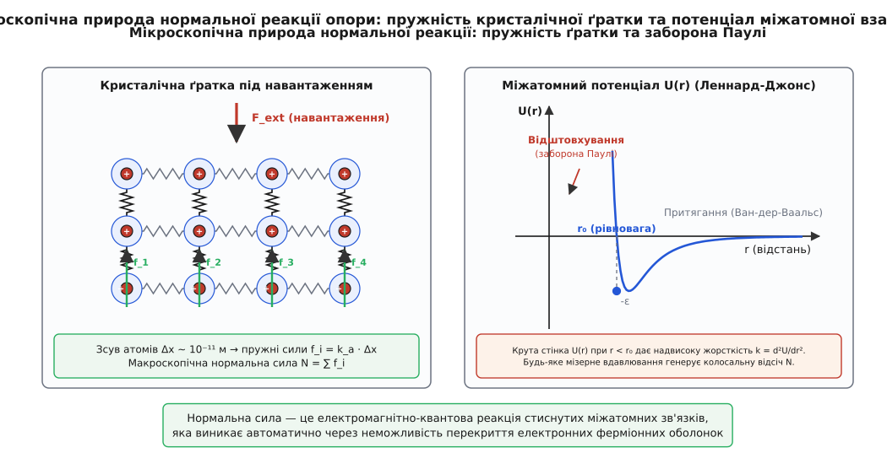
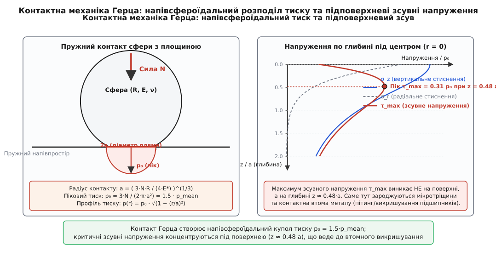

# Нормальна сила

<preknowlist>
- [Сила](root:ph-mechanics/force) — векторна міра механічної взаємодії тіл, що змінює їхній рух або викликає деформацію.
- [Другий закон Ньютона](root:ph-mechanics/newtons-second-law) — зв'язок сили, маси й прискорення `F = m·a`; нульове прискорення вздовж нормалі вимагає рівноваги сил.
- [Третій закон Ньютона](root:ph-mechanics/newtons-third-law) — рівність і протилежність сили дії та протидії в контактній парі.
- [Закон Гука](root:ph-mechanics/hookes-law) — лінійний зв'язок між пружною деформацією та механічним напруженням у матеріалі.
- [Тиск](root:ph-mechanics/pressure) — скалярна величина розподіленої нормальної сили на одиницю площі `p = dN/dA`.
- [Вага](root:ph-mechanics/weight) — сила гравітаційного або інерційного навантаження, з якою тіло тисне на опору або підвіс.
- [Тертя](root:ph-mechanics/friction) — тангенціальна складова контактної взаємодії, що обмежується нормальною реакцією за законом Амонтона-Кулона.
</preknowlist>

Книжка лежить на горизонтальному столі під дією сили тяжіння, масивна колона утримує склепіння мосту, а сталева кулька підшипника котиться доріжкою під навантаженням у десятки кілоньютонів. У кожній із цих ситуацій тіла перебувають у стані рівноваги або здійснюють плавний рух уздовж поверхні без занурення в глибину матеріалу опори. Сила тяжіння неперервно притискає об'єкт до поверхні, проте прискорення у напрямку, перпендикулярному до площини розділу середовищ, суворо дорівнює нулю. Згідно з другим законом Ньютона, це означає єдине: поверхня опори розвиває зустрічну механічну силу, яка в кожен момент часу в точності зрівноважує перпендикулярну складову всіх зовнішніх сил. Цю перпендикулярну контактну реакцію називають **нормальною силою** або силою нормальної реакції опори (від латинського *normalis* — «прямокутний, зроблений за косинцем», від *norma* — столярний косинець).

Незважаючи на видиму простоту шкільного виразу `N = m·g`, фізична природа нормальної сили є напрочуд глибокою. Вона не є фундаментальною константою чи наперед заданою характеристикою матеріалу. Нормальна сила — це адаптивна реакція односторонньої геометричної в'язі, яка виникає на макрорівні як статистичний інтеграл колосального числа мікроскопічних деформацій міжатомних потенціальних зв'язків. Опора нічого не «знає» про масу покладеного на неї тіла заздалегідь: вона прогинається на мікроскопічну глибину, накопичуючи пружну енергію стиснення кристалічної ґратки рівно доти, доки відновлювальна сила відштовхування не зрівняється з прикладеним тиском.

## Геометрична природа та розклад контактної сили

Будь-який механічний контакт між двома матеріальними тілами породжує повний просторовий вектор контактної сили взаємодії `F_c`. У загальному випадку опора діє на тіло під довільним просторовим кутом, одночасно перешкоджаючи взаємному проникненню матеріальних середовищ та чинячи опір їхньому відносному тангенціальному зсуву. У механіці суцільних середовищ повну контактну силу розкладають на дві ортогональні складові вздовж локального базису поверхні контакту:

```
F_c = N · n̂ + F_t · t̂

де:
n̂ — одиничний вектор нормалі до поверхні (спрямований назовні опори)
t̂ — одиничний вектор дотичної до поверхні контакту
N — нормальна сила (скалярна проєкція на n̂)
F_t — сила тертя (скалярна проєкція на t̂)
```

Нормальна складова `N` завжди спрямована суворо перпендикулярно до дотичної площини в точці контакту. Оскільки більшість природних опор не мають адгезійного клею і не здатні утримувати тіло від вільного відриву (ідеальні односторонні кінематичні в'язі, або unilateral constraints), нормальна сила задовольняє фундаментальну нерівність:

```
N ≥ 0
```

Якщо зовнішні сили спрямовані так, що намагаються віддалити тіло від опори, контакт миттєво розривається, і нормальна реакція стає тотожним нулем `N = 0`. Якщо ж зовнішнє навантаження притискає тіло до поверхні, опора пружно деформується на мікроскопічну глибину доти, доки пружна відсіч точно не скомпенсує зовнішнє притискання.

> 🔧 **Навіщо це.** Нормальна сила — це стрижневий параметр усього інженерного розрахунку навантажень. Від її величини безпосередньо залежить гранична сила зчеплення коліс автомобіля з асфальтом `F_max = μ · N`, контактний [тиск](root:ph-mechanics/pressure) у шарнірах і зубчастих зачепленнях, стійкість конструкцій проти перекидання та зсуву, а також опір коченню. Будь-яка похибка у визначенні нормальної реакції мультиплікативно спотворює розрахунок тертя та запасів міцності.

## Мікроскопічний механізм: від квантової заборони до закону Гука

Чому стіл, підлога або масивний скельний ґрунт здатні розвивати відсіч у тисячі й мільйони ньютонів, якщо з точки зору ядерної фізики атом на 99.999999999999% складається з порожнечі? Відстань між ядрами в кристалічній ґратці металів чи силікатів становить типово `0.2–0.3 нм`, тоді як діаметр самого ядра — лише близько `10⁻¹⁵ м`.

Поширена інтуїтивна відповідь про «просте кулонівське відштовхування однойменних зарядів» спростовується класичною електродинамікою. Ще 1842 року британський математик Семюел Ірншоу (англ. Samuel Earnshaw) довів фундаментальну теорему: **система нерухомих точкових зарядів, що взаємодіють за законом Кулона (обернено пропорційно квадрату відстані), не може перебувати в стані стійкої рівноваги**. Оскільки скалярний потенціал у вільному просторі задовольняє рівняння Лапласа `∇²φ = 0`, електростатичне поле не має локальних мінімумів, а лише сідлові точки. Матерія, побудована лише на класичній електростатиці, неминуче колапсувала б або розліталася під дією найменшого зовнішнього збурення.

Справжньою причиною непроникності та пружності твердих тіл є квантовомеханічний ефект — **принцип заборони Паулі** (Wolfgang Pauli, 1925), що діє для ферміонів (електронів із напівцілим спіном `s = 1/2`). Коли дві нейтральні поверхні зближуються на відстані, сумірні з розмірами атомних орбіталей, хвильові функції їхніх електронних оболонок починають перекриватися. Оскільки два ферміони не можуть одночасно займати один і той самий квантовий стан, частина електронів змушена переходити на вищі, просторово деформовані енергетичні рівні з додатковими просторовими вузлами. 

Зі збільшенням просторової кривини хвильової функції `ψ` згідно з рівнянням Шредінгера різко зростає квантовомеханічний оператор кінетичної енергії:

```
E_kin = ∫ (ħ² / (2·m_e)) · |∇ψ|² dV
```

Цей стрибок кінетичної енергії електронів породжує колосальний відштовхувальний тиск виродженого електронного газу (тиск Фермі), що формує практично вертикальну «потенціальну стінку» міжатомного відштовхування. Докладну еволюцію поглядів на природу непроникності речовини від Ньютона до Дайсона і Ліба викладено в історичній довідці: [чому тверде тіло непроникне](root:ph-mechanics/normal-force/hist-solidity.md).


*Мікроскопічне походження сили реакції опори: пружне зміщення атомних ядер та перекриття хвильових функцій електронів створюють колосальне відштовхування, еквівалентне закону Гука на рівні міжатомних зв'язків.*

Сумарну енергію взаємодії пари атомів на відстані `r` у феноменологічній фізиці конденсованого стану описують потенціалом Леннард-Джонса (John Lennard-Jones, 1924):

```
U(r) = 4·ε · [ (σ / r)¹² − (σ / r)⁶ ]

де:
ε — глибина потенціальної ями (енергія зв'язку)
σ — відстань, на якій енергія взаємодії дорівнює нулю
r₀ = 2^(1/6) · σ ≈ 1.122·σ — рівноважна міжатомна відстань
```

Член `(σ/r)⁶` відповідає за далекодійне дисперсійне притягання Ван-дер-Ваальса, а член `(σ/r)¹²` моделює круте короткодійне квантове відштовхування Паулі. Якщо розкласти функцію потенціалу `U(r)` у ряд Тейлора навколо точки термодинамічної рівноваги `r₀`:

```
U(r) = U(r₀) + (dU/dr)|_{r₀} · (r − r₀) + (1/2) · (d²U/dr²)|_{r₀} · (r − r₀)² + O((r − r₀)³)
```

Оскільки в точці рівноваги перша похідна `(dU/dr)|_{r₀} = 0`, сила міжатомної взаємодії `f_a(r) = −dU/dr` для малих зміщень `Δr = r − r₀` набуває строго лінійного вигляду:

```
f_a(Δr) = −k_a · Δr

де мікроскопічна жорсткість міжатомного зв'язку:
k_a = (d²U/dr²)|_{r₀} = (72 · ε) / (2^(1/3) · σ²) ≈ 57.14 · (ε / σ²)
```

Це і є [закон Гука](root:ph-mechanics/hookes-law) на мікроскопічному рівні. Кристалічна ґратка опори являє собою тривимірну сітку таких надзвичайно жорстких міжатомних пружин. Коли макроскопічне тіло навантажує поверхню, мільярди міжатомних шарів прогинаються на частки ангстрема (`10⁻¹¹–10⁻¹⁰ м`). Сума вертикальних проєкцій сил усіх стиснутих міжатомних зв'язків інтегрується по всій фактичній площі контакту, формуючи макроскопічну нормальну силу:

```
N = ∬ σ_zz(x, y) dx dy
```

Нормальна сила виступає як емерджентна макроскопічна реакція: опора автоматично просідає рівно на ту глибину, де сумарна пружна сила міжатомного відштовхування зрівноважує прикладене зовнішнє навантаження.

## Класифікація контактних взаємодій: конформний проти неконформного

У прикладній контактній механіці всі типи механічних дотиків поділяють на два фундаментальні класи:

1. **Конформний контакт (Conformal contact).** Поверхні тіл мають однакову або дуже близьку кривину й точно прилягають одна до одної на макроскопічній площі ще до прикладання навантаження. Класичні приклади: поршень у циліндрі двигуна, вал у підшипнику ковзання, плоский брусок на плоскому столі. У конформному контакті площа дотику практично не змінюється при збільшенні сили `N`, а розподіл нормального тиску `p(x,y)` визначається загальною згинальною та об'ємною жорсткістю деталей, а також мікрорельєфом шорсткості.

2. **Неконформний контакт (Non-conformal contact).** До прикладання сили тіла торкаються лише в одній точці (сфера з площиною, дві опуклі сфери) або вздовж однієї лінії (циліндр на площині, пара конічних роликів). При зростанні нормальної сили `N` тіла пружно сплющуються, і площа контакту динамічно зростає від нуля до скінченної плями чи смуги. Контактні напруження концентруються у крихітній зоні, сягаючи гігапаскалів. Саме цей клас описується класичною контактною теорією Герца.

## Класична контактна механіка Герца (Hertzian Contact Mechanics)

На макроскопічному рівні ідеально плоских тіл не існує: будь-який контакт деталей є контактом опуклих або шорстких поверхонь. Розрахунок реального розподілу контактного тиску, розмірів плями контакту та напружень у глибині матеріалу базується на класичній теорії, яку 1881 року створив 24-річний німецький фізик Генріх Герц (нім. Heinrich Hertz).

Герц розглянув пружний контакт двох ізотропних тіл без тертя за таких фундаментальних припущень:
1. Матеріали підпорядковуються закону Гука в межах лінійної пружності (деформації суто пружні, відсутня пластичність).
2. Розміри контактної плями значно менші за характерні радіуси кривини тіл (`a << R`).
3. Поверхні контакту є гладкими та можуть бути апроксимовані квадратичними параболоїдами.
4. Контактні напруження швидко згасають у глибину, що дозволяє розглядати кожне тіло як пружний напівбезмежний простір (задача Буссінеска-Черруті).

### Приведені параметри контактної пари

Для довільної пари контактуючих тіл 1 і 2 з головними радіусами кривини `R₁`, `R₂`, модулями пружності Юнга `E₁`, `E₂` та коефіцієнтами Пуассона `ν₁`, `ν₂` вводять два узагальнені параметри:

1. **Еквівалентний (приведений) радіус кривини `R`**:
```
1 / R = 1 / R₁ + 1 / R₂
R = (R₁ · R₂) / (R₁ + R₂)
```
*(Для контакту сфери радіуса `R₁` з плоскою поверхнею `R₂ = ∞`, отже `R = R₁`).*

2. **Ефективний контактний модуль пружності `E*`**:
```
1 / E* = (1 − ν₁²) / E₁ + (1 − ν₂²) / E₂
```

### Точковий контакт (сфера зі сферою або сфера з площиною)

При притисканні сферичного тіла до площини нормальною силою `N` кругова пляма контакту радіуса `a` та пружне нормальне зближення центрів тіл `δ` (глибина вдавлювання) визначаються фундаментальними співвідношеннями Герца:

```
Радіус контактної плями:
a = [ (3 · N · R) / (4 · E*) ]^(1/3)

Пружне зближення (вдавлювання):
δ = a² / R = [ (9 · N²) / (16 · R · E*²) ]^(1/3)

Нормальна сила як функція деформації:
N = (4/3) · E* · R^(1/2) · δ^(3/2)
```

Зверніть увагу: на відміну від простої одновимірної пружини Гука (`F = k·x`), зв'язок між нормальною силою `N` та контактним зближенням `δ` є **нелінійним** (`N ∝ δ^(3/2)`). У міру вдавлювання сфери радіус плями `a` зростає, площа опорної зони збільшується, і контактна жорсткість `k_c = dN/dδ = 2·E*·a` прогресивно зростає разом із навантаженням.

Розподіл контактного тиску `p(r)` за радіусом плями контакту `0 ≤ r ≤ a` має напівсфероїдальну (еліптичну) форму:

```
p(r) = p₀ · √( 1 − (r / a)² )

де максимальний тиск у центрі контакту (r = 0):
p₀ = (3 · N) / (2 · π · a²) = [ (6 · N · E*²) / (π³ · R²) ]^(1/3)

Середній контактний тиск:
p_mean = N / (π · a²) = (2/3) · p₀
```

Максимальний тиск у центрі рівно в `1.5 раза` перевищує середній тиск по всій площі плями контакту.

### Лінійний контакт (два паралельні циліндри)

Для циліндричних тіл довжини `L` (наприклад, ролики в роликових підшипниках або валки прокатного стану) контакт відбувається вздовж прямокутної смуги шириною `2b` і довжиною `L`:

```
Півширина контактної смуги:
b = √( (4 · N · R) / (π · L · E*) )

Максимальний контактний тиск по осі контакту (x = 0):
p₀ = (2 · N) / (π · b · L) = √( (N · E*) / (π · R · L) )

Середній контактний тиск:
p_mean = N / (2 · b · L) = (π / 4) · p₀ ≈ 0.785 · p₀

Розподіл тиску впоперек осі контакту (-b ≤ x ≤ b):
p(x) = p₀ · √( 1 − (x / b)² )
```


*Еліптичний розподіл контактного тиску за Герцом та розташування пікового підповерхневого зсувного напруження на глибині z ≈ 0.48a, що викликає втому матеріалу під плямою контакту.*

## Напружено-деформований стан та підповерхнева контактна втома

Визначення нормального тиску на поверхні `p(r)` — це лише перший крок аналізу. Головна небезпека руйнування матеріалів під дією нормальної сили ховається не на поверхні, а в **товщі матеріалу**.

Уздовж осі симетрії контакту `z` (де `z = 0` — поверхня контакту, а вісь спрямована вглиб тіла) тензор напружень має три головні діагональні компоненти: вертикальне стискальне напруження `σ_z` та два однакових горизонтальних напруження `σ_x = σ_y = σ_r`:

```
Вертикальне головне напруження:
σ_z(z) = −p₀ / (1 + (z/a)²)

Радіальне головне напруження (для коефіцієнта Пуассона ν = 0.3):
σ_r(z) = −p₀ · [ (1 + ν) · (1 − (z/a) · arctan(a/z)) − 1 / (2 · (1 + (z/a)²)) ]
```

На самій поверхні тіла (`z = 0`):
- `σ_z(0) = −p₀`
- `σ_r(0) = −p₀ · (1 + 2ν) / 2 = −0.8 · p₀` (при `ν = 0.3`)

Матеріал у центрі поверхні перебуває в умовах майже всебічного тривісного гідростатичного стиснення. Згідно з теорією міцності пластичних матеріалів (критерій текучості Треска та критерій Губера-Мізеса-Генкі), пластична деформація та руйнування металів відбуваються не від гідростатичного тиску, а від **максимальних дотичних (зсувних) напружень**:

```
τ_max(z) = (1/2) · | σ_z(z) − σ_r(z) |
```

На самій поверхні `z = 0`:
```
τ_max(0) = (1/2) · | −p₀ − (−0.8 · p₀) | = 0.10 · p₀
```

У міру занурення вглиб матеріалу радіальне напруження `σ_r(z)` спадає набагато швидше, ніж вертикальне `σ_z(z)`. Різниця між ними спочатку збільшується, проходить через виражений екстремум і лише потім починає повільно спадати.

Точний розрахунок показує, що максимальне дотичне напруження виникає **під поверхнею на строго визначеній глибині `z_crit`**:

```
Для сферичного контакту:
z_crit ≈ 0.48 · a
τ_max ≈ 0.31 · p₀

Для циліндричного контакту:
z_crit ≈ 0.78 · b
τ_max ≈ 0.30 · p₀
```

Еквівалентне напруження за фон Мізесом `σ_vM = √( (3/2) · S_ij · S_ij )` також досягає піку під поверхнею: `σ_vM,max ≈ 0.56 · p₀` на глибині `z ≈ 0.57 · a`.

### Радіальні напруження розтягу на краю контактної плями

Окрім підповерхневого зсуву, контакт Герца створює ще одну критичну зону напружень. Якщо в центрі плями (`r = 0, z = 0`) радіальні напруження є сильно стискальними, то на зовнішньому контурі контактного круга (`r = a, z = 0`) виникає різкий просторовий градієнт, і радіальне напруження стає **розтягувальним**:

```
σ_r(a, 0) = +p₀ · (1 − 2·ν) / 3
```

Для сталі з коефіцієнтом Пуассона `ν = 0.30`:
```
σ_r(a, 0) = +0.133 · p₀
```

Для крихких матеріалів (скло, мінерали, карбідна кераміка, загартовані інструментальні сталі), які погано витримують навантаження на розрив, це кільцеве розтягувальне напруження викликає зародження характерних кільцевих поверхневих тріщин. Під час подальшого заглиблення ці тріщини поширюються вниз під кутом, утворюючи відомі в геомеханіці та матеріалознавстві **герцівські конічні тріщини** (Hertzian cone cracks).

> ⚠️ **Практичний наслідок у машинобудуванні: контактна втома (пітинг).** Коли рейкою котиться колесо потяга або кулькова вальниця обертається під навантаженням, кожна точка матеріалу циклічно зазнає підповерхневих зсувних деформацій `τ_max ≈ 0.31·p₀`. Саме на глибині `0.48·a` зароджуються мікротріщини втоми металу. З часом тріщини проростають паралельно поверхні та виходять назовні, викликаючи викришування шматочків металу — явище **пітингу** (англ. *pitting*) або **сполінгу** (англ. *spalling*). Це головна причина виходу з ладу всіх підшипників кочення та зубчастих редукторів у світі.

Чисельну реалізацію розв'язання рівнянь Герца, розрахунку тривимірного поля напружень та визначення коефіцієнтів запасу міцності представлено в окремій прикладній вставці: [розв'язувач контактних пружних деформацій та розподілу контактного тиску за Герцом](root:ph-mechanics/normal-force/proj-hertzian-contact-solver.md).

## Вплив дотичних сил: контакт Міндліна-Каттанео та фретинг

У реальних інженерних конструкціях нормальна сила рідко діє ізольовано. Передача крутного моменту в підшипниках, тяга коліс електровоза чи вібрація затягнутих болтових з'єднань додають до нормальної сили `N` тангенціальну складову `T < μ·N`. Цю задачу дослідили Р. Д. Міндлін (R. D. Mindlin) та К. Каттанео (C. Cattaneo) у 1949–1953 роках.

Теорія Міндліна-Каттанео показала, що прикладання навіть невеликої дотичної сили `T` порушує однорідність контактної плями. Пляма розпадається на дві концентричні зони:
1. **Центральна зона зчеплення (Stick zone)** радіуса `c = a · (1 − T / (μ·N))^(1/3)`, де відносний зсув поверхонь відсутній.
2. **Периферійна зона мікропроковзування (Micro-slip zone)** `c ≤ r ≤ a`, де дотичне напруження сягає границі тертя `q(r) = μ · p(r)` і поверхневі шари здійснюють циклічні мікропереміщення амплітудою в кілька мікрометрів.

Тангенціальна сила кардинально змінює розподіл підповерхневих напружень: пік максимального зсувного напруження `τ_max` мігрує з глибини `z ≈ 0.48·a` **безпосередньо на поверхню контакту** на задньому краї плями мікроковзання. Це викликає **фретинг-корозію** (англ. *fretting wear*) — швидке стирання оксидних плівок, втомне задирання та передчасне руйнування посадкових поверхонь валів і лопаток турбін.

## Еластогідродинамічний контакт (EHL): коли в контакт вступає мастило

У швидкохідних підшипниках та зубчастих передачах нормальна сила діє через проміжний шар рідкого мастила. За класичною гідродинамікою Рейнольдса мастило мало б вичавитися з плями контакту за мікросекунди під дією тиску в 1–3 ГПа. Проте підшипники працюють роками без прямого металевого контакту.

Цей феномен пояснює теорія еластогідродинамічного змащування (Elastohydrodynamic Lubrication, EHL, розвинена Арчібальдом Мелдоном, Даусоном і Хіггінсоном). Вона поєднує два ефекти:
1. **Герцівську пружну деформацію металу**: під дією тиску поверхні деталей прогинаються, утворюючи конформний паралельний зазор.
2. **П'єзов'язкість мастила (закон Баруса)**: за тисків `p > 0.5 ГПа` в'язкість мінеральних та синтетичних олив зростає за експонентою в `10⁴–10⁶ разів`:
```
η(p) = η₀ · exp(α · p)
```

Мастило в зоні герцівського контакту миттєво перетворюється на твердоподібний склоподібний шар (glassy state), який фізично не встигає витекти з-під колеса чи кульки. Цей шар товщиною всього `0.1–1.0 мкм` повністю розділяє нерівності металу, сприймаючи повну нормальну силу `N` і захищаючи поверхню від абразивного зношування.

## Контакт з урахуванням адгезії: моделі JKR та DMT

Коли розміри контактуючих тіл зменшуються до мікро- та наномасштабів (наприклад, у вістрях атомно-силових мікроскопів, мікроелектромеханічних системах MEMS або наночастинках), класична теорія Герца стає неповною, оскільки вона нехтує молекулярними силами міжфазної адгезії за межами плями геометричного контакту. Для опису адгезійного контакту використовують дві класичні моделі:

1. **Модель Джонсона-Кендалла-Робертса (JKR model, 1971).** Застосовується для м'яких матеріалів із високою поверхневою енергією `γ` (гума, еластомери, біологічні клітини). Модель враховує адгезійні сили виключно всередині контактної зони. Вона передбачає, що пляма контакту має скінченний радіус навіть при нульовій нормальній силі `N = 0`, а для відриву тіла необхідно прикласти від'ємну розтягувальну силу відриву (pull-off force):
```
F_pull_off = −(3/2) · π · R · γ
```

2. **Модель Дерягіна-Мюллера-Топорова (DMT model, 1975).** Застосовується для твердих матеріалів із малим радіусом кривини та слабкою адгезією (алмаз, кремній). Вона припускає, що адгезійні сили діють як далекодійний притягальний пояс за межами зони пружного контакту Герца. Сила відриву в моделі DMT становить:
```
F_pull_off = −2 · π · R · γ
```

Вибір між моделями Герца, JKR та DMT визначається безрозмірним **параметром Табора (David Tabor, 1977)**:

```
μ_Tabor = [ (R · γ²) / (E*² · z₀³) ]^(1/3)

де z₀ ≈ 0.3–0.5 нм — міжатомна відстань рівноваги.
```
Якщо `μ_Tabor < 0.1` — контакт строго описується моделлю DMT або класичним Герцом; якщо `μ_Tabor > 5` — панує режим JKR.

## Експериментальні методи вимірювання та діагностики нормальних сил

У сучасних інженерних та лабораторних дослідженнях визначення нормальних контактних сил і просторового розподілу тиску здійснюється такими інструментальними методами:

1. **П'єзоелектричні багатокомпонентні динамометри.** Датчики на основі кристалів кварцу або сегнетокераміки (наприклад, платформи Kistler) реєструють нормальні та тангенціальні сили за рахунок прямого п'єзоелектричного ефекту: стиснення кристала генерує електричний заряд, строго пропорційний силі `N`. Ці датчики мають надвисоку жорсткість і частотний діапазон до десятків кілогерц, що дозволяє фіксувати динамічні ударні контактні сили.
2. **Тензометричні мостові схеми.** Вимірювання деформацій за допомогою фольгових тензорезисторів, увімкнених у міст Вітстона. Застосовується у вагових платформах, кранових вагах та тензометричних колісних парах залізничного транспорту.
3. **Оптичний метод фотопружності (Photoelasticity).** Моделі деталей із прозорих оптично анізотропних полімерів (епоксидна смола, полікарбонат) навантажують у полі поляризованого світла (полярископі). Механічні напруження викликають подвійне променезаломлення, створюючи інтерференційну картину ізохром — ліній однакових максимальних зсувних напружень `τ_max`. Цей метод наочно демонструє підповерхневу концентрацію зсуву Герца.
4. **Пресочутливі плівки (Pressure sensitive films, наприклад Fuji Prescale).** Плівка містить мікрокапсули з барвником різного діаметра, які руйнуються при досягненні певного порогу локального контактного тиску `p`. Густина забарвлення після стиснення сканується оптичним денситометром, даючи точну двовимірну карту розподілу тиску `p(x,y)`.
5. **Тактильні матричні сенсори (Tactile matrix sensors, Tekscan).** Гнучкі матриці на основі п'єзорезистивних полімерів дозволяють у реальному часі оцифровувати динамічний розподіл контактного тиску в суглобах, шинах автомобілів та зубчастих зачепленнях.

## Взаємозв'язок нормальної сили з тертям Амонтона-Кулона

Макроскопічний закон сухого тертя Амонтона-Кулона стверджує, що гранична сила тертя спокою та сила тертя ковзання строго пропорційні нормальній силі `N` і взагалі не залежать від геометричної площі контактуючих тіл `A_nom`:

```
F_friction ≤ μ · N
```

Протягом двох століть це виглядало фізичним парадоксом: якщо площа контакту цеглини, покладеної плиском, утричі більша, ніж коли вона стоїть на ребрі, чому сила тертя залишається абсолютно незмінною?

Відповідь дає поєднання мікротопографії поверхонь із теорією контакту Герца. Будь-яка полірована металева чи кам'яна поверхня на мікрорівні має виражену шорсткість — хаотичний рельєф із мікроскопічних виступів (асперитів) висотою від `0.1` до `10 мкм`.

Коли два тіла торкаються одне одного, номінальна геометрична площа `A_nom` є фікцією: тіла контактують виключно вершинами найвищих асперитів. Сумарна **фактична (істинна) площа контакту `A_real`** становить крихітну частку номінальної площі — типово від `0.01%` до `1%` від `A_nom`:

```
A_real = ∑ A_i << A_nom
```

У моделі Боудена-Тейбора (F.P. Bowden, D. Tabor, 1950) локальний контактний тиск на вершинах асперитів `p_i = N_i / A_i` настільки великий, що миттєво перевищує границю текучості матеріалу. Виступи зазнають пластичної деформації, метал починає «текти», доки тиск на кожному виступі не зафіксується на рівні мікротвердості матеріалу `H`:

```
N = ∬ p dA = H · A_real   ⇒   A_real = N / H
```

Фактична площа контакту `A_real` виявляється **суворо прямо пропорційною нормальній силі `N`** і абсолютно не залежить від номінальної площі `A_nom`.

У точках фактичного контакту виникає молекулярне схоплювання (холодне мікрозварювання). Щоб зрушити тіло, необхідно зрізати ці мікроскопічні містки схоплювання, подолавши граничне напруження зсуву матеріалу `τ_shear`:

```
F_friction = τ_shear · A_real = τ_shear · (N / H) = (τ_shear / H) · N = μ · N
```

Коефіцієнт тертя `μ = τ_shear / H` виявляється безрозмірним відношенням міцності матеріалу на зсув до його твердості.

Але що відбувається, якщо контакт асперитів є суто пружним і підпорядковується закону Герца? Для одного герцівського виступу радіусом `R_i` площа контакту залежить від нормальної сили нелінійно: `A_i = π·a_i² ∝ N_i^(2/3)`. Здавалося б, сумарна площа мала б рости як `N^(2/3)`, що порушило б лінійний закон Амонтона-Кулона.

Цю загадку блискуче розв'язали Джон Грінвуд і Девід Вільямсон (J.A. Greenwood, J.B.P. Williamson, 1966). Вони показали, що висоти асперитів реальної поверхні підпорядковуються статистичному розподілу Гаусса. Зі збільшенням нормальної сили `N`:
1. Площа кожного вже навантаженого виступу повільно зростає як `N_i^(2/3)`.
2. Але водночас поверхні зближуються, і в контакт вступають **нові, раніше не задіяні нижчі асперити**, причому число контактуючих плям `n` росте практично лінійно з навантаженням.

Комбінація закону Герца для одиничного виступу зі статистичним гауссовим розподілом висот призводить до того, що сумарна площа контакту знову стає строго лінійною: `A_real ∝ N`. Таким чином, макроскопічний закон тертя Амонтона-Кулона є статистичним інтегралом тисяч мікроскопічних пружних контактів Герца.

## Нормальна сила в динамічних задачах та аналітичній механіці

У класичній динаміці нормальна сила знаходиться не через властивості матеріалів, а через розв'язання рівнянь руху з накладеними кінематичними в'язями. Для матеріальної точки маси `m`, що рухається по криволінійній поверхні, нормальна реакція визначається єдиною скалярною проєкцією другого закону Ньютона на нормаль `n̂`:

```
N = m · ( a_⊥ + g · cos β )

де:
a_⊥ — компонента прискорення тіла вздовж нормалі (для нерухомої опори a_⊥ = v²/R_c)
R_c — радіус кривини траєкторії в цій точці
β — просторовий кут між вектором нормалі n̂ та вектором g (прямовисною вгору)
```

Детальний математичний вивід усіх класичних випадків динамічних в'язей (похила площина, вертикальна мертва петля, рух по опуклому куполу, відрив тіла) наведено у вставці: [нормальна сила в різних в'язях: розрахунок](root:ph-mechanics/normal-force/math-constraint-reaction.md).

У сучасних чисельних фізичних рушіях (game engines, CAD/CAM, робототехнічні симулятори на кшталт Bullet, PhysX, ODE, MuJoCo) нормальні сили не можна розраховувати пружними пружинами Гука через жорсткість диференціальних рівнянь на скінченному кроці часу `Δt = 1/60 с`. Там нормальна реакція обчислюється як покроковий розв'язок задачі лінійного доповнення (LCP) методом послідовних проєктованих імпульсів Гаусса-Зейделя (PGS): [як рушій рахує силу контакту](root:ph-mechanics/normal-force/proj-contact-solver.md).

## Інженерний розрахунок контакту Герца (C99 та C++20)

Нижче наведено верифіковану обчислювальну бібліотеку для аналізу нормального напружено-деформованого стану в контактних парах за теорією Герца. Програма обчислює геометричні параметри плями контакту, величину пружного зближення `δ`, піковий контактний тиск `p₀`, розподіл напружень по глибині та визначає точку зародження втомних тріщин `z_crit` і коефіцієнт запасу міцності за критерієм текучості Треска.

:::tabs
:::code normal-force-d/c/main.c
:::code normal-force-d/cpp/main.cpp
:::

## Підсумок

Нормальна сила є фундаментальним проявом квантової природи речовини в макроскопічному світі. Вона виникає як адаптивна реакція односторонньої кінематичної в'язі, породжується квантовим тиском виродження електронних оболонок Паулі та підпорядковується мікроскопічному закону Гука стиснутих міжатомних зв'язків. 

Контактна механіка Герца встановлює нелінійний характер деформацій `N ∝ δ^(3/2)` для пружних тіл і показує, що найнебезпечніші зсувні напруження концентруються не на самій поверхні, а на підповерхневій глизині `z ≈ 0.48·a`, спричиняючи втомне викришування деталей. Водночас статистичне інтегрування тисяч мікроконтактів Герца на шорсткій поверхні перетворює нелінійну пружність на макроскопічний лінійний закон сухого тертя Амонтона-Кулона.
