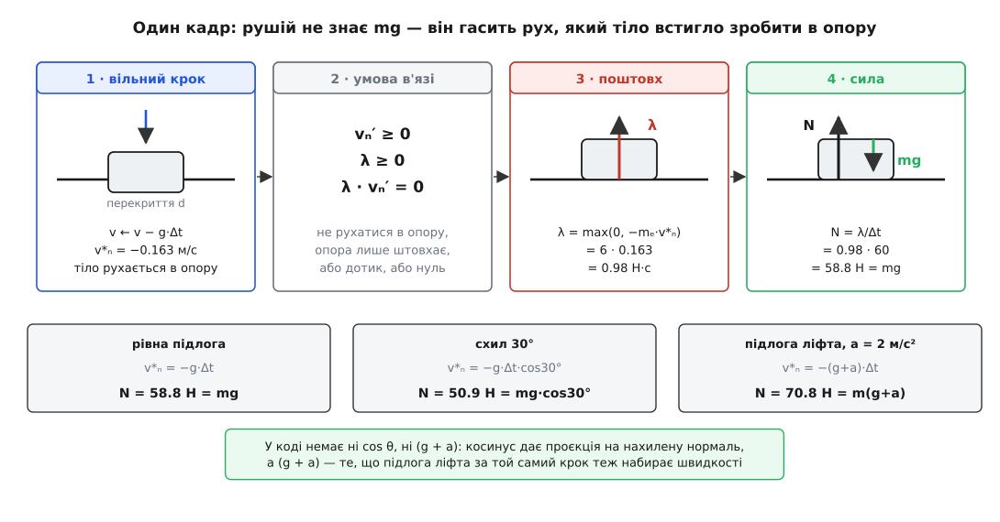
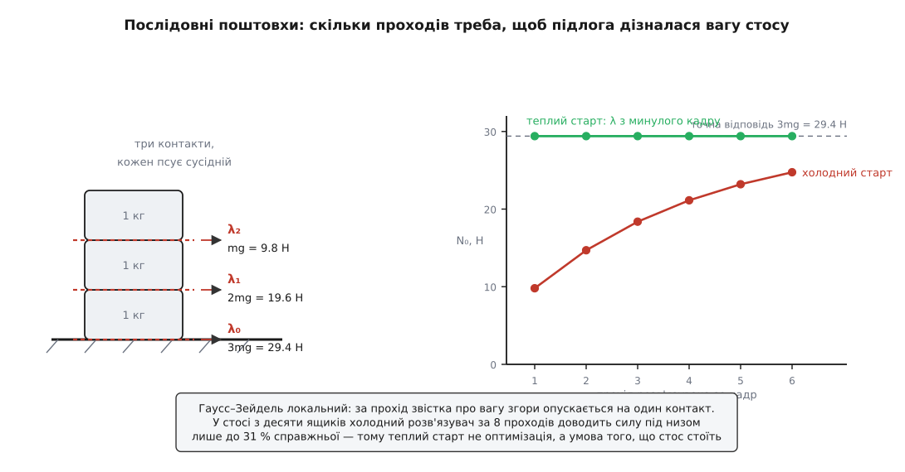

# ⚙️ Як рушій рахує силу контакту: нормальна сила зі скінченного кроку часу

У симуляції немає ні атомів, ні пружних зв'язків: підлога — це рівняння прямої в пам'яті, персонаж — жменя чисел. Проте шістдесят разів на секунду хтось мусить видати те саме число, що його видає справжній стіл: таку силу, щоб тіло не пройшло крізь опору, і саме `mg`, коли воно просто стоїть. Ця вставка — про машинку, яка це число робить: чому найчесніша на вигляд модель «поверхня як цупка пружина» на кроці 1/60 с непридатна, як контакт формулюється мовою лінійної доповняльності (LCP), чому ітератор Гаусса–Зейделя з проєкцією (PGS) став промисловим стандартом і як виглядає повний робочий код із верифікаційними тестами.

## Кадр, у якому ще ніщо не тримає

Рушій живе фіксованим кроком часу. Раз на `Δt = 1/60 с ≈ 16.7 мс` він збирає активні сили (гравітацію, тягу моторів, вітер), оновлює швидкості, зсуває тіла — і все. У цьому базовому циклі інтегрування немає жодного вбудованого механізму, який заважав би твердому тілу опинитися всередині іншого тіла:

```
v ← v + (F/m)·Δt          швидкість від зовнішніх сил
x ← x + v·Δt              нове положення — уже, можливо, всередині підлоги
```

Перекриття тут не халепа кепсько написаного рушія, а неминучий наслідок дискретності часу. За один кадр тіло зі звичайною швидкістю пролітає `v·Δt`, і це макроскопічні відстані:

```
v =   5 м/с (людина біжить):   5 · 1/60   = 8.3 см за кадр
v =  30 м/с (машина):         30 · 1/60   = 50 см за кадр
v = 300 м/с (куля):          300 · 1/60   = 5 м за кадр
```

Отже, розв'язувач береться до роботи тоді, коли тіло вже зайшло за межу дозволеного. І питання перед ним не «яка аналітична формула для N» — формули він знати не може: йому не сказано, чи це похила площина, чи підлога ліфта з прискоренням, чи низ стосу з двадцяти ящиків. Йому дано лише геометричну умову «не проникати» — і саме з неї, щокадру, наново, він мусить дістати число.

### Дискретизація за часом: явний проти напівнеявного Ейлера

Вибір схеми чисельного інтегрування визначає, як контактні сили зв'язуються зі зміною геометрії. Розглянемо класичний **явний метод Ейлера** (Forward Euler):

```
v_{k+1} = v_k + (F_k / m) · Δt
x_{k+1} = x_k + v_k · Δt
```

У явному інтеграторі нове положення обчислюється за *старою* швидкістю `v_k`. Якщо на початку кроку тіло наближалося до підлоги (`v_k < 0`), воно неодмінно зануриться вглиб на величину `|v_k|·Δt`, навіть якщо сила реакції `F_k` на цьому кроці вже намагається його спинити. Явний Ейлер постійно спізнюється на один крок, штучно накачуючи енергію в систему: на фазовій площині траєкторія розкручується по спіралі назовні. Для контакту це означає неминучий вибух симуляції або постійне тремтіння тіл на підлозі.

Сучасні фізичні рушії спираються на **напівнеявний метод Ейлера** (Semi-implicit Euler, або симплектичний інтегратор Ейлера–Кромера):

```
v_{k+1} = v_k + (F_{k+1} / m) · Δt       (1) швидкість інтегрується першою
x_{k+1} = x_k + v_{k+1} · Δt             (2) положення використовує ОНОВЛЕНУ швидкість
```

Цей зсув порядку має вирішальне значення: нове положення `x_{k+1}` обчислюється вже за свіжою швидкістю `v_{k+1}`, до якої включено дію контактного поштовху на поточному кроці. Якщо контактний розв'язувач скоригував швидкість так, що `v_{k+1} \cdot n̂ = 0`, тіло за час `Δt` взагалі не рухається вглиб опори. Симплектичний Ейлер зберігає фазовий об'єм (є симплектичним відображенням першого порядку), що забезпечує довготривалу стабільність закритих механічних систем без накопичення штучної кінетичної енергії.

Неперервна контактна сила `N(t)` інтегрується за інтервал кроку `Δt` у дискретний **контактний імпульс** (поштовх):

```
λ = ∫_{t}^{t + Δt} N(τ) dτ ≈ N · Δt
```

Оскільки за час `Δt` взаємодія вважається постійною або миттєвою, робота зі швидкісними імпульсами `λ` замість неперервних сил `N` перетворює диференціальні рівняння другого порядку на систему лінійних алгебраїчних співвідношень на швидкості в кінці інтервалу `v_{k+1}`.

## Спокуса вдавати пружину

Найпряміший код виписується просто з фізики опори. Поверхня прогинається — то нехай і буде пружиною: наскільки тіло влізло, настільки й відпихаємо. Це називають **методом штрафу** (penalty method) — за проникання «штрафують» силою:

```
N = k·d + c·ḋ            d — глибина перекриття, k — цупкість, c — демпфер
```

Десять рядків, жодного розв'язувача. І тут усе ламається.

Цупкість `k` не вільна: її задає те, наскільки глибоко ти дозволяєш тілу тонути. Для рівноваги `k·δ = mg`, тобто `k = mg/δ`. А `k` разом із масою задає власну частоту тієї пружини — і, що прикметно, маса скорочується ([закон Гука](root:ph-mechanics/hookes-law): відсіч пружного тіла пропорційна до стиснення, а частота коливань такої системи — `ω = √(k/m)`):

```
ω = √(k/m) = √(g/δ)

δ = 1 мм:    ω =   99 рад/с
δ = 0.1 мм:  ω =  313 рад/с
δ = 0.01 мм: ω =  990 рад/с
```

Напівнеявне інтегрування тримає коливальну систему стійкою лише поки `ω·Δt < 2`; далі за один крок пружина встигає перескочити рівновагу з надлишком, і амплітуда росте від кадру до кадру. Для `δ = 1 мм` це `Δt < 20 мс` — кадр на 16.7 мс уже майже на межі, і це для **одного** тіла.

Тепер постав на цю підлогу справжню сцену. Цупкість доводиться брати за найважчим тілом: щоб вантажівка на 1000 кг просіла лише на міліметр, треба `k = 9.8·10⁶ Н/м`. І на тій самій підлозі:

```
ω·Δt при k = 9.8·10⁶ Н/м, Δt = 1/60 с

  вантажівка 1000 кг:   ω =     99 рад/с    ω·Δt =    1.65    (ледве-ледве)
  ящик          1 кг:   ω =   3131 рад/с    ω·Δt =   52.2     (розліт)
  камінець      1 г:    ω =  98995 рад/с    ω·Δt = 1649.9     (катастрофа)
```

Цупкість задає найважче тіло, а стійкість — найлегше, а між ними в будь-якій людній сцені різниця в тисячі разів. Але добиває навіть не це, а сама дискретність. Хай тіло підлітає до підлоги зі швидкістю 1 м/с. Перш ніж пружину взагалі опитають, тіло за один кадр влізе на 1.7 см:

```
занурення за кадр:      d = v·Δt = 1.0 · 1/60      = 0.0167 м
відсіч пружини:         N = k·d  = 9.8·10⁶ · 0.0167 = 1.63·10⁵ Н

а це за той самий кадр додає швидкості вгору Δv = (N/m)·Δt:
  вантажівці 1000 кг:   2.7 м/с          (прилетіла на 1 — відскочила на 2.7)
  ящику 1 кг:           2.7·10³ м/с
  камінцю 1 г:          2.7·10⁶ м/с      (зник зі сцени назавжди)
```

Метод штрафу програє не через недбальство. Він чесно **моделює** цупкість — а щоб промацати десять мільйонів ньютонів на метр, її треба опитувати з частотою в десятки кілогерців. У рушія є шістдесят герців. Вихід — той самий, на який указує сама природа реакції в'язі: не моделювати матеріал, а **накласти умову** й дозволити силі набути того значення, якого умова вимагає.

## Питати не про силу, а про поштовх

За один крок сила й поштовх — те саме, з точністю до множника: `λ = N·Δt`. Різниця в тому, що поштовх можна знайти, не знаючи жодної цупкості.

Хай `n̂` — одинична нормаль контакту, напрямлена з опори до тіла. Спершу рушій робить **вільний крок**: додає до швидкостей усе, що діє, не зважаючи ні на які в'язі, і дістає `v*` — швидкість, яку тіло *мало б*, якби опори не було. Її нормальна складова `v*ₙ = v*·n̂` від'ємна: тіло рухається в опору. Тепер шукаємо поштовх `λ` уздовж `n̂`, який це виправить:

```
vₙ′ = v*ₙ + λ/mₑ ≥ 0        після поштовху не рухатися в опору
λ ≥ 0                        опора вміє тільки штовхати
λ · vₙ′ = 0                  або дотик і поштовх, або відхід і нуль
```

Це та сама трійця «не проникати — не тягти — одне з двох», тільки перенесена з відстаней на швидкості: на кроці `Δt` дешевше стежити, щоб тіло не *рухалося* в опору, ніж щоб не *перебувало* в ній. Умови однобічного контакту в такому вигляді виписав італійський механік **Антоніо Сіньйоріні**: коротка нотатка 1933 року, де він назвав їх «неоднозначними крайовими умовами», і повний виклад із курсу 1959 року; існування та єдиність розв'язку довів його учень **Ґаетано Фікера** 1963–64 років, і саме він дав задачі ім'я вчителя. Ця хронологія — усталений факт історії механіки суцільних середовищ, а не пізніше приписування.

Розв'язок для одного контакту видно з першого погляду:

```
λ = max(0, −mₑ · v*ₙ)
```

І ось заради чого все затівалося. Ящик просто лежить, діє сама лише вага. Тоді за вільний крок він набирає `v*ₙ = −g·Δt`, звідки `λ = m·g·Δt`, а поділивши на крок:

```
ящик 6 кг, Δt = 1/60 с, g = 9.8 м/с²

вільний крок:   v*ₙ = −g·Δt = −9.8/60          = −0.1633 м/с
поштовх:        λ  = m·|v*ₙ| = 6 · 0.1633      =  0.98 Н·с
сила:           N  = λ/Δt = 0.98 · 60          =  58.8 Н  =  m·g
```

Ніде в коді немає числа `mg`. Розв'язувач міряє, наскільки тіло за крок спробувало влізти в опору, і гасить рівно цей рух — а вага потрапляє у відповідь через `v*ₙ`, через ту швидкість, яку вона встигла надати за `Δt`. Цифрова підлога «знає», скільки штовхати, з тієї самої причини, що й дерев'яний стіл: вона відповідає не на вагу, а на спробу руху.

Найкраще це видно, коли міняється обстава, а код лишається той самий:

```
                            v*ₙ                  λ = −m·v*ₙ       N = λ/Δt

рівна підлога          −g·Δt        = −0.1633      0.9800 Н·с      58.8 Н  = mg
схил 30°               −g·Δt·cos30° = −0.1415      0.8487 Н·с      50.9 Н  = mg·cos30°
підлога ліфта, a = 2   −(g+a)·Δt    = −0.1967      1.1800 Н·с      70.8 Н  = m(g+a)
```

Косинус не вписаний у код — він з'явився з проєкції вільної швидкості на нахилену нормаль. `(g + a)` теж ніхто не програмував: підлога ліфта за той самий крок набирає власної швидкості вгору, тож зближення виходить більшим. Одна формула на три класичні задачі — бо всі три задають ту саму умову, просто в різних декораціях.


*Рушій ніде не зберігає mg. Він міряє рух, який тіло встигло зробити в опору за крок, і гасить його невід'ємним поштовхом; поділений на крок, той поштовх і є нормальна сила.*

### Чому mₑ, а не m

Для тіла, що може ще й обертатися, у знаменнику стоїть не маса, а **ефективна маса контакту**. Поштовх у ріг ящика частково не піднімає його, а крутить, тож точка дотику від того самого поштовху зрушується дужче — контакт «відчуває» легше тіло:

```
1/mₑ = 1/m₁ + 1/m₂ + (r₁ × n̂)²/I₁ + (r₂ × n̂)²/I₂
```

де `rᵢ` — вектор від центра мас до точки дотику, а `I` — [момент інерції](root:ph-mechanics/moment-of-inertia): міра того, як важко тіло розкрутити, — що далі маса від осі, то він більший. Для ящика 0.4 × 0.4 м масою 4 кг (`I = 0.107 кг·м²`):

```
дотик під центром мас (плече 0):        mₑ = 4.00 кг
дотик зі зсувом 0.10 м:                 mₑ = 2.91 кг
дотик під рогом, зсув 0.20 м:           mₑ = 1.60 кг
```

Нерухома опора входить сюди без жодної особливої гілки: у неї `1/m = 0` та `1/I = 0`, тож обидва її доданки тихо зникають. У загальному записі `1/mₑ = J·M⁻¹·Jᵀ`, де `J` — рядок якобіана в'язі, а `M⁻¹` — обернена матриця мас; для контакту цей рядок і є «нормаль плюс плече», і нічого більше.

## Кілька контактів: LCP-формулювання задачі

Ящик на підлозі спирається двома точками, стос із десяти ящиків має два десятки контактів, купа уламків — сотні. І вони зв'язані: поштовх, яким ти щойно виправив один контакт, змінює швидкість тіла, яке ділять два контакти, — і псує сусідній.

Розглянемо систему з `N` твердих тіл і `M` контактних точок. Стан швидкостей системи описується узагальненим вектором швидкостей `V = [v₁ᵀ, ω₁ᵀ, v₂ᵀ, ω₂ᵀ, ..., v_Nᵀ, ω_Nᵀ]ᵀ` розмірності `3N` (у 2D) або `6N` (у 3D). Матриця мас та інерцій системи `M` є блочно-діагональною, симетричною та додатноозначеною:

```
M = diag(m₁ I₂, I₁, m₂ I₂, I₂, ..., m_N I₂, I_N)
```

Кожен контакт `i` накладає кінематичну умову незближення через рядок геометричного якобіана `J_i`. Зібравши всі `M` контактів у глобальну матрицю якобіана `J` розмірності `M × 3N`, маємо вираз для відносної нормальної швидкості в усіх точках контакту:

```
vₙ = J · V
```

Рівняння руху системи під дією контактних імпульсів `λ = [λ₁, λ₂, ..., λ_M]ᵀ ≥ 0` у дискретному часі набувають вигляду:

```
M · (V_{k+1} − V*) = Jᵀ · λ
V_{k+1} = V* + M⁻¹ · Jᵀ · λ
```

де `V*` — вектор прогнозованих швидкостей після дії зовнішніх сил без урахування контактів. Підставивши нову швидкість у вираз для нормальних швидкостей у контактах разом із вектором швидкісних поправок перекриття `c_bias`, дістаємо:

```
w = J · V_{k+1} + c_bias
w = J · (V* + M⁻¹ · Jᵀ · λ) + c_bias
w = (J · M⁻¹ · Jᵀ) · λ + (J · V* + c_bias)
```

Позначивши матрицю контактної податливості (матрицю Делассу, Delassus matrix) через `A = J · M⁻¹ · Jᵀ` розмірності `M × M`, а вільний вектор через `b = J · V* + c_bias`, маємо класичну **задачу лінійної доповняльності** (Linear Complementarity Problem, LCP):

```
w = A·λ + b        де  A = J·M⁻¹·Jᵀ,   b = J·V* + c_bias
λ ≥ 0,   w ≥ 0,   λᵀ · w = 0
```

Це скорочено записують як `0 ≤ λ ⊥ (A·λ + b) ≥ 0`. Умова ортогональності `λᵀ · w = 0` означає покомпонентне доповнення: для кожного контакту `i` або `λ_i = 0` (контакт неактивний, тіла розходяться зі швидкістю `w_i > 0`), або `w_i = 0` (контакт закритий, діє нормальний поштовх `λ_i > 0`).

### Властивості матриці Делассу та зв'язок із квадратичним програмуванням

Матриця Делассу `A = J · M⁻¹ · Jᵀ` має фундаментальні властивості:
1. **Симетричність**: `Aᵀ = (J · M⁻¹ · Jᵀ)ᵀ = J · (M⁻¹)ᵀ · Jᵀ = A`, оскільки `M` симетрична.
2. **Додатна напіввизначеність**: для довільного вектора `x`:
   ```
   xᵀ · A · x = xᵀ · (J · M⁻¹ · Jᵀ) · x = (Jᵀ · x)ᵀ · M⁻¹ · (Jᵀ · x) ≥ 0
   ```
   оскільки матриця `M⁻¹` строго додатноозначена.

Завдяки симетрії та додатній напіввизначеності матриці `A` задача LCP для контактів без тертя строго еквівалентна задачі опуклого **квадратичного програмування** (Quadratic Programming, QP) — мінімізації кінетичної енергії поштовхів:

```
мінімізувати:   f(λ) = (1/2) · λᵀ · A · λ + bᵀ · λ
за обмеження:   λ ≥ 0
```

Умови Каруша–Куна–Таккера (KKT) для цієї задачі QP точно збігаються з умовами Сіньйоріні та LCP:
- Градієнт цільової функції `∇f(λ) = A·λ + b = w`.
- Допустимість множників: `λ ≥ 0`.
- Пряма допустимість: `w ≥ 0`.
- Доповняльна нежорсткість: `λ_i · w_i = 0`.

Розглянемо числовий приклад взаємного зв'язку контактів: ящик масою `m = 4 кг` розміром 0.4 × 0.4 м (`I = 0.1067 кг·м²`, `1/m = 0.25 кг⁻¹`, `1/I = 9.375 кг⁻¹·м⁻²`) спирається на дві симетричні точки підлоги на відстанях `r₁ₓ = −0.15 м` та `r₂ₓ = +0.15 м` від центру мас. Обчислимо елементи матриці Делассу `A`:

```
A₁₁ = 1/m + (r₁ₓ)² / I = 0.25 + 9.375 · (−0.15)² = 0.25 + 0.2109 = 0.4609 кг⁻¹
A₂₂ = 1/m + (r₂ₓ)² / I = 0.25 + 9.375 · (+0.15)² = 0.25 + 0.2109 = 0.4609 кг⁻¹
A₁₂ = A₂₁ = 1/m + (r₁ₓ · r₂ₓ) / I = 0.25 + 9.375 · (−0.15) · (+0.15) = 0.25 − 0.2109 = 0.0391 кг⁻¹
```

Позадіагональний елемент `A₁₂ = 0.0391 > 0` показує механічний перехресний зв'язок: поштовх у першій точці не лише піднімає свій край, а й створює обертальний момент, що частково розвантажує другу точку. Матриця `A` має суворе діагональне переважання (`A₁₁ = 0.4609 >> |A₁₂| = 0.0391`), що гарантує надзвичайно швидку збіжність ітеративних алгоритмів.

Прямі методи розв'язання LCP — метод Лемке, алгоритм Данціга та алгоритми активних множин, введені в комп'ютерну графіку Девідом Бараффом (David Baraff, SIGGRAPH '94), — шукають точний комбінаторний поділ контактів на активні (`w_i = 0, λ_i > 0`) та пасивні (`λ_i = 0, w_i > 0`). Хоча прямі методи дають машинно точну відповідь, вони вимагають розв'язання лінійних підсистем на кожній зміні множини, що дає складність близько `O(M³)` у середньому та експоненційну `O(2^M)` у найгіршому випадку. Ба більше, при вироджених геометріях (чотири ніжки столу на площині створюють лінійно залежні рядки в `J`, через що `det(A) = 0`) прямі методи зациклюються або вимагають складної регуляризації. На 500 контактів у 16-мілісекундному кадрі це неприйнятно.

## Послідовні поштовхи: Гаусс–Зейдель із проєкцією (PGS)

Замість глобальної факторизації матриці `A` рушії розв'язують задачу методом покоординатного спуску (Projected Gauss-Seidel, PGS).

Матриця `A` розбивається на діагональну частину `D`, строго нижню трикутну `L` та строго верхню трикутну `Lᵀ`:

```
A = L + D + Lᵀ
```

У класичному методі Гаусса–Зейделя для кожного рядка `i` шукається значення `λ_i`, що обнуляє нев'язку `(A·λ + b)_i = 0` з урахуванням уже оновлених значень `λ_j` для `j < i`. У проєкційному варіанті отримане значення негайно проєктується на допустиму множину `λ_i ≥ 0`:

```
λ_i^{(k+1)} = max( 0,  λ_i^{(k)} − (1 / A_ii) · [ b_i + ∑_{j < i} A_{ij} λ_j^{(k+1)} + ∑_{j ≥ i} A_{ij} λ_j^{(k)} ] )
```

Зверніть увагу: діагональний елемент `A_ii = J_i · M⁻¹ · J_iᵀ` — це в точності зворотна ефективна маса контакту `1/mₑ`. А вираз у дужках `[ A·λ + b ]_i` — це поточна відносна нормальна швидкість точки контакту `vₙ,i` з урахуванням усіх поштовхів, застосованих до цієї миті!

Це дозволяє позбутися явного зберігання матриці `A` та вектора `b`. Замість множення матриць рушій зберігає лише швидкості тіл `v, ω` і обходить контакти по одному, щоразу виконуючи локальний розрахунок:

1. Обчислити поточну відносну нормальну швидкість точок контакту `vₙ = (v_A + ω_A × r_A − v_B − ω_B × r_B) · n̂`.
2. Знайти нев'язку з урахуванням швидкісного доважка: `Δv = bias − vₙ`.
3. Обчислити сирий приріст поштовху: `Δλ = mₑ · Δv`.
4. Затиснути накопичений поштовх: `λ_new = max(0, λ_old + Δλ)`.
5. Застосувати фактичний приріст `δλ = λ_new − λ_old` безпосередньо до швидкостей пари тіл:
   ```
   v_A ← v_A + (δλ / m_A) · n̂
   ω_A ← ω_A + I_A⁻¹ · (r_A × (δλ · n̂))
   v_B ← v_B − (δλ / m_B) · n̂
   ω_B ← ω_B − I_B⁻¹ · (r_B × (δλ · n̂))
   ```

Цей прийом, названий **послідовними поштовхами** (Sequential Impulses), сформулював Ерін Катто (Erin Catto, GDC 2005) і втілив у Box2D. Він математично тотожний PGS, але виконується в пам'яті за лінійний час без виділення глобальних матриць.

Для прискорення збіжності на високих стосах іноді застосовують метод надрелаксації з проєкцією (Projected Successive Over-Relaxation, PSOR), де знайдений приріст масштабується коефіцієнтом релаксації `ω_relax ∈ (1.0, 1.4)`: `λ_new = max(0, λ_old + ω_relax · Δλ)`. Для симетричних додатноозначених матриць Делассу це скорочує число необхідних ітерацій на 30–40% без порушення стійкості.

**Ключова дрібниця, без якої нічого не працює: затискають накопичений імпульс, а не приріст.**

```
Δλ      = mₑ · (bias − vₙ)      скільки бракує саме цьому контактові
λ_нове  = max(0, λ + Δλ)        затиск НАКОПИЧЕНОГО за кадр
подати  (λ_нове − λ)            на швидкості йде тільки різниця
λ       = λ_нове
```

На пізніших проходах сусідній контакт міг перештовхнути — і тоді цьому контактові треба поправка **вниз**, від'ємний приріст. Якби кожен приріст затискали нулем окремо, забрати надлишок було б нічим: сума тільки росла б, і стос у спокої повільно роздувався б угору й дрижав. Коли ж затиск накладено на накопичену суму, від'ємні прирости дозволені, поки підсумок лишається невід'ємним, — а фізичний сенс «опора не тягне» має саме підсумок, бо саме він, поділений на `Δt`, є силою.

### Генерація контактного маніфолду та стійкість опорного полігону

Геометричний модуль вузької фази (narrowphase) будує для пари опуклих багатокутників не поодиноку точку, а **контактний маніфолд** (contact manifold) за алгоритмом відсікання Сазерленда–Ходжмена (Sutherland-Hodgman clipping). З двох тіл вибирається опорне ребро (reference edge) та інцидентне ребро (incident edge), після чого інцидентне ребро послідовно обрізається площинами бічних граней опорного тіла.

У 2D просторі стійкий контакт ребро-по-ребру завжди дає **рівно дві крайні точки дотику**. Менше двох точок (одна точка) не здатні сприймати перекидний момент сили, і ящик починає нескінченно коливатися з грані на грань. Більше двох точок є кінематично надлишковими й призводять до виродження матриці Делассу. Кожна точка споряджається 64-бітним ключем ознаки `feature_id`, що кодує індекси ребер і вершин:

```
feature_id = (ref_edge_index << 32) | (inc_edge_index << 16) | vertex_index
```

Цей стабільний ключ дозволяє системі кешування безпомилково зіставляти контакти між послідовними кадрами навіть за умови інтенсивного зміщення тіл уздовж поверхні.

### Стабілізація Баумгарте проти розділення імпульсів (Split Impulses)

Через дискретність часу тіла неминуче занурюються на глибину `d > 0`. Щоб ліквідувати це перекриття, до цільової швидкості додають пружний коригувальний доважок — **стабілізацію Баумгарте**:

```
bias = (β / Δt) · max(0, d − d_slop)
```

де `d_slop` (зазвичай `0.005 м` = 5 мм) — зона допустимого мертвого перекриття, що запобігає тремтінню при мікрорухах, а `β` (зазвичай `0.2`) — безрозмірний коефіцієнт повернення. При `β = 0.2` надлишок перекриття спадає на 20% щокадру, повністю зникаючи за 15–20 кадрів без різких візуальних поштовхів.

Однак стабілізація Баумгарте має фізичний побічний ефект: додавання штучної швидкості `bias` у швидкості тіл додає кінетичну енергію («фантомну енергію»). Якщо тіло затиснуте між двома стінами або у важкому стосі, `bias` змушує стос пружинити та вібрувати.

Для усунення цього ефекту в сучасних рушіях застосовують **розділення імпульсів** (Split Impulses):
- Швидкості тіл діляться на реальні `(v, ω)` та коригувальні позиційні `(v_pos, ω_pos)`.
- Контактний PGS запускається двічі: перший раз для реальних швидкостей із нульовим `bias` (знаходить чисті пружні поштовхи `λ`), а другий раз — лише для `(v_pos, ω_pos)` з урахуванням `bias`.
- Позиційні швидкості застосовуються виключно для оновлення координат `x ← x + v_pos · Δt`, не змінюючи кінетичну енергію тіл і не впливаючи на наступний кадр.

**Теплий старт.** Стос за кадр майже не змінився, отже, минулокадрові `λ` — це вже майже точна відповідь. Тож перед першим проходом їх подають як поштовхи, а лічильники починають не з нуля, а з них. Умова тут одна: контакти треба **впізнавати** між кадрами — не створювати заново, а зіставляти за ключем геометричної ознаки (ідентифікатор пари ребро-вершина). Катто назвав це кешуванням реакцій в'язей, і саме воно перетворює стос, що осідає, на стос, що стоїть.

Ось як це виглядає на числах. Три ящики по 1 кг один на одному, контакти знизу вгору; точні відповіді — `3mg`, `2mg`, `mg`:

```
стос 3 × 1 кг, Δt = 1/60 с, холодний старт (λ = 0), прохід знизу вгору

  прохід      N₀ (низ)     N₁         N₂ (верх)
     1          9.800     4.900       2.450
     2         14.700     8.575       4.287
     3         18.375    11.331       5.666
     4         21.131    13.398       6.699
     5         23.198    14.949       7.474
     6         24.749    16.112       8.056
  точно        29.400    19.600       9.800

теплий старт (λ з попереднього кадру):
     1         29.400    19.600       9.800      ← уже точно, далі не змінюється
```

За шість проходів холодний розв'язувач дійшов лише до 84 % справжньої сили під низом. Причина видна з механіки самого методу: Гаусс–Зейдель локальний, за один прохід звістка про вагу згори опускається рівно на один контакт. Тому з висотою стосу все гіршає стрімко — у стосі з десяти ящиків холодний розв'язувач бере 31 % за 8 проходів, половину за 20 і 90 % аж за 85. Теплий старт із цього погляду — не оптимізація, а сама умова того, що стоси в рушії взагалі стоять: він щокадру приносить готову відповідь, а проходи лишень підправляють її під зміни.


*Один прохід переносить звістку про вагу вниз рівно на один контакт, тож холодний стос осідає; збережені з минулого кадру поштовхи дають правильну відповідь одразу.*

Коли й цього замало — стоси високі, маси різняться на порядки, — сучасні рушії міняють не розв'язувач, а розклад кроку: розбивають кадр на кілька підкроків, розв'язуючи контакти в кожному (так працює Box2D 3.0, що вийшов у серпні 2024 з розв'язувачем Soft Step на підкроках і м'яких в'язях), або впорядковують контакти знизу вгору й проганяють хвилю навантаження за один прохід — прийом ударного поширення з праці Ерана Ґендельмана (Eran Guendelman), Роберта Бридсона (Robert Bridson) і Рональда Федківа (Ronald Fedkiw) «Nonconvex rigid bodies with stacking» (SIGGRAPH 2003).

## Робочий код (C99 та C++20)

Це найгарячіший цикл фізичного рушія: кілька тисяч ітерацій за кадр, жодного динамічного виділення пам'яті в купі (`malloc`/`new`), лінійний прохід по щільному масиву контактів. Обидві реалізації нижче є автономними, потокобезпечними та містять повний комплекс верифікаційних тестів, що перевіряють:
1. Рівновагу ящика на горизонтальній підлозі (`N = mg = 58.8 Н`).
2. Рівновагу на похилій площині 30° (`N = mg cos 30° = 50.92 Н`).
3. Динамічну реакцію в ліфті з прискоренням `a = 2.0 м/с²` (`N = m(g + a) = 70.8 Н`).
4. Збіжність трирівневого стосу ящиків при холодному та теплому стартах.
5. Зсув точки контакту від центра мас та обертальну податливість твердого тіла.

:::tabs
:::code proj-contact-solver/c/main.c
:::code proj-contact-solver/cpp/main.cpp
:::

> 🔧 **Навіщо це.** `λ/Δt` — не службова величина розв'язувача, а те саме, що видає тензодатчик під ногою. Рушії його й віддають назовні: у Box2D нормальний імпульс контакту дорівнює нормальній силі, помноженій на крок, тож поділивши на `Δt`, дістаєш ньютони. На цьому числі стоїть половина ігрової логіки: чи ламається дошка під вагою, як голосно звучить удар, чи витримає міст, коли по ньому їде вантажівка, куди й наскільки прогинається нога персонажа. Помилишся в `λ` — і все, що нижче за течією, теж піде хибно.

## Пастки

**Сила — середня за крок, а не миттєва.** `λ/Δt` — це поштовх, розмазаний по всьому `Δt`. Для контакту, що спокійно тримає, це чесна сила. Для удару — ні: справжній контакт триває мікросекунди, і поділивши поштовх на 16.7 мс, дістанеш величину, у сотні разів меншу за пікову. Тому пороги «зламатися від удару» ставлять на імпульс, а не на силу.

**Розподіл сил між контактами неоднозначний.** Це не хиба методу, а фізика. Стрижень на трьох опорах — задача статично невизначена: самих рівнянь рівноваги замало, і будь-який розподіл із правильною сумою й правильним моментом їх задовольняє. Розв'язувач видасть **якийсь** із них — той, який випливе з порядку обходу:

```
стрижень 12 кг на трьох опорах (−0.5 м, 0, +0.5 м), вага 117.6 Н

порядок зліва направо:   N = [ 19.98   77.63   19.98 ]   сума 117.60
порядок справа наліво:   N = [ 19.98   77.63   19.98 ]   сума 117.60
середню опору першою:    N = [  0.00  117.60    0.00 ]   сума 117.60
```

Два симетричні обходи тут збігаються, а варто взяти середню опору першою — і вона забирає всю вагу, бо гасить і поступальну, і обертову швидкість стрижня разом, не лишивши крайнім опорам чого виправляти. Сума завжди точна, розподіл — ні. Справжній стіл вирішує цю неоднозначність власною деформацією: ніжка, що трохи довша, просідає дужче й бере більше. Модель твердого тіла деформацію викинула — а разом із нею й те, що добирало відповідь. Практичний висновок: не будуй логіку на силі **одного** контакту в надлишковому наборі; питай суму або пильнуй порядок.

**Тіло прослизає повз опору (тунелювання).** Куля летить 5 м за кадр — жодного перекриття на початку й кінці кроку не виникає, контакт не народжується, `λ` не рахується, і куля проходить крізь стіну. Лікують окремо від розв'язувача: неперервним пошуком зіткнень (CCD) або «спекулятивними» контактами, що заводяться заздалегідь, за прогнозом траєкторії на крок уперед.

**Тертя їде верхи на `λ`.** Дотичний поштовх обмежений `μ·λ` ([тертя](root:ph-mechanics/friction): дотична складова контактної сили не перевищує частки нормальної), причому в тій самій ітерації — тобто межа конуса тертя рухається, поки розв'язувач збігається. Тому тертя розв'язують у тому ж проході, одразу після нормальної складової, і беруть поточне накопичене `λ`.

**Пружний відскок — окрема ціль.** Тут скрізь припускалося `vₙ′ ≥ 0`: тіло просто не рухається в опору. Для удару ціль інша, `vₙ′ ≥ −e·vₙ`, і це вже задача [зіткнення](root:ph-mechanics/collisions), де коефіцієнт відновлення каже, з якою часткою швидкості тіла розлітаються. Той самий розв'язувач тримає обидва режими, треба лише міняти цільову швидкість — і вимикати пружність нижче порогу швидкості (restitution threshold), інакше кожен спокійний контакт вічно теленькатиме.

**Результат залежить від порядку й від чисел із рухомою комою.** Порядок обходу контактів визначає розподіл, а різні порядки підсумовування дають різні останні біти — [числа з рухомою комою](root:hw-arch/floating-point) не мають властивості асоціативності, тож сума залежить від того, як її згрупувати. Для однієї машини це дрібниця, для мережевої гри з покроковою синхронізацією (lockstep multiplayer) — ні: два клієнти розійдуться. Лікують фіксацією порядку контактів у пам'яті та однаковими прапорцями оптимізації компілятора.

**Контраст мас та обумовленість системи.** Якщо на легкий ящик масою 1 кг покласти вантаж у 1000 кг, число обумовленості матриці Делассу `κ(A) = λ_max / λ_min` зростає пропорційно відношенню мас (`1000:1`). Покоординатний спуск PGS у таких умовах уповільнює збіжність у сотні разів: за стандартні 8–10 ітерацій поштовх від важкого тіла просто не встигає підняти легке, і легкий ящик візуально сплющується в коржик. Лікують регуляризацією мас (mass conditioning), м'якими в'язями (soft constraints) або збільшенням підкроків інтегрування.

**Приспані тіла нічого не рахують.** Коли тіло довго майже не рухається, рушій його «присипляє» й перестає обробляти. Збережений `λ` при цьому лишається останнім порахованим — і код, що читає силу контакту, отримає застаріле число, доки тіло не розбудять зовнішнім поштовхом.

## Складність

Один контакт за один прохід — це десятка два множень і додавань, одне порівняння на затиск, жодного виділення пам'яті й жодної складної гілки: `O(1)` з дуже маленькою сталою. Кадр коштує `O(K·C)`, де `C` — число контактів, `K` — число проходів (типово 4–10), плюс `O(C)` пам'яті на кеш поштовхів, який переживає кадр. Збіжність лінійна, і швидкість її псують дві речі — висота стосу (звістка йде на один контакт за прохід) і відношення мас (важке тіло на легкому робить систему кепсько зумовленою). Прямий розв'язувач задачі доповняльності дав би точну відповідь за `O(n³)`, але саме тому в реальному часі його й не тримають. А головна ціна кадру взагалі не тут: розв'язувач — найдешевша частина рушія, дорожчі за нього пошук пар (broadphase) і побудова контактних маніфолдів (narrowphase).

Уся ця машинерія тримається на одному зсуві погляду. Метод штрафу питав «яка сила в цьому матеріалі» — і потонув у цупкості, якої не можна промацати шістдесятьма герцами. Розв'язувач в'язей питає інше: «який найменший невід'ємний поштовх зробить рух допустимим» — і на це питання відповідь є завжди, бо вона не про матеріал, а про геометрію та крок часу. Число, яке з цього виходить, `λ/Δt`, збігається з реакцією опори не випадково: в обох випадках сила не задана наперед, а є рівно тим, чого вимагає умова «крізь опору не пройти».
