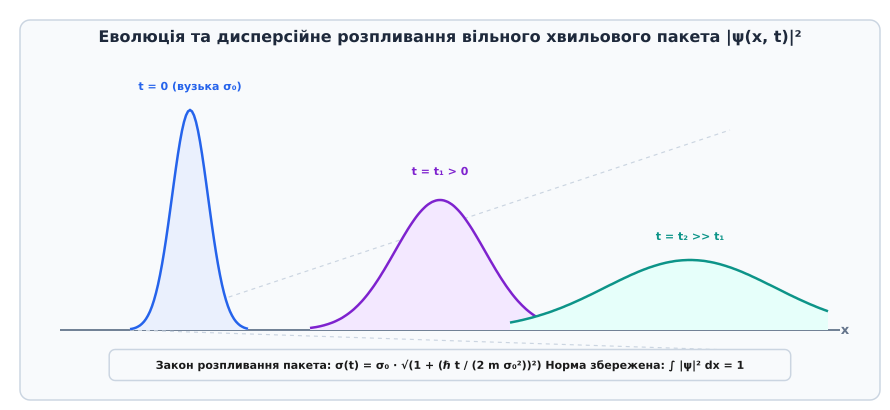

# ⚙️ Чисельне моделювання еволюції та розпливання квантового хвильового пакета

Нерівність Гайзенберга запевняє, що будь-який квантовий стан із обмеженою просторовою шириною `σ_x` неминуче містить спектральний розкид імпульсів `σ_p ≥ ℏ / (2 σ_x)`. У разі вільного руху частинки (коли зовнішній потенціал відсутній, `V(x) = 0`) складові хвильового пакета з вищими імпульсами (вищими фазовими швидкостями) випереджають повільніші складові. Як наслідок, просторовий розмах хвильового пакета монотонно зростає у часі — явище, відоме у фізиці як **дисперсійне розпливання хвильового пакета**.

Еволюція Гаусового хвильового пакета описується аналітичними формулами зміни його ширини `σ(t)`, виявляє різницю між фазовою та груповою швидкостями, підпорядковується теоремі Еренфеста для руху в зовнішніх полях і обчислюється чисельними алгоритмами розв'язання часового рівняння Шредінгера.


*Еволюція та розпливання огинаючої густини ймовірності |ψ(x, t)|² вільного Гаусового хвильового пакета з часом.*

## Фізична модель та розклад за плоскими хвилями

Розглянемо одновимірне часове рівняння Шредінгера для вільної мікрочастинки маси `m` у відсутність зовнішніх полів:

```
i ℏ (∂ψ / ∂t) = - (ℏ² / 2m) (∂²ψ / ∂x²) [вільне рівняння Шредінгера]
```

У початковий момент часу `t = 0` стан частинки задано нормованим Гаусовим хвильовим пакетом із середньою координатою `x₀ = 0`, середнім хвильовим вектором `k₀ = p₀ / ℏ` та початковою просторовою шириною `σ₀`:

```
ψ(x, 0) = (1 / (2 π σ₀²)^(1/4)) · exp( - x² / (4 σ₀²) + i k₀ x ) [початковий стан]
```

Густина ймовірності у початковий момент має симетричний Гаусів розподіл `|ψ(x, 0)|² = (1 / √(2 π σ₀²)) exp(- x² / (2 σ₀²))`, для якого початкові дисперсії складають `σ_x(0) = σ₀` та `σ_p(0) = ℏ / (2 σ₀)`, досягаючи точного теоретичного мінімуму невизначеності `σ_x(0) · σ_p(0) = ℏ / 2`.

Щоб знайти еволюцію стану `ψ(x, t)`, розкладемо початкову хвильову функцію в інтеграл Фур'є за власними функціями оператора імпульсу — плоскими хвилями `exp(i k x)`:

```
ϕ(k) = (1 / √(2 π)) ∫ ψ(x, 0) exp(-i k x) dx
= (2 σ₀² / π)^(1/4) · exp( - σ₀² (k - k₀)² ) [амплітуда Фур'є в імпульсному просторі]
```

Кожна плоска хвиля `exp(i k x)` еволюціонує у часі з власною частотою `ω(k) = ℏ k² / (2m)` відповідно до закону `exp(-i ω(k) t)`. Зворотне перетворення Фур'є дає точний аналітичний вираз для хвильової функції у довільний момент часу `t > 0`:

```
ψ(x, t) = (1 / √(2 π)) ∫ ϕ(k) exp(i (k x - ω(k) t)) dk
= (1 / (2 π σ₀²)^(1/4)) · (1 / √(1 + i ℏ t / (2 m σ₀²)))
  · exp( - (x - v₀ t)² / (4 σ₀² (1 + i ℏ t / (2 m σ₀²))) + i k₀ (x - v₀ t / 2) )
```

де `v₀ = ℏ k₀ / m` — групова швидкість руху центру пакета.

## Аналіз розпливання та кінематика хвильового пакета

Обчисливши квадрат модуля хвильової функції `|ψ(x, t)|²`, отримуємо густину ймовірності знаходження частинки у точці `x` у момент часу `t`:

```
|ψ(x, t)|² = (1 / √(2 π σ(t)²)) · exp( - (x - v₀ t)² / (2 σ(t)²) ) [густина ймовірності]
```

де часова залежність просторової ширини (стандартного відхилення) задається співвідношенням:

```
σ(t) = σ₀ · √( 1 + ( ℏ t / (2 m σ₀²) )² ) [закон розпливання пакета]
```

Ця формула ілюструє фундаментальну квантову рису: **чим тісніше ми локалізуємо частинку у початковий момент `t = 0` (тобто чим меншим є `σ₀`), тим вищою є невизначеність імпульсу `σ_p = ℏ / (2 σ₀)`, і тим швидше хвильовий пакет розпливається у просторі!**

Звернемо увагу на важливу відмінність між двома швидкостями:
1. **Фазова швидкість окремої монохроматичної хвилі:** `v_фаз = ω / k = ℏ k / (2m) = v / 2`.
2. **Групова швидкість огинаючої пакета:** `v_груп = dω / dk = ℏ k / m = v`.

Оскільки фазова швидкість удвічі менша за групову, горби окремих осциляцій всередині пакета рухаються повільніше за саму огинаючу оболонку: вони зароджуються на задньому хвості пакета, пробігають крізь центр і зникають на передньому фронті.

Для мікрочастинок (наприклад, електрона з масою `m = 9.1 · 10⁻³¹ кг` та початковим розміром `σ₀ = 0.1 нм`) характерний час розпливання `τ = 2 m σ₀² / ℏ` становить близько `1.7 · 10⁻¹⁶ с` (фемтосекунди). Натомість для макроскопічного об'єкта масою 1 грам із розміром 1 мікрон час розпливання перевищує вік Всесвіту, що пояснює, чому макроскопічні тіла рухаються за класичними траєкторіями без видимого розпливання.

## Рух у постійному силовому полі та теорема Еренфеста

Розглянемо випадок, коли на квантову частинку діє однорідна постійна сила `F` (наприклад, однорідне електричне або гравітаційне поле `V(x) = -F x`).

Рівняння Шредінгера для даної системи має вигляд:

```
i ℏ (∂ψ / ∂t) = - (ℏ² / 2m) (∂²ψ / ∂x²) - F x ψ [рівняння Шредінгера в однорідному полі]
```

Застосовуючи перетворення координат до рухомої системи відліку, що прискорюється за класичним законом `x_cl(t) = x₀ + v₀ t + (F / 2m) t²`, можна отримати точний розв'язок для хвильової функції:

```
|ψ(x, t)|² = (1 / √(2 π σ(t)²)) · exp( - (x - x_cl(t))² / (2 σ(t)²) )
```

Цей результат є глибокою ілюстрацією **теореми Еренфеста** (нід. *Paul Ehrenfest*):
1. **Центр ваги хвильового пакета `⟨x⟩(t)` рухається суворо за класичною траєкторією Ньютона:** `m (d²⟨x⟩ / dt²) = ⟨F⟩ = F`.
2. **Просторова ширина пакета `σ(t)` розпливається абсолютно так само, як і для вільної частинки:** `σ(t) = σ₀ √(1 + (ℏ t / 2 m σ₀²)²)`.

Наявність зовнішнього однорідного поля прискорює пакет як ціле, але ніяк не зупиняє і не прискорює його квантове розпливання.

## Дискретизація простору та сіткові дисперсійні похибки

Під час переходу від неперервного диференціального рівняння Шредінгера до різницевої сітки з кроком `dx` друга похідна апроксимується триточковим шаблоном:

```
∂²ψ / ∂x² ≈ (ψ_{i+1} - 2 ψ_i + ψ_{i-1}) / dx² [триточковий шаблон різниці]
```

Якщо підставити плоску хвилю `ψ_i = exp(i k x_i)` у дискретний оператор кінетичної енергії, дискретне дисперсійне співвідношення набуває вигляду:

```
ω_сітка(k) = (2 ℏ / (m dx²)) · sin²(k dx / 2) [дискретний закон дисперсії]
```

Для довгих хвиль (`k dx << 1`) расклад у ряд Тейлора дає `sin(k dx / 2) ≈ k dx / 2 - (k dx)³ / 48`, звідки:

```
ω_сітка(k) ≈ (ℏ k² / 2m) · (1 - (k dx)² / 12) [похилка просторової дискретизації]
```

Цей результат показує, що просторова дискретизація вносить штучну цифрову дисперсію. Щоб зменшити сіткову похибку до рівня менше 1%, крок сітки повинен задовольняти умову `dx ≤ λ_мін / 8 = π / (4 k_макс)`.

## Алгоритм Кранка — Ніколсон для часового рівняння Шредінгера

Для чисельного інтегрування часового рівняння Шредінгера дискретизуємо просторову область `[x_min, x_max]` на `N` вузлів з кроком `dx = (x_max - x_min) / (N - 1)` та часовий крок `dt`.

Проста явна схема Ейлера є нестійкою. Неявна схема Кранка — Ніколсон (Crank-Nicolson scheme) бере просторову другу похідну як середнє арифметичне між часовими шарами `n` та `n+1`:

```
(ψ^{n+1}_i - ψ^n_i) / dt = (i ℏ / (4 m dx²)) · [ (ψ^{n+1}_{i+1} - 2 ψ^{n+1}_i + ψ^{n+1}_{i-1})
                                                 + (ψ^n_{i+1} - 2 ψ^n_i + ψ^n_{i-1}) ]
```

Ввівши безрозмірну константу `α = ℏ dt / (4 m dx²)`, отримуємо тридіагональну систему лінійних алгебраїчних рівнянь відносно невідомих значень `ψ^{n+1}`:

```
-i α ψ^{n+1}_{i-1} + (1 + 2i α) ψ^{n+1}_i - i α ψ^{n+1}_{i+1}
= i α ψ^n_{i-1} + (1 - 2i α) ψ^n_i + i α ψ^n_{i+1} [система Кранка — Ніколсон]
```

Ця система є безумовно стійкою і суворо унітарною, зберігаючи норму `∫ |ψ|² dx = 1` з точністю до машинного нуля на кожному кроці за часом.

## Повнофункціональна програмна реалізація

Нижче наведено порівняльні реалізації чисельного розв'язувача еволюції хвильового пакета методом Кранка — Ніколсон мовами C, C++ та Python.

:::tabs
:::code proj-wavepacket-dispersion/c/main.c
:::code proj-wavepacket-dispersion/cpp/main.cpp
:::code proj-wavepacket-dispersion/py/main.py
:::

## Аналіз пасток та рекомендації для чисельного розв'язання

1. **Крайові умови та відбиття хвилі (Boundary Reflection):**
   При досягненні поширеним пакетом меж обчислювального доменованого простору `x_min` або `x_max` на нульових граничних умовах виникає штучне відбиття хвилі, що викликає хибну самоінтерференцію. Для моделювання нескінченного середовища біля країв додають комплексний поглинаючий потенціал (англ. *Complex Absorbing Potential, CAP*) `V_abs(x) = -i V₀ ((x - x_bound) / w)⁴`, який невідображувально гасить хвилю.

2. **Критерій числової стійкості та збереження норми:**
   У той час як явна різницева схема (Euler method) є безумовно нестійкою для рівняння Шредінгера, метод Кранка — Ніколсон є унітарним: оператор еволюції `U_CN = (I + i Δt Ĥ / 2)⁻¹ (I - i Δt Ĥ / 2)` є суворо унітарним (`U_CN⁺ U_CN = I`), що гарантує точне збереження норми `∫ |ψ|² dx = 1` при довільному кроці `Δt`.

3. **Співвідношення дискретизації `Δx` та `Δp`:**
   Відповідно до принципу невизначеності, максимальний імпульс, який може бути репрезентований на просторовій сітці з кроком `dx`, обмежений теоремою Найквіста — Котельникова: `p_max = π ℏ / dx`. Якщо початкова ширина `σ₀` занадто мала, високі імпульсні гармоніки `k > k_max` викличуть явище аліасингу (спотворення високих частот). Оптимальний вибір кроку сітки вимагає `dx ≤ σ₀ / 4`.
