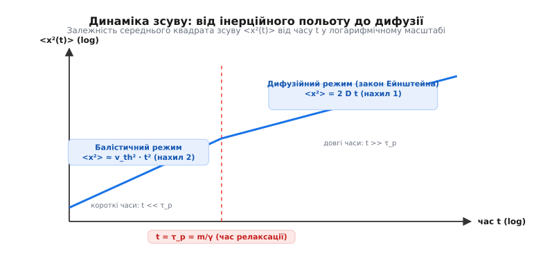

# ⚙️ Симуляція броунівського руху: алгоритм Ейлера—Маруями та обчислення MSD

Чисельне моделювання броунівського руху дає змогу відтворити реалістичні траєкторії частинок у двовимірному та тривимірному просторах, розрахувати статистичний середній квадрат зсуву (MSD) та експериментально дослідити перехід між короткотривалим балістичним польотом і довготривалим дифузійним блуканням. У цій вставці описано математичну дискретизацію стохастичного рівняння Ланжевена за схемою Ейлера—Маруями, наведено детальний аналіз стійкості алгоритму та наведено готові ідіоматичні реалізації мовами C та C++.

### 1. Фізична постановка та дискретизація (схема Ейлера—Маруями)

Рівняння Ланжевена описує динаміку броунівської частинки під дією двох сил — макроскопічного в'язкого гальмування та мікроскопічних хаотичних ударів молекул середовища. У двовимірній площині (2D) система диференціальних рівнянь другого порядку розкладається на пару зв'язаних рівнянь для швидкостей `v_x, v_y` та координат `x, y`:

```
m · (dv_x / dt) = − γ · v_x + ξ_x(t)
m · (dv_y / dt) = − γ · v_y + ξ_y(t)

dx / dt = v_x
dy / dt = v_y
```

де `m` — маса частинки, `γ = 6 · π · η · a` — коефіцієнт тертя Стокса, а `ξ_x(t), ξ_y(t)` — незалежні компоненти гаусового білого шуму з кореляцією `<ξ_i(t) ξ_j(t')> = 2 γ k_B T δ_ij δ(t − t')`.

Для чисельного розв'язання цієї стохастичної системи ми застосовуємо дискретизацію за схемою Ейлера—Маруями (*Euler–Maruyama scheme*). Стохастичний інтеграл від білого шуму за маленький інтервал часу `Δt` дає Вінерівський приріст `ΔW = N(0, 1) · √(Δt)`, де `N(0, 1)` — стандартна нормальна випадкова величина з нульовим математичним сподіванням та дисперсією `1.0`.

Дискретні формули оновлення швидкості та позиції на кожен крок `n → n + 1`:

```
v_x[n+1] = v_x[n] · (1 − (γ / m) · Δt) + (√(2 · γ · k_B · T · Δt) / m) · N_x(0, 1)
v_y[n+1] = v_y[n] · (1 − (γ / m) · Δt) + (√(2 · γ · k_B · T · Δt) / m) · N_y(0, 1)

x[n+1] = x[n] + v_x[n+1] · Δt
y[n+1] = y[n] + v_y[n+1] · Δt
```

Ключовим фактором точності симуляції є вибір кроку за часом `Δt`. Оскільки імпульс частинки релаксує за характерний час `τ_p = m / γ`, чисельна схема буде стійкою лише за умови `Δt < 2 m / γ`. Якщо обрати `Δt >> τ_p`, інерційні доданки розбігатимуться, і симуляція «вибухне». Для довгих проміжків часу без інтересу до балістики застосовують перевизначену (overdamped) схему Ейлера, де швидкість не інтегрується, а крок за координатою розраховується безпосередньо як `Δx = √(2 D Δt) · N(0, 1)`.


*Прикрокова дискретизація точного рівняння Ланжевена відтворює балістичний режим на коротких часах (t << τ_p) та класичний дифузійний нахил на довгих часах.*

---

### 2. Алгоритм обчислення ансамблевого MSD

Середній квадрат зсуву (*Mean Squared Displacement*, MSD) для ансамблю з `N_trials` частинок обчислюється шляхом симуляції незалежних траєкторій. Для кожної частинки `k` відстежується зміщення від її початкової точки `(x_k(0), y_k(0))`:

```
MSD(t_n) = (1 / N_trials) · ∑ₖ₌₁ⁿᵗʳⁱᵃˡˢ [ (x_k(t_n) − x_k(0))² + (y_k(t_n) − y_k(0))² ]
```

У двовимірному просторі теоретичний зв'язок між коефіцієнтом дифузії та MSD задається формулою `MSD(t) = 4 · D · t`. Звідси оцінка коефіцієнта дифузії за результатами моделювання обчислюється за нахилом кривої на довгих часах: `D_est = MSD(t_max) / (4 · t_max)`.

---

### 3. Реалізації моделі мовами C та C++

Нижче наведено робочі реалізації симулятора та розрахунку MSD. Приклади написані так, щоб показати відмінності у підходах між низькорівневим C (пряме управління пам'яттю, перетворення Бокса—Мюллера) та сучасним C++ (RAII, шаблони, контейнери `std::vector` та бібліотека `<random>`).

:::tabs
:::code proj-brownian-simulation/c/main.c
:::code proj-brownian-simulation/cpp/main.cpp
:::

---

### 4. Часове (TA-MSD) проти ансамблевого (EA-MSD) усереднення

У комп'ютерному моделюванні та реальному мікроскопічному експерименті існують два фундаментальні шляхи обчислення середнього квадрата зсуву:

1. **Ансамблеве усереднення (Ensemble-Averaged MSD, EA-MSD):**
   Вимагає одночасної наявності великої кількості `N` незалежних траєкторій частинок. Для кожної часової мітки `t` обчислюється розкид координат відносного початкового стану `t = 0`. Цей метод ідеально підходить для комп'ютерного моделювання, де легко створити тисячі частинок.

2. **Часове усереднення уздовж однієї траєкторії (Time-Averaged MSD, TA-MSD):**
   У реальних дослідах із мікроскопом часто вдається відстежити лише **один** довгоживучий флуоресцентний трек частинки тривалістю `T`. Тоді для кожного часового лагу `Δ` розраховується ковзаюче середнє уздовж всієї траєкторії:

```
δ²(Δ; T) = (1 / (T − Δ)) · ∫₀ᵀ⁻Δ [ r(t + Δ) − r(t) ]² dt
```

Дискретний аналог для сітки з `N` кроків:

```
δ²(m · Δt) = (1 / (N − m)) · ∑ₖ₌₀ᴺ⁻ᵐ⁻¹ [ (x[k + m] − x[k])² + (y[k + m] − y[k])² ]
```

Для класичного броунівського руху виконується **ергодична гіпотеза**: при `T → ∞` часове усереднення для однієї траєкторії `δ²(Δ; T)` повністю збігається з ансамблевим усередненням `<r²(Δ)>`. Проте при наявності субдифузії у пористому середовищі або неергодичних процесів (наприклад, у гелях) ергодичність порушується (`δ²(Δ) ≠ <r²(Δ)>`), що є важливою діагностичною ознакою у біофізиці.

---

### 5. Практичні пастки, чисельні обмеження та векторна оптимізація

При моделюванні стохастичних диференціальних рівнянь розробники часто припустиються типових помилок, які викривляють статистику:

1. **Неправильний дільник у залежності MSD від просторової розмірності:**
   - 1D простір: `<Δx²(t)> = 2 · D · t` (дільник `2`).
   - 2D простір: `<Δr²(t)> = 4 · D · t` (дільник `4`).
   - 3D простір: `<Δr²(t)> = 6 · D · t` (дільник `6`).
   Плутанина коефіцієнтів розрахунку призводить до систематичної помилки на 33–50%.

2. **Статистична похибка генераторів випадкових чисел:** стандартний генератор `rand()` у мові C має малий період та некорельованість на коротких вибірках. У високоточних розрахунках слід використовувати алгоритм «Мерсеннів вихор» (`std::mt19937` у C++) або криптографічно стійкі генератори.

3. **Стійкість за часовим кроком `Δt`:** якщо чисельний крок `Δt` підбирається близьким до згасання `m / γ`, у неявній схемі Ейлера виникають нефізичні осциляції швидкості. У такому випадку рекомендовано зменшувати крок або переходити на схему Мільштейна чи вищого порядку Рунге—Кутти для СДР.

4. **Апаратно-векторна прискореність (SIMD та OpenMP):** оскільки кроки інтегрування частинок не залежать один від одного, розрахунок легко прискорити на високопродуктивних серверах за допомогою директив OpenMP `#pragma omp parallel for` або використання векторних інструкцій AVX-512 для одночасної генерації 8 випадкових чисел Ґаусса.

Опис повного програмного інтерфейсу та виробничих C/C++ бібліотек подано у вставці [Інтерфейс бібліотеки симуляції](root:ph-thermodynamics/brownian-motion/api-simulation-lib.md).

[step] += (x * x + y * y);
            }
        }

        for (auto &val : res.msd) {
            val /= static_cast<double>(config_.trials);
        }

        const std::size_t last = config_.steps - 1;
        if (res.time[last] > 0.0) {
            // У 2D просторі: MSD = 4 * D * t
            res.estimated_diffusion_coeff = res.msd[last] / (4.0 * res.time[last]);
        }

        return res;
    }

private:
    SimulationConfig config_;
    std::random_device rd_;
    std::mt19937 gen_;
};

int main() {
    try {
        SimulationConfig cfg{
            .temp = 300.0,
            .gamma = 1e-8,
            .mass = 1e-14,
            .dt = 1e-7,
            .steps = 1000,
            .trials = 500
        };

        BrownianSimulator simulator(cfg);
        auto result = simulator.run();

        std::cout << "Теоретичний D = " << result.theoretical_diffusion_coeff << " м²/с\n";
        std::cout << "Оцінений D    = " << result.estimated_diffusion_coeff << " м²/с\n";
        std::cout << "MSD на фініші (t = " << result.time.back() << " с): " 
                  << result.msd.back() << " м²\n";
    } catch (const std::exception &e) {
        std::cerr << "Помилка симуляції: " << e.what() << '\n';
        return 1;
    }

    return 0;
}
```
:::

### Пастки та рекомендації щодо обчислень

1. **Вибір часового кроку `Δt`:** якщо `Δt > m / γ`, чисельна схема Ейлера виходить за межі стійкості і «вибухає». Для стійкості обов'язково має виконуватися умова `Δt < 2 m / γ`.
2. **Розмірність простору:** у 1D просторі `MSD = 2 D t`, у 2D — `MSD = 4 D t`, у 3D — `MSD = 6 D t`. Не плутайте дільник при визначенні коефіцієнта дифузії!
3. **Статистичний шум:** для гладкої кривої MSD потрібен ансамбль із щонайменше 500–1000 незалежних частинок, або застосування часового усереднення (*Time-Averaged MSD*) уздовж однієї довгої траєкторії.

Опис повного програмного інтерфейсу та API бібліотеки аналізу подано у вставці [Інтерфейс бібліотеки симуляції](root:ph-thermodynamics/brownian-motion/api-simulation-lib.md).
