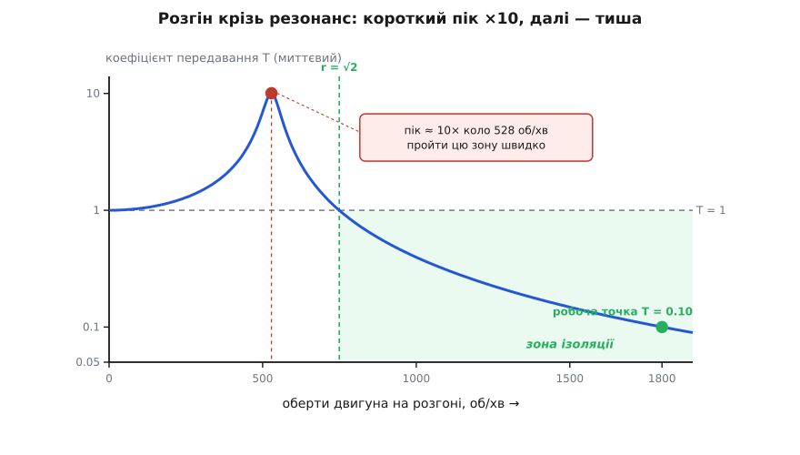

# ⚙️ Проєктувальник антивібраційної опори

Про машину ти зазвичай знаєш три речі: скільки в неї обертів (або на якій частоті вона трясе), скільки вона важить, і наскільки тихо має бути внизу. Проєктування опори — це перетворити ці три числа на три інші, за якими опору вже можна замовити: власну частоту fₙ, статичний прогин δ і жорсткість k. Одну точку рахують і ручкою. Але щойно треба прогнати всю смугу частот, порівняти кілька гум із різним внутрішнім тертям і не проґавити пастки, яких на папері не видно, — потрібен інструмент, що робить це за секунду й сам вмикає запобіжники.

Пасток тут рівно дві, і обидві коштують дорого. Перша — короткий, але лютий резонанс на розгоні: поки машина набирає оберти, її частота неминуче проповзає крізь власну частоту опори, і на ті кілька секунд опора не гасить, а підсилює трясіння вдесятеро. Друга — спокуса «чим м'якше, тим краще»: занадто податлива опора чудово ізолює, але плаває під машиною, кренить на пуску й потребує забагато ходу. Хороший інструмент рахує не лише робочу точку, а й показує обидва краї.

## Ідея: обернути формулу передавання

Коефіцієнт передавання T — частка розмаху, що проходить крізь опору, — залежить від двох чисел: відношення частот r = f/fₙ і коефіцієнта загасання ζ.

```
T = √[ (1 + (2ζr)²) / ((1 − r²)² + (2ζr)²) ]
```

Ми знаємо, яке T хочемо (скажімо, 0.1 — пропустити лише десяту частину), і яке ζ у нашої гуми. Невідоме — r, робоча точка. Тобто формулу треба **обернути**: знайти r за заданим T і ζ.

Наївний хід — знехтувати загасанням. Тоді T ≈ 1/(r²−1), звідки r² = 1 + 1/T, і для T = 0.1 виходить r = √11 ≈ 3.32. Просто, але оманливо: реальне загасання трохи псує ізоляцію (той самий доданок 2ζr у чисельнику, що дає силі другий шлях повз пружину), тож при знайденому r справжнє T виходить **гіршим** за ціль. Похибка мала при м'якій гумі й росте з ζ. Інструмент має брати точний корінь — із загасанням усередині.

І його можна взяти без жодного пошуку. Піднесімо формулу в квадрат і позначмо u = r², a = (2ζ)²:

```
T²·[(1 − u)² + a·u] = 1 + a·u
T²·u² − [2T² + a(1 − T²)]·u + (T² − 1) = 0
```

Це звичайне квадратне рівняння відносно u. Вільний член (T² − 1) від'ємний (адже T < 1 у зоні ізоляції), тож корені різного знака — беремо додатний, він і дає r = √u > √2. Одна формула, точна за будь-якого загасання. А прибравши загасання (a = 0), вона згортається рівно до u = 1 + 1/T — та сама наближена формула стає окремим випадком точної.

## Робочий код

Мова тут — Python, і це зважений вибір, а не звичка. Розрахунок разовий, «порахував і замовив», не гарячий цикл; уся цінність — у прозорості формул і зручності таблиць, а не в мікросекундах, тож тягнути сюди C немає сенсу. Код чистий stdlib — жодних залежностей, запуститься будь-де.

Серце інструмента — сама формула передавання й її обернення:

:::code proj-isolator-design/py/robochyi-kod.py

Резонанс на розгоні заслуговує на окрему функцію — це найнебезпечніше місце всієї конструкції. Максимум кривої лежить не точно в r = 1, а трохи лівіше, і має закриту формулу; поряд наведімо й правило-прикидку 1/(2ζ), щоб число не приходило нізвідки:

:::code proj-isolator-design/py/robochyi-kod-2.py

Тепер головний розрахунок. Зібравши r, легко дістати решту: власна частота fₙ = f/r, кутова ωₙ = 2π·fₙ, жорсткість k = ωₙ²·m, а статичний прогин — прямо з рівноваги ваги й пружини (k·δ = m·g за [законом Гука](root:ph-condensed/elastic-deformation) дає δ = g/ωₙ², без маси). Результат складімо в один незмінний запис:

:::code proj-isolator-design/py/robochyi-kod-3.py

Зверни увагу на `order`: незбалансований барабан б'є раз на оберт (order = 1), але зубчаста передача чи лопаті трясуть кілька разів на оберт — тоді частота трясіння вища за оборотну в стільки ж разів. Це часте джерело помилки на самому вході.

Лишається вивід, і саме тут інструмент відпрацьовує свій хліб — не просто друкує числа, а вмикає запобіжники: перевіряє головну умову r > √2, окремим рядком попереджає про резонанс на пуску й лається, якщо опора вийшла надто м'якою:

:::code proj-isolator-design/py/robochyi-kod-4.py

І два помічники, що перетворюють один розрахунок на картину: крива T(r) по всій смузі як простий ASCII-графік, і порівняння тієї самої опори за різних ζ — щоб парадокс загасання було видно числами, а не на слово:

:::code proj-isolator-design/py/robochyi-kod-5.py

Проженімо все на наскрізному прикладі теми: мотор 1800 об/хв, дисбаланс б'є раз на оберт (30 Гц), маса з рамою 40 кг, чотири гумові опори з поміркованим загасанням ζ = 0.05, ціль — пропускати десяту частину:

:::code proj-isolator-design/py/robochyi-kod-6.py

Ось що воно друкує:

```
── Опора під 40 кг, трясіння 30.0 Гц, ζ = 0.05, ціль T = 0.1 ──
  власна частота  fₙ =   8.82 Гц
  відношення      r  =   3.40   (робоча точка)
  статичний прогин δ =   3.19 мм
  жорсткість      k  =  123.0 кН/м   (30.7 кН/м на кожну з 4)
  ізоляція на робочій частоті: 90 %
  [OK] r = 3.40 > √2 = 1.41  → зона ізоляції
  [!!] на розгоні пройде резонанс: пік T ≈ 10.1× коло 528 об/хв (r ≈ 1.00)

  T(r) для ζ = 0.05   (│ вісь T лог, r лог; ─ T=1; : r=√2)
   │                      *   :
   │                     *    :
   │                    *  *  :
   │                 ***    * :
   │     ************        **
   │*****----------------------**-------------------------
   │                          :  **
   │                          :    **
   │                          :      ***
   │                          :         ***
   │                          :            ****
   │                          :                ***
   │                          :                   ****
   │                          :                       ****
   │                          :
   └──────────────────────────────────────────────────────
    r=0.2                                          r=10

── Одна опора fₙ = 8.8 Гц, трясіння 30.0 Гц (r = 3.40) — вплив ζ ──
       ζ │  T роб. │  ізол. │  пік на пуску
  ───────┼─────────┼────────┼──────────────
   0.020 │   0.096 │    90% │       25.0×
   0.050 │   0.100 │    90% │       10.1×
   0.150 │   0.135 │    87% │        3.5×
   0.300 │   0.211 │    79% │        2.0×
   0.700 │   0.420 │    58% │        1.3×

── Наївне сортування (без загасання) проти точного ──
  без ζ:  r = 3.317  → але реальне T при ζ=0.05: 0.105  (ціль 0.100 промазана)
  з ζ:    r = 3.399  → T точно 0.100 (опора трохи м'якша)
```

Три числа для замовлення готові: власна частота близько 8.8 Гц, прогин під вагою близько 3.2 мм, жорсткість 123 кН/м на весь вузол — тобто десь 30 кН/м на кожну з чотирьох опор. Головна перевірка каже [OK]: r = 3.4 справді більше за √2, ми в зоні ізоляції, а не підсилення. Дев'яносто відсотків трясіння лишається нагорі й до підлоги не доходить.

## Що видно в таблицях

Порівняння за ζ — це той самий парадокс загасання, тепер числами. Дивись на два крайні стовпці разом. Згори вниз загасання росте: пік на пуску падає красиво — з ×25 при майже сухій пружині до ×1.3 при дуже в'язкій. Але одночасно псується робоча ізоляція: T на 30 Гц повзе з 0.096 аж до 0.42, і остання опора вже пропускає майже половину. Ось уся напруга проєктування в одній табличці: досить загасання, щоб пережити резонанс на розгоні, але не стільки, щоб убити ізоляцію на робочій частоті. ζ ≈ 0.05…0.15 для гуми — типовий компроміс; рядок ζ = 0.7 показує, що «більше тертя» аж ніяк не завжди краще.

Останній блок — маленька, але повчальна різниця. Наївне сортування без загасання дало r = 3.317; підставмо цей r у повну формулу з реальним ζ = 0.05 — і замість цілі 0.100 виходить 0.105. Ціль промазана, хай трохи. Точний корінь дає r = 3.399, опора трохи м'якша, і T лягає точно в 0.100. Тут розрив крихітний, але з в'язкішою гумою він росте, а інструмент завжди бере точний корінь, тож про це можна не думати.

## Пастка, якої не видно на робочій точці: розгін

Робоча точка r = 3.4 виглядає безпечно. Але щоб туди дійти, машина стартує з нуля, і поки набирає оберти, її частота проповзає крізь власну частоту опори знизу вгору — r проходить через одиницю. У ці кілька секунд опора не ізолює, а входить у [механічний резонанс](root:ph-waves/mechanical-resonance): кожен поштовх додається в такт, і розмах злітає до ≈1/(2ζ). Для нашої гуми це ×10 коло 528 об/хв — саме те, що інструмент друкує окремим рядком-попередженням. Робоча точка про це мовчить; резонанс живе далеко ліворуч від неї.



*На розгоні машина обов'язково проходить власний резонанс — короткий сплеск ×10, який опора мусить пережити щопуску. Аж за порогом r=√2 передавання падає нижче одиниці, і на 1800 об/хв опора нарешті працює як щит.*

Що з цим робити — три ходи, і всі три інструмент підказує числами. По-перше, тримати досить загасання, щоб пік був стерпний: стовпець «пік на пуску» прямо каже, у скільки разів трусоне. По-друге, проходити цю зону швидко — не давати розгону застрягти коло 528 об/хв, бо саме затримка в резонансі накопичує руйнівний розмах. По-третє, ставити обмежувачі ходу (снабери), що не дають масі розгойдатися на піку. Проґавиш це — і кожен пуск та кожна зупинка б'ють опору й раму на порядок сильніше, ніж робочий режим; звідси втомні тріщини й розбиті кріплення, хоча «на оборотах усе тихо». Резонанс на пуску — головна причина, чому [втома металу](root:ph-mechanics/material-fatigue) вражає навіть акуратно ізольовані машини.

## Пастки й межі

**Плутанина ζ.** Коефіцієнт загасання ζ — не те саме, що [добротність](root:ph-waves/q-factor) Q чи коефіцієнт втрат η, хоч усі троє описують те саме тертя. Зв'язки прості: Q ≈ 1/(2ζ), а η ≈ 2ζ. Паспорт гуми часто дає саме η («loss factor») або tan δ — це вдвічі більше за ζ. Підставиш η замість ζ у формулу — занизиш пік на пуску вдвічі й переоціниш ізоляцію. Реальні числа для орієнтиру: сталева гвинтова пружина майже без власного загасання, ζ ≈ 0.005 (їй часто доточують окремий гасник); гума ζ ≈ 0.05…0.2 залежно від суміші. Що таке ζ і звідки береться критичне загасання — в окремій розмові про [загасний осцилятор](root:ph-waves/damped-oscillator).

**Резонанс на пуску проґавлено.** Це та сама пастка, що вище, але варта окремого рядка в переліку, бо ловить найбільше людей: підбирають опору чисто по робочій частоті, милуються дев'яноста відсотками ізоляції — і забувають, що дорога до робочої частоти лежить крізь резонанс. Інструмент навмисне друкує пік на пуску поряд із робочою ізоляцією, щоб обидва числа були перед очима одночасно.

**Занадто м'яка опора.** З формули δ = g/ωₙ² видно: щоб опустити власну частоту, треба збільшити прогин. Спокуса «чим м'якше, тим краще ізолює» веде до великого δ — і тут причаїлася розплата. Прогин 3 мм — добре; 30 мм — машина плаває, помітно кренить на розгоні, гуляє від найменшого поштовху, потребує вертикального ходу й місця, а її центр ваги гуляє над опорами. Інструмент лається, щойно δ переходить за 25 мм або fₙ падає нижче 2.5 Гц. У реальних вузлах власну частоту рідко опускають нижче кількох герц саме тому: далі виграш в ізоляції вже не окупає втрати стійкості.

**Тіло — не точка, опора — не ідеальна пружина.** Одновимірна модель дає правильну суть і майже завжди достатній перший розрахунок. Але справжня машина стоїть на кількох опорах і може не лише підстрибувати, а й гойдатися та крутитися — шість переплетених рухів замість одного. А реальна гума на високих частотах має власні внутрішні хвилі, і крива ізоляції там перестає падати як 1/r². Точний підбір багатоопорного підвісу — уже інша, важча модель; цей інструмент дає число, з якого вона стартує.

**Чому взагалі Python.** Уся арифметика розрахунку — O(1): жодних ітерацій, жодного пошуку навіть в оберненні формули (закритий корінь квадратного рівняння). Прогін смуги — простий O(n) по точках. Тобто гарячого шляху тут нема ні на йоту; програма рахує один раз, а вся її вага — в ясності формул і зручності таблиць. Саме тому це Python, а не C: коли важлива читаність, а не мікросекунди, перформанс-мова була б дорогою відповіддю на питання, якого ніхто не ставив.
