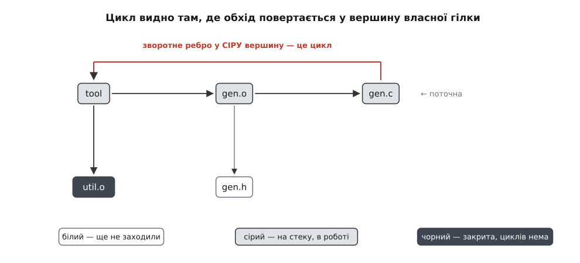
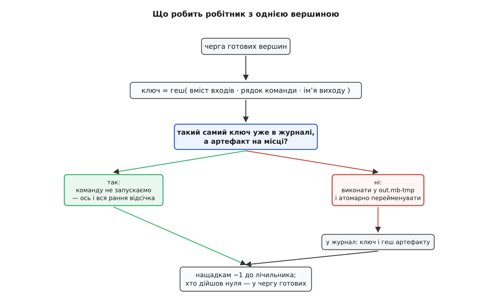

# ⚙️ Власна система збірки на двісті рядків

Модель збірки — граф, ключ, журнал — легко переказати й важко перевірити на слух: поки вона лишається схемою, у ній не видно жодного місця, де можна помилитися. Тому ми її напишемо. Нижче — робочий інструмент `mb`: він читає файл правил, будує з них граф, відмовляється працювати з циклом, рахує ключ кожної задачі з **вмісту** входів і рядка команди, тримає журнал ключів між прогонами й виконує все, що лишилося, у пулі потоків. Двісті з чимось рядків C++ — і в цих рядках уся модель, включно з тими трьома-чотирма деталями, повз які схема проходить мовчки, а реалізація — ні.

Мова тут не декоративна. Задача системна наскрізь: побайтове читання файлів, атомарна заміна на диску, спільні лічильники між потоками, породження процесів. У C++ кожна з цих речей видима — нема бібліотечного виклику, який зробив би цікаву частину за нас і сховав її під іменем.

## Задача, сформульована так, щоб її можна було перевірити

Інструмент отримує файл правил і мусить дати три обіцянки.

**Перша: не виконувати команду, результат якої не змінився б.** Не «команду, входи якої не молодші» — саме результат. Отже, ознакою буде вміст, а не час.

**Друга: ніколи не лишати недописаного артефакту.** Обірвана команда, `Ctrl-C`, вимкнене живлення — після будь-чого з цього на місці виходу має лежати або старий цілий файл, або нічого. Напіврезультат, який наступний прогін вважатиме готовим, — найдорожча помилка з усіх можливих, бо вона тиха.

**Третя: виконувати одночасно все, що граф не заборонив.** Не «розпаралелювати», а просто не вигадувати порядку там, де його немає в даних.

Чого `mb` свідомо не робить: не вибирає ціль (будує все, бо вибір цілі — це обхід угору від неї й позначення досяжного, десять рядків, які нічого не додають до моделі), не виявляє заголовки сам і не ізолює задачі від файлової системи. Ці три пропуски — не спрощення заради стислості; кожен із них має свою ціну, і наприкінці ми її назвемо.

## Ідея на п'ять частин

Розбір файлу правил дає плоский список записів `{вихід, входи, команда}` — і більше нічого; жодного порядку в цьому списку немає. З імен виходів будується покажчик, за яким кожен вхід або знаходить своє правило (тоді це ребро), або не знаходить (тоді це лист, який просто мусить існувати). Обхід у глибину трьома кольорами перевіряє, що циклів немає, і саме він робить решту можливою. Ключ задачі — геш усього, від чого залежить результат. Журнал на диску зберігає ключі минулого прогону. Пул потоків бере в роботу лише ті вершини, у яких лічильник неготових входів дійшов нуля.

П'ять частин, кожна відповідає рівно за одне. Далі — кожна кодом.

## Формат: правило — це три поля й нічого більше

```
# build.rules — те, що читає mb
gen.h: gen.py config.txt
    python3 gen.py config.txt $out

util.o: util.c util.h
    cc -c $in -o $out

main.o: main.c util.h gen.h
    cc -c $in -o $out

app: util.o main.o
    cc $ins -o $out
```

Рядок без відступу — заголовок правила: вихід, двокрапка, входи. Рядок із відступом — команда. Три підстановки: `$out` — вихід, `$in` — **перший** вхід, `$ins` — усі входи через пропуск. Підстановки тут не для зручності. Ім'я виходу мусить бути змінною, бо команду ми виконуватимемо не одразу у вихід, а в тимчасовий файл поруч — інакше обірвана посеред роботи збірка лишила б напівфайл під правильним іменем.

:::code proj-mini-build/cpp/mb.cpp

Порядок перевірок в `expand` не випадковий: `$ins` мусить перевірятися раніше за `$in`, інакше довша підстановка не спрацює ніколи. Коротша збіглася б першою, `$ins` розібралося б як `$in` плюс літера `s`, і в команду замість усіх входів пішов би перший із приліпленою літерою. Це дрібниця, але з тих, які ловляться не компілятором, а зіпсованою збіркою через тиждень.

## Геш: п'ять рядків, у яких сховані два рішення

:::code proj-mini-build/cpp/hesh-piat-riadkiv-u-iakykh.cpp

Це FNV-1a — [некриптографічна гешфункція](root:sf-algorithms/non-cryptographic-hash) з дуже точною історією: основу надіслали Гленн Фаулер і Фонг Во як зауваження рецензентів до комітету IEEE POSIX P1003.2 у 1991 році, а в наступному колі голосування Лендон Керт Нолл її поліпшив; звідси й назва Fowler/Noll/Vo. Варіант «1a» відрізняється від первісного лише порядком двох дій — спершу `xor`, потім множення, — і цим рівномірніше розмазує вплив кожного байта.

Перше приховане рішення — метод `sep()`. Без нього ключ був би просто гешем склеєних полів, а склеювання втрачає межі: пара («ab», «c») і пара («a», «bc») дали б один ключ. У системі збірки це означає, що правило `foo.o` з командою `cc -O2` могло б збігтися ключем із правилом `foo.o -O` та командою `2` — приклад надуманий, але клас помилки цілком реальний, і коштує один байт-роздільник між полями.

Друге рішення чесніше назвати компромісом: 64 біти замало для спільного кеша. Імовірність хоч однієї колізії серед `n` різних ключів рахується парадоксом днів народження:

```
p ≈ 1 − exp(−n² / 2ᴺ⁺¹),   N = 64,   2⁶⁵ ≈ 3.689·10¹⁹

n = 10⁶   (локальна збірка за роки роботи)   →  p ≈ 2.7·10⁻⁸
n = 10⁹   (спільний кеш команди за рік)      →  p ≈ 0.027
n = 2³² ≈ 4.3·10⁹                            →  p ≈ 0.39
```

Для однієї машини 64 біти безпечні з великим запасом. Для кеша, яким користується вся компанія, вони означають кілька відсотків шансу колись віддати чужий артефакт замість свого — а це помилка сорту «актуально, коли насправді застаріло», найдорожча з можливих. Тому справжні системи беруть 128 біт і більше, і зазвичай саме [криптографічну гешфункцію](root:sf-security/cryptographic-hash): від неї потрібна не лише рівномірність, а й стійкість до навмисно підібраного збігу, бо в кеш, спільний для багатьох, може писати не тільки друг.

FNV-1a стоїть тут через свої п'ять рядків, а не через швидкість. Кожен байт множиться на просте число, і наступне множення чекає на результат попереднього — тобто ланцюг залежностей завдовжки з файл. Затримка цілочисельного множення на сучасному ядрі — близько трьох тактів, отже:

```
3 такти/байт ÷ 4·10⁹ тактів/с ≈ 0.75 нс/байт ≈ 1.3 ГБ/с
```

Функції на кшталт xxHash чи BLAKE3 обробляють десятки байтів за ітерацію в кількох незалежних доріжках і тому впираються не в затримку множення, а в пропускну здатність пам'яті. Різниця — приблизно порядок, і на великому дереві вона помітна.

## Ключ задачі

:::code proj-mini-build/cpp/kliuch-zadachi.cpp

Чотирнадцять рядків, у яких лежить уся правильність інкрементальної збірки. Варто прочитати їх як список обіцянок: результат залежить від імені виходу, від розгорнутого рядка команди, від імен усіх входів і від вмісту всіх входів — і ні від чого більше. Кожен рядок тут — це стверджувальне речення про світ, і кожне з них може виявитися неправдою; з розбору того, які саме, складено пастки наприкінці.

Рядок `h.feed("mb/1")` — версія схеми ключа. Коли ми колись почнемо додавати до ключа ще щось (версію компілятора, наприклад), усі старі записи журналу мусять стати недійсними одним рухом. Без цієї версії довелося б просити людей вручну чистити журнал — тобто просити їх пам'ятати те, що вміє пам'ятати програма.

Найтонше в цьому шматку — `expand(r, r.out)`. Команду ми будемо виконувати в **тимчасовий** файл, а не одразу у вихід; отже, рядок, який справді піде в оболонку, щоразу міститиме `gen.h.mb-tmp` замість `gen.h`. Якби ключ рахувався з нього, він був би однаковий — але описував би не ту команду. Ключ мусить бути гешем наміру, а не гешем службової деталі виконання. Тому підстановок дві: одна з реальним іменем виходу — для ключа, друга з тимчасовим — для запуску.

## Граф і три кольори

:::code proj-mini-build/cpp/hraf-i-try-kolory.cpp

Граф ніхто не оголошував — він виріс із покажчика `byOut`. Кожен вхід питає покажчик про своє ім'я: якщо хтось таке робить, з'являється ребро; якщо ніхто, це вихідний файл із репозиторію, і від нього ми вимагаємо лише існувати. Заборона двох правил на один вихід — не примха: два різні способи зробити один файл означають, що результат залежить від того, хто встиг першим, а тоді про ключі можна забути.

Тепер цикл. Наївна перевірка «чи не потрапили ми туди, де вже були» неправильна: вершину, у якій ми вже побували й із якої благополучно вийшли, зустріти вдруге цілком нормально — це просто спільна залежність. Помилка — тільки повернення у вершину, з якої ми ще **не вийшли**, тобто в ту, що зараз лежить на нашому власному шляху. Звідси три стани, а не два.



*Сіра — це «зараз на моєму шляху»; чорна — «уже перевірена, звідти циклу нема». Різниця між цими двома станами — вся різниця між правильною перевіркою і хибним спрацюванням на спільній залежності.*

:::code proj-mini-build/cpp/hraf-i-try-kolory-2.cpp

Обхід тут навмисно розгорнутий у власний стек замість рекурсії. У [пошуку в глибину](root:sf-algorithms/depth-first-search) рекурсія природніша й коротша, але глибина тут — це довжина ланцюга залежностей, а вона в реальних деревах доходить до тисяч; стек викликів такого не любить, і падіння виглядало б як загадковий збій замість повідомлення про цикл.

Вектор `path` — це поточна гілка, і потрібен він рівно для одного: щоб повідомлення про помилку назвало не «цикл виявлено», а `tool → gen.o → gen.c → tool`. Різниця між цими двома повідомленнями — це різниця між п'ятьма хвилинами й вечором.

Ациклічність тут не одна з перевірок серед інших. Вона — умова, за якої задача взагалі має розв'язок: там, де `a` потрібен для `b`, а `b` для `a`, порядку виконання не існує. Саме з неї випливає, що [топологічний порядок](root:sf-algorithms/topological-sort) є завжди, і саме на неї спиратиметься планувальник, коли ми доводитимемо, що він не зависне.

## Журнал: те, що переживає прогін

:::code proj-mini-build/cpp/zhurnal-te-shcho.cpp

Три числа на рядок: ключ задачі, геш артефакту, ім'я виходу. Цього досить, бо рішення «запускати чи ні» ставиться не до файлової системи, а до нашого власного минулого: **чи робили ми вже цю саму роботу і чи лежить її результат на місці**. Час зміни файлу в цій схемі не питається жодного разу — ані у входів, ані у виходів.

Зіпсований рядок журналу ми мовчки пропускаємо, і це свідомо. Журнал — підказка, а не джерело правди: у найгіршому разі ми втратимо його й зробимо зайву роботу. Помилка в цей бік коштує часу; помилка в інший бік коштує дня пошуку неіснуючої вади.

## Одна задача цілком



*Уся розвилка — в одному порівнянні ключів; гілка «так» і є ранньою відсічкою, і в ній немає жодного рядка коду.*

:::code proj-mini-build/cpp/odna-zadacha-tsilkom.cpp

Команда ніколи не пише туди, куди дивиться наступний прогін. Вона пише в `out.mb-tmp`, і тільки коли завершилася нулем і файл справді з'явився, ми переставляємо ім'я. Перейменування в межах однієї файлової системи POSIX вимагає виконувати неподільно: якщо цільове ім'я вже існує, воно лишається видимим протягом усієї операції й указує або на старий файл, або на новий — стану «ні на що» не буває. Тому обірвана посеред роботи збірка не може лишити після себе напівфайл: або старий артефакт цілий, або новий цілий.

Три деталі, без яких ця гарантія розсипається. Тимчасовий файл лежить **у тій самій теці**, що й вихід, а не в системній теці тимчасових файлів: перейменування між різними файловими системами POSIX не дозволяє взагалі — воно провалиться з помилкою «кросове посилання між пристроями», бо це вже копіювання, а копіювання неподільним не буває. Далі, після невдалої команди ми прибираємо `tmp` самі — інакше наступний прогін застане чужий недопис. І, нарешті, при провалі ми **не чіпаємо ні артефакт, ні журнал**: старий запис і старий файл лишаються узгодженою парою, тож наступний прогін почне з того самого місця, а не з руїни. Загальний прийом і його межі — [атомарна заміна файлу](root:sf-data/atomic-file-replace).

На Windows це місце слабше. `std::filesystem::rename` там лягає на `MoveFileEx` із прапорцем заміни, і документація прямо неподільності не обіцяє; функція, для якої така обіцянка є, — `ReplaceFile`, і вона теж вимагає, щоб усі три файли були на одному томі. Отже, обіцянка «або старий, або новий» на Windows тримається на реалізації, а не на специфікації, і серйозний інструмент викликає `ReplaceFile` прямо.

## Пул, який бере тільки готове

:::code proj-mini-build/cpp/pul-iakyi-bere-tilky.cpp

Тут немає топологічного сортування як окремого кроку, і це не спрощення. Лічильник `pending` — це кількість входів вершини, які ще хтось будує; вершина потрапляє в чергу рівно тоді, коли він дійшов нуля. Порядок, у якому робітники розбирають чергу, довільний і щоразу інший — але жоден із цих порядків не порушує стрілок графа, бо вершина фізично не може опинитися в черзі раніше за свої входи. Топологічний порядок тут не обчислюють; його дотримуються.

Чому пул не може зависнути, теж варто довести, а не відчути. Лічильник вершини зменшується рівно один раз на кожен її вхід — бо кожен вхід завершується рівно один раз. Отже, кожна вершина колись дійде нуля й потрапить у чергу. Єдиний спосіб зламати це міркування — цикл: тоді вершини кола нескінченно чекали б одна одну. Але цикли ми відкинули ще до старту. Перевірка ациклічності — це і є доказ відсутності взаємної блокади.

М'ютекс тут один на все — і чергу, і лічильники, і журнал. Це навмисно: єдина довга дія (`runNode`) виконується поза ним, а решта — це кілька операцій над пам'яттю, для яких окремі замки додали б ризиків більше, ніж швидкості. Про сам прийом і про те, як вибирають розмір такого пулу, — [пул потоків](root:sf-tasks/thread-pool); про схему «черга й ті, хто з неї беруть» — [виробник–споживач](root:sf-tasks/producer-consumer).

## Прогін, у якому видно ранню відсічку

Перший запуск робить усе:

```
$ ./mb -j4
▸  cc -c util.c -o util.o.mb-tmp
▸  python3 gen.py config.txt gen.h.mb-tmp
▸  cc -c main.c -o main.o.mb-tmp
▸  cc util.o main.o -o app.mb-tmp
```

Тепер додамо в `config.txt` рядок-коментар — такий, що `gen.py` його ігнорує, тож згенерований `gen.h` вийде побайтово тим самим:

```
$ ./mb -j4
—  util.o
▸  python3 gen.py config.txt gen.h.mb-tmp
—  main.o
—  app
```

`config.txt` змінився, тож ключ задачі `gen.h` став іншим і генератор відпрацював. Але його результат — ті самі байти, отже вміст входів `main.o` не змінився, отже його ключ теж не зрушив, отже компілятор не запускається. І `app` не лінкується.

Тепер найважливіше про цей вивід: **ми не написали для нього жодного рядка**. У коді немає слів «рання відсічка», немає порівняння «а чи змінився результат попередньої задачі», немає прапорця, який зупиняв би хвилю. Є лише ключ, порахований із вмісту. Відсічка — це не механізм, який до такої схеми додають; це те, що ключ із вмісту **означає**. Хвиля зупиняється не тому, що її зупинили, а тому, що нижче нема чого перераховувати.

Порівняння з інструментом, який дивиться на час, робить контраст точним. Ninja вважає ціль застарілою, якщо вона старіша за вхід, а свій журнал `.ninja_log` веде для іншого — там на кожен вихід лежить геш рядка команди, і зміна прапорців перезбирає ціль, навіть коли всі файли на місці (повний рядок команди в журнал не пишуть свідомо: на великому проєкті геші стискають журнал у сотню разів). Ранньої відсічки з такої ознаки не випливає — мітка часу перегенерованого файлу свіжа навіть тоді, коли вміст той самий. Тому її довелося додати окремим механізмом: `restat = 1` змушує ninja перезняти час виходу після команди, і, за словами документації, кожен вихід, чий час зміни команда не змінила, трактується так, ніби його ніколи не треба було збирати, а це може викинути його зворотні залежності зі списку робіт. Той самий результат — але як окрема властивість правила, яку хтось мусив увімкнути. Про повний простір таких рішень — [інкрементальна збірка](root:sys-bsystem/incremental-build).

## Ціна

```
побудова графа й перевірка циклів:   O(V + E)
планування:                          O(V + E), по одному входженню в чергу на вершину
ключ однієї задачі:                  прочитати всі її входи цілком
```

Перші два рядки нічого не варті: на десяти тисячах правил це мілісекунди. Уся ціна — у третьому.

І тут наша реалізація наївна в один конкретний спосіб: **кожна вершина читає свої входи сама**. Заголовок, оголошений входом у чотирьохстах правилах, буде прочитаний і прогешований чотириста разів.

```
проєкт: 3000 одиниць, 420 МБ джерел
у середньому 4 МБ оголошених входів на одиницю

наївно:  3000 · 4 МБ = 12 ГБ ÷ 1.3 ГБ/с ≈ 9 с   ← на кожен прогін
з кешем: 420 МБ ÷ 1.3 ГБ/с ≈ 0.32 с             ← кожен файл читається раз
```

Дев'ять секунд перед кожною збіркою — рівно та ціна, через яку про геші кажуть «задорого». Але платимо ми її не за геші, а за повторне читання. Лікується це кешем дайджестів: геш файлу рахують один раз і кладуть у таблицю за ключем «шлях + час зміни + розмір»; наступні звертання беруть готове. Мітка часу тут повертається — але вже не як **ознака актуальності**, а лише як дешевий натяк «файл, схоже, не чіпали»; коли натяк збреше, ми прочитаємо файл зайвий раз, і це все. Різниця між цими двома ролями мітки часу і є різниця між правильною системою збірки й тією, що іноді бреше.

## Пастки

**Непроголошений вхід.** `mb` вірить списку входів на слово. У правилі `util.o: util.c util.h` ми написали `util.h` руками — а якщо `util.c` включає ще й `config.h`, ключ його не бачить, і правка `config.h` не перезбере нічого. Це не дрібна вада реалізації, а межа самої моделі: **ключ покриває рівно те, що оголошено**. Полагодити це можна двома шляхами — попросити слід у компілятора (`-MMD -MF util.d` кладе поряд із об'єктним файлом справжній список включених заголовків, і наступного прогону він уже є) або відібрати в задачі можливість читати неоголошене, виконуючи її в пісочниці. Перше дешеве й лікує наслідок, друге дороге й лікує причину.

**Недетермінований порядок каталогу.** Спокуса написати правило зі зразком на кшталт `*.c` дуже велика, і саме тому `mb` не має розкриття зразків. Каталог віддає імена в порядку, який залежить від файлової системи й від історії створення файлів, а лінкер складає символи в порядку, у якому їх отримав. Дві машини з тим самим кодом дадуть різні артефакти — а разом із ними різні геші й марно неспрацьовані кеші. Якщо зразки все-таки потрібні, результат розкриття треба сортувати, і сортувати за байтами імені, а не за правилами мови поточного оточення: у Туреччині `I` і `i` впорядковуються не так, як у США. Ширше про це — [відтворювані збірки](root:sys-bsystem/reproducible-builds).

**Команда, що не є функцією.** Уся конструкція стоїть на припущенні, що однакові входи дають однакові байти. Правило з `date` усередині, компілятор, який вписує в налагоджувальні символи абсолютний шлях, архіватор, що зберігає час, — і геш артефакту стрибає щопрогону. Наслідок не «трохи неточний кеш»: рання відсічка перестає спрацьовувати взагалі, бо жоден результат ніколи не збігається з попереднім, і кожна дрібна правка знову перезбирає все дерево вниз. Чому мемоізація має сенс лише для передбачуваного обчислення — [чисті функції і побічні ефекти](root:sf-apps/pure-functions-side-effects).

**Тимчасове ім'я теж видно.** Наш прийом із `out.mb-tmp` купує неподільність, але команда виконується з іншим ім'ям виходу, ніж те, під яким файл житиме. Інструмент, що вписує власне вихідне ім'я всередину артефакту — а компілятори роблять це в налагоджувальній інформації, — дасть байти, які залежать від нашої службової деталі. Тому ім'я тимчасового файлу тут виведене з імені виходу детерміновано, а не випадкове: принаймні воно однакове між прогонами. Повного розв'язку немає — доводиться вибирати між неподільністю заміни й чистотою байтів, і хто хоче другого, той натомість видаляє зіпсований вихід після провалу.

**Ключ не покриває сам вихід.** Ми звіряємо ключ і перевіряємо, що файл існує, — але не перевіряємо, що це той самий файл. Хто завгодно може підмінити `.o` між прогонами, і `mb` цього не помітить. Геш артефакту в журналі для цього є, і одна перевірка тут коштувала б одного читання; системи, які цим переймаються всерйоз, ідуть далі й тримають артефакти у сховищі, куди має доступ лише збірка.

**`std::system` — не той інструмент.** Стандарт не обіцяє, що його можна кликати з кількох потоків; glibc свою реалізацію робить потокобезпечною свідомо, але це властивість бібліотеки, а не мови. До того ж усі задачі пишуть в один спільний потік виводу, тож на `-j8` рядки різних команд перемішуються, і знайти, чия саме помилка, стає окремою вправою. Справжній інструмент породжує процес прямо — через [posix_spawn чи його родичів](root:sys-unix/spawn-alternatives) — і видає кожній задачі власні труби, щоб вивести її вивід одним цілим шматком після завершення.

**Журнал пишеться в кінці.** `saveLog` викликається після того, як усі потоки зійшлися. Обрив посередині — і весь прогін пропав для наступного разу, хоча артефакти на диску цілі. Виправлення просте й того варте: дописувати рядок одразу після кожної задачі, а не збирати таблицю в пам'яті. Саме так і влаштовані журнали справжніх систем — це журнал дописування, а не файл, що перезаписується цілком.
