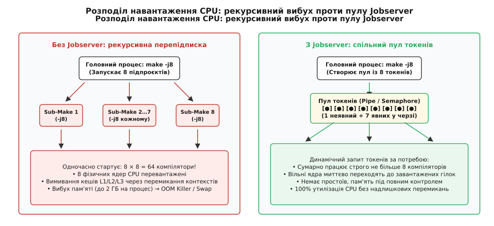
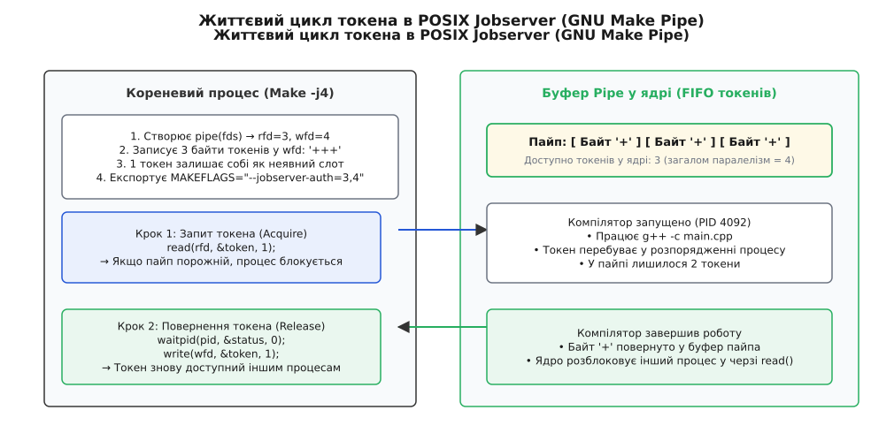
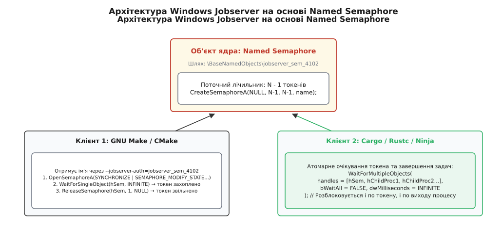
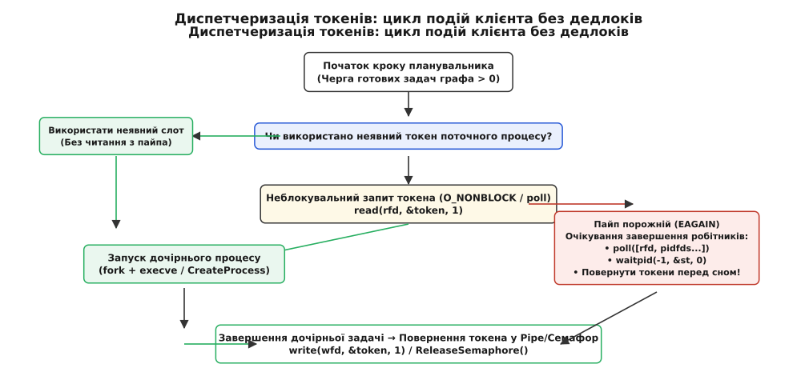

# Протокол Jobserver: координація паралелізму між процесами збірки

<preknowlist>
- [Граф залежностей і порядок робіт](root:sys-bsystem/dependency-graph) — топологічний порядок задач, критичний шлях та планування паралельного виконання.
- [Швидкість збірки](root:sys-bsystem/build-speed) — фактори затримок компіляції, утилізація процесорних ядер та вузькі місця введення-виведення.
- [pipe та FIFO](root:sys-unix/pipe-and-fifo) — передача байтів між процесами через системні буфери ядра та семантика дескрипторів.
- [Успадкування дескрипторів та close-on-exec](root:sys-unix/close-on-exec) — прапорець `O_CLOEXEC`, збереження та витік дескрипторів при виклику `execve()`.
- [Блокувальне та неблокувальне введення-виведення](root:sys-unix/blocking-and-nonblocking) — виклики `read()`/`write()`, неблокувальний режим `O_NONBLOCK` та готовність через `poll()` / `epoll()`.
</preknowlist>

Коли на шістнадцятиядерній робочій станції запускають збірку великого проєкту командою `make -j16`, система збірки розпаралелює компіляцію незалежних файлів рівно на шістнадцять потоків. Але якщо кореневий сценарій збірки містить виклики вкладених підпроєктів (`$(MAKE) -C subproject -j16`), кожен із дочірніх процесів Make заново запускає власні шістнадцять задач. За лічені мілісекунди в операційній системі виникає понад двісті п'ятдесят одночасних процесів компілятора, які намертво забивають чергу планувальника ядра, спустошують процесорні кеші та вичерпують гігабайти оперативної пам'яті до аварійного спрацьовування механізму аварійного завершення процесів (OOM Killer).

Щоб узгодити ліміт паралелізму між довільною кількістю незалежних процесів збірки без використання важких фонових демонів, інженери GNU розробили протокол **Jobserver** (англ. *job* — завдання, *server* — обслуговуючий вузол). Сьогодні цей протокол став загальновизнаним міжсистемним стандартом, який підтримують GNU Make, Ninja, Cargo (Rust), Meson, CMake та десятки сторонніх компіляторних інструментів на платформах Linux, macOS та Windows.

## Проблема рекурсивної перепідписки ядер (CPU Oversubscription)

У великих програмних комплексах дерево вихідного коду рідко буває однорідним. Воно містить ядро програми, сторонні бібліотеки, утиліти кодогенерації, підмодулі на мовах C, C++ та Rust, а також окремі компоненти, кожен із яких збирається власною системою збірки.

Традиційним підходом до організації таких проєктів є рекурсивний запуск підсистем (англ. *recursive make*). Кореневий сценарій запускає команду для кожного каталогу:

```makefile
SUBDIRS = core engine network renderer ui

all:
	for dir in $(SUBDIRS); do \
		$(MAKE) -C $$dir || exit 1; \
	done
```

Якщо користувач бажає прискорити збірку і передає прапорець `-j16` (англ. *jobs* — кількість паралельних задач), кореневий процес `make` може запустити всі підкаталоги одночасно. Проте всередині кожного каталогу `core/Makefile` чи `engine/Makefile` також прописано або передано через змінні середовища прапорець `-j16`.

```
Кореневий make -j16
 ├── Sub-Make core (-j16)      → 16 процесів g++
 ├── Sub-Make engine (-j16)    → 16 процесів g++
 ├── Sub-Make network (-j16)   → 16 процесів g++
 └── Sub-Make renderer (-j16)  → 16 процесів g++
... Сумарно: 16 × 16 = 256 паралельних процесів на 16 фізичних ядер CPU
```

Така ситуація називається перепідпискою процесора (англ. *CPU oversubscription*). Наслідки неконтрольованої перепідписки проявляються у чотирьох критичних деградаціях продуктивності:

1. **Вибух накладних витрат на перемикання контексту (Context Switch Overhead).** Замість того, щоб шістнадцять процесів безперервно виконували інструкції компілятора на шістнадцяти фізичних ядрах, планувальник операційної системи змушений щосекунди виконувати сотні тисяч перемикань між 256 процесами. Кожне перемикання скидає стан конвеєрів процесора, вимагає оновлення таблиць сторінок пам'яті та ініціює дорогі міжпроцесорні переривання (TLB shootdowns).
2. **Вимивання процесорних кешів (Cache Thrashing).** Компілятор під час синтаксичного аналізу активно використовує кеші інструкцій та даних першого (L1) та другого (L2) рівнів. Постійне витіснення робочих наборів даних різними процесами перетворює швидку роботу з кешем на безперервне очікування вибірки рядків із повільної оперативної пам'яті через насичену системну шину.
3. **Вичерпання оперативної пам'яті та OOM Killer.** Сучасні компілятори C++ (Clang, GCC) та Rust (`rustc`) при оптимізації важких шаблонів і макросів споживають від 1 до 3 ГБ оперативної пам'яті на одну одиницю трансляції. Одночасний запуск 256 процесів вимагає понад 400 ГБ пам'яті. Якщо фізичної пам'яті недостатньо, операційна система починає інтенсивний скид сторінок у файл підкачування (англ. *thrashing*), після чого підсистема Out-Of-Memory (OOM) примусово завершує процеси сигналом `SIGKILL`.
4. **Хибність статичного розподілу квот.** Спроба вирішити проблему шляхом статичного обмеження квот (наприклад, призначити кожному підкаталогу фіксований ліміт `-j2` або `-j4`) призводить до протилежної проблеми — простою обладнання (англ. *underutilization*). Якщо модуль `network` містить лише 2 файли, а модуль `renderer` — 500 важких файлів, то після компіляції мережевого коду більшість ядер процесора стоятимуть без діла, тоді як `renderer` повільно компілюватиметься лише двома потоками.


*Порівняння неконтрольованої рекурсивної збірки (256 процесів на 16 ядер) з централізованим пулом Jobserver, що підтримує суворо фіксовану кількість активних робітників.*

Вирішенням проблеми є глобальний динамічний пул токенів (англ. *token pool*), який діє на рівні всього дерева процесів незалежно від глибини вкладеності.

> 🔧 **Навіщо це.** Без узгодженого протоколу розподілу задач паралельна збірка великих монорепозиторіїв або проєктів із підмодулями (Linux Kernel, Chromium, Android AOSP, LLVM) або деградує вдесятеро за часом, або падає через нестачу пам'яті. Jobserver дозволяє тримати рівно `N` активних задач у масштабі всієї системи, миттєво віддаючи вільні ресурси тим гілкам графа, які мають готові задачі.

## Класичний протокол через POSIX-пайпи (GNU Make Pipe)

Ідею синхронізації паралельних екземплярів make через звичайний pipe у лютому 1999 року вперше запропонував Говард Чу (Howard Chu); у GNU Make 3.78 (вересень 1999 року) архітектуру Jobserver було реалізовано спільно групою розробників (Howard Chu, Roland McGrath, Paul Smith, Tim Magill). Головною вимогою була абсолютна простота, відсутність окремих фонових служб-демонів та здатність працювати виключно на стандартних системних викликах POSIX.

Механізм базується на концепції відерця з токенами (англ. *token bucket*), реалізованого через звичайний анонімний односпрямований канал — пайп (англ. *pipe*).

### Правило неявного токена (Implicit Token)

Ключовим фундаментальним правилом протоколу є концепція **неявного токена** (англ. *implicit token* або *internal token*):

> Кожен запущений процес системи збірки (кореневий `make` або будь-який дочірній `sub-make`) автоматично володіє рівно одним слотом виконання за фактом свого існування.

Це означає:
- Якщо користувач вказав загальний ліміт паралелізму `N` (наприклад, `-j4`), то кореневий процес `make` створює канал `pipe(fds)` і записує в нього рівно `N - 1` байтів-токенів (у нашому випадку — 3 байти, зазвичай символи `'+'` або пробіли).
- Першу задачу будь-який процес виконує на основі свого неявного токена, **не читаючи** нічого з каналу.
- Якщо процес бажає запустити *другу*, *третю* або *N-ну* паралельну задачу одночасно з першою, він зобов'язаний вилучити (прочитати) один байт із дескриптора читання каналу.
- Після завершення кожної додаткової задачі процес зобов'язаний повернути (записати) вилучений байт назад у дескриптор запису каналу.

```
Паралелізм: N = 4
├── Неявний токен (Implicit): 1 слот утримує сам процес make
└── Токени в пайпі: N - 1 = 3 байти ['+']['+']['+']
```

Якщо в пайпі не залишилося байтів (усі токени розібрані іншими паралельними процесами), системний виклик `read()` переводить процес у стан блокування в ядрі операційної системи. Щойно будь-який компілятор у системі завершує роботу і його батьківський процес повертає байт у пайп через `write()`, ядро миттєво будить один із заблокованих процесів.


*Життєвий цикл токена в POSIX Jobserver: кореневий процес створює дескриптори пайпа, записує N-1 байтів і передає їх дочірнім процесам через змінну MAKEFLAGS.*

### Передача параметрів через командний рядок та MAKEFLAGS

Щоб дочірні процеси знали, звідки читати та куди повертати токени, кореневий процес Make передає номери відкритих файлових дескрипторів через аргументи командного рядка та автоматичну змінну середовища `MAKEFLAGS`.

Історично формат прапорця змінювався:
- **GNU Make до версії 4.2:** використовувався прапорець `--jobserver-fds=R,W`, де `R` — номер файлового дескриптора для читання, а `W` — для запису (наприклад, `--jobserver-fds=3,4`).
- **GNU Make 4.2 та новіші версії:** прапорець перейменовано на `--jobserver-auth=R,W` (від англ. *authentication* — авторизація), щоб підкреслити передачу прав доступу до пулу.

При виклику вкладеного підпроцесу Make автоматично формує змінну середовища:

```bash
MAKEFLAGS="--jobserver-auth=3,4 -j16"
```

Коли дочірній процес `make` стартує, він розбирає `MAKEFLAGS`. Виявивши параметр `--jobserver-auth=3,4`, він розуміє, що не має права створювати новий власний пул токенів. Замість цього він підключається до вже відкритих дескрипторів 3 і 4 та стає клієнтом батьківського Jobserver.

## Підводні камені POSIX-пайпів: дескриптори, FIFO, eventfd і pidfd

Попри елегантність ідеї з байтами в пайпі, на практиці класичний підхід через передачу числових дескрипторів містить кілька серйозних вразливостей системного рівня.

### Проблема витоку та пошкодження дескрипторів

У стандартах POSIX відкриті файлові дескриптори за замовчуванням успадковуються дочірніми процесами при виклику `execve()`, якщо на них явно не встановлено прапорець `FD_CLOEXEC` (англ. *close-on-exec*).

Якщо дескриптори 3 і 4 залишаться відкритими, вони будуть успадковані кожним дочірнім процесом: компілятором `gcc`, компонувальником `ld`, утилітами `sed`, `awk`, оболонкою `sh` та довільними користувацькими скриптами. Це призводить до двох небезпечних ситуацій:

- Якщо довільний сторонній скрипт у рецепті випадково прочитає щось із дескриптора 3 (наприклад, очікуючи там вхідні дані), токен збірки зникне назавжди. Загальний ліміт паралелізму системи безповоротно зменшиться на одиницю.
- Якщо дочірня програма закриє дескриптор 4, наступна спроба системи збірки повернути токен викличе сигнал помилки зламаного каналу `SIGPIPE` (або помилку `EPIPE`), що призведе до аварійного падіння всієї збірки.

Щоб запобігти цьому, GNU Make використовує умовну логіку управління прапорцем `FD_CLOEXEC`:
1. За замовчуванням на дескриптори пайпа встановлюється прапорець `FD_CLOEXEC` за допомогою виклику `fcntl(fd, F_SETFD, FD_CLOEXEC)`. Усі звичайні команди рецептів (компілятори, утиліти) запускаються із закритими дескрипторами Jobserver.
2. Якщо Make виявляє, що рядок рецепта містить рекурсивний виклик (позначається символом `+` на початку рядка або містить посилання на змінні `$(MAKE)` чи `${MAKE}`), Make безпосередньо перед викликом `execve()` знімає прапорець `FD_CLOEXEC`, роблячи дескриптори доступними для вкладеного Make.

### Еволюція GNU Make 4.4+: іменовані канали (FIFO)

У складних інструментальних ланцюгах (де Make викликає CMake, CMake генерує виклики Python-скриптів, а ті викликають вкладений Make або Ninja) прапорці дескрипторів часто втрачаються або дескриптори закриваються проміжними бібліотеками.

У GNU Make 4.4 (випущеному наприкінці 2022 року) було представлено новий режим Jobserver на базі іменованих каналів — **FIFO** (лат. *primum intro, primum exit* — першим прийшов, першим пішов).

Замість анонімного пайпа кореневий процес створює тимчасовий FIFO-файл у файловій системі за допомогою системного виклику `mkfifo()` (наприклад, у каталозі `/tmp`):

```bash
--jobserver-auth=fifo:/tmp/GMfifo48912
```

Переваги схеми на базі FIFO:
- **Відсутність проблем з номерами дескрипторів.** Будь-який процес у дереві на будь-якому рівні вкладеності може самостійно відкрити зазначений файл викликом `open("/tmp/GMfifo48912", O_RDWR | O_CLOEXEC)`.
- **Безпека успадкування.** Кожен процес відкриває власний дескриптор із негайно встановленим `O_CLOEXEC`. Жодні дескриптори не передаються через `execve()`, що унеможливлює випадкове пошкодження пайпа сторонніми програмами.
- **Очищення ресурсів.** Кореневий процес видаляє точку монтування файлу викликом `unlink()`, але відкритий об'єкт у пам'яті ядра залишається доступним для всіх підключених процесів аж до закриття останнього дескриптора.

### Асинхронне опитування: eventfd, pidfd та неблокувальний ввід-вивід

Класичний блокувальний виклик `read(rfd, &token, 1)` створює проблему в архітектурі сучасних систем збірки з циклом обробки подій (англ. *event loop*). Якщо планувальник заблокується на читанні токена з пайпа, він не зможе вчасно реагувати на завершення дочірніх процесів або системні сигнали без переривання через `EINTR` та обробників `SIGCHLD`.

Сучасні клієнти Jobserver (наприклад, у системі збірки Ninja або компіляторі Rust) переводять дескриптор читання в неблокувальний режим:

:::tabs
```c
/* Налаштування неблокувального режиму дескриптора читання в C */
int make_nonblocking(int fd) {
    int flags = fcntl(fd, F_GETFL, 0);
    if (flags < 0) return -1;
    return fcntl(fd, F_SETFL, flags | O_NONBLOCK);
}
```
:::code jobserver-protocol-d/cpp/asynkhronne-opytuvannia.cpp
:::

Тепер замість сліпого зависання у виклику `read()`, планувальник використовує мультиплексування системних викликів `poll()`, `ppoll()` або `epoll()`:

1. У масив подій `struct pollfd` додається дескриптор читання Jobserver з прапорцем `POLLIN`.
2. Одночасно туди ж додаються дескриптори завершення процесів (у сучасному Linux — дескриптори `pidfd`, створені через `pidfd_open()`, або дескриптор сигналів `signalfd`).
3. Коли `poll()` повертає готовність дескриптора Jobserver, клієнт виконує неблокувальний `read()`. Якщо отримано токен — стартує новий компілятор. Якщо повертається `EAGAIN` чи `EWOULDBLOCK` (інший паралельний процес встиг перехопити токен раніше), планувальник просто повертається в цикл очікування.

## Реалізація Jobserver на Windows: іменовані семафори (Named Semaphores)

В операційній системі Windows архітектура процесів та файлових дескрипторів принципово відрізняється від POSIX. У Windows немає нативних числових дескрипторів файлів на рівні ядра — дескриптори (англ. *file descriptors*) є штучною надбудовою бібліотеки C Runtime (MSVCRT / UCRT). Спроба передати числові дескриптори через змінні середовища дочірнім процесам Windows призводить до збою, оскільки таблиця дескрипторів CRT є локальною для кожного процесу.

Крім того, механізм успадкування дескрипторів ядра Win32 (англ. *HANDLE inheritance*) через структуру `STARTUPINFOEX` вимагає складного ручного налаштування списків успадкування `LPPROC_THREAD_ATTRIBUTE_LIST`, який легко ламається при виклику проміжних командних інтерпретаторів на зразок `cmd.exe` або `powershell.exe`.

З цієї причини для платформи Windows було розроблено альтернативний протокол Jobserver на базі **іменованих семафорів ядра** (англ. *Win32 Named Semaphores*).

```
Ім'я об'єкта ядра: \BaseNamedObjects\jobserver_semaphore_PID_18420
Формат у MAKEFLAGS: --jobserver-auth=jobserver_semaphore_PID_18420
                 або --jobserver-auth=semaphore:jobserver_semaphore_PID_18420
```

### Принцип роботи з Win32 Named Semaphore

Семафор в операційній системі Windows є об'єктом синхронізації ядра, який зберігає цілочисельний лічильник у діапазоні від 0 до заданого максимуму. Стан семафора є «сигнальним» (англ. *signaled*), коли його лічильник строго більший за нуль, і «несигнальним» (англ. *nonsignaled*), коли лічильник дорівнює нулю.

:::tabs
:::code jobserver-protocol-d/c/pryntsyp-roboty-z-win32.c
:::code jobserver-protocol-d/cpp/pryntsyp-roboty-z-win32.cpp
:::

1. **Ініціалізація.** Кореневий процес створює семафор за допомогою виклику API Win32 `CreateSemaphoreA(NULL, N - 1, N - 1, semaphore_name)`.
2. **Підключення клієнта.** Дочірній процес збірки (Make, CMake, Cargo, Ninja) вичитує ім'я семафора з `MAKEFLAGS` і відкриває існуючий об'єкт викликом `OpenSemaphoreA`.
3. **Запит токена (Acquire).** Клієнт викликає функцію очікування `WaitForSingleObject(hSem, INFINITE)`. Ядро Windows атомарно зменшує лічильник семафора на одиницю. Якщо лічильник був рівний нулю, потік переходить у стан очікування без витрат процесорного часу.
4. **Повернення токена (Release).** Після завершення задачі процес збільшує лічильник семафора на одиницю викликом `ReleaseSemaphore(hSem, 1, NULL)`.


*Архітектура Windows Jobserver: використання системного об'єкта Named Semaphore для міжпроцесної координації та атомарного очікування через WaitForMultipleObjects.*

### Перевага Windows: атомарне очікування через WaitForMultipleObjects

У системі Windows реалізація Jobserver має суттєву перевагу над класичним пайпом POSIX завдяки системному виклику `WaitForMultipleObjects`.

Планувальник збірки на Windows формує єдиний масив дескрипторів:
- Перший елемент — дескриптор семафора `hSem`.
- Наступні елементи — дескриптори процесів запущених компіляторів `hProcess[0...K]`.

:::tabs
```c
/* Очікування або токена, або завершення робітника в C */
DWORD wait_jobserver_event(HANDLE hSem, HANDLE *procs, DWORD num_procs) {
    HANDLE handles[64];
    handles[0] = hSem;
    for (DWORD i = 0; i < num_procs && i < 63; ++i) {
        handles[i + 1] = procs[i];
    }
    return WaitForMultipleObjects(num_procs + 1, handles, FALSE, INFINITE);
}
```
:::code jobserver-protocol-d/cpp/perevaha-windows-atomarne.hpp
:::

Цей виклик атомарно вирішує проблему синхронізації: потік пробуджується або коли звільнився токен (семафор став сигнальним), або коли будь-який із компіляторів завершив роботу (дескриптор процесу перейшов у сигнальний стан). Це повністю усуває гонитву станів (англ. *race condition*) між отриманням токенів і збором результатів виконання.

## Федерація інструментів: GNU Make, Ninja, Cargo, Meson і CMake

Jobserver перестав бути внутрішньою особливістю GNU Make і перетворився на стандартний протокол обміну лімітами паралелізму між гетерогенними інструментами розробки.

### Інтеграція в екосистему Cargo (Rust)

Пакетний менеджер і система збірки мови Rust — Cargo — використовує крейт `jobserver` (офіційно підтримуваний командою Rust).
- Коли `cargo build -j8` запускається з командного рядка самостійно, він створює власний Jobserver і передає токени численним екземплярам компілятора `rustc`, які виконують паралельну кодогенерацію (англ. *codegen units*).
- Коли Cargo викликається зсередини великого проєкту на C++ під керуванням GNU Make або CMake, Cargo виявляє змінні `MAKEFLAGS` або `CARGO_MAKEFLAGS`. Він не створює новий пул, а стає клієнтом батьківського Jobserver. Токени використовуються як для компіляції Rust-файлів, так і для запуску сторонніх C/C++ бібліотек у сценаріях `build.rs` (через крейт `cc-rs`).

### Інтеграція в Ninja

Система збірки Ninja від початку розроблялася для максимально швидкої роботи з пласким графом залежностей і довгий час не підтримувала Jobserver, запускаючи фіксовану кількість задач `-jN`. Проте при використанні Ninja у ролі підсистеми всередині інших систем збірки виникала та сама проблема перепідписки CPU.

Починаючи з версії Kitware Ninja та офіційних патчів Ninja v1.12+, Ninja підтримує роботу в режимі клієнта Jobserver (прапорець `-j` без аргументів або автоматичне зчитування `--jobserver-auth` із середовища). Ninja захоплює токени перед кожним викликом компілятора і повертає їх після завершення, забезпечуючи ідеальну інтеграцію у великі змішані збірки.

### Уникнення взаємних блокувань (Deadlock Avoidance)

Неправильна реалізація клієнта Jobserver може легко призвести до взаємного блокування (англ. *deadlock*), коли вся система збірки назавжди зависає.

Класичний сценарій взаємного блокування виникає при недотриманні правила утримання токенів (англ. *Hold and Wait*):

1. Нехай у системі є пул з 2 токенів (1 неявний + 1 у пайпі).
2. Процес `Make A` запускає вкладений `Make B` (використовуючи свій неявний токен).
3. Процес `Make A` вирішує запустити другу задачу `Make C`. Для цього `Make A` забирає 1 токен із пайпа. Пайп стає порожнім.
4. Тепер працюють `Make B` та `Make C`. Обидва використовують свої неявні токени.
5. Для завершення своєї першої фази `Make B` потребує запустити допоміжну утиліту (наприклад, кодогенератор). Але для другої задачі йому потрібен токен з пайпа. `Make B` блокується на виклику `read()`.
6. Одночасно `Make C` теж потребує запустити допоміжну утиліту і також блокується на читанні з порожнього пайпа.
7. `Make A` чекає завершення `Make B` та `Make C`, утримуючи токен. `Make B` і `Make C` чекають токена від `Make A`. Збірка зупинилася назавжди.


*Алгоритм диспетчеризації токенів: перевірка неявного слота, неблокувальний запит токена з пайпа та своєчасне повернення ресурсів у чергу очікування.*

Щоб гарантувати відсутність взаємних блокувань, клієнти Jobserver повинні дотримуватися **золотих правил клієнта**:

1. **Не утримувати зайві токени під час сну.** Якщо процес збирається заснути в очікуванні завершення дочірніх процесів (`waitpid()`, `poll()`), він не має права тримати в руках жодного токена з пайпа, якщо для цього токена прямо зараз не виконується реальний активний процес.
2. **Своєчасне повернення.** Якщо процес захопив токен з пайпа, але через внутрішню помилку або зміну умов не зміг запустити дочірній процес, токен повинен бути негайно повернений назад у пайп або семафор.
3. **Строга відповідність символу токена.** При використанні пайпа бажано повертати рівно той самий байт, який було вичитано під час запиту (хоча GNU Make сприймає будь-які байти, деякі діагностичні розширення відстежують байти для профілювання черги).

## Практична реалізація клієнта Jobserver (C та C++)

Нижче наведено повноцінну, надійну реалізацію клієнта Jobserver, сумісну зі стандартами POSIX (пайпи дескрипторів та FIFO) і Windows (іменовані семафори). Клієнт підтримує розбір змінної `MAKEFLAGS`, неблокувальне отримання токенів та безпечне повернення ресурсів за допомогою ідіоми RAII в C++.

:::tabs
:::code jobserver-protocol-d/c/jobserver_client.c
:::code jobserver-protocol-d/cpp/jobserver_client.hpp
:::

## Зведення архітектурних рішень

Протокол Jobserver демонструє, як мінімалістичний дизайн системного рівня здатен масштабуватися від невеликих утиліт до гігантських розподілених монорепозиторіїв із сотнями тисяч файлів:

| Параметр | POSIX Classic (Make 3.81+) | POSIX Modern FIFO (Make 4.4+) | Windows Named Semaphore |
|---|---|---|---|
| **Механізм ядра** | Анонімний канал `pipe()` | Іменований канал `mkfifo()` | Об'єкт `Named Semaphore` |
| **Параметр MAKEFLAGS** | `--jobserver-auth=R,W` | `--jobserver-auth=fifo:PATH` | `--jobserver-auth=NAME` |
| **Успадкування** | Через дескриптори `execve()` | Відкриття файлу `open()` | Відкриття за ім'ям `OpenSemaphore` |
| **Безпека дескрипторів** | Потребує ручного керування `FD_CLOEXEC` | Повна ізоляція (`O_CLOEXEC`) | Повна ізоляція дескрипторів |
| **Синхронізація подій** | `poll()`, `signalfd`, `pidfd` | `poll()`, `epoll`, `pidfd` | `WaitForMultipleObjects` |
| **Підтримка в тулчейнах** | GNU Make, Ninja, Cargo, CMake | GNU Make 4.4+, Cargo, Ninja | GNU Make (Windows), MSVC, Cargo |

Завдяки протоколу Jobserver сучасні багатоядерні системи підтримують 100% утилізацію процесора без взаємних блокувань, вичерпання пам'яті та деградації кешів.
