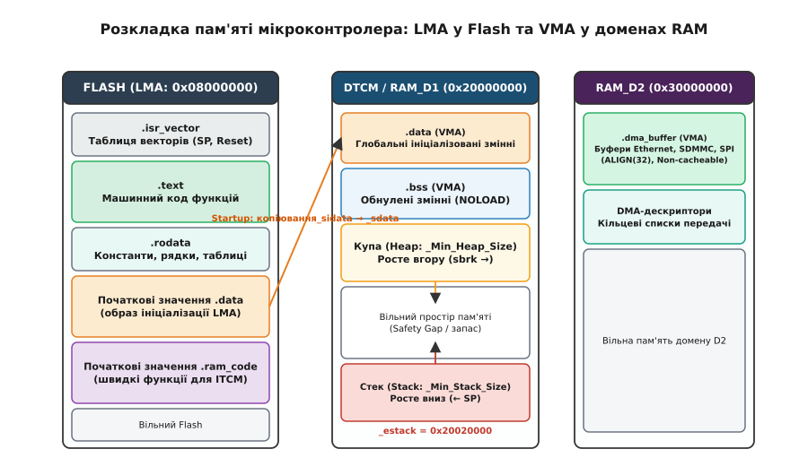
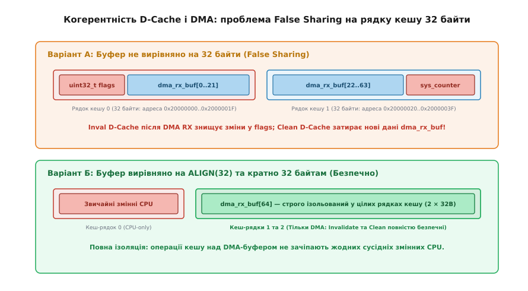
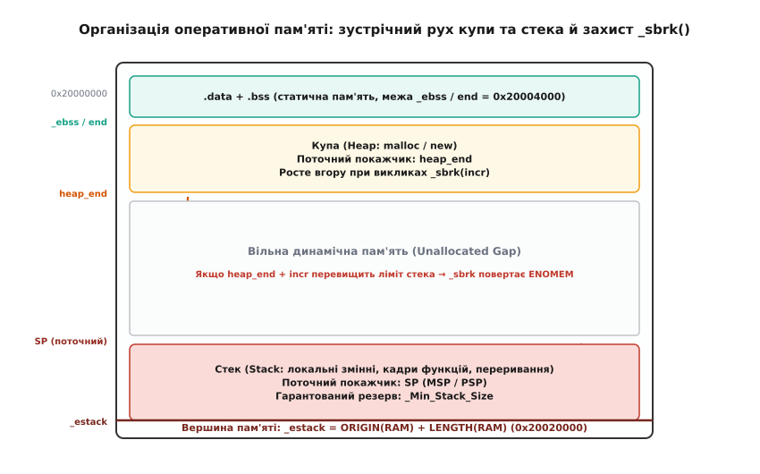

# Свої секції, буфер DMA, стек і купа під свій обсяг

<preknowlist>
- [Тулчейн](root:sys-bsystem/toolchain) — компілятор, асемблер, компонувальник і послідовність етапів збірки бінарного образу.
- [Map-файл](root:sys-bsystem/map-fail) — карта символів, секцій і розподілу адрес пам'яті компонувальником.
- [Прямий доступ до пам'яті (DMA)](root:hw-arch/dma) — апаратна передача блоків даних між периферією та RAM без участі процесора.
- [Когерентність кеша і DMA](root:hw-arch/cache-coherency-dma) — розсинхронізація даних між кешем ядра та фізичною оперативною пам'яттю.
- [Матриця шин](root:hw-arch/bus-matrix) — топологія багатошинних з'єднань між процесорними ядрами, контролерами DMA та різними банками RAM.
</preknowlist>

Коли типовий шаблон проєкту під мікроконтролер архітектури ARM Cortex-M або RISC-V компілюється зі стандартним скриптом компонувальника (*linker script*), пам'ять виглядає однорідною і простою: єдиний блок постійної пам'яті Flash та єдиний суцільний масив оперативної пам'яті RAM. Проте в реальних сучасних мікроконтролерах — таких як сімейства STM32H7, STM32F7 чи NXP i.MX RT — апаратна організація пам'яті є суворо гетерогенною. Фізичний кристал містить декілька незалежних доменів пам'яті: надшвидку пам'ять інструкцій ITCM (*Instruction Tightly-Coupled Memory*), пам'ять даних ядра DTCM (*Data Tightly-Coupled Memory*), загальну системну оперативну пам'ять AXI SRAM та окремі банки SRAM периферійних доменів D2 і D3.

Щойно у прошивці з'являється високонавантажена периферія — наприклад, контролер Ethernet, SD-карта на шині SDMMC через DMA, або графічний дисплей — наївна модель однорідної пам'яті призводить до важких апаратних збоїв. Якщо буфер приймання Ethernet розміром 1536 байтів випадково опиниться у пам'яті DTCM, апаратний блок DMA викличе BusFault або зависне, оскільки матриця системних шин фізично не з'єднує DMA-мастер мережевого контролера з приватною шиною ядра. Якщо на ядрі Cortex-M7 увімкнути кеш даних (*D-Cache*) і не вирівняти буфер передавання на розмір рядка кешу в 32 байти, інвалідація кешу після отримання пакета непомітно знищить змінні операційної системи, що випадково опинилися в тому ж рядку. А якщо динамічна купа (*heap*) безконтрольно росте назустріч низхідному стеку (*stack*), вони зіткнуться всередині оперативної пам'яті, руйнуючи покажчики повернення з функцій.

Усі ці проблеми вирішуються на рівні компонування прошивки. Скрипт компонувальника (файл із розширенням `.ld` у тулчейні GNU) формує фізичну топологію прошивки, призначає змінні та функції у цільові банки пам'яті, гарантує строге вирівнювання структур під вимоги кеш-пам'яті та встановлює апаратні й програмні бар'єри між стеком і купою.



*Фізична топологія пам'яті: відповідність адрес завантаження (LMA) у постійній пам'яті Flash та адрес виконання (VMA) у незалежних доменах оперативної пам'яті DTCM, RAM_D1 та RAM_D2.*

## Анатомія скрипта компонувальника: блоки MEMORY та SECTIONS

Компонувальник GNU `ld` формує остаточний двійковий образ ELF (*Executable and Linkable Format*) з множини вхідних об'єктних файлів (`.o`), створених компілятором та асемблером. Кожен об'єктний файл містить власні секції коду, констант і даних. Робота компонувальника полягає у тому, щоб зібрати однотипні секції докупи, виділити для них неперервні діапазони фізичних адрес та розрахувати абсолютні значення всіх покажчиків і символів.

Цей процес керується двома фундаментальними блоками скрипта компонувальника: директивою `MEMORY` та директивою `SECTIONS`.

### Директива MEMORY: опис фізичного простору чипа

Блок `MEMORY` декларує фізично наявні в мікроконтролері банки пам'яті, вказуючи для кожного з них базову адресу (`ORIGIN`), граничну довжину (`LENGTH`) та список прав доступу:
- `r` — пам'ять доступна для читання (*read*);
- `w` — пам'ять доступна для запису (*write*);
- `x` — пам'ять містить виконуваний машинний код (*execute*).

Типова конфігурація для високопродуктивного мікроконтролера з багатодоменною шинною матрицею визначає незалежні регіони:

```ld
MEMORY
{
  ITCM_RAM (rwx) : ORIGIN = 0x00000000, LENGTH = 64K
  FLASH    (rx)  : ORIGIN = 0x08000000, LENGTH = 1024K
  DTCM_RAM (rwx) : ORIGIN = 0x20000000, LENGTH = 128K
  RAM_D1   (rwx) : ORIGIN = 0x24000000, LENGTH = 512K
  RAM_D2   (rwx) : ORIGIN = 0x30000000, LENGTH = 288K
  RAM_D3   (rwx) : ORIGIN = 0x38000000, LENGTH = 64K
}
```

У цій конфігурації кожен регіон має суворе апаратне призначення. Регіон `FLASH` зберігає незмінний двійковий код і константи. Регіон `ITCM_RAM` з'єднаний з ядром через шину I-TCM і забезпечує вибірку інструкцій із нульовою затримкою тактування. Регіон `DTCM_RAM` є найшвидшою оперативною пам'яттю для стека ядра та критичних обчислювальних структур. Регіони `RAM_D1` та `RAM_D2` розміщені на загальній системній шині AXI/AHB і доступні як ядру, так і автономним контролерам DMA.

### Директива SECTIONS та концепція VMA проти LMA

Блок `SECTIONS` описує правила розміщення вхідних секцій з об'єктних файлів у вихідні блоки пам'яті. На цьому етапі виникає принципове розмежування між двома типами адрес:

1. **VMA** (*Virtual / Execution Memory Address*) — адреса виконання. Це фізична адреса комірки пам'яті, за якою секція розташовується під час роботи прошивки і до якої процесор звертається за допомогою інструкцій завантаження (`LDR`), запису (`STR`) та переходів (`BL`).
2. **LMA** (*Load Memory Address*) — адреса завантаження. Це адреса у двійковому образі енергонезалежної пам'яті Flash, за якою початковий вміст секції зберігається до старту процесора.

Для незмінного машинного коду (`.text`), таблиці векторів переривань (`.isr_vector`) та константних даних (`.rodata`) адреси VMA та LMA ідентичні: вони зберігаються у Flash і виконуються безпосередньо з Flash (механізм XIP — *eXecute In Place*). У скрипті для них вказується однозначне призначення `> FLASH`.

Для глобальних змінних з ненульовими початковими значеннями (`.data`) виникає роздвоєння: початкові байти змінних повинні надійно зберігатися у Flash при вимкненому живленні, але під час виконання програми процесор повинен мати змогу читати і змінювати їх у швидкій оперативній пам'яті. Тому для секції `.data` адреса VMA належить оперативній пам'яті (`DTCM_RAM`), а адреса LMA — постійній пам'яті `FLASH`. У синтаксисі GNU `ld` це записується за допомогою оператора `AT>`:

```ld
SECTIONS
{
  /* Таблиця векторів переривань розміщується на початку Flash */
  .isr_vector :
  {
    . = ALIGN(4);
    KEEP(*(.isr_vector))
    . = ALIGN(4);
  } > FLASH

  /* Машинний код програми */
  .text :
  {
    . = ALIGN(4);
    *(.text)
    *(.text*)
    *(.glue_7)
    *(.glue_7t)
    *(.eh_frame)
    KEEP(*(.init))
    KEEP(*(.fini))
    . = ALIGN(4);
    _etext = .;
  } > FLASH

  /* Таблиці виклику конструкторів глобальних об'єктів C++ */
  .init_array :
  {
    . = ALIGN(4);
    PROVIDE_HIDDEN (__init_array_start = .);
    KEEP (*(SORT(.init_array.*)))
    KEEP (*(.init_array*))
    PROVIDE_HIDDEN (__init_array_end = .);
    . = ALIGN(4);
  } > FLASH

  /* Незмінні константи: рядкові літерали, lookup-таблиці */
  .rodata :
  {
    . = ALIGN(4);
    *(.rodata)
    *(.rodata*)
    . = ALIGN(4);
  } > FLASH

  /* Збереження адреси початку LMA-образу секції .data у Flash */
  _sidata = LOADADDR(.data);

  /* Секція ініціалізованих змінних: VMA в RAM, LMA у FLASH */
  .data :
  {
    . = ALIGN(4);
    _sdata = .;
    *(.data)
    *(.data*)
    . = ALIGN(4);
    _edata = .;
  } > DTCM_RAM AT> FLASH

  /* Секція неініціалізованих змінних: тільки VMA в RAM (обнуляється стартапом) */
  .bss :
  {
    . = ALIGN(4);
    _sbss = .;
    __bss_start__ = _sbss;
    *(.bss)
    *(.bss*)
    *(COMMON)
    . = ALIGN(4);
    _ebss = .;
    __bss_end__ = _ebss;
  } > DTCM_RAM
}
```

У наведеному фрагменті застосовано кілька ключових інструментів компонувальника:
- Символ крапки `.` позначає поточний лічильник адреси (*location counter*). Призначення виразу лічильнику зсуває адресу наступного об'єкта.
- Функція `ALIGN(4)` вирівнює лічильник адреси вгору до найближчого числа, кратного 4 байтам, запобігаючи генерації нерозпізнаних апаратних помилок вирівнювання (*Alignment Faults*) при 32-бітних зверненнях.
- Функція `LOADADDR(.data)` повертає фізичну адресу LMA у пам'яті Flash, де компонувальник розмістив початкові байти ініціалізації для змінних секції `.data`.
- Директива `KEEP()` забороняє компонувальнику видаляти секцію під час роботи оптимізації прапорцем `--gc-sections` (видалення мертвого коду). Без `KEEP()` таблиця векторів переривань була б видалена, оскільки на неї немає прямих посилань із прикладного коду.
- Директива `PROVIDE_HIDDEN()` експортує глобальний символ для стартап-коду середовища C++, але обмежує його видимість межами поточного двійкового модуля.

### Стартап-ініціалізація пам'яті перед main()

Мікроконтролер не має вбудованої операційної системи, яка завантажувала б образи програм у пам'ять. Коли сигнал апаратного скидання Reset знімається, ядро зчитує з нульового зміщення Flash початкову вершину стека та адресу функції `Reset_Handler`.

До моменту виклику першої інструкції прикладного коду або конструктора C++ стартап-код зобов'язаний самостійно виконати дві низькорівневі операції:
1. Скопіювати байти секції `.data` з Flash (починаючи з адреси `_sidata`) у фізичну RAM (від `_sdata` до `_edata`).
2. Заповнити нульовими байтами весь діапазон пам'яті секції `.bss` (від `_sbss` до `_ebss`).
3. Для програм на C++ — викликати функцію ініціалізації середовища `__libc_init_array()`, яка по черзі виконує покажчики на конструктори глобальних і статичних об'єктів із секції `.init_array`.

:::tabs
:::code svoi-sektsii-bufer-dma-stek-i-kupa-pid-svii-obsiah-d/c/startap-initsializatsiia.c
:::code svoi-sektsii-bufer-dma-stek-i-kupa-pid-svii-obsiah-d/cpp/startap-initsializatsiia.cpp
:::

Якщо стартап-код буде скомпільовано без точної відповідності символам компонувальника або якщо розміри секцій не будуть кратними розміру слова (4 байти), цикл копіювання пошкодить перші змінні в пам'яті ще до того, як процесор виконає перший рядок функції `main()`.

> 🔧 **Навіщо це.** Розділення LMA та VMA дозволяє мікроконтролеру зберігати весь стан змінних у компактному енергонезалежному Flash-образі, а під час завантаження розгортати його у швидкісній оперативній пам'яті. Розуміння цієї моделі дозволяє переносити критичні функції у швидку пам'ять або ізолювати специфічні буфери для периферійних контролерів.

## Створення кастомних секцій для периферії, швидкого коду та енергонезалежних даних

Стандартні секції `.text`, `.rodata`, `.data` та `.bss` закривають потреби типових обчислень. Проте реальна вбудована система вимагає спеціалізованого розміщення даних у пам'яті:
- **Буфери дескрипторів DMA:** контролери Ethernet, SDMMC чи USB вимагають, щоб буфери лежали в доменах оперативної пам'яті, підключених до загальної матриці шин (наприклад, `RAM_D2` за адресою `0x30000000`), оскільки ядровий домен `DTCM` апаратно ізольований від периферійного DMA.
- **Швидкісні функції в RAM (*RAM Code*):** математичні алгоритми цифрової фільтрації або обробники високовольтних інверторів повинні виконуватися з пам'яті `ITCM_RAM` без тактів очікування (*zero wait-states*), тоді як Flash на високих частотах вимагає від 3 до 7 тактів затримки на кожну вибірку.
- **Енергонезалежні змінні (*No-Init RAM* / *Backup SRAM*):** дані журналу аварій або змінні обміну з завантажувачем (*bootloader*) не повинні затиратися нулями під час «теплого» перезавантаження мікроконтролера по Reset.

### Оголошення та властивості кастомних секцій у скрипті

Для створення нової секції вказується її ім'я, правила вирівнювання, цільовий банк пам'яті та спосіб завантаження:

```ld
SECTIONS
{
  /* 1. Секція для буферів DMA у домені RAM_D2 */
  .dma_buffer (NOLOAD) :
  {
    . = ALIGN(32);
    _sdma_buffer = .;
    *(.dma_buffer)
    *(.dma_buffer*)
    . = ALIGN(32);
    _edma_buffer = .;
  } > RAM_D2

  /* 2. Секція коду для виконання з надшвидкої пам'яті ITCM */
  _siram_code = LOADADDR(.ram_code);
  .ram_code :
  {
    . = ALIGN(4);
    _sram_code = .;
    *(.ram_code)
    *(.ram_code*)
    . = ALIGN(4);
    _eram_code = .;
  } > ITCM_RAM AT> FLASH

  /* 3. Секція змінних, що зберігають стан при перезавантаженні (No-Init) */
  .noinit (NOLOAD) :
  {
    . = ALIGN(4);
    *(.noinit)
    *(.noinit*)
    . = ALIGN(4);
  } > DTCM_RAM
}
```

Директива `(NOLOAD)` має вирішальне значення. Вона повідомляє компонувальнику, що секція описує пам'ять, початковий образ якої **не потрібно записувати у вихідний двійковий файл** (`.bin` або `.hex`). Без прапорця `(NOLOAD)` оголошення буфера DMA розміром 64 КБ призвело б до роздування бінарного образу прошивки на 64 КБ порожніх нулів, які програматор змушений був би довго прошивати у Flash.

Для розміщення змінних або функцій у кастомних секціях у вихідному коді застосовують атрибути компілятора GCC / Clang:

:::tabs
:::code svoi-sektsii-bufer-dma-stek-i-kupa-pid-svii-obsiah-d/c/oholoshennia-ta.c
:::code svoi-sektsii-bufer-dma-stek-i-kupa-pid-svii-obsiah-d/cpp/oholoshennia-ta.hpp
:::

Для секції `.ram_code` стартап-код доповнюється ще одним циклом копіювання, який переносить байти машинного коду з адреси `_siram_code` у Flash за адресою `_sram_code` у пам'ять `ITCM_RAM` перед стартом `main()`.

## Вирівнювання та кеш-когерентність: небезпека False Sharing

Високопродуктивні процесорні ядра архітектур Cortex-M7 та Cortex-M55 оснащені дворівневим апаратним кешем даних (*L1 D-Cache*). Кеш-пам'ять оперує не поодинокими байтами чи 32-бітними словами, а дискретними блоками фіксованої довжини — **рядками кешу** (*cache lines*), розмір яких на ядрах Cortex-M7 становить рівно 32 байти.

Коли процесор виконує запис у пам'ять, D-Cache (якщо він налаштований у типовому режимі відкладеного запису — *Write-Back*) оновлює лише внутрішній рядок кешу, помічаючи його прапорцем модифікації (*dirty*). Фізична комірка у мікросхемі RAM залишається зі старим значенням до моменту витіснення або примусового скидання рядка.

Водночас периферійні контролери прямого доступу до пам'яті (DMA) взаємодіють з оперативною пам'яттю безпосередньо через системну шину, повністю оминаючи процесорний кеш. Це породжує дві взаємні проблеми когерентності даних:

1. **Передавання через DMA (TX):** Процесор сформував пакет у пам'яті, але свіжі байти залишилися у швидкому кеші ядра. Контролер DMA вичитує з фізичної RAM застарілі дані. Щоб уникнути цього, перед стартом DMA-транзакції процесор зобов'язаний виконати операцію скидання кешу (*Clean* / *Flush*): функція `SCB_CleanDCache_by_Addr()`.
2. **Приймання через DMA (RX):** Контролер DMA записав щойно прийнятий пакет у фізичну RAM. Якщо процесор звернеться до буфера, кеш ядра може повернути старі байти, які випадково опинилися в кеші раніше. Щоб уникнути цього, після завершення DMA-транзакції процесор зобов'язаний виконати операцію інвалідації кешу (*Invalidate*): функція `SCB_InvalidateDCache_by_Addr()`.



*Проблема хибного спільного використання (False Sharing): якщо буфер DMA не вирівняний на 32 байти або його довжина не кратна розміру рядка кешу, інвалідація та скидання кешу пошкоджують сусідні змінні ядра.*

### Механізм апаратної катастрофи: False Sharing

Найбільш підступний дефект виникає тоді, коли буфер DMA не вирівняний на межу 32 байтів або його розмір не кратний 32 байтам.

Розглянемо практичний випадок: буфер приймання DMA `dma_rx_buf[64]` розташований за адресою `0x20000004`, а за адресою `0x20000000` компілятор випадково поклав системний прапорець операційної системи `uint32_t os_task_flags`. Обидві змінні ділять спільний 32-байтний рядок кешу (діапазон адрес від `0x20000000` до `0x2000001F`).

Послідовність руйнування даних розгортається наступним чином:
1. Процесор оновлює стан операційної системи: `os_task_flags |= TASK_READY`. Рядок кешу `0x20000000..0x2000001F` стає «брудним» (*dirty*).
2. Зовнішній контролер DMA приймає мережевий пакет і записує байти у фізичну RAM за адресою `0x20000004..0x20000043`.
3. Обробник переривання DMA викликає функцію інвалідації: `SCB_InvalidateDCache_by_Addr(0x20000004, 64)`.
4. Оскільки апаратна інвалідація оперує тільки повними рядками кешу, процесор викидає весь перший рядок `0x20000000..0x2000001F`. Модифіковане значення `os_task_flags` безслідно знищується, і операційна система пропускає подію перемикання задачі!
5. Зворотний сценарій: якби процесор викликав `SCB_CleanDCache` над сусідньою змінною, кеш ядра примусово виштовхнув би свої застарілі байти `0x20000004..0x2000001F` у RAM, затерши початок щойно прийнятого мережевого кадру!

Цей ефект називається **хибним спільним доступом** (*false sharing*).

### Захист на рівні скрипта компонування та MPU

Щоб повністю унеможливити False Sharing, діє непорушний інженерний стандарт: **кожен буфер або масив дескрипторів DMA повинен починатися з адреси, строго кратної 32 байтам (`ALIGN(32)`), і мати розмір, доповнений до цілого числа, кратного 32 байтам**.

Якщо постійне ручне керування кешем через `SCB_CleanDCache` та `SCB_InvalidateDCache` створює накладні витрати часу або підвищує ризик людської помилки, застосовують апаратний модуль захисту пам'яті (*MPU — Memory Protection Unit*).

Через MPU весь домен пам'яті `RAM_D2` (адреса `0x30000000`) конфігурується як звичайна некешована пам'ять (*Normal Non-Cacheable*):

:::tabs
:::code svoi-sektsii-bufer-dma-stek-i-kupa-pid-svii-obsiah-d/c/zakhyst-na-rivni-skrypta.c
:::code svoi-sektsii-bufer-dma-stek-i-kupa-pid-svii-obsiah-d/cpp/zakhyst-na-rivni-skrypta.hpp
:::

Після активації цього регіону MPU процесорні звернення до секції `.dma_buffer` проходять повз D-Cache, гарантуючи повну апаратну когерентність між ядром та DMA без додаткових інструкцій скидання.

## Організація оперативної пам'яті: стек, купа та ключові символи компонувальника

Основна оперативна пам'ять мікроконтролера (наприклад, банк `DTCM_RAM` або `RAM_D1`) ділиться між чотирма сутностями:
1. **Секція `.data`** — розміщується з молодших адрес оперативної пам'яті.
2. **Секція `.bss`** — розміщується безпосередньо за `.data`.
3. **Купа (Heap)** — простір динамічної пам'яті для викликів `malloc()`, `calloc()` та оператора C++ `new`. Вона починається відразу за межею `.bss` (символ `_ebss` або `end`) і зростає у бік старших адрес.
4. **Стек (Stack)** — пам'ять під локальні змінні, кадри функцій та контексти збереження регістрів при виклику переривань. На архітектурах ARM Cortex-M та RISC-V реалізовано низхідний стек (*Full Descending Stack*): покажчик вершини стека (*Stack Pointer — SP*) ініціалізується найвищою адресою банку пам'яті (`_estack`) і при кожному виклику функції рухається вниз — назустріч купі.



*Зустрічний рух купи та стека в оперативній пам'яті: межі `_Min_Heap_Size`, `_Min_Stack_Size`, захисний бар'єр та перевірка вільних адрес.*

### Конфігурація розмірів та статична валідація пам'яті

Розміри гарантованого запасу під купу та стек задаються змінними на початку скрипта компонувальника:

```ld
/* Мінімальний гарантований обсяг під купу та стек */
_Min_Heap_Size = 0x800;   /* 2 КБ під динамічну пам'ять */
_Min_Stack_Size = 0x1000; /* 4 КБ під стек ядра та переривань */

/* Вершина стека — найвища адреса регіону DTCM_RAM */
_estack = ORIGIN(DTCM_RAM) + LENGTH(DTCM_RAM);
```

Щоб компонувальник ще під час збірки перевірив, чи фізично помістяться всі статичні дані разом із запитаним обсягом стека й купи у фізичний кристал, у кінець блоку `SECTIONS` додають секцію статичної верифікації:

```ld
SECTIONS
{
  /* ... попередні секції (.text, .rodata, .data, .bss) ... */

  ._user_heap_stack :
  {
    . = ALIGN(8);
    PROVIDE(end = .);
    PROVIDE(_end = .);
    . = . + _Min_Heap_Size;
    . = . + _Min_Stack_Size;
    . = ALIGN(8);
  } > DTCM_RAM

  /* Якщо сумарний обсяг перевищує фізичну пам'ять — зупинити збірку */
  ASSERT(. <= ORIGIN(DTCM_RAM) + LENGTH(DTCM_RAM), 
         "ПОМИЛКА: Недостатньо пам'яті DTCM_RAM для розміщення статичних даних, купи та стека!")
}
```

Директива `ASSERT` перетворює небезпечну плаваючу помилку під час виконання на жорстку помилку компонування. Якщо після додавання нових глобальних масивів пам'ять буде вичерпана, компіляція зупиниться з точним повідомленням про дефіцит байтів.

## Захист від фатального зіткнення стека й купи: системний виклик `_sbrk()`

Динамічне виділення пам'яті через стандартні бібліотеки C/C++ (`newlib`, `newlib-nano`) спирається на низькорівневий системний виклик `_sbrk(ptrdiff_t incr)`. Його призначення — зсувати поточну верхню межу виділеного пулу купи (*break pointer*) на `incr` байтів вгору.

У багатьох застарілих прикладах `_sbrk` реалізовано без жодної перевірки меж:

:::tabs
:::code svoi-sektsii-bufer-dma-stek-i-kupa-pid-svii-obsiah-d/c/zakhyst-vid-fatalnoho.c
:::code svoi-sektsii-bufer-dma-stek-i-kupa-pid-svii-obsiah-d/cpp/zakhyst-vid-fatalnoho.cpp
:::

Така реалізація є джерелом фатальних збоїв. Коли купа переповнюється, `heap_end` перетинає межу активного стека. Наступний виклик `malloc` повертає адресу всередині стекових кадрів, і запис у виділений буфер затирає локальні змінні та адреси повернення функцій у стеку, викликаючи невідтворюваний HardFault.

### Надійна реалізація `_sbrk` з подвійним бар'єром захисту

Надійна реалізація зобов'язана одночасно перевіряти два критерії безпеки:
1. **Динамічний бар'єр:** Нова межа купи `heap_end + incr` не повинна перевищувати поточне значення апаратного покажчика стека `SP` (зчитується з регістру `MSP` через інструкцію `MRS`).
2. **Гарантований статичний бар'єр:** Нова межа купи не повинна заходити у зарезервований простір під стек `_estack - _Min_Stack_Size`, навіть якщо в поточну мить стек не заглиблений (оскільки переривання з високим пріоритетом може виникнути будь-якої миті).

Якщо пам'ять вичерпана, функція встановлює код помилки `errno = ENOMEM` і повертає значення `(void*)-1`:

:::tabs
:::code svoi-sektsii-bufer-dma-stek-i-kupa-pid-svii-obsiah-d/c/nadiina-realizatsiia-sbrk.c
:::code svoi-sektsii-bufer-dma-stek-i-kupa-pid-svii-obsiah-d/cpp/nadiina-realizatsiia-sbrk.cpp
:::

### Патерни детермінованого виділення пам'яті в C++

У вбудованих системах реального часу стандартний `malloc` і глобальний `new` несуть критичний ризик **фрагментації пам'яті**: після тривалої роботи системи купа розбивається на дрібні ізольовані фрагменти, і виділення навіть невеликого неперервного буфера зазнає невдачі.

У сучасному C++17 для уникнення фрагментації застосовують поліморфні ресурси пам'яті (*PMR — Polymorphic Memory Resources*). Буфер виділяється всередині спеціалізованої секції пам'яті (наприклад, у `RAM_D2`), а контейнери `std::pmr::vector` працюють виключно всередині локального монотонного алокатора:

:::tabs
:::code svoi-sektsii-bufer-dma-stek-i-kupa-pid-svii-obsiah-d/c/paterny-determinovanoho.c
:::code svoi-sektsii-bufer-dma-stek-i-kupa-pid-svii-obsiah-d/cpp/paterny-determinovanoho.cpp
:::

## Контрольний інженерний чекліст валідації компонування

Перед фінальним випуском прошивки та під час діагностики складних збоїв пам'яті перевіряють наступний контрольний список:

1. **Аналіз Map-файлу:** Згенерувати файл карти (`-Wl,-Map=output.map`) і перевірити секцію `Linker script and memory map`. Переконатися, що всі структури з атрибутом `__attribute__((section(".dma_buffer")))` потрапили саме у вихідну секцію `.dma_buffer`, а не звалилися у загальний `.bss` через друкарську помилку в імені атрибута.
2. **Звірка з таблицею Bus Matrix:** Порівняти адреси буферів DMA з апаратною таблицею матриці шин у даташиті мікроконтролера. Якщо буфер Ethernet чи SDMMC опинився за адресою `0x20000000` (DTCM), зв'язок апаратно заблоковано на рівні кремнію.
3. **Перевірка вирівнювання кешу:** Переконатися, що для кожного буфера DMA виконано дві умови: адреса початку кратна 32 байтам (`addr % 32 == 0`), а розмір також ділиться на 32 без залишку (`size % 32 == 0`).
4. **Статичний бар'єр у скрипті:** Перевірити наявність директиви `ASSERT` у файлі `.ld` для перевірки `_ebss + _Min_Heap_Size + _Min_Stack_Size <= ORIGIN(RAM) + LENGTH(RAM)`.
5. **Водяні знаки стека (Stack Watermarking):** Під час стартапу заповнити всю область стека від `_ebss + _Min_Heap_Size` до `_estack` магічним байтом `0xA5`. Після стрес-тестування системи перевірити, яка кількість байтів `0xA5` залишилася незмінною знизу стека — це дає точну реальну оцінку глибини стека під час переривань.
