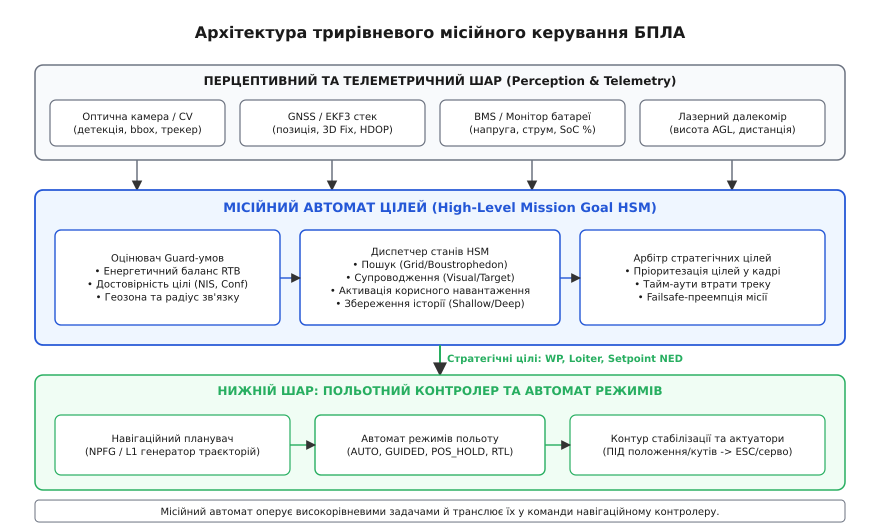
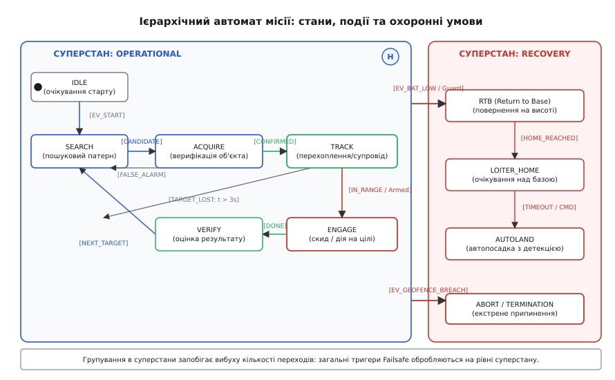

# Автомат цілей: стани, переходи, охоронні умови

<preknowlist>
- [Автомат режимів](root:sys-dron/mode-state-machine) — керування низькорівневими контурами польоту (Manual, Stabilize, PosHold, Auto, Guided) та ланцюжки деградації.
- [Місії та маршрутні точки](root:sys-dron/missions-waypoints) — структурування плану польоту, навігаційні команди MAVLink та послідовності точок.
- [Перепланування на ходу](root:sys-dron/pereplanuvannia-na-khodu) — динамічна зміна траєкторії, генерація обхідних точок та онлайн-корекція цільових уставок.
- [Дія на точці](root:sys-dron/diia-na-tochtsi) — активація корисного навантаження, скид вантажів, керування сервоприводами та оптичними сенсорами.
- [Наведення на рухому ціль](root:sys-dron/navedennia-na-rukhomu-tsil) — пропорційна навігація (PN), лінії візування (LOS) та кінематичне зближення.
- [Ціль загублена](root:sys-dron/tsil-zahublena) — екстраполяція траєкторії, зони невизначеності та алгоритми відновлення супроводу.
- [Failsafe](root:sys-dron/failsafe) — аварійні протоколи при втраті зв'язку, навігаційного сигналу або критичному розряді батареї.
- [Петля Sense-Decide-Act](root:sys-dron/sense-decide-act-loop) — архітектура автономного циклу прийняття рішень на борту БПЛА.
</preknowlist>

Автономний розвідувально-ударний безпілотний літальний апарат масою 4.5 кг виконує тактичне завдання на висоті 120 метрів над пересіченою місцевістю зі швидкістю 24 м/с. На борту одночасно функціонують кілька незалежних апаратних підсистем: нейромережевий детектор на базі бортового комп'ютера обробляє відеопотік із роздільною здатністю 1920×1080 із частотою 30 кадрів на секунду; навігаційний фільтр розширеної оцінки стану EKF3 транслює вектор просторових координат і швидкостей із частотою 100 Гц; контролер тягової батареї BMS фіксує падіння залишкового заряду до 22% при напрузі 21.8 В під навантаженням; датчик повітряної швидкості фіксує поривчастий зустрічний вітер швидкістю 14 м/с; а далекомір кругового огляду виявляє висотну щоглу зв'язку за 35 метрів прямо за курсом польоту.

Якщо логіка вибору тактичної поведінки побудована як наївний набір розрізнених прапорців та каскадів умовних операторів `if-else` у головному циклі програми, система стикається з фатальною невизначеністю. В один і той самий момент часу істинними виявляються взаємовиключні умови: детектор вимагає негайного переходу в пікірування для атаки виявленого бронеоб'єкта; система моніторингу енергії вимагає негайного розвороту на точку старту через дефіцит заряду проти вітру; локальний планувальник вимагає екстреного відвороту вбік для огинання щогли; а втрата окремих кадрів оптичного трекера провокує паразитичний перезапуск алгоритму пошуку. Борт починає хаотично перемикати режими стабілізації, скидає накопичений прогрес сканування сектора, зависає в неконсистентному стані або розряджає акумулятор у безплідному маневруванні.

Керування місією в нестаціонарному динамічному середовищі вимагає детермінованого архітектурного розділення обов'язків: низькорівневий автопілот гарантує стабілізацію кутів, швидкостей і висоти, тоді як стратегічні рішення ухвалює **місійний автомат цілей** (High-Level Mission State Machine / Goal Arbiter). Цей автомат формалізує фази життєвого циклу цілей, перевіряє фізичну та сенсорну допустимість кожного маневру через строгі математичні предикати (охоронні умови, *guard conditions*), ізолює паралельні контури навігації та корисного навантаження й забезпечує детерміноване повернення до перерваних операцій за допомогою механізму збереження історії станів.

## Архітектурне місце місійного автомата у польотному стеку

У системі керування безпілотним комплексом діють два взаємопов'язані, але фундаментально ізольовані рівні дискретної логіки:

1. **Автомат польотних режимів (Flight Mode FSM):** шар польотного контролера (Flight Controller на мікроконтролері STM32 під керуванням PX4 або ArduPilot). Цей контур оперує безпосередніми станами стабілізації: `MANUAL`, `STABILIZE`, `ALT_HOLD`, `POS_HOLD`, `AUTO`, `GUIDED`, `RTL`, `LAND`. Його завдання — транслювати просторові координати, швидкості й прискорення в кутові моменти та тягу моторів з урахуванням аеродинамічних обмежень планера.
2. **Місійний автомат цілей (Mission Goal HSM / Arbiter):** шар тактичної автономії (бортовий комп'ютер Companion Computer під керуванням Linux/ROS 2 або верхній модуль високорівневого планувальника). Цей контур оперує стратегічними намірами місії: «патрулювання за маршрутом», «секторний пошук об'єкта», «класифікація підозрілого сигналу», «динамічний кінематичний перехоплення», «скид корисного навантаження», «оцінка наслідків удару», «ухилення від перешкод», «евакуація».


*Архітектура трирівневого місійного керування: перцептивний шар постачає події та метрики, місійний автомат генерує стратегічні цілі, а навігаційний контролер перетворює їх на польотні уставки.*

### Протоколи та інтерфейси обміну Companion Computer ↔ Flight Controller

Місійний автомат не займається прямим розрахунком широтно-імпульсної модуляції (ШІМ) для силових регуляторів обертів (ESC) чи сервоприводів елеронів. Він взаємодіє з польотним стеком через стандартні інтерфейси протоколу MAVLink та внутрішні шини uORB:

1. **Потокове наведення через `SET_POSITION_TARGET_LOCAL_NED` (MAVLink #84):**
   У фазах активного переслідування цілі (`TRACK`) або ухилення від перешкод (`AVOID`) місійний автомат транслює на польотний контролер координати цільової просторової точки, вектор швидкості та бажану кутову швидкість рискання в локальній системі координат North-East-Down (NED). За допомогою бітової маски `type_mask` автомат динамічно обирає контур керування:
   * `type_mask = 0b0000111111000111` — керування виключно 3D-вектором швидкості (`vx`, `vy`, `vz`) з одночасним утриманням кутової швидкості рискання `yaw_rate` на лінію візування цілі (Line-of-Sight, LOS);
   * `type_mask = 0b0000111111111000` — керування цільовою 3D-позицією (`x`, `y`, `z`) при підльоті до точки скиду;
   * `coordinate_frame = MAV_FRAME_LOCAL_NED` або `MAV_FRAME_BODY_NED` для наведення за вектором власної оптичної осі камери.

2. **Керування маршрутною місією (`MISSION_PROTOCOL`):**
   Перемикання між етапами глобального маршруту здійснюється командами `MISSION_SET_CURRENT`, завантаженням динамічно згенерованих обхідних точок через `MISSION_ITEM_INT` або прямим перемиканням польотних режимів контролера за допомогою `COMMAND_LONG` (`MAV_CMD_DO_SET_MODE`).

3. **Керування корисним навантаженням (`COMMAND_LONG`):**
   Подача імпульсу на розмикання електромагнітного замка скидача, зведення запобіжників або запуск серії фотофіксації високої роздільної здатності виконуються спеціалізованими командами MAVLink:
   * `MAV_CMD_DO_SET_SERVO` (номер каналу, значення імпульсу в мікросекундах);
   * `MAV_CMD_DO_DIGICAM_CONTROL` (управління затвором і зумом оптичного підвісу);
   * `MAV_CMD_PAYLOAD_PREPARE_DEPLOY` (перевірка стану кінцевих вимикачів перед активацією).

4. **Моніторинг зворотної телеметрії та стану сенсорів:**
   Місійний автомат безперервно підписується на зворотний потік повідомлень від польотного контролера:
   * `GLOBAL_POSITION_INT` (широта, довгота, абсолютна висота MSL, відносна висота AGL, вектори швидкості);
   * `ATTITUDE` (кути крену, тангажу, рискання та їхні похідні);
   * `BATTERY_STATUS` (напруга окремих банок, інтегральний струм розряду, температура, залишкова ємність у мАг);
   * `ESTIMATOR_STATUS` (прапорці працездатності оцінювача EKF, рівні інновацій датчиків за осями);
   * `SYS_STATUS` (частота пропуску пакетів зв'язку, завантаження процесора MCU, прапорці сенсорних аварій).

### Синхронізація часових шкал та запобігання фазовим затримкам

Для коректного розрахунку динамічних Guard-умов та наведення на рухомі об'єкти критично важливо усунути розбіжність між системним таймером Companion Computer (який живе за шкалою `CLOCK_MONOTONIC` операційної системи Linux) та апаратним мікросекундним лічильником польотного контролера (`time_boot_ms` / `time_unix_usec`).

Обмін повідомленнями `TIMESYNC` (MAVLink #111) дозволяє бортовому комп'ютеру безперервно оцінювати зміщення фази годинників `time_offset_ns` та затримку в каналі передачі UART/Ethernet (Round-Trip Time, RTT). Усі вхідні координати цілей від детектора комп'ютерного зору отримують часові мітки в єдиній польотній шкалі часу, що унеможливлює просторову помилку екстраполяції при високих кутових швидкостях розвороту дрона.

---

## Формальний апарат: математичний опис та семантика станів

Формально місійний автомат цілей визначається розширеним математичним кортежем ієрархічного автомату станів Харела (Harel Statechart):

```
M = ⟨S, E, T, γ, α, S_0, H⟩
```

де:
* `S` — скінченна множина станів та суперстанів автомата;
* `E` — множина вхідних подій (повідомлення сенсорів, таймери, телеметрія, команди оператора);
* `T: S × E → S` — функція переходів між станами;
* `γ: S × E → {0, 1}` — множина булевих охоронних умов (Guard Conditions), що валідують фізичну безпеку переходу;
* `α: S × E → A` — множина вихідних дій (Entry, Exit та Transition Actions), що надсилають команди виконавчим механізмам;
* `S_0 ∈ S` — вектор початкових станів автомата;
* `H` — множина збережених контекстів історії (History Pseudo-states) для повернення до перерваних операцій.


*Діаграма станів HSM: групування робочих підстанів у суперстан OPERATIONAL та аварійних у RECOVERY усуває дублювання переходів та забезпечує спадковість обробки подій.*

### Множина станів життєвого циклу місії S

Усі стани місійного автомата розбиваються на функціональні фази:

1. **IDLE (Очікування / Передпольотна готовність):** апарат перебуває на землі або зависає в точці старту після зльоту. Виконуються перевірки датчиків, калібрування сенсорів та верифікація завантаженого плану польоту.
2. **PATROL (Патрулювання):** політ за заздалегідь визначеним маршрутом між ключовими навігаційними точками на крейсерській швидкості. Сенсори працюють у пасивному фоновому режимі.
3. **SEARCH (Секторний пошук):** виконання структурованого пошукового патерну ([галсовий пошук boustrophedon](root:sys-dron/boustrophedon-coverage) або концентричні спіралі) над цільовим районом із максимальним оптичним перекриттям підстильної поверхні.
4. **ACQUIRE (Захоплення та первинна класифікація):** при виявленні сигналу або кандидата на ціль борт сповільнює рух або виконує віраж для накопичення відеокадрів і підтвердження класу об'єкта нейромережею.
5. **TRACK (Динамічний супровід / Наведення):** активне переслідування рухомої або стаціонарної цілі за алгоритмами [пропорційного наведення](root:sys-dron/navedennia-na-rukhomu-tsil) з оптимізацією кута атаки та утриманням об'єкта в центрі кадру.
6. **ENGAGE (Дія на точці / Скид):** фінальний етап атаки або скиду корисного навантаження. Автомат виходить у розрахункову балістичну точку та подає імпульс на актуатор замка вантажу.
7. **VERIFY (Оцінка результату):** фіксація наслідків скиду протягом заданого інтервалу часу (наприклад, 2–4 секунди зависання на безпечній дистанції з оптичною реєстрацією), передача звіту на наземну станцію.
8. **AVOID (Локальний обхід перешкоди):** тимчасове відхилення від маршруту для обльоту виявленої висотної перешкоди або зони небезпеки за командами локального планувальника.
9. **RTB (Повернення на базу / Домашню точку):** набір безпечного ешелону висоти та політ за прямою лінією або безпечним коридором до точки посадки (Home Point) чи призначеного запасного майданчика (Rally Point).
10. **ABORT (Аварійне припинення):** екстрена посадка на місці, відхід у зону безпечного очікування або активація парашутної системи при критичних відмовах.

### Ортогональні регіони (Parallel AND-States)

Спроба описати стан дрона одним єдиним переліком призводить до комбінаторного вибуху: якщо борт має 8 фаз польоту, 4 стани боєкомплекту та 3 стани радіозв'язку, плоский автомат вимагає створення 8 × 4 × 3 = 96 комбінованих станів. Кожна нова подія (наприклад, зміна статусу зв'язку) вимагає дублювання переходів у всіх 32 паралельних станах.

Для усунення цієї надлишковості ієрархічний автомат організує простір станів у **три паралельні ортогональні регіони**, які функціонують одночасно й незалежно:

```
+───────────────────────────────────────────────────────────────────────────+
|                          SUPERSTATE: MISSION_RUN                          |
+───────────────────────────────────────────────────────────────────────────+
| [Регіон 1: Траєкторія та навігація]                                       |
|  (IDLE) -> (SEARCH) <-> (ACQUIRE) -> (TRACK) -> (ENGAGE) -> (VERIFY)      |
|               ^                                                           |
|               +----------- [AVOID] (обхід перешкоди) ---------------------+
+ - - - - - - - - - - - - - - - - - - - - - - - - - - - - - - - - - - - - - +
| [Регіон 2: Контур корисного навантаження]                                 |
|  (PAYLOAD_SAFE) -> (PAYLOAD_ARMED) -> (PAYLOAD_DEPLOYING) -> (EXHAUSTED)  |
+ - - - - - - - - - - - - - - - - - - - - - - - - - - - - - - - - - - - - - +
| [Регіон 3: Моніторинг радіоканалу та РЕБ]                                 |
|  (LINK_ONLINE) <-> (LINK_DEGRADED) -> (LINK_AUTONOMOUS_SILENT)            |
+───────────────────────────────────────────────────────────────────────────+
```

1. **Регіон навігації (Navigation Region):** керує просторовим переміщенням і фазами наведення.
2. **Регіон корисного навантаження (Payload Region):** контролює живлення скидного механізму, стан електричних запобіжників, наявність боєприпасів у магазині та датчики підтвердження відкриття замка.
3. **Регіон зв'язку та радіоелектронної обстановки (Comms & EW Region):** відстежує рівень сигналу RSSI, втрату телеметричних пакетів та авторизує автономне ухвалення рішень у зоні повного радіомовчання (Silent Autonomous Mode).

Регіони взаємодіють через внутрішні широкомовні події та перехресні Guard-умови: наприклад, перехід Регіону 1 зі стану `TRACK` у `ENGAGE` дозволяється лише за умови, що Регіон 2 перебуває в стані `PAYLOAD_ARMED`, а Регіон 3 не перебуває в стані аварійної термінації зв'язку.

---

## Охоронні умови (Guard Conditions): фізико-математичний апарат

Охоронна умова γ(s, e) — це детермінований предикат, який оцінює поточний вектор фізичного стану апарата x(t) та параметри навколишнього середовища. Перехід між станами відбувається тоді й лише тоді, коли подія e збіглася з істинним значенням γ(s, e) = 1.

Нижче наведено повну інженерну таблицю переходів місійного автомата:

| Поточний стан | Вхідна подія | Охоронна умова (Guard) | Цільовий стан | Вихідна дія (Action) |
| :--- | :--- | :--- | :--- | :--- |
| **IDLE** | `EV_CMD_START` | `SensorsHealthy` ∧ `GeofenceOK` ∧ `SoC >= 0.90` | **SEARCH** | Ініціалізація пошукової сітки, запуск трекера |
| **SEARCH** | `EV_CANDIDATE_FOUND` | `Confidence >= 0.55` ∧ `GeofenceOK` | **ACQUIRE** | Фіксація курсу, фокусування оптичної камери |
| **ACQUIRE** | `EV_TARGET_LOCKED` | `Confidence >= 0.80` ∧ `NIS <= 5.99` ∧ `EnergyRTB_OK` | **TRACK** | Запуск алгоритму пропорційного зближення |
| **ACQUIRE** | `EV_TIMEOUT` | `t_acquire > 4.0s` ∨ `Confidence < 0.30` | **SEARCH** | Повернення до точки перерваного пошукового галса |
| **TRACK** | `EV_IN_ENGAGE_ZONE` | `Dist <= R_max` ∧ `PayloadArmed` ∧ `EnergyRTB_OK` | **ENGAGE** | Подача імпульсу відкриття замка вантажу |
| **TRACK** | `EV_TARGET_LOST` | `t_lost > 3.0s` | **SEARCH** | Відновлення контексту пошуку через Shallow History |
| **TRACK** | `EV_OBSTACLE_ALERT` | `DistObstacle < SafeMargin` | **AVOID** | Збереження цілі в стек, запуск локального обходу |
| **AVOID** | `EV_OBSTACLE_CLEARED` | `DistObstacle >= ClearMargin` | **H\*** (History) | Відновлення перерваного стану (TRACK або SEARCH) |
| **ENGAGE** | `EV_PAYLOAD_RELEASED`| `ReleaseSensorTriggered == true` | **VERIFY** | Запуск таймера оцінки наслідків, утримання камери |
| **VERIFY** | `EV_VERIFY_DONE` | `PayloadCount > 0` ∧ `EnergyRTB_OK` | **SEARCH** | Продовження місії пошуку наступних об'єктів |
| **VERIFY** | `EV_VERIFY_DONE` | `PayloadCount == 0` ∨ `!EnergyRTB_OK` | **RTB** | Перехід на висоту ешелону повернення додому |
| **OPERATIONAL** | `EV_BATTERY_LOW` | `EnergyRemaining <= EnergyRTB + Reserve` | **RTB** | Скасування поточних задач, набір курсу на Home |
| **OPERATIONAL** | `EV_GEOFENCE_BREACH`| `DistToBoundary <= Margin` | **ABORT** | Гальмування, розкриття парашута або аварійна посадка |

### Математичні моделі предикатів безпеки

Розглянемо детальний аналітичний апарат ключових охоронних умов.

#### 1. Векторний розрахунок енергетичного бюджету повернення на базу

Поширена помилка простих систем — оцінка запасу батареї за фіксованим порогом напруги чи відсотків (наприклад, `SoC <= 20%`). Якщо дрон віддалився на 8 км за попутним вітром 12 м/с, на зворотний шлях проти зустрічного вітру йому знадобиться втричі більше енергії, ніж було витрачено на політ уперед.

Вектор повітряної швидкості дрона v_a, вектор швидкості вітру w та вектор шляхової швидкості відносно землі v_g пов'язані векторним трикутником швидкостей:

```
v_g = v_a + w                                              [Векторний трикутник швидкостей]
```

Нехай одиничний вектор напрямку на точку повернення (Home Point) дорівнює u_home. Проєкція шляхової швидкості на лінію повернення становить:

```
v_ground_rtb = |v_a| · cos(ψ_a - ψ_home) + |w| · cos(ψ_w - ψ_home)   [Шляхова швидкість повернення]
```

де ψ_a, ψ_w та ψ_home — азимути вектора тяги, вітру та курсу на базу відповідно. Для безпечного просування вперед шляхова швидкість повинна задовольняти обмеження v_ground_rtb >= v_min_ground ≈ 3.0 м/с. Якщо вітер перевищує максимальну швидкість апарата, дрон зносить назад, і потрібна зміна ешелону висоти для пошуку слабшого вітрового шару.

Розрахунковий час польоту до точки посадки з урахуванням горизонтальної дистанції d_home та вертикального перепаду висот Δh:

```
t_RTB = (d_home / v_ground_rtb) + (Δh / v_climb)           [Розрахунковий час повернення, с]
```

Повна електрична енергія E_RTB (у ват-годинах, Вт·год), необхідна для досягнення бази:

```
E_RTB = ( (P_cruise(v_a) · (d_home / v_ground_rtb) + P_climb · (Δh / v_climb)) / 3600 ) · (1 / η_batt)
```

де:
* P_cruise(v_a) — потужність енергоспоживання силової установки та бортової електроніки на крейсерській швидкості v_a (Вт);
* P_climb — електрична потужність двигунів при вертикальному наборі висоти (Вт);
* η_batt ≈ 0.88...0.92 — коефіцієнт тепловіддачі та втрат батареї при поточному температурному режимі.

Охоронна умова достатності енергії `EnergyRTB_OK` дозволяє виконання будь-яких тактичних задач (`SEARCH`, `TRACK`, `ENGAGE`) виключно за умови:

```
E_rem - E_RTB(d_home, w) >= E_reserve = 0.20 · E_total      [Предикат енергетичного балансу]
```

де E_reserve — 20% гарантованого недоторканного запасу енергії на випадок візуального пошуку майданчика посадки, маневрів ухилення або сильних поривів вітру над точкою старту.

#### 2. Сенсорно-навігаційний шлюз та інноваційна фільтрація Калмана (NIS Gating)

Під час оптичного супроводу рухомої цілі детектор комп'ютерного зору періодично генерує хибні спрацьовування (сонячні відблиски на воді, рух гілок дерев, птахи). Якщо місійний автомат прийме таку детекцію за ціль, дрон зірве стабільний політ і почне хаотичні маневри.

Для відсікання аномальних вимірювань використовується статистичний критерій нормованої квадратичної інновації (Normalized Innovation Squared, NIS) фільтра Калмана трекера:

```
y_k = z_k - h(x̂_k|k-1)                                    [Вектор інновації вимірювання]
S_k = H_k · P_k|k-1 · H_k^T + R_k                          [Коваріаційна матриця інновації]
NIS_k = y_k^T · S_k^(-1) · y_k                             [Нормована квадратична нев'язка]
```

де z_k — вектор вимірювання координат об'єкта від камери, h(x̂) — проєкційна функція прогнозу стану цілі, P — коваріація помилки екстраполяції, R — коваріація шуму сенсора.

Для двовимірного вектора спостереження (азимут та кут місця цілі, ступінь вільності m = 2) величина NIS_k підпорядковується статистичному розподілу хі-квадрат (χ²).

Охоронна умова довіри до цілі формулюється як:

```
γ_target = ( (1 / K) · ∑ C_det(t - i·Δt) >= 0.80 ) ∧ ( NIS_k <= χ²_(2, 0.95) = 5.99 )
```

Якщо інновація перевищує поріг 5.99, вимірювання класифікується як аномальний викид (outlier) і відкидається без переривання загального треку.

#### 3. Радіотехнічний шлюз (DataLink & Jamming Guard)

Оцінка якості каналу зв'язку базується на чотирьох показниках:
* Рівень сигналу прийому `RSSI >= -92 dBm`;
* Співвідношення сигнал/шум `SNR >= 6 dB`;
* Частота втрати пакетів `Packet_Loss <= 15%` протягом вікна 2.0 с;
* Час від останнього валідного пакету `t_link_loss < 2.0 s`.

Якщо канал зв'язку падає в зоні бойових дій, охоронна умова перевіряє директиву місії: якщо дозволено повністю автономний режим (Silent Mode), автомат продовжує виконання завдання за завантаженим планом; якщо ні — ініціюється аварійне повернення на базу (`RTB`).

---

## Обробка історії станів: Shallow History (H) проти Deep History (H\*)

Під час автономного польоту виникають ситуації, коли борт змушений тимчасово призупинити виконання поточної задачі:
* Локальний далекомір або лідар фіксує перешкоду (опора лінії електропередач, крона дерева), і дрон виконує обхідний маневр ([Local Obstacle Avoidance](root:sys-dron/pereplanuvannia-na-khodu));
* Короткочасне радіоелектронне придушення змушує дрон перейти в режим радіомовчання й утримання висоти.

У класичному плоскому автоматі після завершення обходу перешкоди система повертається у вихідний стан суперстану (зазвичай `IDLE` або початок `SEARCH`), скидаючи весь накопичений прогрес місії: дрон починає прочісувати сектор із самого початку (галс №1), витрачаючи марно заряд батареї.

Для вирішення цієї проблеми ієрархічні автомати використовують псевдостани історії:

```
               [SUPERSTATE: OPERATIONAL]
               ┌───────────────────────────────────────────────┐
               │  (H) Shallow History    (H*) Deep History     │
               │                                               │
               │  ┌──────────┐      ┌──────────┐               │
               │  │  SEARCH  │ <--> │  TRACK   │               │
               │  └────┬─────┘      └──────────┘               │
               │       │ (підстан: галс 7)                     │
               └───────┼───────────────────────────────────────┘
                       │ EV_OBSTACLE_DETECTED
                       ▼
               ┌──────────────┐
               │ AVOID_HAZARD │ (динамічний маневр)
               └───────┬──────┘
                       │ EV_OBSTACLE_CLEARED
                       ▼ (повернення в H*)
```

### Різниця між Shallow та Deep History

1. **Shallow History (H):** фіксує лише безпосередній активний підстан на поточному рівні ієрархії суперстану `OPERATIONAL`. Якщо борт перебував у стані `TRACK`, після повернення через стрілку `(H)` активується стан `TRACK`, але його внутрішні змінні (таймери зближення, стадія підльоту) скидаються до значень за замовчуванням.
2. **Deep History (H\*):** рекурсивно фіксує повну конфігурацію станів на всю глибину вкладеності, включно з внутрішніми підстанами складних процесів (номер активного галса, вектор швидкості сканування, цільовий кут огляду камери).

### Сценарій відновлення пошукового галса

Розглянемо практичний польотний сценарій:
1. Дрон виконує галсовий пошук у секторі (`OPERATIONAL -> SEARCH -> SWEEP`). Активним є галс №7 із 16, поточний напрямок руху — 045°, пройдено 60% довжини відрізка.
2. Сенсор кругового огляду виявляє висотну щоглу зв'язку на дистанції 25 метрів за курсом. Генерується високопріоритетна подія `EV_OBSTACLE_DETECTED`.
3. Суперстан `OPERATIONAL` призупиняє виконання, зберігає свій повний контекст у псевдостан `H*` та ініціює перехід у стан `AVOID_HAZARD`.
4. Дрон відхиляється вбік на 30 метрів, огинає небезпечну зону та стабілізує висоту.
5. Щойно сенсори підтверджують безпечний простір (`EV_OBSTACLE_CLEARED`), автомат здійснює перехід за стрілкою повернення в `H*`.
6. Завдяки Deep History автомат відновлює стан `SEARCH` не з першого галса, а точно з 7-го галса, розраховує найкоротшу траєкторію виходу на перервану лінію сканування й продовжує виконання місії без пропусків площі.

---

## Пастки реалізації, конкурентність та динаміка подій

Перенесення математичної моделі автомата станів у реальну вбудовану прошивку пов'язане з низкою критичних проблем синхронізації та обробки сигналів.

### 1. Гонитва станів (Race Conditions) при асинхронних подіях

У польотному комп'ютері події генеруються різними апаратними та програмними потоками:
* Потік MAVLink-декодера отримує пакети з послідовного порту UART;
* Потік комп'ютерного зору (OpenCV / TensorRT) генерує детекції цілей у власному циклі захоплення кадрів;
* Таймерний перерив RTOS що 10 мс викликає оцінку сенсорів та стану батареї.

Якщо кожен потік безпосередньо викликає функцію переходу автомата `fsm_transition()`, виникає неконсистентний стан пам'яті: обробник стану `TRACK` може виконувати дію входу, тоді як асинхронний потік батареї одночасно перезаписує вказівник поточного стану на `RTB`.

**Інженерне рішення — модель Run-to-Completion (RTC) та кільцеві буфери:**
* Автомат станів виконується виключно в **одному головному потоці диспетчеризації**;
* Усі зовнішні джерела подій записують структури подій у безблокувальний односпрямований кільцевий буфер (Lock-free Single-Producer Single-Consumer, SPSC Ring Buffer);
* Головний цикл послідовно вибирає події з черги, гарантуючи, що обробка поточної події та виконання всіх пов'язаних дій входу/виходу завершуються повністю до початку обробки наступної події.

```
Потік CV (30 Гц)      ──┐
Потік MAVLink (50 Гц) ──┼──> [ Lock-Free SPSC Ring Buffer ] ──> [ RTC Диспетчер HSM ]
Таймер BMS (10 Гц)    ──┘       (Черга подій місії)               (Атомарні переходи)
```

### 2. Брязкіт перемикання станів (State Flapping / Chattering)

Якщо охоронна умова переходу спирається на неперервну фізичну величину (наприклад, перехід `TRACK -> ENGAGE` при дистанції R <= 15.0 м), шуми далекоміра призводять до того, що на відстані 15.01 м дрон перемикається між станами десятки разів на секунду.

**Захист за допомогою подвійного гістерезису:**
* **Просторовий гістерезис (Deadband):** умова переходу в `ENGAGE` вимагає R <= 15.0 м, тоді як зворотний перехід у `TRACK` (при зриві атаки) дозволяється лише при віддаленні R > 18.5 м;
* **Часовий фільтр (Debounce Timer):** подія вважається валідною, якщо значення параметра тримається в допустимому діапазоні протягом інтервалу Δt_debounce >= 250 мс поспіль.

### 3. Ефект вибігу трекера (Target Dropout Coasting)

Під час виконання різких маневрів кутова швидкість апарата може досягати 90°/с. Камера на 1–2 кадри втрачає ціль через динамічне розмиття (motion blur) або кутове затінення корпусом.

Якщо автомат миттєво генеруватиме подію `EV_TARGET_LOST` при зникненні детекції на 1 кадрі (33 мс при 30 FPS), наведення стане неможливим.

**Механізм захисту:** впровадження фільтра вибігу (Coast Phase):
* При втраті сигналу запускається таймер вибігу t_coast = 1.5 с;
* Протягом цього часу положення цілі екстраполюється вектором прогнозу швидкості від фільтра Калмана, а дрон продовжує рух за розрахунковою лінією візування;
* Лише після перевищення повного ліміту втрати t_lost > 3.0 с генерується перехід до відновлення пошуку.

### 4. Пріоритезація множинних цілей (Target ID Lock)

Якщо оптичний сенсор фіксує одночасно кілька об'єктів у кадрі (наприклад, колону техніки), наївний алгоритм «вибирати найближчу ціль щокадру» змушує дрон хаотично перемикати вектор наведення між сусідніми машинами при зміні їхніх відносних піксельних відстаней.

**Механізм захоплення ідентифікатора:**
Щойно стан `ACQUIRE` підтвердив ціль із унікальним числовим ідентифікатором `Target_ID = 42`, автомат блокує цей ідентифікатор у полі `active_target_id`. Усі інші кандидати ігноруються доти, доки поточна ціль не перейде у статус `ENGAGED`, не буде остаточно втрачена за тайм-аутом або оператор не надішле команду скидання цілі.

---

## Програмна реалізація ієрархічного автомата цілей

Для розробки місійних автоматів критичного застосування використовують структуровані шаблони без динамічного виділення пам'яті (`malloc` / `new`).

Повноцінний автономний модуль з повною інфраструктурою черг, збереженням Deep History та набором комплексних юніт-тестів наведено в інженерному проєкті [автономний модуль місійного автомата цілей автопілота](root:sys-dron/avtomat-tsilei/proj-mission-fsm.md).

Нижче представлено базову архітектуру диспетчера ієрархічних станів та охоронних предикатів на мовах C та C++.

:::tabs
:::code avtomat-tsilei-d/c/main.c
:::code avtomat-tsilei-d/cpp/main.cpp
:::

---

## Інженерна діагностика: бітові маски статусів та телеметрія

Для діагностики та постпольотного аналізу логів (ULog у PX4 чи DataFlash у ArduPilot) стан місійного автомата транслюється у телеметричне 32-бітне слово `mission_state_flags`:

```
+---------------+---------------+---------------+---------------+
| 31 ... 24     | 23 ... 16     | 15 ... 8      | 7 ... 0       |
+---------------+---------------+---------------+---------------+
| Super-State ID| Active State  | Active Guards | Pending Events|
| 0x01: OPERAT. | 0x01: SEARCH  | Bit 0: BAT_OK | Bit 0: CAND_F |
| 0x02: RECOVERY| 0x02: ACQUIRE | Bit 1: EKF_OK | Bit 1: LOCK_T |
| 0x03: EMERGEN.| 0x03: TRACK   | Bit 2: GEO_OK | Bit 2: RANGE  |
|               | 0x04: ENGAGE  | Bit 3: ARM_OK | Bit 3: ABORT  |
|               | 0x05: AVOID   | Bit 4: NIS_OK |               |
+---------------+---------------+---------------+---------------+
```

Завдяки такій бітовій структурі будь-яке відхилення команди або непередбачений перехід у режим повернення однозначно локалізується в журналі за значенням заблокованого Guard-біта.
