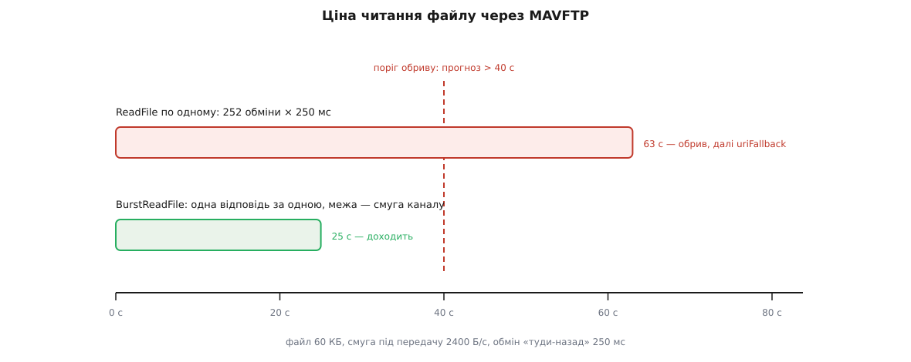
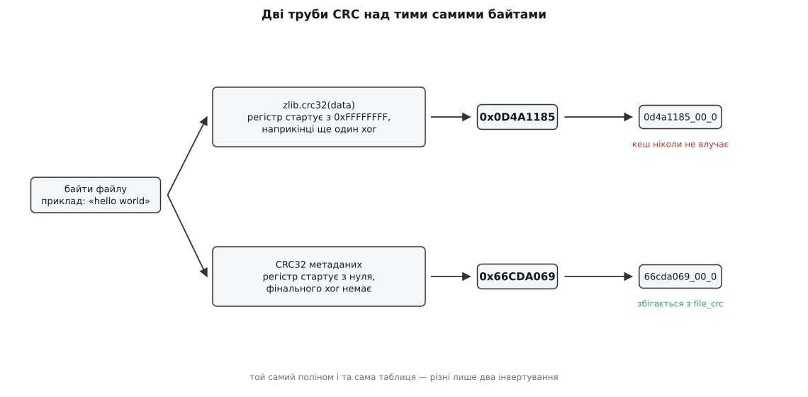

# ⚙️ Клієнт метаданих компонента: сто рядків замість станції

Ця програма під'єднується до апарата й друкує в консоль повний опис одного параметра — підпис, одиниці, межі, усталене значення, назви варіантів, — витягнувши його з борту самим протоколом, без застосунку й без Qt. Писати її варто не заради заміни станції, а тому, що протокол метаданих стає зрозумілим рівно тоді, коли ти сам збираєш ім'я кеш-запису й сам вирішуєш, коли обірвати завантаження: у готовій станції ці два рішення сховані за менеджером, а тут вони твої — і одразу видно, чому кожне з них саме таке.

### Задача

Нехай апарат уже говорить: плата з USB-кабелем, радіомодем або симулятор на UDP-порті 14550. Треба назвати програмі ім'я `MPC_XY_P` і побачити у відповідь не число, а опис.

Дорога від з'єднання до відповіді складається з дев'яти кроків, і жоден не можна пропустити.

Дочекатися серцебиття — доти невідомий номер апарата, а без адресата команду нікуди слати. Попросити повідомлення `COMPONENT_METADATA` і дочекатися його. Витягти з нього адресу файлу-покажчика й CRC цього файлу. Зібрати з CRC ім'я запису в кеші й зазирнути туди. Якщо в кеші порожньо — завантажити файл: із борту через MAVFTP, якщо адреса починається з `mftp://`, або з мережі, якщо з `https://`. Розпакувати, якщо файл стиснений. Розібрати JSON і знайти в масиві `metadataTypes` запис із `type` рівним одиниці — це описи параметрів. Повторити для нього ті самі кроки «кеш → завантаження → розпакування», але вже з двома адресами: головною й запасною. І, нарешті, знайти в отриманому описі потрібне ім'я.

Кроки четвертий і п'ятий виглядають технічними дрібницями. Насправді саме вони роблять програму робочою чи неробочою: перший визначає, чи буде наступний запуск миттєвим, а другий — чи дочекається програма відповіді взагалі.

### Задум: п'ять речей, які легко зробити неправильно

**Одна команда — дві можливі відповіді, і порядок між ними не визначений.** Метадані не транслюються потоком: `COMPONENT_METADATA` просять поштучно [командою](root:sys-dron/mavlink-commands) `MAV_CMD_REQUEST_MESSAGE` (номер 512), поклавши номер бажаного повідомлення в перший параметр. У відповідь прилітає двоє: `COMMAND_ACK` із результатом і саме повідомлення. Прилітають вони в будь-якому порядку — борт може надіслати повідомлення раніше за підтвердження, — тож чекати треба на обидва одночасно. І окремо: `COMMAND_ACK` з результатом, відмінним від `MAV_RESULT_ACCEPTED`, означає «не вмію» — це не тимчасова невдача, і повторювати запит нема сенсу, треба виходити одразу, а не досиджувати таймаут.

**Адреса приїжджає в полі фіксованої довжини.** [Пакет MAVLink](root:sys-dron/mavlink-packet) не має полів змінного розміру, тому під адресу відведено рівно `char[100]`, добитих нулями. Отриманий рядок треба обрізати по першому нулю — інакше в дорогу піде адреса з хвостом невидимого сміття, а помилка вилізе аж на етапі відкриття файлу, у вигляді «немає такого файлу» з нормальним на вигляд шляхом у повідомленні.

**CRC тут не перевіряють — ним називають.** Число з поля `file_crc` потрібне не для звірки завантаженого, а для того, щоб скласти ім'я запису в кеші **до** завантаження: `%08x_%02i_%i` — CRC, номер виду опису, ознака перекладу. Ані апарата, ані адреси в цьому імені немає, тому два різні борти з однаковою прошивкою користуються одним записом, а оновлення прошивки саме собою робить старий запис недосяжним — [ключ є відбитком вмісту](root:sf-distributed/cache-key-design), і окремої інвалідації не потрібно.

Пастка чекає того, хто вирішить це число все-таки порахувати — щоб звірити завантажене або щоб згенерувати власні метадані. [CRC-32](root:com-modulation/crc) у метаданих береться з тим самим поліномом, що в zip і PNG, але **без початкового й кінцевого інвертування**: регістр стартує з нуля й віддається як є. Бібліотечна функція робить обидва інвертування, тому на тих самих байтах видасть інше число.

**Ключ `fileCrc` необов'язковий, і його відсутність означає конкретну річ.** «Цей опис твориться на льоту, сталого вмісту в нього немає». Без CRC ім'я запису не збирається — отже, кеш просто вимикається для цього виду: файл качають, читають і видаляють. Програма при цьому не має ані падати, ані вигадувати ім'я з адреси.

**Читання файлу з борту — це сотні обмінів, і за їхнім темпом треба стежити самому.** У [MAVFTP](root:sys-dron/mavlink-ftp) на корисні дані одного повідомлення лишається 239 байтів: із 251 байта поля `payload` дванадцять з'їдає заголовок. Опис параметрів — десятки кілобайтів, тож обмінів виходить кількасот.

**Умова: файл 60 000 байтів, обмін «туди-назад» 250 мс, під передачу файлу лишається 2400 Б/с смуги.**

```
шматків по 239 байтів     = 60000 / 239 ≈ 251.05 → 252
читання по одному, з очікуванням відповіді на кожне:
  252 · 0.25 с            = 63 с
потоковим читанням, межа — сама смуга каналу:
  60000 / 2400            = 25 с
```

Різниця не в тонкощах, а в тому, дочекається програма чи ні. Тому читати треба потоково: `BurstReadFile` (код операції 15) змушує борт слати шматки один за одним, не питаючи дозволу на кожен. І навіть тоді потрібен свій сторож: якщо через десять секунд пройдено менше половини, а за поточним темпом виходить понад сорок секунд на все, завантаження варто обірвати й піти на запасну адресу — там той самий файл, тільки з мережі, і взяти його швидше.



*Той самий канал і той самий файл — різниця лише в тому, чи чекає програма підтвердження на кожен шматок. Правило обриву дивиться при цьому не на абсолютний час, а на прогноз: важить не «довго», а «за таким темпом не встигне».*

### Код

Головна мова тут — Python із `pymavlink`. Наземний інструмент, який раз на запуск качає десятки кілобайтів і розбирає JSON, нічого не виграв би від переписування на C: час його роботи цілком визначає канал. А виграє він від того, що вміщується на екран.

Спершу з'єднання й запит одного повідомлення.

:::code proj-metadata-client/py/paramdoc.py

Далі — CRC і ім'я запису в кеші. Це та частина, яку найчастіше переносять в інші програми, тож ось вона двома мовами: на Python — щоб бачити, як скасувати обидва інвертування бібліотечної функції одним рядком, і на C++ — щоб бачити, звідки ці інвертування взагалі беруться.

:::tabs
:::code proj-metadata-client/py/kod.py
:::code proj-metadata-client/cpp/main.cpp
:::

Два коментарі в C++-версії позначають усю різницю. На однакових байтах вона виглядає так:

```
байти «hello world»
CRC-32 як у zip     (регістр 0xFFFFFFFF, фінальний xor)  = 0x0D4A1185
CRC-32 метаданих    (регістр 0, без фінального xor)      = 0x66CDA069
```



*Поліном той самий, таблиця та сама, цикл той самий — розходяться лише два інвертування на краях. Помилка не викликає ані збою, ані повідомлення: файл завантажиться й ляже в кеш, просто під іменем, за яким його потім ніхто не шукатиме.*

Кеш — тека з файлами, названими за тегом. Відсутній тег означає «CRC не приїхав», і тоді кеш просто вимикається:

:::code proj-metadata-client/py/kod-2.py

Тепер читання з борту. Заголовок MAVFTP — дванадцять байтів у полі `payload` завдовжки 251; решта 239 і є корисні дані.

:::code proj-metadata-client/py/kod-3.py

Поле `req_opcode` у відповіді повторює код операції, на яку вона відповідає, і без цієї перевірки програма розвалюється не одразу: перше завантаження минеться добре, а на другому в чергу приїде запізніла відповідь на закриття сесії з першого — з нульовим розміром замість розміру файлу.

Саме завантаження — цикл із трьома виходами: файл зібрано, борт мовчить надто довго, темп надто повільний. Останній вихід і є той сторож, без якого програма чекатиме хвилину замість того, щоб за секунду взяти той самий файл із мережі.

:::code proj-metadata-client/py/kod-4.py

Лишилося звести докупи вибір джерела, розпакування й розбір. Схему беремо з адреси, а не з налаштувань, і розпаковуємо за магічними байтами, а не за розширенням:

:::code proj-metadata-client/py/kod-5.py

Запасна адреса має власний ключ `fileCrcFallback`, і в PX4 його зазвичай немає: там за обома адресами лежить той самий файл тієї самої збірки. Але покладатися на це не варто — джерела різні, тому й тег кешу в кожного свій, а відсутність ключа просто вимикає кеш для цього джерела.

І головна частина — дев'ять кроків задачі, вишикувані в рядок:

:::code proj-metadata-client/py/kod-6.py

На апараті з PX4 це друкує приблизно таке:

```
MPC_XY_P  (Float)
  підпис   : Proportional gain for horizontal position error
  межі     : 0.0 … 2.0
  усталене : 0.95
  група    : Multicopter Position Control
```

Перший запуск займає стільки, скільки триває завантаження; другий — частки секунди, бо обидва файли вже лежать у кеші під іменами зі своїх CRC.

> 🔧 **Навіщо це.** Скрипт вартий місця в теці з інструментами поруч зі станцією. Коли параметр видно голим числом без підпису, він за пів хвилини каже, чия це біда: якщо опис друкується — метадані на борту цілі, і винна станція; якщо не друкується — видно, на якому саме кроці обірвалося. Тим самим прийомом перевіряють і свою прошивку: змінив опис, перезібрав, запустив — і одразу ясно, чи перерахувався CRC.

### Складність і пастки

Обчислень тут нема: два файли, десятки кілобайтів, розпакування й розбір JSON. Пам'яті потрібно на розмір найбільшого файлу в розпакованому вигляді — кілька сотень кілобайтів; читати описи параметрів потоково немає сенсу, бо їх усе одно тримають у пам'яті цілком. Уся вартість — у двох завантаженнях, і саме тому кеш важить більше за будь-яку оптимізацію коду.

А ось перелік того, на чому ця програма ламається — кожен пункт трапляється в житті.

**CRC порахований бібліотечною функцією.** Найпідступніша з усіх, бо не дає ані збою, ані попередження. Файл завантажиться, розбереться й ляже в кеш — під іменем, за яким його ніхто не шукатиме, бо борт назве інше число. Кеш тихо перестане працювати: кожне під'єднання коштуватиме повного завантаження. Помилка виявляється не в програмі, а в тому, що тека кешу росте, а швидше не стає. Той самий прорахунок з боку прошивки дає дзеркальний і гірший наслідок: старий CRC при новому вмісті означає, що станція вічно братиме з кешу застарілий опис.

**Кешовано розпакований файл замість стисненого.** Тег рахується з CRC того файлу, який лежить на борту, — тобто зі стисненого. Якщо покласти в кеш розпакований вміст під тим самим тегом, наступного разу з кешу приїде готовий JSON, і `maybe_decompress` його просто пропустить. Працюватиме — доти, доки хтось не вирішить звірити кешоване з `file_crc`.

**Немає `fileCrc` — а програма все одно збирає ім'я.** Формат `%08x` на `None` впаде з `TypeError`, і це ще щаслива розв'язка. Гірша — «полагодити» падіння, підставивши нуль або кусень адреси: тоді всі описи без CRC зіллються в один запис кешу незалежно від вмісту, і другий апарат отримає опис першого. Правильна поведінка — не кешувати взагалі: відсутність ключа означає, що опис твориться на льоту й сталого вмісту не має.

**Немає сторожа темпу.** Без `too_slow` програма на телеметричному радіо чесно чекає хвилину, потім ще одну на переклади, і виглядає це як зависання. Прогноз рахують від поступу, а не від годинника: «двадцять секунд» саме собою не помилка, помилка — «за таким темпом усе триватиме понад сорок». І перші десять секунд не питають нічого, бо на початку темп ще нічого не означає. Загальний бік цієї механіки — [таймаути й дедлайни](root:sf-distributed/timeouts-deadlines).

**Сесію MAVFTP не закрито.** Сесій на борту лічені штуки, і кинута незакритою не звільниться сама доти, доки не спрацює її власний таймаут. Три обірваних запуски скрипта поспіль — і борт відповідає `MAV_FTP_ERR_NOSESSIONSAVAILABLE` на кожне відкриття. Тому `TerminateSession` стоїть у `finally`, а не після успішного завершення.

**Розпакування за розширенням в адресі.** У `mftp://etc/extras/parameters.json.xz` розширення видно, у мережевій адресі з параметрами запиту — може й не бути, а деякі борти віддають описи взагалі нестисненими. Магічні байти `FD 37 7A 58 5A 00` на початку файлу кажуть правду завжди; це той самий [LZMA у форматі `.xz`](root:math-information/lossless-huffman-lz), що й у звичайних архівах.

**Обірваний рядок адреси.** `char[100]` без обрізання по нулю дає адресу, яка на вигляд нормальна, а на дроті — з хвостом. Пов'язана дрібниця: у шаблонах мережевих адрес PX4 тримає `{version}`, але підставляє туди назву гілки чи тега **під час збирання прошивки**. Якщо `{version}` дожив до клієнта — метадані згенеровано без файлу версії, і підставляти щось самому не варто: адреса все одно вкаже не на ту збірку. Хай спрацює запасна.

**За відповідь беруть чуже.** Двома способами. Перший: метадані віддає лише автопілот, а камера чи підвіс на той самий запит або не відповість, або відповість своїм — і `recv_match` без фільтра за номером компонента візьме перше-ліпше; тут захист тримається на тому, що ми самі шлемо на `MAV_COMP_ID_AUTOPILOT1`, але довгоживучому інструментові варто перевіряти ще й `get_srcComponent()`. Другий підступніший: у каналі лежать запізнілі відповіді на **власні** попередні запити, і без звірки за `req_opcode` перше ж завантаження після закриття сесії прочитає розмір файлу з чужої відповіді.

**Читання по одному шматку замість потокового.** Найчастіша причина того, що «скрипт працює на USB і не працює на радіо». Різницю між `ReadFile` і `BurstReadFile` на кабелі не видно взагалі, а на телеметрії вона — між двадцятьма п'ятьма секундами й хвилиною з гаком. Решта гострих кутів самого протоколу — [граблі MAVLink](root:sys-dron/mavlink-pitfalls).

Чого ця програма свідомо не робить — теж варто назвати, бо саме тут проходить межа між інструментом і станцією. Вона не бере перекладів: у файлі опису лежить мапа перекладних місць, за `translationUri` — зведення локалей, і повний шлях додає ще одне завантаження й прохід по дереву JSON. Вона не має ані стелі на розмір кешу, ані витіснення давніх записів. Вона не вміє запасних дверей поза протоколом — вшитої в застосунок бази описів, з якої станція бере опис, коли не приїхало нічого. І вона питає рівно один параметр, тоді як станція чіпляє метадані до [тисячі фактів](root:sys-dron/parameter-manager) тієї ж миті, коли для кожного прилітає перше значення.

Але головне вона робить те саме: перетворює сто байтів повідомлення на осмислений опис — і робить це, нічого не знаючи про `MPC_XY_P` наперед.
