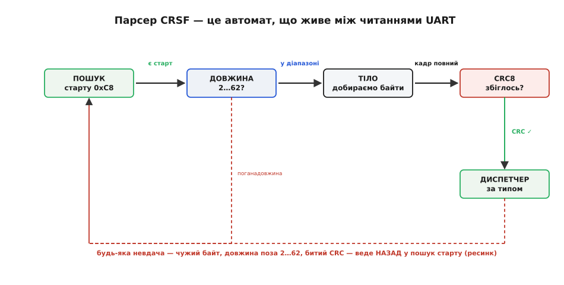

# ⚙️ Парсер CRSF з UART-потоку: повний код, що не ламається

## Задача, якої не видно з опису кадру

На папері кадр CRSF простий: байт-старт `0xC8`, поле довжини, тип, дані, CRC. Здається, парсер — це чотири рядки: прочитав старт, прочитав довжину, прочитав стільки байтів, звірив CRC. Але між «на папері» й «у прошивці» лежить прірва, і вся вона в одному факті: **UART віддає байти не кадрами, а як заманеться**.

Драйвер послідовного порту нічого не знає про CRSF. Він накопичує байти в апаратному чи кільцевому буфері й віддає їх тобі порціями, розмір яких визначає не структура кадру, а те, коли ти встиг зайти по дані й скільки їх на той момент назбиралось. Одне читання [асинхронного послідовного порту](root:com-devices/async-serial) може повернути пів кадру. Наступне — решту того кадру плюс початок наступного. Третє — три з половиною кадри поспіль. А четверте — жодного байта, бо лінія на мить замовкла.

Ось конкретний приклад того, що прилітає з `read()` за чотири виклики поспіль, коли лінією йде щільний потік пакетів каналів (кожен — 26 байтів):

```
читання 1:  C8 18 16 E0 03 1F ...        (13 байтів: старт + шматок кадру A)
читання 2:  ... F8 C0 07 D5 C8 18 16      (13 байтів: хвіст A + CRC + старт B)
читання 3:  E0 03 1F F8 ...               (9 байтів: середина кадру B)
читання 4:  (порожньо — лінія замовкла на 300 мкс)
```

Кадр A **розірваний між двома читаннями**. Кадр B починається в середині другого читання. Парсер, який припускає, що одне читання = один кадр, тут розсиплеться на першому ж пакеті. А ще ж бувають завади: перевернутий біт у полі довжини накаже прочитати 200 байтів там, де їх 24; втрачений байт зсуне всю синхронізацію, і те, що парсер вважає стартом, насправді — середина чужого поля даних.

Тому справжня задача звучить інакше, ніж «розібрати кадр». Вона звучить так: **із нескінченного потоку байтів, що приходять довільними порціями, надійно виловлювати цілі кадри, впізнавати межі навіть після збою синхронізації, і жодного разу не вийти за буфер, хоч би яке сміття прилетіло**. Це задача про стан, що живе **між** читаннями, — а отже, про скінченний автомат.

> 🔧 **Навіщо це.** Парсер, написаний «як на папері», працює на столі й розсипається в польоті. На столі лінія чиста, читання майже збігаються з кадрами, і байти не псуються. У повітрі — поряд мотори, силові струми, довгий дріт — байти губляться й перевертаються реально, а планувальник прошивки заходить по UART коли встигне. Різниця між іграшковим і бойовим парсером — рівно в тому, як він поводиться, коли синхронізація злітає. Саме цю різницю ми й пишемо.

## Ідея: парсер — це автомат зі станом між байтами

Оскільки один байт може прийти зараз, а наступний — за три читання, парсер не може бути функцією, що «читає кадр згори вниз». Він мусить пам'ятати, **де саме зупинився**, і продовжити з тієї ж точки, коли прилетить наступна порція. Це і є скінченний автомат (англ. *finite state machine*): жменя станів і чіткі правила переходу між ними на кожен новий байт.

Станів рівно чотири, і кожен відповідає на одне питання:


*Парсер живе між читаннями UART як автомат. Прямі стрілки — успішний хід уперед: є старт → довжина в діапазоні → кадр добрано → CRC збігся → диспетчер за типом. Штрихова дуга — ребро ресинку: будь-яка невдача (чужий байт замість старту, довжина поза 2…62, битий CRC) не «зависає» й не читає сміття, а веде НАЗАД у пошук старту. Саме це ребро й робить парсер стійким до втрати синхронізації.*

Пройдімо стани зсередини, бо кожен ловить свій клас біди.

**Стан «пошук старту».** Парсер читає байти по одному й викидає всі, крім `0xC8`. Це фаза синхронізації: серед потоку сміття (або серед хвоста попереднього кадру, який ми загубили) ми чекаємо на єдиний орієнтир — байт-старт. Щойно він трапився — переходимо далі. Це найважливіший стан для стійкості: якщо синхронізація злетіла, автомат **сам** повернеться сюди й пересинхронізується на першому ж `0xC8`.

**Стан «довжина».** Наступний байт — поле довжини. Тут — перша й найдешевша перевірка: **чи лежить довжина в діапазоні 2…62?** Поле довжини рахує все, що після нього (тип + дані + CRC), тож менше за 2 (сам тип + CRC) не буває, а більше за 62 не влазить у 64-байтовий кадр. Якщо число поза цим діапазоном — це не довжина, а сміття: або ми прийняли за старт випадковий `0xC8` усередині чужих даних, або біт перевернувся. Реакція одна: **назад у пошук старту**. Ця єдина перевірка гасить цілий клас катастроф, про які нижче.

**Стан «тіло».** Довжина відома, тепер добираємо рівно стільки байтів, скільки вона наказала (тип + дані + CRC). Тут і живе межа читань: байти можуть приходити хоч по одному за виклик, автомат просто накопичує їх у буфері, доки не набереться повний кадр. Ключова тонкість — **лічильник не виходить за буфер**: він фізично не може перевищити довжину, яку ми вже перевірили як ≤ 62.

**Стан «CRC».** Кадр повний. Рахуємо CRC8 над типом і даними, звіряємо з останнім прийнятим байтом. Збіглося — кадр цілий, віддаємо його диспетчеру. Не збіглося — тихо викидаємо весь кадр і **назад у пошук старту**. Керування йде щільно, наступний кадр прилетить за пару мілісекунд; діяти за спотвореним — небезпечніше, ніж пропустити один.

Помічаєш спільне в трьох станах? Будь-яка невдача веде в один бік — **назад у пошук старту**. Автомат не має тупика, у якому він «зависає» чи читає сміття як дані. Це і є ресинк, і саме він відрізняє парсер, що переживає збій, від парсера, що після одного втраченого байта більше ніколи не спіймає жодного кадру.

## Робочий код: побайтовий кінцевий автомат

Почнемо з фундаменту — CRC8. CRSF бере **CRC8 за поліномом DVB-S2** (`0xD5`): восьмибітний [циклічний надлишковий код](root:com-modulation/crc), що одним байтом накладних ловить і поодинокі перевернуті біти, і короткі пачки помилок. Порахуємо його таблично — це швидше за побітове прокручування в гарячому шляху приймача, а таблицю будуємо раз при старті:

:::tabs
:::code proj-crsf-parser/cpp/robochyi-kod-pobaitovyi.cpp
:::code proj-crsf-parser/py/robochyi-kod-pobaitovyi.py
:::

Тепер серце — сам автомат. Він оформлений як об'єкт зі станом (структура `CrsfParser`), у який ми **згодовуємо байти по одному** через `crsf_parser_push`. Функція нічого не читає з UART сама: це зроблено навмисно, щоб автомат не залежав від конкретного драйвера. Ти береш байти з `read()` як завгодно й проштовхуєш їх; коли назбирався цілий валідний кадр, автомат кличе твій обробник.

:::tabs
:::code proj-crsf-parser/cpp/robochyi-kod-pobaitovyi-2.cpp
:::code proj-crsf-parser/py/robochyi-kod-pobaitovyi-2.py
:::

А ось і логіка переходів — по одному байту:

:::tabs
:::code proj-crsf-parser/cpp/robochyi-kod-pobaitovyi-3.cpp
:::code proj-crsf-parser/py/robochyi-kod-pobaitovyi-3.py
:::

Зверни увагу на найпідступніший рядок — обробку поганої довжини в `ST_LEN`. Наївне «повернутись у `ST_SYNC`» тут має діру: якщо байт, що прийшов на місце довжини, сам дорівнює `0xC8`, то це, найімовірніше, **справжній старт наступного кадру**, а не сміття. Просто скинувши в `ST_SYNC`, ми б викинули цей байт — і почали шукати старт із **наступного**, загубивши валідний кадр. Тому ми не викидаємо `0xC8`, а лишаємось у `ST_LEN`, ніби щойно його прийняли за старт. Дрібниця на один рядок — а без неї парсер втрачає по кадру щоразу, коли сміття закінчується байтом-стартом.

Тепер обгортка, що зчитує UART і годує автомат. Вона нехитра саме тому, що вся складність — в автоматі:

:::tabs
:::code proj-crsf-parser/cpp/robochyi-kod-pobaitovyi-4.cpp
:::code proj-crsf-parser/py/robochyi-kod-pobaitovyi-4.py
:::

Оце і весь каркас. Байти приходять як завгодно — по одному, пачками, з розривами кадрів посередині; автомат байдужий до порцій, бо тримає стан між викликами. Лишилось те, заради чого все й затівалось: розібрати вміст цілого кадру.

## Диспетчер і розпаковка: канали й статистика лінка

Коли автомат зібрав цілий кадр і CRC зійшовся, він кличе `crsf_dispatch` із покажчиком на тіло (`тип + дані + CRC`) і його довжиною. Диспетчер дивиться на **тип** — перший байт тіла — і скеровує решту в потрібний розбірник:

:::tabs
:::code proj-crsf-parser/cpp/dyspetcher-i-rozpakovka.cpp
:::code proj-crsf-parser/py/dyspetcher-i-rozpakovka.py
:::

Друга перевірка довжини всередині диспетчера — не зайва параноя, а страховка. CRC уже підтвердив, що кадр не спотворений у дорозі, але він **не гарантує**, що ти правильно вгадав його тип: інша прошивка могла надіслати кадр `0x16` нестандартної довжини, або тип збігся випадково. Перш ніж читати 22 байти каналів, переконайся, що їх справді 22, — інакше розпакування прочитає за межами даних.

Тепер розпаковка каналів. Шістнадцять чисел по 11 бітів набиті впритул у 22 байти, порядком little-endian (молодші біти — вперед). Тримаємо «конвеєр бітів» у 32-бітному акумуляторі: доливаємо байти зверху, зчерпуємо готові 11-бітні канали знизу:

:::tabs
:::code proj-crsf-parser/cpp/dyspetcher-i-rozpakovka-2.cpp
:::code proj-crsf-parser/py/dyspetcher-i-rozpakovka-2.py
:::

Тонкість акумулятора — скільки каналів «дозріває» за один долитий байт. Кожен байт додає 8 бітів, а канал забирає 11. Оскільки 8 менше за 11, один байт **не може** доповнити більш ніж один канал: перед доливанням в акумуляторі завжди менше за 11 бітів (усе готове ми вже зчерпали), а до 10 залишкових плюс 8 долитих — це щонайбільше 18, тоді як на два канали треба 22. Тобто саме для CRSF цей `while` прокручується не більш як раз на байт, і `if` дав би тут ідентичний результат. Чому ж усе-таки `while`? Бо це чесний запис наміру «зчерпати все, що дозріло», і він лишається правильним незалежно від розкладки. Щойно поле стане вужчим за крок доливання (інша упаковка, ширше читання) — один шматок доповнить одразу два поля, і `if` тихо лишив би друге застряглим. `while` не спирається на збіг «8 менше за 11», коштує рівно стільки ж — тому це та звичка, яку варто мати з першого рядка.

Отримані числа — сирі «тіки» CRSF (0…2047), де центр стіка (1500 мкс) — це 992 тіки. Перевід у звичні мікросекунди робить лінійна формула:

:::tabs
```cpp
// сирий тік CRSF → мікросекунди керма (стандарт RC: 988…2012 мкс)
static inline uint16_t crsf_ticks_to_us(uint16_t t) {
    // мкс = (t − 992) · 5 / 8 + 1500
    return (uint16_t)(((int32_t)t - 992) * 5 / 8 + 1500);
}
```
```python
# сирий тік CRSF → мікросекунди керма (стандарт RC: 988…2012 мкс)
def crsf_ticks_to_us(t):
    # мкс = (t − 992) · 5 / 8 + 1500
    # int() усікає до нуля — як цілочислене ділення в C (не floor),
    # щоб від'ємні тіки нижче центру рахувалися так само.
    num = (t - 992) * 5
    return int(num / 8) + 1500
```
:::

**Умова.** Прийшов пакет каналів, перші три байти даних — `E8 03 9F`. Що в каналі 0?

```
i=0: acc = 0x000000E8,  bits = 8    (8 < 11 — ще рано)
i=1: acc |= 0x03 << 8 = 0x000003E8,  bits = 16
     16 ≥ 11 → канал 0 = 0x3E8 & 0x7FF = 0x3E8 = 1000 (тіків)
     acc >>= 11 → 0x00000000,  bits = 5
```

Канал 0 = **1000 тіків** ≈ `(1000 − 992)·5/8 + 1500` = **1505 мкс** — трохи вище нейтралі. Число зійшлося з тим, що очікуєш від стіка біля центру.

Нарешті — статистика лінка, тип `0x14`, рівно 10 байтів у строгому порядку. Тут розпакування тривіальне (усі поля — по одному байту), важливий лише **правильний порядок і знаковість**: RSSI й LQ — беззнакові байти, а SNR — знаковий (`int8_t`), бо відношення сигнал/шум буває від'ємним, коли сигнал тоне в шумі:

:::tabs
:::code proj-crsf-parser/cpp/dyspetcher-i-rozpakovka-3.cpp
:::code proj-crsf-parser/py/dyspetcher-i-rozpakovka-3.py
:::

Значення RSSI приходить **як додатне число, що означає від'ємні дБм**: байт `92` — це −92 дБм. Це компактна умовність (сила сигналу завжди від'ємна, тож знак не шлють), і про неї легко забути, вивівши на екран безглузде «+92». А переплутати знаковість SNR — значить показати пілотові `250 дБ` замість чесних `−6 дБ` у мить, коли лінк уже тоне. Обидві дрібниці коштують хвилини в коді й годин у полі, якщо їх проґавити.

> 🔧 **Навіщо це.** Диспетчер із перевіркою довжини на тип — це межа між «прошивка стійка до чужих кадрів» і «прошивка падає, щойно в лінію зайшов новий сенсор». CRSF-шину ділять багато пристроїв (приймач, датчик струму, GPS, VTX), і по ній течуть десятки типів кадрів, більшість з яких твоя логіка не чекає. Парсер, що для КОЖНОГО кадру спершу питає «а моєї це довжини?», спокійно пропускає незнайоме повз — замість читати чужі 40 байтів як 22 канали й смикати кермом від сміття.

## Граничні випадки: де ламаються прості парсери

Каркас написано. Тепер найважливіше — прогнати його через усі капості, що трапляються в польоті, і переконатися, що на кожну автомат відповідає коректно, а не «зависає» й не читає за буфер. Пройдімо по черзі.

**Неповний кадр (розрив між читаннями).** Найчастіший випадок, і водночас той, який іграшкові парсери провалюють першим. Кадр A з прикладу на початку розірваний: 13 байтів у першому читанні, решта — у другому. Наш автомат байдужий: у `ST_BODY` він накопичує `got` байтів і чекає, доки `got == need`. Перше читання лишає його в `ST_BODY` з `got == 11`; наступне читання доллє решту, `got` дійде до `need`, і аж тоді пуститься перевірка CRC. **Стан пережив розрив** — саме заради цього автомат і потрібен. Ніякого «прочитав пів кадру — викинув».

**Зсув синхронізації (втрачений байт).** Уяви, що завада з'їла один байт посеред потоку. Тепер усі наступні байти зсунуті: те, що автомат вважає стартом, — насправді середина чужого поля даних. Що станеться? Один із двох рятівних запобіжників спрацює **майже напевно**: або на місці «довжини» опиниться байт поза діапазоном 2…62 (і ми повернемось у пошук старту), або довжина випадково влізе в діапазон, ми доберемо «кадр» — і на ньому **не зійдеться CRC** (256 варіантів, шанс випадкового збігу — 1 до 256). У будь-якому разі автомат вивалюється назад у `ST_SYNC` і ловить наступний **справжній** `0xC8`. Зсув гоїться сам за один-два кадри.

**Зіпсована довжина.** Перевернувся біт у полі довжини: замість `24` прийшло, скажімо, `152`. Без перевірки діапазону автомат покірно почав би добирати 152 байти — і, якби не межа буфера, вийшов би далеко за нього; а якби межа була, то з'їв би півтора наступні кадри, поки набере 152 байти, і надовго втратив би синхронізацію. Наша перевірка `byte > CRSF_LEN_MAX` ловить це **до першого прочитаного байта тіла**: 152 > 62, отже, назад у пошук старту. Один рядок гасить найнебезпечніший клас збоїв.

**Переповнення буфера.** А що, як довжина валідна (≤ 62), але з якоїсь причини `got` спробує вийти за `buf`? Розберімо арифметику й переконаймося, що це **неможливо за побудовою**. Буфер — `CRSF_FRAME_MAX == 64` байти. У `ST_BODY` ми пишемо в `buf[1 + got]`, а `got` росте від 0 до `need − 1`, де `need ≤ 62`. Максимальний індекс запису — `1 + 61 == 62`, а буфер має індекси 0…63. Запас у два байти є завжди, вихід за межі неможливий:

```
буфер:   buf[0]  buf[1]         ...        buf[62]   buf[63]
         довжина ├─ тіло: до 62 байтів (need) ─┤     (запас)
макс. індекс запису = 1 + (need−1) = need = 62  ≤ 63  ✓
```

Ключ до цієї гарантії — те, що ми **перевірили довжину перед тим, як за нею йти**. Якби перевірки не було, зловмисна чи спотворена довжина 200 наказала б писати в `buf[201]` — класичне переповнення стеку з наслідками від тихого псування сусідніх змінних до падіння прошивки. Порядок «спершу валідуй діапазон, потім використовуй» — не стиль, а безпека.

**Десинхронізація й ресинк.** Складімо всі невдачі в одну картину. Що б не пішло не так — сміття замість старту, довжина поза діапазоном, битий CRC, — автомат завжди опиняється в `ST_SYNC` і чекає на `0xC8`. Він **не має стану, з якого не було б виходу**. Це властивість, яку варто перевіряти свідомо: пройди подумки кожен `case` і переконайся, що кожна гілка веде або вперед по валідному кадру, або назад у пошук. Немає гілки, що лишає автомат читати сміття як дані нескінченно. Саме ця замкненість — а не кількість перевірок — робить парсер надійним.

Є ще один запобіжник, який додають бойові прошивки поверх нашого каркаса, — **скид за тишею на лінії**. Якщо між байтами минуло більше, ніж триває найдовший кадр (для 64 байтів на 420 000 бод це близько 1.75 мс), логічно вважати, що почався новий кадр, і скинути автомат у `ST_SYNC` навіть посеред `ST_BODY`. Це страхує від рідкісного випадку, коли зіпсована довжина влізла в діапазон, а решти байтів для добору кадру так і не прийшло: без таймауту автомат чекав би їх вічно, тримаючи недобраний «кадр». Реалізується просто — засікаємо час приходу першого байта кадру й порівнюємо на кожному наступному:

:::tabs
:::code proj-crsf-parser/cpp/hranychni-vypadky-de.cpp
:::code proj-crsf-parser/py/hranychni-vypadky-de.py
:::

Порівняння через беззнакову різницю `now_us − frame_start_us` — навмисне: воно коректно переживає переповнення 32-бітного лічильника мікросекунд (а він переповнюється кожні ~71 хвилину), бо в беззнаковій арифметиці різниця лишається правильною й через «обгортання» нуля. Записати `now_us > frame_start_us + TIMEOUT` було б помилкою, що раз на годину дає хибне спрацювання.

## Складність і пастки: що не видно, доки не обпечешся

Зберемо докупи місця, де цей парсер тихо ламається в руках того, хто пише його вперше. Кожна пастка коштувала комусь вечора з логічним аналізатором.

**CRC рахують не над усім кадром.** Найпоширеніша помилка. CRC8 у CRSF накриває **тип і дані** — від `buf[1]` до передостаннього байта тіла, — а байт-старт і поле довжини в неї **не входять**. Візьмеш весь кадр разом зі стартом — CRC не зійдеться **ніколи**, і жоден кадр не пройде перевірку. Симптом характерний: парсер начебто правильний, синхронізується, добирає кадри — а на виході нуль валідних. Перше, що перевіряти, — над якими саме байтами рахується CRC.

**`if` чи `while` при зчерпуванні каналів — чому тут байдуже.** Ходить порада: «пиши `while`, бо з простим `if` канали поповзуть і апарат засмикає». Для CRSF це **не реальний баг**. Канал — 11 бітів, байт — 8; один долитий байт фізично не доповнює двох каналів (до 10 залишкових плюс 8 долитих — щонайбільше 18, а на два канали треба 22), тож `if` дав би тут те саме, що `while`. Писати `while` усе одно варто як правильну звичку: він зчерпує все дозріле незалежно від розкладки й рятує, щойно поле стане вужчим за крок доливання. Просто не через міфічне «інакше CRSF засмикає» — тут не засмикає.

**Знаковість SNR і умовність RSSI.** SNR — `int8_t`, не `uint8_t`: у мить деградації він від'ємний, і байт `250` насправді означає `−6 дБ`. RSSI приходить як додатне число, що читається як від'ємні дБм: `92` — це −92 дБм. Переплутати перше — показати пілотові безглузді `+250 дБ` замість тривожних `−6`; проґавити друге — вивести `+92` там, де сила сигналу насправді −92. Обидві дрібниці невидимі на столі, де лінк ідеальний, і вилазять саме тоді, коли метрики стають важливими, — на межі зв'язку.

**Довжина без валідації — це дірка в безпеці, не просто баг.** Спокуса «довжина ж прийшла, значить, читаємо стільки» веде до переповнення буфера на першому ж спотвореному байті. Перевірка діапазону 2…62 **до** того, як за довжиною йти, — не косметика: вона і гасить десинхронізацію, і закриває запис за межі масиву. Правило універсальне для будь-якого парсера бінарного протоколу: **розмір, прочитаний із потоку, — завжди підозрюваний, поки не звірений з фізичною межею буфера**. Це той самий принцип, на якому стоїть уся [надійна передача](root:com-transport/reliable-link): не довіряй жодному числу з дроту, доки не перевірив його власними межами.

**Одне читання — не один кадр.** І навпаки — одне читання може містити кілька кадрів або пів кадру. Парсер, збудований навколо припущення «прочитав буфер — розібрав кадр», приречений. Автомат зі станом між байтами — не ускладнення заради краси, а єдиний спосіб мати справу з тим, як UART реально віддає дані. Побудуй парсер побайтово з першого рядка — і межі читань перестануть існувати як проблема.

**Випадковий `0xC8` усередині даних.** Байт-старт `0xC8` — звичайне число, і воно **трапляється всередині корисних даних** інших кадрів. Парсер у `ST_SYNC` спіймає такий випадковий `0xC8` і почне збирати «кадр» із середини чужих даних. Це не біда: перевірка довжини або CRC майже напевно відкине фальстарт, і автомат пересинхронізується на справжньому старті. Але це пояснює, **чому одного лише пошуку байта-старту замало** — і чому дві перевірки (діапазон довжини + CRC) не надлишкові, а необхідні. Байт-старт лише пропонує гіпотезу «тут початок кадру»; підтверджують її аж наступні перевірки.

Підсумок практичний. Парсер CRSF — це не «розібрати п'ять полів», а **скінченний автомат, що переживає розриви читань і збої синхронізації**. Три речі роблять його бойовим: стан, що живе між байтами (переживає розрив кадру); валідація довжини перед використанням (гасить десинхронізацію й закриває буфер); і замкнене ребро ресинку, куди веде будь-яка невдача (жодного тупика, де читається сміття). Напиши ці три властивості свідомо — і твій парсер працюватиме не лише на столі, а й там, де байти псуються по-справжньому.
