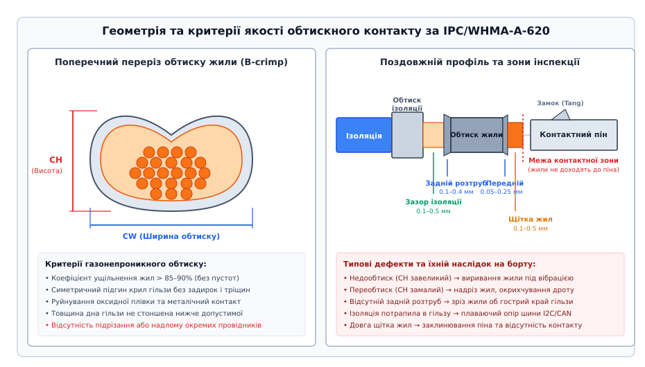
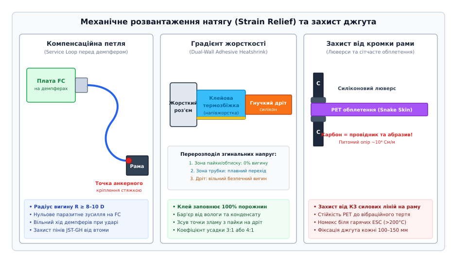

# Джгут, обтиск і розвантаження натягу

<preknowlist>
- [Політний контролер](root:sys-dron/flight-controller) — архітектура інтерфейсів датчиків, шини живлення та вимоги до стабільності сигнальних ліній.
- [Компонування борту: розміщення, джгут, розв'язка](root:sys-dron/komponuvannia-bortu) — топологія трасування, просторове зонування та рознесення силових і сигнальних ліній.
- [Різьба під вібрацією: самовідкручування й фіксація](root:sys-dron/rizba-pid-vibratsiieiu) — спектри вібраційних навантажень на борту, резонансні частоти та втомне руйнування матеріалів.
- [Композити: вуглепластик і склопластик](root:sys-dron/kompozyty) — електропровідність, механічна міцність та абразивні властивості вуглецевого волокна.
- [Земляні петлі](root:hw-pcb/ground-loops) — паразитні контури зворотного струму, різниця потенціалів землі та синфазні завади.
</preknowlist>

Під час різкого маневру безпілотного апарата з перевантаженням `4–6 g` або за тривалого польоту в режимі зависання вібрація чотирьох безколекторних двигунів на частотах 150–400 Гц передається на силові та сигнальні кабелі. Якщо контактний пін датчика орієнтації (IMU) або компаса обтиснутий із мікроскопічним зазором, динамічні коливання проводу викликають мікропереміщення мідних жил відносно ламелі гільзи. У точці контакту виникає фретинг-корозія: шар оксиду міді товщиною в частки мікрона збільшує перехідний опір з `4 мОм` до `350 мОм` за кілька мілісекунд. На сигнальній лінії шини I2C зі струмом підтяжки `3 мА` цей стрибок опору породжує паразитний імпульс напруги `ΔU = 1.05 В`. Логічний рівень на вході мікроконтролера просідає нижче порогу розпізнавання одиниці `V_IH = 2.31 В` (для логіки 3.3 В), контролер фіксує таймаут апаратного інтерфейсу (Bus Lockup), навігаційний фільтр EKF втрачає оцінку курсу, і апарат зривається в некероване обертання.

> 🔧 **Навіщо це.** Надійність бортової електроніки безпілотника визначається не мікроконтролерами чи алгоритмами автопілота, а фізичною якістю кабельного джгута та роз'ємних з'єднань. Жоден програмний фільтр не здатен врятувати літальний апарат, якщо через втомний злам мідної жили переривається живлення польотного контролера або через відсутність компенсаційної петлі натягнутий дріт передає вібрацію рами прямо на чутливий кристал гіроскопа. Проєктування джгутів за аерокосмічним стандартом IPC/WHMA-A-620, використання спеціалізованих роз'ємів із замком (JST-GH, XT60) та грамотне механічне розвантаження натягу (Strain Relief) перетворюють набір розрізнених друкованих плат на єдину вібростійку систему.

---

### Фізика контактного з'єднання: чому обтиск замінив паяння

В аматорській практиці поширене хибне уявлення, що пропаяний контакт надійніший за механічний обтиск (кримп). В умовах постійних знакозмінних вібрацій та ударних навантажень авіаційного борту паяння багатожильного дроту безпосередньо в роз'єм є головною причиною раптових втомних обривів.

#### Механізм руйнування паяного з'єднання (Solder Wicking)
Коли рідкий олов'яно-свинцевий (Sn63Pb37) або безсвинцевий (SAC305) припій торкається нагрітого багатожильного мідного провідника, капілярні сили затягують розплавлений метал під ізоляцію на відстань 3–8 мм від місця пайки (англ. *solder wicking*). 

У зоні проникнення припою відбуваються незворотні фізико-хімічні процеси:
1. **Утворення крихких інтерметалідів:** На межі контакту міді з оловом утворюються інтерметалічні сполуки `Cu₆Sn₅` та `Cu₃Sn`. Ці кристалічні структури мають високу твердість, але надзвичайно низьку пластичність і нульову ударну в'язкість.
2. **Формування концентратора механічних напружень:** Багатожильний дріт складається з десятків тонких гнучких жил діаметром 0.05–0.08 мм. У зоні затікання припою провідник перетворюється на монолітний жорсткий стрижень. Точно на лінії закінчення проникнення припою виникає різкий градієнт жорсткості: гнучка частина жили різко переходить у зацементовану монолітну зону.

При вібраційних коливаннях дроту з амплітудою всього `±0.5 мм` згинальний момент концентрується строго на цій граничній лінії. За формулою вигину балки максимальні нормальні напруження на поверхні жили становлять:

```
σ_max = (M_bend · y_max) / I_z      [напруження вигину жили]
```

де `M_bend` — локальний згинальний момент, `y_max = d_wire / 2` — радіус жили, а `I_z = (π · d_wire⁴) / 64` — осьовий момент інерції перерізу провідника. Оскільки база вигину на межі припою прямує до нуля, амплітуда напружень `σ_max` перевищує границю плинності міді `σ_y ≈ 200 МПа`. Через `10⁴...10⁵` циклів вібрації (що відповідає лише 10–20 хвилинам польоту квадрокоптера на частоті 200 Гц) жили послідовно ламаються внаслідок багатоциклової втоми металу (англ. *fatigue failure*).

```
Паяне з'єднання під вібрацією:
Ізоляція ─── [Гнучкі жили] ──X── [Затік припою: моноліт] ─── [Контакт]
                             ▲
                    Точка втомного зламу (концентратор σ_max)
```

#### Фізика газонепроникного обтиску (Gas-Tight Cold Weld)
На відміну від пайки, якісний механічний обтиск здійснюється методом пластичної деформації матеріалу в холодному стані (Cold Stamping / Swaging). 

Під час опускання матриці ручного або автоматичного кримпера відкрита гільза контакту (Conductor Barrel) стискає пучок багатожильного проводу з зусиллям `F_crimp = 1.5...5.0 кН`. При цьому відбуваються три взаємопов'язані фізичні процеси:
1. **Зсувна деформація та руйнування оксидів:** Тверді поверхневі діелектричні плівки оксиду міді `Cu₂O` та оксиду латуні під дією колосального тиску (понад `300...400 МПа`) розтріскуються і зміщуються відносно металу.
2. **Ювенільний металічний контакт (Холодне зварювання):** Очищені чисті поверхні мідних провідників притискаються одна до одної на відстані міжатомної взаємодії. Окремі круглі жили деформуються в щільні шестигранні призми, утворюючи монолітний блок без повітряних порожнин (коефіцієнт ущільнення металу `> 85–90%`).
3. **Пластичне зміцнення (Наклеп):** Деформація кристалічної решітки міді підвищує границю міцності з'єднання в зоні обтиску, а пружні залишкові напруження самої латунної чи бронзової гільзи забезпечують постійний стискальний радіальний тиск протягом усього терміну експлуатації, компенсуючи температурні розширення в діапазоні від `-55 °C` до `+125 °C`.

Газонепроникність (Gas-Tightness) означає, що всередину спресованого пучка жил не можуть проникнути молекули кисню, сірчистого газу або водяної пари. Такий контакт не окислюється з часом, забезпечуючи стабільний перехідний опір `R_contact ≤ 2...5 мОм` протягом багатьох років польотів.

---

### Геометрія та стандарти якості обтиску за IPC/WHMA-A-620

Міжнародний стандарт IPC/WHMA-A-620 (Requirements and Acceptance for Cable and Wire Harness Assemblies) регламентує суворі геометричні допуски для обтискних контактів класу 3 (High Performance Electronic Products — аерокосмічні та військові системи).


*Поперечний переріз F-подібного обтиску (B-crimp) та поздовжні зони контролю контакту: розтруб (bellmouth), щітка жил і газонепроникне стиснення.*

#### Анатомія обтискного контакту відкритого типу (Open-Barrel Terminal)
Типовий контакт мініатюрних роз'ємів (JST-GH, JST-SH, Molex PicoBlade) складається з п'яти обов'язкових зон:

1. **Контактна зона (Mating Area):** Позолочені або луджені гніздові ламелі чи штирі, які входять у зачеплення з ответною частиною роз'єму. Жили дроту та сліди деформації не повинні заходити в цю зону.
2. **Фіксуючий замок (Locking Tang / Lance):** Пружний металевий пелюсток, який замикається за пластиковий виступ усередині корпусу роз'єму, запобігаючи висуванню піна назад при осьовому натягу дроту.
3. **Гільза обтиску жили (Conductor Crimp Barrel):** Зона основного електричного та механічного з'єднання. Пелюстки гільзи закочуються всередину за формою латинської літери «B» (F-crimp або B-crimp), рівномірно стискаючи провідники.
4. **Розтруби гільзи (Bellmouth):** Плавні воронкоподібні розширення металу на передньому та задньому краях гільзи жили:
   - **Задній розтруб (Rear Bellmouth):** Найважливіший геометричний елемент. Його довжина повинна становити `0.1...0.4 мм` (або `1...2` товщини стінки гільзи `t_wall`). Задній розтруб створює гладку радіусну кромку, що запобігає зрізанню зовнішніх мідних жил об гострий штампований край гільзи при вібраційному вигині кабелю. Відсутність заднього розтруба — критичний дефект, який знижує вібростійкість дроту в 10–15 разів.
   - **Передній розтруб (Front Bellmouth):** Довжина `0.05...0.25 мм`. Знижує концентрацію напружень на виході жил у напрямку контактної зони.
5. **Щітка провідників (Conductor Brush):** Кінці зачищених мідних жил повинні виступати за передній край гільзи на `0.1...0.5 мм`. Якщо жили не доходять до переднього краю гільзи, площа механічного контакту зменшується, і сила утримання на виривання падає. Якщо щітка занадто довга (`> 0.8 мм`), жили потрапляють у зону дії замка (Locking Tang) або заважають стикуванню роз'єму.
6. **Гільза обтиску ізоляції (Insulation Crimp Barrel):** Друга пара пелюсток, що охоплює зовнішню полімерну (силіконову або тефлонову) ізоляцію проводу. Ця гільза виконує функцію вбудованого розвантажувача натягу: вона приймає на себе всі осьові та згинальні сили, не передаючи механічні напруження на оголені мідні жили всередині основного обтиску.
7. **Зазор ізоляції (Insulation Clearance Gap):** Між кінцем ізоляції та початком гільзи жили повинен бути чітко видимий зазор оголеного проводу довжиною `0.1...0.5 мм`. Якщо зазор відсутній і ізоляція потрапила всередину гільзи жили, пластик заважає холодному зварюванню металу, викликаючи різке зростання перехідного опору або повний розрив кола.

#### Вимоги до зачистки проводу (Wire Stripping)
Якість обтиску закладається на етапі зняття ізоляції:
- **Заборона підрізання жил (Zero Strand Nicking):** Згідно з IPC-620 Class 3 для авіаційних джгутів підрізання, надсікання або обрив хоча б однієї мікрожили в багатожильному проводі є неприпустимим дефектом. Надсічена жила під вібрацією стає зародком втомної тріщини, яка поширюється по всьому перерізу.
- **Інструмент зачистки:** Застосовуються прецизійні стрипери з каліброваними матричними ножами (Die-Type Strippers) або термічні стрипери (Thermal Wire Strippers). Термічний ніж розплавляє силікон чи тефлон безконтактно, що на 100% гарантує відсутність механічних подряпин на міді.
- **Збереження повиву жил:** Після зняття ізоляції природний крок скручування провідників повинен зберігатися. Заборонено надмірно скручувати жили пальцями, оскільки це збільшує діаметр пучка і призводить до витискання жил повз гільзу кримпера.

#### Метрологічний контроль: висота обтиску (Crimp Height)
Єдиним об'єктивним критерієм якості обтиску в серійному виробництві є мікроскопічний та мікрометричний вимір висоти обтиску (Crimp Height, `CH`) та ширини обтиску (Crimp Width, `CW`).

Висота обтиску вимірюється спеціальним мікрометром із плоским упором (Anvil) та загостреним вимірювальним стрижнем (Spindle) з точністю `±0.01 мм`.

```
          F_pull (Зусилля на виривання)
            ▲
            │             Оптимальне вікно (IPC Class 3)
            │                  ┌──────┐
     F_req ─┼──────────────────┤******├────────────────── (Вимога стандарту)
            │                 /│      │\
            │                / │      │ \  Підрізання жил
            │  Недообтиск   /  │      │  \ (Переобтиск)
            │  (Виривання) /   │      │   \
            └─────────────┴────┴──────┴────┴────────────►
                         CH_max      CH_min          CH (Висота обтиску)
```

Залежність характеристик контакту від висоти обтиску:
- **Зона недообтиску (`CH > CH_max`):** Гільза стиснута недостатньо. Коефіцієнт ущільнення пучка жил низький, між жилами залишаються повітряні зазори. Зусилля на виривання проводу `F_pull` не досягає норми стандарту, кабель легко висмикується з клеми при монтажі, а перехідний опір з часом зростає через окислення.
- **Оптимальне вікно обтиску (`CH_min ≤ CH ≤ CH_max`):** Допуск становить зазвичай лише `±0.02...0.03 мм`. Досягається 100% газонепроникність, перехідний опір мінімальний (`R < 3 мОм`), а зусилля на виривання досягає абсолютного максимуму.
- **Зона переобтиску (`CH < CH_min`):** Матриця кримпера надмірно стискає метал. Товщина стінки дна гільзи стоншується, а гострі кромки матриці підрізають або надламують зовнішні провідники багатожильного пучка. Хоча електричний контакт здається ідеальним, ефективний переріз жили зменшується на 30–50%, провідник окрихчується і ламається при першому ж вібраційному навантаженні.

Таблиця мінімально допустимого зусилля на виривання дроту з клеми (Pull-Out Force за стандартом IPC/WHMA-A-620, Class 3):

| Калібр проводу (AWG) | Номінальний переріз (мм²) | Мінімальна сила виривання `F_pull` (Н) | Мінімальна сила утримання (кгс) |
|---|---|---|---|
| AWG 32 | 0.032 | 4.5 | 0.46 |
| AWG 30 | 0.051 | 6.7 | 0.68 |
| AWG 28 | 0.081 | 11.1 | 1.13 |
| AWG 26 | 0.129 | 15.6 | 1.59 |
| AWG 24 | 0.205 | 22.3 | 2.27 |
| AWG 22 | 0.326 | 35.6 | 3.63 |
| AWG 20 | 0.518 | 57.8 | 5.89 |
| AWG 18 | 0.823 | 89.0 | 9.08 |
| AWG 16 | 1.31 | 133.4 | 13.60 |
| AWG 14 | 2.08 | 178.0 | 18.15 |

#### Інструментальне оснащення: храпові кримпери та позиціонери
Для забезпечення повторюваності обтиску застосовується професійний інструмент із примусовим повним циклом (Full-Cycle Ratchet Mechanism за військовим стандартом MIL-DTL-22520):
- Храповий механізм блокує розкриття рукояток кримпера доти, доки матриця не зійдеться на 100% заданої висоти. Оператор не може випадково недотиснути контакт.
- Прецизійні позиціонери (Locators): спеціальні підпружинені упори, які фіксують контактний пін у правильному просторовому положенні всередині матриці, запобігаючи його осьовому зміщенню, кутовому перекосу (Roll) або дугоподібному вигину (Banana Distortion).

---

### Роз'єми мікроелектроніки та силових кіл БПЛА

У бортових системах безпілотників використовується чітко розмежований набір стандартів з'єднувачів, оптимізованих під обмеження за масою, габаритами, струмовим навантаженням та вібраційними прискореннями.

#### Сигнальні субмініатюрні роз'єми

##### 1. JST-GH (Japan Solderless Terminals — GH Series)
Стандарт, прийнятий консорціумом Dronecode Foundation та розробниками автопілотів Pixhawk/PX4/ArduPilot як базовий міжблочний інтерфейс авіоніки.
- **Крок контактів (Pitch):** 1.25 мм.
- **Номінальний струм:** до `1.0 А` на контакт.
- **Діапазон калібрів проводу:** AWG 26–30.
- **Механізм фіксації:** Позитивний пружинний замок-защіпка (Positive Latching Mechanism). При з'єднанні роз'єм видає виразне клацання. Зусилля утримання замка становить `> 15 Н`, що унеможливлює самовільне розстикування роз'єму навіть під дією вібрацій до `20 g` або випадкового смикання за джгут.
- **Контакти:** Фосфориста бронза з золотим (Au) або лудженим (Sn) покриттям. Опір ізоляції `> 100 МОм`.

##### 2. JST-SH (JST — SH Series)
Ультракомпактний роз'єм для високоінтегрованих плат (наприклад, малогабаритні польотні контролери гоночних FPV-дронів та модулі оптичного потоку).
- **Крок контактів:** 1.0 мм.
- **Номінальний струм:** `1.0 А`.
- **Калібр проводу:** AWG 28–32.
- **Особливості експлуатації:** Відсутній механічний замок; утримання вилки в гнізді здійснюється виключно силами тертя ламелей. Через малий крок контактів та низьку силу утримання роз'єм JST-SH вразливий до вібраційного випадання. На важких промислових дронах кабелі JST-SH після стикування вимагають обов'язкової фіксації краплею нейтрального силіконового герметика (RTV Silicon) або термоклею.

##### 3. Molex PicoBlade
Широко використовується в сервоприводах, модулях телеметрії та лідарних далекомірах.
- **Крок контактів:** 1.25 мм.
- **Номінальний струм:** `1.0 А`.
- **Калібр проводу:** AWG 26–32.
- **Особливості:** Фрикційний замок із напрямними ребрами. Має дві точки контакту на кожен пін (Tuning Fork Contact), що підвищує стабільність опору при вібраціях.

##### 4. Заборона роз'ємів Dupont 2.54 мм у польотних системах
Стандартні штирьові лінійки з кроком 2.54 мм (типу Dupont / Arduino Jumpers) категорично заборонені до використання в кабельних джгутах БПЛА:
- Відсутній замок фіксації (контакт вислизає при прискоренні від 2 g).
- Відсутній ключ захисту від переполюсовки (ризик спалити контролер при підключенні зі зсувом на один пін).
- Велика маса та низька корозійна стійкість штампованих сталевих або латунних контактів без напилення благородних металів.

#### Силові високострумові роз'єми

Силові лінії акумуляторів та регуляторів швидкості (ESC) комутують постійні струми від 30 до 200 А. Для мінімізації омічних втрат та запобігання пожежам застосовуються роз'єми родини XT (виробництва Amass):

```
Типорозміри силових роз'ємів:
XT30  ─── [Ø 2.0 мм гільза] ─── До 30 А постійно (дріт AWG 16–20)
XT60  ─── [Ø 3.5 мм гільза] ─── До 60 А постійно (дріт AWG 12–14)
XT90  ─── [Ø 4.5 мм гільза] ─── До 90 А постійно (дріт AWG 10–12)
XT90-S─── [Anti-Spark R=5.1Ω] ── Безпечне підключення батарей 6S–14S
```

1. **XT30 / XT30U:** Малогабаритні роз'єми для струмів до 30 А (пік 40 А протягом 10 с). Позолочені розрізні штирі діаметром 2.0 мм. Матеріал корпусу — високотемпературний поліамід (PA66, вогнестійкість UL94V-0).
2. **XT60 / XT60H:** Стандарт для квадрокоптерів середнього класу. Контакти діаметром 3.5 мм, струм 60 А постійно (пік 100 А). Модифікація XT60H має знімні пластикові ковпачки, які замінюють термозбіжну трубку і захищають паяне з'єднання від механічного натягу.
3. **XT90-S з технологією Anti-Spark:** Під час підключення високовольтного акумулятора LiPo (6S–12S, напруга 25.2–50.4 В) до регуляторів ESC вхідні електролітичні конденсатори ємністю `2000...5000 мкФ` перебувають у розрядженому стані. У момент дотику контактів струм заряду конденсаторів досягає пікових значень:

```
I_inrush = U_bat / (ESR_caps + R_loop)
= 50 В / (0.02 + 0.03 Ом)
= 50 / 0.05
= 1000 А      [імпульсний струм заряду вхідної ємності]
```

Цей струм викликає потужний дуговий розряд (іскру), яка випалює золото на кінчиках контактів, утворюючи мікрократери та ізолюючий нагар. 

Роз'єм XT90-S вирішує цю проблему за допомогою двоступеневого підключення: на передньому кінці плюсового штиря змонтовано ізольований сегмент, підключений через вбудований резистор `R_anti = 5.1 Ом`. При неповному вставлянні роз'єму струм заряду обмежується безпечним рівнем `I = 50 В / 5.1 Ом ≈ 9.8 А`, плавно заряджаючи конденсатори за `t ≈ 3 · R · C = 3 · 5.1 · 0.003 ≈ 45 мс`. При повному замиканні штир перекриває прямий контакт із нульовим опором без жодної іскри.

4. **Правила паяння силових роз'ємів:**
   - **Температурний режим:** Паяльник потужністю 80–100 Вт із масивним мідним клиноподібним жалом, температура `380...400 °C`. Час контакту не повинен перевищувати `3.5 секунди`, щоб не розплавити пластик корпусу.
   - **Використання ответної частини як радіатора та фіксатора:** Перед паянням у роз'єм обов'язково вставляють ответну половину (Mating Dummy Plug). Металеві штирі ответної частини відводять надлишкове тепло і жорстко утримують піни в правильній геометрії, унеможливлюючи їхній перекіс при розм'якшенні поліаміду.

---

### Механічне розвантаження натягу (Strain Relief) та захист від вібрацій

Кабельний джгут на борту безпілотника зазнає складного комплексу статичних та динамічних навантажень: вібрацій рами, температурних розширень, інерційних сил при прискореннях та абразивного тертя об деталі фюзеляжу.


*Принципи формування компенсаційних петель (service loop), градієнта жорсткості за допомогою клейової термозбіжки та захисту джгута від перетирання об кромки карбонової рами.*

#### 1. Компенсаційні сервісні петлі (Service Loops)
Головне правило монтажу кабелів до рухомих або віброізольованих компонентів — неприпустимість натягування джгута «як струна».

Плата польотного контролера монтується на силіконових демпферах (Shore A 30–40), які утворюють механічний фільтр з амплітудою вільного коливання до `1.5–3.0 мм`. Якщо сигнальний кабель приймача або GPS натягнутий прямолінійно, він створює паразитну механічну пружність:
- Жорсткість натягнутого дроту шунтує силіконові демпфери, передаючи високочастотні вібрації рами прямо на плату IMU.
- Постійне бічне зусилля перекошує плату, зміщуючи вісь чутливості акселерометра відносно центру мас дрона.
- Контактні піни роз'єма JST-GH зазнають постійного згинального навантаження, що призводить до втомного розхитування паяних контактів на друкованій платі.

Правильне інженерне рішення: формувати перед роз'ємом S-подібну або Ω-подібну компенсаційну петлю (Service Loop). Довжина петлі повинна забезпечувати мінімальний радіус вигину:

```
R_bend_min ≥ 6 · D_cable      [для статичного вигину]
R_bend_min ≥ 10 · D_cable     [для динамічного вібраційного вигину]
```

де `D_cable` — зовнішній діаметр кабельного джгута. Кабель жорстко фіксується стяжкою або скобою до рами на відстані 30–50 мм від плати (Anchor Point), а вільна петля поглинає всі взаємні зміщення без створення залишкових зусиль на роз'ємі.

#### 2. Градієнт жорсткості за допомогою клейової термозбіжної трубки (Dual-Wall Heatshrink)
Будь-який роз'єм (XT60, Molex, JST) є абсолютно жорстким масивним тілом, тоді як підключений силіконовий кабель — гнучким. Якщо просто надіти тонку одинарну термозбіжку, точка максимального згинального напруження зосередиться точно на зрізі металевої гільзи контакту.

Для розвантаження цього вузла використовують двостінні термозбіжні трубки з термоплавким клеєм (Dual-Wall Adhesive-Lined Polyolefin Heatshrink) з коефіцієнтом усадки 3:1 або 4:1.

Механізм роботи клейової термозбіжки:
1. Під час нагрівання гарячим повітрям (температура `120...150 °C`) внутрішній шар поліамідного термоклею розплавляється і під тиском зовнішньої трубки заповнює 100% внутрішніх порожнин між проводами, герметизуючи стик від вологи, сольового туману та конденсату.
2. Після охолодження застиглий клей разом із товстою поліолефіновою оболонкою утворює напівжорстку муфту. Вона переносить точку максимального вигину на 10–20 мм далі від металевого контакту, створюючи плавний градієнт жорсткості (Tapered Transition):
   `Жорсткий роз'єм (100%) → Напівжорстка клейова муфта (50%) → Гнучкий кабель (0%)`.

#### 3. Захист від абразивного перетирання об вуглепластикову раму (Carbon Fiber Abrasion)
Вуглепластик (карбон) — це композит із переплетених вуглецевих волокон, скріплених епоксидною смолою. Він володіє двома специфічними властивостями, які роблять його смертельно небезпечним для кабельних джгутів:
- **Абразивність:** Фрезеровані кромки та отвори в карбонових пластинах діють як мікроскопічна пилка з алмазним напиленням.
- **Електропровідність:** Вуглецеві волокна є провідниками з питомим опором близько `10⁴ См/м`.

Під дією вібрації силіконова або ПВХ ізоляція силового дроту AWG 12, притиснутого до кромки карбонового отвору без захисту, перетирається до голого металу за 5–15 годин польоту. Щойно оголена мідна жила плюсового проводу `+24 В` торкається струмопровідної кромки рами, виникає коротке замикання через карбон. Струм силою понад 300 А миттєво пропалює раму з виділенням відкритого полум'я, а напруга живлення логіки просідає до нуля, викликаючи повне руйнування апарата.

Методи захисту кабелів від карбону:
1. **Захисне сітчасте обплетення (PET Expandable Braided Sleeving / Snake Skin):** Кабельний джгут затягується в самозагортальне або трубчасте обплетення з монофіламентного поліетилентерефталату (PET). Обплетення має високу стійкість до стирання, робочий діапазон від `-50 °C` до `+150 °C` та дозволяє легко відгалужувати проводи в потрібних місцях.
2. **Арамідне обплетення (Nomex / Kevlar):** Застосовується в силових зонах поруч із нагрітими регуляторами швидкості (ESC) та двигунами. Витримує температури до `+300 °C` і не підтримує горіння.
3. **Гумові та силіконові люверси (Edge Grommets):** Будь-який прохід кабелю крізь отвір у карбоновій пластині повинен бути захищений розрізним силіконовим профілем (Edge Guarding Strip) або цільним круглим гумовим люверсом.

---

### Електричний та тепловий розрахунок проводів джгута

#### Вибір марки та конструкції проводу
У безпілотній авіації категорично заборонено застосовувати монтажні проводи з монолітною жилою або побутові багатожильні проводи з жорсткою ПВХ ізоляцією (наприклад, серії ПВ-3). ПВХ дубіє і розтріскується при мінусових температурах (вже при `-10 °C`), а мала кількість товстих жил швидко зазнає втомного зламу.

Стандартом авіоніки є **супергнучкі силіконові проводи (Ultra-Flexible Silicone Wire)** з жилами з лудженої безкисневої міді (Tinned OFC Copper, клас гнучкості Class 6):
- Кожна жила складається з сотень мікропровідників діаметром `0.05...0.08 мм` (наприклад, провід AWG 12 містить 680 провідників діаметром 0.08 мм).
- Оболонка з високомолекулярного кремнійорганічного силікону зберігає еластичність у діапазоні від `-60 °C` до `+200 °C`, не плавиться при дотику паяльника та володіє високою діелектричною міцністю (`> 600 В`).

#### Розрахунок спаду напруги на силовому кабелі
Для силового кабелю довжиною `L = 0.35 м` (від акумулятора через джгут до 4-in-1 ESC), який проводить постійний струм `I = 80 А`, розрахуємо падіння напруги та теплові втрати для проводів AWG 14 (`S = 2.08 мм²`) та AWG 12 (`S = 3.31 мм²`).

Питомий опір міді при температурі `T = 20 °C` становить `ρ = 0.0175 Ом·мм²/м`. З урахуванням нагріву проводу до робочої температури `T = 70 °C` опір зростає за температурним коефіцієнтом `α = 0.00393 1/°C`:

```
ρ_70C = ρ_20C · (1 + α · (70 - 20))
= 0.0175 · (1 + 0.00393 · 50)
= 0.0175 · (1 + 0.1965)
≈ 0.0209 Ом · мм² / м      [питомий опір гарячої міді]
```

Повний опір двох провідників живлення (прямий провід `+` та зворотний `-`, сумарна довжина `2 · L = 0.7 м`):

1. **Для проводу AWG 14 (`S = 2.08 мм²`):**

```
R_loop = (ρ_70C · 2 · L) / S
= (0.0209 · 0.7) / 2.08
= 0.01463 / 2.08
≈ 0.00703 Ом = 7.03 мОм      [опір шлейфу AWG 14]
```

Падіння напруги при струмі 80 А:

```
ΔU = I · R_loop
= 80 · 0.00703
≈ 0.562 В      [втрата напруги живлення]
```

Потужність теплових втрат, що виділяється у вигляді нагріву джгута:

```
P_loss = I² · R_loop
= (80)² · 0.00703
= 6400 · 0.00703
≈ 45.0 Вт      [потужність нагріву кабелю AWG 14]
```

Виділення 45 Вт тепла на короткому відрізку джгута 35 см призведе до перегріву ізоляції понад допустимі норми та швидкого теплового старіння.

2. **Для проводу AWG 12 (`S = 3.31 мм²`):**

```
R_loop = (0.0209 · 0.7) / 3.31
= 0.01463 / 3.31
≈ 0.00442 Ом = 4.42 мОм      [опір шлейфу AWG 12]
```

```
ΔU = 80 · 0.00442 ≈ 0.354 В      [втрата напруги живлення]
P_loss = 6400 · 0.00442 ≈ 28.3 Вт      [нагрів знижено на 37%]
```

Вибір проводу AWG 12 зменшує просідання напруги на 0.21 В та знижує тепловиділення на 16.7 Вт, що суттєво підвищує загальний ККД силової установки дрона.

#### Коефіцієнт пучкування джгута (Bundle Derating Factor)
Коли десятки провідників зв'язуються в щільний круглий джгут, тепловіддача внутрішніх жил ускладнюється. Згідно зі стандартом проектування авіаційної проводки SAE AS50881, допустимий тривалий струм кожного проводу в пучку зменшується на поправочний коефіцієнт пучкування `k_bundle`:

```
I_allowed_bundle = I_single_wire · k_bundle      [дерайтинг струму в пучку]
```

Значення коефіцієнта пучкування за AS50881:
- Джгут із 2–5 проводів: `k_bundle = 0.80`.
- Джгут із 6–15 проводів: `k_bundle = 0.70`.
- Джгут із 16–30 проводів: `k_bundle = 0.55`.
- Джгут понад 30 проводів: `k_bundle = 0.45`.

Якщо окремий провід AWG 24 у вільному повітрі витримує струм до 3.5 А, то всередині центрального джгута з 20 провідників його максимальний робочий струм не повинен перевищувати `I_max = 3.5 · 0.55 ≈ 1.9 А`.

---

### Бандажування та маршрутизація джгута на рамі

Прокладання кабельних трас виконується за правилами бортового монтажу:

1. **Крок фіксації стяжками (Tie Spacing):** Кабельний джгут повинен кріпитися до елементів рами нейлоновими стяжками (Cable Ties, стійкими до ультрафіолету поліамідними стяжками PA66-UV) з кроком:
   `L_step ≤ 100...150 мм` на прямолінійних ділянках та на відстані `20–30 мм` перед кожним вигином або роз'ємом.
2. **Авіаційна шнурівка замість стяжок (Lacing Tape за NASA-STD-8739.4):**
   На відповідальних безпілотниках професійного та військового призначення пластикові стяжки замінюють плетеним капроновим або кевларовим шнуром, просоченим мікрокристалічним воском чи синтетичним еластомером. На відміну від пластикових стяжок, які при затягуванні створюють точковий тиск і здатні перекусити тонку силіконову ізоляцію або утворити гострий обрізний хвіст, шнурівка вузлами «стремено» (Clove Hitch) рівномірно розподіляє навантаження по колу джгута і не має гострих виступів.
3. **Розділення сигнальних та силових трас:** Сигнальні лінії датчиків (I2C, SPI) та радіочастотні коаксіальні кабелі антен повинні проходити на відстані не менше `30–50 мм` від силових проводів ESC та фазних кабелів двигунів. Якщо перетин трас неминучий, він повинен виконуватися строго під прямим кутом `90°`, щоб звести взаємну індуктивність до нуля.
4. **Герметизація та компаундування (Potting):**
   У морських та всепогодних безпілотниках (стандарт захисту IP67) тильна сторона роз'ємів заливається двокомпонентним нейтральним силіконовим компаундом (наприклад, Dow Corning Sylgard 184) або тиксотропним герметиком. Компаунд повністю ізолює металеві клеми від проникнення вологи та фіксує проводи в єдиний монолітний блок, унеможливлюючи вібраційне виламування контактів.

---

### Контроль якості та автоматизована діагностика джгута

Після завершення складання та монтажу роз'ємів кожен кабельний джгут повинен пройти 100% верифікацію перед установкою на апарат. Ручна перевірка мультиметром із щупами для 30-пінового джгута займає до 20 хвилин і не дозволяє виявити мікрообриви, які виникають лише під час вібрації.

Для автоматизованої перевірки застосовується матричний тестер топології, описаний у практичній вставці [Автоматизований тестер цілісності кабельного джгута](root:sys-dron/dzhhut-obtysk-i-rozvantazhennia-natiahu/proj-harness-tester-engine.md). Тестер за частки мікросекунди формує повну матрицю провідності, виявляє переплутані піни, закорочення та реєструє мікророзриви контактів тривалістю від `1 мкс` у режимі вібраційного струшування.
