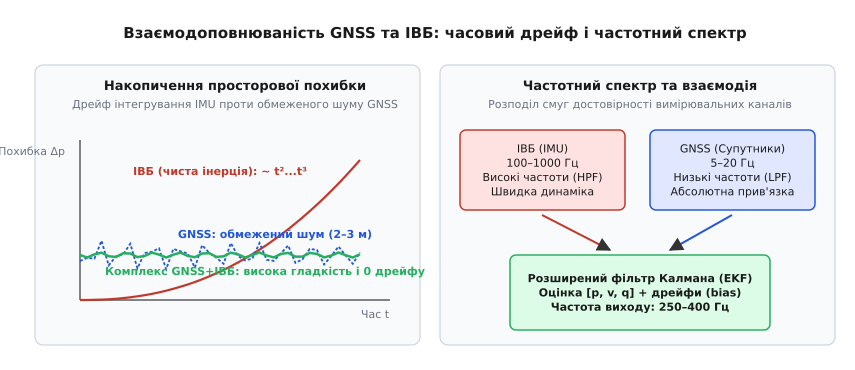
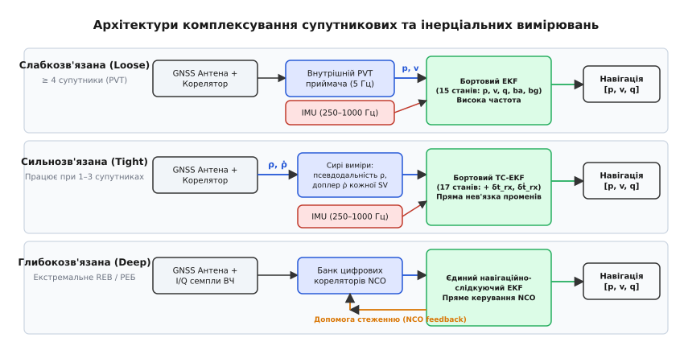
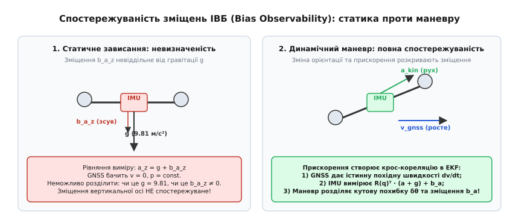
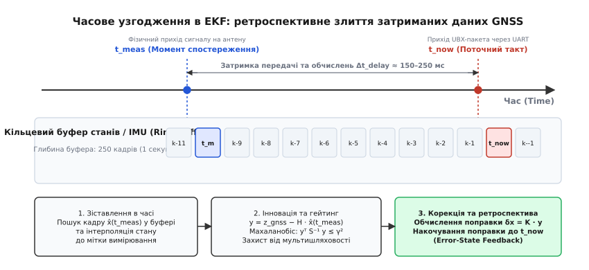

# GNSS і ІВБ разом: кому вірити й коли

<preknowlist>
- [Фільтр Калмана](root:com-signal/kalman-filter) — оцінювання стану динамічної системи та коваріаційні матриці похибок.
- [Розширений фільтр Калмана (EKF)](root:com-signal/kalman-ekf) — лінеаризація нелінійних моделей руху та матриці якобіанів.
- [Псевдодальність і чотири супутники](root:sys-dron/psevdodalnist-i-chotyry-suputnyky) — геометричні основи супутникової навігації та формування PVT-рішення.
- [Кватерніони](root:math-geometry/quaternions) — безсингулярне представлення тривимірної орієнтації апарата.
- [Коваріація та коваріаційна матриця](root:math-probability/covariance) — кількісний опис невизначеності та взаємозв'язку векторних оцінок.
- [Комплементарний фільтр](root:com-signal/complementary-filter) — частотний розподіл каналів вимірювання високої та низької частоти.
</preknowlist>

Безпілотний розвідувальний літак масою дванадцять кілограмів виконує політ на швидкості 25 м/с уздовж лінії фронту, коли супутниковий приймач раптово потрапляє під дію спрямованої завади комплексу радіоелектронної боротьби: дисперсія координат стрибає з 1.5 до 45 метрів, а затримка видачі пакетів зростає до 600 мілісекунд. Якщо бортовий автопілот побудований на прямому дотриманні супутникових координат, апарат робить різкий крен для компенсації несправжнього зсуву й за кілька секунд зривається у штопор. Якщо ж автопілот повністю відкидає дані GNSS і переходить на чисте подвійне інтегрування бортового інерціального вимірювального блока (ІВБ / IMU), то через непомітне зміщення нуля гіроскопа всього в 0.08 градуса на секунду накопичена просторова похибка вже за сорок секунд сягає 180 метрів, ведучи літак повз маршрутну точку в зону дії ворожої ППО.

Ця кризова ситуація викриває фундаментальну проблему автономної навігації: жоден бортовий сенсор не здатний самостійно забезпечити точне, неперервне й надійне позиціонування літального апарата. Лише математичне комплексування (Sensor Fusion) взаємодоповнювальних фізичних джерел — супутникових радіонавігаційних систем (GNSS) та інерціальних давачів (IMU) у межах розширеного фільтра Калмана (Extended Kalman Filter, EKF) — дозволяє побудувати єдиний неподільний навігаційний контур, здатний динамічно регулювати міру довіри до кожного каналу вимірювань і калібрувати дрейфи апаратури безпосередньо під час польоту.

## Анатомія давачів: чому жоден не літає наодинці

Щоб зрозуміти механіку комплексування, необхідно проаналізувати фізичну природу шумів та динамічні характеристики кожного з двох вимірювальних каналів.

Інерціальний вимірювальний блок (IMU, від англ. *Inertial Measurement Unit*) складається з тривісного мікроелектромеханічного (MEMS) акселерометра та тривісного гіроскопа. Акселерометр вимірює питому силу (векторну суму кінематичного прискорення та реакції опори проти гравітації Землі), а гіроскоп фіксує миттєву кутову швидкість обертання відносно інерціального простору.

Головними перевагами інерціального блока є:
1. **Висока частота оновлення:** опитування давачів через шини SPI здійснюється на частотах від 250 до 1000 Гц (а первинне апаратне семплювання кристала сягає 8 кГц).
2. **Нульова фазова затримка:** затримка між фізичним рухом і появою даних у регістрах сенсора становить менше 1–2 мілісекунд.
3. **Абсолютна автономність:** інерціальні давачі повністю замкнені всередині корпусу апарата, не випромінюють радіохвиль і принципово не піддаються зовнішньому радіоелектронному глушінню або підміні (спуфінгу).

Проте платою за швидкість та автономність є катастрофічний дрейф інтегрування. Будь-який MEMS-давач має два фундаментальні джерела похибок: високочастотний білий шум (шум вимірювання) та низькочастотне повільно змінне зміщення нуля (Bias / нульовий зсув).

### Спектральний аналіз шуму ІВБ за варіацією Аллана

Для точного математичного опису шумів інерціальних давачів застосовують метод варіації Аллана (Allan Variance). Він дозволяє розкласти сумарний дрейф давача на фізичні складові залежно від часу усереднення `τ`:

1. **Кутове випадкове блукання (Angular Random Walk, ARW / Velocity Random Walk, VRW):** високочастотний широкосмуговий білий шум, що виникає через тепловий рух електронів у первинних перетворювачах ємнісних MEMS-структур. На логарифмічному графіку варіації Аллана цей шум має нахил `−1/2`. При інтегруванні кутової швидкості він створює похибку кута, що зростає як `σ_θ(t) = N · √t`, де `N` — коефіцієнт ARW у `рад/√с`.
2. **Нестабільність зміщення нуля (Bias Instability):** фліккер-шум (шум типу `1/f`), зумовлений низькочастотними флуктуаціями напруги в інтегральних підсилювачах та механічними релаксаціями кремнієвих пружних підвісів. На графіку Аллана він утворює плоске плато з нульовим нахилом і визначає фундаментальну межу точності давача, яку неможливо усунути звичайним часовим усередненням.
3. **Швидкісне випадкове блукання (Rate Random Walk, RRW):** повільний дрейф зміщення нуля під дією градієнтів температури кристала та старіння матеріалу, що має нахил `+1/2` і моделюється у фільтрі Калмана як інтеграл від білого шуму (вінеровський процес).

Коли навігаційний алгоритм інтегрує покази гіроскопа `ω_meas = ω_true + b_g + w_g` для обчислення просторової орієнтації (кутів тангажу `θ`, крену `φ` та курсу `ψ`), похибка кута `Δθ` зростає лінійно в часі за рахунок зміщення `b_g` та пропорційно квадратному кореню з часу через інтегрування випадкового шуму (ARW):

```
Δθ(t) = b_g · t + w_g · √t
```

Коли ж автопілот обчислює лінійну швидкість та просторові координати, він повинен двічі проінтегрувати покази акселерометра `f_meas = Rᵀ · (a − g) + b_a + w_a`. Тут виникає потрійний кумулятивний ефект:
- Похибка зміщення нуля акселерометра `b_a` після першого інтегрування дає лінійний дрейф швидкості `Δv_a = b_a · t`, а після другого — квадратичне зростання похибки координат `Δp_a = 0.5 · b_a · t²`.
- Найнебезпечнішим чинником є похибка орієнтації `Δθ`, накопичена гіроскопом. Оскільки акселерометр перебуває у полі тяжіння Землі `g = 9.81` м/с², будь-яка кутова помилка горизонтування призводить до того, що вектор гравітації проектується на горизонтальні осі з амплітудою `g · sin(Δθ) ≈ g · Δθ`.
- Підставляючи лінійне зростання кутової похибки від дрейфу гіроскопа `Δθ = b_g · t`, отримуємо фіктивне горизонтальне прискорення `a_err = g · b_g · t`. Його подвійне інтегрування породжує **кубічне зростання просторової похибки**:

```
Δp_gyro(t) = 1/6 · g · b_g · t³
```

Для типового MEMS-гіроскопа тактичного або споживчого класу (наприклад, Bosch BMI088 або TDK InvenSense ICM-42688) залишкове зміщення нуля після заводського калібрування становить близько `0.1°/с` (`0.00175` рад/с). Якщо покладатися виключно на IMU:
- Через 10 секунд: кутова похибка становить 1.0°, помилка швидкості досягає 1.7 м/с, а відхилення координат — 8.6 метра.
- Через 30 секунд: помилка швидкості сягає 15.4 м/с, а координати зміщуються на 230 метрів.
- Через 60 секунд: апарат зміщується на 1.84 кілометра від реального маршруту.

На противагу інерціальним сенсорам, супутникова система GNSS (GPS, Galileo, BeiDou) забезпечує **абсолютну довгострокову прив'язку**. Похибка визначення координат автономного GNSS-приймача коливається в межах 1.5–3.0 метрів (і 1–2 сантиметрів у режимі RTK), але математичне сподівання цієї похибки не зростає в часі: середній дрейф за годину дорівнює нулю.

Проте GNSS має зворотні вади:
- **Низька частота оновлення:** стандартні модулі видають координати з частотою 5–10 Гц (рідше 20 Гц), що абсолютно недостатньо для контурів стабілізації польоту, які потребують відгуку на частотах 200–500 Гц.
- **Істотна фазова затримка (Latency):** на обробку радіосигналу, кореляцію коду, декодування навігаційних повідомлень та передачу пакетів через UART витрачається 100–250 мілісекунд.
- **Чутливість до завад:** супутниковий сигнал має мізерну потужність біля поверхні Землі (близько −160 дБВт / `10⁻¹⁶` Вт), тому легко придушується комплексами РЕБ або спотворюється перевідбиттями від будинків та скель (багатопроменевість / Multipath).


*Часовий дрейф чистої інерції проти обмеженого шуму GNSS та комплементарне об'єднання їхніх частотних спектрів у розширеному фільтрі Калмана.*

Ці характеристики роблять GNSS та IMU ідеальною комплементарною парою: IMU бере на себе високочастотну динаміку, згладжуючи шум супутників між рідкими відліками (високочастотний фільтр / High-Pass), а GNSS усуває довготривалий дрейф інтегрування та безперервно підкалібровує зміщення нуля датчиків (низькочастотний фільтр / Low-Pass).

## Архітектури комплексування: Loosely, Tightly та Deeply Coupled

Спосіб об'єднання супутникових та інерціальних даних визначає обчислювальну складність, стійкість до втрати сигналу та архітектуру зв'язку між навігаційним приймачем і польотним комп'ютером. В інженерній практиці розрізняють три класи комплексування.


*Рівні сполучення супутникового приймача та бортового фільтра оцінки стану: від передачі готових координат PVT до прямого керування фазовими генераторами NCO.*

### 1. Слабкозв'язане комплексування (Loosely Coupled EKF)

У слабкозв'язаній архітектурі супутниковий приймач працює як повністю автономний обчислювальний блок. Використовуючи власний внутрішній навігаційний процесор, приймач вимірює псевдодальності, розв'язує систему навігаційних рівнянь і формує готовий вектор PVT (Position, Velocity, Time): географічні координати (широта, довгота, висота) та вектор тривимірної швидкості у системі NED.

Ці готові значення передаються польотному контролеру по протоколу UBX або NMEA з частотою 5–10 Гц. Бортовий EKF використовує їх як вектор прямих спостережень:

```
z_k = [ p_gnssᵀ,  v_gnssᵀ ]ᵀ
```

**Переваги слабкозв'язаної схеми:**
- **Універсальність та модульність:** автопілот може працювати з будь-яким комерційним GNSS-модулем без доступу до його прошивки чи сирих радіовимірювань.
- **Мінімальне навантаження на процесор:** бортовий EKF має компактний вектор стану (зазвичай 15 або 24 елементи), а лінеаризована матриця спостереження `H` складається з простих одиничних блоків.

**Недоліки та обмеження:**
- **Поріг чотирьох супутників:** щоб обчислити три просторові координати та зсув власного годинника, автономний GNSS-приймач повинен одночасно бачити щонайменше 4 супутники. Якщо в умовах маневру, рельєфу або РЕБ кількість видимих супутників зменшується до трьох чи двох, приймач повністю припиняє видачу PVT-фіксу. Бортовий EKF миттєво втрачає всі супутникові корекції, хоча вимірювання за трьома супутниками несуть колосальний обсяг корисної інформації.
- **Корельованість вимірювального шуму:** внутрішній алгоритм GNSS-приймача сам містить згладжувальний фільтр. У результаті похибки переданих координат перестають бути білим шумом і стають забарвленими (Time-Correlated Noise). Подання забарвленого шуму в бортовий EKF порушує фундаментальні припущення Калмана і може викликати штучну самовпевненість фільтра (заниження оцінки коваріації `P`).
- **Каскадна затримка:** обчислення навігаційного розв'язку всередині приймача додає додаткові 50–100 мс затримки до часу передачі по UART.

### 2. Сильнозв'язане комплексування (Tightly Coupled EKF)

У сильнозв'язаній архітектурі супутниковий приймач звільняється від завдання обчислення координат. Він працює виключно як вимірювач первинних радіопараметрів, передаючи на автопілот вектор сирих спостережень (Raw Observations):
- Псевдодальності `ρ_i` (Pseudoranges) для кожного `i`-го видимого супутника;
- Доплерівські зсуви частоти або псевдошвидкості `ρ̇_i` (Pseudorange Rates / Doppler);
- Інформацію про співвідношення сигнал/шум `C/N0` та ефемериди орбіт супутників.

Вектор стану бортового EKF розширюється двома додатковими змінними, що описують похибки власного кварцового генератора приймача: зсувом годинника `δt_rx` (в метрах, `c · δt_rx`) та швидкістю дрейфу годинника `δṫ_rx` (м/с).

Рівняння спостереження для `i`-го супутника пов'язує виміряну псевдодальність `ρ_i` з вектором положення апарата `p` та відомим із ефемерид вектором положення супутника `r_sat_i`:

```
h_ρ,i(x) = ||r_sat_i − p|| + c · δt_rx + d_ion,i + d_trop,i
```

де `d_ion` та `d_trop` — поправки на затримку сигналу в іоносфері та тропосфері.

Лінеаризований рядок матриці спостереження `H_i` для `i`-го супутника формується одиничним вектором прямої видимості `u_i = (r_sat_i − p) / ||r_sat_i − p||`:

```
H_ρ,i = [ −u_iᵀ,   0₁ₓ₃,   0₁ₓ₃,   0₁ₓ₃,   0₁ₓ₃,   1,   0 ]
H_ρ̇,i = [  0₁ₓ₃,  −u_iᵀ,   0₁ₓ₃,   0₁ₓ₃,   0₁ₓ₃,   0,   1 ]
```

**Геометричний фактор зниження точності (DOP) та його роль у TC-EKF:**
Розподіл супутників на небосхилі визначає просторову конфігурацію матриці спостереження. Якщо супутники згруповані у вузькому секторі, значення геометричного фактора зниження точності (DOP: Dilution of Precision) стрімко зростає:

```
DOP = √( trace( (Hᵀ · H)⁻¹ ) )
```

У сильнозв'язаному фільтрі геометрична невизначеність природно враховується в коваріаційній матриці: вздовж напрямків з високим розкидом супутників коваріація `P` швидко стискається, а вздовж сліпих зон залишається широкою.

**Головні переваги сильнозв'язаної схеми:**
- **Навігація при недостатній кількості супутників (1–3 SV):** фільтр не зупиняє корекцію, навіть коли видимим лишається лише один супутник! Вимірювання псевдодальності від одного супутника дає жорстке геометричне обмеження вздовж лінії візування (Line-of-Sight), миттєво припиняючи дрейф інерціальної системи в цьому напрямку. Два або три супутники дозволяють повністю контролювати швидкість і висоту.
- **Справжній білий шум:** первинні псевдодальності не проходять згладжування внутрішніми фільтрами приймача, тому шум вимірювань строго відповідає гаусовому розподілу з дисперсією, що обчислюється з поточної амплітуди `C/N0`.
- **Автономний контроль цілісності (RAIM / Fault Detection and Exclusion):** бортовий EKF аналізує нев'язку (інновацію) кожного супутника окремо. Якщо один супутник дає спотворений сигнал через перевідбиття або локальну заваду, EKF відкидає виключно його, продовжуючи використовувати решту супутників.

### 3. Глибокозв'язана архітектура (Deeply / Ultra-Tightly Coupled)

Глибокозв'язане комплексування об'єднує навігаційний фільтр та цифрову обробку сигналів на рівні радіочастотних кореляторів. 

У класичному приймачі стеження за фазою коду та несучої здійснюється незалежними контурами ФАПЧ/ФАЧ (PLL, DLL). При різкому маневрі дрона з перевантаженням 5–10 g контури стеження можуть зірватися. У системі Deeply Coupled оцінка кінематики апарата з бортового INS безпосередньо керує цифровими генераторами NCO (Numerically Controlled Oscillator) контурів стеження приймача. Це дозволяє звузити смугу пропускання контурів стеження з 20–50 Гц до лічених герц, забезпечуючи колосальний виграш у завадозахищеності (до 15–20 дБ) під час маневрів в умовах радіоелектронного придушення.

## Математика простору похибок: Error-State EKF (ES-EKF)

Пряме застосування класичного EKF до повного вектора стану стикається з серйозною проблемою: орієнтація апарата описується нелінійними групами обертань SO(3). Кути Ейлера мають особливі точки (Gimbal lock), а чотирикомпонентний кватерніон має надлишкову розмірність і вимагає збереження одиничної норми `||q|| = 1`, що складно узгодити з адитивними матричними рівняннями Калмана.

Архітектурним розв'язком, прийнятим в авіаційних навігаційних системах та автопілотах PX4/ArduPilot, є **фільтр стану похибок** (Error-State EKF). 

Істинний стан системи розбивається на дві частини:
1. **Номінальний стан** `x = [p, v, q, b_a, b_g]` — великомасштабні змінні, що інтегруються на високій частоті (250–1000 Гц) за точними нелінійними кінематичними рівняннями.
2. **Стан похибок** `δx = [δp, δv, δθ, δb_a, δb_g]ᵀ` — вектор малого відхилення розмірністю 15×1, де кутова похибка `δθ = [δθ_x, δθ_y, δθ_z]ᵀ` задається у тривимірному дотичному просторі векторів обертання.

Детальне математичне виведення неперервних рівнянь похибок, лінеаризацію кінематики та обчислення матриць переходу наведено у вставці [Математика простору похибок навігаційного фільтра (ES-EKF)](root:sys-dron/gnss-i-ivb-razom/math-ins-error-propagation.md).

Ключові матричні співвідношення динаміки похибок мають вигляд:

```
d/dt(δp) = δv
d/dt(δv) = −R(q) · [f̂]× · δθ − R(q) · δb_a − R(q) · w_a
d/dt(δθ) = −[ω̂]× · δθ − δb_g − w_g
d/dt(δb_a) = w_ba
d/dt(δb_g) = w_bg
```

де `R(q)` — матриця повороту з системи Body в систему NED, `f̂ = f_meas − b_a` — оцінена питома сила, а `[v]×` — кососиметрична матриця векторного добутку.

З рівняння для `δv̇` чітко видно фундаментальний механізм міжвісьового зв'язку: похибка просторової орієнтації `δθ` множиться на виміряну питому силу `[f̂]×`. Завдяки цьому в коваріаційній матриці `P` природно накопичуються недіагональні елементи зв'язку між швидкістю, нахилом та зміщеннями давачів `b_a`, що дозволяє фільтру коригувати орієнтацію та дрейфи акселерометра під час надходження супутникових вимірювань швидкості.

## Оцінювання та калібрування дрейфів у динаміці польоту

Зміщення нуля MEMS-давачів (Bias) не є постійними величинами: вони плавають від зміни температури кристала, механічних напружень плати під час нагрівання та вібрацій моторів. Для точної навігації фільтр повинен оцінювати зміщення `b_a` та `b_g` у реальному часі (In-Flight Bias Estimation).

Проте можливість математичного визначення невідомих параметрів визначається властивістю **спостережуваності** (Observability) динамічної системи.


*Вплив динаміки руху апарата на ранг матриці спостережуваності та оцінку нульових зміщень акселерометра й гіроскопа.*

### 1. Неспостережуваність у статичному зависанні

Розглянемо випадок, коли квадрокоптер нерухомо завис у повітрі за ідеальної погоди:
- Лінійна швидкість постійна: `v = 0`, прискорення `a_kin = 0`.
- Покази акселерометра в горизонтальному положенні: `f_z = −g + b_az`.
- GNSS-вимірювання швидкості показують `v_gnss = [0, 0, 0]ᵀ`.

У такій конфігурації рівняння вертикальної сили має вигляд `f_z − b_az = −g`. Якщо акселерометр має невідоме вертикальне зміщення `b_az = +0.15` м/с², фільтр не має жодного математичного способу з'ясувати: чи це локальна гравітація Землі становить `9.66` м/с², чи це давач зміщений на `+0.15` м/с². Вертикальне зміщення акселерометра у стаціонарному прямолінійному польоті є **строго неспостережуваним**.

Аналогічно, кут курсу (Yaw / азимут) навколо вертикальної осі `Z` ніяк не взаємодіє з вектором гравітації. Якщо дрон не рухається горизонтально, відхилення курсу `Δψ` не створює проекцій вектора швидкості, тому помилка азимута і дрейф вертикального гіроскопа `b_gz` не можуть бути скомпенсовані супутниковими вимірюваннями швидкості без наявності магнітометра або дводіапазонної GNSS-антени.

### 2. Як маневри розкривають спостережуваність

Ситуація кардинально змінюється, щойно апарат починає динамічно маневрувати:

1. **Горизонтальне прискорення (розгін / гальмування):** коли дрон нахиляється вперед і набирає швидкість, GNSS фіксує точну похідну зміни швидкості `dv/dt` у просторі NED. Водночас акселерометр вимірює вектор питомої сили `f_b` у зв'язаних осях. Порівняння динаміки наростання швидкості за GNSS із показами акселерометра миттєво розділяє помилку нахилу `δθ` та постійне зміщення нуля `b_a`.
2. **Координований розворот (Banked Turn):** виконання віражу зі створенням бічного доцентрового прискорення розвертає вектор тяги відносно осей інерції. Матриця спостережуваності системи:

```
O = [ H;  H·F;  H·F²;  H·F³;  ... ]ᵀ
```

набуває повного рангу (Rank = 15). Усі три компоненти зміщення акселерометра `(b_ax, b_ay, b_az)` та кутовий дрейф гіроскопів стають строго спостережуваними. Саме тому алгоритми автопілотів вимагають виконання коротких динамічних віражів (S-подібних маневрів або «вісімки») після зльоту для точного калібрування інерціальних дрейфів перед переходом до автономного польоту за маршрутом.

## Часове узгодження: кільцевий буфер та затримка вимірювань

Найпідступнішою інженерною пасткою комплексування GNSS+ІВБ є **часова асинхронність**.

IMU опитується бортовим комп'ютером із періодом `Δt = 4` мс (250 Гц) з мінімальною затримкою. GNSS-модуль надсилає пакет навігаційних даних через послідовний порт UART із затримкою `τ = 150–250` мс. Це означає, що коли процесор отримує повідомлення UBX з міткою часу `t_meas = 10.000` с, поточний системний час уже становить `t_now = 10.200` с.

Якщо застосувати цей вимір безпосередньо до поточного стану `x(t_now)`:
- За 200 мілісекунд літак, що рухається на швидкості 20 м/с, долає відстань `Δp = 20 · 0.200 = 4.0` метри.
- Фільтр обчислить фальшиву інновацію `y = p_gnss(t_meas) − p(t_now) ≈ −4.0` м.
- Помилково вважаючи, що апарат відхилився від маршруту назад на 4 метри, EKF видасть потужний імпульс поправки швидкості вперед.
- На наступному такті виникне зворотний стрибок. У контурі виникає паразитна розкачка швидкості та орієнтації, що призводить до дестабілізації всього літального апарата.


*Ретроспективна фільтрація затриманих супутникових спостережень за допомогою кільцевого буфера вибірок стану автопілота.*

Для коректного злиття сучасні оцінювачі (PX4 EKF2) використовують **кільцевий буфер історії станів** (State Ring Buffer) глибиною 250 кадрів (1 секунда запису):

1. **Буферизація:** на кожному такті інтегрування IMU (250 Гц) поточний вектор стану `x(t)` та коваріація записуються в кільцевий буфер.
2. **Часове зіставлення:** коли через UART приходить GNSS-пакет із часовою позначкою `t_meas`, алгоритм сканує буфер і знаходить історичний стан `x_hist = x(t_meas)`.
3. **Обчислення інновації:** нев'язка вимірювання розраховується строго відносно знайденого історичного стану:

```
y = z_gnss(t_meas) − H · x_hist(t_meas)
```

4. **Гейтинг за Махаланобісом (Outlier Rejection):** обчислюється нормалізований квадрат нев'язки:

```
d² = yᵀ · S⁻¹ · y,    де S = H · P_hist · Hᵀ + R_gnss
```

Якщо `d² > γ²` (де `γ² = 11.34` — 99%-й довірчий поріг для розподілу `χ²` з 3 ступенями вільності), вимірювання вважається аномальним стрибком (внаслідок перевідбиття сигналу чи локальної завади) і миттєво відкидається.

5. **Інжекція стану похибок (Error-State Feedback):** якщо гейтинг пройдено, обчислюється поправка `δx = K · y`. Ця поправка ретроспективно застосовується до поточного стану `x(t_now)`, повністю виправляючи накопичений за час затримки дрейф без генерації фазових спотворень.

Робочий C/C++ модуль буферизації та ретроспективного злиття винесено в окрему вставку [Кільцевий буфер часового узгодження та ретроспективне злиття в EKF](root:sys-dron/gnss-i-ivb-razom/proj-delayed-fusion-buffer.md).

## Повний цикл комплексування GNSS+ІВБ у коді

Нижче наведено закінчену реалізацію ядра слабкозв'язаного навігаційного EKF, що виконує високовольтне інтегрування кінематики на 250 Гц та корекцію затриманих GNSS-даних на 5 Гц з оцінкою зміщень давачів.

:::tabs
:::code gnss-i-ivb-razom-d/c/main.c
:::code gnss-i-ivb-razom-d/cpp/main.cpp
:::

## Практичні пастки та діагностика стану фільтра

У реальній експлуатації безпілотників навігаційний фільтр стикається зі складними збуреннями, які неможливо описати простими гаусовими шумами.

1. **Ефект плеча антени (Lever-Arm Effect):**
   Якщо GNSS-антена винесена на щоглу або крило на вектор `L_arm` від центру чутливості IMU (наприклад, `L_arm = [0.3, 0.0, -0.2]ᵀ` м), обертання апарата з кутовою швидкістю `ω` викликає додатковий кінематичний зсув координат та швидкості антени:

   ```
   p_ant = p_imu + R(q) · L_arm
   v_ant = v_imu + R(q) · (ω × L_arm)
   ```

   Якщо цей зсув не враховується у рівнянні спостереження `h(x)`, то під час різких поворотів кутова швидкість у `120°/с` породжує фіктивну лінійну швидкість антени `v_rot ≈ 0.6` м/с. Фільтр сприйме її за прискорення всього дрона, що спричинить хибну поправку зміщення акселерометра `b_a`.

2. **Діагностика за польотними логами (EKF Telemetry Analysis):**
   Сучасні прошивки записують у лог ключові метрики здоров'я EKF:
   - **Інноваційні коефіцієнти (Innovation Test Ratios):** нормалізована нев'язка `y² / S`. Якщо значення перевищує `1.0`, вимірювання сенсора відхиляються від математичної моделі сильніше за очікуваний шум.
   - **Дисперсія інновацій позиції (`EKF1.PosHorizVariance`):** плавне зростання свідчить про погіршення геометрії супутників (зростання HDOP) або початок дії радіозавад.
   - **Розбіжність компаса та інерції (Yaw Reset):** якщо магнітометр зазнає впливу струмів батареї, а GNSS показує рух уперед, фільтр виявляє несумісність `v_gnss` та орієнтації, генеруючи подію аварійного скидання курсу (Emergency Yaw Reset).

3. **Захист від спуфінгу та перехід у режим автономного числення (Dead Reckoning):**
   При виявленні збою GNSS (послідовне відкидання 5–10 пакетів через перевищення порогу Махаланобіса) автопілот не повинен намагатися підтягнути стан до хибних координат. Фільтр плавно відключає супутникові оновлення, переводить контур у режим Dead Reckoning та збільшує діагональні елементи коваріації `P_pos` і `P_vel`. Одночасно система керування місією ініціює аварійне повернення додому за оптичним потоком або барометричним численням курсу, гарантуючи збереження апарата навіть у зоні повного придушення супутникової навігації.
