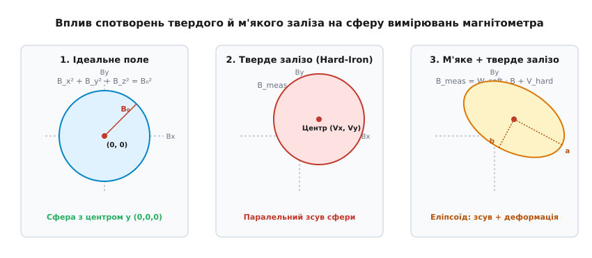
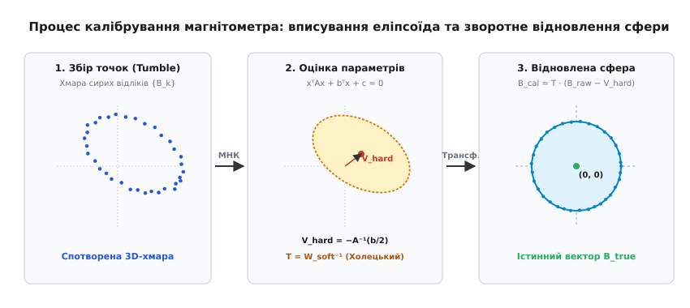
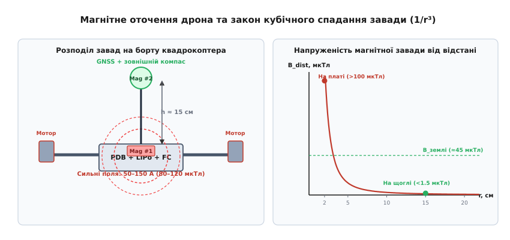

# Магнітні спотворення на борту: тверде й м'яке залізо

<preknowlist>
- [Магнітне поле: вектор індукції та напруженість](root:ph-electromagnetism/magnetic-field) — природа магнітної індукції та закони взаємодії струмів і полів.
- [Магнітне поле Землі](root:ph-electromagnetism/earth-magnetic-field) — просторова структура геомагнітного диполя, горизонтальна та вертикальна складові.
- [Магнітне схилення та інклінація](root:ph-electromagnetism/magnetic-declination) — відхилення магнітного меридіана від географічного та нахил вектора поля до горизонту.
- [Магнітометри: вимірювання магнітного поля](root:hw-sensing/magnetometer) — принципи роботи тривісних магніторезистивних сенсорів на борту.
- [Метод найменших квадратів](root:math-probability/least-squares) — мінімізація суми квадратів нев'язок при оцінюванні параметрів моделей.
- [Кватерніонне керування орієнтацією](root:sys-dron/quaternion-attitude-control) — орієнтація апарата в просторі та перетворення між зв'язаною й географічною системами координат.
</preknowlist>

Безпілотний гексакоптер вагою вісім кілограмів зависає над точкою зльоту для виконання автоматичної місії, проте за кілька секунд після переходу в режим утримання позиції починає з наростаючою швидкістю описувати спіральні кола діаметром десять–двадцять метрів — автопілот потрапляє в режим туалетного чашування (toiletbowling). Навігаційний розширений фільтр Калмана (EKF) намагається утримати координати за даними GNSS, але просторова орієнтація за курсом (yaw) розраховується з магнітометра, зміщеного на 35 мікротесла сталевими гвинтами кріплення підвісу камери та струмами силової шини. Коли дрон коригує дрейф уперед, фільтр через хибний курс дає вектор тяги зі зсувом у 25 градусів, розганяючи бічне прискорення; за 15 секунд апарат втрачає керованість і стикається з перешкодою.

Ця аварія ілюструє головну вразливість навігаційної системи безпілотника: магнітометр є єдиним бортовим датчиком, здатним визначити абсолютний азимут нерухомого апарата без накопичення інтегрального дрейфу, але він вимірює не лише поле Землі, а й сумарне магнітне поле всього апарата. Власні магнітні поля дрона — постійні магніти безколекторних моторів, динаміки, сталеве кріплення, струми в сотні ампер та феромагнітні сплави рами — спотворюють геомагнітне поле в рази, роблячи сирі покази давача абсолютно непридатними для керування.

Щоб повернути компасу точність, навігаційний стек повинен математично розділити, описати та скомпенсувати два фундаментальні класи магнітних завад: спотворення твердого заліза (Hard-Iron) та спотворення м'якого заліза (Soft-Iron).

## Геомагнітне поле та геометрія ідеального компаса

Магнітне поле Землі у кожній точці простору описується вектором магнітної індукції `B_earth`. Модуль цього вектора на поверхні планети становить від 25 до 65 мікротесла (0.25–0.65 Гауса) залежно від географічної широти: біля екватора поле слабше й спрямоване майже паралельно до горизонту, а в приполярних областях напруженість зростає, і вектор входить практично вертикально в землю.

У навігації стан вектора задається у локальній географічній системі координат NED (North, East, Down — північ, схід, низ). Вектор індукції нахилений до горизонтальної площини під кутом магнітної інклінації `I`, а його горизонтальна проекція відхилена від істинного географічного меридіана на кут магнітного схилення (деклінації) `D`. Наприклад, на території України магнітна інклінація становить близько 64°–68° (вектор спрямований переважно вниз), а горизонтальна складова становить лише 18–22 мкТл при повній напруженості поля близько 48–50 мкТл.

Тривісний магнітометр на борту вимірює проекції вектора поля на власні конструктивні осі апарата (Body Frame: X — уперед, Y — праворуч, Z — униз). Якщо дрон нахиляється за креном (roll, кут `φ`) або тангажем (pitch, кут `θ`), магнітометр реєструє суміш горизонтальної та вертикальної складових. Оскільки вертикальна складова `B_z` у помірних широтах у 2–2.5 раза перевищує корисну горизонтальну складову, будь-який ненахилений розрахунок курсу зазнає катастрофічної похибки:

```
B_x_hor = B_x · cos(θ) + B_y · sin(φ) · sin(θ) + B_z · cos(φ) · sin(θ)
B_y_hor = B_y · cos(φ) − B_z · sin(φ)
yaw_mag = atan2(−B_y_hor, B_x_hor) + D
```

Чутливість обчисленого курсу до похибки оцінки кутів нахилу описується коефіцієнтом витоку інклінації (Dip Angle Leakage): похибка в оцінці тангажу `Δθ` у 1 градус перетікає в похибку курсу `Δψ ≈ Δθ · tan(I)`. Для широти Києва (`I ≈ 66°`), `tan(66°) ≈ 2.25`, тому помилка горизонтування всього в 2 градуси викликає спотворення компаса на 4.5 градуса навіть за ідеально відкаліброваного магнітометра.

Якщо уявити ідеальний безпілотник без жодних внутрішніх завад, що обертається в чистому однорідному геомагнітному полі в усіх можливих 3D-орієнтаціях, довжина виміряного вектора залишатиметься незмінною константою:

```
B_x² + B_y² + B_z² = B₀²
```

Множина кінців усіх таких векторів вимірювань у просторі зв'язаних осей `(Bx, By, Bz)` утворює ідеальну сферу радіусом `B₀` із центром точно в початку координат `(0, 0, 0)`. Ця сфера є геометричним еталоном: будь-яке відхилення експериментальної хмари точок від центрованої сфери свідчить про наявність бортових спотворень.


*Вплив спотворень твердого й м'якого заліза на геометрію відліків тривісного магнітометра.*

## Спотворення твердого заліза: паралельний зсув вимірювальної сфери

Спотворення твердого заліза (Hard-Iron Distortion) виникають від об'єктів на борту апарата, які мають власну залишкову намагніченість і створюють постійне магнітне поле, жорстко прив'язане до конструкції дрона.

Основними джерелами твердого заліза є:
- Постійні магніти роторів безколекторних електродвигунів (висококоерцитивні сплави NdFeB створюють локальні поля в сотні мікротесла);
- Акустичні випромінювачі (бузери та пищалки системи сигналізації), магнітна система яких не екранована;
- Сталеві елементи кріплення: гвинти, гайки, підшипники та пружини підвісу камери, намагнічені під час механічної обробки або контакту з намагніченими викрутками;
- Постійні струми споживання базової електроніки (відеопередавач, обчислювальний модуль, плата живлення), що формують статичну заваду.

Оскільки ці джерела закріплені на рамі нерухомо відносно сенсора, їхнє сумарне магнітне поле утворює постійний адитивний вектор `V_hard = (Vx, Vy, Vz)ᵀ`. Незалежно від того, як дрон обертається у просторі, цей вектор додається до виміряного зовнішнього поля:

```
B_meas = B_true + V_hard
```

Геометричний наслідок адитивного зсуву очевидний: уся сфера вимірювань зміщується як єдине тверде тіло з точки `(0, 0, 0)` у точку `(Vx, Vy, Vz)`. При цьому форма поверхні залишається строго сферичною, а її радіус не змінюється.

Проте вплив цього зсуву на навігацію є руйнівним. Якщо вектор твердого заліза становить, наприклад, `Vx = +25 мкТл` (що перевищує горизонтальну складову поля Землі), то при повороті носа апарата на схід або захід проекція `B_x_hor` ніколи не набуде від'ємного значення. Обчислений за формулою `atan2` курс виявиться затиснутим у вузькому секторі, а похибка визначення азимута матиме вигляд одноперіодної гармонійної хвилі на 360° оберту з амплітудою в десятки градусів.

## Спотворення м'якого заліза: перетворення сфери на еліпсоїд

Спотворення м'якого заліза (Soft-Iron Distortion) спричиняються матеріалами з високою магнітною проникністю, які самі по собі не мають власної залишкової намагніченості, але намагнічуються під дією зовнішнього геомагнітного поля.

До м'якого заліза на борту безпілотника належать:
- Феромагнітна та низьковуглецева сталь силових елементів рами, напрямних і стійок;
- Нікелеві пластини контактного зварювання акумуляторних елементів LiPo / Li-ion;
- Феритові сердечники індуктивностей імпульсних стабілізаторів напруги (DC-DC регуляторів);
- Металеві екрани високочастотних радіомодулів (RF-Shields) приймача та модема телеметрії;
- Масивні алюмінієві радіатори та струмопровідні мідні шини друкованих плат, що спотворюють просторовий розподіл силових ліній.

Коли зовнішнє поле `B_true` пронизує такий матеріал, всередині нього наводиться вторинне поле, пропорційне зовнішньому: `B_ind = χ · B_true`, де `χ` — тензор магнітної сприйнятливості. Оскільки геометрія металевих деталей навколо датчика несиметрична (наприклад, довга пластина акумулятора розташована знизу, а моторні промені розходяться під кутами), поле підсилюється вздовж одних осей і послаблюється вздовж інших, а силові лінії зазнають просторового викривлення.

Математично цей ефект описується матрицею м'якого заліза `W_soft` розміром 3×3:

```
W_soft = [ w_xx  w_xy  w_xz ]
         [ w_yx  w_yy  w_yz ]
         [ w_zx  w_zy  w_zz ]
```

Діагональні елементи `(w_xx, w_yy, w_zz)` відповідають за масштабування чутливості за окремими осями, а недіагональні елементи описують перехресний перекіс осей (cross-axis coupling), коли поле вздовж осі X створює відгук на осі Y або Z.

Під дією матриці `W_soft` ідеальна сфера деформується: масштабування перетворює її на еліпсоїд, а недіагональні зв'язки розвертають головні осі цього еліпсоїда у просторі під довільними кутами відносно осей сенсора. Додатковий внесок у матрицю `W_soft` роблять і власні похибки кристала магнітометра — неортогональність вимірювальних мостів сенсора на кремнієвій пластині та технологічний розкид коефіцієнтів підсилення АЦП.

Об'єднуючи дію твердого й м'якого заліза, отримуємо повну модель вимірювань тривісного магнітометра на борту:

```
B_meas = W_soft · B_true + V_hard + η
```

де `η` — вектор високочастотного білого шуму вимірювань. Завдання калібрування полягає в знаходженні невідомих компонентів вектора `V_hard` (3 параметри) та матриці `W_soft` (6 незалежних параметрів симетричної квадрики), щоб під час польоту в реальному часі обчислювати істинний вектор поля:

```
B_true = W_soft⁻¹ · (B_meas − V_hard)
```

## Алгебраїчне вписування еліпсоїда (Ellipsoid Fitting)

Щоб знайти 9 невідомих параметрів спотворення, дрон переводять у режим калібрування компаса та повільно обертають навколо всіх трьох просторових осей (так званий «танець компаса», compass dance). Сенсор фіксує масив виміряних векторів `(x_i, y_i, z_i)`, які утворюють хмару точок на поверхні спотвореного тривісного еліпсоїда.

Будь-який тривимірний еліпсоїд задається алгебраїчним рівнянням поверхні другого порядку (квадрики):

```
a·x² + b·y² + c·z² + 2·d·x·y + 2·e·x·z + 2·f·y·z + 2·g·x + 2·h·y + 2·k·z + j = 0
```

У матричній формі це рівняння має вигляд:

```
xᵀ · A · x + 2 · b_vecᵀ · x + j = 0
```

де симетрична матриця `A` описує форму та орієнтацію еліпсоїда, а вектор `b_vec = (g, h, k)ᵀ` визначає його просторове зміщення.


*Конвеєр відновлення геомагнітної сфери методом вписування тривимірного еліпсоїда.*

Для знаходження коефіцієнтів квадрики застосовують метод найменших квадратів. Для усунення невизначеності масштабу рівняння фіксують вільний член `j = −1`. Тоді для кожного виміряного вектора `(x_i, y_i, z_i)` формується рядок матриці базисних функцій `H_i`:

```
H_i = [ x_i²,  y_i²,  z_i²,  x_i·y_i,  x_i·z_i,  y_i·z_i,  x_i,  y_i,  z_i ]
```

Система рівнянь зводиться до лінійної форми `H · p ≈ 1_vec`, де `p` — 9-вимірний вектор шуканих алгебраїчних коефіцієнтів. Розв'язок за нормальними рівняннями Гаусса дає оптимальні коефіцієнти:

```
p = (Hᵀ · H)⁻¹ · Hᵀ · 1_vec
```

Отримавши вектор `p`, відновлюють фізичні та геометричні параметри калібрування:
1. **Вектор твердого заліза `V_hard`** (геометричний центр еліпсоїда):
   Обчислюється як точка екстремуму квадрики: `V_hard = −A⁻¹ · b_vec`.
2. **Масштабована матриця форми `M`**:
   Значення рівняння в центрі дає масштабний множник `scale = V_hardᵀ · A · V_hard + 1`, звідки нормована матриця форми еліпсоїда дорівнює `M = A / scale`.
3. **Матриця компенсації м'якого заліза `T = W_soft⁻¹`**:
   Матриця `M` є симетричною і додатно визначеною, тому за допомогою розкладу Холецького `M = L · Lᵀ` або спектрального розкладу знаходять перетворення, що стискає головні півосі еліпсоїда та розвертає їх назад у сферичну оболонку радіусом `B₀`:
   `T = B₀ · Lᵀ`.

Повне матричне виведення системи рівнянь, розкладу форми та геометричних співвідношень наведено у [математичному виведенні вписування еліпсоїда](root:sys-dron/mahnitni-spotvorennia-na-bortu/math-ellipsoid-fit.md).

## Алгоритм калібрування на борту мікроконтролера

Реалізація вписування еліпсоїда на вбудованому мікроконтролері автопілота вимагає подолання двох апаратних обмежень: обмеженого обсягу оперативної пам'яті RAM та нерівномірності ручного обертання дрона.

Якщо пілот обертає апарат у руках, він природно затримується в положеннях, зручних для утримання (наприклад, горизонтально чи вертикально), генеруючи сотні надлишкових точок в одних секторах і залишаючи порожніми інші. Якщо подати таку незбалансовану вибірку в алгоритм найменших квадратів, оцінка параметрів деформується у бік перенасичених ділянок, а матриця `Hᵀ·H` може стати погано обумовленою.

Для вирішення цієї проблеми польотні стеки застосовують три ключові механізми:
1. **Просторове розбиття на сектори (Sphere Binning):** сфера ділиться за азимутом (12 секторів по 30°) та місцем (6 секторів по 30°), утворюючи 72 просторові комірки (біни). Нова точка записується в накопичувач лише тоді, коли лічильник відповідної комірки не перевищив встановлений ліміт (наприклад, 5 точок на бін). Це гарантує рівномірне просторове покриття.
2. **Потокова акумуляція нормальних рівнянь:** матриця `Hᵀ·H` розміром 9×9 та вектор `Hᵀ·1` оновлюються на льоту при додаванні кожного прийнятого вимірювання. Бортовому контролеру не потрібно зберігати в пам'яті вихідний масив із 500–2000 точок — стан калібратора займає менше 1 Кбайт RAM.
3. **Контроль якості вибірки (Fitness & Condition Check):** калібрування вважається валідним лише за умови, що заповнено не менше 40–50% просторових секторів, матриця форми `A` має додатний детермінант, а відношення максимальної півосі еліпсоїда до мінімальної не перевищує допустимого порогу (зазвичай 1.5–2.5).

Нижче наведено робочу реалізацію бортового калібратора мовами C та C++, яка реалізує бінування, акумуляцію МНК, розв'язання системи лінійних рівнянь методом Гаусса з вибором головного елемента та швидке застосування корекції. Повна модульна архітектура з тестами доступна у [практичній реалізації бортового калібратора](root:sys-dron/mahnitni-spotvorennia-na-bortu/proj-mag-calibration.md).

:::tabs
:::code mahnitni-spotvorennia-na-bortu-d/c/main.c
:::code mahnitni-spotvorennia-na-bortu-d/cpp/main.cpp
:::

## Динамічні завади від струмів живлення та компенсація дроселювання

Описане статичне калібрування твердого й м'якого заліза компенсує лише статичне магнітне поле рами. Проте під час реального польоту через силові дроти від акумулятора до регуляторів швидкості (ESC) протікають струми від 20 до 200 ампер.

За законом Біо-Савара-Лапласа кожен провідник зі струмом породжує магнітне поле, напруженість якого пропорційна силі струму:

```
B_curr = K_current · I_batt
```

Коли пілот дає повний газ (full throttle), силове поле в центрі рами сягає 40–100 мкТл, що повністю перекриває геомагнітне поле Землі. Компас починає «повертатися» разом зі збільшенням обертів двигунів, викликаючи раптове закручування дрона за курсом.

Для усунення цієї динамічної завади застосовують два рівні захисту:
1. **Калібрування струмової компенсації (Compassmot / Throttle-Compass Calibration):** дрон жорстко фіксують на землі зі знятими пропелерами або під навантаженням, плавно піднімають оберти двигунів від 0 до 100% і записують синхронні відліки датчика струму `I_batt` та магнітометра. Лінійна регресія визначає 3D-вектор коефіцієнтів `K_current = (Kx, Ky, Kz)ᵀ`. У польоті від виміряного вектора віднімають динамічну поправку:
   `B_corrected = B_calibrated − K_current · I_batt`.
2. **Геометричне винесення давача на щоглу (GNSS Mast):** напруженість магнітного поля диполя спадає обернено пропорційно кубу відстані `B(r) ∝ 1 / r³`. Якщо всередині корпусу на відстані 2 см від силової плати PDB завада становить 120 мкТл, то підняття комбінованого модуля GNSS/магнітометр на щоглу висотою 15 см зменшує амплітуду завади у понад 400 разів — до величини менше 0.3 мкТл, що нижче рівня природного шуму сенсора.


*Розподіл магнітних завад на борту дрона та ефективність просторового винесення компаса.*

Додатково силові дроти від акумулятора до регуляторів ESC скручують у виті пари (Twisted Pairs): оскільки струми у прямому та зворотному проводах рівні за величиною та протилежні за напрямком, створювані ними магнітні поля взаємно компенсуються на відстані вже кількох сантиметрів.

## Діагностика, консистенція та обробка аномалій у польотному стеку

У сучасних автопілотах на базі PX4 (модуль EKF2) та ArduPilot (модуль EKF3) магнітометр не використовується «всліпу». Навігаційний фільтр постійно зіставляє вектор магнітної індукції з поточною моделлю геомагнітного поля WMM (World Magnetic Model), завантаженою в пам'ять автопілота за поточними GNSS-координатами.

Фільтр контролює такі ключові метрики:
- **Магнітна інновація (Mag Innovation):** різниця між вектором, передбаченим фільтром на основі гіроскопів та орієнтації, і фактично виміряним вектором `B_calibrated`.
- **Тест консистенції довжини вектора:** модуль виміряного вектора порівнюється з табличною напруженістю `B₀` для даної точки Землі. Якщо розбіжність перевищує поріг (наприклад, понад 15–25%), дрон фіксує магнітну аномалію.
- **Мульти-компасний консенсус:** якщо на борту встановлено два або три магнітометри (один зовнішній на щоглі та два внутрішні на платі), автопілот порівнює їхні покази. Якщо основний компас розходиться з резервними більш ніж на 15–20 градусів, виконується автоматичне безшовне перемикання на резервний датчик.

При прольоті поруч із залізобетонними спорудами, сталевими мостами чи дахами ангарів EKF тимчасово блокує злиття даних магнітометра (Mag Fusion Timeout) і переходить на утримання курсу за інтегруванням кутових швидкостей гіроскопа та вектором шляхової швидкості GNSS (Course-over-Ground). Якщо аномалія триває довго або компас повністю відмовляє, автопілот ініціює аварійне скидання курсу (Yaw Reset) та переводить апарат у безпечний режим утримання горизонту або автоматичного повернення додому за координатами супутників без використання магнітометра.
