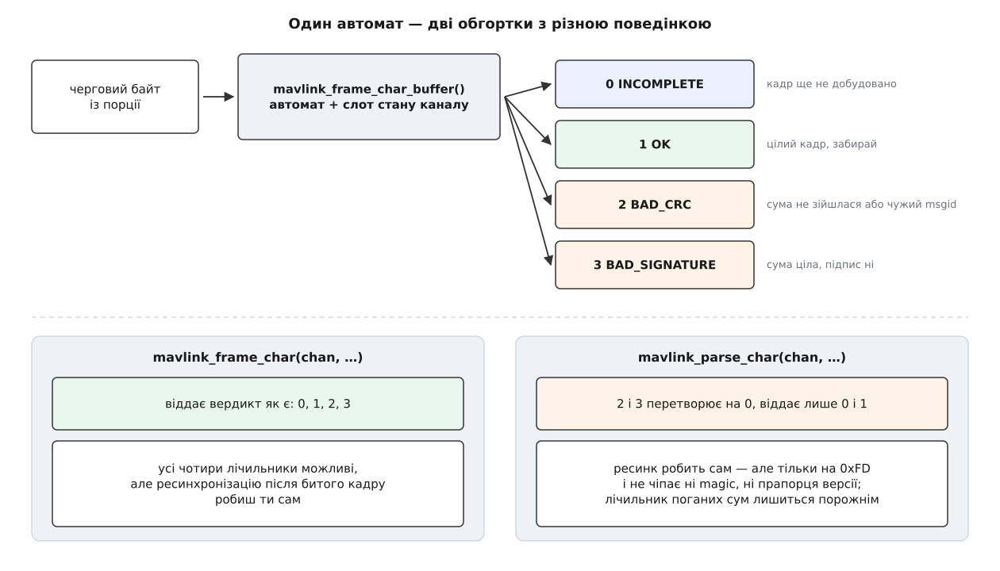

# ⚙️ Розбирач MAVLink на одному каналі: рвані порції, чотири вердикти, дірки в нумерації

Це приймальна частина наземної станції, зведена до сторінки коду на C: усередину заходять байти такими порціями, якими їх віддає операційна система, а назовні виходять цілі повідомлення, чесний лічильник кожного з чотирьох вердиктів розбирача й оцінка того, скільки кадрів не долетіло. Писати її доводиться руками — і не тому, що бібліотеки MAVLink мало, а тому, що дві найзручніші її функції роблять не зовсім те, чого від них чекають.

## Задача

Приймач має витримати потік, який ніхто не подавав йому охайно. Порція байтів із порту не збігається з кадром: у ній буває пів кадру, два з половиною кадри або жодного цілого. Перед першим кадром лежить сміття — залишок чужого протоколу, шум від увімкнення живлення, недописаний рядок завантажувача. Десь у потоці трапиться кадр із перевернутим бітом. Десь — кадр із номером повідомлення, якого в цій збірці немає. І десь на тій самій лінії з'явиться підписаний трафік.

Отже, від коду треба чотири речі:

1. **Прийняти байти будь-якими порціями** й не втратити недозібраний кадр між викликами.
2. **Порахувати всі чотири вердикти** розбирача — незавершено, цілий кадр, погана сума, поганий підпис — щоб було з чого діагностувати лінію.
3. **Оцінити втрати** за дірками в номерах послідовності, окремо для кожного відправника.
4. **Не завалитися**, коли слоти каналів скінчилися або коли слот дістався у спадок від попереднього з'єднання.

Перше з цього бібліотека дає задарма. Друге й третє — ні, і саме це робить приклад цікавим.

## Чому звичний цикл не покаже чотирьох вердиктів

Документація радить очевидне: годувати байти функції `mavlink_parse_char` і чекати на одиницю. Функція справді робить те, що обіцяє інтерфейс [інкрементного розбирача](root:com-protocol/stream-parser) — тримає стан між викликами й приймає потік побайтово. Але подивімося, що вона повертає насправді:

:::code proj-parse-channel/c/chomu-zvychnyi-tsykl-ne.c

Два з чотирьох вердиктів вона перетворює на нуль. Лічильник `BAD_CRC` за таким циклом завжди лишиться порожнім — не тому, що лінія чиста, а тому, що погані кадри порахувати нічим. Її власна документація каже про це прямо: «returns 0 if no message could be decoded or bad CRC».

Натомість функція робить корисну роботу, яку легко проґавити: **ресинхронізацію**. Байт, на якому кадр завалився, — це остання половина контрольної суми. Якщо в ефірі саме там стояв стартовий байт нового кадру, то без цього `if (c == MAVLINK_STX)` цей кадр був би з'їдений разом із попереднім.

Тобто вибір такий: або чотири вердикти без ресинку, або ресинк без вердиктів. Отримати обидва можна лише одним способом — узяти нижчу функцію `mavlink_frame_char`, яка віддає вердикт як є, і зробити ресинк самому.



*Автомат усередині завжди той самий; різниця — лише в тому, що обгортка робить із двома «поганими» вердиктами.*

Ресинк, до речі, варто зробити краще за оригінал. Бібліотечний варіант ставить фазу `GOT_STX`, але не чіпає ні поля `magic`, ні прапорця `MAVLINK_STATUS_FLAG_IN_MAVLINK1` — а саме за цим прапорцем автомат вирішує, чи читати після довжини два байти прапорців несумісності. Кадр, що почався з відновлення, розбереться у версії **попереднього** кадру. У чистому потоці однієї версії цього не видно; у змішаному — це готова пастка. І байт `0xFE`, тобто старт кадру версії 1, оригінальний ресинк не впізнає взагалі.

## Чому втрати теж доводиться рахувати самому

Друга спокуса — повірити полю `packet_rx_drop_count` у структурі стану: назва обіцяє рівно те, що треба. Ось що в нього кладуть насправді, наприкінці кожного виклику розбирача:

```c
if (r_mavlink_status != NULL) {
    r_mavlink_status->parse_state = status->parse_state;
    r_mavlink_status->packet_idx = status->packet_idx;
    r_mavlink_status->current_rx_seq = status->current_rx_seq+1;
    r_mavlink_status->packet_rx_success_count = status->packet_rx_success_count;
    r_mavlink_status->packet_rx_drop_count = status->parse_error;
}
status->parse_error = 0;
```

У поле «загублених пакетів» копіюють `parse_error` — кількість **помилок розбору**, та ще й обнулювану після кожного байта. А код, який справді рахував би дірки в нумерації, у бібліотеці є, і він закоментований:

```c
if (status->msg_received == MAVLINK_FRAMING_OK)
{
    //while(status->current_seq != rxmsg->seq)
    //{
    //	status->packet_rx_drop_count++;
    //               status->current_seq++;
    //}
    status->current_rx_seq = rxmsg->seq;
```

Причина, чому його вимкнули, видна з самого рядка: `status` — один на канал, а відправників у каналі багато. Автопілот, камера й підвіс нумерують свої повідомлення незалежно, тож єдиний лічильник на канал показував би суцільні розриви там, де все ціле. Правильна одиниця обліку — трійка «канал, система, компонент», і вести її може лише той, хто розбирає, а не бібліотека.

## Слот каналу: узяти, скинути, повернути

Перший аргумент `mavlink_frame_char` — не з'єднання, а індекс у глобальних масивах бібліотеки. Тому облік ведемо руками, бітовою маскою:

:::code proj-parse-channel/c/rxdemo.c

Чотири присвоєння після `mavlink_reset_channel_status` — не перестраховка. Ця функція робить рівно одну дію: `status->parse_state = MAVLINK_PARSE_STATE_IDLE`. Прапорці версії, лічильник вихідних номерів і — найнебезпечніше — покажчик на структуру [підпису](root:sys-dron/mavlink-v2-signing) (ключ і мітки часу, якими автентифікують кадри) лишаються від попереднього з'єднання. Слот, який колись обслуговував підписаний канал, віддасть новому з'єднанню покажчик на давно звільнену пам'ять.

> 🔧 **Навіщо це.** Маска зайнятих слотів — це не бухгалтерія заради бухгалтерії, а єдина межа, що відділяє програму від тихого псування даних. Два потоки байтів на одному номері складуть свої недокадри в один буфер; результат буде не помилкою, а мовчазним сміттям із правильною сумою в рідкісних випадках і зниклими кадрами в решті.

## Стан приймача

Усе, що приймач пам'ятає понад те, що пам'ятає бібліотека:

:::code proj-parse-channel/c/stan-pryimacha.c

Масив `verdict` індексується самим вердиктом — значення `mavlink_framing_t` це рівно 0…3, тож жодного `switch` для підрахунку не треба.

## Ресинк після битого кадру

:::code proj-parse-channel/c/resynk-pislia-bytoho-kadru.c

Порівняно з бібліотечним ресинком тут з'явилися три рядки: `magic`, прапорець версії й впізнавання старого стартового байта. Кожен закриває свій випадок — і жоден не з'явився б, якби вердикт `BAD_CRC` не був видимий.

## Облік дірок у нумерації

:::code proj-parse-channel/c/oblik-dirok-u-numeratsii.c

Три рядки тут виглядають простішими, ніж вони є.

**Перша зустріч.** Станція під'єдналася посеред польоту й побачила номер 137. Це не сто тридцять сім загублених кадрів, а перше, що вона почула. Тому новий відправник заводиться з `last_seq = msg->seq` і нулем втрат.

**Дубль.** Той самий кадр цілком може прийти двічі — два маршрути, увімкнене пересилання, повтор у мережі. Без явної перевірки на рівність різниця дала б нуль і не зашкодила б, але наступний крок оновив би `last_seq` тим самим числом; перевірка робить намір видимим.

**Різниця за модулем 256.** Обидва вирази спираються на те, що арифметика тут циклічна: `s->last_seq + 1` після 255 дає 0, а `msg->seq - expected` після переходу через межу дає правильну відстань. Працює це через приведення до `uint8_t`: операнди спершу підвищуються до `int` за правилами [цілочислової промоції](root:sf-lang/integer-promotion) — тобто дрібніші за `int` типи в арифметиці автоматично стають `int`, — віднімання відбувається у знаковому типі, а зворотне приведення бере результат за модулем 256. Це той самий механізм, який у необережному коді дає [беззнакове переповнення](root:sf-lang/unsigned-overflow), а тут працює на нас.

```
last_seq = 251, прийшов seq = 254
expected = (uint8_t)(251 + 1) = 252
lost    += (uint8_t)(254 − 252) = 2

last_seq = 254, прийшов seq = 1        (253, 254 → 255, 0, 1)
expected = (uint8_t)(254 + 1) = 255
lost    += (uint8_t)(1 − 255) = (uint8_t)(−254) = 2
```

Сліпа пляма методу теж видно з арифметики: рівно 256 загублених кадрів дадуть різницю 0, а 300 виглядатимуть як 44. На реальних частотах телеметрії такий провал — це секунди повної тиші, які видно й без лічильника.

## Цикл по байтах

:::code proj-parse-channel/c/tsykl-po-baitakh.c

Гілка `BAD_CRC` варта окремого слова. Контрольна сума MAVLink рахується не лише по байтах кадру: у неї домішується `CRC_EXTRA` — байт, обчислений з опису самого повідомлення. Розбирач бере цей байт із таблиці, згенерованої при збірці; для невідомого номера запису немає, і кадр іде тим самим шляхом, що й пошкоджений. Але заголовок на той момент уже розібрано, і `msg.msgid` заповнено — отже, повторний пошук у тій самій таблиці відрізняє «шум в ефірі» від «повідомлення, якого немає в моїй збірці». Ознака евристична: у справді зіпсованому кадрі байти номера теж можуть випадково скластися у відомий номер. Але сотня однакових невідомих номерів у лічильнику — це вже не збіг, а діагноз.

## Стенд: рвані порції, сміття, чужий діалект

Щоб числа на виході можна було перевірити руками, потік складаємо самі — з кадрів, зібраних тією ж бібліотекою.

:::code proj-parse-channel/c/stend-rvani-portsii.c

Кодувальник теж бере слот каналу — з нього він читає лічильник вихідних номерів. Тому автопілот і камера в стенді дістають **різні** передавальні слоти: інакше два незалежні відправники нумерували б повідомлення з одного лічильника, і жодних дірок у нумерації не було б видно.

:::code proj-parse-channel/c/stend-rvani-portsii-2.c

Два місця в стенді зроблено навмисно, і обидва варті пояснення.

**Затерта сума, а не перевернутий байт навантаження.** Обидва способи дадуть `BAD_CRC`, але в першому випадку останній байт кадру відомий — нуль. Якби ми зіпсували навантаження, останнім байтом лишилася б справжня контрольна сума, і з імовірністю один до двохсот п'ятдесяти шести вона виявилася б стартовим байтом `0xFD`. Тоді ресинк почав би новий кадр, і наступна порція розібралася б інакше. Стенд, у якому таке можливе, не дає відтворюваних чисел — а в ефірі це трапляється постійно, і саме тому ресинк потрібен.

**Порожній ключ підпису.** Перевірка підпису тут не спрацює — ми годуємо каналові **непідписаний** кадр. У бібліотеці це окремий шлях: якщо на каналі ввімкнено підпис і немає зворотного виклику, що дозволяє непідписані повідомлення, то цілий кадр із правильною сумою все одно отримує вердикт `BAD_SIGNATURE`. Це найкоротший спосіб побачити четверте значення, і водночас найчастіша причина, з якої канал раптом «замовкає» після ввімкнення підпису.

## Що друкує програма

```
INCOMPLETE      118
OK              3
BAD_CRC         2
BAD_SIGNATURE   1
цілих кадрів    3
дірок у номерах 2
чужий діалект   1
відправників    2
```

Кожне число перевіряється арифметикою. Кадр `HEARTBEAT` у версії 2 має 21 байт: 10 заголовка, 9 навантаження, 2 суми. Через приймач пройшло 3 + 8 + 39 + 37 + 16 + 21 = 124 байти. Термінальний вердикт віддає рівно останній байт кожного кадру, і таких кадрів шість: три цілі, два з поганою сумою, один із поганим підписом. Отже, незавершених вердиктів 124 − 6 = 118.

Дірок у нумерації дві: автопілот дав `seq` 0, потім 3 — кадри 1 і 2 ми просто не подали в приймач. Кадр `seq 4` не порахувався, бо не пройшов суму, а `seq 5` — бо не пройшов підпис; обидва вибувають до обліку, і це правильно: втрачений кадр і відкинутий кадр — різні речі. Камера дала свій єдиний кадр із номером 0 — перша зустріч, нуль втрат. Відправників у таблиці двоє, хоч система в них одна: ключем є пара «система, компонент».

Останнє число варте окремої уваги. Коли ключ підпису нарешті підбереться й кадри почнуть проходити, історія нумерації стане брехливою: доки станція відкидала підписаний трафік, у номерах утворилася діра розміром у все відкинуте. Лікується це одним рядком:

```c
static void rx_forget_senders(rx_t *rx) { rx->senders = 0; }
```

Порожня таблиця повертає кожного відправника в стан «перша зустріч», і наступний його кадр задасть початок відліку замість фальшивого провалу зв'язку.

## Скільки це коштує

```
на один байт        O(1): один switch, ні циклів, ні виділення пам'яті

стан на канал       mavlink_message_t + mavlink_status_t
                    навантаження: (255 + 2 + 7) / 8 = 33 слова по 8 байтів = 264 Б
                    разом трохи більше за 300 Б

усі слоти           16 × ≈300 Б ≈ 5 КіБ статичної пам'яті, живої весь час роботи
                    (на не-настільних системах слотів 4, отже ≈1.2 КіБ)

таблиця відправників, лінійний перебір по 16
                    16 × 3 Б = 48 Б на канал, до 16 порівнянь на кадр

повна матриця [sysid][compid], як її веде станція
                    256 × 256 = 64 КіБ на канал, × 16 каналів = 1 МіБ
```

Останні два рядки — справжній компроміс, а не мікрооптимізація. Матриця дає доступ за одне звертання й не має стелі на кількість відправників; лінійний перебір коштує в шістнадцять разів більше порівнянь на кадр, зате вміщається в кеш і не забирає мегабайт. На каналі, де живуть автопілот, камера й підвіс, перебір виграє з великим запасом; на маршрутизаторі, крізь який ідуть десятки апаратів, — навпаки. Межа приблизно там, де кількість відправників перестає вміщатися в одну лінію кеша.

## Пастки

**Розбір одного каналу з двох ниток.** Бібліотека потокобезпечна рівно в межах каналу: два виклики `mavlink_frame_char` з тим самим номером із різних ниток пишуть у той самий `packet_idx` і той самий буфер кадру. Наслідок — не збій, а мовчазне псування: недокадри складуться в один. [Потокобезпечність](root:sf-tasks/thread-safety) тут забезпечує не бібліотека, а домовленість «один слот — одна нитка», і тримати її мусить той, хто роздає слоти.

**Один канал — одна одиниця трансляції.** Масиви стану лежать усередині функцій `mavlink_get_channel_status` і `mavlink_get_channel_buffer`, а самі ці функції за замовчуванням оголошені як `static inline`. Ключове слово `static` перед функцією дає їй внутрішнє зв'язування — тобто кожен `.c`-файл дістає **власну** копію функції разом із її статичними масивами ([одиниця трансляції та зв'язування](root:sf-lang/translation-unit)). Розбирати канал 0 у двох різних файлах — це розбирати два різні канали, які випадково однаково називаються. Лікується визначенням `MAVLINK_SEPARATE_HELPERS` і окремою компіляцією помічників.

**Невідомий msgid — це «погана сума».** Повідомлення, якого немає в збірці, не існує для станції ані як попередження, ані як запис у журналі: лічильник поганих сум трохи підріс, і все. Своє повідомлення в окремому [діалекті](root:sys-dron/mavlink-dialect) — теж описі полів, з якого генерують код і таблицю сум — станція мовчки викидатиме, доки ви не зберете її з цим діалектом. Перевірка `mavlink_get_msg_entry(msg.msgid) == NULL` у гілці `BAD_CRC` перетворює цю тишу на діагноз.

**Забутий скид слота.** `mavlink_reset_channel_status` скидає фазу автомата — і більше нічого. Слот, узятий повторно без ручного очищення, приносить із собою прапорці версії попереднього з'єднання, чужий лічильник вихідних номерів і покажчик на структуру підпису, якої вже може не бути в пам'яті. Половина кадру, що лишилася в буфері від померлого з'єднання, доклеїться до перших байтів нового.

**Слоти скінчилися.** `mavlink_get_channel_status` не перевіряє межі: `m_mavlink_status[chan]` для `chan = 0xFF` — це звичайний вихід за межі масиву, тобто [невизначена поведінка](root:sf-lang/undefined-behavior), яка зіпсує сусідні дані й проявиться десь зовсім в іншому місці. Значення «немає слотів» треба перевірити там, де його повернули, а не там, де воно нашкодить. Шістнадцять слотів на настільних системах і чотири на решті — це жорстка стеля одночасних з'єднань, а не порада; після кількох перепідключень без `channel_give` вона вичерпається.

**Порція, що не має нічого спільного з кадром.** Це не пастка коду, а пастка мислення: спокуса написати «прочитав — розібрав кадр» повертається щоразу, коли на столі лінія чиста й читання випадково збігаються з кадрами. У повітрі не збігаються ніколи. Перевірити це можна одним рядком — подавати стенд не порціями, а по одному байту за виклик: жоден лічильник не має змінитися.
