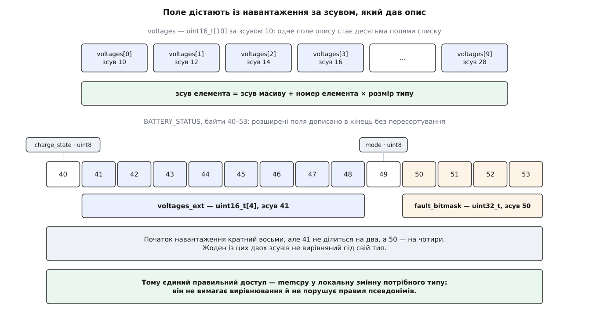
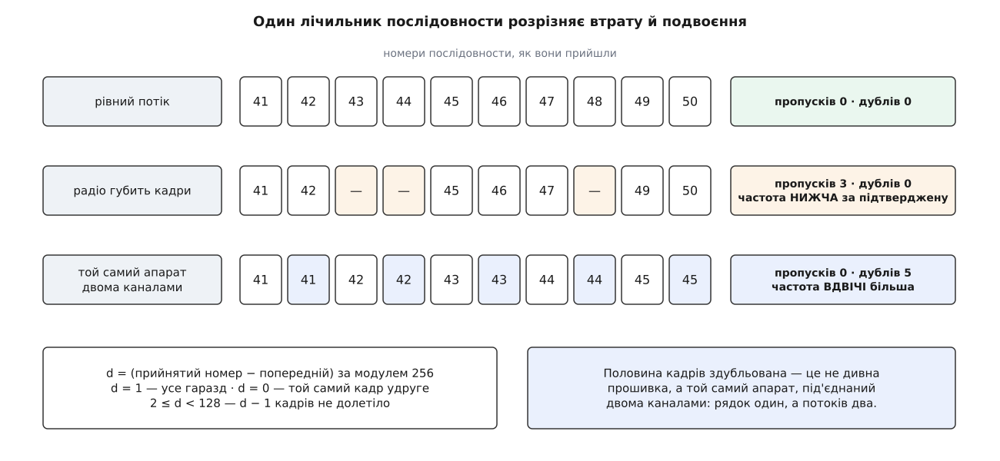

# ⚙️ `mavtap`: спостерігач за потоком MAVLink, зібраний з нуля

Це чотириста рядків, які підключаються до потоку MAVLink і тримають живу таблицю: що прилітає, від кого, як часто і що всередині. Жодного рядка, присвяченого конкретному повідомленню, у них немає — програма нічого не знає ні про батареї, ні про положення, ні про регулятори обертів, і саме тому працює на будь-якому діалекті, зокрема на вашому власному.

## Задача

Програма командного рядка з одним джерелом байтів і трьома роботами:

```
mavtap --udp 14550 --select BATTERY_STATUS[0]
mavtap --tlog flight.tlog --log ATTITUDE.roll
```

1. **Таблиця рядків.** Кожне окреме джерело значень — свій рядок: назва повідомлення, компонент, лічильник кадрів, оцінка частоти.
2. **Поля вибраного рядка** — розкладені з навантаження за описом повідомлення, з розгорнутими масивами.
3. **Запис одного поля в CSV** — щоб потім побудувати криву чим завгодно.
4. **Файл телеметрії читається так само, як живий канал** — та сама таблиця, ті самі числа, незалежно від того, за скільки прочитався файл.

Чого програма не робить: не тлумачить змісту. Вона не знає, що `BATTERY_STATUS.voltages` — це напруги в мілівольтах, і не переводить їх у вольти. Усе, що вона вміє, — правильно дістати з байтів число потрібного типу. Ця відмова від тлумачення і є сенсом такого інструмента: показане ним не може виявитися помилкою обробника, бо обробника немає.

## Шов: розібраний кадр і більше нічого

Уся програма висить на одному виклику:

```cpp
void onMessage(const mavlink_message_t& m, uint64_t tUsec);
```

Байти в кадри складає [інкрементний розбирач](root:com-protocol/stream-parser) бібліотеки — автомат, який їсть потік по байту, тримає стан на канал і повертає одиницю рівно тоді, коли зібрав цілий кадр і звірив контрольну суму. Усе, що не зійшлося, до `onMessage` не доходить узагалі: погана сума, невідомий номер повідомлення, чужа версія протоколу.

Джерел два, і обидва зводяться до годування того самого автомата:

```cpp
for (ssize_t i = 0; i < n; ++i)
    if (mavlink_parse_char(kChannel, buf[i], &msg, &st)) onMessage(msg, tUsec);
```

Файл телеметрії проходить крізь той самий автомат — не тому, що інакше не вийшло б (межі кадрів у ньому відомі точно), а тому, що це робить два режими справді однаковими. Розбирач дає не лише перевірку суми: він **дописує нулі в хвіст навантаження**. Це важить більше, ніж здається. Версія 2 протоколу зобов'язана обрізати нульові байти в кінці навантаження перед надсиланням, тож у кадрі фізично може не бути останніх полів. Розбирач, знайшовши в таблиці свого діалекту повну довжину цього повідомлення, заповнює нулями все, що не долетіло, — і подальший код може читати будь-яке поле, не питаючи, чи воно взагалі було в кадрі. Кадр, зібраний руками в обхід розбирача, такої гарантії не має, і читання «зайвого» поля дало б залишки попереднього повідомлення в тому самому буфері.

Сам формат файлу телеметрії простий — вісім байтів часу, за ними кадр як прийшов, — але має досить своїх особливостей, щоб їх розбирати окремо: порядок байтів мітки у файлі не записаний, довжини запису теж немає. Тут узято найпростіше прочитання; повний [читач логу з перемотуванням](root:sys-dron/telemetry-logging/proj-tlog-reader.md) розібрано окремо.

Ще одна дрібниця, без якої не збереться взагалі нічого:

```cpp
#define MAVLINK_USE_MESSAGE_INFO   // ДО #include <common/mavlink.h>
```

Таблиці опису повідомлень — необов'язкова частина згенерованих заголовків. Без цього визначення функції `mavlink_get_message_info` просто не існує, а разом із нею немає й усієї програми.

## Ключ рядка: третя частина — дані, а не код

Один кадр — не одне джерело значень. Автопілот, підвіс і камера мають спільний ідентифікатор системи й різні ідентифікатори компонента; ба більше, один компонент шле те саме повідомлення про різні речі — окремо про кожну батарею, окремо про кожну четвірку регуляторів, а `NAMED_VALUE_FLOAT` узагалі є контейнером «ім'я — число», у якому за одним номером ходять десятки величин. Тому ключ рядка — трійка: номер повідомлення, компонент і значення розрізняльного поля.

Перші дві частини лежать [прямо в заголовку кадру](root:sys-dron/mavlink-packet) — ідентифікатори системи, компонента, номер повідомлення і порядковий номер відправника. Третю треба звідкись узяти, і тут є розвилка. Можна зашити в код перелік «повідомлення 147 розрізняти за полем `id`» — і щоразу перезбирати програму, коли в діалекті з'явиться щось нове. А можна зробити цей перелік **даними**:

```cpp
static std::unordered_map<uint32_t, unsigned> g_instField;   // msgid → номер поля

static bool addInstanceRule(const char* msgName, const char* fieldName, bool quiet = false);
```

Правило задається парою імен — `--instance BATTERY_STATUS=id` — і розв'язується на старті: бібліотека знаходить опис повідомлення за назвою, програма шукає в ньому поле за назвою й запам'ятовує **номер поля**, щоб у гарячому шляху не порівнювати рядків. Усе інше — тип, зсув у навантаженні, довжина масиву — береться з того самого опису під час роботи.

Ця дрібна зміна дає несподівано багато. Розрізняльне поле буває не лише числом: у `NAMED_VALUE_FLOAT` це `char[10]` з іменем величини. Правило «прочитати поле, назване в таблиці, і перетворити на короткий текст» покриває обидва випадки одним кодом: число друкується за своїм типом, символьний масив береться як рядок до першого нуля. Окремих гілок для налагоджувальних повідомлень не потрібно взагалі.

Ключ, зібраний із трьох частин, лягає в [таблицю з хешуванням](root:sf-algorithms/hash-table) — структуру, яка знаходить запис за ключем за сталий час, розсіюючи ключі по кошиках хеш-функцією. Один нюанс варто продумати наперед: третя частина ключа — текст, і найпростіше зробити її `std::string`. Тоді кожен кадр створює тимчасовий рядок лише заради пошуку. Короткі рядки більшість реалізацій тримає в самому об'єкті, без звертання до купи, — але покладатися на це в шляху, яким проходить кожен кадр, не варто. Тому ключ носить власний буфер:

```cpp
struct Inst {                    // значення розрізняльного поля як короткий текст
    char    s[24] = {};          // 20 цифр найбільшого uint64 і char[10] імені — обоє влазять
    uint8_t n     = 0;
};
```

Двадцять чотири байти на стеку, порівняння через `memcmp`, хеш через прохід по `n` байтах — і жодного виділення пам'яті на кадр.

## Поля постають з опису

Коли рядок з'являється вперше, програма будує його поля, нічого не знаючи про повідомлення. Усе потрібне лежить у таблиці, яку [генератор коду](root:sys-dron/mavlink-xml-codegen) виписав із XML-опису діалекту в заголовок: для кожного поля — ім'я, тип, зсув у навантаженні й довжина масиву.

```cpp
typedef struct __mavlink_field_info {
    const char            *name;
    const char            *print_format;
    mavlink_message_type_t type;
    unsigned int           array_length;
    unsigned int           wire_offset;
    unsigned int           structure_offset;
} mavlink_field_info_t;
```

Це [рефлексія](root:sf-lang/reflection-metaprogramming) — опис даних, що існує окремо від коду й доступний під час виконання, — лише зроблена не мовою, а генератором. Наслідок той, заради якого все й затівалося: додайте у свій діалект нове повідомлення, перезберіть — і воно з'явиться в таблиці з усіма полями, без жодної правки.

Одне перетворення робиться свідомо: числовий масив розгортається в окремі поля-елементи. Масив із десяти напруг, показаний одним рядком, не можна ні порівняти сам із собою, ні винести на криву; розгорнутий на `voltages[0]`…`voltages[9]`, він дає десять незалежних величин. Зсув елемента виводиться арифметикою — зсув масиву плюс номер, помножений на розмір типу. Символьні масиви цього не отримують: ім'я величини не є числом, і як число воно нікому не потрібне.



*Зсув елемента рахується від зсуву масиву; розширені поля дописано в кінець, і їхні зсуви вирівняними не є.*

Два місця тут ловлять того, хто пише таке вперше.

**Порядок полів в описі — не порядок у навантаженні.** Таблиця перелічує поля так, як вони стоять в XML, а на дроті вони переставлені за спаданням розміру типу. У `NAMED_VALUE_FLOAT` це видно голим оком: опис іде `time_boot_ms`, `name`, `value`, а зсуви в них — 0, 8 і 4. Порядок в описі добрий для показу людині; про місце в байтах питати можна лише `wire_offset`.

**Зсув поля не вирівняний під свій тип.** Це не рідкісний крайній випадок, а норма: розширені поля версії 2 дописуються в кінець в оголошеному порядку, без пересортування, щоб додавання поля не ламало сумісности. У `BATTERY_STATUS` через це `voltages_ext` — масив `uint16_t` — стоїть за зсувом 41, а `fault_bitmask` типу `uint32_t` за зсувом 50. Початок навантаження кратний восьми, отже жодна з цих адрес не вирівняна. Приведення вказівника до `uint16_t*` тут або впаде на архітектурі, яка [вимагає вирівнювання](root:sf-apps/memory-alignment), або порушить [правила псевдонімів](root:sf-lang/strict-aliasing) — обіцянку компіляторові, що об'єкт читають лише через його справжній тип; порушену, вона дає не помилку, а тихо неправильний код після оптимізації. Обидві проблеми знімає одна звичка:

```cpp
template <typename T>
static T wireRead(const mavlink_message_t& m, unsigned off) {
    T v{};
    std::memcpy(&v, _MAV_PAYLOAD(&m) + off, sizeof(T));   // ЗАВЖДИ memcpy
    return v;
}
```

Тут немає ціни, за яку варто торгуватися: компілятор перетворює `memcpy` відомого розміру на одну машинну команду завантаження.

## Рахувати всіх, розкладати лише вибраного

Тепер найдорожче місце. Розкладання одного кадру на дванадцять полів — це дванадцять перетворень числа на текст і дванадцять порівнянь із попереднім значенням. Порахуймо, скільки цього набігає.

```
Умова: 40 рядків у таблиці, 200 кадрів за секунду,
       12 полів у середньому після розгортання масивів,
       такт друку — раз на секунду, вибраний рядок приходить 10 разів за секунду.

розкладати все на кожному кадрі       200 × 12 = 2400 розкладань/с
рядок вибрано, розклад на кадрі        10 × 12 =  120 розкладань/с
рядок вибрано, розклад на друці         1 × 12 =   12 розкладань/с
пишеться ОДНЕ поле, розклад на кадрі   10 ×  1 =   10 розкладань/с
```

Різниця між першим і третім рядком — двісті разів, і вся вона з'явилася з одного спостереження: **на екрані одночасно розгорнуто щонайбільше один рядок**. Решта 2388 розкладань за секунду робилися б заради того, щоб їх ніхто не побачив.

Звідси розділення, яке проходить крізь усю програму. Кожен кадр робить лише дешеві речі:

```cpp
Row& row = it->second;
++row.count;
row.last = m;                            // копія ОСТАННЬОГО кадру — 296 байтів
if (row.anyLogged) logSample(row, tUsec);
```

Порівняймо ціни чесно, бо тут легко злякатися не того.

```
дешевий шлях — на КОЖЕН кадр
  хеш трійки й пошук рядка         одне звертання по пам'ять
  ++лічильник, перевірка номера    одиниці тактів
  memcpy 296 байтів із кеша        близько десятка тактів

дорогий шлях — на КОЖНЕ поле
  memcpy ≤ 8 байтів                одиниці тактів
  число → текст                    десятки–сотні тактів
  порівняння з попереднім          десятки тактів
  сповіщення спостерігача          від десятків тактів (виклик функції)
                                   до десятків тисяч (перемальовка панелі)
```

Копія цілого кадру виглядає марнотратством — двісті дев'яносто шість байтів заради дев'ятибайтового серцебиття, — а насправді коштує менше, ніж перетворення **одного** числа на текст:

```
sizeof(mavlink_message_t) на 64-бітній машині:
  сума, прапорці, ідентифікатори       16 Б  (msgid:24 вирівняне до чотирьох)
  payload64[33]                       264 Б  ((255 + 2 + 7) / 8 = 33 слова по 8 Б)
  ck[2] + signature[13]                16 Б  (з кінцевим вирівнюванням структури)
                                    ───────
                                      296 Б

200 кадрів/с × 296 Б = 59 КБ/с записів у пам'ять
```

Шістдесят кілобайтів за секунду не помітить ніхто. Розмір копії відомий на етапі компіляції, тож вона розгортається в кілька векторних записів у пам'ять, що вже лежить у кеші. Спокуса копіювати лише `msg.len` фактичних байтів економить дев'яносто відсотків байтів — і додає розгалуження та копію змінної довжини, яка на таких розмірах повільніша за копію сталої. Оптимізувати тут нема чого.

А от чому копія взагалі потрібна — питання цікавіше за економію. **Прихід кадрів і показ таблиці ведуть різні годинники.** Кадри приходять, коли їх шле апарат; таблиця друкується, коли настав такт. Збережена копія — це буфер між двома незалежними ритмами: у момент друку в рядку завжди є з чого розкласти поля, навіть якщо останній кадр цього типу прийшов дев'ять секунд тому. Без копії панель рідкісного повідомлення стояла б порожньою до наступного приходу.

І звідси ж випливає, чому розділення саме подвійне, а не просте «розкладати лише вибране».

**Таблиця дивиться на найсвіжіше значення** — її досить розкласти на такті друку, з копії. Сто оновлень за секунду однаково ніхто не встигне прочитати: око бере від сили десяток.

**Крива не має права проґавити відлік.** Сплеск, що прожив один кадр між двома друками, при розкладанні на такті просто зникне. Тому поле, яке пишеться в CSV, розкладається на **приході** — але саме воно одне, а не всі дванадцять полів рядка.

Дві потреби — два моменти розкладання, і кожна платить рівно за те, що їй потрібно.

## Такт частоти веде час потоку

Частота рахується найгрубішим із можливих способів: скільки кадрів прийшло за такт. Різниця лічильників, поділена на тривалість такту, і є частотою в герцах. Показувати її напряму незручно — цілочислове рахування дає смикання на одиницю, — тому свіжий відлік змішується з попереднім значенням:

```cpp
const double instHz = double(row.count - row.lastCount) / elapsedSec;
row.rateHz = (1.0 - kAlphaNew) * row.rateHz + kAlphaNew * instHz;
```

Це [експоненційне згладжування](root:math-probability/exponential-smoothing) — зважене середнє, у якому вага старих відліків спадає геометрично. Вага свіжого тут велика, чотири п'ятих: показник майже не бреше, але вже не тремтить.

Важливіше за коефіцієнт те, **чим міряється `elapsedSec`**. Спокуса підставити одиницю велика: такт же секундний. Але таймер ніколи не спрацьовує рівно, а на файлі поняття «секунда» взагалі інше. Тому такт веде **годинник самого потоку**:

- живий канал — [монотонний годинник](root:sf-apps/monotonic-vs-wall-time) машини, той, що міряє проміжки й не переводиться разом із настінним часом;
- файл телеметрії — мітка часу запису.

```cpp
if (tUsec >= lastTickUsec + uint64_t(kTickSec * 1e6)) {
    tap.tick(double(tUsec - lastTickUsec) / 1e6);
    ...
}
```

Це той рядок, через який файл поводиться як живий потік. Прочитаний за секунду, годинний лог дасть **ті самі** частоти, що й програний у темпі польоту: обидва рахують кадри за власним часом логу. Підставити туди настінний годинник — і швидке читання показало б тисячі герців.

## Втрата чи подвоєння: один лічильник розрізняє

Ключ рядка не містить каналу — і це навмисно. Питання, на яке відповідає таблиця, звучить «скільки цього долітає до мене», а не «якою дорогою». Але звідси й пастка: апарат, під'єднаний і радіомодемом, і кабелем, дасть один рядок і **суму** двох потоків. Подвоєна частота серцебиття — майже завжди не дивна прошивка, а два шляхи до однієї станції.

Розрізнити це можна, не чіпаючи ключа. У заголовку кожного кадру є порядковий номер, який кожен компонент нарощує на кожному надісланому кадрі — на один байт, тобто по колу через кожні 256 кадрів. Різниця сусідніх номерів каже все:

```cpp
const uint8_t d = static_cast<uint8_t>(m.seq - s.last);   // навмисно за модулем 256
if      (d == 0)  ++s.dup;                 // той самий кадр удруге
else if (d == 1)  { }                      // рівно наступний
else if (d < 128) s.gap += (d - 1);        // стільки кадрів не долетіло
else              ++s.back;                // номер пішов назад
```

Віднімання беззнакових однобайтових чисел саме собою обертається за модулем 256, тож перехід через межу лічильника обробляти окремо не треба. Половина кола — сто двадцять вісім — ділить різниці на «попереду» й «позаду»: усе, що далі, читаємо як крок назад, а не як гігантську втрату.

Три картини виходять різні. Рівний потік: пропусків нема, дублів нема. Радіо губить: ростуть пропуски, а показана частота стає нижчою за ту, яку апарат підтвердив. Два шляхи: пропусків нема, а **половина кадрів здубльована** — бо кожен приходить двічі. Якщо ж дороги мають різну затримку, дублі перемішуються з кроками назад, і високий лічильник `back` каже те саме.



*Той самий лічильник дає обидва діагнози: пропуски міряють утрати каналу, дублі виказують другу дорогу.*

> 🔧 **Навіщо це.** Дві однакові з вигляду скарги розділяються одним числом. «Частота вдвічі більша за очікувану», де половина кадрів здубльована, — це не апарат і не прошивка, а зайвий канал, який до того ж двічі витрачає смугу. «Частота нижча за підтверджену» з ненульовими пропусками — це канал не встигає, і різниця двох чисел прямо міряє, скільки з надісланого гине дорогою.

Точнішу оцінку втрат — з урахуванням того, що лічильник спільний на всі повідомлення компонента, — розібрано в [підрахунку втрат](root:sys-dron/mavlink-handling/math-loss-counting.md); тут потрібне лише грубе розрізнення трьох випадків.

## Робочий код

Мова тут не обирається: програма компілюється зі згенерованими заголовками MAVLink і читає навантаження за зсувами, тож це C++ і нічого іншого. Джерело UDP написане під POSIX; на Windows ті самі двадцять рядків пишуться через Winsock.

:::code proj-inspector-tap/cpp/mavtap.cpp

## Складність

```
n — рядків у системі · k — полів у рядку

прийняти кадр             O(1)         хеш трійки, лічильник, копія 296 Б
завести рядок             O(k)         один раз на рядок: список полів з опису
такт частоти              O(n)         раз на секунду по всіх рядках
друк таблиці              O(n log n)   сортування назв на кожному друці
розкласти вибраний рядок  O(k)         раз на друк
записати поле кривої      O(1)         на кожен кадр рядка, чиє поле пишуть
пам'ять                   O(n·k)       ≈ 300 Б на рядок плюс текст на поле
```

Сортування на кожному друці варте окремого слова, бо в станції зроблено інакше — там рядки тримають упорядкованими й уставляють двійковим пошуком. Причина не в швидкості: список **сам є моделлю**, до якої прив'язаний інтерфейс, і вставка посередині зсуває індекси, тобто виривала б вибраний рядок з-під курсора. Друкована таблиця такої проблеми не має — вона щоразу будується заново, тож упорядковувати сховище нема потреби.

## Пастки

**Приведення вказівника замість `memcpy`.** Найпоширеніша помилка в такому коді — `*(const uint16_t*)(payload + off)`. Вона виживає на тестових повідомленнях зі старими полями й падає на розширених: `voltages_ext` у `BATTERY_STATUS` стоїть за зсувом 41, `fault_bitmask` — за зсувом 50. На архітектурі, що вимагає вирівнювання, це виняток; на тій, що не вимагає, — тихе порушення правил псевдонімів, яке оптимізатор має право використати як завгодно. Тому доступ лише через `memcpy`, і про це варто домовитися один раз, а не згадувати щоразу.

**Нуль, якого не надсилали.** Розбирач дописує нулі в хвіст обрізаного навантаження, тож поле, якого в кадрі не було, читається як нуль і від справжнього нуля не відрізняється. Це неусувна властивість протоколу: інформації «не надіслано» в кадрі немає. Але поки кадри йдуть крізь розбирач, читати можна будь-яке поле. Кадр, зібраний у структуру руками — з файлу, з чужого коду, з тесту, — цієї гарантії не має, і його треба обнуляти самому.

**Спільний слот розбирача.** Бібліотека тримає стан на канал у статичній таблиці, а каналів обмежена кількість — шістнадцять на настільних системах, чотири на решті. Два джерела на одному слоті почнуть добудовувати кадри одне одному, і результат виглядатиме як зіпсований потік. Кожне джерело бере свій номер.

**Нескінченні примірники.** Ключ із розрізняльним полем зручний, доки значень небагато. `NAMED_VALUE_FLOAT` цю умову порушує легко: налагоджувальний код прошивки може слати сотні різних імен, а кожне заводить свій рядок зі своїм списком полів. Тому стеля рядків — не перестрахування, а необхідність; без неї таблиця росте, доки не з'їсть пам'ять.

**Такт, який не дорівнює секунді.** Ділити різницю лічильників на одиницю замість виміряного проміжку — помилка, яка на живому каналі дає кілька відсотків похибки й тому довго лишається непоміченою. На файлі вона стає катастрофічною: лог, прочитаний за секунду, покаже тисячі герців. Одне ділення на справжній проміжок закриває обидва випадки.

**Обгортання номера послідовности.** Лічильник однобайтовий і йде по колу через кожні 256 кадрів, тож утрата рівно двохсот п'ятдесяти шести кадрів поспіль невидима: різниця дає одиницю. На двадцяти герцах це тринадцять секунд повної тиші — рідко, але буває, і саме тоді, коли діагноз найпотрібніший. Виказує такий провал не лічильник пропусків, а частота, що сповзла до нуля й повернулася.

**Ключ без каналу.** Об'єднання каналів в один рядок — вибір, а не недогляд, і зворотний вибір теж має ціну. Додайте канал у ключ — і апарат на двох каналах дасть два комплекти рядків, кожен зі своєю частотою; питання «скільки цього долітає загалом» доведеться рахувати додаванням. Два різні питання, два різні ключі; лічильник дублів дозволяє відповісти на обидва, не перебудовуючи таблиці.
