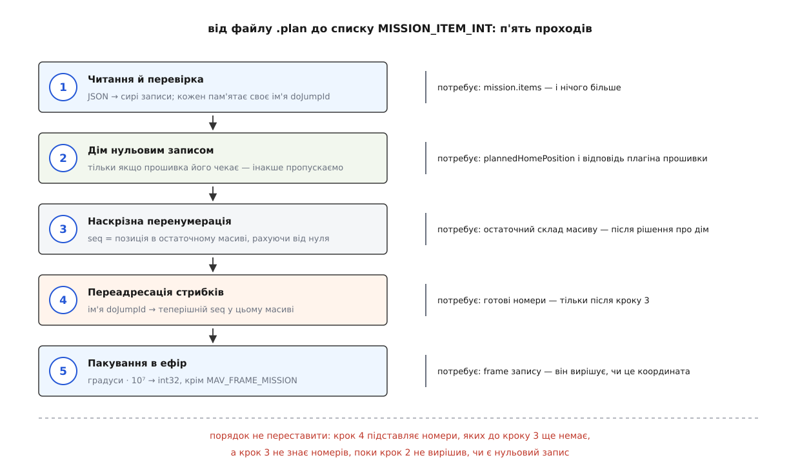

# ⚙️ Від файлу .plan до плаского списку MISSION_ITEM_INT

Ось повний робочий код, який бере збережений файл `.plan` і повертає масив записів `MISSION_ITEM_INT`, готових піти на борт — з проставленими наскрізними номерами й із переадресованими стрибками. Це доводиться писати кожному, хто вивантажує місію без графічного застосунку: скриптом на польовому ноутбуці, стендом автотестів, мостом між сервером завдань і апаратом.

## Задача

Дано файл, збережений станцією. Треба дістати з нього рівно те, що піде в ефір, — і нічого понад те. Ані більше (жодних режимів висоти, висот рельєфу, полігонів), ані менше (номери мусять бути проставлені, а стрибки — вказувати куди слід).

Всередині файлу — звичайний JSON:

```json
{
    "fileType":      "Plan",
    "version":       1,
    "groundStation": "QGroundControl",
    "mission": {
        "version":                2,
        "firmwareType":           12,
        "vehicleType":            2,
        "cruiseSpeed":            15,
        "hoverSpeed":             5,
        "globalPlanAltitudeMode": 1,
        "plannedHomePosition":    [47.3977419, 8.5455938, 488.0],
        "items":                  [ ... ]
    },
    "geoFence":    { "circles": [], "polygons": [], "version": 2 },
    "rallyPoints": { "points": [], "version": 2 }
}
```

Один елемент масиву `items` виглядає так:

```json
{
    "type":                "SimpleItem",
    "command":             16,
    "frame":               3,
    "params":              [0, 0, 0, null, 47.3977419, 8.5455938, 50],
    "doJumpId":            4,
    "autoContinue":        true,
    "Altitude":            50,
    "AltitudeMode":        1,
    "AMSLAltAboveTerrain": null
}
```

Специфікація формату описує ключ `params` дослівно як «`MISSION_ITEM`.param1,2,3,4,x,y,z» — сім комірок, де п'ята й шоста це широта й довгота **у градусах**, а сьома — висота. Три ключі з великої літери (`Altitude`, `AltitudeMode`, `AMSLAltAboveTerrain`) редакторські: вони потрібні, щоб при відкритті файлу відновити той самий вигляд полів, і в ефір не йдуть узагалі. У ефір іде `frame` і `params`.

Ключ `globalPlanAltitudeMode` у секції `mission` — теж редакторський: специфікація каже, що це «глобальний режим висоти на весь план, який беруть ті елементи, що не вказали власного `AltitudeMode`». Для нашої задачі він марний: висота, яка полетить на борт, уже лежить у `params[6]`, а система відліку — у `frame`. Про те, чому цих ключів у файлі аж чотири й чим вони різняться, є [окрема тема про рельєф і режими висоти](root:sys-dron/terrain-and-altitude).

## Один елемент файлу — один запис

Логічно було б чекати, що галочка «знімати кожні 20 м», причеплена до точки, лежить у тому ж об'єкті `SimpleItem`, — і що її доведеться звідти витягати й перетворювати на окрему команду. Так не є, і причина в тому, як влаштоване збереження:

:::code proj-plan-to-items/cpp/odyn-element-failu-odyn.cpp

Розгортання відбувається **під час збереження**. У масиві `items` уже лежить плаский список: точка, за нею `DO_SET_CAM_TRIGG_DIST`, за нею `DO_CHANGE_SPEED` — кожна окремим об'єктом `"type": "SimpleItem"`. Задача від цього спрощується різко: кожен `SimpleItem` дає рівно один запис, і розгортати нема чого.

Виняток один, зате великий — `ComplexItem`. Полігон зйомки зберігається своїми параметрами: вершини, кут галсів, перекриття знімків. Щоб дістати з нього сотню точок, треба повторити всю геометрію розкрою, а це не «ще один прохід по масиву», а окремий підпроєкт (як саме будується розкрій — у [темі про патерни зйомки](root:sys-dron/survey-patterns)). Чесна поведінка тут одна: зупинитися й сказати вголос.

## Чому номер у файлі не є номером

Кожен `SimpleItem` має ключ `doJumpId`. Пишеться він одним рядком:

```cpp
json[_jsonDoJumpIdKey] = _sequenceNumber;
```

Отже, **ім'я елемента — це номер, який елемент мав у мить збереження**. Звідси й формулювання специфікації, що `doJumpId` нумерується автоматично «починаючи з одиниці»: нуль у редакторі зайнято рядком налаштувань місії, тому першому справжньому елементові дістається одиниця.

А тепер найтонше місце всієї задачі. У записі `DO_JUMP` перший параметр — номер цілі. У мить збереження цей номер дорівнює номерові цільового елемента, а номер цільового елемента — це і є його `doJumpId`. Одне й те саме число опиняється у файлі двічі, у двох різних ролях: у `params[0]` стрибка воно виглядає як **позиція**, у `doJumpId` цілі — як **ім'я**.

Прочитати його треба як ім'я. Прочитати як позицію — спокуса, бо в мить збереження це було правдою. Але правдою воно бути перестає, щойно змінюється склад масиву, — а він змінюється прямо тут, усередині нашого конвертера.

> 🔧 **Навіщо це.** Якщо ваш скрипт вивантаження одного дня «стрибнув не туди», перевіряйте не файл і не автопілот, а саме цей рядок конвертера. Число в `params[0]` завжди виглядає правдоподібним номером, тому помилка не ловиться ні перевіркою формату, ні перевіркою місії на борту: список коректний, номери в межах, автопілот приймає. Ціна знаходиться в польоті.

## Дім, який зсуває все

Запланована домашня позиція лежить у файлі окремим ключем `plannedHomePosition` — масивом із широти, довготи й абсолютної висоти, — а не елементом масиву `items`. Чи піде вона в ефір нульовим записом місії, вирішує не файл, а [плагін прошивки](root:sys-dron/firmware-plugin): одні автопілоти чекають, що елемент 0 — це дім, інші вважають нульовим елементом першу справжню команду.

Рішення бінарне, а наслідок — зсув усіх номерів на одиницю.

**Порахуймо: той самий файл, дві прошивки.**

```text
файл (імена doJumpId проставлено під час збереження)
  items[0]  ім'я 1   NAV_TAKEOFF
  items[1]  ім'я 2   NAV_WAYPOINT              ← ціль стрибка
  items[2]  ім'я 3   NAV_WAYPOINT
  items[3]  ім'я 4   DO_SET_CAM_TRIGG_DIST
  items[4]  ім'я 5   DO_JUMP,  params[0] = 2

без нульового дому                 з нульовим домом
  seq 0  NAV_TAKEOFF                 seq 0  дім
  seq 1  NAV_WAYPOINT   ← ім'я 2     seq 1  NAV_TAKEOFF
  seq 2  NAV_WAYPOINT                seq 2  NAV_WAYPOINT   ← ім'я 2
  seq 3  DO_SET_CAM_TRIGG_DIST       seq 3  NAV_WAYPOINT
  seq 4  DO_JUMP,  param1 = 1        seq 4  DO_SET_CAM_TRIGG_DIST
                                     seq 5  DO_JUMP,  param1 = 2

одне й те саме число 2 у файлі дає param1 = 1 або param1 = 2
```

Конвертер, який просто переписує `params[0]` у `param1`, відправить двійку в обох випадках. З нульовим домом він випадково має рацію; без нього — посилає апарат стрибати на зліт замість першої точки.

## П'ять проходів, і порядок не переставити



*Кожен наступний прохід потребує того, що дав попередній, — тому це саме конвеєр, а не набір незалежних правок.*

Залежності жорсткі, і саме вони диктують порядок. Переадресація стрибків підставляє теперішні номери — отже, номери на цей момент мусять бути готові. Перенумерація дає номер за позицією в остаточному масиві — отже, склад масиву мусить бути остаточним, а він залежить від рішення про дім. Пакування дивиться на `frame`, щоб вирішити, множити координати чи ні. Спроба зробити все за один прохід по масиву обов'язково зламає стрибки: коли ви читаєте `DO_JUMP`, ціль може бути ще попереду й номера не мати.

## Сім комірок, яких колись було чотири

Перш ніж писати читання, варто взяти будь-який старий файл — хоча б із тестових даних самого проєкту — і подивитися на елемент:

```json
{
    "autoContinue": true,
    "command":      22,
    "coordinate":   [47.63311996, -122.090763, 20],
    "doJumpId":     1,
    "frame":        3,
    "params":       [0, 0, 0, null],
    "type":         "SimpleItem"
}
```

Тут `params` має чотири комірки, а координата лежить окремим ключем `coordinate`. Це не зіпсований файл — це попередня версія форми елемента, і застосунок читає її й досі. Усередині `MissionItem::load()` стоять два послідовні перетворення, і тільки після них перевіряється, що параметрів рівно сім:

```cpp
if (!_convertJsonV1ToV2(json, convertedJson, errorString)) {
    return false;
}
if (!_convertJsonV2ToV3(convertedJson, errorString)) {
    return false;
}
```

Найдавніша форма тримала кожен параметр окремим ключем; наступна звела перші чотири в масив, лишивши координату збоку; теперішня склала всі сім в один масив. Перетворення з другої в третю саме й дописує до `params` широту, довготу й висоту з ключа `coordinate`, а сам ключ прибирає.

Конвертер, який цього не робить, спотикається на першому ж елементі будь-якого файлу зі старою формою запису — а плани зберігають роками й возять між машинами, тому такі файли трапляються постійно. Тож нормалізація форми — не витончена сумісність, а частина читання.

## Код

Перший прохід — читання й перевірка. Кожен запис забирає з файлу своє ім'я `doJumpId` і несе його далі; координати лишаються градусами аж до останнього кроку.

:::tabs
:::code proj-plan-to-items/cpp/kod.cpp
:::code proj-plan-to-items/py/kod.py
:::

Проходи третій і четвертий — власне те, задля чого весь конвеєр і потрібен. Перенумерація тривіальна; переадресація будує словник «ім'я → теперішній номер» і підставляє з нього. Словник заразом ловить збіг імен: у файлі, збереженому станцією, імена унікальні за побудовою, але файл могли зліпити скриптом або склеїти вручну, і тоді стрибок став би двозначним.

:::tabs
:::code proj-plan-to-items/cpp/kod-2.cpp
:::code proj-plan-to-items/py/kod-2.py
:::

Останній прохід — пакування. Тут і живуть множення на 10⁷ та виняток для `MAV_FRAME_MISSION` (значення 2), яке означає «ця команда взагалі не про місце»: у такому записі п'ята й шоста комірки — просто числа, і множити їх було б безглуздо.

:::tabs
:::code proj-plan-to-items/cpp/kod-3.cpp
:::code proj-plan-to-items/py/kod-3.py
:::

Словники з `to_mission_item_int` лягають прямо в `mav.mission_item_int_send(**record)` бібліотеки pymavlink, якщо дописати `target_system` і `target_component`. Далі починається діалог із бортом — «ось скільки елементів → надішли мені №N → підтвердження», — розібраний у темі про [обмін планом із апаратом](root:sys-dron/plan-exchange).

## Складність і точність

Кожен із п'яти проходів іде по масиву один раз, словник імен дає сталий пошук — разом O(n) за часом і O(n) за пам'яттю. Сам застосунок шукає ціль стрибка вкладеним циклом, тобто за O(n²); для планів на кілька тисяч записів це все одно мілісекунди, тож словник тут не заради швидкості, а заради того, що він безкоштовно ловить збіг імен.

Цікавіше з точністю. Множення на 10⁷ вибрано так, щоб цілого поля вистачило на весь глобус із запасом:

```text
широта    90.0000000° · 10⁷ =    900 000 000
довгота  180.0000000° · 10⁷ =  1 800 000 000
межа int32                  =  2 147 483 647   → переповнення неможливе

одиниця останнього розряду:
  10⁻⁷° · 111 320 м/°  ≈  0.0111 м  ≈  1.11 см по меридіану
```

Тобто перевірка на переповнення в коді ніколи не спрацює на справжніх координатах — вона спрацює тільки на зіпсованих даних, і саме тому її варто лишити. Чому взагалі знадобилися цілі числа замість дробових, розібрано в темі про [MAVLink-місію та її команди](root:sys-dron/mavlink-mission-items).

## Пастки

**Складений елемент — не «пропустити мовчки».** Спокуса написати `continue` замість помилки велика: код стає коротшим, файли з полігонами перестають падати. Наслідок гірший за падіння — виходить коротша місія, яка проходить усі перевірки, вивантажується й летить. Апарат просто не зробить зйомку, і дізнаєтесь ви про це після посадки, коли на карті пам'яті нема знімків.

**NaN — не нуль, і не «щось незрозуміле».** У MAVLink домовлено, що `NaN` означає «не чіпай, лиши як є». Для параметра «Yaw» точки маршруту нуль наказав би апаратові розвернутися на північ, тоді як `NaN` каже «байдуже, лети як летиш». У словнику команд така комірка позначена ключем `nanUnchanged`, а типове значення в ній — `null`, а не `0`. Тому `params` не можна пропускати через щось на кшталт «якщо не число, то нуль»: чотири з семи комірок — числа з рухомою комою й несуть NaN без утрат. А от п'ята й шоста в `MISSION_ITEM_INT` цілі — тут NaN не існує в принципі, і єдина чесна реакція на нього — відмова. У C++ перетворення NaN до `qint32` до того ж має невизначену поведінку: без перевірки ви отримаєте не «якесь дивне число», а що завгодно.

**Порожній `items` — окремий випадок, а не крайній.** Специфікація формату вимагає щонайменше один елемент, і не випадково: у протоколі місій «список із нуля елементів» — це команда стерти місію на борту. Файл, який випадково перетворився на таку команду, — не помилка формату, а помилка дії.

**`frame` — не режим висоти.** Ключі `AltitudeMode` й `AMSLAltAboveTerrain` лишилися в редакторі, але одна їхня тінь падає й на наш конвеєр. Режим «порахувати абсолютну висоту з рельєфу» дає в ефір звичайний `MAV_FRAME_GLOBAL`, а обчислене значення застосунок кладе просто в сьомий параметр:

```cpp
case QGroundControlQmlGlobal::AltitudeFrameCalcAboveTerrain:
    _missionItem.setFrame(MAV_FRAME_GLOBAL);
    _missionItem._param7Fact.setRawValue(qQNaN());
    _amslAltAboveTerrainFact.setRawValue(qQNaN());
    break;
```

Поки дані рельєфу не прийшли з сервера, у сьомому параметрі лежить `NaN` — і саме таким він потрапить у файл (як `null`). Конвертер прочитає його чесно й віддасть висоту `NaN`, бо `z` у записі — число з рухомою комою й NaN приймає. Планові, збереженому без мережі, варто не довіряти на слово: перевірка «жоден `params[6]` у координатних командах не є NaN» коштує один прохід і рятує від вивантаження місії з невизначеною висотою.
