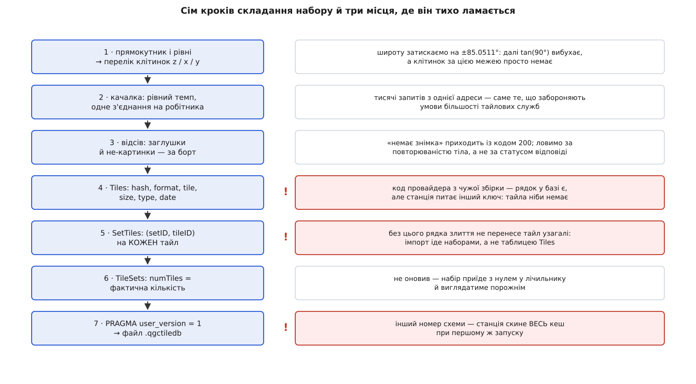

# 🧰 Зібрати `.qgctiledb` скриптом: набір карт без інтерфейсу станції

Це робочий приклад: програма, якій дають прямокутник у градусах, діапазон рівнів масштабу й адресу тайлової служби, а вона віддає готовий файл `.qgctiledb` — рівно той формат, який станція приймає командою «імпортувати». Потрібен він тоді, коли карту треба підготувати один раз і роздати на парк станцій, зробити це на машині без екрана або вбудувати в автоматичну збірку виїзного комплекту.

## Чому не мишкою

Редактор наборів у станції робить те саме — і для одного планшета цього досить. Але щойно станцій стає дванадцять, кожна з них качає ті самі десятки тисяч клітинок із того самого сервера. Це втричі-вчетверо довше, ніж треба, і рівно втричі-вчетверо більше навантаження на службу, яка цього не просила.

Далі йдуть речі, яких інтерфейс не вміє взагалі. Прямокутник району найчастіше вже існує — у файлі плану, у KML із межами ділянки, у наряді на роботи; вводити ті самі чотири числа руками означає ще одне місце, де можна помилитися. Машина, що має інтернет, і машина, що полетить у поле, часто різні, і друга взагалі не має графічного середовища. А підготовку комплекту хочеться відтворювати: той самий прямокутник, ті самі рівні, той самий вміст — і сьогодні, і через півроку.

Звідси чотири вимоги до скрипта:

- на виході — **один самодостатній файл**, який приймає імпорт;
- прогін **відтворюваний**: ті самі аргументи дають той самий вміст;
- перерваний прогін **продовжується** з того місця, де впав;
- у живу базу станції не пишемо **нічого**.

Останнє — не з обережності, а по суті. Поки станція працює, її робітник кеша тримає власне з'єднання й власне уявлення про те, що вже завантажено; сторонній запис у той самий файл у кращому разі впаде на `database is locked`, у гіршому розійдеться з тим, що станція вважає правдою. Правильна межа — окремий файл і штатний імпорт.

## Ідея: що саме має бути у файлі

Спокуслива й хибна модель — «покладу тайли в таблицю `Tiles`, а станція їх підхопить». Не підхопить. Імпорт іде **наборами**: код читає рядки `TileSets`, для кожного набору проходить по його рядках зв'язку `SetTiles` і копіює у свою базу тільки ті клітинки, на які цей зв'язок показує. Тайл без рядка `SetTiles` не існує для імпорту взагалі — він проїде повз, скільки б місця не займав у файлі.

Отже, мінімальний правильний файл — це три речі, і жодну не можна пропустити:

1. **рядок у `TileSets`** з `defaultSet = 0` — іменований набір, на який хтось показує;
2. **рядок у `Tiles`** на кожну клітинку, з ключем `hash`, порахованим точно так, як його рахує станція;
3. **рядок у `SetTiles`** на кожну пару «набір ↔ клітинка».

Плюс одна дрібниця в заголовку файлу — номер схеми в `PRAGMA user_version`. Станція записує туди своє значення при створенні бази і звіряє при відкритті; чуже число вона не мігрує, а трактує як «база не моя» й **перестворює всі чотири таблиці**.

Дві деталі, які видно тільки з коду імпорту й які легко зробити навпаки. По-перше, у файлі, що його експортує сама станція, **немає рядка типового набору**: експорт створює базу з явним «типовий набір не заводити». Це не косметика — при злитті набір із `defaultSet = 1` не створюється заново, а зливається з типовим набором приймача, тобто ваші тайли лягають рівно в ту купу, яку станція має право забути першою. По-друге, ім'я набору при злитті **перейменовується**, якщо таке вже є: до нього дописується номер (`Полігон 0001`). Тому осмислене унікальне ім'я з районом і датою — не естетика, а спосіб не отримати на парку станцій три різні набори з іменами, що відрізняються лише хвостом.



*Перші три кроки — звичайний конвеєр викачування; уся специфіка станції зосереджена в останніх чотирьох, і саме там помилка не падає, а тихо дає непрацездатний файл.*

## Крок 1: перелік клітинок

Прямокутник задають чотири числа в градусах, клітинку — три цілих. Перехід між ними — дві формули проєкції Web Mercator: довгота лягає в горизонтальний номер лінійно, широта у вертикальний — через логарифм тангенса.

```
n = 2ᶻ
x = ⌊ (lon + 180) / 360 · n ⌋
y = ⌊ (1 − ln(tan φ + 1/cos φ) / π) / 2 · n ⌋,   φ = lat у радіанах
```

Це дослівно те, що робить станція у `long2tileX` і `lat2tileY`, і збіг тут обов'язковий: розійдетеся в одному округленні — отримаєте сусідню клітинку з іншим ключем. Про саму сітку — [Web Mercator і тайлова сітка](root:math-geometry/web-mercator-tiles): проєкція розгортає кулю в квадрат, квадрат ділиться на 4ᶻ однакових клітинок, адреса клітинки — номер стовпця, номер рядка й рівень.

Три місця, де перелік ламається мовчки.

**Північ — це менший `y`.** Вертикальний номер росте на південь, тому нижня межа за номером відповідає верхній за широтою. Переплутали — отримали порожній діапазон і файл на нуль тайлів.

**Полюси.** При широті 90° тангенс іде в нескінченність, а логарифм за ним. Тому широту затискають на ±85.05112878° — це та паралель, на якій карта Меркатора стає рівно квадратною, і за нею клітинок просто немає.

**Край сітки.** Номери мусять лишатися в межах `0 … 2ᶻ − 1`. Прямокутник, що вилазить за антимеридіан або за полярну межу, дає від'ємні номери або номери завеликі — і запити за ними повернуть помилку від сервера, а не картинку.

**Оцінка для прямокутника 30.44°–30.58° сх. д., 50.36°–50.45° пн. ш. (приблизно 10 × 10 км), рівні 3–18.**

```
рівень   по x   по y   на рівні   разом
 3–10       1      1          1        8
11          1      2          2       10
12          2      2          4       14
13          4      4         16       30
14          7      7         49       79
15         14     13        182      261
16         26     26        676      937
17         52     52       2704     3641
18        103    104      10712    14353

обсяг ≈ 14353 · 13652 ≈ 195 947 156 байтів ≈ 187 МіБ
час   ≈ 14353 / 4 запити за секунду ≈ 3588 с ≈ 60 хв
```

Останній рядок важливіший, ніж здається: **час прогону визначає темп, а не смуга**. Скільки б каналу не було, чотири запити за секунду дадуть годину на цей район — і саме цю годину треба закласти в підготовку.

## Крок 2: качалка, яка не сварить вас із провайдером

Мережева частина проста, і вся її складність — у самообмеженні. Тайлові служби майже без винятку забороняють масове викачування або обмежують його явним темпом; «я ж лише свій район» — не аргумент, коли скрипт із чотирма нитками б'є в один хост. Що саме дозволено конкретній службі, читають у її угоді: межі описано в [умовах користування тайловими сервісами](root:sys-notary/tile-service-terms) — від прямої заборони bulk-завантаження до дозволу за окремим договором чи за плату. Приклад нижче написаний під **власний або ліцензований** тайловий сервер, і адреса шаблоном подається саме тому.

Чотири речі, які качалка мусить робити правильно.

**Темп — спільний на весь процес.** Не «пауза в кожній нитці», а один спільний лічильник: наступний запит випускається не раніше, ніж через `1/rps` секунди після попереднього, ким би він не був відправлений. Інакше чотири нитки з паузою по чверть секунди дадуть шістнадцять запитів за секунду замість чотирьох. Це найпростіша з [схем обмеження темпу](root:sf-security/rate-limiting) — рівномірний інтервал без сплесків, і для викачування вона краща за відро токенів саме тим, що сплесків не дає.

**Одне з'єднання на робітника.** TLS-рукостискання коштує більше, ніж сам тайл, тож пул із кількох робітників, кожен зі своїм тривким з'єднанням, — правильна форма. Це звичайний [пул робітників](root:sf-tasks/thread-pool): фіксована кількість виконавців розбирає спільну чергу завдань, і кількість одночасних запитів обмежена ними, а не розміром черги. Станція, до речі, тримає шість одночасних запитів — це верхня межа, від якої варто відштовхуватися, а не перевищувати її.

**Заголовки, яких вимагає служба.** Частина серверів відмовляє без `User-Agent`, частина — без `Referer` із дозволеною адресою. Станція підставляє браузероподібний `User-Agent` і `Referer`, оголошений класом провайдера; свій скрипт краще підписувати чесно й тим ім'ям, яке дозволяє угода.

**Повтори — лише там, де вони мають сенс.** `429` і `5xx` — тимчасові, їх повторюють із подвоєнням паузи й повагою до заголовка `Retry-After`. `403` і `404` — остаточні: повторювати їх означає лише швидше отримати блокування. Загальна механіка — у [повторах із відступом](root:sf-distributed/retries-backoff): пауза росте геометрично, щоб не додавати навантаження туди, де вже погано.

## Крок 3: відсів того, що не є картинкою

Тайл, який приїхав із кодом `200`, ще не тайл. Відсів має два рівні надійності, і плутати їх не можна.

**Тверде правило.** Тіло, що не починається сигнатурою PNG (`89 50 4E 47`) або JPEG (`FF D8 FF`), — не картинка. Так у базу не потрапить сторінка помилки, XML із текстом «ліміт вичерпано» чи порожня відповідь. Станція визначає формат так само — за сигнатурою тіла, а не за розширенням в адресі, — тож і поле `format` заповнюється з того ж джерела.

**М'яке правило.** Заглушка «немає знімка» приходить із кодом успіху й **є** справжнім PNG. Упізнати її можна лише за тим, що вона повторюється: та сама послідовність байтів на десятках різних клітинок. Але тут легко зробити гірше, ніж було: суцільна вода чи однорідний пісок на високому рівні теж дають байт-у-байт однакові тайли, і викинути їх — значить залишити в полі дірку там, де насправді все гаразд.

Тому повторюваність — **підозра, а не вирок**. Скрипт рахує контрольну суму кожного тіла, наприкінці показує найчастіші й викладає по одному зразку у файл, щоб людина глянула очима. Викидає він тільки ті суми, які їй назвали явно. Це на одну хвилину роботи довше й на один клас мовчазних помилок менше.

## Крок 4–7: база

Тепер найважливіше, і воно ж найкоротше. Схему створюємо дослівно ту, яку створює станція, — жодних «покращень», бо приймач звіряється з нею буквально. Ключ рахуємо одним форматуванням із фіксованими ширинами полів: десять цифр коду провайдера, вісім на `x`, вісім на `y`, три на рівень.

Записи в `Tiles` ідуть **пачками в одній транзакції**. Кожен окремий `INSERT` поза транзакцією — це власний запис на диск із очікуванням підтвердження; чотирнадцять тисяч таких коштують хвилини на порожньому місці. Пачка по двісті рядків зводить це до сімдесяти підтверджень і водночас обмежує втрату при аварії двомастами тайлами. Чому одиниця запису тут саме транзакція й що вона гарантує — у [властивостях транзакцій](root:sf-data/transactions-acid): усе або нічого, і підтверджене не зникає.

Рядки `SetTiles` дописуємо після відсіву — одним запитом на всі клітинки файлу. `numTiles` виставляємо **за фактом**, а не за оцінкою: це число станція показує як «скільки в наборі», і нуль у ньому означає набір, що виглядає порожнім, хоча тайли в ньому є. Останнім рухом — `PRAGMA user_version = 1`.

І одна тиха деталь: журнал. Станція тримає свою базу в режимі `WAL`, і поруч із файлом живуть ще два — `-wal` і `-shm`. Файлу, який ви кудись повезете, це шкодить: забули супутника — привезли стан на кілька хвилин старіший. Тому збірний файл робимо у звичайному режимі журналу, щоб на виході був **один** файл і нічого більше.

## Скрипт цілком

Задача мережево-зв'язана й скриптова: вся робота — це очікування відповідей і кілька тисяч однакових вставок у SQLite, тож виграє мова, у якій і те, і те є в стандартній поставці. У Python це `sqlite3` і `http.client` без жодної залежності; у Node з версії 22.13 те саме дає `node:sqlite` разом із вбудованим `fetch`. Обидві версії роблять те саме й дають байт-у-байт однаковий файл; різниця, варта уваги, одна — у Python робітники є справжніми нитками, і спільний лічильник темпу треба закривати м'ютексом, а в Node паралельність кооперативна, тож той самий лічильник обходиться без замка.

:::tabs
:::code proj-seed-cache/py/seed_qgctiledb.py
:::code proj-seed-cache/ts/seed-qgctiledb.ts
:::

Виклик виглядає так:

```bash
python3 seed_qgctiledb.py \
  --out "polygon-2026-08.qgctiledb" \
  --name "Полігон Північ · 2026-08" \
  --bbox 30.44,50.36,30.58,50.45 --zoom 3-18 \
  --url "https://tiles.example.org/sat/{z}/{x}/{y}.jpg" \
  --map-name "Bing Satellite" --map-id 7 --rps 4 --workers 4
```

## Перевірка перед тим, як везти

Файл на 187 мегабайтів, який виявиться непридатним уже в полі, — найдорожча з можливих помилок, і коштує вона рівно нуль, якщо перевірити його одразу. Спершу три структурні звірки: усе, що має збігатися, збігається.

:::code proj-seed-cache/sql/main.sql

`tiles` дорівнює `links`, `orphans` нульовий, обидві довжини ключа рівно `29`, `numTiles` збігається з `tiles`. Будь-яке інше число — привід не везти файл нікуди.

Але жодна з цих перевірок не бачить головного: чи **той самий** код провайдера в ключі. Ловиться це тільки натурним випробуванням, і воно триває дві хвилини. Зберіть той самий район на одному-єдиному рівні — скажімо, `--zoom 10-10`, кілька клітинок і кілька десятків кілобайтів, — імпортуйте його **в ту саму збірку станції**, з якою поїдете, вимкніть мережу й подивіться на карту. Намалювалося — можна запускати повний прогін на годину. Не намалювалося — ви щойно зекономили годину й дізналися, що код провайдера чи його ім'я не ті.

## Скільки це коштує

```
клітинок на рівні   N(z) = (x₁ − x₀ + 1) · (y₁ − y₀ + 1)   ≈ вчетверо більше за N(z−1)
разом               Σ N(z) ≈ N(zₘₐₖₛ) · 4/3
час прогону         ≈ разом / rps                (упирається в темп, не в смугу)
пам'ять             ≈ черга результатів · середній тайл + перелік контрольних сум
запис у базу        разом вставок, кожна O(log разом) через унікальний індекс hash
підтверджень диска  ≈ разом / BATCH
```

Практично це означає ось що. Прибрати верхній рівень — скоротити прогін учетверо; додати один — учетверо подовжити. Збільшувати кількість робітників понад темп безглуздо: вони однаково стоятимуть у спільній черзі темпу, тож єдина причина мати їх чотири, а не одного, — сховати затримку відповіді, а не обійти обмеження. Пам'ять не залежить від розміру набору: тайли не накопичуються, а протікають крізь чергу фіксованої довжини; єдине, що росте лінійно, — перелік контрольних сум, і це десятки байтів на клітинку.

## Де це ламається

**Не той код провайдера.** Найпідступніша з помилок, бо все виглядає бездоганно: файл є, імпорт пройшов, набір у списку, мегабайти на місці. Але станція шукає клітинку за ключем, у перших десяти цифрах якого — **її** номер провайдера, а він є всього лише порядковим номером у списку реєстрації всередині збірки. Досить комусь додати провайдера в середину списку — і всі наступні зсунуться. Тому число не вгадують і не переписують зі сторонньої таблиці: його беруть із бази **тієї самої** станції запитом `SELECT DISTINCT type, typeStr FROM TileSets WHERE type >= 0` або звіряють із її журналом запуску. Які провайдери взагалі є в застосунку й звідки береться їхній порядок — у [рушії карти](root:sys-dron/map-engine).

**Забутий рядок `SetTiles`.** Тайл без зв'язку невидимий двічі. У файлі для перенесення імпорт його просто не побачить — він ходить наборами, а не таблицею `Tiles`. А якщо тайли колись потраплять у робочу базу без прив'язки до **іменованого** набору, вони стануть звичайними кандидатами на витіснення: обіцянкою є саме рядок зв'язку, а не наявність картинки.

**Набір, позначений типовим.** `defaultSet = 1` у вашому файлі означає не «головний», а «звалище». Злиття не створить такий набір заново — воно висипле його вміст у типовий набір приймача, тобто рівно в ту частину сховища, яку станція викидає першою, коли їй забракне місця.

**Заглушки замість знімків.** Картинка «немає зображення» приходить з кодом успіху й займає місце як справжня. Найгірше в ній не місце, а те, що вона **закриває собою** клітинку назавжди: станція вважає її кешованою й більше не питатиме сервер, навіть коли знімок там з'явиться.

**Чужий номер схеми.** Значення `user_version`, якого станція не чекає, вона трактує не як «треба мігрувати», а як «база не моя» — і перестворює всі чотири таблиці. Тобто один невдалий імпорт стирає **весь** накопичений кеш, а не тільки привезене.

**Висоти так не засіяти.** Спокуса поширити скрипт на рельєф природна, але клітинка висот зберігається в базі не як відповідь сервера, а як розібрана й серіалізована сітка висот. Покласти туди сирі байти означає покласти сміття, яке станція спробує прочитати як масив чисел. Висотні набори лишаються за станцією.

**Один файл — один набір.** Скрипт вище прив'язує до набору всі рядки `Tiles` у файлі, бо файл будується під одне замовлення. Захочете складати кілька районів в один файл — вести перелік `tileID` цього прогону доведеться окремо, інакше другий набір привласнить собі й клітинки першого.
