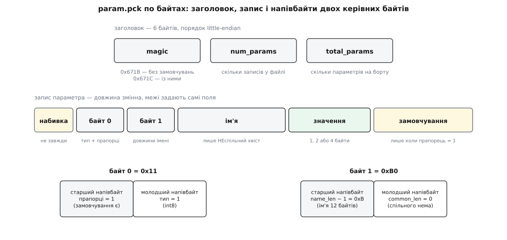

# ⚙️ param.pck по байтах: розбір формату й робочий парсер

Апарат на ArduPilot уміє віддати весь свій набір параметрів одним файлом — синтетичним, якого немає на жодній картці пам'яті, породженим на льоту у відповідь на запит імені `@PARAM/param.pck`. Тут ми розкладемо цей файл побайтово й напишемо парсер, який перетворює його на список «ім'я — тип — значення — значення за замовчуванням» разом з усіма перевірками, без яких побитий файл тихо стане набором правдоподібних чисел.

## Задача

Звичайний спосіб отримати параметри — просити їх повідомленнями. У корисному навантаженні `PARAM_VALUE` двадцять п'ять байтів: шістнадцять на ім'я (завжди шістнадцять, навіть якщо ім'я коротше), чотири на значення, один на тип, два на загальну кількість і два на порядковий номер. Обгортка кадру MAVLink v2 додає ще дванадцять. Виходить до тридцяти семи байтів на кожен параметр — а параметрів у польотного контролера понад тисячу. Це десятки кілобайтів, і жоден із цих кадрів не підтверджується: втрачений треба помітити за дірою в нумерації й просити наново, поштучно.

Файл усуває обидві біди одразу. По-перше, він щільніший: те саме ім'я коштує стільки байтів, скільки в ньому справді нових літер. По-друге, він їде каналом, який уміє помічати втрати сам — [передачею файлів поверх MAVLink](root:sys-dron/mavlink-ftp): станція відкриває сеанс, просить блоки за зсувом, борт відповідає підтвердженнями, а неотриманий блок станція просить наново за його зсувом. Формату вже не треба дбати про доставку; йому лишається бути щільним і розбірним за один прохід уперед.

Наша мета — код, який із такого файлу дістає чотири речі про кожен параметр: ім'я, тип, значення й — там, де воно є — значення за замовчуванням прошивки.

## Заголовок — шість байтів

```
зсув 0   magic         2 Б   0x671B або 0x671C
зсув 2   num_params    2 Б   скільки записів у ЦЬОМУ файлі
зсув 4   total_params  2 Б   скільки параметрів має апарат
```

Усі числа у файлі — молодшим байтом уперед; звідси й `1C 67` на початку замість очікуваного `67 1C`. Якщо ця перестановка ще не звична, варто мати на увазі просту річ: багатобайтове число можна класти в пам'ять із будь-якого кінця, і машина, яка кладе його інакше, прочитає ваш файл як інше число — детальніше в [порядку байтів](root:sf-algorithms/bits-bytes-endianness).

Два magic — не забаганка. Станція завжди просить файл із суфіксом `?withdefaults=1`, тобто «дай і значення за замовчуванням». Але прошивка, зібрана без підтримки замовчувань, цього суфікса просто не впізнає й **мовчки його ігнорує**: ніякої відмови, ніякої ознаки в самій передачі. Єдине місце, де відповідь зізнається, чого в ній насправді нема, — перші два байти. `0x671B` — замовчувань усередині немає; `0x671C` — частина записів їх несе. Тому клієнт не має права судити з власного запиту; він мусить дивитися на magic.

Два лічильники різняться теж не випадково. Ім'я файлу приймає й такі суфікси: `?start=N&count=C` — «віддай зріз, починаючи з N-го, довжиною C». Тоді `num_params` — розмір зрізу, а `total_params` — скільки параметрів усього на борту. QGroundControl зрізами не користується і, навпаки, вважає розбіжність цих двох чисел помилкою файлу: він просив усе, отже мусить отримати все.

А от чого в заголовку **немає** — так це довжини файлу в байтах. І дізнатися її наперед ніде: `stat` на цьому шляху відповідає оцінкою «кількість параметрів × 12», яка не збігається зі справжнім розміром. Кінець файлу виявляється коротким читанням, і парсер має вміти сказати «записи скінчилися», не маючи жодної довжини.

Формат молодший, ніж здається: перша версія `@PARAM` з'явилася в ArduPilot наприкінці березня 2020 року й magic узагалі не мала — його додали через три тижні, а ще за кілька днів по тому — набивку й суфікси в імені файлу (зміни за авторством Ендрю Тріджелла в бібліотеці `AP_Filesystem`); варіант `0x671C` із замовчуваннями дописали влітку 2022-го. Дати й авторство — з історії змін самого репозиторію.

## Два керівні байти, розрізані навпіл

Кожен запис починається з двох байтів, і кожен із них несе по два поля — по напівбайту.

**Байт 0.** Молодший напівбайт — тип значення, старший — прапорці, з яких визначено лише нульовий біт: «після значення йде ще й замовчування».

**Байт 1.** Молодший напівбайт — `common_len`, скільки перших літер імені збігаються з попереднім записом. Старший — `name_len − 1`, довжина решти імені.

Мінус одиниця тут не дивацтво, а арифметика: у чотири біти вміщаються числа 0…15, а довжина хвоста імені буває від 1 до 16 — нуль неможливий (чому саме, побачимо нижче), шістнадцять — можливе. Зсув на одиницю точно накладає один діапазон на другий.

Типів у файлі рівно чотири: `1` — int8, `2` — int16, `3` — int32, `4` — float. Нуля серед них немає: у внутрішньому переліку прошивки нуль означає «типу нема», і в записі він не трапляється ніколи. Це не дрібниця — саме на цьому тримається розпізнавання набивки: **нульовий байт не може починати запис**, отже нуль між записами — завжди сміття для викидання. Тривимірних векторів у файлі теж немає, хоч у прошивці такий тип є: обхідник, який породжує файл, розкладає їх на три окремі дробові значення з суфіксами `_X`, `_Y`, `_Z` і пропускає все, чий тип більший за float.



*Заголовок фіксований, запис — ні: його довжину задають самі поля, тому пропустити запис, не розібравши його, неможливо.*

## Ім'я — тільки хвіст

Параметри йдуть у файлі в порядку обходу внутрішнього дерева прошивки, а це означає, що сусіди майже завжди з однієї групи й починаються однаково: `BATT_MONITOR`, `BATT_CAPACITY`, `BATT_AMP_PERVLT`. Пакувальник це використовує: він рахує довжину спільного початку з попереднім іменем і кладе у файл лише хвіст. `BATT_CAPACITY` після `BATT_MONITOR` коштує вісім байтів замість тринадцяти.

Один випадок ламає цю схему, і його довелося залатати окремо. Якщо чергове ім'я цілком збігається з початком попереднього — скажімо, гіпотетичне `FOO_BAR` одразу після `FOO_BARX` — то хвоста не лишається взагалі, а нульову довжину закодувати нічим. Пакувальник відступає на одну літеру назад: зменшує `common_len` на одиницю й шле хвіст завдовжки в один символ. Коштує це зайвий байт, зате діапазон довжин лишається 1…16 і напівбайт не переповнюється.

Обмеження, яке парсер зобов'язаний перевірити: `common_len + name_len` ніколи не більше за шістнадцять — це стеля довжини імені в прошивці. Перевірка тут не формальність, бо саме цим числом ми зараз задамо розмір буфера імені.

## Значення й замовчування

Значення лежить одразу за іменем — один, два або чотири байти, молодшим уперед, за таблицею типу. Float — звичайний IEEE-754 із чотирьох байтів, тож розбирати його треба саме як набір бітів, а не як «число, схоже на дробове»; чому побайтова копія тут єдиний чесний шлях, розписано в статті про [числа з рухомою комою](root:hw-arch/floating-point).

Замовчування додається за тим самим правилом розміру — і лише тоді, коли встановлено прапорець. А прапорець прошивка ставить тільки в одному разі: **коли замовчування відрізняється від поточного значення**. У цьому й уся економія: параметри, яких ніхто не чіпав, а таких переважна більшість, не платять за замовчування нічого.

Наслідок для того, хто розбирає, важливіший за економію. У файлі з magic `0x671C` відсутність замовчування — це не «невідомо», а конкретне твердження: *значення й є заводським*. Хто хоче повну таблицю заводських значень, дописує її сам із тих самих байтів. Станція цього не робить: вона запам'ятовує замовчування лише для тих записів, які його несуть, а для решти лишає те, що знає з метаданих.

Дрібний шрифт: «відрізняється» вирішує порівняння дробових чисел, бо замовчування борт тримає як float і ціле значення для порівняння теж зводить до float. Для int32 з величиною понад 2²⁴ таке зведення вже втрачає біти, і справді змінений параметр може здатися незміненим. Кут вузький, але він є.

## Нульова набивка й межа блока

Тепер найхитріше поле формату — те, якого в записі немає, аж поки воно раптом не з'явиться.

Файл їде блоками сталого розміру. Станція визначає цей розмір першим же читанням, і далі прошивка відмовляє в читанні іншого розміру — навмисно. Причина в тому, що файл **не існує**: кожен блок наново складається з живих параметрів у момент, коли його просять. Блок, який загубився й був запитаний наново через секунду, принесе значення, що встигли змінитися.

Ось звідки вимога. Якби байти одного значення лежали у двох сусідніх блоках, а перечитали лише один із них, станція склеїла б число з двох різних моментів часу — молодшу половину зі старого, старшу з нового. Таке число не існувало на борту ніколи. Тож пакувальник стежить, щоб значення цілком уміщалося в один блок, і, коли не вміщається, підсовує перед записом кілька нульових байтів — саме стільки, щоб зіпхнути значення на початок наступного блока.

```
ofs      = зсув кінця запису у файлі (з урахуванням 6 байтів заголовка)
ofs_mod  = ofs mod read_size
якщо 0 < ofs_mod < type_len:
    набивка = type_len − ofs_mod      ← стільки нулів стає ПЕРЕД записом
```

**Умова.** Розмір блока 16 байтів, запис `BATT_CAPACITY` типу int32, попереднє ім'я — `BATT_MONITOR`.

```
спільна частина      = 5           ("BATT_")
хвіст імені          = 8           ("CAPACITY")
довжина запису       = 2 + 8 + 4   = 14 байтів
зсув початку запису  = 21
ofs                  = 21 + 14     = 35
ofs_mod              = 35 mod 16   = 3
0 < 3 < 4  →  набивка = 4 − 3      = 1 байт
```

Без набивки значення зайняло б байти 31…34 — один по цей бік межі, три по той. З одним нульовим байтом запис зсувається, і значення лягає на 32…35, тобто рівно на початок блока.


*Розмір блока на рисунку зменшено до 16 байтів заради місця; насправді станція читає по 239 байтів — стільки даних несе один кадр передачі файлів.*

> 🔧 **Навіщо це.** Набивка тут не про вирівнювання й не про швидкість доступу — процесорові байт 31 не гірший за байт 32. Вона про те, що джерело даних живе й міняється, а транспорт має право перечитати шматок пізніше. Щоразу, коли ви віддаєте живий стан через протокол із повторами, ставте собі це саме питання: яка найменша одиниця даних мусить бути неподільною, і чи не розрізає її транспорт навпіл.

І чесна вада, видима просто з арифметики. Перевірка дивиться на кінець **запису**, а не на кінець поля значення. Коли запис несе ще й замовчування, останнє поле — це замовчування, і саме воно гарантовано не розривається. Значення лежить перед ним: воно займає `[ofs − 2·type_len, ofs − type_len)`. Для чотирибайтових типів набивку додають при `ofs mod read_size` ∈ {1, 2, 3}, а розривається значення при `ofs mod read_size` ∈ {5, 6, 7} — і в цьому проміжку набивки не буде. Наслідок вузький: розрив зашкодить лише тому параметрові, який змінили саме між читаннями двох сусідніх блоків. Але інструмент, що звіряє два завантаження й шукає розбіжності, має знати, звідки може взятися число, якого на борту не було.

## Реальний уривок

Ось повний файл із п'яти параметрів, знятий із суфіксом `withdefaults=1`. Ліворуч — зсув, посередині байти, праворуч друковані символи.

```
0000  1C 67 05 00 05 00 11 B0 42 41 54 54 5F 4D 4F 4E  .g......BATT_MON
0010  49 54 4F 52 04 00 13 75 43 41 50 41 43 49 54 59  ITOR...uCAPACITY
0020  88 13 00 00 E4 0C 00 00 04 95 41 4D 50 5F 50 45  ..........AMP_PE
0030  52 56 4C 54 00 00 88 41 04 59 4F 46 46 53 45 54  RVLT...A.YOFFSET
0040  00 00 00 00 01 84 32 5F 4D 4F 4E 49 54 4F 52 00  ......2_MONITOR.
```

Розберімо його руками — інакше жоден код не переконує.

```
зсув 0   1C 67          magic = 0x671C — замовчування всередині є
зсув 2   05 00          num_params = 5
зсув 4   05 00          total_params = 5 — зріз не просили

зсув 6   11             прапорці 1 (замовчування далі), тип 1 = int8
зсув 7   B0             name_len − 1 = 0xB = 11 → 12; common_len = 0
зсув 8   "BATT_MONITOR" 12 байтів імені
зсув 20  04             значення = 4
зсув 21  00             замовчування = 0        ← прапорець стояв

зсув 22  13             прапорці 1, тип 3 = int32
зсув 23  75             name_len − 1 = 7 → 8; common_len = 5
зсув 24  "CAPACITY"     ім'я = "BATT_" + "CAPACITY"
зсув 32  88 13 00 00    значення = 0x1388 = 5000
зсув 36  E4 0C 00 00    замовчування = 0x0CE4 = 3300

зсув 40  04             прапорців нема, тип 4 = float
зсув 41  95             name_len − 1 = 9 → 10; common_len = 5
зсув 42  "AMP_PERVLT"   ім'я = "BATT_" + "AMP_PERVLT"
зсув 52  00 00 88 41    значення = 0x41880000 = 17.0
                        замовчування відсутнє → 17.0 і є заводським

зсув 56  04             прапорців нема, тип 4 = float
зсув 57  59             name_len − 1 = 5 → 6; common_len = 9
зсув 58  "OFFSET"       ім'я = "BATT_AMP_" + "OFFSET"
зсув 64  00 00 00 00    значення = 0.0

зсув 68  01             прапорців нема, тип 1 = int8
зсув 69  84             name_len − 1 = 8 → 9; common_len = 4
зсув 70  "2_MONITOR"    ім'я = "BATT" + "2_MONITOR"
зсув 79  00             значення = 0
```

Вісімдесят байтів на п'ять параметрів — по шістнадцять на кожен разом із заголовком, і це ще з довгими іменами й двома замовчуваннями. Ті самі п'ять повідомленнями `PARAM_VALUE` зайняли б до ста вісімдесяти п'яти байтів у каналі, і без жодного підтвердження.

Зверніть увагу на два місця, які найлегше проґавити. Перше: `B0` читається як «одинадцять і нуль», причому одинадцять — це **старший** напівбайт, тобто перша цифра шістнадцяткового запису. Друге: у четвертому записі `common_len = 9` відлічується від попереднього імені `BATT_AMP_PERVLT`, а не від першого в файлі, — база префіксного стиснення зсувається на кожному кроці.

## Код

Розбір бінарного потоку байт за байтом — саме та робота, де C++ дає й точний контроль над представленням, і швидкість без зусиль; Python із модулем `struct` тут другий, бо тим самим кодом зручно колупати файл руками, коли щось пішло не так. Обидві версії роблять одне й те саме й дають однаковий результат на дампі вище.

:::tabs
:::code proj-param-pck/cpp/main.cpp
:::code proj-param-pck/py/main.py
:::

## Складність і граблі

Прохід один і тільки вперед: кожен байт файлу торкають рівно раз, робота на запис обмежена шістнадцятьма байтами імені, тож розбір лінійний за розміром файлу. Пам'яті понад сам результат — рівно одне попереднє ім'я.

Головна структурна властивість формату: **розібрати його з середини неможливо**. Початок запису відомий лише після того, як розібрано попередній, а ім'я взагалі не існує окремо від ланцюжка попередників. Це ціна префіксного стиснення, і борт платить її теж: щоб віддати блок із середини файлу, прошивка тримає два «курсори» й, коли просять зсув менший за поточний, перепаковує від самого початку.

Тепер граблі — у порядку від найчастіших.

**Порядок байтів задавайте явно.** Стандартний потік Qt читає числа старшим байтом уперед, і станція мусить окремим рядком перемкнути його на молодший; своя реалізація, що просто копіює чотири байти в `float`, на машині з іншим порядком видасть тихе сміття без жодної помилки. Складання числа зі зсувів, як у коді вище, знімає питання назавжди.

**Набивку їжте перед КОЖНИМ записом, не тільки перед першим.** Нулі виникають там, де черговий запис не вписався в блок, тобто в довільному місці файлу.

**Не вірте оголошеному розміру.** `stat` на `@PARAM/param.pck` відповідає добутком «кількість параметрів × 12» — це оцінка, щоб клієнт не сканував увесь файл заради довжини. Справжня довжина з'ясовується коротким читанням.

**Перевіряйте `common_len` проти довжини попереднього імені.** Формат цього не гарантує, а наслідок мовчазний. Станція такої перевірки не робить, і робить це цікаво: її парсер оголошує буфер імені **всередині** циклу й ніколи не копіює туди спільний початок — розрахунок на те, що змінна щоразу лягає на те саме місце в стеку й досі тримає попереднє ім'я. Працює, бо компілятор так і робить; але захисту від завеликого `common_len` тут немає — у назву просто вклеїться шматок ще давнішого імені, і параметр піде в набір під чужим ім'ям.

**Вивантаження назад — це інший формат тієї самої форми.** Той самий шлях приймає й запис, але правила там свої: magic мусить бути `0x671B` (файл із замовчуваннями борт відкидає), прапорці мусять бути нульові, поле `total_params` несе **довжину файлу в байтах**, а не кількість, і — головне — розбирач на борту нулі **не пропускає** взагалі, він читає записи впритул. Тобто повернути апарату щойно завантажений із нього файл не вийде: набивка все зламає. Це поле з двома різними значеннями в двох напрямках — найпідступніше місце всього формату.

**Відсутнє замовчування не означає «невідоме».** У файлі з magic `0x671C` це твердження «значення заводське». Плутати ці два стани — прямий шлях до редактора, який показує всі параметри зміненими.

**Зріз — не те саме, що повний файл.** Якщо будуєте `param.pck` самі й пишете `num_params` менше за `total_params`, станція такий файл відхилить цілком: вона просила все й вважає нерівність цих чисел ознакою побитого файлу.
