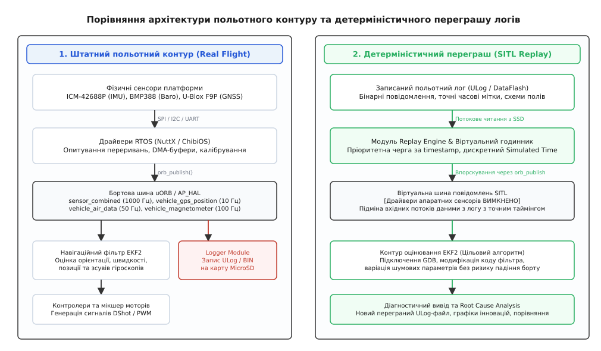
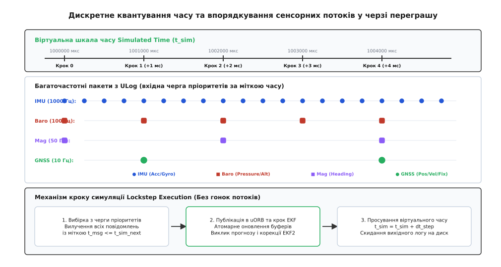

# Переграш журналу: детерміністичне відтворення та пошук першопричин збоїв

<preknowlist>
- [Формати бортових логів: ULog і DataFlash](root:sys-dron/flight-log-formats) — двійкова структура повідомлень, самоописні схеми полів та організація буферизації.
- [Симуляція SITL](root:sys-dron/sitl-simulation) — запуск польотного стека у віртуальному оточенні без реального заліза.
- [Комплексування GNSS та ІНС](root:sys-dron/gnss-i-ivb-razom) — розширений фільтр Калмана (EKF), оцінка стану, коваріаційні матриці та інновації вимірювань.
- [Модель багатопотоковості](root:sys-dron/threading-model) — взаємодія потоків у реальному часі, м'ютекси, черги та механізми синхронізації RTOS.
- [Архітектура PX4](root:sys-dron/px4-architecture) — мікроядерна шина публікацій/підписок uORB, модульна композиція та поділ драйверів і контурів керування.
</preknowlist>

Коли автономний безпілотний літак вагою 12 кг на швидкості 130 км/год раптово зазнає зриву оцінки просторової орієнтації, входить у неконтрольовану спіраль і стикається з землею, стандартний статичний аналіз графіків телеметрії часто виявляється безсилим. Інженер відкриває збережений на флеш-накопичувачі бінарний журнал (англ. *flight log*, від давньогрец. *λόγος* — слово, звіт) і бачить одночасний стрибок інновацій гіроскопа, скидання фільтра EKF2 (англ. *Extended Kalman Filter*, від араб. *al-khwarizmi*) за вектором швидкості та відмову магнітометра через локальну магнітну аномалію. Проте статичний графік фіксує лише *наслідки* катастрофи — значення змінних у моменти їхнього збереження. Він не дає змоги з'ясувати, що саме було первинним тригером: помилка в матриці шуму процесу, приховане переповнення черги повідомлень сенсора при вібраційному піку чи крайовий стан в алгоритмі виявлення збоїв GNSS.

Спроба відтворити таку аварію в реальному польоті створює пряму загрозу повторної втрати дорогого обладнання, а синтетична симуляція SITL (англ. *Software-in-the-Loop*) зі штучною фізикою не здатна змоделювати унікальний спектр механічних резонансів рами, турбулентні вихори та стрибки фазових центрів супутників, присутні в реальному польоті.

Єдиним детерміністичним інженерним інструментом для виявлення прихованих причин збоїв є **переграш журналу** (англ. *log replay*). Метод полягає в запуску оригінального бінарного коду автопілота у віртуальному симуляційному оточенні, де всі фізичні драйвери сенсорів повністю відключені, а замість них у системну шину публікацій/підписок із прецизійним збереженням часових інтервалів впорскуються збережені бінарні кадри польоту. Це перетворює алгоритми оцінки стану та навігації на повністю повторювану математичну функцію від вхідного потоку вимірювань, відкриваючи можливість покрокового зневадження в GDB, варіації коефіцієнтів фільтрації та перевірки виправлень без ризику для апарата.

> 🔧 **Навіщо це.** Переграш логів дозволяє підключити покроковий зневаджувач GDB до алгоритмів EKF2/EKF3, варувати матриці шумів вимірювань `R` та шумів процесу `Q`, змінювати порогові коефіцієнти відхилення інновацій і миттєво перевіряти стійкість фільтра на тих самих сирих сенсорних даних, які спричинили падіння реального дрона.

---

## 1. Архітектурне протиріччя: пасивний перегляд графіків проти динамічного збудження алгоритмів

Більшість інженерів після аварії обмежуються побудовою часових графіків утилітами на зразок FlightPlot або PlotJuggler. Такий підхід дає змогу виявити факт аномалії, проте має чотири принципові обмеження, які роблять неможливою глибоку локалізацію складних відмов:

1. **Неможливість експерименту та перевірки контрфактичних гіпотез:** Якщо виникає гіпотеза, що збільшення шуму процесу гіроскопа `EKF2_GYR_NOISE` з 0.015 рад/с до 0.035 рад/с запобігло б розходженню кватерніона орієнтації під час вібрації, перевірити це за статичним логом неможливо. Для розрахунку нового стану необхідно виконати повне інтегрування нелінійних диференціальних рівнянь кінематики та оновлення коваріацій на кожному кроці часу.
2. **Відсутність внутрішніх проміжних станів у лозі:** З метою економії пропускної здатності SD-карти (яка обмежена затримками запису сторінок NAND Flash і періодичним збиранням сміття контролером накопичувача) бортовий логер записує далеко не всі змінні. Наприклад, повна коваріаційна матриця стану EKF розміром 24×24 елементи (576 чисел з плаваючою комою подвійної точності) займає понад 4.6 КБ на один крок; запис такої матриці на частоті 250 Гц вимагав би понад 1.1 МБ/с лише для діагностики одного навігаційного фільтра. Під час переграшу алгоритм виконується на комп'ютері наживо, дозволяючи зняти стан будь-якої внутрішньої змінної, проміжної похідної матриці Якобі чи вектора нев'язок на кожній ітерації.
3. **Неможливість зневадження вихідного коду (Source-Level Debugging):** Якщо збій спричинений діленням на нуль, неініціалізованим покажчиком, переповненням стека чи зацикленням в ітераційному алгоритмі розв'язання задачі кватерніонного вирівнювання, знайти точний рядок коду без виконання програми під керуванням GDB (GNU Debugger) або LLDB вкрай складно.
4. **Втрата нелінійної динаміки зворотних зв'язків:** У сучасних навігаційних фільтрах стан однієї підсистеми безпосередньо впливає на гейти відкидання вимірювань іншої. Наприклад, накопичення похибки за вектором зсуву акселерометра призводить до хибного розрахунку нахилу (Roll/Pitch), що тягне за собою неправильну проекцію вектора магнітного поля Землі та спричиняє раптове відхилення вимірювань компаса (Heading Gate Rejection). У статичному лозі ці події виглядають як одночасні незалежні збої, тоді як переграш дозволяє розгорнути причинно-наслідковий ланцюг крок за кроком.

Переграш розв'язує це протиріччя, розділяючи польотний стек на два ізольовані контури: джерело вхідних даних (яким тепер стає записаний файл) та обчислювальне ядро автопілота.


*Архітектура заміни сенсорних джерел: відключення реальних драйверів RTOS та впорскування бінарних кадрів логу у віртуальну шину uORB/AP_HAL для автономного збудження контуру EKF.*

---

## 2. Механізм заміни джерел сенсорних даних: ізоляція драйверів та впорскування повідомлень

Головна архітектурна умова успішного переграшу — наявність чіткої межі між апаратними драйверами сенсорів та алгоритмами обробки інформації. У сучасних польотних стеках (PX4 Autopilot та ArduPilot) ця межа реалізована через рівень проміжного програмного забезпечення (англ. *middleware*).

### 2.1. Конфігурація шини публікацій/підписок uORB у PX4

У штатному польоті в операційній системі реального часу NuttX апаратні драйвери сенсорів (наприклад, драйвер тривісного акселерометра та гіроскопа `icm42688p` по шині SPI, барометра `bmp388` по шині I2C та GNSS-приймача `ubx` по UART) опитують фізичні регістри мікросхем і публікують сирі вибірки у відповідні топіки uORB:
* `sensor_accel` (вимірювання лінійних прискорень, 800–1000 Гц);
* `sensor_gyro` (вимірювання кутових швидкостей, 800–1000 Гц);
* `sensor_mag` (вимірювання напруженості магнітного поля, 50–100 Гц);
* `sensor_baro` (вимірювання статичного тиску та температури, 50–100 Гц);
* `sensor_gps` (геодезичні координати, швидкість та оцінка точності DOP, 5–10 Гц);
* `differential_pressure` (динамічний тиск трубки Піто-Прандтля для літаків, 50–100 Гц);
* `distance_sensor` (показники лазерного або ультразвукового далекоміра, 20–50 Гц).

Модуль попередньої обробки сенсорів (`sensors`) підписується на ці топіки, застосовує калібрувальні матриці зміщення нуля (англ. *bias*) та масштабних коефіцієнтів (англ. *scale factor*), виконує температурну компенсацію, цифрову фільтрацію нижніх частот (LPF) та режекторну фільтрацію гармонік моторів (Notch Filter) і формує агреговане повідомлення `sensor_combined`, яке є основним вхідним потоком для навігаційного фільтра `ekf2`.

При переході в режим Replay на хост-системі (Linux/macOS/Windows) конфігурація запуску модулів докорінно змінюється:
1. Запуск усіх фізичних драйверів сенсорів (`drivers/boards`, `drivers/imu`, `drivers/barometer`, `drivers/gps`, `drivers/distance_sensor`) **блокується** на рівні стартового скрипту `rc.replay`.
2. Запускається спеціалізований системний модуль `replay` (або `ekf2_replay`).
3. Модуль Replay відкриває вхідний бінарний файл логу (`.ulg`), вичитує заголовки та схеми повідомлень, ініціалізує початковий стан системних параметрів тими значеннями, які були зафіксовані на момент старту реального борту, та починає самостійно викликати системну функцію `orb_publish()` для цільових топіків.

```
[ Реальний політ ]
Фізичні сенсори ──> SPI/I2C драйвери ──> uORB: sensor_combined ──> EKF2 ──> Контролери

[ Режим Replay ]
ULog файл ──> Модуль Replay Engine ──> uORB: sensor_combined ──> EKF2 ──> Діагностичний лог
```

### 2.2. Запобігання колізіям публікацій та перепризначення топіків (Topic Remapping)

Якщо в системі одночасно працюють кілька модулів, що публікують в один і той самий топік, виникає стан невизначеності (англ. *race condition*), за якого фільтр отримує змішаний потік даних. Щоб запобігти цьому, застосовують механізм **перепризначення імен топіків** (англ. *topic remapping*).

Під час збирання автопілота для режиму переграшу вихідні топіки фільтра EKF перенаправляються в окремий простір імен:
* Замість публікації в штатний топік `vehicle_attitude` створюється підписка на `vehicle_attitude_groundtruth` (записаний еталон з польоту) та публікація в новий топік `vehicle_attitude_replay`.
* Топік вихідної оцінки глобальної позиції `vehicle_global_position` дублюється як `vehicle_global_position_replay`.
* Топік оцінки локальної позиції `vehicle_local_position` дублюється як `vehicle_local_position_replay`.
* Топік діагностичних інновацій `estimator_innovations` транслюється як `estimator_innovations_replay`.

Це дає змогу одночасно записувати новий діагностичний ULog-файл, у якому в паралельних часових рядах присутні як вихідні оцінки з реального борту, так і нові оцінки, отримані в результаті повторного обчислення з модифікованими параметрами, що дозволяє миттєво будувати графіки їхньої різниці (дельти стану).

### 2.3. Механіка Replay в екосистемі ArduPilot: Data Abstraction Layer (AP_DAL)

В автопілотах ArduPilot апаратна ізоляція історично реалізовувалася через рівень апаратної абстракції `AP_HAL`. Проте через високу взаємозв'язаність внутрішніх модулів ArduPilot починаючи з версій 4.1+ запровадив спеціалізований рівень абстракції даних — **AP_DAL** (англ. *Data Abstraction Layer*).

Архітектурний сенс `AP_DAL` полягає в тому, що всі виклики між навігаційним фільтром `AP_NavEKF3` та рештою системи проходять через суворо типізований інтерфейс обміну даними:
* У реальному польоті модуль `AP_DAL` транслює виклики від сенсорів безпосередньо до EKF3 і одночасно записує кожен факт звернення в DataFlash-журнал (`.bin`) у вигляді спеціальних високоефективних структурних блоків `DAL`.
* У режимі переграшу компілюється бінарний файл під архітектуру `SITL`, де підсистема `AP_HAL_SITL` емулює апаратне середовище, а `AP_DAL` повністю вимикає реальні драйвери й вичитує блоки `DAL` з журналу.

Спеціальна утиліта `Tools/Replay` або запуск `arduplane/arducopter` із прапорцем `--replay <path_to_dataflash.bin>` перехоплює вхідні виклики. Завдяки `AP_DAL` досягається 100% порозрядна збіжність (англ. *bit-exact determinism*) результатів переграшу з реальним польотом навіть при складних асинхронних запитах до магнітометра чи барометра.

### 2.4. Переграш у робототехнічних комплексах на базі ROS 2 (rosbag2)

У комплексних безпілотних комплексах, де автопілот нижнього рівня (PX4/ArduPilot) з'єднаний із бортовим комп'ютером (Companion Computer на базі NVIDIA Jetson чи Raspberry Pi), керування та просторове планування виконуються в середовищі ROS 2 (англ. *Robot Operating System*).

У такій системі логування здійснюється за допомогою механізму **rosbag2** у форматі MCAP або SQLite3. Переграш на рівні ROS 2 вимагає чіткого дотримання протоколу віртуального часу:
* Вузол відтворення `ros2 bag play <bag_file> --clock` публікує віртуальні мітки часу в глобальний топік `/clock`.
* Усі залежні ноди (наприклад, візуально-інерційна одометрія VIO, картографування SLAM, планувальник траєкторій Nav2) запускаються з параметром `use_sim_time = true`.
* Системний годинник `rclcpp::Clock` перемикається в режим прослуховування топіка `/clock`, завдяки чому обчислення VIO та фільтрів зливаються в детерміністичний ланцюг без втрат пакетів по мережевому мосту micro-XRCE-DDS.

---

## 3. Синхронізація часу: монотонний віртуальний годинник проти реального часу

Найкритичніший інженерний виклик детерміністичного переграшу полягає в керуванні часом. У реальному польоті час є неперервним і диктується високостабільними апаратними таймерами мікроконтролера та сигналами секундної синхронізації PPS (англ. *Pulse Per Second*) від GNSS-супутників.

Якщо спробувати запустити переграш із використанням стандартного системного годинника операційної системи (наприклад, викликаючи POSIX-функцію `clock_gettime(CLOCK_MONOTONIC)` або `std::chrono::steady_clock::now()`), процес переграшу зазнає фатального краху через дві фундаментальні проблеми:

1. **Часовий джитер (Jitter) та квантування планувальника ОС:** На хост-системі загального призначення (Linux/macOS/Windows) квант часу планувальника процесів зазвичай становить від 1 до 4 мс. Потік Replay не може забезпечити стабільне впорскування повідомлень на частоті 1000 Гц (інтервал 1000 мкс) без суттєвого випадкового джитера, який спотворює чисельні похідні сигналів у розрахунках інтегратора прискорень EKF.
2. **Невідповідність швидкості обчислень:** Комп'ютер здатен обробляти 1 хвилину польотних даних за 2 секунди (прискорення 30x) або, навпаки, сповільнюватися при увімкненому трасуванні в GDB. Якщо час прив'язаний до фізичного годинника (англ. *Wall Clock*), фільтр сприйматиме паузу під час зневадження як катастрофічну затримку сенсорів і виконає скидання коваріацій за таймаутом.

### 3.1. Архітектура дискретного віртуального часу (Simulated Time)

Щоб усунути вплив фізичного часу, підсистема переграшу повністю бере на себе формування шкали часу автопілота:

```
t_virtual = t_log_start + dt_accumulated
```

Всі системні виклики автопілота, що запитують поточний час (`hrt_absolute_time()` у PX4, `AP_HAL::micros64()` в ArduPilot), перехоплюються. Віртуальний годинник просувається вперед виключно подійно:
* Поточний віртуальний час `t_sim` встановлюється рівним часовій мітці `timestamp` наступного найстарішого повідомлення у черзі логу.
* Якщо між повідомленнями виникає інтервал, на якому мають спрацювати внутрішні таймери (англ. *timer callbacks*) або крок інтегрування фільтра (наприклад, фіксований крок EKF 4.0 мс при частоті 250 Гц), віртуальний час збільшується дискретними кроками `Δt`, виконуючи всі заплановані обчислення, після чого обробляється наступний кадр логу.


*Часова діаграма відновлення подій: багаточастотні пакети з логу впорядковуються в пріоритетній черзі за мітками часу, просуваючи дискретний віртуальний годинник без часового джитера та гонок потоків.*

### 3.2. Буфери затримки злиття спостережень (Delayed Fusion Time-Horizon)

Особливістю фільтрів EKF2/EKF3 є робота з **затриманими спостереженнями** (англ. *Delayed Measurement Fusion*). 

У реальній авіоніці різні сенсори мають принципово різний час транспортної затримки (англ. *transport delay / latency*):
* Вибірки IMU доступні миттєво (затримка по шині SPI < 0.5 мс);
* Барометр має затримку цифрової фільтрації та I2C-транзакцій близько 15–30 мс;
* GNSS-приймач виконує складні навігаційні розрахунки, тому його повідомлення надходять із затримкою від 120 до 250 мс відносно фізичного моменту вимірювання;
* Оптичний потік (Optical Flow) та VIO мають затримку обробки кадрів 30–80 мс.

Для коректного врахування затримок EKF підтримує кільцевий буфер історії стану (англ. *State History Ring Buffer*) тривалістю зазвичай 250–300 мс. Коли в систему надходить вимірювання GNSS із міткою `t_meas = t_now - 200 мс`, фільтр знаходить у кільцевому буфері історичний стан на момент `t_meas`, обчислює інновацію `y = z_gps - h(x_hist)`, розраховує поправку Калмана та проектує її вперед у часі до моменту `t_now`.

Під час переграшу підсистема Replay зобов'язана зберегти оригінальну часову послідовність надходження пакетів. Повідомлення GNSS має впорскуватися в шину саме в той віртуальний момент часу, коли воно фізично було записано логером (тобто вже із затримкою 200 мс), що дозволяє перевірити коректність роботи буферів затримки та виявити помилки переповнення черги історії.

---

## 4. Внутрішня будова стану EKF: вектор стану та поширення коваріацій

Щоб повноцінно аналізувати поведінку навігаційного фільтра під час переграшу, необхідно детально розуміти математичну структуру його вектора стану `x(t)`. У стандартному 24-вимірному розширеному фільтрі Калмана (EKF2) вектор стану формується таким чином:

```
x = [ q,  v,  p,  Δθ_bias,  Δv_bias,  mag_earth,  mag_body,  v_wind ]ᵀ
```

Де:
* `q = [q₀, q₁, q₂, q₃]ᵀ` — кватерніон орієнтації апарата відносно навігаційної системи координат NED (North-East-Down), розмірність 4;
* `v = [v_N, v_E, v_D]ᵀ` — вектор лінійної швидкості в системі NED, розмірність 3;
* `p = [p_N, p_E, p_D]ᵀ` — вектор відносного положення (позиції) в системі NED, розмірність 3;
* `Δθ_bias = [b_wx, b_wy, b_wz]ᵀ` — оцінка адитивного зміщення нуля гіроскопів (Gyro Bias), розмірність 3;
* `Δv_bias = [b_ax, b_ay, b_az]ᵀ` — оцінка зміщення нуля акселерометрів (Accel Bias), розмірність 3;
* `mag_earth = [m_N, m_E, m_D]ᵀ` — оцінка вектора напруженості геомагнітного поля Землі, розмірність 3;
* `mag_body = [m_bx, m_by, m_bz]ᵀ` — оцінка власного магнітного спотворення корпусу безпілотника (Hard Iron), розмірність 3;
* `v_wind = [w_N, w_E]ᵀ` — оцінка горизонтальної швидкості вітру (для літаків та VTOL), розмірність 2.

Разом вектор стану містить 24 параметри. Повна симетрична коваріаційна матриця невизначеності `P(t)` має розмірність 24×24 (576 елементів), а її діагональні елементи `P[i][i]` представляють дисперсії відповідних оцінок.

### 4.1. Динаміка поширення коваріацій на кроці передбачення (Prediction Step)

На високій частоті (250–1000 Гц) фільтр виконує інтегрування сирих приростів кутів `Δθ` та приростів швидкостей `Δv` з IMU:

```
x̂_k⁻ = f(x̂_k-1, Δθ_k, Δv_k)
P_k⁻ = F_k · P_k-1 · F_kᵀ + Q_k
```

Де:
* `F_k = ∂f/∂x` — матриця Якобі лінеаризованої дискретної динамічної системи;
* `Q_k` — коваріаційна матриця шуму процесу, яка визначається параметрами конфігурації автопілота:
  * `EKF2_GYR_NOISE` — спектральна щільність шуму гіроскопа (рад/с/√Гц);
  * `EKF2_ACC_NOISE` — спектральна щільність шуму акселерометра (м/с²/√Гц);
  * `EKF2_GYR_B_NOISE` — шум випадкового блукання зсуву гіроскопа;
  * `EKF2_ACC_B_NOISE` — шум блукання зсуву акселерометра;
  * `EKF2_MAG_NOISE` — шум геомагнітного поля.

Під час переграшу логу інженер має можливість змінювати діагональні елементи матриці `Q_k`. Якщо в реальному польоті апарат піддався потужній моторній вібрації, збільшення `EKF2_ACC_NOISE` під час Replay дозволяє фільтру знизити довіру до інтегратора акселерометра та запобігти вибуховому зростанню похибки швидкості.

### 4.2. Формула оновлення коваріацій у формі Джозефа (Joseph Stabilized Update)

Особливу небезпеку під час тривалого польоту становить втрата додатної визначеності матриці `P` через похибки заокруглення чисел із плаваючою комою (Float32). Стандартна формула оновлення коваріацій:

```
P_k⁺ = (I - K_k · H_k) · P_k⁻
```

Є чисельно нестійкою: через віднімання двох близьких додатних чисел діагональні елементи `P[i][i]` можуть стати від'ємними, що призводить до вилучення квадратного кореня з від'ємного числа при розрахунку стандартного відхилення і аварійного краху алгоритму (NaN Exception).

Тому в якісних реалізаціях EKF застосовують симетричну форму Джозефа:

```
P_k⁺ = (I - K_k · H_k) · P_k⁻ · (I - K_k · H_k)ᵀ + K_k · R_k · K_kᵀ
```

Ця форма гарантує збереження симетричності та додатної напіввизначеності матриці `P_k⁺` за будь-яких умов. Переграш логу під керуванням AddressSanitizer та перевірками `std::isnan()` / `std::isinf()` дозволяє миттєво зафіксувати будь-які чисельні деградації коваріацій.

---

## 5. Багатопотоковість, гонки та відтворення асинхронних переривань

У реальній операційній системі реального часу (RTOS NuttX на ядрах ARM Cortex-M7 польотних контролерів Pixhawk / Cube) автопілот складається з десятків взаємодіючих потоків з різними пріоритетами, що витісняють один одного (англ. *preemptive multitasking*). Високопріоритетні переривання шин SPI (до 2000 Гц) переривають виконання низькопріоритетного потоку навігатора чи менеджера параметрів.

При перенесенні цього середовища в симуляцію виникає серйозний виклик: якщо в симуляторі запустити ті самі потоки як стандартні POSIX-потоки (`pthread`), планувальник операційної системи хоста буде перемикати їх у довільні моменти часу. Це створює стохастичну недетерміністичність: порядок обробки повідомлень може змінюватися від запуску до запуску, що робить точну локалізацію тонких помилок неможливою.

### 5.1. Кооперативний цикл подій проти багатопотоковості

Для досягнення 100% повторюваності в сучасних рушіях переграшу застосовують дві стратегії:

1. **Бар'єрна синхронізація (Lockstep Barrier):** Потоки автопілота залишаються розділеними, проте їхній прогрес синхронізується за допомогою умовних змінних (англ. *condition variables*) та бар'єрів. Жоден потік не може почати обробку такту `t_k + 1`, доки всі інші потоки не завершили обробку такту `t_k`.
2. **Єдиний синхронний диспетчер подій (Single-Threaded Cooperative Loop):** Усі алгоритми оцінки та керування згортаються в послідовний виклик функцій всередині головного циклу Replay. Потік Replay послідовно передає керування модулю сенсорів, фільтру EKF та регуляторам, повністю виключаючи стан гонок за даними.

### 5.2. Обробка маркерів втрати пакетів (Dropouts)

Якщо під час реального польоту на мікроконтролері відбулося переповнення буфера SD-карти через затримку запису NAND Flash (сплеск затримки до 200 мс), бортовий логер фіксує пропуск даних і записує спеціальне повідомлення `ULog Message 'S'` (`dropout`) із зазначенням тривалості пропущеного інтервалу в мілісекундах.

Під час переграшу модуль Replay не повинен намагатися інтерполювати втрачені дані, оскільки реальний EKF на борту працював саме в умовах відсутності вимірювань. Рушій переграшу виконує такі дії:
* Фіксує стрибок часу `Δt_dropout`;
* Передає у фільтр інформацію про відсутність вимірювань за цей інтервал часу;
* Дозволяє фільтру EKF виконати лише фазу екстраполяції стану (прогнозу за моделлю руху) зі зростанням діагональних елементів коваріаційної матриці `P`, точно відтворюючи динаміку невизначеності, яка мала місце на реальному борту.

---

## 6. Методологія пост-мортем аналізу: від інновацій EKF до виправлення алгоритмів

Пост-мортем аналіз (англ. *Post-Mortem Analysis*, від лат. *post mortem* — після смерті) за допомогою переграшу логів — це структурована інженерна процедура, що складається з чотирьох послідовних етапів.

```
[ Етап 1: Тріаж ] ──> [ Етап 2: Гіпотеза ] ──> [ Етап 3: Replay-експеримент ] ──> [ Етап 4: Регресія ]
  Аналіз інновацій      Визначення джерела       Варіація параметрів Q, R         Перевірка бази
  та аварійних скидань  (вібрація, магніт, GPS)  і модифікація коду EKF           з 100+ логів
```

### 6.1. Етап 1: Тріаж та аналіз інновацій EKF

Інновація вимірювання (англ. *measurement innovation* або нев'язка) є різницею між реальним вимірюванням сенсора `z_k` та очікуваним вимірюванням, розрахованим на основі поточного прогнозу стану `h(x̂_k⁻)`:

```
y_k = z_k - h(x̂_k⁻)
```

Коваріація інновації `S_k` розраховується через матрицю спостереження `H_k`, апріорну коваріацію стану `P_k⁻` та матрицю шуму вимірювання `R_k`:

```
S_k = H_k · P_k⁻ · H_kᵀ + R_k
```

Фільтр EKF відстежує нормовану квадратичну відстань Махаланобіса (англ. *Normalized Innovation Squared*, NIS):

```
NIS_k = y_kᵀ · S_k⁻¹ · y_k
```

Якщо значення `NIS_k` перевищує встановлений поріг (англ. *gate limit*, наприклад, `NIS > 25` для тривимірного вектора швидкості при довірчому інтервалі 99.9%), вимірювання відкидається (англ. *innovation gate rejection*). Якщо відкидання триває понад критичний час (наприклад, 1.0 с), фільтр фіксує аварійний стан і виконує жорстке скидання стану (англ. *hard reset*) до поточних показників сенсора, що супроводжується різким стрибком розрахункових координат та кутів.

Під час тріажу інженер шукає в лозі такі маркери:
* Стрибки інновацій швидкості (`vel_innov`), позиції (`pos_innov`) та курсу (`heading_innov`);
* Прапорці відмови сенсорів (`control_mode_flags`, `fault_status`);
* Співвідношення інновацій до їхньої розрахункової дисперсії (значення інноваційного тесту `innov_test_ratio > 1.0`).

### 6.2. Етап 2: Формулювання фізичної гіпотези збою

На основі первинних маркерів формулюється гіпотеза першопричини. Типові сценарії відмов у безпілотних системах:

| Симптом у лозі | Фізична першопричина | Ключові параметри для перевірки |
|---|---|---|
| Стрибок висоти при різкому розгоні літака або коптера | Аеродинамічне розрідження всередині фюзеляжу, що спотворює тиск барометра | `EKF2_BARO_GATE`, `EKF2_GND_EFF_ANG`, статичні трубки ПВД |
| Розходження курсу (Yaw divergence) при дачі повного газу | Електромагнітна наводка від силових дротів живлення моторів на магнітометр | `EKF2_MAG_TYPE`, компенсація струму `CAL_MAG_COMP_TYP` |
| Постійне зростання вертикальної швидкості до нескінченності | Апаратне насичення (кліпінг, *clipping*) акселерометра через вібрацію рами | `EKF2_ACC_NOISE`, динамічні режекторні фільтри (Notch filters) |
| Скидання позиції EKF з подальшим різким кидком убік | Багатопроменевість (Multipath) GNSS або супутниковий збій зі стрибком швидкості | `EKF2_GPS_CHECK`, `EKF2_REQ_EPH`, `EKF2_GPS_P_GATE` |

### 6.3. Етап 3: Replay-експерименти та параметричний аналіз

На цьому етапі інженер створює конфігураційний файл переграшу з модифікованими параметрами. 

Наприклад, якщо підозрюється, що фільтр передчасно довірився ненадійному магнітометру в умовах локальної аномалії, виконується серія з трьох переграшів одного й того самого ULog-файлу:
1. **Базовий запуск (Baseline):** Відтворює оригінальну поведінку для верифікації збіжності з польотом.
2. **Запуск без магнітометра (Magless Replay):** Параметр `EKF2_MAG_TYPE` встановлюється в `none` (використовується оцінка курсу за швидкістю GNSS під час руху або подвійна GNSS-антена).
3. **Запуск із розширеним гейтом інновацій:** Збільшується шум магнітометра `EKF2_MAG_NOISE` з 0.05 Gauss до 0.15 Gauss.

Після кожного прогону генерується новий ULog-файл. Шляхом накладання графіків перевіряється, чи усунуто розходження оцінки стану.

> Повний сирцевий код автономного рушія парсингу та переграшу ULog-потоків на мовах C99 та C++20 із реалізацією пріоритетної черги часових міток наведено у вставці [⚙️ Реалізація детерміністичного рушія переграшу ULog-потоків](root:sys-dron/perehrash-zhurnalu/proj-ulog-replay-engine.md).

### 6.4. Етап 4: Валідація на регресійній базі польотних логів

Виправлення параметра або алгоритму, що врятувало один конкретний борт від падіння в екстремальній ситуації, може погіршити точність навігації в штатних режимах. Тому завершальним етапом є **автоматизований пакетний переграш** (англ. *batch regression replay*):
* Створюється тестовий набір (англ. *benchmark dataset*) з 50–100 еталонних польотних логів різних типів апаратів (квадрокоптери, літаки, планери, VTOL) за різних погодних умов.
* Скрипт автоматично переграє всю базу логів з новою версією прошивки.
* Розраховуються метрики якості: середньоквадратична похибка позиції (RMSE), максимальні піки інновацій, частота спрацьовування захисних гейтів. Якщо всі метрики залишаються в межах допуску, патч вважається валідним і допускається до польотних випробувань.

---

## 7. Практичні кейси розбору реальних аварій

Для закріплення методології розглянемо три детальні інженерні кейси локалізації складних відмов за допомогою переграшу логів.

### 7.1. Кейс 1: Аліасинг вібраційного шуму та висотний зрив квадрокоптера

**Симптоми аварії:** Важкий квадрокоптер масою 8 кг під час виконання місії з корисним навантаженням на 4-й хвилині польоту почав неконтрольовано набирати висоту. Оператор перевів дрон у режим ручного керування `Altitude Hold`, проте апарат продовжив політ угору зі швидкістю 15 м/с до спрацьовування аварійного відсікання двигунів за стелею геозони (Geofence).

**Тріаж логу:**
* Графік барометра показує плавний підйом.
* Графік вертикальної швидкості EKF `vz` стрімко відхиляється вниз (у системі координат NED від'ємне значення `vz` означає рух угору).
* Показники лічильника апаратного кліпінгу акселерометра `sensor_accel.clipping[2]` фіксують понад 1200 подій насичення на секунду.

**Фізичний механізм збою:** Двигуни з діаметром пропелерів 18 дюймів створювали гармонійну вібрацію на частоті 140 Гц. Частота дискретизації внутрішнього АЦП акселерометра становила 1000 Гц, проте внутрішній фільтр ковзного середнього мав недостатнє придушення на частоті 140 Гц. Через нелінійне насичення кремнієвих пружних підвісів мікромеханічного сенсора (MEMS) синусоїдальна вібрація перетворилася на випрямлену постійну складову прискорення (англ. *DC Rectification Error*). Фільтр EKF сприйняв цей штучний зсув як фізичне прискорення вільного падіння, що призвело до математичного розходження оцінки вертикальної швидкості.

**Локалізація через Replay:**
1. Початковий переграш у точності відтворив підйом квадрокоптера.
2. Було активовано програмний подвійний гіро-режекторний фільтр (Notch Filter) `IMU_GYRO_NF0_FRQ = 140 Гц`, `IMU_GYRO_NF0_BW = 20 Гц`.
3. Параметр шуму акселерометра `EKF2_ACC_NOISE` збільшено з 0.35 м/с² до 0.85 м/с² для зниження ваги акселерометра у вертикальному каналі на користь барометра.
4. Повторний переграш показав ідеальну збіжність розрахункової висоти EKF із барометричним профілем без жодного розходження швидкості.

### 7.2. Кейс 2: Стрибок позиції через багатопроменевість GNSS у міській забудові

**Симптоми аварії:** Мультикоптер міської доставки під час прольоту між висотними будівлями раптово зробив різкий ривок праворуч на 12 метрів, зачепив будівельні риштування та впав.

**Тріаж логу:**
* Кількість супутників GNSS впала з 18 до 11, значення HDOP зросло з 0.7 до 2.4.
* Сирі координати GNSS стрибнули на 15 метрів вбік протягом 300 мс (ефект відбиття сигналу від скляного фасаду будинку — Multipath).
* Інновація позиції EKF `pos_innov` миттєво перевищила поріг гейта `EKF2_GPS_P_GATE = 5.0`.
* Фільтр відкидав вимірювання GNSS протягом 1.2 с, після чого таймер захисту вичерпався, і EKF виконав жорстке скидання координат (`reset_to_gps`), що спричинило різку команду регулятора позиції на максимальний крен.

**Локалізація через Replay:**
1. Під час переграшу було досліджено динаміку прапорців перевірки якості `vehicle_gps_position.fix_type` та `eph/epv`.
2. Було розроблено патч до алгоритму `ekf2`, що додає адаптивне зважування GNSS за дисперсією фазових шумів приймача (доплерового зсуву швидкості).
3. Після переграшу з новим алгоритмом фільтр зафіксував розбіжність між вектором швидкості за фазою несучої та координатами й замість жорсткого скидання плавно збільшив коваріацію позиції, продовжуючи політ за рахунок мертвої точки інтегрування IMU (Dead Reckoning) протягом 4 секунд до відновлення прямої видимості супутників.

### 7.3. Кейс 3: Магнітна інтерференція силових дротів та розходження курсу

**Симптоми аварії:** Літак вертикального зльоту та посадки (VTOL) під час переходу з режиму висіння в горизонтальний політ (Transition Phase) при дачі 100% тяги тягових моторів почав здійснювати хаотичні розвороти за курсом (Yaw Hunting) і втратив керування.

**Тріаж логу:**
* У момент переходу струм акумуляторної батареї зріс від 30 А до 180 А.
* Вектор вимірювання магнітометра `sensor_mag` зазнав раптового повороту на 48 градусів за віссю Z.
* Інновація курсу EKF `heading_innov` досягла 60 градусів.

**Локалізація через Replay:**
1. Силові дроти живлення розташовувалися на відстані 2.5 см від внутрішнього магнітометра польотного контролера, створюючи магнітне поле, пропорційне квадрату сили струму.
2. За допомогою Replay було виконано калібрування таблиці компенсації струму `CAL_MAG_COMP_TYP = Current` та визначено коефіцієнти полінома компенсації наведеного поля.
3. Повторний переграш із задіяною динамічною компенсацією струму повністю усунув поворот вектора магнітометра, забезпечивши стабільне утримання курсу з похибкою менше 1.8 градуса протягом усього циклу перехідного режиму.

---

## 8. Мультисенсорне резервування та ін'єкція штучних відмов під час Replay

Сучасні польотні контролери промислового класу комплектуються двома або трьома незалежними блоками IMU від різних виробників на окремих шинах SPI (наприклад, основний ICM-42688P на SPI1, допоміжний IIM-42652 на SPI2 та віброізольований BMI088 на SPI4) та двома GNSS-приймачами.

У системній архітектурі PX4 вибір активного джерела здійснює модуль арбітражу `sensors_status`:
* Розраховуються ковзні дисперсії різниці вимірювань між датчиками: `Δ_accel = ||a₁ - a₂||`.
* Якщо один із сенсорів зазнає апаратного збою (зависання SPI-транзакції, різкий дрейф зміщення нуля чи вихід шумів за допустиму межу), система автоматично перемикає активний потік на резервний сенсор.

Технологія Replay дає змогу проводити **ін'єкцію штучних несправностей** (англ. *Fault Injection Replay*):
* Інженер модифікує потік одного з сенсорів безпосередньо в коді парсера ULog (наприклад, додає штучний постійний зсув 2.0 м/с² до показань `sensor_accel[0]` на 120-й секунді або симулює раптову втрату 50% пакетів).
* Під час переграшу перевіряється реакція логіки арбітражу: чи відбулося своєчасне перемикання на `sensor_accel[1]`, чи не виникло стрибка у розрахунках швидкості EKF і чи згенерував автопілот коректне MAVLink-повідомлення `STATUSTEXT` про відмову первинного IMU.

---

## 9. Апаратний переграш у контурі (Hardware-in-the-Loop Replay)

Окрім чисто програмного переграшу на комп'ютері (SITL Replay), існує розширений рівень верифікації — **апаратний переграш у контурі** (Hardware-in-the-Loop Replay, HITL).

У цьому режимі скомпільована прошивка виконується безпосередньо на фізичному мікроконтролері борту (ARM Cortex-M7 STM32H743/H753), а бінарні пакети з логу передаються з комп'ютера через високошвидкісний інтерфейс USB (Virtual COM Port на швидкості 12 Мбіт/с) або шину CAN (FD-CAN 5 Мбіт/с).

Апаратний переграш вирішує критичні завдання верифікації, недоступні для SITL:
1. **Верифікація апаратного блоку плаваючої коми (FPU):** Процесори x86_64 комп'ютера виконують математичні операції з розширеною 64/80-бітною точністю (AVX2/FMA), тоді як мікроконтролер виконує одинарну точність `Float32` апаратними інструкціями `VADD.F32` / `VFMA.F32`. HITL Replay дозволяє виявити накопичення похибок заокруглення саме на цільовому процесорі.
2. **Оцінка завантаження процесора (CPU Load) та затримок планувальника RTOS:** Впорскування високочастотного потоку 1000 Гц на реальний процесор дозволяє перевірити, чи не викликають обчислення EKF2 сплесків завантаження CPU понад 85%, що могло б заблокувати виконання задач зв'язку або навігатора.

---

## 10. Інструментальне зневадження та автоматизація оптимізації параметрів

Технологія Replay відкриває безпрецедентні можливості для глибокого аналізу та автоматичного підбору параметрів авіоніки.

### 10.1. Покрокове трасування під керуванням GDB та апаратні точки спостереження

Оскільки Replay виконується як стандартний процес користувацького простору в Linux, розробник може запустити автопілот під повноцінним контролем зневаджувача:

```bash
gdb --args ./build/px4_sitl_default/bin/px4 ./ROMFS/px4fmu_common -s etc/init.d-posix/rc.replay
```

Всередині сесії GDB можна встановити апаратні точки спостереження (англ. *watchpoints*) на критичні змінні стану:
* `watch _state.quat_nominal` — зупинка виконання в той момент, коли нормування кватерніона порушується більше ніж на `1e-4`;
* `watch _state.vel(2)` — перехоплення стрибка вертикальної швидкості;
* `break Ekf::fuseGpsVel if (innov(0) > 3.0)` — умовна точка зупинки, яка спрацьовує виключно при аномальній інновації північної швидкості.

Це дозволяє дослідити стек викликів, переглянути проміжні значення локальних змінних та знайти точний рядок коду, де виникла чисельна нестабільність.

### 10.2. Автоматичний пошук оптимальних гіперпараметрів (Parameter Sweeps & Bayesian Optimization)

Підбір шумових матриць `Q` та `R` вручну є трудомістким процесом. За допомогою Replay інженери будують автоматизовані конвеєри оптимізації на Python:

1. Визначається цільова функція втрат (Cost Function), наприклад, сума середньоквадратичної похибки швидкості та нормованих інновацій:
   ```
   J(θ) = ∑ [ (v_ekf - v_rtk)² + w · NIS_gps ]
   ```
2. Алгоритм байєсівської оптимізації (Bayesian Optimization з використанням гауссівських процесів) генерує набори векторів параметрів `θ = [EKF2_ACC_NOISE, EKF2_GYR_NOISE, EKF2_BARO_NOISE]`.
3. Скрипт паралельно на 32 процесорних ядрах запускає переграш польотного логу для кожного вектора `θ`.
4. За 5–10 хвилин обчислень система знаходить глобальний оптимум параметрів, що забезпечує мінімальну похибку оцінки стану для даної конкретної рами та конфігурації пропелерів.

---

## 11. Програмна реалізація конвеєра Replay на C та C++

Для глибокого розуміння внутрішньої взаємодії нижче наведено приклад ядра диспетчеризації повідомлень та синхронізації віртуального годинника. Програма зчитує бінарні пакети сенсорів, впорядковує їх у черзі за мітками часу і покроково передає у віртуальний контур оцінювача стану.

:::tabs
```c
#include <stdio.h>
#include <stdlib.h>
#include <stdint.h>
#include <stdbool.h>
#include <string.h>

#define MAX_QUEUE_SIZE 1024

/* Типи сенсорних повідомлень для впорскування в EKF */
typedef enum {
    MSG_TYPE_IMU  = 1,
    MSG_TYPE_MAG  = 2,
    MSG_TYPE_BARO = 3,
    MSG_TYPE_GPS  = 4
} sensor_msg_type_t;

/* Структура бінарного кадру сенсора */
typedef struct {
    uint64_t timestamp_us;
    sensor_msg_type_t type;
    uint16_t size;
    uint8_t payload[64];
} replay_packet_t;

/* Пріоритетна черга з мінімальною купою (Min-Heap) за timestamp */
typedef struct {
    replay_packet_t data[MAX_QUEUE_SIZE];
    size_t size;
} priority_queue_t;

static void pq_init(priority_queue_t *pq) {
    pq->size = 0;
}

static void pq_push(priority_queue_t *pq, const replay_packet_t *pkt) {
    if (pq->size >= MAX_QUEUE_SIZE) {
        fprintf(stderr, "Помилка: переповнення черги переграшу!\n");
        return;
    }
    size_t i = pq->size++;
    while (i > 0) {
        size_t parent = (i - 1) / 2;
        if (pq->data[parent].timestamp_us <= pkt->timestamp_us) {
            break;
        }
        pq->data[i] = pq->data[parent];
        i = parent;
    }
    pq->data[i] = *pkt;
}

static bool pq_pop(priority_queue_t *pq, replay_packet_t *out_pkt) {
    if (pq->size == 0) return false;
    *out_pkt = pq->data[0];
    replay_packet_t last = pq->data[--pq->size];
    if (pq->size == 0) return true;

    size_t i = 0;
    while (i * 2 + 1 < pq->size) {
        size_t left = i * 2 + 1;
        size_t right = left + 1;
        size_t smallest = left;
        if (right < pq->size && pq->data[right].timestamp_us < pq->data[left].timestamp_us) {
            smallest = right;
        }
        if (last.timestamp_us <= pq->data[smallest].timestamp_us) {
            break;
        }
        pq->data[i] = pq->data[smallest];
        i = smallest;
    }
    pq->data[i] = last;
    return true;
}

/* Емуляція функції публікації в шину uORB */
static void mock_orb_publish(sensor_msg_type_t type, uint64_t t_sim, const uint8_t *payload, uint16_t size) {
    (void)payload;
    (void)size;
    const char *type_name = "НЕВІДОМИЙ";
    switch (type) {
        case MSG_TYPE_IMU:  type_name = "IMU (1000 Гц)"; break;
        case MSG_TYPE_MAG:  type_name = "MAG (50 Гц)";   break;
        case MSG_TYPE_BARO: type_name = "BARO (100 Гц)"; break;
        case MSG_TYPE_GPS:  type_name = "GPS (10 Гц)";   break;
    }
    printf("[t_sim = %10llu мкс] Впорскування топіка uORB -> %s\n", 
           (unsigned long long)t_sim, type_name);
}

/* Диспетчер детерміністичного кроку переграшу */
void run_replay_event_loop(priority_queue_t *pq) {
    uint64_t t_sim = 0;
    replay_packet_t pkt;

    while (pq_pop(pq, &pkt)) {
        /* Просування віртуального часу вперед без джитера */
        if (pkt.timestamp_us > t_sim) {
            t_sim = pkt.timestamp_us;
        }
        /* Впорскування даних у цільові контури автопілота */
        mock_orb_publish(pkt.type, t_sim, pkt.payload, pkt.size);
    }
    printf("[Завершення переграшу] Усі кадри успішно оброблено. Кінцевий t_sim = %llu мкс\n", 
           (unsigned long long)t_sim);
}
```
```cpp
#include <iostream>
#include <vector>
#include <queue>
#include <cstdint>
#include <span>
#include <string_view>
#include <memory>
#include <format>

enum class SensorType : uint8_t {
    Imu  = 1,
    Mag  = 2,
    Baro = 3,
    Gps  = 4
};

struct ReplayPacket {
    uint64_t timestamp_us{0};
    SensorType type{SensorType::Imu};
    std::vector<uint8_t> payload;

    // Компаратор для std::priority_queue (Min-Heap за timestamp)
    bool operator>(const ReplayPacket& other) const noexcept {
        return timestamp_us > other.timestamp_us;
    }
};

class ReplayEngine {
public:
    void pushPacket(ReplayPacket packet) {
        queue_.push(std::move(packet));
    }

    void executeReplay() {
        uint64_t simulated_time_us = 0;

        while (!queue_.empty()) {
            ReplayPacket pkt = std::move(const_cast<ReplayPacket&>(queue_.top()));
            queue_.pop();

            // Монотонне просування віртуального годинника
            if (pkt.timestamp_us > simulated_time_us) {
                simulated_time_us = pkt.timestamp_us;
            }

            dispatchToVirtualBus(pkt.type, simulated_time_us, pkt.payload);
        }

        std::cout << std::format("[Завершення переграшу] Усі кадри оброблено. Кінцевий час: {} мкс\n",
                                 simulated_time_us);
    }

private:
    std::priority_queue<ReplayPacket, std::vector<ReplayPacket>, std::greater<ReplayPacket>> queue_;

    void dispatchToVirtualBus(SensorType type, uint64_t t_sim, std::span<const uint8_t> payload) const {
        (void)payload;
        std::string_view name = "НЕВІДОМИЙ";
        switch (type) {
            case SensorType::Imu:  name = "IMU (1000 Гц)"; break;
            case SensorType::Mag:  name = "MAG (50 Гц)";   break;
            case SensorType::Baro: name = "BARO (100 Гц)"; break;
            case SensorType::Gps:  name = "GPS (10 Гц)";   break;
        }
        std::cout << std::format("[t_sim = {:10} мкс] Впорскування топіка uORB -> {}\n",
                                 t_sim, name);
    }
};
```
:::

---

## 12. Крайові випадки, пастки та апаратні аномалії

При реалізації та використанні підсистеми переграшу інженери стикаються з низкою підступних проблем, нехтування якими спотворює результати аналізу:

### 12.1. Ефект переповнення 32-бітних лічильників мікросекунд

У багатьох застарілих форматах логів або сторонніх датчиках часові мітки зберігаються як 32-бітні цілі числа (`uint32_t`) у мікросекундах:
* Максимальне значення `2³² - 1 = 4 294 967 295` мікросекунд відповідає всього **71.58 хвилини** безперервного польоту.
* Після закінчення цього часу лічильник скидається в 0 (англ. *timer rollover* / *wrap-around*).
* Якщо парсер переграшу не містить алгоритму розгортання в 64-бітну шкалу (`uint64_t`), черга пріоритетів сприйме повідомлення з нульовим часом як таке, що відбулося на початку місії, що спричинить повне блокування конвеєра переграшу.

### 12.2. Розбіжність порядка байтів (Endianness) та вирівнювання структур

Бортові мікроконтролери польотних стеків (STM32, NXP i.MX RT) мають архітектуру Little-Endian. Якщо аналіз логу виконується на хост-сервері з нестандартною архітектурою (або під час крос-серіалізації повідомлень мережевими протоколами), обов'язковою є явна перевірка та конвертація порядку байтів. Формат ULog гарантує передачу всіх числових полів у Little-Endian, тому парсер повинен використовувати стандартизовані макроси зсуву або інструкції `le32toh()` / `le64toh()`.

### 12.3. Незамкненість контуру керування (Open-Loop vs Closed-Loop Divergence)

Фундаментальне обмеження сенсорного переграшу полягає в тому, що він працює в **розімкненому контурі** (англ. *Open-Loop Replay*):
* Якщо в результаті переналаштування параметрів фільтр EKF обчислив іншу орієнтацію літака, ніж та, що була в реальному польоті, вихідні команди PID-регуляторів на сервоприводи елеронів та керма висоти зміняться.
* Проте в записаному лозі реакція літака (кутові швидкості з гіроскопа) залишиться старою — тією, яка відповідала реальним відхиленням керма в польоті.
* Тому сенсорний переграш призначений виключно для оцінки **контурів оцінювання стану (EKF, AHRS)** та виявлення збоїв сенсорів. Для аналізу контурів автоматичного пілотування та навігації по точках місії сенсорний переграш комбінують із повною аеродинамічною симуляцією динаміки тіла (Closed-Loop SITL з фізичним рушієм).

---

## 13. Підсумковий синтез: місце Replay у життєвому циклі безпілотної системи

Детерміністичний переграш польотних логів трансформує підхід до розробки та супроводу авіоніки. Замість здогадок і ризикованих повторних польотів інженерна команда отримує математично строгий інструмент верифікації:

1. **Кожна аварія стає детерміністичним регресійним тестом:** Лог аварійного польоту додається в автоматизовану систему CI/CD (Continuous Integration). Жоден новий реліз прошивки не випускається, доки автопілот не пройде переграш усіх історичних аварійних логів без розходження стану.
2. **Точне налаштування під специфічні носії:** Нова важка гексакоптерна рама або швидкісний літак-розвідник із високим рівнем вібрацій вимагають індивідуального підбору шумових матриць EKF. Достатньо одного короткого тестового польоту в ручному режимі: подальше тонке калібрування всіх фільтрів виконується на комп'ютері за допомогою багаторазового переграшу без витрат ресурсу акумуляторів і двигунів.
3. **Абсолютна прозорість для аудиту:** У разі інцидентів з автономними вантажними чи цивільними безпілотниками технологія Replay надає слідчим комісіям покроковий протокол внутрішнього стану системи в кожен мікросекундний інтервал часу.
