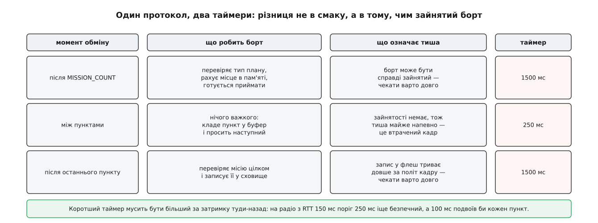
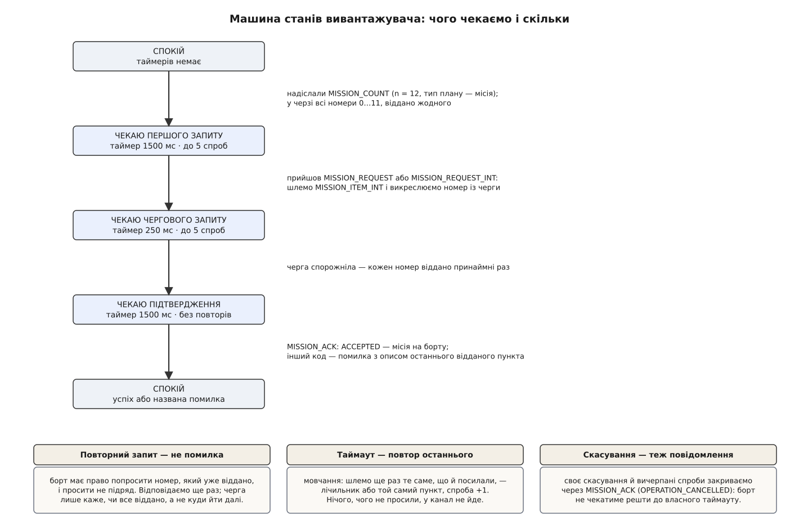

# ⚙️ Вивантажувач місії з нуля: код, що доводить план до борту

Ось повний робочий клієнт протоколу місій — приблизно двісті рядків, які беруть список пунктів і **або кладуть його на борт цілим, або називають, на якому саме пункті й чому зламалося**. Таке доводиться написати кожному, хто робить свій передпольотний скрипт, міст «хмара — апарат» чи власну наземну станцію; і майже кожна перша спроба виглядає як цикл «шлемо пункт, чекаємо, шлемо наступний» — а він не працює вже на другому втраченому кадрі.

## Задача

**Дано.** Список пунктів у нашій нумерації. Канал, який губить кадри й доставляє їх із затримкою в сотні мілісекунд, — про його влаштування описано в [пакеті MAVLink](root:sys-dron/mavlink-packet): кадр із адресами, контрольною сумою й без жодних гарантій доставки. І борт, який в обміні **головний**: ми оголошуємо, скільки пунктів маємо, а далі лише відповідаємо на його запити.

**Треба.** Довести всі пункти до борту, і щоб результат був одним із двох: «місія на борту, стільки-то пунктів» або «не вийшло, ось причина й ось пункт, на якому вона спрацювала». Третій результат — «начебто поїхало» — заборонений: на ньому пілот злітає з місією, якої на борту немає.

Три умови роблять задачу нетривіальною.

**Нічого, чого не просили.** Приймач сам замовляє, який пункт йому потрібен. Пункт, надісланий без запиту, у кращому разі буде відкинутий, у гіршому — прошивка вважатиме нумерацію порушеною й обірве обмін. Конвеєра тут немає: [вікна з кількома кадрами в польоті](root:com-transport/sliding-window-sizing-bdp) протокол місій не має взагалі.

**Скінченність.** На каналі, який губить помітну частину кадрів, процедура мусить закінчитися — успіхом чи відмовою, але закінчитися. Мовчання борту не має ані змісту, ані адреси: воно однаково означає і «твій пункт не долетів», і «моя відповідь не долетіла», і «я вимкнувся».

**Діагностика з адресою.** Борт відповідає кодом причини, але **не каже, на чому саме спіткнувся**. Код `MAV_MISSION_UNSUPPORTED_FRAME` у місії на двісті пунктів без прив'язки до пункту — це не діагноз, а загадка. Прив'язку доводиться робити самому.

## Ідея: три рішення, з яких виростає весь код

### Черга номерів, а не курсор

Спокуслива структура стану — одне число `next`, яке після кожного відправленого пункту збільшується на одиницю. Вона ламається на першій же особливості протоколу: **порядок запитів визначає борт**, і він не зобов'язаний питати підряд. Прошивка, у якої загубився шостий пункт, попросить шостий удруге — і курсор, що вже стоїть на сьомому, або віддасть не те, або оголосить помилку там, де все гаразд.

Тому стан обміну — це **множина номерів, яких борт іще не забирав**. Прийшов запит на `seq` — віддаємо `items[seq]` і викреслюємо `seq` із множини. Порожня множина означає рівно одне: кожен номер віддано принаймні раз, більше нам ініціювати нічого. Множина при цьому **не вирішує, що слати**: що слати, каже запит. Вона лише відповідає на питання «чи все віддано».

Різниця здається дрібною, поки не подивитися на повторний запит: із чергою він обробляється тим самим кодом, що й первинний, і не потребує жодної окремої гілки. Викреслення з множини, у якій елемента вже немає, — операція без наслідків.

### Два таймери, бо тиша означає різне

Тиша в каналі — єдина ознака біди, яку ми маємо, і питання лише в тому, скільки її терпіти. Одне значення тут не годиться, бо в різних місцях обміну мовчання борту має різні причини.


*Довгий таймер стоїть там, де борт справді щось робить; короткий — там, де він не робить нічого, тож тиша майже напевно означає втрачений кадр.*

Півтори секунди після лічильника — це запас на роботу: борт перевіряє тип плану, рахує, чи вистачить пам'яті, готує приймання. Півтори секунди після останнього пункту — запас на запис у флеш-пам'ять, який на дешевому контролері триває помітно довше за політ кадру. А чверть секунди між пунктами — це очікування в уже розігнаному обміні, де борт кладе пункт у буфер і одразу просить наступний; тут мовчання майже напевно означає втрачений кадр, і чекати довше — просто дарувати час.

Нижню межу короткого таймера задає арифметика, а не смак.

**Скільки мусить чекати короткий таймер**

```
затримка туди-назад на телеметричному радіо   RTT ≈ 150 мс
поріг 250 мс:  250 > 150 → відповідь устигає, повтор іде лише на справжню втрату
поріг 100 мс:  100 < 150 → таймер спрацьовує ЗАВЖДИ, кожен пункт іде двічі,
               канал забитий удвічі, втрат стає більше — і так по колу
```

> 🔧 **Навіщо це.** Якщо між станцією й апаратом стоїть не радіо, а мобільний інтернет, затримка туди-назад легко переростає 400 мс — і зашитий поріг 250 мс перетворює кожен пункт на пару дублікатів. Короткий таймер має бути налаштовним і братися **з виміряної затримки каналу**, а не з константи в коді. Виміряти її просто: `PING` або власний оберт «запит — відповідь» перед початком вивантаження.

Лічильник спроб — п'ять. Не тому, що п'ять чарівне, а тому, що добуток «спроби × таймер» задає час, після якого ми здаємося: п'ять по чверть секунди — трохи більше секунди на пункт, п'ять по півтори секунди на лічильнику — сім із половиною секунд на те, щоб борт узагалі озвався. Лічильник обнуляється на **кожному русі вперед**, тобто на кожному прийнятому запиті: п'ять спроб витрачаються на один пункт, а не на всю місію.

### Стан — це пара, а не одне число

Хвіст попередньої розмови — окремий клас неприємностей. Повільна відповідь на скасовану транзакцію приходить тоді, коли вже почалася нова, і без захисту вона зіб'є нову з ніг.

Тому стан складається з двох незалежних величин: **тип транзакції** (пишемо, читаємо, видаляємо, спокій) і **очікуване повідомлення** (запит, підтвердження, нічого). Кожне вхідне повідомлення звіряється з цією парою, і невідповідність — не помилка, а привід мовчки викинути кадр. Помилку оголошує тиша, а не несподіванка.

Тут же живе й обмеження «одна транзакція за раз». Протокол не має поля, яким можна було б розрізнити дві одночасні розмови на одну тему: якби ми вели два записи місії паралельно, ми не змогли б сказати, до котрого з них належить наступний запит. Тож друга спроба почати просто відмовляється.


*Уся машина: чотири стани, чотири переходи вперед і три правила на все інше. Таймер вибирається не станом, а тим, що ми щойно надіслали й чи спорожніла черга.*

Загальний каркас — таймаут, повтор, лічильник спроб — це та сама схема, що й у будь-якому [надійному обміні поверх ненадійного каналу](root:com-transport/reliable-link); особливість тут лише в тому, що підтвердженням служить не окреме повідомлення, а наступний запит.

### Зсув `DO_JUMP` робиться один раз, на вході

Прошивки розходяться в тому, чи є домашня точка нульовим пунктом місії. Питання «чи вставляти дім» вирішує [плагін прошивки](root:sys-dron/firmware-plugin), а нам лишається наслідок: коли дім вставлено, **усі номери поїхали на одиницю**, і команда `DO_JUMP`, у першому параметрі якої лежить номер цілі, мусить поїхати разом із ними.

Місце цього зсуву в коді важливіше, ніж здається. Спокуса — робити його в момент відправлення пункту: там під рукою і номер, і прапорець прошивки. Але відправлення повторюється: втратився кадр — той самий пункт іде вдруге, і другий зсув відправить `DO_JUMP` на пункт, який ніхто не планував. Тому зсув — частина **підготовки списку**, разом із вставленням дому: після `begin()` масив уже в бортовій нумерації, і надсилання стає чистою операцією без побічних наслідків.

Ціль `DO_JUMP` живе в полі, оголошеному як число з рухомою комою, — саме тому в коді нижче вона зчитується округленням, а не зведенням типу. Для номерів пунктів це нешкідливо: [точності float](root:hw-arch/floating-point) вистачає на цілі значно більші за будь-яку реальну місію, а от відкидання дробової частини після арифметики зі зсувом могло б дати `2` там, де мало бути `3`.

## Код

Дві реалізації того самого: перша — для станції чи бортового мосту, де важать буфери й пакування кадру; друга — для скрипта, яким переливають місію на майданчику.

:::tabs
:::code proj-plan-upload/cpp/main.cpp
:::code proj-plan-upload/py/main.py
:::

У Python-варіанті машину станів згорнуто в цикл: `recv_match` із розрахованим залишком до дедлайну робить те саме, що явний таймер у C++, а повернене `None` і є спрацюванням таймера. Обидві версії однаково беруть час із **монотонного годинника**, а не з настінного: [настінний час стрибає](root:sf-apps/monotonic-vs-wall-time) при синхронізації з супутниками чи мережею, і стрибок назад посеред вивантаження заморозив би дедлайн на невизначений час.

## Що це коштує

Ціна протоколу — один оберт по каналу на кожен пункт, і саме вона визначає, скільки триває кнопка «Вивантажити».

**Сто пунктів на телеметричному радіо**

```
кадр MISSION_ITEM_INT      12 Б обгортки MAVLink 2 + 38 Б полів   =  50 Б
кадр MISSION_REQUEST_INT   12 Б обгортки + 5 Б полів              =  17 Б
на один пункт                                     50 + 17         =  67 Б

N = 100 пунктів
трафік                     100 · 67                               ≈  6.7 кБ
ефір на 57600 бод (≈ 5760 Б/с)                                    ≈  1.2 с
обертів по каналу          N + 2                                  =  102
час                        102 · 0.150 с                          ≈  15 с
```

П'ятнадцять секунд проти однієї — тобто **дванадцять частин часу з тринадцяти витрачено на очікування, а не на передавання**. Вузьке місце тут не швидкість каналу, а його затримка, і збільшення швидкості радіо вдвічі майже нічого не змінить.

Утрати додають до цього рівно те, що коштує повтор.

**Той самий обмін на каналі, який губить десяту частину кадрів**

```
утрата в один бік              p = 0.10
оберт удався                   q = (1 − p)² = 0.81
обертів на пункт у середньому  1 / q ≈ 1.23
доплата часу на пункт          0.23 · 250 мс ≈ 58 мс
час на сто пунктів             15 + 100 · 0.058 ≈ 21 с
```

Двадцять одна секунда замість п'ятнадцяти — місія доїде. А тепер підставмо в ту саму формулу короткий таймер 1500 мс замість 250: доплата стає 0.23 · 1500 ≈ 345 мс на пункт, і ті самі сто пунктів ідуть майже п'ятдесят секунд. Ось звідки взялася потреба в **двох** таймерах, а не в одному обережному.

## Підводні камені

**Курсор замість черги.** Найпоширеніша помилка першої реалізації. Вона не виявляється на локальному з'єднанні через симулятор, де нічого не губиться й борт питає підряд, — і вилазить на майданчику при першому ж повторному запиті.

**`seq` із запиту — це індекс у наш масив.** Він приїхав по мережі, тобто його значення нам ніхто не гарантував. У C++ звертання `_items[seq]` без перевірки межі — це читання за межами буфера з даних, які надіслав хтось інший; у Python — виняток посеред обміну. Перевірка `seq >= _items.size()` у коді стоїть не для порядку.

**Відповідь завжди `MISSION_ITEM_INT`.** Старий `MISSION_REQUEST` і новий `MISSION_REQUEST_INT` обробляє один код, але відповідь на обидва — цілочислова. Відповісти дробовим `MISSION_ITEM` означало б віддати координату з кроком близько сорока сантиметрів там, де прошивка вміє прийняти крок в одинадцять міліметрів.

**`mission_type` — у кожному повідомленні обміну.** Тип плану розділяє три незалежні простори номерів: місія, геозона, точки збору. Забути його в одному повідомленні з десятка означає, що геозона поїде як місія й затре маршрут. Нуль у цьому полі — не «не вказано», а «місія»: розширені поля MAVLink 2 приймач добиває нулями, тож «поля немає» й «поле дорівнює нулю» на дроті нерозрізненні. Що саме кладуть у пункти геозони й чому її, на відміну від зйомки, можна зібрати назад, — окрема історія [геозони в автопілоті](root:sys-dron/geofence).

**Подвійний зсув `DO_JUMP`.** Якщо зсув робиться під час відправлення, а не під час підготовки, будь-який повтор пункту зсуває ціль удруге. Помилка тиха: місія вивантажиться, борт її прийме, і апарат стрибне на пункт, сусідній із задуманим. У ArduPilot цього класу бід можна уникнути зовсім — команди `JUMP_TAG` і `DO_JUMP_TAG` посилаються на мітку, а не на номер, і зсув їх не зачіпає.

**Скасування — це повідомлення, а не мовчанка.** Просто перестати відповідати означає лишити борт у напіврозмові: він чекатиме решти пунктів до власного таймауту й може відкинути нашу нову спробу як спробу вести дві транзакції одразу. `MISSION_ACK` із кодом `MAV_MISSION_OPERATION_CANCELLED` закриває розмову з обох боків одразу.

**Пізні кадри скасованої транзакції.** Фільтр за парою «тип транзакції + очікуване повідомлення» ловить їх усі, поки таймер — це перевірка дедлайну в циклі. Щойно таймер стає викликом за подією, з'являється ще одна діра: колбек скасованого таймера вже стоїть у черзі й спрацює після скидання стану. Проти цього допомагає лічильник поколінь — номер транзакції, який колбек порівнює з поточним і при розбіжності мовчки виходить. Той самий прийом, що й у будь-якому [автоматі станів](root:sf-apps/state-machine-model) з асинхронними подіями.

**Розбір байтів у C++ має глобальний стан.** `mavlink_parse_char` тримає незавершений кадр у статичному буфері **на канал** (`MAVLINK_COMM_0`, `MAVLINK_COMM_1`, …). Два потоки, що розбирають один канал, псують один одному кадри; два з'єднання, які помилково користуються одним номером каналу, склеюють свої байти в кашу. Один канал — один номер, один потік. І буфер відправлення мусить бути щонайменше `MAVLINK_MAX_PACKET_LEN`: у MAVLink 2 з підписом кадр доходить до 280 байтів, а зашитих «64 — усім вистачить» вистачає рівно до першого довгого повідомлення.

**Перекіс версій згенерованих заголовків.** Поля `opaque_id` у `MISSION_COUNT` і `MISSION_ACK` додали пізніше за решту, тому в старіших заголовках останнього аргументу в `..._pack` просто немає, а в pymavlink відрізняється список параметрів у `..._send`. Це ловиться на першій же збірці; лікується або оновленням заголовків, або прибиранням аргументу — а в Python перевіряється одним рядком `help(conn.mav.mission_count_send)`.

**Провалена спроба лишає невизначеність.** Протокол не обіцяє, у який момент борт застосовує нову місію, і після обірваного вивантаження ми не знаємо, що там лежить, — саме тому код у такому разі каже «невідомо», а не «на борту стара». Єдина чесна перевірка — прочитати з борту `MISSION_COUNT` і подивитися на кількість. Тому в бойовому скрипті вивантаження завжди йде в парі зі зворотним читанням: тридцять секунд ефіру дешевші за зліт із чужим маршрутом.
