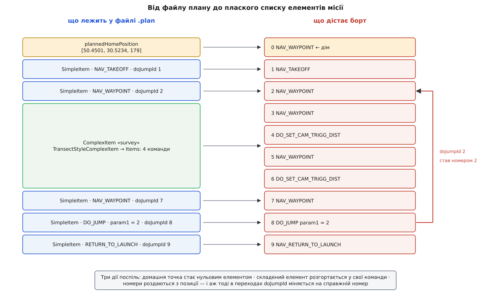
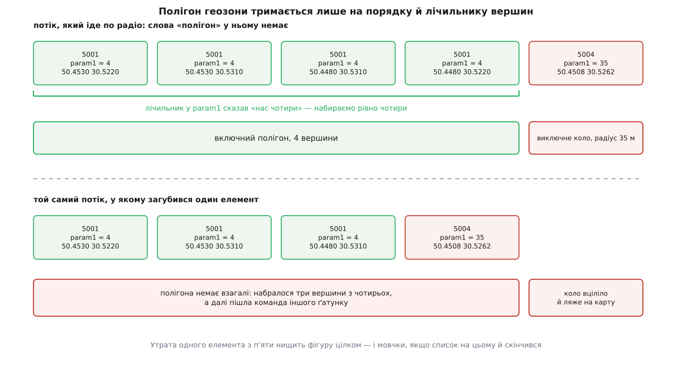

# ⚙️ Файл `.plan` очима борту: розбір із робочим кодом

Це невелика програма, яка перетворює збережений `.plan` на той самий плаский список команд, що його автопілот дістане по радіо, — щоб подивитися на план очима апарата, не піднімаючи ані станції, ані самого апарата. Дорогою стане видно, чому номера елемента у файлі немає взагалі, звідки він береться й що це робить із переходами.

## Задача

На вході — файл. На виході — список, у якому кожен рядок є одним елементом місії MAVLink: номер, команда, система координат, сім числових параметрів. Що вміщає один такий елемент і чому параметрів саме сім — тема про [елементи місії й команди](root:sys-dron/mission-items); тут вони цікавлять нас як готова форма, у яку все врешті лягає. Сам файл — звичайний [JSON](root:sf-data/json-format), текстове дерево об'єктів і масивів.

П'ять речей, які треба зробити правильно:

1. **Домашня точка.** У файлі вона лежить окремим ключем `plannedHomePosition`, поза списком елементів. На дроті вона — звичайний нульовий елемент.
2. **Прості елементи** переносяться майже як є — з однією тонкістю в параметрах, через яку легко змінити наказ, не помітивши цього.
3. **Складений елемент** — одна фігура у файлі — розгортається у стільки команд, скільки в ньому насправді.
4. **Наскрізна нумерація.** Номерів у файлі немає; вони обчислюються з позиції в готовому списку.
5. **Переходи.** Команда `DO_JUMP` у файлі посилається не на номер, а на сталу тотожність `doJumpId`; справжній номер підставляється в останню мить.

Навіщо це поза станцією: звірити план із тим, що вже лежить на борту; прогнати перевірку плану в складанні, не піднімаючи вікон; згодувати список симуляторові; зрозуміти, чому апарат після зйомки пішов не туди.

## Що у файлі є і чого в ньому немає

Ось місія з невеликого плану — зліт, точка, зйомка полігону, ще точка, перехід і повернення додому:

```json
{
  "fileType": "Plan", "version": 1, "groundStation": "QGroundControl",
  "mission": {
    "version": 2, "firmwareType": 12, "vehicleType": 2,
    "cruiseSpeed": 15, "hoverSpeed": 5, "globalPlanAltitudeMode": 1,
    "plannedHomePosition": [50.4501, 30.5234, 179],
    "items": [
      { "type": "SimpleItem", "command": 22, "frame": 3, "autoContinue": true, "doJumpId": 1,
        "params": [15, 0, 0, null, 50.4501, 30.5234, 50],
        "Altitude": 50, "AltitudeMode": 1, "AMSLAltAboveTerrain": null },

      { "type": "SimpleItem", "command": 16, "frame": 3, "autoContinue": true, "doJumpId": 2,
        "params": [0, 0, 0, null, 50.4509, 30.5241, 50],
        "Altitude": 50, "AltitudeMode": 1, "AMSLAltAboveTerrain": null },

      { "type": "ComplexItem", "complexItemType": "survey", "version": 5,
        "angle": 0, "entryLocation": 0,
        "polygon": [[50.4520, 30.5240], [50.4520, 30.5290], [50.4495, 30.5290], [50.4495, 30.5240]],
        "TransectStyleComplexItem": {
          "version": 2, "CameraShots": 24,
          "Items": [
            { "type": "SimpleItem", "command": 16,  "frame": 3, "autoContinue": true, "doJumpId": 3,
              "params": [0, 0, 0, null, 50.4519, 30.5243, 50] },
            { "type": "SimpleItem", "command": 206, "frame": 2, "autoContinue": true, "doJumpId": 4,
              "params": [25, 0, 0, 0, 0, 0, 0] },
            { "type": "SimpleItem", "command": 16,  "frame": 3, "autoContinue": true, "doJumpId": 5,
              "params": [0, 0, 0, null, 50.4497, 30.5243, 50] },
            { "type": "SimpleItem", "command": 206, "frame": 2, "autoContinue": true, "doJumpId": 6,
              "params": [0, 0, 0, 0, 0, 0, 0] }
          ]
        } },

      { "type": "SimpleItem", "command": 16, "frame": 3, "autoContinue": true, "doJumpId": 7,
        "params": [0, 0, 0, null, 50.4506, 30.5252, 50],
        "Altitude": 50, "AltitudeMode": 1, "AMSLAltAboveTerrain": null },

      { "type": "SimpleItem", "command": 177, "frame": 2, "autoContinue": true, "doJumpId": 8,
        "params": [2, 2, 0, 0, 0, 0, 0] },

      { "type": "SimpleItem", "command": 20, "frame": 2, "autoContinue": true, "doJumpId": 9,
        "params": [0, 0, 0, 0, 0, 0, 0] }
    ]
  }
}
```

Числа команд тут справжні: 22 — зліт, 16 — політ до точки, 206 — умикання знімання через задану відстань, 177 — перехід, 20 — повернення до старту. Число `frame` — система координат: 3 означає висоту над домашньою точкою, 2 — що координат у команді немає взагалі.

У цьому масиві шість елементів; на борт поїде десять команд. А номера — того самого, яким автопілот доповідає про поточний крок, — у файлі немає ніде.

Три розбіжності між файлом і дротом видно одразу.

**Дім стоїть осторонь.** `plannedHomePosition` — не крок маршруту, а довідка «звідки все почнеться», і в редакторі вона живе в шапці плану. У списку ж MAVLink домашня точка займає нульову позицію як звичайний елемент — тож її треба зліпити самому.

**Складений елемент — одна річ.** Об'єкт `"type": "ComplexItem"` описує зйомку полігону так, як її задав користувач: контур, кут галсів, точка входу. Те, у що це перетворюється — окремі галси й команди камери, — лежить усередині, у вкладеному `TransectStyleComplexItem` під ключем `Items`. Станція зберігає туди вже розгорнуті команди навмисно: щоб не перераховувати геометрію [зйомки](root:sys-dron/survey-patterns) щоразу, коли файл відкривають. Для нашої задачі це подарунок — розгортати нічого не треба, досить узяти готове.

**Номерів немає, є тотожності.** Замість номера кожен елемент несе `doJumpId`, а команда переходу тримає цю тотожність у своєму першому параметрі: `"params": [2, 2, …]` означає «перейти на елемент із тотожністю 2, повторити двічі». Це не примха формату, а єдиний спосіб пережити редагування: досить укинути одну точку перед зйомкою — і всі номери після неї поїдуть, а тотожність не зрушить.

> 🔧 **Навіщо це.** Звідси випливає порядок дій, який не можна переставити. Нумерувати можна лише після розгортання — доти невідомо, скільки позицій займе складений елемент. Підставляти номери в переходи можна лише після нумерації — доти невідомо, який номер має ціль. Тому проходів рівно три, і саме в такому порядку.



*Шість об'єктів у файлі стають десятьма командами; перехід, що у файлі вказував на тотожність 2, на дроті вказує на номер 2 — збіг тут випадковий і зникне після першої ж вставки.*

## Код

Мова — C++, як і в самій станції: програма повторює її рішення крок у крок, і тримати обидві сторони однією мовою простіше, ніж щоразу звіряти переклад. Розбір JSON — `nlohmann/json`, один заголовний файл. Друга вкладка — те саме на Python, коли треба швидко зазирнути в чужий файл і нічого не збирати.

:::tabs
:::code proj-plan-json-roundtrip/cpp/plan_flatten.cpp
:::code proj-plan-json-roundtrip/py/plan_flat.py
:::

На нашому файлі це друкує:

```
ArduPilot: домашня точка лишається номером 0
seq  команда                frame     p1     широта    довгота  висота  джерело
  0  NAV_WAYPOINT               0      0    50.4501    30.5234   179.0  plannedHomePosition
  1  NAV_TAKEOFF                3     15    50.4501    30.5234    50.0  SimpleItem
  2  NAV_WAYPOINT               3      0    50.4509    30.5241    50.0  SimpleItem
  3  NAV_WAYPOINT               3      0    50.4519    30.5243    50.0  survey
  4  DO_SET_CAM_TRIGG_DIST      2     25     0.0000     0.0000     0.0  survey
  5  NAV_WAYPOINT               3      0    50.4497    30.5243    50.0  survey
  6  DO_SET_CAM_TRIGG_DIST      2      0     0.0000     0.0000     0.0  survey
  7  NAV_WAYPOINT               3      0    50.4506    30.5252    50.0  SimpleItem
  8  DO_JUMP                    2      2     0.0000     0.0000     0.0  SimpleItem
  9  NAV_RETURN_TO_LAUNCH       2      0     0.0000     0.0000     0.0  SimpleItem
```

Колонка «джерело» — не прикраса: рядки 3–6 узялися з одного об'єкта у файлі, і саме вони роз'їдуться, щойно користувач поворухне контур зйомки.

## Останній крок робить не файл, а прошивка

Список готовий — але одне число в ньому ще може змінитися, і файл до цього непричетний. Автопілоти не згодні між собою, чи має домашня точка їхати по дроту. ArduPilot чекає її нульовим елементом; PX4 не хоче її взагалі й вимагає, щоб маршрут починався з першої справжньої команди. Станція розв'язує це на самому виході, у спільній для трьох списків машині обміну:

:::code proj-plan-json-roundtrip/cpp/ostannii-krok-robyt-ne.cpp

Дві дії в одному місці варті уваги. Номер зсувається на одиницю — це очевидно. Але разом із ним зсувається `param1` у кожному переході, бо той уже не тотожність, а номер; забути про нього означало б відправити апарат на сусідній крок. Ось той самий план для PX4:

```
PX4: домашньої точки на дроті немає, решта зсунулася на одиницю
seq  команда                frame     p1     широта    довгота  висота  джерело
  0  NAV_TAKEOFF                3     15    50.4501    30.5234    50.0  SimpleItem
  1  NAV_WAYPOINT               3      0    50.4509    30.5241    50.0  SimpleItem
  2  NAV_WAYPOINT               3      0    50.4519    30.5243    50.0  survey
  3  DO_SET_CAM_TRIGG_DIST      2     25     0.0000     0.0000     0.0  survey
  4  NAV_WAYPOINT               3      0    50.4497    30.5243    50.0  survey
  5  DO_SET_CAM_TRIGG_DIST      2      0     0.0000     0.0000     0.0  survey
  6  NAV_WAYPOINT               3      0    50.4506    30.5252    50.0  SimpleItem
  7  DO_JUMP                    2      1     0.0000     0.0000     0.0  SimpleItem
  8  NAV_RETURN_TO_LAUNCH       2      0     0.0000     0.0000     0.0  SimpleItem
```

Практичний висновок неприємний: питання «який номер має третя точка мого маршруту» не має відповіді без назви прошивки. Той самий файл дає два різні списки, і апарат у польоті доповідатиме про поточний крок числами з тієї версії, яку прийняв. Як цей список їде на борт елемент за елементом — тема про [обмін планом із апаратом](root:sys-dron/plan-exchange).

## Зворотний бік: геозона з плаского потоку

Маршрут ми розгортали з файлу. Геозона цікава протилежним напрямком — тим, як її **збирають назад**, коли список прочитано з борту. [Геозона](root:sys-dron/geofence) — межа, за яку апаратові виходити не можна; у файлі вона лежить готовими фігурами:

```json
"geoFence": {
  "version": 2,
  "polygons": [
    { "version": 1, "inclusion": true,
      "polygon": [[50.4530, 30.5220], [50.4530, 30.5310], [50.4480, 30.5310], [50.4480, 30.5220]] }
  ],
  "circles": [
    { "version": 1, "inclusion": false,
      "circle": { "center": [50.4508, 30.5262], "radius": 35 } }
  ]
}
```

А протокол місій уміє передавати лише елементи — команду з номером і сімома параметрами. Коло вкладається в один елемент природно: центр у параметрах координат, радіус у першому. Полігон не вкладається ніяк: одна вершина — один елемент, і сказати «наступні чотири елементи є однією фігурою» протокол не вміє. Тому в кожну вершину кладуть **лічильник**: скільки всього вершин у полігоні, якому вона належить. Уся структура фігури тримається на цьому числі й на порядку елементів.

Ця програма проходить коло цілком: бере геозону з файлу, робить із неї потік елементів — точно як менеджер геозони перед вивантаженням, — а потім складає фігури назад із того потоку.

:::code proj-plan-json-roundtrip/cpp/fence_roundtrip.cpp

Вивід:

```
на дріт іде 5 елементів:
  5001  p1=4.0      50.4530    30.5220
  5001  p1=4.0      50.4530    30.5310
  5001  p1=4.0      50.4480    30.5310
  5001  p1=4.0      50.4480    30.5220
  5004  p1=35.0     50.4508    30.5262

зібралося назад:
  полігон включний, вершин 4
  коло виключне, радіус 35 м, центр 50.4508 30.5262

той самий потік без однієї вершини:
  коло виключне, радіус 35 м, центр 50.4508 30.5262
  ! недобраний полігон: 3 вершин із 4, а далі вже коло
```

Останні три рядки — уся суть цього кодування. Загублений елемент не робить полігон трохи меншим; він знищує його цілком, і на карті лишається саме коло.



*Чотири вершини з однаковим лічильником складаються в полігон; три вершини з чотирьох не складаються ні в що.*

Інші дві скарги ловлять решту способів зіпсувати той самий потік. Лічильник, що змінився посеред набору, означає, що межа між фігурами стала невизначеною: перші вершини вже прийнято під одне число, наступні прийшли з іншим — і сказати, де кінчається перша фігура, вже нема з чого. Незнайома команда спиняє розбір цілком, бо порядок є єдиною структурою цього списку, а незрозумілий елемент рве саме порядок. Окремо варто перевіряти й сам лічильник: нуль або одиниця в `param1` — це не полігон, і чесна скарга тут краща за набір, який ніколи не завершиться.

У самій станції цей розбір написано так само — і з двома дірками, які варто знати. Перевірку «а чи не лишилося недобраних вершин» там роблять лише перед колом; ані перед точкою повернення, ані наприкінці списку її немає, тож потік, що обірвався на середині полігону, зникає **мовчки**. Друга дірка тонша: змінна `loadFailed`, за якою мала б іти очистка після помилки, оголошена й перевіряється, але їй ніде не присвоюють `true` — тож навіть після скарги частково зібрані фігури доходять до контролера й лягають на карту. Обидві поведінки видно в чинному коді `GeoFenceManager::_planManagerLoadComplete()`; звідси й практичне правило перечитувати геозону після вивантаження та дивитися на карту, а не на повідомлення про успіх.

## Складність і пастки

Розбір лінійний: один прохід по файлу, один по готовому списку для нумерації, один для переходів; словник тотожностей робить пошук цілі логарифмічним. Станція шукає ціль вкладеним циклом по видимих елементах — квадратично, — і це нормально, бо видимих елементів десятки, а не тисячі; повторювати цей вибір у програмі, яка працює вже з розгорнутим списком у тисячі команд, не варто.

Що ламається на практиці:

**`doJumpId` у щойно збереженому файлі дорівнює номеру.** Станція, зберігаючи елемент, кладе туди його теперішній номер — тому спокуса взяти `param1` переходу за номер напряму спрацює майже завжди. І перестане спрацьовувати рівно тоді, коли файл прийде з іншої програми або хтось допише елемент руками. Зіставлення за тотожністю коштує один словник і не ламається ніколи.

**Перехід усередину складеного елемента неможливий.** Станція, читаючи файл, шукає тотожність цілі лише серед **простих** елементів верхнього рівня — команди всередині зйомки для неї невидимі. Файл із переходом на галс не відкриється взагалі: розбір спиниться з помилкою «Could not find doJumpId». Наш код розгортає все підряд і міг би таку ціль знайти, але робити цього не варто — вийшов би список, якого станція не покаже.

**Розгорнуті команди у файлі — кеш, а не істина.** Якщо правити `polygon` зйомки текстовим редактором і не чіпати `Items`, на борт поїде стара геометрія: станція після завантаження бере збережені елементи як є й перераховує їх лише тоді, коли щось у налаштуваннях складеного елемента справді зміниться.

**Не всі складені елементи кешують свої команди.** Готовий список тримають лише елементи галсової породи — зйомка полігону, коридорна зйомка. Схеми посадки зберігають параметри, з яких команди народжуються заново, і розгорнути їх без повторення тієї самої геометрії неможливо. Тому в коді тут виняток, а не мовчазний пропуск: краще відмовитися, ніж віддати неповний список як повний.

**`null` у параметрах — це NaN, а не нуль.** У JSON немає способу записати не-число, тому станція пише `null`, і в четвертому параметрі точки це означає «кут лишити як є». Наївне читання перетворить його на нуль — тобто на наказ «розвернутися на північ», який ніхто не давав. Чим NaN відрізняється від будь-якого числа й чому його не можна порівнювати звичним способом — тема про [числа з рухомою комою](root:hw-arch/floating-point).

**Старі файли влаштовані інакше.** У першій версії формату елемент мав чотири параметри й окремий ключ `coordinate`; нинішні сім параметрів зібрані з них. Файли тієї доби ще трапляються, і читач, який вимагає рівно семи параметрів, на них спіткнеться — з чесною помилкою, а не з тихим сміттям, і це правильний бік для помилки.

**Домашня точка у файлі — запланована.** Справжній дім автопілот визначає сам у момент зброєння, за своїм приймачем. Нульовий елемент, який ми зліпили з `plannedHomePosition`, потрібен станції, щоб намалювати лінію від старту й порахувати відстань; апарат може прийняти його й одразу перезаписати власним. Чекати, що апарат повернеться саме в цю точку, підстав немає.
