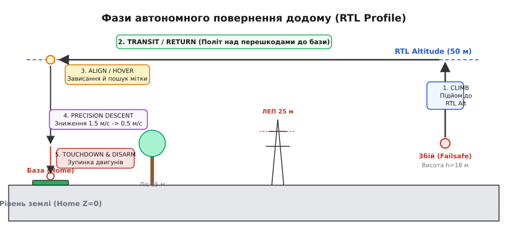
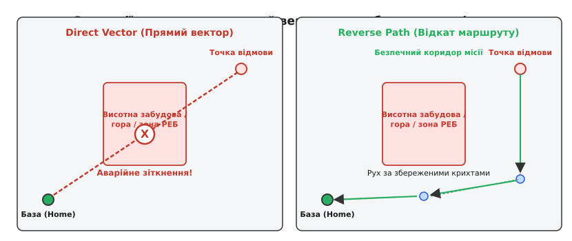
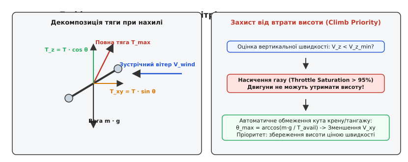
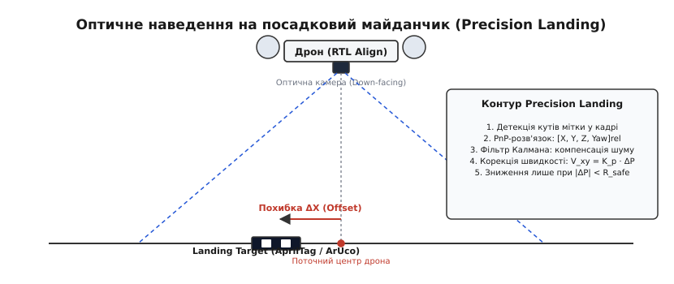

# Повернення додому: висота, шлях, поведінка на місці

<preknowlist>
- [Безпечний відмов (failsafe)](root:sys-dron/failsafe) — виявлення обриву зв'язку та запуск рятувальних процедур
- [Автомат польотних режимів](root:sys-dron/mode-state-machine) — перемикання станів і контурів керування автопілота
- [Вітер і знос](root:sys-dron/viter-i-znos) — аеродинамічний знос, різниця між повітряною та шляховою швидкістю
- [Автопосадка](root:sys-dron/avtoposadka) — фази зниження та критерії зупинки двигунів
- [Маршрут як список точок](root:sys-dron/waypoint-route-sequencing) — навігація за дороговказами та цільові вектори
</preknowlist>

Дрон виконує картографування лісового масиву на висоті вісімнадцять метрів за чотири кілометри від точки зльоту. Раптовий порив вітру відносить апарат за пагорб, спрямована антена втрачає радіогоризонт, і телеметричний лінк обривається. Якщо бортовий комп'ютер у цю ж секунду прокладе пряму лінію до точки старту й рушить уперед на поточній висоті, через двісті метрів апарат вріжеться у верхівки тридцятиметрових сосен або лінію електропередач. Якщо ж він спробує сісти там, де стоїть, літій-полімерна батарея сяде в непрохідній хащі, звідки його не дістати. Єдиний порятунок машини полягає в автоматичній процедурі **повернення на базу** (RTL, *Return to Launch* / *Return to Home*) — комплексному автоматі станів, який спершу виводить апарат на чистий ешелон, обирає безпечний коридор польоту, бореться зі зносом зустрічного вітру, оптично центрується над посадковим п'ятачком і глушить мотори лише після надійного контакту з опорою.

Повернення на точку старту — це не одноразова зміна координати цілі в польотному контролері, а суворий багатофазний процес. Кожна його фаза розв'язує окрему фізичну та просторову проблему, має власні критерії завершення й аварійні запобіжники.


*П'ять обов'язкових фаз процедури повернення додому: вертикальний набір безпечної висоти над перешкодами, горизонтальний крейсерський транзит до точки старту, зависання та оптичний пошук майданчика, прецизійне зниження з контролем горизонтального зміщення та зупинка моторів за детектом контакту з ґрунтом.*

---

### Фаза 1: Безпечна висота повернення (Safe Altitude Climb)

Перша небезпека після активації аварійного повернення — наявність наземних перешкод між поточною точкою та базою. Промислові склади, дерева, опори зв'язку та дроти високовольтних ліній сягають висоти від 15 до 45 метрів. Якщо дрон виконував низьковисотне завдання (сканування рельєфу, огляд фасадів чи пошук об'єктів), його робочий ешелон завідомо нижчий за верхівки цих перешкод.

Тому перший інваріант автомата RTL звучить так: **жодного горизонтального руху до досягнення безпечної висоти**.

Автопілот обчислює цільову висоту першої фази `h_target` за правилом максимуму:

```
h_target = max(h_current, h_rtl_alt)   [вибір ешелону повернення]
```

де `h_current` — поточна барометрична або злита висота над точкою старту (Home Altitude), а `h_rtl_alt` — наперед заданий параметр безпечного ешелону (зазвичай 30–60 метрів).

Тут криється критична деталь логіки:
1. Якщо дрон перебуває **нижче** безпечного ешелону (`h_current < h_rtl_alt`), апарат зависає на місці за координатами `(X, Y)`, переводить вектор тяги суворо у вертикаль і здійснює підйом зі швидкістю 2–3 м/с до позначки `h_rtl_alt`. Горизонтальні координати заблоковані контуром позиціювання, що виключає дрейф у дерева під час набору висоти.
2. Якщо ж дрон на момент збою летів на висоті 120 метрів (`h_current > h_rtl_alt`), контролер **не має права знижуватися** до 50 метрів посеред маршруту. Зниження на чужій ділянці простору небезпечне: рельєф під дроном міг піднятися, або на шляху виріс пагорб. Автопілот фіксує поточні 120 метрів як маршову висоту транзиту й виконує повернення на ній, відкладаючи зниження до виходу в точку над базою.

```
                  ┌─ h_current < h_rtl ──→ Набір висоти: Z_cmd = h_rtl, (X,Y) заблоковані
h_failsafe_trigger┤
                  └─ h_current ≥ h_rtl ──→ Збереження ешелону: Z_cmd = h_current
```

Існує окремий крайовий випадок — так звана **конусна зона бази** (`RTL_CONE_DIST`). Якщо обрив зв'язку чи команда оператора сталася в момент, коли дрон висить усього за сім метрів від точки старту на висоті трьох метрів, підйом на 50 метрів вгору — це безглузда трата енергії акумулятора та часу. У сучасних прошивках (PX4, ArduPilot) впроваджено радіус ближньої зони: якщо горизонтальна дистанція до точки повернення менша за `RTL_CONE_DIST` (наприклад, 10 метрів), фаза підйому пропускається повністю, і дрон одразу переходить до фази посадки.

---

### Динамічний енергетичний бюджет повернення (Battery Return Threshold)

Повернення на базу вимагає не лише геометричної правильності, а й суворого розрахунку запасу енергії. Якщо безпілотник летить за 5 кілометрів від точки старту за сильного зустрічного вітру, зворотний шлях забере значно більше енергії, ніж політ уперед за вітром. Помилка у визначенні **точки неповернення** (*Point of No Return*, PNR) призводить до повної зупинки двигунів посеред перельоту.

Бортовий менеджер живлення безперервно розраховує енергетичний бюджет повернення `E_RTL` у режимі реального часу:

```
E_RTL = E_climb + E_transit + E_desc + E_reserve   [структура енергетичного бюджету]
```

Розрахунок складається з чотирьох складових:

1. **Енергія підйому на безпечний ешелон (`E_climb`):**
   Час підйому `t_climb` становить:
```
t_climb = max(0, (h_rtl - h_current)) / V_climb   [час вертикального підйому]
E_climb = P_climb · t_climb                       [енергія набору висоти]
```
   де `P_climb` — середня електрична потужність моторів під час вертикального набору (зазвичай на 25–40% вища за потужність висіння `P_hover`).

2. **Енергія горизонтального транзиту проти вітру (`E_transit`):**
   Шляхова швидкість руху до бази `V_ground` залежить від вектора зустрічного вітру `V_wind` та кута між вітром і курсом `β`:
```
V_ground = V_air · cos α - V_wind · cos β   [шляхова швидкість із поправкою на знос]
t_transit = D_home / V_ground               [час подолання дистанції до бази]
E_transit = P_cruise · t_transit            [енергія горизонтального перельоту]
```
   Якщо вітер посилюється до 14 м/с при власній повітряній швидкості 16 м/с, шляхова швидкість падає до `V_ground = 2 м/с`. Час польоту зростає у 8 разів, що миттєво спустошує батарею.

3. **Енергія на спуск та оптичне зависання (`E_desc`):**
```
t_desc = h_rtl / V_desc_avg + t_hover_align   [час на вирівнювання та посадку]
E_desc = P_hover · t_desc                     [енергія фінальної стадії]
```

4. **Незнижуваний резерв безпеки (`E_reserve`):**
   Запас ємності для компенсації деградації хімії батареї під навантаженням та поривів вітру (зазвичай 15–20% від повної ємності `C_bat`).

Якщо поточний залишковий заряд батареї `E_rem` наближається до розрахункового порогу:

```
E_rem ≤ E_RTL   [умова спрацьовування Battery Failsafe]
```

автопілот автоматично перехоплює керування в оператора, блокує подальше виконання місії та примусово активує режим RTL, навіть якщо зв'язок із пультом залишається ідеальним.

---

### Фаза 2: Шлях до бази — прямий вектор проти відкату траєкторії

Опинившись на безпечній висоті, дрон має подолати відстань до майданчика посадки. Традиційний і найпростіший підхід — **прямий вектор** (*Direct Vector*). Автопілот бере географічні координати домашньої точки `(Lat_home, Lon_home)` і розраховує прямий ортодромічний курс.

Прямий вектор мінімізує пройдену дистанцію і витрату енергії: дрон летить найкоротшим відрізком прямої. Проте у складних умовах прямий шлях стає смертельною пасткою.


*Зліва: прямий вектор зрізає кут і направляє апарат крізь стіну будівлі, гірський схил або зону ворожого РЕБ. Справа: алгоритм Reverse Path веде дрон назад уздовж уже перевіреного безпечного коридору місії.*

Прямий вектор зазнає краху в трьох типових ситуаціях:
- **Політ у каньйоні чи міській забудові:** апарат залітав у двір огинаючи хмарочоси; пряма лінія до бази впирається у залізобетонну стіну, яка вища за будь-який безпечний ешелон `h_rtl_alt`.
- **Зона придушення навігації (РЕБ):** дрон залетів у зону завдання в обхід відомого купола радіозавад; прямий відкат веде його точно крізь джерело глушіння, де апарат гарантовано втратить супутники й орієнтацію.
- **Гірський рельєф зі стрімким перепадом висот:** висота над рівнем моря точки старту може бути на сотні метрів нижчою за перевал, повз який щойно пролетів безпілотник.

Для вирішення цієї проблеми застосовують алгоритм **відкату за пройденим шляхом** (*Reverse Path* або *Breadcrumb Retracing*).

Під час штатного польоту бортовий навігатор безперервно записує в кільцевий буфер історію своїх координат — «крихти хліба» (*breadcrumbs*). Кожна точка містить просторовий вектор `(X, Y, Z)` та оцінку безпеки ділянки. Оскільки апарат щойно успішно подолав цей маршрут у напрямку «вперед», даний просторовий коридор гарантовано вільний від статичних фізичних перешкод.

При вході у фазу RTL список точок інвертується: остання відвідана точка стає першою проміжною ціллю, а рух здійснюється строго назад у зворотному порядку. 

Головна інженерна трудність відкату траєкторії — **надлишковість і зашумленість сирих координат**. Якщо зберігати кожну точку з частотою GPS 10 Гц, буфер переповниться за кілька хвилин, а траєкторія складатиметься з мікросіпань. Тому автопілот застосовує просторове стиснення траєкторії за алгоритмом Рамера-Дугласа-Пекера в реальному часі.

Спрощення траєкторії виконується за такими математичними критеріями:
1. **Дистанційне квантування:** нова точка `P_new` додається в буфер лише за умови, що дистанція від останнього опорного вузла перевищує просторовий поріг:
```
dist(P_new, P_last) ≥ d_min   [поріг квантування d_min = 8..15 м]
```
2. **Збереження поворотних вузлів (Corner Protection):** якщо кут зміни курсу між векторами переміщення перевищує поріг повороту:
```
|Δψ| ≥ 25°   [виявлено різкий поворот огинання перешкоди]
```
точка фіксується в пам'яті безумовно, навіть якщо відстань менша за `d_min`. Це гарантує, що контур не «зріже» кут висотної будівлі при зворотному польоті.
3. **Проріджування колінеарних відрізків (Collinear Pruning):** якщо відхилення проміжної точки `P_k` від відрізка прямої між `P_k-1` та `P_k+1` менше радіуса безпечного коридору `ε`:
```
h_perp = ( |(P_k - P_k-1) × (P_k+1 - P_k-1)| ) / |P_k+1 - P_k-1|
```
за умови `h_perp < ε` (де `ε ≈ 1.5 м`) вузол `P_k` видаляється з черги відкату.

Коли дрон під час відкату виходить із небезпечного сектора на ділянку відкритого простору, де пряма лінія до бази вільна від перешкод, алгоритм перемикається з покрокового відкату крихт на швидкісний прямий вектор.

---

### Фаза 3: Захист від втрати висоти проти вітру (Wind Drift & Climb Margin)

Повертаючись на базу, дрон нерідко зустрічає сильний зустрічний або боковий вітер. Для апаратів вертолітного та мультироторного типу вітер створює підступну аеродинамічну пастку: **дефіцит вертикальної тяги через критичний нахил корпусу**.

Щоб рухатися вперед проти зустрічного повітряного потоку зі швидкістю `V_wind`, автопілот змушений нахиляти апарат уперед на кут тангажу `θ`. Вектор повної тяги гвинтів `T_total` при цьому відхиляється від вертикалі.


*При зустрічному вітрі спроба підтримувати задану шляхову швидкість веде до збільшення кута тангажу θ. Вертикальна проєкція тяги T_z падає. Якщо газ досягає 100%, виникає дефіцит підйомної сили, і дрон починає некеровано втрачати висоту.*

Розкладемо сили, що діють на апарат масою `m`:

```
T_z  = T_total · cos θ   [вертикальна тяга для компенсації сили тяжіння]
T_xy = T_total · sin θ   [горизонтальна сила для подолання опору вітру]
```

Щоб дрон утримував стабільну висоту, вертикальна проєкція тяги зобов'язана врівноважувати вагу апарата:

```
T_z = m · g
```

Звідси випливає вираз для необхідної повної тяги при нахилі на кут `θ`:

```
T_total = (m · g) / cos θ
```

Якщо кут нахилу становить `θ = 0°`, `T_total = m · g` (рівень зависання). Але при нахилі `θ = 45°`, знаменник cos(45°) ≈ 0.707, отже двигуни мають видавати `T_total ≈ 1.41 · m · g` (тяга зростає на 41%). При нахилі `θ = 60°` потрібна подвійна тяга `T_total = 2.0 · m · g`.

Якщо максимальна сумарна тяга сисової установки `T_max` обмежена (наприклад, `T_max = 1.5 · m · g`), а швидкісний регулятор намагається пробити вітер 15 м/с і нахиляє раму на `θ = 50°`, настає **насичення регулятора газу** (*Throttle Saturation*). ШІМ-сигнал моторів упирається в 100%, але вертикальна тяга `T_z = 1.5 · m · g · cos(50°) ≈ 0.96 · m · g < m · g`.

Результат: **дрон починає мимовільно просідати вниз**. Апарат летить уперед назустріч базі, але водночас стрімко падає в дерева чи рельєф, хоча висотний контролер вимагає утримувати 50 метрів.

Щоб запобігти цій катастрофі, в архітектурі RTL реалізують **регулятор пріоритету висоти** (*Altitude Priority Governor*):
1. **Моніторинг просідання:** якщо вертикальна швидкість стає від'ємною (`V_z < -0.3 м/с`) при позитивній або нульовій уставці висоти, а вихід газу перевищує 90%, пріоритет горизонтальної швидкості негайно скидається.
2. **Динамічне обмеження кута нахилу (`θ_max`):** автопілот розраховує граничний кут тангажу, який фізично гарантує збереження вертикальної тяги:
```
θ_max = arccos( (m · g + ΔT_climb) / T_avail )
```
де `ΔT_climb` — мінімальний запас тяги на вертикальне маневрування.
3. **Жертва шляховою швидкістю заради висоти:** контролер штучно зменшує кут нахилу до `θ_max`. Дрон уповільнює рух до бази (його шляхова швидкість `V_ground` може впасти з 12 м/с до 3 м/с або навіть до нуля), але він зберігає безпечний висотний ешелон і не падає на землю. Якщо вітер перевищує максимальну повітряну швидкість апарата, дрон переходить до аварійної посадки на найближчий запасний майданчик ([rally points](root:sys-dron/rally-points)), замість самогубної спроби пробитися крізь ураган до віддаленого дому.

---

### Фаза 4: Зависання та оптичне вирівнювання (Precision Landing)

Коли дрон дістається просторових координат бази, він опиняється у циліндрі зависання над точкою старту. Наївний підхід полягає в тому, щоб одразу почати зниження за координатами супутникової навігації. Однак стандартний цивільний GNSS-приймач має похибку позиціювання в межах ±1.5–3.0 м, яка під час іоносферних збурень або відбиття сигналу від будівель (багатопроменевість, *multipath*) може зростати до 5–8 метрів.

Помилка посадки у два метри означає, що замість розчищеного майданчика дрон сяде в багажник автомобіля, воду, кущі або промахнеться повз контакти автономної зарядної станції (док-станції).

Тому сучасні автономні системи використовують **прецизійне оптичне наведення** (*Precision Landing*).


*Робота системи оптичного вирівнювання: курсова камера, спрямована вниз, розпізнає контрастну мітку AprilTag або ArUco, обчислює просторовий вектор зміщення ΔX, ΔY та формує коригувальні уставки швидкості для точного виходу в нуль.*

Контур прецизійної посадки працює за принципом оптичного зворотного зв'язку:
1. **Дворівнева ієрархія маркерів:**
   На посадковому майданчику розміщують вкладену систему маркерів:
   - **Зовнішня велика мітка (40 × 40 см):** виявляється з висоти 20–30 метрів при вході в зону бази;
   - **Внутрішня мікромітка (8 × 8 см):** розташована в центрі великої мітки; коли дрон знижується нижче 2 метрів і велика мітка виходить за межі кадру (*FOV clipping*), комп'ютерний зір автоматично перемикається на мікромітку для фінального наведення.
2. **Розв'язання задачі PnP (Perspective-n-Point):** знаючи фокусну відстань камери, матрицю дисторсії та фізичні розміри чорно-білих квадратів мітки, алгоритм комп'ютерного зору відновлює точний 3D-вектор від оптичного центру камери до центру мітки:
```
r_rel = [X_cam, Y_cam, Z_cam]^T,   ψ_rel
```
3. **Трансформація систем координат:** просторовий вектор перераховується з рухомої системи координат камери в локальну навігаційну систему NED (North-East-Down) з урахуванням поточного крену, тангажу та курсу апарата.
4. **Фільтрація та супровід цілі:** дані надходять у розширений фільтр Калмана (EKF), який компенсує затримки обробки відеокадрів (latency 30–70 мс) та згладжує короткочасні випадання мітки через перекриття або тіні.
5. **Замкнений контур позиціювання:** контролер формує вектор горизонтальної швидкості, пропорційний зміщенню від центру мітки:
```
V_x = -K_p · ΔX_ned
V_y = -K_p · ΔY_ned
```
6. **Конус безпечного зниження:** вертикальне зниження дозволяється лише за умови, що дрон утримує горизонтальну похибку всередині допустимого конуса:
```
sqrt(ΔX^2 + ΔY^2) ≤ h · tan(α_cone)
```
Якщо порив вітру зміщує дрон за межі конуса, вертикальне зниження негайно призупиняється (апарат зависає на поточній висоті), контролер виправляє горизонтальне зміщення, і лише після повернення в центр мітки спуск відновлюється. Якщо мітка втрачена на тривалий час (понад 4 секунди), дрон припиняє спуск, піднімається на 3 метри вгору та виконує пошуковий рух по спіралі Архімеда.

---

### Фаза 5: Зниження, детектування торкання та дисарм

Остання фаза повернення — керований спуск на ґрунт і своєчасна зупинка моторів. Здавалося б, це найпростіший крок, але саме тут трапляється найбільше апаратних аварій: перекидання через запізнілий дисарм, підстрибування на пружинних ніжках шасі або спалювання обмоток двигунів, заблокованих травою.

Спуск розбивається на два висотні етапи:
- **Швидке зниження (Fast Descent):** від безпечної висоти (50 м) до висоти перемикання (5–10 м) зі швидкістю `V_z = 1.5 - 2.0 м/с`. Це мінімізує час перебування в нестійкому режимі.
- **Фінальне підкрадання (Final Touchdown Approach):** нижче 5 метрів вертикальна швидкість сповільнюється до `V_z = 0.3 - 0.5 м/с`.

На висоті менше одного метра виникає небезпечний аеродинамічний феномен — **екранний ефект** (*Ground Effect*). Повітряні струмені від пропелерів відбиваються від плоскої землі й створюють під рамою зону підвищеного статичного тиску та вихрової турбулентності.

Екранний ефект викликає дві біди:
1. **Хибне підняття висоти на барометрі:** через підвищення тиску під дроном барометричний датчик «думає», що дрон раптово пішов униз. Висотний фільтр намагається це скомпенсувати і скидає оберти, що призводить до жорсткого удару об землю. Тому на висотах `h < 2 м` автопілот зобов'язаний спиратися на оптичний чи лазерний далекомір (LiDAR / ToF), знижуючи вагу барометра до нуля.
2. **Турбулентне розгойдування:** повітряна подушка дестабілізує кутову орієнтацію, змушуючи контури стабілізації агресивно смикати моторами.

```
       ДРОН
      ▼ ▼ ▼
   (вихрові струмені)
  ═══════════════════  ← Екранна подушка: ріст тиску, барометр «пливе»
  ▒▒▒▒▒▒▒▒▒▒▒▒▒▒▒▒▒▒▒  ← Земля / посадковий майданчик
```

Окремою небезпекою під час швидкого вертикального спуску є **режим вихрового кільця** (*Vortex Ring State*, VRS). Якщо дрон падає швидше ніж 2.5–3.0 м/с прямо у власний низхідний потік повітря, гвинти втрачають упор, апарат починає хаотично гойдатися й провалюватися вниз. Тому максимальна вертикальна швидкість автопосадки `V_desc` програмно обмежена значенням, яке завідомо менше швидкості індукованого потоку гвинтів.

Після фізичного торкання землі автопілот зобов'язаний зафіксувати факт зупинки та роззброїти двигуни (*Disarm*). Але як прошивка розуміє, що апарат уже на землі, якщо в нього немає кінцевих вимикачів на ніжках?

Для цього використовується алгоритм **багатофакторного детектора контакту з землею** (*Land & Ground Detector*). Він перевіряє одночасне виконання чотирьох фізичних критеріїв:

1. **Нульова вертикальна швидкість при уставці на спуск:**
   Контролер вимагає `V_z_cmd = -0.4 м/с`, але оцінена за акселерометром та далекоміром вертикальна швидкість становить `|V_z| < 0.1 м/с` (дрон уперся в перешкоду й не рухається вниз).
2. **Насичення інтегратора газу в мінімум (Low Throttle Saturation):**
   Оскільки апарат спирається ніжками на землю, вага знята з гвинтів. Висотний PID-регулятор бачить, що висота не зменшується до мінусових значень, і його I-компонента стрімко падає до нуля. Рівень газу опускається нижче порога `THR_MIN_LAND` (менше 20–30% від газу висіння).
3. **Мінімальні кутові швидкості (No Angular Movement):**
   Гіроскопи фіксують відсутність обертання за трьома осями: кутові швидкості менші за 10 градусів на секунду.
4. **Таймаут підтвердження (Persistence Filter):**
   Усі вищезгадані умови мають безперервно утримуватися протягом заданого часу (зазвичай від 1.0 до 1.5 секунди).

Коли таймер підтвердження спливає, автомат переводить прапорець у стан `GROUND_CONTACT_CONFIRMED`, виконує плавне лінійне зниження обертів (Ramp Down за 0.3 с) і переводить двигуни в стан `DISARMED`. Гвинти зупиняються, виключаючи можливість перевороту від бокового вітру.

---

### Архітектура автомата RTL у коді

Об'єднаємо всі п'ять фаз у єдину детерміновану машину станів на C та C++. Контролер викликається в навігаційному циклі з частотою 50 Гц.

:::tabs
:::code povernennia-dodomu-d/c/main.c
:::code povernennia-dodomu-d/cpp/main.cpp
:::

Повний інженерний розбір промислової реалізації автомата RTL з підтримкою кільцевого буфера крихт (Breadcrumbs buffer), відкату за місією та матричної фільтрації шуму наведено у практичній вставці [Повна реалізація автомата RTL на C та C++](root:sys-dron/povernennia-dodomu/proj-rtl-state-machine.md).

---

### Зведена таблиця поведінки та аварійних переходів

У кожній фазі автопілот захищений від нештатних ситуацій внутрішніми сторожовими умовами. Нижче зведено таблицю реакцій на критичні відмови:

| Фаза RTL | Основна дія | Критичний збій | Аварійна реакція автопілота |
|---|---|---|---|
| **1. Climb** | Вертикальний набір до `h_rtl_alt` | Насичення газу, просідання від вітру | Обмеження кута `θ_max`, пріоритет висоти |
| **2. Return** | Рух за Reverse Path / Direct Vector | Втрата супутників GNSS під час руху | Перехід у режим утримання висоти на барометрі ([Altitude Hold](root:sys-dron/manual-stabilized-modes)) або негайна посадка |
| **2. Return** | Рух до бази на маршовій висоті | Критичний розряд батареї (Battery Critical) | Вибір найближчої запасної точки ([Rally Point](root:sys-dron/rally-points)) або аварійна посадка |
| **3. Align** | Зависання над точкою старту | Знесення сильним поривом вітру | Збільшення інтегральної компоненти PID курсу, розширення зони пошуку |
| **4. Descent** | Оптичне наведення на AprilTag | Втрата візуального контакту з міткою | Зависання на 3 секунди, пошукова спіраль, повернення на супутниковий маяк Home |
| **5. Touchdown**| Очікування детекту землі | Дрон завис у екранному ефекті (`V_z = 0, h = 0.5 м`) | Примусове зниження обертів нижче висіння за таймаутом 3 с |
| **6. Disarm** | Повне зняття напруги з моторів | Переворот на бік (кут нахилу понад 45 градусів) | Миттєвий аварійний Kill-Switch роззброєння |

Усі переходи між фазами підпорядковані єдиному правилу: **за будь-якої невизначеності система переходить у стан найменшого ризику**. Набір висоти гарантує чистий повітряний простір, відкат за пройденим шляхом оберігає від сліпих перешкод, захист вертикальної тяги не дає звалитися під поривом вітру, оптична камера саджає апарат із сантиметровою точністю, а багатофакторний детектор землі надійно гасить двигуни без ризику перекидання.
