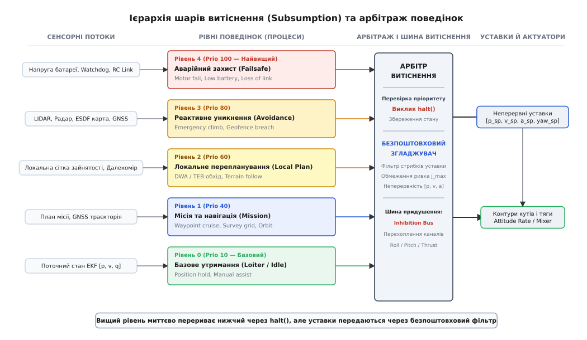
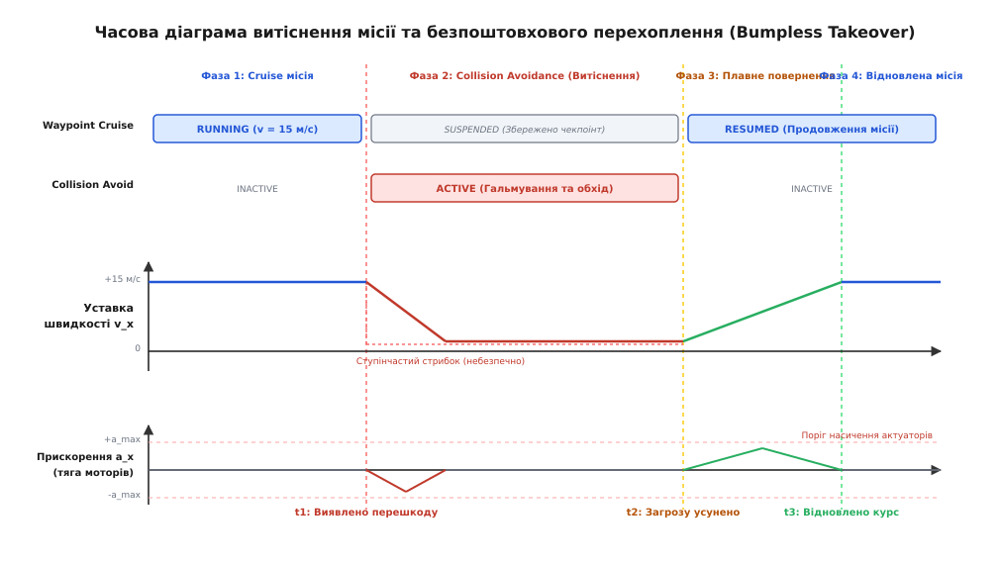

# Пріоритет і витіснення поведінок

<preknowlist>
* [Автомат цілей: стани, переходи, охоронні умови](root:sys-dron/avtomat-tsilei)
* [Дерево поведінки: чому воно витіснило автомат](root:sys-dron/derevo-povedinky)
* [Безпечний відмов (failsafe)](root:sys-dron/failsafe)
* [Уставки керування рухом (motion control setpoints)](root:sys-dron/motion-control-setpoints)
* [Розподіл керування та мікшування актуаторів](root:sys-dron/actuator-allocation)
* [Кватерніонне керування просторовою орієнтацією](root:sys-dron/quaternion-attitude-control)
* [Пауза, зміна й продовження місії на ходу](root:sys-dron/pauza-zmina-i-prodovzhennia-misii-na-khodu)
* [Зациклення, тремтіння і тупик у логіці цілей](root:sys-dron/zatsyklennia-tremtinnia-i-tupyk-u-lohitsi-tsilei)
</preknowlist>

Безпілотний гексакоптер виконує ортогональну аерофотозйомку промислової зони на швидкості 18 м/с та висоті 45 метрів. Модуль траєкторної навігації плавно обчислює уставки швидкості вздовж сплайна, забезпечуючи нульове кутове тремтіння для камери на гіростабілізованому підвісі. На сороковій хвилині польоту передній твердотільний лідар фіксує незанесену до карти стрілу будівельного крана за 15 метрів прямо по вектору руху, або телеметрія силової шини реєструє раптове просідання напруги однієї з банок LiPo-батареї нижче критичних 3.2 В під час пориву зустрічного вітру. 

За швидкості 18 м/с час до фізичного зіткнення з перешкодою розраховується з кінематичного співвідношення:

```text
t_coll = d / v = 15 / 18 ≈ 0.833 с                      [час до фізичного зіткнення]
```

Якщо бортова архітектура побудована на засадах кооперативної багатозадачності чи послідовного опитування, де поточна місія зйомки зобов'язана долетіти до чергового поворотного пункту, завершити цикл експозиції та добровільно звільнити керування, апарат зіткнеться з перешкодою задовго до виклику обробника безпеки. Фізика динамічного польоту не прощає затримок стратегічного планувальника. Задачі збереження планера вимагають негайного, примусового відбору повноважень у будь-якої активної місії.

Цей процес називається **витісненням поведінок (behavior preemption)**. Він вирішує три взаємопов'язані інженерні проблеми:
1. **Детермінована зупинка активної задачі:** як гарантовано зняти запити поточної поведінки, ізолювати підсистеми корисного навантаження й повернути сервоприводи в безпечний стан без витоку ресурсів та без зависання процесора;
2. **Збереження прогресу (checkpointing):** як зафіксувати стан перерваної місії, щоб після усунення загрози відновити просторову траєкторію без повторного прольоту вже оброблених зон;
3. **Безпоштовхове зшивання динаміки (bumpless transfer):** як перемкнути вектори тяги та кутових швидкостей між двома кардинально різними завданнями так, щоб не перевантажити силові регулятори двигунів і не загнати планер у зривний режим чи некероване обертання.

---

## Архітектура підпорядкування (Subsumption) та її інверсія для літальних апаратів

Фундамент ієрархічної організації реактивного інтелекту заклав Родні Брукс у 1986 році у праці «A Robust Layered Control System for a Mobile Robot», запропонувавши **архітектуру підпорядкування (Subsumption Architecture)**. До появи цієї моделі класичний штучний інтелект будувався на монолітній послідовній схемі SMPA (*Sense-Model-Plan-Act*): сенсори наповнювали глобальну карту світу, планувальник шукав оптимальний маршрут у графі простору, і лише після завершення обчислень формувалася дія для актуаторів. За будь-якої раптової зміни середовища системі доводилося повністю перезапускати обчислювальний цикл, що для рухомих роботів неминуче завершувалося аваріями через відставання обчислень від реальності.

Брукс запропонував відмовитися від централізованого моделювання світу на користь паралельних, слабко зв'язаних між собою **шарів компетентності (competence layers)**. Кожен шар є доповненим скінченним автоматом (*Augmented Finite State Machine, AFSM*), що містить власні внутрішні таймери, регістри даних і правила переходів. Шари функціонують асинхронно та паралельно: кожен із них безпосередньо зчитує сенсорні входи й генерує власні команди для виконавчих механізмів.

```
СЕНСОРИ ──────┬─────────────────────────────────────────────┐
              │                                             │
              ▼                                             ▼
     ┌─────────────────┐                           ┌─────────────────┐
     │  Шар 0 (AFSM)   │                           │  Шар 1 (AFSM)   │
     │ Уникнення стін  │                           │ Дослідження зон │
     └────────┬────────┘                           └────────┬────────┘
              │                                             │
              │                                      (Inhibition S)
              │                                             ▼
              └──────────────── (Inhibition I) ───────> [АКТУАТОРИ]
```

Взаємодія між паралельними автоматами організовувалася на рівні сигнальних ліній за допомогою двох базових операцій:
* **Придушення входу (*Suppression, S*):** сигнальний дріт від вищого рівня перехоплює вхідний сенсорний потік нижчого рівня на заданий інтервал часу `T_suppress`, підміняючи реальні покази сенсора синтетичними даними;
* **Блокування виходу (*Inhibition, I*):** команда вищого рівня встановлює цифровий вентиль на вихідній лінії нижчого рівня, повністю блокуючи його сигнал керування і передаючи на актуатор команду вищого автомата.
* **Скидання (*Reset, R*):** лінія вищого рівня скидає внутрішній стан нижчого автомата в початкову конфігурацію при виникненні нештатної ситуації.

У наземних колісних роботах Брукса ієрархія будувалася за принципом «від примітивного рефлексу до абстрактного інтелекту»:
* **Рівень 0:** уникати фізичних зіткнень (відскакувати від контактних бамперів чи перешкод за ультразвуковими сонарами);
* **Рівень 1:** блукати вільним простором (рухатися вперед, доки немає перешкод);
* **Рівень 2:** досліджувати цікаві ділянки простору та будувати топологічні орієнтири;
* **Рівень 3:** маніпулювати об'єктами, розпізнавати цілі та виконувати завдання оператора.

У цій схемі **вищі шари підпорядковували нижчі**. «Розумна» поведінка вищого рівня пригнічувала базові рефлекси: коли робот виявляв цільовий об'єкт, рівень дослідження блокував хаотичне блукання нижчого шару й вів платформу до мети.

### Структурна інверсія піраміди Брукса для БПЛА

Для безпілотних літальних апаратів пряма піраміда Брукса виявляється смертельно небезпечною. Якщо надати модулю довгострокового планування місії право безумовно придушувати базові контури, будь-яка затримка оптимізатора сплайнів або помилка в розрахунку сітки призведе до падіння дрона на землю через ігнорування відмови силової установки, перегріву ESC чи критичного зближення з рельєфом.

Тому в авіоніці архітектура підпорядкування зазнає **повної структурної інверсії**:


*П'ятирівнева інвертована ієрархія поведінок бортового автопілота: низькорівневі рефлекси безпеки мають найвищий пріоритет і через шину витіснення миттєво перехоплюють керування у стратегічної місії.*

На борту швидкісного літального апарата стратегічна місія володіє **найменшим динамічним пріоритетом**. Вона оперує найбільшим просторово-часовим горизонтом (хвилини, десятки кілометрів), але не має права суперечити фізичним обмеженням планера. Верхівку шкали пріоритетів займають швидкі рефлекси безпеки, чий горизонт обчислення становить одиниці мілісекунд.

Розподіл п'яти рівнів автопілота за пріоритетом виглядає так:

1. **Рівень 4: Аварійний захист та термінація (*Critical Failsafe*, пріоритет 200–255).** Негайний піротехнічний відстріл парашутної системи, аварійне знеструмлення двигунів при падінні чи перекиданні, перехід в авторотацію для безпілотних вертольотів або примусове термінальне планування у виділений сектор аварійної посадки. Гарантований час реакції становить до 10 мс.
2. **Рівень 3: Реактивна безпека й геозони (*Reactive Safety*, пріоритет 150–199).** Екстрений набір висоти при раптовому виявленні землі радіовисотоміром, аварійне гальмування перед дротами ЛЕП, розворот на межі апаратного [geofence](root:sys-dron/failsafe), реакція на критичне падіння напруги силової шини. Гарантований час реакції становить до 20 мс.
3. **Рівень 2: Тактичне перепланування (*Tactical Avoidance*, пріоритет 100–149).** Локальний обхід динамічних перешкод за алгоритмами DWA (*Dynamic Window Approach*) чи TEB (*Timed Elastic Band*), огинання рельєфу за [картою висот](root:sys-dron/karta-zainiatosti-z-dalekomira), уникнення зон супутнього струменя інших бортів. Допустимий час реакції становить до 100 мс.
4. **Рівень 1: Стратегічна місія (*Strategic Mission*, пріоритет 50–99).** Політ за поворотними пунктами маршруту (Waypoints), виконання бустрофедонної сітки картографування, орбітальний політ навколо об'єкта, автоматична доставка вантажу. Горизонт планування становить від 0.1 до 10.0 с.
5. **Рівень 0: Базовий нейтральний стан (*Loiter / Idle*, пріоритет 0–49).** Стабілізоване утримання поточної точки зависання за відсутності активних завдань, нейтральне положення сервоприводів або очікування команди оператора перед стартом.

### Чому пряме цифрове блокування непридатне для польоту

У класичних наземних роботах Брукса виходи AFSM комутувалися за допомогою простих логічних вентилів або мультиплексорів сигналів. Якщо вищий рівень активував лінію `inhibit`, сигнал швидкості нижчого рівня просто вимикався, а колеса зупинялися тертям об підлогу.

У польоті ступінчастий стрибок команд керування є катастрофічним. Мультиротор не може миттєво змінити вектор швидкості з +15 м/с вперед на +4 м/с вгору:
* Спроба миттєво відхилити корпус породжує запит кутової швидкості понад 400 град/с;
* [Моторний мікшер](root:sys-dron/actuator-allocation) входить у глибоке насичення: передні гвинти скидаються в нульову тягу, задні розкручуються до максимуму;
* На нульових обертах передніх моторів втрачається гіроскопічна стабілізація та керованість за рисканням, а на задніх гвинтах виникає зрив потоку;
* Апарат завалюється в неконтрольований штопор або зазнає руйнування рами від знакозмінного динамічного удару.

Тому сучасні автопілоти замінюють просте комутаційне блокування виходів Брукса на централізований **диспетчер арбітражу (Behavior Arbiter)**, інтегрований із контуром траєкторного згладжування.

### Еволюція від Subsumption до дерев поведінки

Зі зростанням складності місій чиста архітектура Брукса зіткнулася з проблемою масштабованості. Коли кількість поведінок перевищує 10–15, заплутана мережа перехресних зв'язків `suppression` та `inhibition` перетворюється на «спагеті-архітектуру», де неможливо передбачити реакцію системи на рідкісні комбінації сенсорних подій.

Сучасна авіоніка вирішує цю проблему переходом до [дерев поведінки (Behavior Trees)](root:sys-dron/derevo-povedinky) та трирівневих гібридних архітектур (*3T Architecture*):
1. **Деліберативний рівень (Deliberative Tier):** фоновий генератор глобальних планів і карт;
2. **Виконавчий рівень (Executive Tier):** дерево поведінки або диспетчер витіснення, що керує активацією підзадач;
3. **Реактивний рівень (Reactive Tier):** контури жорсткого реального часу (стабілізація кутів, лімітування ривка, мікшування моторів).

У деревах поведінки пріоритетне витіснення виражається через реактивні селектори (*Reactive Fallback / Selector*). Кожен такт виконання (Tick) дерево обходить вузли зліва направо: якщо ліва гілка безпеки повертає стан `RUNNING`, права гілка місії автоматично отримує сигнал переривання, зберігаючи детерміновану ієрархію без хаотичних сигнальних проводів.

---

## Протокол коректного переривання: життєвий цикл, halt() та деактивація підсистем

Примусове відбирання керування у місії не може зводитися до простого скидання покажчика активної функції чи зупинки потоку в RTOS. Якщо місія, яка керувала сервоприводом корисного навантаження, утримувала лазерний далекомір або вела транзакцію запису на SD-карту, буде грубо знеструмлена, апарат продовжить аварійний політ із розбалансованим підвісом або відкритим вантажним люком.

Детермінована поведінка описується розширеним автоматом станів життєвого циклу:

```
                  ┌─────────────── [INITIALIZING]
                  │                      │
                  │ (успіх ініціалізації)│
                  ▼                      ▼
           [INACTIVE] ──────────────> [PENDING]
                  ▲                      │
                  │ (завершення/скидання)│ (дозвіл арбітра)
                  │                      ▼
                  │                  [RUNNING] ◄──────────────┐
                  │                      │                    │
                  │                      │ (запит витіснення) │ (успішне
                  │                      ▼                    │  відновлення)
                  │                [PREEMPTING]               │
                  │                      │                    │
                  │             (звільнення ресурсів)         │
                  │                      ▼                    │
                  └─────────────── [SUSPENDED] ───────────────┘
                                         │
                                         │ (фатальна відмова/таймаут)
                                         ▼
                                     [ABORTED]
```

### Контракт методу halt() та часовий бюджет

Коли арбітр фіксує переважання пріоритету нової поведінки, він генерує запит витіснення для поточної активної задачі через виклик методу `halt(preemption_reason)`.

Метод `halt()` є обов'язковою частиною інтерфейсу будь-якої бортової поведінки. Він приймає код причини витіснення:

:::tabs
@tab C
```c
typedef enum {
    PREEMPT_REASON_NONE = 0,
    PREEMPT_REASON_COLLISION_AVOIDANCE,
    PREEMPT_REASON_GEOFENCE_BREACH,
    PREEMPT_REASON_CRITICAL_FAILSAFE,
    PREEMPT_REASON_OPERATOR_OVERRIDE
} preempt_reason_t;
```
@tab C++
```cpp
enum class PreemptReason : uint8_t {
    None = 0,
    CollisionAvoidance,
    GeofenceBreach,
    CriticalFailsafe,
    OperatorOverride
};
```
:::

Виконання `halt()` підпорядковується суворим вимогам детермінізму:
1. **Фіксований часовий квант (Execution Budget):** обробник `halt()` повинен виконатися не більше ніж за 1–2 такти навігаційного циклу (зазвичай від 10 до 20 мс). 
2. **Заборона блокуючих операцій:** усередині `halt()` категорично заборонено викликати блокуючі виклики RTOS (`vTaskDelay`, `sleep`), очікувати на м'ютекси зовнішніх потоків або проводити синхронний обмін по шинах UART/SPI.
3. **Захисний сторожовий таймер (Preemption Watchdog):** якщо витіснювана задача зациклилася чи не повернула статус завершення за відведений квант часу, диспетчер примусово переводить її у стан `ABORTED`, конфіскує захоплені ресурси й виставляє прапорець системної діагностики.

### Ізоляція та безпечне паркування підсистем

Під час виконання `halt()` задача зобов'язана перевести всі пов'язані з нею апаратні вузли в пасивний безпечний стан:

* **Оптико-електронні підвіси камери (Gimbal):** у місійному польоті підвіс відстежує наземні координати або орієнтується в надир. Під час екстреного ухилення різкі кутові еволюції корпусу можуть вибити осі мокропідвісу в механічні упори. Метод `halt()` надсилає підвісу команду арретування (*caging*) — жорсткої фіксації по поздовжній осі дрона зі зниженням коефіцієнтів підсилення стабілізації;
* **Активні випромінювачі та лідари:** якщо місія картографування використовувала високопотужний структурований лазер або підсвічувач, його генерація тимчасово пригнічується для виключення осліплення інших оптичних датчиків безпеки;
* **Виконавчі замки та скидачі вантажу:** соленоїди та сервозамки переходять у режим апаратного блокування (*Safety Interlock*), що виключає мимовільне розчеплення вантажу при знакозмінних перевантаженнях маневру ухилення;
* **Контур фотограмметрії:** генератор імпульсів затвора камери заморожується, а інтегратор дистанції обнуляється, запобігаючи переповненню швидкісних буферів накопичувача під час аварійного маневру.

---

## Збереження контрольних точок (Checkpointing) та шовне повернення до місії

Більшість випадків витіснення в польоті носять тимчасовий характер. Наприклад, локальний обхід радіовежі або висотного дерева триває від 3 до 8 секунд, після чого простір знову стає вільним. Якщо після завершення маневру ухилення автопілот скине місію на початок, дрон буде змушений заново летіти через усю карту, повторно витрачаючи обмежений запас енергії батареї.

Для продовження місії застосовується механізм **контрольних точок (Checkpointing)**.

```
+-------------------------------------------------------------------------+
|                  ЗЛІПОК СТАНУ ПОВЕДІНКИ (CHECKPOINT)                    |
+-------------------------------------------------------------------------+
| [ІНВАРІАНТНІ ДАНІ — ЗБЕРІГАЮТЬСЯ]                                       |
|  * uint16_t current_waypoint_idx  (індекс цільового вейпоінта)          |
|  * float    spline_parameter_s    (прогрес уздовж сегмента 0.0 .. 1.0)  |
|  * float    cross_track_ref_dist  (закладений радіус проходження)       |
|  * uint32_t survey_bitmask[8]     (маска вже відзнятих полігонів)       |
|  * float    accumulated_energy_ah (витрачена ємність на момент паузи)   |
|  * uint32_t remaining_dwell_ms    (залишок таймера зависання на точці)  |
+-------------------------------------------------------------------------+
| [ДИНАМІЧНИЙ СТАН КОНТУРУ — КАТЕГОРИЧНО СКИДАЄТЬСЯ]                      |
|  * Integrator error accumulators  (накопичені інтегратори PID швидкості)|
|  * Feedforward velocity / accel   (вектори випередження старої місії)   |
|  * Desired attitude quaternions   (старі цільові кути орієнтації)       |
|  * Rate setpoint derivates        (похідні кутових швидкостей)          |
+-------------------------------------------------------------------------+
```

### Що зберігається, а що скидається

Головне правило формування чекпоінта: **зберігається лише логічний прогрес завдання, а динамічний стан контуру керування обнуляється**.

У структуру `checkpoint_t` записуються:
1. Номер активного поворотного пункту вейпоінта `k`;
2. Нормалізований просторовий параметр `s ∈ [0.0, 1.0]`, який визначає точне положення проєкції дрона на вихідному поліноміальному сегменті між точками `W[k-1]` та `W[k]`. Прогрес обчислюється через інтеграл довжини дуги:

```text
s         = (∫ ||dr/dτ|| dτ) / L_segment                [прогрес уздовж сегмента від 0.0 до 1.0]
L_segment = ∫ ||dr/dσ|| dσ                              [повна просторова довжина сегмента]
```

3. Бітова маска завершених ліній зйомки;
4. Невикористаний залишок часу перебування на точці спостереження;
5. Запас виділеного енергетичного бюджету.

Категорично заборонено зберігати в чекпоінті:
* **Інтегральні суми регуляторів положення та швидкості (`I_accum`):** у точці повернення дрон перебуватиме в іншій просторовій позиції з іншим вектором вітрового зносу. Відновлення старих інтеграторів викличе миттєвий ривок тяги та перерегулювання (*integral windup kick*);
* **Вектори цільових кутів і кватерніонів:** орієнтація дрона після виходу з маневру ухилення має відповідати фактичному вектору швидкості, а не застарілим положенням перед початком переривання.

### Геометрія зшивання траєкторії при відновленні

Після деактивації аварійної задачі (наприклад, далекомір більше не бачить перешкоди) диспетчер витягує збережений чекпоінт і викликає `resume(checkpoint)`.

Проте дрон уже змістився у просторі: точка виходу з маневру `P_exit` віддалена від вихідної лінії шляху на величину бічного відхилення `d_xtrack`.

```
            [Вихідна траєкторія місії]
 W[k-1] ────────────────────●────────────────────────► W[k]
                           P_proj
                            │  ▲
             [Зміщення      │  │  [Плавне зшивання сплайном]
              під час       │  │
              ухилення]     ▼  │
                           ┌───┴──┐
                           │ P_exit (Кінець обходу перешкоди)
                           └──────┘
```

Для запобігання ступінчастому зрізанню кута навігаційний генератор будує зшивальний поліном 5-го порядку (*Quintic Spline Rejoin Trajectory*), що з'єднує точку `P_exit` із точкою відновлення на маршруті `P_target`:

```text
P(t) = c_0 + c_1·t + c_2·t² + c_3·t³ + c_4·t⁴ + c_5·t⁵  [зшивальний поліном 5-го порядку]

P(0)       = P_exit,       P(T_rejoin)       = P_target [початкове та кінцеве положення]
v(0)       = v_exit,       v(T_rejoin)       = v_target [узгодження векторів швидкості]
a(0)       = a_exit,       a(T_rejoin)       = a_target [узгодження векторів прискорення]
```

Тривалість маневру зшивання `T_rejoin` розраховується автоматично, виходячи з мінімізації функціонала ривка при обмеженні бокового прискорення `a_lat_max ≤ 2.5 м/с²`:

```text
J = ∫ ||d³P/dt³||² dt → min                             [критерій мінімізації ривка]
```

---

## Безпоштовхове перехоплення керування (Bumpless Trajectory Transfer)

Найгостріший фізичний конфлікт під час витіснення виникає в контурі генерації уставок руху. Нехай активна місія польоту за маршрутом видає вектор швидкості:

```text
v_mission = [15.0,  0.0, 0.0]ᵀ м/с                      [уставка поточної місії]
v_avoid   = [ 0.0, -3.0, 4.0]ᵀ м/с                      [уставка реактивного ухилення]
```

Ступінчастий розрив швидкості становить:

```text
Δv        = v_avoid - v_mission = [-15.0, -3.0, 4.0]ᵀ   [вектор розриву швидкості]
|Δv|      = √((-15.0)² + (-3.0)² + 4.0²) ≈ 15.81 м/с    [модуль стрибка швидкості]
```

Якщо вектор `v_avoid` передати в контур швидкості безпосередньо, пропорційний регулятор із коефіцієнтом `K_p = 2.5 с⁻¹` згенерує миттєвий запит прискорення:

```text
a_req     = K_p · |Δv| = 2.5 · 15.81 ≈ 39.5 м/с² (≈ 4.03 g) [запит миттєвого прискорення]
```

Такий запит значно перевищує максимальну тягооснащеність типового цивільного мультиротора (значення тягооснащеності від 1.8 до 2.2). [Кватерніонний регулятор орієнтації](root:sys-dron/quaternion-attitude-control) спробує нахилити дрон на максимальний кут тангажу за соті частки секунди, що призведе до повного насичення моторів, стрибка струму на силовій шині й зриву кутової стабілізації.


*Часова діаграма витіснення: замість небезпечного ступінчастого стрибка уставки безпоштовховий фільтр плавно обмежує темп наростання прискорення (ривок j_max), утримуючи навантаження моторів у допустимих межах.*

### Динамічна модель фільтра обмеження ривка

Для виключення ударних навантажень диспетчер арбітражу застосовує алгоритм **безпоштовхового перехоплення (Bumpless Transfer)**. 

Перше фундаментальне правило перехоплення: **нововведена поведінка бере за точку відліку не бажану уставку старої задачі, а фактичний виміряний вектор стану дрона з розширеного фільтра Калмана (EKF)**:

```text
p_0 = p_measured                                        [початкова позиція з EKF]
v_0 = v_measured                                        [початкова швидкість з EKF]
a_0 = a_measured                                        [початкове прискорення з EKF]
```

Друге правило: перехід від `v_0` до цільової швидкості `v_target` формується через динамічний фільтр 3-го порядку з жорсткими обмеженнями на максимальне прискорення `a_max` та максимальний ривок (*jerk*) `j_max`.

Математичний апарат фільтра для кожного такту дискретизації `Δt` описується рекурентними співвідношеннями:

```text
e_v(k)   = v_target(k) - v_filtered(k - 1)              [помилка узгодження швидкості]
a_raw(k) = e_v(k) · k_v                                 [бажане прискорення контуру]
a_des(k) = clamp(a_raw(k), -a_max, +a_max)              [обмеження максимального прискорення]
j_raw(k) = (a_des(k) - a_filtered(k - 1)) / Δt          [розрахунок похідної прискорення (ривка)]
j_des(k) = clamp(j_raw(k), -j_max, +j_max)              [обмеження максимального ривка]
a_filtered(k) = a_filtered(k - 1) + j_des(k) · Δt       [інтегрування згладженого прискорення]
v_filtered(k) = v_filtered(k - 1) + a_filtered(k) · Δt   [інтегрування згладженої швидкості]
```

де:
* `k_v` — коефіцієнт узгодження швидкості (типово 2.0–3.0 с⁻¹);
* `a_max` — граничне прискорення планера (для мультироторів 3.0–6.0 м/с²);
* `j_max` — граничний ривок (типово 10.0–25.0 м/с³).

Обмеження ривка гарантує гладкість другої похідної положення дрона, що унеможливлює різкі стрибки кутових прискорень і виключає перегрів силових транзисторів регуляторів швидкості (ESC).

### Аеродинамічні ефекти та захист від вихрового кільця (VRS)

При екстреному вертикальному маневруванні (наприклад, ухилення від літака зверху шляхом різкого зниження) неконтрольований стрибок швидкості вниз може загнати мультиротор у небезпечний аеродинамічний режим **вихрового кільця (*Vortex Ring State, VRS*)**.

Режим вихрового кільця виникає, коли швидкість вертикального зниження `v_z` наближається до швидкості індукованого потоку гвинтів `v_ind`:

```text
v_ind = √(T / (2 · ρ · A))                              [індукована швидкість потоку ротора]
```

де `T` — сумарна тяга, `ρ` — густина повітря, `A` — площа ометання гвинтів.

У стані VRS ротор потрапляє у власний турбулентний супутній струмінь: тяга різко падає на 40–60%, дрон починає інтенсивно розгойдуватися за креном та тангажем і переходить у некероване падіння. 

Безпоштовховий фільтр із жорстким обмеженням вертикального сповільнення та прискорення унеможливлює вхід у зону VRS, автоматично перетворюючи запит вертикального зниження на комбінований косий маневр із горизонтальним зміщенням, що продуває площину обертання гвинтів чистим зустрічним повітрям.

---

## Арбітраж пріоритетів: статичні драбини проти динамічної корисності

Вибір того, яка саме поведінка отримує доступ до актуаторів, здійснюється арбітром пріоритетів. В інженерній практиці застосовують два підходи: статичний і динамічний.

### Статична драбина пріоритетів (Static Priority Ladder)

Статична схема базується на фіксованій цілочисельній шкалі рангів від 0 до 255, жорстко закладеній на етапі проектування архітектури автопілота:

| Ранг пріоритету | Клас поведінки | Типові польотні задачі | Гарантований час реакції |
| :--- | :--- | :--- | :--- |
| **200 – 255** | Аварійна термінація / Критичний Failsafe | Викид парашута, вимкнення при перекиданні, реакція на критичний розряд LiPo | ≤ 10 мс (1 такт) |
| **150 – 199** | Реактивна безпека й геозони | Екстрене гальмування перед перешкодою, реакція на Geofence, набір висоти при відмові альтиметра | ≤ 20 мс (1–2 такти) |
| **100 – 149** | Тактичне перепланування | Локальний обхід за картою ESDF/DWA, огинання рельєфу (Terrain Following), вихід із супутнього струменя | ≤ 100 мс (5–10 тактів) |
| **50 – 99** | Стратегічна місія | Політ по вейпоінтах, зйомка за сіткою, орбітальний політ навколо об'єкта | ≤ 500 мс |
| **1 – 49** | Допоміжні фонові процеси | Калібрування компаса в польоті, фонове логування, позиціонування підвісу камери | Не регламентується |
| **0** | Базовий стан (Loiter / Idle) | Утримання точки зависання за відсутності активних завдань | Базовий стан |

Статична драбина володіє властивістю абсолютної обчислювальної детермінованості: складність вибору активної задачі становить O(N) (або O(1) при використанні бітових масок `__builtin_clz`), а поведінка системи повністю піддається формальній сертифікації за стандартом DO-178C.

Проте статична драбина абсолютно нездатна знаходити компроміси, коли кілька завдань мають близьку важливість у мінливих умовах.

### Динамічний арбітраж на основі функції корисності (Utility AI)

У складних багатоцільових сценаріях (наприклад, автономний пошук постраждалих у лісі з урахуванням залишку заряду батареї та якості радіозв'язку) статичні ранги стають занадто жорсткими. У таких системах кожна поведінка `i` безперервно розраховує свою нормалізовану **динамічну корисність (Utility)** `U_i(x, t) ∈ [0.0, 1.0]`:

```text
U_i(x, t) = w_g · G_i(x) - w_c · C_i(x) - w_r · R_i(x)  [динамічна корисність поведінки]
```

де:
* `G_i(x) ∈ [0.0, 1.0]` — очікувана вигода (*Gain*): ймовірність успішного виявлення цілі, площа відзнятої території або наближення до мети;
* `C_i(x) ∈ [0.0, 1.0]` — вартість виконання (*Cost*): розрахункова витрата заряду батареї, знос механізмів, час затримки місії;
* `R_i(x) ∈ [0.0, 1.0]` — ризик (*Risk*): дистанція до перешкод, ймовірність втрати телеметрії, пориви вітру;
* `w_g, w_c, w_r` — нормалізовані вагові коефіцієнти поточного профілю польоту (сума ваг дорівнює 1.0).

Для нелінійних фізичних факторів (наприклад, критичного розряду батареї або наближення до землі) застосовують сигмоїдні передавальні функції відгуку:

```text
S(x) = 1 / (1 + exp(-k · (x - x_0)))                   [сигмоїдна функція відгуку загрози]
```

де `x_0` — порогове значення (наприклад, 3.3 В на банку), а `k` — крутизна наростання пріоритету аварійного повернення.

```
[Поведінка 1: Зйомка]     ───► Розрахунок U_survey = 0.72 ──┐
                                                            │
[Поведінка 2: Батарея RTL] ───► Розрахунок U_rtl    = 0.68 ──┼──► [АРБІТР КОРИСНОСТІ]
                                                            │     (Гістерезис + Dwell)
[Поведінка 3: Обхід лісу] ───► Розрахунок U_avoid  = 0.15 ──┘
```

### Запобігання деренчанню та тремтінню цілей (Thrashing / Chatter)

Головна небезпека динамічного арбітражу — **високочастотне деренчання (*thrashing / chatter*)**. 

Нехай корисність місії зйомки становить `U_survey = 0.71`, а корисність повернення на зарядку — `U_charge = 0.70`. Через звичайні шуми вимірювання напруги батареї та далекоміра на такті `k` перемагає місія (0.71 > 0.70), а на такті `k+1` шум зсуває оцінку — і перемагає повернення (0.69 < 0.705).

Якщо перемикати поведінки щотакту, дрон зависне на місці в нескінченному циклі `halt() -> resume() -> halt()`, безперервно скидаючи уставки й марно випалюючи батарею.

Для стабілізації динамічного арбітражу застосовують три обов'язкові бар'єри:

1. **Гістерезисний поріг перемикання (`ΔU_switch`):** кандидат перехоплює керування лише тоді, коли його корисність перевищує корисність активної задачі на фіксовану дельту:
   `U_candidate > U_active + ΔU_switch`, де `ΔU_switch ≈ 0.15 ... 0.25`.

2. **Мінімальний час утримання (*Dwell Time*, `τ_dwell`):** після активації поведінка отримує захисний інтервал часу (типово від 1.5 до 3.0 с), протягом якого жодна інша задача не може її витіснити (за винятком безумовного рівня Critical Failsafe).

3. **Низькочастотна фільтрація оцінок корисності:** сирі значення корисності згладжуються фільтром першого порядку з постійною часу `τ_f ≈ 0.5 с`:

```text
U_filt(k) = α · U_raw(k) + (1 - α) · U_filt(k - 1)      [фільтрація корисності першого порядку]
α         = Δt / (τ_f + Δt)                             [коефіцієнт ваги поточного заміру]
```

---

## Боротьба за актуатори, інверсія пріоритетів та RTOS-детермінізм

У багатозадачних автопілотах різні поведінки можуть вимагати часткового або роздільного контролю над просторовими осями літального апарата. Наприклад:
* Поведінка стеження за автомобілем вимагає керування кутом рискання (Yaw) та оптичним підвісом камери;
* Навігаційна поведінка утримання висоти вимагає контролю над вертикальною тягою (Thrust);
* Поведінка ухилення від бічного вітру вимагає контролю над креном (Roll) та тангажем (Pitch).

Конфлікт між задачами за окремі канали керування називається **боротьбою за актуатори (Actuator Contention)**.

### Монопольне витіснення проти поканального арбітражу (DoF Slicing)

В авіаційній практиці застосовують два підходи до розподілу осей:

1. **Монопольне витіснення (*All-or-Nothing Takeover*):** активна поведінка повністю забирає під свій контроль усі 4 основні ступені вільності польоту (Roll, Pitch, Yaw, Thrust). Це найбільш надійний, повністю детермінований підхід, обов'язковий для реакцій безпеки та аварійного захисту;
2. **Поканальний арбітраж (*Degree-of-Freedom Slicing*):** арбітр ділить вектор керування на незалежні ступені вільності через бітові маски дозволу:

:::tabs
@tab C
```c
typedef struct {
    uint8_t roll_owner_id;
    uint8_t pitch_owner_id;
    uint8_t yaw_owner_id;
    uint8_t thrust_owner_id;
    uint8_t gimbal_owner_id;
} axis_allocation_mask_t;
```
@tab C++
```cpp
struct AxisAllocationMask {
    uint8_t roll_owner_id{0};
    uint8_t pitch_owner_id{0};
    uint8_t yaw_owner_id{0};
    uint8_t thrust_owner_id{0};
    uint8_t gimbal_owner_id{0};
};
```
:::

Якщо високопріоритетна реакція вимагає екстреного набору висоти, вона блокує лише вісь `Thrust`, дозволяючи місії продовжувати утримання курсу `Yaw`. Проте якщо загроза зростає (наприклад, перешкода попереду), реакція виставляє прапорець монопольного блокування, миттєво підпорядковуючи собі всі 4 канали.

### Інверсія пріоритетів у диспетчері поведінок

У польотних операційних системах реального часу (NuttX у PX4, ChibiOS в ArduPilot чи FreeRTOS) виконання задач і поведінок розподіляється між системними потоками. Неправильне використання примітивів синхронізації неминуче веде до класичної катастрофи — **інверсії пріоритетів (Priority Inversion)**.

```
Час ───────────────────────────────────────────────────────────────────────────►
T_high [Avoidance]                   ... очікує м'ютекс SPI ... ═════════► ДІЯ (пізно!)
                                     ▲                         ▲
T_med  [Survey Plan]                 │ ═══════════════════════ │
                                     │ (витісняє T_low)        │
T_low  [Logging]      ═══[Lock Mutex]┘                         └──[Unlock]
```

Розглянемо фатальний сценарій:
1. Низькопріоритетна задача логування `T_low` захоплює м'ютекс шини SPI для скидання телеметрії на повільну SD-карту;
2. Високопріоритетна задача аварійного ухилення `T_high` активується за сигналом далекоміра й намагається опитати SPI-сенсор, але блокується на м'ютексі, утримуваному `T_low`;
3. Середньопріоритетна задача розрахунку полігонів місії `T_med` прокидається за таймером і повністю витісняє з процесора `T_low`, оскільки її пріоритет вищий за логування;
4. **Результат:** критична задача безпеки `T_high` виявляється заблокованою на сотні мілісекунд задачею `T_med`, до якої вона не має жодного стосунку. Дрон зіштовхується з перешкодою.

Для усунення інверсії пріоритетів на рівні автопілота впроваджують три архітектурні бар'єри:

1. **Протокол успадкування пріоритетів (*Priority Inheritance Protocol, PIP*):** якщо високопріоритетний потік `T_high` блокується на ресурсі, захопленому `T_low`, ядро RTOS негайно піднімає пріоритет виконання `T_low` до рівня `T_high` на весь час володіння м'ютексом. Задача `T_med` більше не може витіснити `T_low`, м'ютекс швидко звільняється, і `T_high` отримує керування за лічені мікросекунди;
2. **Протокол стелі пріоритетів (*Priority Ceiling Protocol, PCP*):** кожному м'ютексу призначається стельовий пріоритет, рівний максимальному пріоритету задач, які можуть його захопити. Потік, що захоплює ресурс, миттєво підвищує свій пріоритет до стелі, блокуючи будь-які спроби витіснення іншими задачами;
3. **Повна відмова від блокувань у контурі арбітражу (Lock-Free Double Buffering):** передача уставок між планувальником та регулятором виконується без м'ютексів через атомарну підміну покажчиків (*Atomic Pointer Swap*) або кільцеві буфери одного читача й одного записувача (*Single-Producer Single-Consumer Lock-Free Ringbuffer*). На апаратному рівні ARM Cortex-M7 це реалізується за допомогою інструкцій бар'єрів пам'яті `DMB` (Data Memory Barrier) та атомарних операцій `LDREX / STREX`. Жодна поведінка не має права викликати `pthread_mutex_lock()` у критичній секції арбітражу.

---

## Програмна архітектура диспетчера поведінок на C та C++

У реальних автопілотах диспетчер витіснення викликається на кожній ітерації навігаційного циклу (50–100 Гц). Він детерміновано оцінює активні запити, керує протоколом виклику `halt()` і передає вихідні вектори через безпоштовховий фільтр.

Нижче наведено порівняльну архітектурну реалізацію диспетчера на мовах C та C++.

:::tabs
@tab C
:::code priorytet-i-vytisnennia-povedinok-d/c/main.c
@tab C++
:::code priorytet-i-vytisnennia-povedinok-d/cpp/main.cpp
:::

Повну практичну реалізацію менеджера з тестом витіснення місії аварійним ухиленням, збереженням детальних чекпоінтів та імітаційним стендом наведено у вставці [Менеджер витіснення та перемикання завдань автопілота](root:sys-dron/priorytet-i-vytisnennia-povedinok/proj-behavior-preemption-manager.md).
