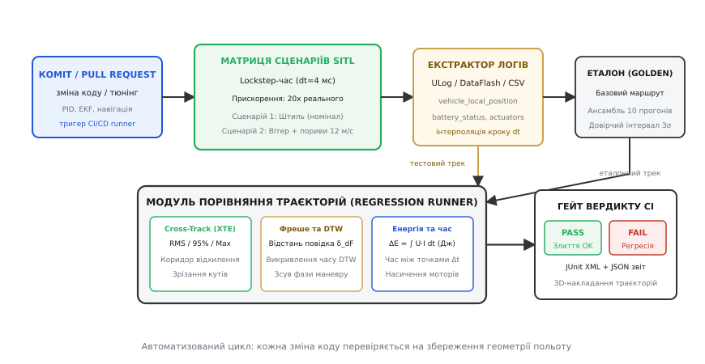
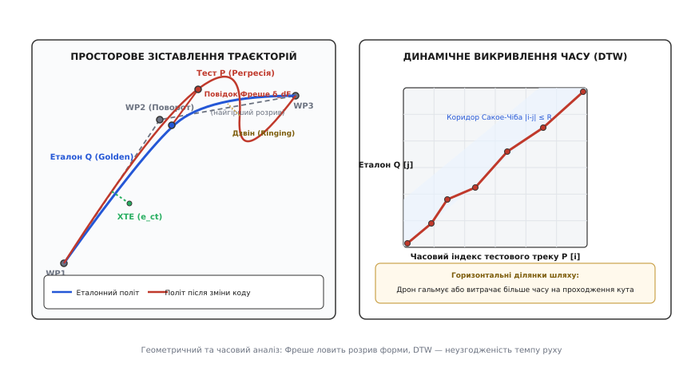

# Регресія автономії: той самий маршрут після кожної зміни

<preknowlist>
- [Симуляція автопілота в SITL](root:sys-dron/sitl-simulation) — запуск бойового бінарника з моделлю фізики та давачів на хості.
- [Відхилення від лінії шляху (Cross-Track Error)](root:sys-dron/vidkhylennia-vid-linii-shliakhu-cross-track) — ортогональне зміщення апарата від планового сегмента місії.
- [Керування просторовою орієнтацією на кватерніонах](root:sys-dron/quaternion-attitude-control) — замкнений контур стабілізації кутів тангажу, крену та рискання.
- [Оцінка стану у фільтрі Калмана (EKF)](root:com-signal/kalman-ekf) — об'єднання даних GNSS, IMU та барометра у вектор положення й швидкості.
- [Формати бортових журналів польоту](root:sys-dron/flight-log-formats) — структура запису високочастотних топіків і повідомлень ULog та DataFlash.
</preknowlist>

Зміна коефіцієнта інтегральної складової кутової швидкості тангажу `MC_PITCHRATE_I` з 0.20 на 0.32 здається цілком безпечною оптимізацією: на стенді автопілот швидше компенсує статичну похибку аеродинамічного моменту, а модульні тести математичних бібліотек проходять без жодного зауваження. Проте під час виконання автономної місії обстеження території на швидкості 14 м/с безпілотник на четвертому розвороті під прямим кутом раптово вилітає за межі планового коридору на 3.8 метра замість допустимих 0.5 метра, зачіпає віртуальну геозону безпеки та ініціює аварійне переривання місії. Жодна функція не повернула помилки, жоден потік операційної системи реального часу не завис, але просторова траєкторія (лат. *trajectus* — перетин, шлях) апарата деградувала. Це класичний прояв регресії автономної поведінки (лат. *regressus* — зворотний рух, відступ): коли модифікація алгоритмічного коду, параметрів цифрових фільтрів або коефіцієнтів контурів стабілізації непомітно руйнує просторово-часову якість виконання польотного завдання.

Традиційні підходи тестування програмного забезпечення — модульні та інтеграційні перевірки окремих функцій — принципово не здатні виявити таку деградацію. Модульний тест перевіряє дискретний контракт: чи правильно функція перетворює вектор прискорень, чи коректно парсується повідомлення мережевого протоколу. Автономний політ — це неперервний динамічний процес взаємодії каскадних регуляторів, оцінювача стану, генератора траєкторії, аеродинаміки планера та зовнішнього середовища. Щоб гарантувати, що безпілотник після внесення будь-яких змін летить тим самим маршрутом, витрачає той самий запас енергії та передбачувано реагує на пориви вітру, потрібен автоматизований контур регресійного тестування на базі симуляції [SITL](root:sys-dron/sitl-simulation) зі строгим математичним апаратом просторового та часового зіставлення траєкторій.

## Анатомія регресії: як непомітні правки ламають траєкторію

Поведінка автономного літального апарата формується ієрархічною пірамідою контурів керування з різними частотами дискретизації. На вершині ієрархії працює планувальник місії (частота 10–20 Гц), який перемикає контрольні точки маршруту й розраховує бажані просторові координати. Під ним розташований контур навігації та ведення за траєкторією (20–50 Гц, наприклад, алгоритм L1 або Pure Pursuit), який перетворює відхилення від відрізка на вектор бажаної швидкості. Ще нижче знаходиться регулятор швидкості та положення (50–100 Гц), що генерує уставки цільового прискорення та просторової орієнтації у вигляді [кватерніона](root:sys-dron/quaternion-attitude-control). В основі піраміди крутиться високочастотний контур кутових швидкостей та моментів (частота 250–1000 Гц), що безпосередньо формує керівні сигнали для силових регуляторів безколекторних двигунів.

Кожен шар цієї піраміди має власну передатну функцію, фазове запізнення та смугу пропускання. Регресія автономії виникає тоді, коли зміна в одному з шарів піраміди порушує фазове або амплітудне узгодження між контурами. Розглянемо детальні інженерні механізми виникнення деградації у реальній розробці польотних стеків.

### 1. Фазовий зсув через надмірну цифрову фільтрацію

Прагнучи зменшити високочастотний шум від вібрацій гвинтів на первинних вимірах гіроскопа, розробник знижує частоту зрізу цифрового фільтра низьких частот другого порядку Баттерворта з 60 Гц до 30 Гц. Шум у логах кутової швидкості помітно спадає, проте передатна функція фільтра вносить додаткове запізнення сигналу за фазою:

```
W_filter(s) = ω_c² / ( s² + 2·ζ·ω_c·s + ω_c² )
Δt_delay ≈ 2·ζ / ω_c = 2 · 0.707 / ( 2 · π · 30 ) ≈ 7.5 мс
```

Для внутрішнього контуру кутової швидкості з частотою 400 Гц затримка у 7.5 мілісекунд еквівалентна втраті 12–15 градусів запасу стійкості за фазою (англ. *phase margin*). На прямолінійних відрізках із малою кутовою швидкістю апарат стабільно утримує горизонт. Проте під час енергійного маневру на повороті, коли потрібна максимальна кутова швидкість перекладки крену (наприклад, 120 град/с), контур кутової швидкості починає запізнюватися з виробленням протидіючого моменту. Виникає високочастотний перехідний коливальний процес: безпілотник тричі перекидається з крила на крило («дзвін», англ. *ringing*), перш ніж вийти на стабільний кут. Цей коливальний рух транслюється вгору по ієрархії контурів, змушуючи контур положення розгойдувати вектор тяги, через що бічне відхилення від лінії маршруту зростає у 4–6 разів.

### 2. Накопичення інтегральної помилки (Integrator Windup)

Під час швидкісного проходження кутового повороту траєкторії автопілот вимагає від апарата створення значного доцентрового прискорення `a_lat = v² / R`. Для створення цього прискорення безпілотник повинен нахилитися на кут крену `θ = arctan( a_lat / g )`. Якщо швидкість польоту становить 16 м/с, а радіус повороту становить лише 20 метрів, необхідне поперечне прискорення дорівнює `16² / 20 = 12.8` м/с² (що становить `1.3 g`). Для мультиротора це вимагає нахилу на кут `arctan(12.8 / 9.81) ≈ 52.5°`.

Якщо в системі безпеки встановлено жорстке обмеження максимального кута нахилу `θ_max = 35°`, апарат не здатний фізично розвинути необхідне поперечне прискорення. Фактичне поперечне прискорення складе лише `g · tan(35°) = 9.81 · 0.700 = 6.87` м/с². Поки апарат перебуває у насиченні за кутом, між цільовою швидкістю розвороту та фактичною швидкістю утворюється стійка неузгодженість `e_v = v_target - v_actual`.

Якщо інтегратор регулятора швидкості не має механізму динамічного затискання (англ. *anti-windup clamping* або інтегрування лише при ненасиченому приводі), інтегральна сума продовжує безперервно накопичуватися протягом усього дугового маневру. Коли розворот геометрично завершено і безпілотник має летіти прямо вздовж наступного сегмента місії, переповнений інтегратор продовжує видавати команду на максимальний нахил у бік повороту. Дрон глибоко вилітає за межі планового сегмента (переліт, англ. *overshoot*), перетинає лінію і ще кілька секунд повертається на курс, поки накопичений інтеграл не скинеться протилежною помилкою.

### 3. Зміщення часової синхронізації в оцінювачі EKF

Оновлення математичного ядра розширеного фільтра Калмана [EKF](root:com-signal/kalman-ekf), покликане зменшити обчислювальну складність матричного множення або перерозподілити чергу буферизації вимірів, може змінити внутрішній параметр оцінки затримки надходження пакетів GNSS (наприклад, з 200 мс на 140 мс).

Оскільки супутниковий приймач завжди видає виміри положення та швидкості із затримкою передачі по послідовному інтерфейсу UART, фільтр Калмана зберігає кільцевий буфер минулих станів інерціальної системи навігації (INS) і застосовує корекцію Калмана до стану в минулому, після чого екстраполює поправку вперед до поточного часу. Якщо оцінка затримки зсувається на 60 мс вперед, розрахована поточна координата починає систематично випереджати або відставати від реального фізичного центру мас на величину `Δx = v · Δt`. При польотній швидкості 15 м/с це створює просторовий зсув оцінки майже на 1 метр.

Контур навігації, отримуючи зміщену оцінку координати, розпочинає маневр повороту передчасно, глибоко зрізаючи внутрішній простір контрольної точки, або, навпаки, запізнюється з початком гальмування.

### 4. Зміна кінематичного профілю згладжування сплайнів

Перехід від лінійного проходження точок із повною зупинкою до сплайн-траєкторій з обмеженням ривка (англ. *jerk-limited trajectories*) дозволяє безпілотнику підтримувати високу крейсерську швидкість на поворотах. Алгоритм розраховує перехідні кубічні сплайни або криві Безьє, вписуючи дугу між двома відрізками.

Проте якщо коефіцієнт допустимого поперечного прискорення на кривизні сплайну налаштовано надмірно агресивно, а радіус прийняття контрольної точки збільшено для запобігання втраті швидкості, апарат вписує дугу занадто широко. Наприклад, у сільськогосподарському моніторингу або лазерному скануванні це призводить до того, що під час розвороту на краю поля камера відхиляється від цільової зони, утворюючи сліпі плями в ортофотоплані. Оптимізація часу проходження місії обертається повною втратою функціональної якості зібраних даних.

### 5. Приховане насичення моторів при вітровому зносі

Нова модифікація алгоритму компенсації бокового вітру за рахунок розрахунку кута зносу (англ. *crab angle*) прагне утримувати ніс апарата проти вітру, зберігаючи вектор шляхової швидкості строго вздовж лінії маршруту. Для квадрокоптера рух боком у вітровому потоці 10 м/с вимагає створення постійного компенсуючого кута крену 18° та додаткового моменту рискання для подолання флюгерного ефекту корпусу.

У результаті мікшер приводів заздалегідь навантажує два навітряних двигуни до 88–92% від їхньої максимальної потужності. У спокійному повітрі симуляції траєкторія виглядає бездоганно: відхилення від лінії становить менше 5 сантиметрів. Проте щойно на траєкторії з'являється динамічний порив вітру швидкістю 4 м/с, навітряні мотори досягають 100% насичення (PWM = 2000 мкс). Контур стабілізації втрачає можливість створювати відновлювальний момент тангажу й крену одночасно: дрон різко втрачає висоту (просідання до 4–6 метрів) і зноситься з маршруту на 5–8 метрів убік.

> 🔧 **Навіщо це.** Автоматизоване регресійне тестування автономії перетворює невидимі динамічні дефекти на точні числові виміри. Будь-який коміт, що призводить до втрати стійкості, фазового запізнення, переповнення інтеграторів чи енергетичного перевитрати, негайно блокується конвеєром ще на стадії компіляції в хмарі, захищаючи реальні апарати від катастроф.

## Багатопотоковість в RTOS, джиттер та затримки шин

У реальних польотних контролерах під керуванням операційних систем реального часу (RTOS, наприклад, NuttX або FreeRTOS) алгоритми виконуються в окремих потоках із витісняльною багатозадачністю за пріоритетами (англ. *preemptive priority-based scheduling*).

Типова карта пріоритетів виглядає так:
1. `rate_control` (контур кутових швидкостей): пріоритет `250` (найвищий), період `2.5` мс (400 Гц);
2. `ekf2` (фільтр оцінки стану): пріоритет `240`, період `4.0` мс (250 Гц);
3. `pos_control` (контур положення та швидкості): пріоритет `200`, період `20.0` мс (50 Гц);
4. `navigator` (планувальник місій та L1): пріоритет `105`, період `50.0` мс (20 Гц);
5. `logger` (запис на SD-карту або флеш-пам'ять): пріоритет `100` (найнижчий), буферизований фоновий потік.

Регресія виникає тоді, коли розробник додає новий топік або важку операцію форматування рядків у потік середнього пріоритету (наприклад, у контур навігації), використовуючи спільний м'ютекс із блокуванням переривань. Виникає класична інверсія пріоритетів (англ. *priority inversion*): високочастотний контур кутових швидкостей чекає звільнення ресурсу, і період його виклику замість строго детермінованих `2.5` мс починає відчувати плаваючий джиттер (дрейф від `2.1` мс до `9.8` мс).

Оскільки диференціальна складова регулятора розраховується як `D = K_d · ( e[k] - e[k-1] ) / Δt`, стрибок `Δt` призводить до миттєвого викиду в розрахунку керуючого моменту. Мотори видають різкий акустичний тріск, ефективність стабілізації падає, а траєкторія вкривається високочастотною гребінкою. Запуск тестів у SITL із профілюванням лічильників продуктивності (`perf_counter`) реєструє такі затримки ще до випробувань на реальному залізі.

Додатковим джерелом регресії стають протоколи передачі керуючих команд на силові регулятори (ESC). Перехід від класичного аналогового ШІМ (PWM) до цифрових протоколів DShot600 або шини DroneCAN скорочує затримку передачі команди з 2.0 мс до 25 мкс. Проте якщо у коді автопілота було залишено компенсаційне випередження фази для повільного ШІМ, швидший відгук цифрових регуляторів викликає високочастотний автоколивальний резонанс контуру кутової швидкості. Симуляція SITL із моделюванням латентності шин зв'язку точно фіксує такий фазовий дисбаланс.

## Алгоритми ведення траєкторією: L1, NPFG та джерела коливань

Особливе місце в аналізі регресії займає контур навігаційного ведення (англ. *guidance logic*), який відповідає за повернення безпілотника на лінію маршруту. Найпоширенішим алгоритмом у літакових та мультироторних автопілотах є нелінійний алгоритм L1 (Nonlinear Guidance Logic).

Алгоритм L1 обирає на плановому відрізку точку випередження (англ. *lookahead point*) на відстані `L_1` попереду апарата. Кут між вектором поточної швидкості безпілотника `V` та напрямком на точку випередження позначається як `η`. Алгоритм формує команду цільового бокового прискорення, пропорційну синусу цього кута:

```
a_s_cmd = 2 · ( V² / L_1 ) · sin( η )
```

Відстань випередження `L_1` розраховується через бажаний період згасання коливань контуру `T_L1` та коефіцієнт демпфування `ζ_L1`:

```
L_1 = ( 1 / π ) · ζ_L1 · T_L1 · V
```

Звідси видно пряму залежність динаміки від налаштувань:
1. Якщо розробник зменшує період `T_L1` (наприклад, з 20 с до 12 с), прагнучи змусити дрон жорсткіше триматися лінії, відстань `L_1` скорочується. Команда на прискорення стає занадто агресивною, система входить у стан автоколивань (англ. *cross-track hunting*): безпілотник безперервно перетинає лінію маршруту з амплітудою 1.5–2.0 метра з періодом у кілька секунд;
2. Якщо період `T_L1` збільшено, контур стає надмірно млявим: при вході на новий відрізок після повороту дрон витрачає 200–300 метрів дистанції лише на те, щоб плавно наблизитися до лінії шляху, що неприпустимо для точних коридорів інспекції ЛЕП чи трубопроводів.

У сучасних версіях автопілотів впроваджується алгоритм NPFG (Nonlinear Path Following Guidance), який окремо керує похибкою кута шляху (англ. *track angle error*) та швидкістю наближення до лінії (англ. *cross-track velocity*). Зміна математичних функцій насичення або коефіцієнтів згладжування в NPFG безпосередньо впливає на форму кривої перехідного процесу. Безперервний регресійний моніторинг просторової форми дозволяє миттєво побачити зміну демпфування контуру навігації.

## Аналіз інновацій EKF та відкидання вимірів (Outlier Rejection)

Оцінювач стану [EKF](root:com-signal/kalman-ekf) є фундаментом точності польоту: він об'єднує передбачення інерціальної моделі з вимірами GNSS, барометра та магнітометра. Якість роботи оцінювача безперервно контролюється вектором інновацій (англ. *innovations*, або вектор нев'язок):

```
ν_k = z_k - h( x̂_{k|k-1} )
```

де `z_k` — вектор вимірів сенсора в момент часу `k`, а `h(x̂)` — нелінійна модель спостереження від екстрапольованого вектору стану.

Коваріаційна матриця невизначеності інновацій `S_k` розраховується через матрицю Якобі `H_k`, коваріацію передбачення стану `P_{k|k-1}` та коваріацію шуму сенсора `R_k`:

```
S_k = H_k · P_{k|k-1} · H_k^T + R_k
```

Для перевірки достовірності вимірів фільтр розраховує нормовану квадратичну інновацію (Normalized Innovation Squared, NIS):

```
ε_k = ν_k^T · S_k^{-1} · ν_k
```

Величина `ε_k` підпорядковується розподілу хі-квадрат (χ²). Якщо під час енергійного розвороту дрон відчуває різке кутове прискорення, а коваріація шуму процесу `Q` у коді автопілота була занижена розробником (наприклад, параметр `EKF2_ACC_NOISE` зменшено вдвічі), матриця `P` стає надмірно оптимістичною. Значення `S_k` виявляється штучно заниженим, і величина NIS перевищує поріг гейтингу `ε_k > 9.21` (що відповідає 99% довірчому інтервалу для 2 ступенів вільності).

Фільтр Калмана робить хибний висновок про те, що сенсор GNSS видає аномальний викид (англ. *outlier*), і повністю блокує корекцію положення. Інерціальна система починає дрейфувати у відкритому контурі. За 2 секунди дрейф сягає 4 метрів. Коли поріг повертається в норму, фільтр робить жорсткий скид стану (Position Reset), викликаючи ступінчастий стрибок координат. Автоматизований регресійний тест, фіксуючи метрики інновацій та відстань Фреше, негайно викриває таку приховану нестабільність матриць коваріацій.

## Фізико-математична модель симулятора SITL

Щоб регресійний тест мав фізичний зміст, симулятор фізичного середовища (наприклад, інтегрований у SITL рушій) розв'язує повну систему нелінійних диференціальних рівнянь руху твердого тіла (рівняння Ньютона-Ейлера) у зв'язаній із корпусом системі координат (Body Frame):

```
m · ( dv/dt + ω × v ) = F_grav + F_aero + F_thrust
I · ( dω/dt ) + ω × ( I · ω ) = M_aero + M_thrust
```

де:
- `m` — маса безпілотника (кг);
- `I` — тензор моментів інерції `diag(I_xx, I_yy, I_zz)` (кг·м²);
- `v = (u, v, w)^T` — вектор лінійних швидкостей у зв'язаній системі координат;
- `ω = (p, q, r)^T` — вектор кутових швидкостей (крен, тангаж, рискання);
- `F_thrust` та `M_thrust` — результуюча сила тяги та момент, створені пропелерами.

Тяга кожного безколекторного двигуна моделюється через швидкість обертання `n` (об/с), діаметр гвинта `D`, густину повітря `ρ` та коефіцієнт тяги `c_T`:

```
T_i = c_T · ρ · n_i² · D⁴
M_i = c_Q · ρ · n_i² · D⁵
```

Для числового інтегрування просторової орієнтації використовується кінематичне рівняння на [кватерніонах](root:sys-dron/quaternion-attitude-control), що інтегрується методом Рунге-Кутти 4-го порядку (RK4) з кроком `dt = 0.004` с:

```
q̇ = 0.5 · q ⊗ [ 0,  p,  q,  r ]^T
```

Моделювання давачів включає точні стохастичні складові:
1. **Акселерометр:** `a_meas = a_true - g_body + b_a + n_a`, де `b_a` — випадковий дрейф нуля (Random Walk з дисперсією `σ_ba = 0.0005` м/с²√с), а `n_a` — білий шум із густиною `σ_na = 0.015` м/с²/√Гц;
2. **Гіроскоп:** `ω_meas = ω_true + b_g + n_g`, де `b_g` — зміщення нуля (`σ_bg = 0.0001` рад/с√с), `n_g` — шум (`σ_ng = 0.001` рад/с/√Гц);
3. **GNSS-приймач:** вектор позиції затримується на кільцевому буфері тривалістю `t_delay = 160` мс і спотворюється шумом псевдодальностей, що відповідає геометричному фактору точності `HDOP = 1.2`.

Завдяки такій деталізації моделі будь-яка зміна в алгоритмі фільтрації шуму давачів у коді автопілота проявляється на реалістичних фазових траєкторіях симуляції.

## Архітектура автоматизованого контуру регресії в SITL

Щоб регресійний тест був інженерно достовірним, симуляція повинна мати дві фундаментальні властивості: повну бінарну ідентичність польотного коду та абсолютну детермінованість ходу модельного часу. Якщо симуляція залежить від поточної завантаженості хост-машини або неконтрольованих джерел випадкових чисел, тести будуть видавати плаваючі результати (англ. *flaky tests*), що руйнує довіру до системи безперервної інтеграції.

Архітектура контуру регресійного тестування складається з шести послідовних модулів, що утворюють замкнений автоматичний конвеєр.


*Конвеєр автоматизованого регресійного тестування автопілота: кожна зміна вихідного коду запускає матрицю детермінованих польотів у SITL із прискоренням віртуального часу, витягує високочастотну телеметрію та порівнює її з еталоном за геометричними, часовими й енергетичними метриками.*

### 1. Ініціалізація та бінарна компіляція

Конвеєр стартує при створенні коміту або оновленні Pull Request у системі контролю версій. Збирається бінарний файл автопілота для платформи `sitl` із точними прапорцями компілятора (`-O2`, `-ffast-math` або суворішими стандартами стандарту IEEE-754). Бінарник містить реальний код оцінювача EKF, автомата польотних режимів, планувальника місій та каскадних регуляторів. Замінюється лише найнижчий шар апаратних абстракцій (HAL), де замість регістрів шин SPI/I2C опитуються змінні віртуальних моделей давачів.

### 2. Матриця сценаріїв та режим Lockstep

Симуляція запускається в режимі строгого замкненого кроку (англ. *lockstep*). У цьому режимі поняття системного настінного часу комп'ютера повністю відключається. Час просувається виключно обміном дискретними пакетами між симулятором фізики та автопілотом.

На початку кроку симулятор фізичного середовища розраховує аеродинамічні сили, інтегрує рівняння Ньютона-Ейлера на інтервалі `dt = 0.004` с (частота 250 Гц), синтезує покази давачів із заданим рівнем шуму та відправляє їх у сокет автопілота у повідомленні `HIL_SENSOR` із позначкою віртуального часу `t_sim`.

Автопілот, отримавши пакет, просуває внутрішній годинник на `dt`, виконує рівно одну ітерацію оцінки стану та розрахунку керуючих дій, відправляє назад повідомлення `HIL_ACTUATOR_CONTROLS` із розрахованими тягами моторів і зупиняється. Симулятор фізики чекає цього повідомлення, застосовує тяги, просуває стан на наступний крок `t_sim + dt` і процес повторюється.

Такий підхід забезпечує дві критичні переваги:
- **100% повторюваність:** один і той самий вихідний код на тій самій фізичній моделі гарантує ідентичний результат до останнього біта координати незалежно від того, чи виконується симуляція на 128-ядерному сервері чи на слабкому віртуальному контейнері CI;
- **Кероване прискорення часу:** оскільки фізичний час не прив'язаний до настінного годинника, симуляцію можна запускати у 10–50 разів швидше за реальний час (`PX4_SIM_SPEED_FACTOR=20` або ArduPilot `-S 20`). Місія картографування реальної тривалості 25 хвилин проганяється за 75 секунд.

Матриця регресії охоплює критичні сценарії польоту:
1. **Nominal Survey Grid:** політ за сіткою з розворотами на 90° та 180° у безвітряних умовах на висоті 50 м зі швидкістю 15 м/с;
2. **Turbulent Crosswind:** та сама сітка за наявності постійного бокового вітру 8 м/с та поривів до 14 м/с за спектральною моделлю турбулентності Драйдена;
3. **Sensor Delay & Jitter:** симуляція деградації каналу GNSS із затримкою передачі повідомлень 150 мс та плаваючим джиттером ±30 мс;
4. **Failsafe & Contingency:** ініціалізація відмови навігації на середині місії, перехід у режим повернення додому (RTH) та виконання вертикальної посадки.

### 3. Фіксація початкових умов і випадкових зерен (Seed Management)

Усі стохастичні процеси всередині симулятора (білий шум акселерометрів, випадковий дрейф нулів гіроскопів, похибки псевдодальностей супутників, випадкові пориви вітру) ініціалізуються детермінованим константним значенням генератора псевдовипадкових чисел:

:::tabs
```c
srand(0x5EED01);
```
```cpp
#include <random>

std::mt19937_64 rng_engine(0x5EED01);
```
:::

Це виключає випадковий розкид і гарантує, що будь-яка зафіксована різниця в траєкторії є прямим наслідком внесених змін у програмний код.

### 4. Витяг і стандартизація телеметрії

По завершенню прогону бортовий журнал ([ULog](root:sys-dron/flight-log-formats) або DataFlash BIN) обробляється утилітою витягу даних. З журналу експортуються ключові топіки з фіксованим інтервалом дискретизації `Δt = 0.02` с (50 Гц):
- `vehicle_local_position`: координати `x, y, z` у системі координат NED (North-East-Down), вектори лінійних швидкостей `vx, vy, vz`;
- `vehicle_attitude`: орієнтація у кватерніонах `q[0..3]` та кутові швидкості `rollspeed, pitchspeed, yawspeed`;
- `vehicle_rates_setpoint` та `vehicle_attitude_setpoint`: бажані значення контурів стабілізації;
- `actuator_motors`: нормалізовані сигнали керування кожним двигуном `[0.0 .. 1.0]`;
- `battery_status`: миттєва напруга `voltage_v` та струм споживання `current_a`.

Дані упаковуються в стандартизовану структуру часових рядів, придатну для геометричного та статистичного аналізу.

### 5. Розрахунок метрик проти Golden Baselines

Модуль зіставлення траєкторій виконує розрахунок метрик Cross-Track Error, дискретної відстані Фреше, DTW, спожитої енергії та часових дельт відносно заздалегідь верифікованої бази еталонів.

### 6. Генерація звітів та блокування злиття (CI Gate)

Формується машинозчитуваний звіт у форматі JUnit XML (для відображення в інтерфейсі GitHub Actions / GitLab CI) та JSON-структура з числовими показниками. Якщо всі метрики перебувають у межах технологічних допусків, тест повертає код `0` (PASS). У разі перевищення порогів формується код помилки `1` (FAIL), злиття блокується, а розробнику надається діагностичний звіт із 3D-візуалізацією місця виникнення дефекту.

## Метрики відповідності траєкторії: математичний апарат

Розглянемо детальний математичний апарат, покладений в основу оцінки регресії автономної поведінки.


*Геометричні та часові метрики регресії: ліворуч — просторовий аналіз зрізання кутів, відхилення Cross-Track та повідка Фреше; праворуч — матриця динамічного викривлення часу DTW із коридором Сакое-Чіба, що виявляє фазові затримки маневру.*

### Відхилення від лінії шляху (Cross-Track Error)

Метрика [Cross-Track Error (XTE)](root:sys-dron/vidkhylennia-vid-linii-shliakhu-cross-track) визначає найкоротшу ортогональну відстань від фактичного просторового положення безпілотника до активного відрізка маршруту між контрольними точками `A` та `B`.

Нехай `A = (x_A, y_A, z_A)` — тривимірні координати початку сегмента, а `B = (x_B, y_B, z_B)` — координати кінця сегмента у локальній декартовій системі координат NED.

Вектор сегмента визначається як:

```
v_AB = B - A = ( x_B - x_A,  y_B - y_A,  z_B - z_A )
L_AB = ||v_AB|| = √( (x_B - x_A)² + (y_B - y_A)² + (z_B - z_A)² )
u_AB = v_AB / L_AB
```

Для кожної точки фактичної траєкторії `P_k = (x_k, y_k, z_k)` обчислюється вектор зміщення відносно точки `A`:

```
w_k = P_k - A = ( x_k - x_A,  y_k - y_A,  z_k - z_A )
```

Скалярна проекція точки `P_k` на пряму `AB` дорівнює скалярному добутку:

```
d_along = w_k · u_AB = (x_k - x_A)·u_x + (y_k - y_A)·u_y + (z_k - z_A)·u_z
```

Нормалізований параметр положення проекції вздовж відрізка обмежується діапазоном `[0.0, 1.0]`:

```
t_proj = clamp( d_along / L_AB,  0.0,  1.0 )
P_proj = A + t_proj · v_AB
```

Миттєва абсолютна помилка бокового відхилення `e_ct(k)` обчислюється як евклідова відстань:

```
e_ct[k] = ||P_k - P_proj|| = √( (x_k - x_proj)² + (y_k - y_proj)² + (z_k - z_proj)² )
```

Статистичні агрегати за `N` точками вибірки вздовж місії:

```
XTE_RMS = √( (1 / N) · ∑_{k=1}^N (e_ct[k])² )
XTE_MAX = max_{k=1..N} ( e_ct[k] )
XTE_P95 = перцентиль_95( e_ct[1..N] )
```

Обмеження метрики XTE полягає в тому, що вона оцінює політ відносно ідеальної геометричної ламаної лінії. Якщо безпілотник виконує штатний плавний розворот по радіусу 15 метрів, XTE на куті обов'язково зросте. Щоб відрізнити штатне скруглення від дефектного перельоту або коливань, потрібні метрики зіставлення кривих між собою.

### Дискретна відстань Фреше (Discrete Fréchet Distance)

Відстань Фреше (фр. *Maurice René Fréchet*) — фундаментальна метрика диференціальної геометрії та топології, що визначає ступінь схожості двох кривих з урахуванням порядку та напрямку їхнього проходження.

Метрику інтуїтивно описують як «задачу про людину та собаку на повідку»: людина йде вздовж еталонної траєкторії `Q`, а собака біжить уздовж випробувальної траєкторії `P`. Вони обидва рухаються від стартової точки до кінцевої, можуть змінювати швидкість і зупинятися, але їм суворо заборонено повертатися назад (рух монотонний). Відстань Фреше — це мінімальна довжина повідка, яка дозволяє людині та собаці пройти свої маршрути від початку до кінця.

На відміну від відстані Гаусдорфа (Hausdorff distance), яка шукає максимальну відстань від точки однієї множини до найближчої точки іншої множини без урахування порядку слідування, відстань Фреше враховує неперервність руху. Якщо дрон пролетів маршрут у зворотному напрямку або зробив петлю на місці, відстань Гаусдорфа покаже нульову різницю, тоді як відстань Фреше зафіксує катастрофічну розбіжність.

Нехай випробувальна траєкторія складається з послідовності `N` точок `P = (p_1, p_2, ..., p_N)`, а еталонна — з `M` точок `Q = (q_1, q_2, ..., q_M)`. Евклідова відстань між парою точок позначається як `d(p_i, q_j) = ||p_i - q_j||`.

Дискретна відстань Фреше `δ_dF(P, Q)` розраховується методом динамічного програмування. Будується матриця зв'язності `L` розміром `N × M`, де елемент `L(i, j)` визначає мінімальну довжину повідка, достатню для проходження префіксів траєкторій `P[1..i]` та `Q[1..j]`.

Рекурентне співвідношення динамічного програмування:

```
L(1, 1) = d(p_1, q_1)                                  [базовий стан на старті]

L(i, 1) = max( L(i-1, 1), d(p_i, q_1) )               [рух уздовж першої траєкторії]
          для всіх i ∈ [2..N]

L(1, j) = max( L(1, j-1), d(p_1, q_j) )               [рух уздовж другої траєкторії]
          для всіх j ∈ [2..M]

L(i, j) = max( d(p_i, q_j),                           [загальний випадок кроку]
               min( L(i-1, j),      // просування собаки (траєкторія P)
                    L(i, j-1),      // просування людини (траєкторія Q)
                    L(i-1, j-1) )   // одночасне просування обох
             )
          для всіх i ∈ [2..N], j ∈ [2..M]
```

Шукана дискретна відстань Фреше дорівнює значенню в кінцевому кутку матриці:

```
δ_dF(P, Q) = L(N, M)
```

Алгоритмічна складність розрахунку становить `O(N · M)` операцій. Оскільки для розрахунку поточного рядка `L(i, *)` потрібні лише значення попереднього рядка `L(i-1, *)`, просторова складність оптимізується до `O(M)` шляхом використання двох чергових буферів пам'яті.

Відстань Фреше є ідеальним детектором поодиноких геометричних викидів: якщо на дев'ятому розвороті автопілот через насичення керма винесло на 3.5 метра вбік, `δ_dF` гарантовано підскочить до 3.5 метрів, незалежно від того, наскільки точно апарат пройшов решту 10 кілометрів маршруту.

### Динамічне викривлення часу (Dynamic Time Warping — DTW)

Якщо відстань Фреше фокусується на максимальному локальному піку неузгодженості, то алгоритм динамічного викривлення часу (англ. *Dynamic Time Warping*, DTW) знаходить глобальну інтегральну схожість двох просторово-часових рядів, дозволяючи нелінійно деформувати вісь часу для досягнення максимального накладання.

DTW будує матрицю накопиченої вартості `D` розміром `N × M`:

```
D(1, 1) = d(p_1, q_1)

D(i, 1) = D(i-1, 1) + d(p_i, q_1)                      [ініціалізація першого стовпця]

D(1, j) = D(1, j-1) + d(p_1, q_j)                      [ініціалізація першого рядка]

D(i, j) = d(p_i, q_j) + min( D(i-1, j),                [накопичення вартості]
                             D(i, j-1),
                             D(i-1, j-1) )
```

Оптимальний шлях викривлення `W = (w_1, w_2, ..., w_K)` — це ланцюжок пар індексів `w_k = (i_k, j_k)`, що з'єднує початок матриці `(1, 1)` з її кінцем `(N, M)` і мінімізує сумарну вартість:

```
DTW_total = D(N, M)
DTW_normalized = D(N, M) / K                           [середнє геометричне відхилення на крок]
```

де `K` — довжина шляху викривлення (`max(N, M) ≤ K < N + M`).

Для виключення патологічних деформацій, коли одна точка зупинки дрона зіставляється з десятками точок нормального польоту, застосовується коридор Сакое-Чіба (англ. *Sakoe-Chiba band*):

```
|i - j| ≤ R
```

де `R` — радіус часового вікна (наприклад, `R = 50` відліків, що відповідає вікну 1.0 с при дискретизації 50 Гц). Елементи поза коридором ініціалізуються нескінченністю `+∞` і не розраховуються, що зменшує обчислювальну складність з `O(N · M)` до `O(N · R)`.

Форма оптимального шляху на сітці DTW дає пряму відповідь про природу регресії:
- **Діагональний рух `i ≈ j`:** часові профілі польотів ідентичні;
- **Горизонтальна поличка (індекс `j` стоїть, `i` зростає):** тестовий дрон затримався на ділянці, рухався повільніше або завис на розвороті;
- **Вертикальна поличка (індекс `i` стоїть, `j` зростає):** тестовий дрон рухався швидше еталона або передчасно перемкнув точку маршруту.

## Покроковий числовий приклад розрахунку матриць

Розглянемо числовий приклад зіставлення двох коротких тривимірних траєкторій для демонстрації принципової відмінності між точковим евклідовим відніманням, відстанню Фреше та DTW.

Нехай еталонна траєкторія `Q` складається з трьох точок (координати в метрах):
- `q_1 = (0.0, 0.0, 10.0)` при `t = 0.0` с;
- `q_2 = (10.0, 0.0, 10.0)` при `t = 1.0` с;
- `q_3 = (20.0, 0.0, 10.0)` при `t = 2.0` с.

Тестова траєкторія `P` після зміни коду регулятора швидкості пройшла ту саму просторову пряму лінію, але через затримку реакції рушила на 0.5 секунди пізніше, тому її точки мають такі координати:
- `p_1 = (0.0, 0.0, 10.0)` при `t = 0.0` с;
- `p_2 = (5.0, 0.0, 10.0)` при `t = 1.0` с;
- `p_3 = (20.0, 0.0, 10.0)` при `t = 2.0` с.

### 1. Поточкове евклідове віднімання в однаковий час

```
Δp(t=0.0) = ||p_1 - q_1|| = ||(0, 0, 0)|| = 0.00 м
Δp(t=1.0) = ||p_2 - q_2|| = ||(5 - 10, 0, 0)|| = 5.00 м
Δp(t=2.0) = ||p_3 - q_3|| = ||(20 - 20, 0, 0)|| = 0.00 м
Похибка RMS = √( (0² + 5² + 0²) / 3 ) = √( 25 / 3 ) = 2.89 м
```

Поточкове порівняння зафіксувало грубу похибку майже 3 метри, хоча апарат жодного разу не зійшов із прямої лінії.

### 2. Розрахунок матриці попарних відстаней `d(p_i, q_j)`

```
d(p_1, q_1) = 0.00 м,   d(p_1, q_2) = 10.00 м,  d(p_1, q_3) = 20.00 м
d(p_2, q_1) = 5.00 м,   d(p_2, q_2) = 5.00 м,   d(p_2, q_3) = 15.00 м
d(p_3, q_1) = 20.00 м,  d(p_3, q_2) = 10.00 м,  d(p_3, q_3) = 0.00 м
```

### 3. Розрахунок матриці дискретної відстані Фреше `L(i, j)`

```
L(1, 1) = d(p_1, q_1) = 0.00 м                                      [базовий елемент стадії]
L(1, 2) = max( L(1, 1), d(p_1, q_2) ) = max(0.0, 10.0) = 10.00 м    [перший рядок: рух по еталону]
L(1, 3) = max( L(1, 2), d(p_1, q_3) ) = max(10.0, 20.0) = 20.00 м    [перший рядок: накопичення максимуму]

L(2, 1) = max( L(1, 1), d(p_2, q_1) ) = max(0.0, 5.0) = 5.00 м      [перший стовпець: рух по тесту]
L(2, 2) = max( d(p_2, q_2), min( L(1, 2), L(2, 1), L(1, 1) ) )       [рекурентний перехід матриці]
        = max( 5.0, min(10.0, 5.0, 0.0) ) = max(5.0, 0.0) = 5.00 м
L(2, 3) = max( d(p_2, q_3), min( L(1, 3), L(2, 2), L(1, 2) ) )       [рекурентний перехід матриці]
        = max( 15.0, min(20.0, 5.0, 10.0) ) = max(15.0, 5.0) = 15.00 м

L(3, 1) = max( L(2, 1), d(p_3, q_1) ) = max(5.0, 20.0) = 20.00 м     [перший стовпець: накопичення максимуму]
L(3, 2) = max( d(p_3, q_2), min( L(2, 2), L(3, 1), L(2, 1) ) )       [рекурентний перехід матриці]
        = max( 10.0, min(5.0, 20.0, 5.0) ) = max(10.0, 5.0) = 10.00 м
L(3, 3) = max( d(p_3, q_3), min( L(2, 3), L(3, 2), L(2, 2) ) )       [фінальний елемент повідка Фреше]
        = max( 0.0, min(15.0, 10.0, 5.0) ) = max(0.0, 5.0) = 5.00 м
```

Дискретна відстань Фреше `δ_dF = L(3, 3) = 5.00` м відображає максимальний розрив у просторі між точками вибірки.

### 4. Розрахунок матриці DTW `D(i, j)`

```
D(1, 1) = 0.00 м                                                    [базовий стан на початку траєкторії]
D(1, 2) = 0.00 + 10.00 = 10.00 м                                    [перший рядок: накопичення вартості]
D(1, 3) = 10.00 + 20.00 = 30.00 м                                   [перший рядок: накопичення вартості]

D(2, 1) = 0.00 + 5.00 = 5.00 м                                      [перший стовпець: вартість по тесту]
D(2, 2) = 5.00 + min(10.0, 5.0, 0.0) = 5.00 + 0.00 = 5.00 м        [рекурентний крок DTW]
D(2, 3) = 15.00 + min(30.0, 5.0, 10.0) = 15.00 + 5.00 = 20.00 м    [рекурентний крок DTW]

D(3, 1) = 5.00 + 20.00 = 25.00 м                                    [перший стовпець: вартість по тесту]
D(3, 2) = 10.00 + min(5.0, 25.0, 5.0) = 10.00 + 5.00 = 15.00 м     [рекурентний крок DTW]
D(3, 3) = 0.00 + min(20.0, 15.0, 5.0) = 0.00 + 5.00 = 5.00 м       [кінцевий вузол матриці DTW]
```

Оптимальний шлях вирівнювання: `(1, 1) → (2, 2) → (3, 3)`.
Довжина шляху `K = 3`. Нормована вартість DTW:

```
DTW_norm = 5.00 / 3 = 1.67 м/відлік
```

## Енергетичні та динамічні метрики

Оцінка якості польоту є неповною без контролю енергетичних витрат силової установки та запасу керованості планера.

### Інтегральна спожита енергія та питома енергоємність

Бортовий контролер фіксує покази датчика струму та напруги з частотою 50 Гц. Повна спожита електрична енергія місії розраховується чисельним інтегруванням методом трапецій:

```
E_total = ∫_{t_0}^{t_end} U(t) · I(t) dt ≈ ∑_{k=1}^{N-1} 0.5 · ( U_k · I_k + U_{k+1} · I_{k+1} ) · ( t_{k+1} - t_k )    [Джоулі]
E_Wh = E_total / 3600                                                                                                   [Ватт-години]
```

Питома витрата енергії на одиницю фактично пройденого шляху:

```
S_total = ∑_{k=1}^{N-1} ||P_{k+1} - P_k||              [сумарна довжина треку, м]
e_dist = E_total / S_total                             [питома енергоємність, Дж/м]
```

Зростання `e_dist` більше ніж на 3–5% при однаковій середній швидкості свідчить про появу високочастотного паразитного дзвону в кутових швидкостях моторів: енергія акумулятора перетворюється на тепло безколекторних двигунів.

### Часова неузгодженість контрольних точок (Waypoint Schedule Jitter)

Для кожної контрольної точки місії `WP_m` фіксується мітка часу досягнення радіуса прийняття `t_enter(WP_m)`. Різниця з еталонним часом формує вектор часового джиттеру:

```
Δt_wp[m] = t_enter_test[m] - t_enter_ref[m]
Jitter_RMS = √( (1 / M) · ∑_{m=1}^M (Δt_wp[m])² )
```

### Динаміка реакції на ступінчасте вітрове збурення

У симуляційному середовищі на прямій ділянці польоту генерується ступінчастий боковий вітер швидкістю 10 м/с під кутом 90° до осі руху.

Оцінюються три параметри перехідного процесу:
1. **Максимальне динамічне відхилення (Peak Dynamic Offset):**
   `e_wind_peak = max |e_ct(t)|` після фронту збурення;
2. **Час повернення в коридор (Settling Time `T_settle`):**
   Час від моменту удару вітру до моменту, коли бокове відхилення стабільно не перевищує `|e_ct| ≤ 0.3` м;
3. **Коефіцієнт насичення приводів (Actuator Saturation Factor):**
   Відсоток часу, протягом якого керівний сигнал будь-якого мотора перевищував 95% максимуму:
   `K_sat = ( T_sat / T_total ) · 100%`.

Перевищення `K_sat > 1.0%` означає відсутність запасу керування на маневрування при поривах вітру.

## Програмна реалізація модуля порівняння траєкторій

Нижче наведено повну реалізацію ядра розрахунку геометричних метрик (Cross-Track Error, дискретної відстані Фреше та DTW з обмеженням вікна Сакое-Чіба) мовами C99 та C++20. Алгоритми оптимізовані для роботи в складі вбудованих утиліт і CI-раннерів.

:::tabs
```c
#include <stdio.h>
#include <stdlib.h>
#include <math.h>
#include <float.h>
#include <stdbool.h>

typedef struct {
    double x;
    double y;
    double z;
    double t;
} Point3D;

typedef struct {
    double xte_rms;
    double xte_max;
    double frechet_dist;
    double dtw_normalized;
    bool passed;
} RegressionReport;

/* Евклідова відстань у 3D просторі */
static inline double euclidean_dist(Point3D a, Point3D b) {
    double dx = a.x - b.x;
    double dy = a.y - b.y;
    double dz = a.z - b.z;
    return sqrt(dx * dx + dy * dy + dz * dz);
}

/* Розрахунок метрик Cross-Track Error відносно планового сегмента AB */
void compute_xte_statistics(const Point3D* test_track, size_t n_points,
                            Point3D seg_a, Point3D seg_b,
                            double* out_rms, double* out_max) {
    if (n_points == 0) {
        *out_rms = 0.0;
        *out_max = 0.0;
        return;
    }

    double vx = seg_b.x - seg_a.x;
    double vy = seg_b.y - seg_a.y;
    double vz = seg_b.z - seg_a.z;
    double seg_len_sq = vx * vx + vy * vy + vz * vz;

    double sum_sq_err = 0.0;
    double max_err = 0.0;

    for (size_t i = 0; i < n_points; ++i) {
        Point3D p = test_track[i];
        double wx = p.x - seg_a.x;
        double wy = p.y - seg_a.y;
        double wz = p.z - seg_a.z;

        double t = (seg_len_sq > 1e-9) ? (wx * vx + wy * vy + wz * vz) / seg_len_sq : 0.0;
        if (t < 0.0) t = 0.0;
        if (t > 1.0) t = 1.0;

        Point3D proj = {
            .x = seg_a.x + t * vx,
            .y = seg_a.y + t * vy,
            .z = seg_a.z + t * vz,
            .t = p.t
        };

        double err = euclidean_dist(p, proj);
        sum_sq_err += err * err;
        if (err > max_err) {
            max_err = err;
        }
    }

    *out_rms = sqrt(sum_sq_err / (double)n_points);
    *out_max = max_err;
}

/* Дискретна відстань Фреше з оптимізацією пам'яті O(M) */
double compute_discrete_frechet(const Point3D* p, size_t n,
                                const Point3D* q, size_t m) {
    if (n == 0 || m == 0) return DBL_MAX;

    double* prev_row = (double*)malloc(m * sizeof(double));
    double* curr_row = (double*)malloc(m * sizeof(double));
    if (!prev_row || !curr_row) {
        free(prev_row);
        free(curr_row);
        return DBL_MAX;
    }

    /* Базовий стан L(0, 0) */
    prev_row[0] = euclidean_dist(p[0], q[0]);

    /* Ініціалізація першого рядка L(0, j) */
    for (size_t j = 1; j < m; ++j) {
        double d = euclidean_dist(p[0], q[j]);
        prev_row[j] = (d > prev_row[j - 1]) ? d : prev_row[j - 1];
    }

    /* Заповнення матриці рядок за рядком */
    for (size_t i = 1; i < n; ++i) {
        double d0 = euclidean_dist(p[i], q[0]);
        curr_row[0] = (d0 > prev_row[0]) ? d0 : prev_row[0];

        for (size_t j = 1; j < m; ++j) {
            double d = euclidean_dist(p[i], q[j]);
            double min_prev = prev_row[j - 1];
            if (prev_row[j] < min_prev) min_prev = prev_row[j];
            if (curr_row[j - 1] < min_prev) min_prev = curr_row[j - 1];

            curr_row[j] = (d > min_prev) ? d : min_prev;
        }

        /* Заміна рядків */
        double* tmp = prev_row;
        prev_row = curr_row;
        curr_row = tmp;
    }

    double result = prev_row[m - 1];
    free(prev_row);
    free(curr_row);
    return result;
}

/* DTW з вікном Сакое-Чіба (радіус window_r) */
double compute_dtw_constrained(const Point3D* p, size_t n,
                               const Point3D* q, size_t m,
                               size_t window_r) {
    if (n == 0 || m == 0) return DBL_MAX;

    double* dtw_matrix = (double*)malloc(n * m * sizeof(double));
    if (!dtw_matrix) return DBL_MAX;

    for (size_t i = 0; i < n * m; ++i) {
        dtw_matrix[i] = DBL_MAX;
    }

    #define DTW(i, j) dtw_matrix[(i) * m + (j)]

    DTW(0, 0) = euclidean_dist(p[0], q[0]);

    for (size_t i = 0; i < n; ++i) {
        size_t j_start = (i > window_r) ? (i - window_r) : 0;
        size_t j_end = (i + window_r + 1 < m) ? (i + window_r + 1) : m;

        for (size_t j = j_start; j < j_end; ++j) {
            if (i == 0 && j == 0) continue;

            double cost = euclidean_dist(p[i], q[j]);
            double min_prev = DBL_MAX;

            if (i > 0 && DTW(i - 1, j) < min_prev) min_prev = DTW(i - 1, j);
            if (j > 0 && DTW(i, j - 1) < min_prev) min_prev = DTW(i, j - 1);
            if (i > 0 && j > 0 && DTW(i - 1, j - 1) < min_prev) min_prev = DTW(i - 1, j - 1);

            if (min_prev < DBL_MAX) {
                DTW(i, j) = cost + min_prev;
            }
        }
    }

    double total_cost = DTW(n - 1, m - 1);
    free(dtw_matrix);
    #undef DTW

    return (total_cost < DBL_MAX) ? (total_cost / (double)(n + m)) : DBL_MAX;
}
```
```cpp
#include <vector>
#include <span>
#include <cmath>
#include <limits>
#include <algorithm>
#include <memory>
#include <expected>
#include <string_view>

struct Point3D {
    double x{0.0};
    double y{0.0};
    double z{0.0};
    double t{0.0};

    [[nodiscard]] constexpr double distance_to(const Point3D& other) const noexcept {
        const double dx = x - other.x;
        const double dy = y - other.y;
        const double dz = z - other.z;
        return std::sqrt(dx * dx + dy * dy + dz * dz);
    }
};

struct RegressionLimits {
    double max_xte_rms{0.50};     // метри
    double max_xte_peak{1.20};    // метри
    double max_frechet{0.80};     // метри
    double max_dtw_norm{0.40};    // метри/крок
};

struct RegressionReport {
    double xte_rms{0.0};
    double xte_max{0.0};
    double frechet_dist{0.0};
    double dtw_normalized{0.0};
    bool passed{false};
};

class TrajectoryComparator {
public:
    [[nodiscard]] static std::pair<double, double> compute_xte(
        std::span<const Point3D> track,
        const Point3D& seg_a,
        const Point3D& seg_b) noexcept {
        
        if (track.empty()) return {0.0, 0.0};

        const double vx = seg_b.x - seg_a.x;
        const double vy = seg_b.y - seg_a.y;
        const double vz = seg_b.z - seg_a.z;
        const double seg_len_sq = vx * vx + vy * vy + vz * vz;

        double sum_sq_err = 0.0;
        double max_err = 0.0;

        for (const auto& p : track) {
            const double wx = p.x - seg_a.x;
            const double wy = p.y - seg_a.y;
            const double wz = p.z - seg_a.z;

            double t = (seg_len_sq > 1e-9) ? (wx * vx + wy * vy + wz * vz) / seg_len_sq : 0.0;
            t = std::clamp(t, 0.0, 1.0);

            const Point3D proj{seg_a.x + t * vx, seg_a.y + t * vy, seg_a.z + t * vz, p.t};
            const double err = p.distance_to(proj);

            sum_sq_err += err * err;
            max_err = std::max(max_err, err);
        }

        return {std::sqrt(sum_sq_err / static_cast<double>(track.size())), max_err};
    }

    [[nodiscard]] static double compute_frechet(
        std::span<const Point3D> p,
        std::span<const Point3D> q) {
        
        const size_t n = p.size();
        const size_t m = q.size();
        if (n == 0 || m == 0) return std::numeric_limits<double>::infinity();

        std::vector<double> prev_row(m);
        std::vector<double> curr_row(m);

        prev_row[0] = p[0].distance_to(q[0]);
        for (size_t j = 1; j < m; ++j) {
            prev_row[j] = std::max(prev_row[j - 1], p[0].distance_to(q[j]));
        }

        for (size_t i = 1; i < n; ++i) {
            curr_row[0] = std::max(prev_row[0], p[i].distance_to(q[0]));

            for (size_t j = 1; j < m; ++j) {
                const double d = p[i].distance_to(q[j]);
                const double min_prev = std::min({prev_row[j - 1], prev_row[j], curr_row[j - 1]});
                curr_row[j] = std::max(d, min_prev);
            }
            std::swap(prev_row, curr_row);
        }

        return prev_row[m - 1];
    }

    [[nodiscard]] static double compute_dtw(
        std::span<const Point3D> p,
        std::span<const Point3D> q,
        size_t window_r) {
        
        const size_t n = p.size();
        const size_t m = q.size();
        if (n == 0 || m == 0) return std::numeric_limits<double>::infinity();

        constexpr double inf = std::numeric_limits<double>::infinity();
        std::vector<double> matrix(n * m, inf);

        auto at = [&](size_t i, size_t j) -> double& { return matrix[i * m + j]; };

        at(0, 0) = p[0].distance_to(q[0]);

        for (size_t i = 0; i < n; ++i) {
            const size_t j_start = (i > window_r) ? (i - window_r) : 0;
            const size_t j_end = std::min(m, i + window_r + 1);

            for (size_t j = j_start; j < j_end; ++j) {
                if (i == 0 && j == 0) continue;

                const double cost = p[i].distance_to(q[j]);
                double min_prev = inf;

                if (i > 0) min_prev = std::min(min_prev, at(i - 1, j));
                if (j > 0) min_prev = std::min(min_prev, at(i, j - 1));
                if (i > 0 && j > 0) min_prev = std::min(min_prev, at(i - 1, j - 1));

                if (min_prev < inf) {
                    at(i, j) = cost + min_prev;
                }
            }
        }

        const double total_cost = at(n - 1, m - 1);
        return (total_cost < inf) ? (total_cost / static_cast<double>(n + m)) : inf;
    }

    [[nodiscard]] static RegressionReport evaluate(
        std::span<const Point3D> test_track,
        std::span<const Point3D> golden_track,
        const Point3D& seg_a,
        const Point3D& seg_b,
        const RegressionLimits& limits,
        size_t dtw_window = 50) {
        
        const auto [rms, max_err] = compute_xte(test_track, seg_a, seg_b);
        const double frechet = compute_frechet(test_track, golden_track);
        const double dtw = compute_dtw(test_track, golden_track, dtw_window);

        const bool pass = (rms <= limits.max_xte_rms) &&
                          (max_err <= limits.max_xte_peak) &&
                          (frechet <= limits.max_frechet) &&
                          (dtw <= limits.max_dtw_norm);

        return {
            .xte_rms = rms,
            .xte_max = max_err,
            .frechet_dist = frechet,
            .dtw_normalized = dtw,
            .passed = pass
        };
    }
};
```
:::

Повний консольний раннер із розбором CSV-файлів, формуванням JSON-звітів та налаштуванням порогів винесено у вставку [консольний раннер регресії автономії](root:sys-dron/rehresiia-avtonomii/proj-autonomy-regression-runner.md).

## Побудова бази еталонів (Golden Baselines) та порогів допуску

Спроба взяти за еталон один-єдиний прогін симулятора призводить до нестійкості тестів. Навіть при зафіксованому псевдовипадковому зерні давачів операції з рухомою комою (FMA, оптимізації компілятора) створюють незначні варіації координат у кілька міліметрів. Якщо виставити нульовий допуск, CI-конвеєр падатиме від числового шуму.

Процедура формування надійного золотого еталона базується на ансамблевому статистичному моделюванні:

1. **Формування ансамблю прогонів:** Стабільний релізний бінарник проганяється через тестовий сценарій `K = 10` разів із різними зернами шуму давачів (`seed_1` ... `seed_10`).
2. **Просторова репараметризація:** Траєкторії параметризуються не часом, а довжиною пройденого шляху `s`. Крок дискретизації сітки встановлюється як `Δs = 0.1` м.
3. **Розрахунок математичного сподівання та дисперсії:** Для кожного просторового вузла `s_k` обчислюється середній вектор положення `μ(s_k)` та стандартне відхилення `σ(s_k)`:

```
μ(s_k) = (1 / K) · ∑_{j=1}^K P_j(s_k)
σ(s_k) = √( (1 / (K - 1)) · ∑_{j=1}^K ||P_j(s_k) - μ(s_k)||² )
```

4. **Формування трубки допуску 3σ:** Верхня та нижня межа просторового коридору формуються правилом трьох сигм:

```
Corridor_Radius(s_k) = max( 3 · σ(s_k), Toler_min )
```

де `Toler_min` — гарантований мінімальний технологічний поріг (наприклад, 0.20 метра).

| Метрика перевірки | Цільовий рівень (Номінал) | Поріг попередження (Warning) | Поріг блокування CI (Fail) |
|---|---|---|---|
| **RMS Cross-Track Error** | ≤ 0.15 м | 0.16 – 0.35 м | > 0.35 м |
| **Max Peak Cross-Track** | ≤ 0.40 м | 0.41 – 0.80 м | > 0.80 м |
| **Відстань Фреше δ_dF** | ≤ 0.30 м | 0.31 – 0.60 м | > 0.60 м |
| **DTW на крок (нормований)** | ≤ 0.10 м | 0.11 – 0.25 м | > 0.25 м |
| **Приріст енергії ΔE** | ± 1.5% | +1.6% ... +4.9% | > +5.0% |
| **Часова неузгодженість Δt_wp** | ≤ 0.5 с | 0.6 – 2.0 с | > 2.0 с |
| **Насичення моторів K_sat** | 0.0% | 0.1 – 1.0% | > 1.0% |

## Матриця діагностичних сигнатур: як за метриками знайти джерело дефекту

Коли автоматизований тест повертає статус FAIL, розробнику потрібна швидка локалізація причини без ручного перегляду гігабайтів логів. Спільний аналіз комбінації метрик утворює діагностичну матрицю сигнатур дефектів:

| Сигнатура метрик | Характер дефекту | Найімовірніша причина в коді |
|---|---|---|
| **Високий Max XTE, нормальний RMS XTE, висока відстань Фреше** | Локальний глибокий викид на розвороті | Насичення інтегратора (`integrator windup`) або замалий ліміт кута нахилу |
| **Високий RMS XTE, хвилястий шлях DTW, нормальний Max XTE** | Безперервні бокові автоколивання («змійка») навколо лінії | Замалий період згасання L1 навігації (`T_L1`) або надмірне підсилення P-контуру |
| **Ідеальний XTE і Фреше, але високий нормований DTW і високий Δt_wp** | Геометрично точний маршрут із затримкою графіка | Зниження обмежень максимального прискорення/ривка або зависання на точках |
| **Нормальні геометричні метрики, але приріст енергії ΔE > +10%** | Високочастотний розхід батареї та нагрів моторів | Шумовий дзвін D-терму кутових швидкостей через заслабку фільтрацію гіроскопа |
| **Різкий стрибок Фреше при вітрі, насичення приводів K_sat > 2%** | Втрата висоти та курсу при боковому вітрі | Невірний розподіл пріоритетів тяги між креном і висотою в мікшері моторів |

## Крайові випадки геометричних обчислень у раннері

При промисловій реалізації раннера регресії виникає низка критичних крайових випадків у числових алгоритмах, які повинні оброблятися безаварійно:

1. **Колінеарні сегменти та нульова довжина відрізка:** Якщо дві послідовні контрольні точки маршруту збігаються (`||B - A|| < 10^{-6}` м), нормалізація вектора діленням на довжину спричиняє ділення на нуль (`NaN`). Алгоритм повинен автоматично згортати такий сегмент у точкову проекцію `P_proj = A`;
2. **Розвороти на 180 градусів (U-turn):** Коли безпілотник летить у протилежному напрямку вздовж сусіднього галса, вектор проекції може потрапити в зону невизначеності між двома паралельними відрізками. Вибір активного сегмента повинен базуватися на індексі активної контрольної точки з бортового журналу `mission_result.current_seq`;
3. **Вертикальні сегменти набору та зниження:** При вертикальному зльоті горизонтальна проекція `(vx, vy)` дорівнює нулю. Тривимірний розрахунок Cross-Track Error у декартових координатах NED природно обробляє вертикальний рух, проекція будується на вісь `Z`;
4. **Геодезичні спотворення на великих масштабах:** Для місій довжиною понад 50 км евклідова геометрія плоскої землі (Flat Earth Projection) накопичує похибку кривизни земного еліпсоїда WGS-84. Раннер регресії конвертує географічні координати широт/довгот у локальну топоцентричну систему координат ENU/NED відносно точки домашньої позиції (Home Position) за формулами ортодромічної проекції.

## Діагностика відмов: аналіз реальних випадків (Post-Mortem)

Розглянемо три характерні випадки з інженерної практики, коли автоматизовані метрики регресії локалізували дефекти, невидимі для звичайних тестів.

### Випадок 1: Оптимізація частоти EKF та зрив оцінки курсу

Для зменшення навантаження на процесор польотного контролера STM32H7 частоту ітерацій оцінювача EKF2 було знижено з 250 Гц до 100 Гц. Прості польоти по колу проходили без проблем. Проте на регресійній сітці з вітром метрика відстані Фреше раптово підскочила з 0.22 м до 2.45 м.

Аналіз логів показав, що при кутовій швидкості розвороту 90 град/с інтервал інтегрування `dt = 10` мс призвів до зростання помилки лінеаризації матриці Якобі. Інновації вимірів магнітометра `innovations.mag_test_ratio` перевищили поріг 1.0, фільтр тимчасово відкинув покази компаса, і розрахований курс зсунувся на 8 градусів. Дрон пролетів повз лінію на 2.4 метра, перш ніж EKF відновив оцінку. Регресійний тест запобіг випуску нестабільної прошивки.

### Випадок 2: Перехід на сплайни та прихований розхід батареї

Розробники додали новий алгоритм генерації сплайн-траєкторій для плавного проходження поворотів без зупинки. Геометричні показники виглядали відмінно: відстань Фреше становила лише 0.28 м. Проте метрика енергії зафіксувала аномальний приріст `ΔE = +18.4%`.

Розбір топіка `actuator_motors` виявив, що через надмірну вимогу до збереження швидкості на малому радіусі контур крену входив у режим високочастотної автогенерації з амплітудою 4 Гц. Мотори безперервно гальмували й розганялися, споживаючи середній струм 38 А замість номінальних 24 А. Помилку було виправлено динамічним зниженням швидкості залежно від кривизни дуги.

### Випадок 3: Зміна порогу скидання інтегратора при вітровому зриві

Внесення змін у функцію скидання інтегратора швидкості при зміні фази польоту призвело до того, що при перемиканні з режиму повернення додому (RTH) у режим автоматичної посадки інтегратор обнулявся миттєво. На висоті 15 метрів при боковому вітрі 9 м/с дрон на 1.5 секунди втрачав компенсацію кута зносу, зносився на 4 метри вбік від посадкового майданчика і лише потім починав знову накопичувати інтеграл. Метрика `XTE_MAX` на етапі посадки миттєво заблокувала релізний бінарник.

## Інтеграція в конвеєр CI/CD: від коміту до блокування злиття

Повний цикл регресійного тестування оформлюється у вигляді автоматичного завдання для GitHub Actions або GitLab CI.

```yaml
name: Autonomy Regression Suite
on:
  pull_request:
    branches: [ main, release/* ]

jobs:
  sitl_regression:
    runs-on: ubuntu-latest
    container:
      image: px4io/px4-dev-simulation-jammy:latest
    steps:
      - name: Checkout Source Code
        uses: actions/checkout@v4

      - name: Build SITL Target
        run: |
          make px4_sitl default

      - name: Execute Deterministic Flight Matrix
        run: |
          python3 scripts/ci_flight_matrix_runner.py \
            --scenarios configs/ci_scenarios.json \
            --speedup 20 \
            --seed 0x5EED01 \
            --output-dir ./flight_logs

      - name: Run Trajectory Metric Comparator
        run: |
          ./build/tools/regression_runner \
            --test-dir ./flight_logs \
            --golden-dir ./baselines/v2.4_golden \
            --config ./configs/regression_tolerances.json \
            --junit-out ./reports/junit.xml \
            --report-json ./reports/summary.json

      - name: Upload Test Report Artifacts
        if: always()
        uses: actions/upload-artifact@v4
        with:
          name: regression-artifacts
          path: |
            reports/
            flight_logs/*.csv
```

Завдяки паралельному запуску симуляцій у кількох контейнерах повний набір із 12 складних польотних місій виконується менш ніж за 3 хвилини. Інженерна команда отримує суворий математичний бар'єр: жодна зміна в сотнях тисяч рядків вихідного коду автопілота не може погіршити точність утримання траєкторії, стійкість до вітру чи енергетичну ефективність апарата.
