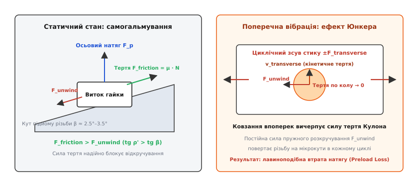
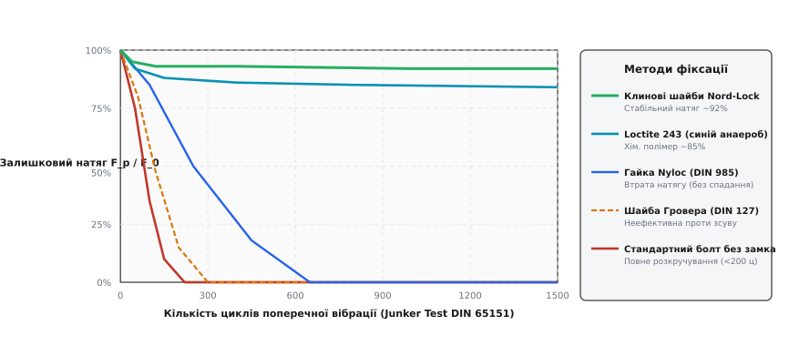
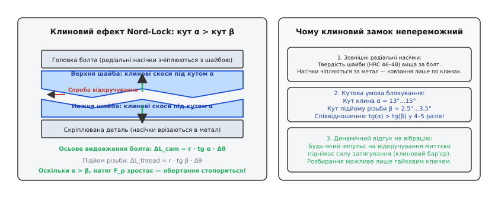
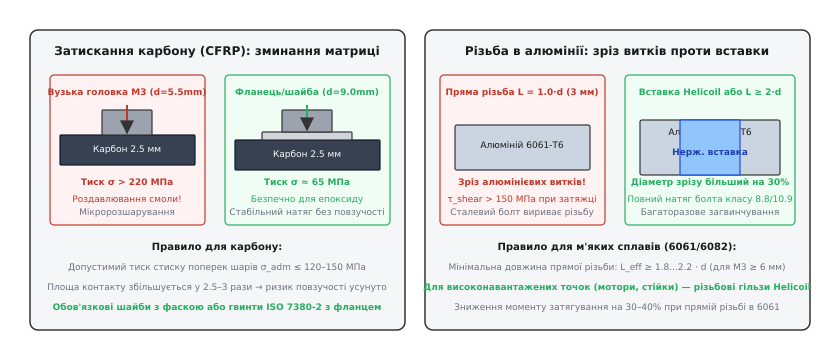

# Різьба під вібрацією: самовідкручування й фіксація

<preknowlist>
- [Тертя ковзання та спокою](root:ph-mechanics/friction) — закон Кулона-Амонтона, коефіцієнт тертя та кут тертя спокою на похилій площині.
- [Момент сили](root:ph-mechanics/torque) — векторний добуток сили на плече, створення крутного моменту при загвинчуванні.
- [Закон Гука й пружна деформація](root:ph-mechanics/hookes-law) — розтягнення стрижня болта як пружної пружини, натяг та жорсткість з'єднання.
- [Безколекторні мотори дрона](root:cat-hw-actuators/bldc-motor-module) — високочастотні джерела знакозмінних вібрацій (дисбаланс ротора та гармоніки пропелера).
- [Балансування гвинтів і вібрації на борту](root:embedded/balansuvannia-hvynta-i-poliuvannia-na-vibratsiiu) — динамічні спектри вібраційних прискорень і передача навантаження на раму.
- [Віброізоляція польотного контролера](root:hw-sensing/imu-vibration-isolation) — вплив структурних вібрацій рами на сенсорні вузли.
</preknowlist>

Коли чотири безколекторні мотори швидкісного квадрокоптера обертаються зі швидкістю 24 000 об/хв (частота 400 Гц), кожен грам динамічного дисбалансу пропелера генерує циклічне відцентрове зусилля понад 15 Н. Це навантаження передається через алюмінієву основу мотора на карбоновий промінь у вигляді знакозмінних поперечних зсувних коливань. Якщо монтажні гвинти М3 затягнуті зі стандартним статичним зусиллям без належного фіксатора, вже через 40–60 секунд польоту сила попереднього натягу в нарізному з'єднанні лавиноподібно падає до нуля, гвинт викручується під дією власної пружної деформації, і мотор відокремлюється від рами безпосередньо в повітрі.

Здатність нарізного з'єднання витримувати інтенсивні вібрації визначається не тим, наскільки міцно закручено болт «від руки», а фізикою взаємодії мікронерівностей у контактних витках під час поперечного зсуву деталей. Розуміння того, як пружний натяг перетворюється на силу самовідкручування, дозволяє обирати дієві інженерні методи фіксації — від анаеробної хімії до клинових механічних замків.

## Болт як натягнута пружина: розклад зусиль і баланс тертя

Будь-яке затягнуте нарізне з'єднання працює як замкнена пружна система з двох зустрічно навантажених пружин. Стрижень болта під дією крутного моменту видовжується в зоні пружних деформацій на величину `ΔL_bolt`, генеруючи осьову силу попереднього затягування (англ. *preload*) `F_p`. Пакет скріплюваних деталей (наприклад, алюмінієва основа мотора та карбонова пластина променя) під дією цієї ж сили зазнає пружного стиску на величину `ΔL_parts`.

Жорсткість болта на розтяг `k_bolt = (E_bolt · A_s) / L_grip` та сумарна жорсткість пакету деталей на стиск `k_parts` визначають пружний баланс з'єднання. Оскільки стиснуті деталі прагнуть повернутися до початкової товщини, а розтягнутий стрижень болта прагне скоротитися, у зоні контакту витків різьби та під опорним торцем головки виникають значні нормальні сили реакції.

Саме нормальна сила породжує силу тертя Кулона, яка в статичному стані блокує поворот гвинта. Проте момент затягування `T`, який оператор прикладає динамометричним ключем, розподіляється вкрай нерівномірно. За моделлю Келлермана-Кляйна (стандарт VDI 2230) прикладений момент витрачається на подолання трьох фізичних опорів:
1. `T_pitch` — корисний момент підйому по гвинтовій лінії (видовження болта): лише 10–15% енергії;
2. `T_thread` — момент тертя на похилих гранях витків різьби (профіль 60° збільшує нормальну силу через розклинювання): 40–50% енергії;
3. `T_bearing` — момент тертя на торцевій опорній поверхні під головкою болта або під гайкою: 40–45% енергії.

Повний математичний вивід складових формули Келлермана-Кляйна, розрахунок площі напруженого перерізу, пружної піддатливості стику та формули граничного натягу детально розібрано у [математичному розборі механіки напружень](root:sys-dron/rizba-pid-vibratsiieiu/math-bolt-mechanics.md).

У статичному стані нарізне з'єднання є самогальмівним. Кут підйому гвинтової лінії метричної різьби `β` для стандартного кроку становить лише `2.5°...3.5°`. Кут тертя спокою у різьбі `ρ'`, що визначається коефіцієнтом тертя `μ` та геометрією профілю різьби (`tg ρ' = μ / cos 30°`), за нормальних умов сухої сталі сягає `8°...11°` (`μ ≈ 0.12...0.15`). Оскільки кут тертя відчутно більший за кут підйому різьби (`ρ' > β`), скочування витків під дією осьового зусилля є неможливим — з'єднання перебуває в рівновазі.

## Спектр вібрацій дрона: як мотори генерують зсувні навантаження

На борту безпілотного апарата джерела вібрацій діють у широкому спектральному діапазоні — від одиниць герц до кількох кілогерців:
1. **Перша гармоніка обертання ротора (1X RPM):** При швидкості обертання мотора від 6 000 до 30 000 об/хв фундаментальна частота становить від 100 до 500 Гц. Навіть мікроскопічний залишковий дисбаланс ротора (наприклад, 0.05 г·мм) на швидкості 24 000 об/хв створює циклічну радіальну силу:
```
F_centrifugal = m · r · ω² = 0.05e-6 кг·м · (2 · π · 400 рад/с)² ≈ 3.16 Н  (на один мотор)
```
Ця сила діє строго в площині обертання, тобто перпендикулярно до осі кріпильних гвинтів М3.
2. **Лопатева частота (Blade Passing Frequency, BPF):** Для дволопатевого гвинта частота збурення дорівнює `2 · f_rot` (200–1000 Гц), для трилопатевого — `3 · f_rot` (300–1500 Гц). Аеродинамічний скос потоку на кожній лопаті породжує пульсації крутного моменту й тяги.
3. **Високочастотні комутаційні гармоніки ESC:** Комутація фаз інвертора на частотах ШІМ 24–48 кГц створює високочастотний акустичний і механічний шум, який хоч і має малу амплітуду переміщень, але руйнує клейові граничні шари й прискорює втому матеріалів.

Коли частота збурення 1X або BPF збігається з власною частотою згину чи кручення карбонового променя (резонанс), амплітуда поперечних прискорень на кінці променя зростає у 5–15 разів, досягаючи пікових значень `30g...80g`.

## Чому вібрація знищує натяг: теорія Юнкера

Уявлення про постійну самогальмівність різьби руйнується, коли на конструкцію починають діяти динамічні навантаження. Проте просторова орієнтація вібрації має вирішальне значення:

**Осьова (поздовжня) вібрація** спрямована вздовж осі болта. Вона викликає циклічні коливання сили натягу: `F(t) = F_p ± F_dyn(t)`. Доки динамічна амплітуда `F_dyn` менша за попередній натяг `F_p`, стиснуті деталі не розмикаються, нормальна сила на витках зберігається, і самовідкручування не відбувається. Осьові коливання можуть спричинити хіба що втому матеріалу при тривалій роботі, але не швидке розкручування різьби.

**Поперечна (трансверсальна) вібрація** діє перпендикулярно до осі болта. Саме вона виникає на променях квадрокоптера через дисбаланс роторів, аеродинамічну турбулентність та перехідні процеси зміни обертів. Поперечні коливання створюють знакозмінну зсувну силу `F_shear` у стику між скріплюваними деталями.

Коли змінна сила зсуву перевищує силу статичного тертя спокою стику (`F_shear > μ · F_p`), між деталями починається циклічне відносне ковзання (макрозсув). Це переміщення миттєво передається на внутрішні контактні поверхні різьби болта й гайки.


*Поперечний зсув стику за теорією Юнкера: циклічне ковзання впоперек осі вичерпує силу тертя Кулона, відкриваючи шлях пружній силі натягу до самовідкручування.*

Фізична сутність ефекту Юнкера полягає у **векторному вичерпанні сили тертя**. За законом сухого тертя Кулона, сила кінетичного тертя `F_f = μ · N` завжди спрямована суворо протилежно вектору відносної швидкості поверхонь `v_rel`.

Коли вібрація змушує деталі ковзати в поперечному напрямку зі швидкістю `v_transverse`, повний вектор тертя вирівнюється вздовж цього поперечного руху. У цей момент проєкція сили тертя на перпендикулярний — тангенціальний (окружний) — напрямок нарізки прямує до нуля:

```
F_friction_tangential ≈ 0                 [тертя в напрямку обертання зникає під час поперечного зсуву]
```

Але розтягнутий стрижень болта продовжує діяти на похилу грань різьби з постійною осьовою силою `F_p`. Ця сила породжує незмінну тангенціальну складову розкручування:

```
F_unwind = F_p · sin(β)                   [пружна сила прагне скотити виток назад]
```

У статиці `F_unwind` блокувалася колосальним тертям спокою. Тепер же, коли поперечний зсув тимчасово ліквідував тертя в окружному напрямку, сила `F_unwind` залишається єдиним неврівноваженим фактором. У кожному півперіоді поперечного зсуву виток гайки зміщується по похилій площині на крихітний мікрокут назад.

Цей процес має лавиноподібний характер (англ. *rotational self-loosening*):
1. Мікроповорот гайки на кут `Δθ` зменшує пружне видовження болта на величину `ΔL = (p / 2π) · Δθ`.
2. Зменшення видовження знижує залишковий натяг `F_p`.
3. Менший натяг знижує силу тертя спокою, через що амплітуда поперечного зсуву під тією ж зовнішньою вібрацією зростає.
4. Швидкість розкручування експоненційно прискорюється — за сотні або навіть десятки циклів натяг падає до нуля.

Історію відкриття цього явища, створення першого динамічного стенда SPS Unbrako та стандартизацію тесту DIN 65151 описано в [історичному нарисі про стенд Юнкера](root:sys-dron/rizba-pid-vibratsiieiu/hist-junker-test.md).

## Необертальні втрати натягу: релаксація та осідання стику

Навіть якщо болт механічно заблокований від провертання, нарізне з'єднання може втратити значну частину сили затягування через **необертальну релаксацію** (англ. *non-rotational relaxation*). Основними механізмами тут є пластичне осідання мікронерівностей та повзучість матеріалів.

### Пластичне осідання (Embedding / Settling)

Жодна механічна поверхня не є ідеально пласкою: після точіння чи фрезерування на ній залишаються мікрогребені шорсткості висотою `R_z = 3...15 мкм`. Під час початкового затягування контакт між витками та опорними торцями відбувається лише у верхівках цих мікрогребенів. Локальний тиск на піках сягає гігапаскалів, через що метал верхівок тече пластично.

Під дією вібрації мікронерівності остаточно зминаються, притираються та ущільнюються. Сумарна товщина пакету зменшується на величину пластичного осідання `f_z ≈ 5...12 мкм`.

Втрата сили натягу через осідання виражається через пружну піддатливість системи:

```
ΔF_relax = f_z / ( (1 / k_bolt) + (1 / k_parts) )
```

Чим коротший болт, тим вища його жорсткість `k_bolt = (E · A) / L_grip`, і тим катастрофічнішими є наслідки мікронного осідання. Для з'єднань дронів із короткою базою затискання (`L_grip = 3...5 мм` для кріплення мотора до променя) пружне видовження сталевого болта М3 під номінальним натягом становить лише `ΔL_bolt ≈ 8...12 мкм`. Осідання стику на ті самі `8 мкм` означає **миттєву втрату 70–100% попереднього натягу** без жодного градуса провертання болта.


*Криві залишкового натягу в тесті Юнкера (DIN 65151 / ISO 16130): порівняння динамічної стійкості незафіксованого болта, шайби Гровера, гайки Nyloc, Loctite 243 та клинових шайб Nord-Lock.*

## Хімічна фіксація: анаеробні полімери (Loctite)

Найпоширенішим і високоефективним методом запобігання як обертальному розкручуванню, так і мікрозсувам у різьбі є застосування рідких анаеробних фіксаторів різьби (англ. *anaerobic threadlockers*).

### Хімічний механізм твердіння

Основою анаеробних фіксаторів є рідкі мономери диметакрилатних ефірів у комбінації з ініціаторами (органічними гідропероксидами) та стабілізаторами. У флаконі рідина контактує з атмосферним киснем, який діє як потужний інгібітор вільних радикалів, підтримуючи полімер у стабільному рідкому стані протягом років.

Коли фіксатор наносять на різьбу й закручують з'єднання, одночасно спрацьовують два фундаментальні тригери полімеризації:
1. **Витіснення кисню:** Зазор між витками метричної різьби (0.05–0.15 мм) повністю заповнюється рідиною, перекриваючи доступ повітря.
2. **Каталітичний контакт з активним металом:** Іони перехідних металів (насамперед заліза `Fe²⁺/Fe³⁺` та міді `Cu⁺/Cu²⁺`) вступають в окисно-відновну реакцію з гідропероксидами, породжуючи лавину вільних радикалів.

Радикали запускають швидку ланцюгову реакцію полімеризації. Мономери зшиваються в міцну, жорстку тривимірну сітку термореактивного поліакрилату. Полімер заповнює 100% мікропорожнин між витками, перетворюючи нарізне з'єднання на монолітний полімерно-металевий композит із високою міцністю на зсув.

### Активні та пасивні метали: коли потрібен праймер

Швидкість і повнота полімеризації критично залежать від електрохімічної активності контактуючої поверхні:
- **Активні метали** (вуглецева сталь, легована сталь, чавун, мідь, латунь, бронза): полімеризація починається за 5–15 хвилин, повна міцність досягається за 2–6 годин.
- **Пасивні метали** (алюміній, анодований алюміній, титан, аустенітна нержавіюча сталь, цинкове або кадмієве гальванічне покриття, магній): через наявність міцної оксидної плівки вільних іонів металу недостатньо для швидкого старту реакції. Полімеризація може тривати понад 24 години або взагалі зупинитися на стадії желеподібного стану.

Для надійного склеювання алюмінієвих моторних кріплень та титанових або нержавіючих гвинтів при температурі нижче +15 °C обов'язковим є використання хімічного активатора/праймера (наприклад, Loctite 7471 або Loctite 7649). Активатор містить розчинні солі міді, які осаджуються на пасивній поверхні й гарантують 100% полімеризацію за будь-яких умов.

### Порівняння синього (Loctite 243) та червоного (Loctite 271) фіксаторів

| Параметр | Loctite 243 (Синій, середньої міцності) | Loctite 271 (Червоний, високої міцності) |
|---|---|---|
| **Призначення** | Розбірні з'єднання, моторні гвинти, рами БПЛА | Нерозбірні вузли, вали моторів, шпильки |
| **Момент зриву (Breakaway torque, M10)** | 26 Н·м | 36–40 Н·м |
| **Момент зриву для M3 (типовий)** | 1.8–2.2 Н·м | 3.5–4.5 Н·м (ризик злизування шліца) |
| **Толерантність до мастила** | Висока (працює на неочищених витках) | Середня (вимагає знежирення) |
| **Спосіб демонтажу** | Звичайний ручний шестигранний ключ | Локальний нагрів до 250 °C + спецключ |
| **Температурний діапазон** | від -55 °C до +180 °C | від -55 °C до +180 °C (Loctite 272 — до +230 °C) |

> ⚠️ **Критична помилка монтажу:** Рідкий фіксатор різьби в момент закручування працює як ефективне мастило, знижуючи коефіцієнт тертя `μ` з 0.20 (суха сталь) до 0.12–0.14. Якщо затягувати болт за «сухою» таблицею моментів, реальне зусилля натягу `F_p` зросте на 40–50%, що неминуче призведе до зриву різьби в алюмінієвій основі мотора або пластичного витягування тонкого гвинта М3.

## Механічні методи: міфи та надійні рішення

Крім хімічних засобів, в інженерії застосовують широку номенклатуру механічних стопорних елементів. Проте їхня реальна ефективність під динамічним поперечним зсувом кардинально різниться.

### Пружинні шайби Гровера (DIN 127): небезпечна ілюзія

Розрізна пружинна шайба Гровера (DIN 127) та її аналоги залишаються найпоширенішою помилкою в аматорських конструкціях:
- Під час затягування до номінального робочого моменту розрізна шайба **повністю стискається і стає пласкою** ще при досягненні 5–10% від кінцевого зусилля затягування.
- Пружна енергія розпрямлення шайби мізерна порівняно з енергією розтягнутого болта.
- У момент виникнення поперечного вібраційного зсуву загартовані гострі кромки розрізу проорюють кругові борозни на м'якій алюмінієвій або карбоновій деталі. Утворені частинки металу починають діяти як сухе абразивне мастило, прискорюючи розкручування.
- У випробуваннях на стенді Юнкера болти з шайбами DIN 127 втрачають натяг майже з тією самою швидкістю, що й болти взагалі без шайб. Через це шайби DIN 127 офіційно вилучені з переліку стопорних елементів у нормах DIN/ISO для динамічно навантажених вузлів.

### Гайки з нейлоновим кільцем (Nyloc, DIN 985 / ISO 7040)

Гайки Nyloc містять пружне кільце з поліаміду (Nylon 6.6), внутрішній діаметр якого менший за зовнішній діаметр різьби болта:
- При накручуванні сталева різьба нарізає власний відбиток у нейлоні шляхом пружно-пластичної деформації полімеру.
- Нейлон створює постійний гальмівний момент тертя (англ. *prevailing torque*), який не залежить від осьового натягу болта.
- **Поведінка під вібрацією:** Гайка Nyloc не запобігає втраті сили попереднього затягування. Під дією поперечної вібрації натяг падає до нуля так само, як і в звичайній гайці. Проте нейлонове кільце перешкоджає повному спаданню гайки зі стрижня (забезпечує неруйнівне утримання вузла в розбовтаному стані).
- **Обмеження:** Температурна межа нейлону становить +100...+120 °C (біля гарячих силових транзисторів чи вихлопних колекторів поліамід розм'якшується й тече); допустима кількість повторних закручувань — не більше 3–5 разів, після чого переважаючий момент падає нижче вимог стандарту ISO 2320.

### Клинові шайби Nord-Lock: геометричний замок проти тертя

Клинові шайби Nord-Lock (стандарт DIN 25201) використовують принципово іншу фізику: вони фіксують з'єднання не за рахунок тертя, а за допомогою **геометричного розклинювання**.

Комплект складається з пари загартованих шайб:
- На внутрішніх суміжних поверхнях виконані клинові скоси (зубці-кулачки) під кутом `α`.
- На зовнішніх опорних поверхнях нанесені радіальні насічки з твердістю, що перевищує твердість болта (понад 46–48 HRC).


*Геометрія та принцип дії клинових шайб Nord-Lock: завдяки співвідношенню кутів α > β будь-яка спроба відкручування призводить до розклинювання та стрибка натягу болта.*

При затягуванні зовнішні насічки врізаються в опорну поверхню головки болта та скріплюваної деталі. Відносний рух стає можливим виключно по внутрішніх клинових поверхнях між шайбами.

Головна геометрична умова працездатності клинового замка:

```
α > β                                     [кут клина шайби більший за кут підйому різьби]
```

Для стандартних метричних шайб Nord-Lock кут клина `α ≈ 13°...15°`, тоді як кут підйому різьби `β ≈ 2.5°...3.5°`.

Якщо під впливом екстремальної вібрації головка болта робить спробу повернутися в бік відкручування на кут `Δθ`, верхня шайба вимушена підійматися по похилих скосах нижньої шайби:
- Осьове підняття клина: `ΔL_cam = r · tg(α) · Δθ`
- Осьове опускання різьби болта: `ΔL_thread = r · tg(β) · Δθ`

Оскільки `tg(α) > tg(β)` приблизно в 4–5 разів, осьове підняття клинів випереджає хід різьби. Замість послаблення болт при спробі розкручування **вимушений додатково розтягуватися**, що призводить до стрибкоподібного зростання сили натягу `F_p`. З'єднання блокує саме себе геометрично. У тесті Юнкера Nord-Lock зберігає понад 90–95% сили затягування протягом мільйонів циклів.

## Специфіка карбону та м'яких алюмінієвих сплавів

У безпілотних літальних апаратах більшість нарізних з'єднань поєднують вуглепластикові композитні пластини (CFRP) та фрезеровані деталі з алюмінієвих сплавів (6061-T6, 7075-T6). Фізичні властивості цих матеріалів диктують жорсткі обмеження на вибір кріплення та момент затягування.

### Затискання карбонових пластин: ризик роздавлювання смоли

Вуглепластик є ортотропним матеріалом: він має колосальну міцність уздовж вуглецевих волокон (понад 1500–2000 МПа), але міцність на стиск у поперечному напрямку (перпендикулярно до шарів ламінату) обмежена міцністю полімерної епоксидної матриці і становить лише `σ_comp_max ≈ 120...150 МПа`.

Якщо затягувати стандартний гвинт із вузькою циліндричною головкою (наприклад, DIN 912 M3, діаметр контакту `d_w ≈ 5.5 мм`), площа контакту під головкою становить:

```
A_bearing = (π / 4) · (5.5² - 3.4²) = 14.68 мм²
```

При створенні рекомендованого для сталевого болта М3 класу 10.9 зусилля затягування `F_p = 3.5 кН` контактний тиск під головкою сягне:

```
σ_contact = 3500 Н / 14.68 мм² = 238.4 МПа   [у півтора раза перевищує міцність епоксиду]
```

Наслідки надмірного тиску:
1. **Мікророзшарування та дроблення матриці:** Епоксидна смола тріскається під головкою, волокна втрачають поздовжню стійкість і ламаються.
2. **Катастрофічна повзучість:** Зім'ята смола продовжує повільно деформуватися під залишковим тиском протягом наступних годин польоту, що призводить до падіння натягу болта на 50–80% навіть за повної відсутності вібраційного самовідкручування.

**Інженерне правило для карбону:**
- Заборонено застосовувати вузькі головки DIN 912 безпосередньо на голий карбон.
- Необхідно використовувати гвинти з широким фланцем (ISO 7380-2 Button Head with Flange) або підкладати прецизійні широкі алюмінієві/нержавіючі шайби DIN 9021 (зовнішній діаметр для М3 — 9.0 мм). Збільшення площі контакту до `54.5 мм²` знижує тиск до безпечних `64 МПа`.


*Механіка затискання в безпілотних конструкціях: розподіл тиску під фланцем на карбоні для запобігання роздавлюванню смоли та захист різьби в алюмінії вставками Helicoil.*

### Різьба в м'якому алюмінії: зріз витків та вставки Helicoil

Основи моторів та стояки дронів зазвичай виготовляють зі сплаву 6061-T6 (границя зсуву `τ_shear ≈ 150 МПа`) або авіаційного 7075-T6 (`τ_shear ≈ 300 МПа`). При закручуванні міцного сталевого гвинта класу 10.9 (`R_m = 1040 МПа`) зріз внутрішніх витків алюмінієвої різьби відбувається задовго до того, як болт досягне межі пружності.

Щоб запобігти зриву внутрішньої різьби, довжина зачеплення `L_eff` повинна задовольняти умові:

```
L_eff ≥ (A_s · R_m_bolt) / (π · d · 0.75 · τ_shear_aluminum)
```

- Для сталевого болта 10.9 у сплав **6061-T6**: мінімальна довжина зачеплення становить `L_eff ≥ 2.0...2.2 · d` (для М3 — не менше 6.0–6.6 мм різьби).
- Для сплаву **7075-T6**: довжина зачеплення становить `L_eff ≥ 1.2...1.4 · d` (для М3 — не менше 4.0 мм).

Якщо товщина алюмінієвої деталі конструктивно обмежена (наприклад, фланець мотора товщиною лише 3.0 мм для гвинта М3), застосування прямої нарізки в сплаві 6061-T6 не дозволяє затягнути болт із повним моментом. У таких випадках застосовують дротяні різьбові вставки **Helicoil (DIN 8140)** із пружинної нержавіючої сталі (1.4301 / AISI 304). Вставка має ромбічний переріз, що збільшує ефективний діаметр зрізу алюмінієвої матриці на 25–30%, повністю усуваючи ризик зриву різьби при багаторазовому монтажі моторів.

## Послідовність затягування та контроль моменту

У вузлах із групою кріпильних гвинтів (наприклад, чотириболтове кріплення мотора до променя за схемою 16×16 або 19×19 мм) одночасне затягування одного болта до повного моменту призводить до перекосу фланця мотора, локального роздавлювання карбону під першим гвинтом та утворення початкового зазору під протилежними гвинтами.

Правильний алгоритм затягування виконується за **перехресною схемою («зіркою»)** у три послідовні проходи:
1. **Перший прохід (30% моменту, ~0.35 Н·м для М3):** Попереднє вирівнювання деталей та вибір зазорів. Болти закручуються по черзі по діагоналі (1 → 3 → 2 → 4).
2. **Другий прохід (70% моменту, ~0.80 Н·м для М3):** Рівномірне обтискання епоксидного ламінату та вирівнювання контактного тиску без перевищення локальної межі пружності.
3. **Фінальний прохід (100% моменту, ~1.15 Н·м для М3 з синім фіксатором):** Остаточне створення робочого натягу болтів за тією ж перехресною схемою, після чого проводиться контрольний круговий обхід (1 → 2 → 3 → 4) без перевищення номінального моменту.

Використання каліброваної динамометричної викрутки з діапазоном 0.2–2.0 Н·м є обов'язковим: затягування шестигранними Г-подібними ключами «на око» дає розкид зусилля в межах ±60–80%, що гарантовано призводить або до недотягування (самовідкручування під вібрацією), або до перетягування (зрив алюмінієвої різьби).

## Інженерний калькулятор нарізних з'єднань на C та C++

Наведений нижче програмний модуль реалізує повний інженерний розрахунок нарізного вузла за стандартом VDI 2230. Програма обчислює розрахункову площу перерізу стрижня `A_s`, рекомендоване зусилля попереднього натягу `F_preload`, момент затягування `T` за моделлю Келлермана-Кляйна з урахуванням стану змащення/фіксатора, контактний тиск на карбонову пластину та мінімальну безпечну глибину різьби в алюмінії.

:::tabs

:::code rizba-pid-vibratsiieiu-d/c/fastener_calc.c

:::code rizba-pid-vibratsiieiu-d/cpp/main.cpp

:::

## Практичний протокол фіксації нарізних вузлів БПЛА

Підсумовуючи механіку вібраційного навантаження, надійний регламент складання нарізних з'єднань дрона складається з п'яти обов'язкових інженерних правил:

1. **Знежирення різьби перед складанням:** Залишки консерваційного мастила знижують зчеплення анаеробного клею на 60–80%. Промивання ізопропіловим спиртом або очисником гальм обов'язкове для всіх металевих поверхонь перед нанесенням складу.
2. **Активатор для алюмінію та титану:** При складанні деталей з анодованого алюмінію (моторні пластини, промені) за температури нижче +15 °C використовуйте праймер Loctite 7471.
3. **Заборона розрізних шайб DIN 127:** Для динамічно навантажених вузлів шайби Гровера повністю замінюють на анаеробний фіксатор (Loctite 243) або клинові пари Nord-Lock.
4. **Захист карбону від стиску:** Усі болти, що проходять крізь карбонові пластини, обов'язково комплектуються фланцевими головками ISO 7380-2 або широкими шайбами DIN 9021 для утримання контактного тиску в межах до 120 МПа.
5. **Контроль моменту затягування:** Застосування динамометричної викрутки з урахуванням мастильного ефекту рідкого фіксатора різьби запобігає зрізу внутрішніх витків в алюмінієвих моторах і гарантує збереження 100% цілісності рами протягом усього життєвого циклу безпілотника.
