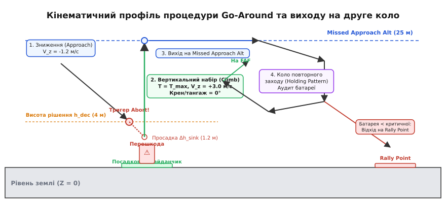
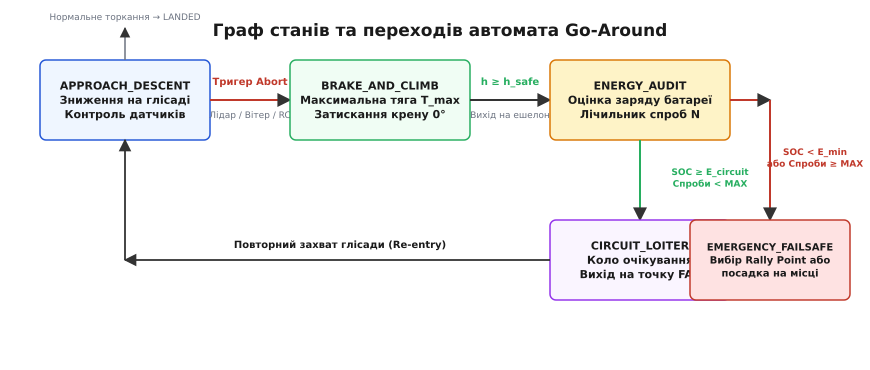

# Скасована посадка й друга спроба

<preknowlist>
- [Автопосадка](root:sys-dron/avtoposadka) — етапи фінального зниження, детектор контакту з землею та алгоритми роззброєння двигунів.
- [Безпечний відмов (failsafe)](root:sys-dron/failsafe) — класифікація аварійних подій, пріоритети захисних процедур та перехід у безпечні стани.
- [Повернення додому](root:sys-dron/povernennia-dodomu) — розрахунок безпечного ешелону повернення, навігація за точками та логіка виходу на базу.
- [Вітер і знос](root:sys-dron/viter-i-znos) — вплив бічного вітру на керованість, кут зносу та дефіцит горизонтальної тяги.
- [Низька батарея](root:sys-dron/nyzka-batareia) — пороги напруги й залишкової ємності, просідання напруги під навантаженням.
- [Точки збору (rally points)](root:sys-dron/rally-points) — вибір альтернативних майданчиків при неможливості посадки на основній базі.
</preknowlist>

Важкий гексакоптер масою дванадцять кілограмів завершує автономну місію моніторингу промислового об'єкта й переходить у режим фінального зниження зі швидкістю півтора метра на секунду. На висоті чотирьох метрів над майданчиком спрямований донизу лазерний далекомір фіксує раптову появу технічного персоналу в зоні приземлення, а раптовий бічний порив вітру швидкістю дев'ять метрів на секунду нахиляє апарат на двадцять вісім градусів. Якщо польотний контролер знехтує цими показниками й продовжить виконання штатної програми посадки, через дві секунди відбудеться зіткнення з людиною або перекидання дрона на шасі через неконтрольований бічний дрейф. Проте спроба миттєво «смикнути» максимальний газ без попереднього розрахунку кінематики не менш небезпечна: ротори мають механічну інерцію розкрутки, і під час затримки створення повної підйомної сили апарат продовжить просідати вниз за інерцією, ризикуючи вдаритися об перешкоду на максимальних обертах двигунів.

Вихід із цієї критичної ситуації покладається на автоматичну процедуру **скасування посадки** (англ. *go-around* або *missed approach* — процедура відходу на друге коло в класичній авіації). Це спеціалізований захисний режим польотного стека, який миттєво перериває траєкторію зниження, переводить силову установку в максимальний вертикальний набір без небезпечних нахилів корпусу, піднімається на висоту безпечного маневрування, виконує аудит залишку енергії в акумуляторі та виводить апарат на повторний захід або на запасний майданчик.


*Кінематичний профіль скасування посадки: траєкторія зниження (Approach), фіксація тригера скасування на висоті прийняття рішення, динамічна просадка внаслідок затримки розкрутки гвинтів (Δh_sink), екстрений вертикальний набір на максимальній тязі до безпечного ешелону (Missed Approach Alt), вихід у зону очікування з аудитом заряду та вибір між повторним заходом на FAF чи відходом на запасний Rally Point.*

---

### Тригери скасування: коли посадка стає неможливою

Посадка є найбільш вразливою фазою польоту будь-якого безпілотного апарата. Під час зниження дрон втрачає висоту, запас потенційної енергії прямує до нуля, а вільний простір для просторового маневрування звужується до лічених метрів. Система автоматичного скасування посадки повинна безперервно опитувати сенсорні, навігаційні та енергетичні контури, щоб розпізнати аварійну ситуацію задовго до фізичного торкання небезпечної поверхні.

```
                  ┌─ Лідар / сонар: раптова перешкода або сходинка рельєфу
                  ├─ Оптична камера: втрата / розмиття посадкової мітки (AprilTag)
                  ├─ ІНС / гіроскопи: критичний крен або тангаж (|θ| > θ_max)
Критерії Abort ───┼─ Оцінка вітру: неконтрольований бічний дрейф (V_xy > V_safe)
                  ├─ Навігація GNSS/RTK: втрата фіксованого розв'язку (EPH > Limit)
                  ├─ Оператор / GCS: команда скасування MAV_CMD_DO_GO_AROUND
                  └─ Часовий ліміт: зависання в глісаді довше допустимого таймауту
```

Виділяють сім фундаментальних груп тригерів, які вимагають негайної активації процедури `Abort Landing`:

1. **Виявлення перешкоди під апаратом (Ground Proximity & Obstacle Breach).** Лазерний далекомір (лідар, англ. *LiDAR* — *Light Detection and Ranging*) або ультразвуковий сонар, спрямований суворо в надир (лат. *nadir* — напрямок униз), здійснює вимірювання дистанції з частотою 50–100 Гц. Якщо барометрична висота або оцінка висоти за фільтром Калмана показує 5 метрів, а далекомір раптово фіксує стрибок дистанції до 1.5 метра — під дроном з'явився динамічний об'єкт (автомобіль, людина, контейнер) або майданчик виявився захаращеним будівельними конструкціями.
2. **Втрата візуального або радіомаякового захоплення (Precision Landing Lock Loss).** Під час високоточного приземлення за оптичними мітками (наприклад, матричними кодами ArUco або AprilTag) бортовий комп'ютер орієнтується на положення мітки в кадрі нижньої камери. Якщо мітку закрило пилом від гвинтів, засліпило прямим сонячним променем або знесло за межі кута огляду об'єктива (FOV, англ. *Field of View*), контур втрачає можливість точного центрування. Продовжувати спуск наосліп заборонено.
3. **Критичне відхилення просторової орієнтації (Attitude Divergence).** При наближенні до землі апарат потрапляє в зону екранного ефекту (англ. *ground effect*) та власної відбитої турбулентності. Якщо кут крену або тангажу перевищує критичну межу (зазвичай 20–25 градусів), а кутові швидкості зростають швидше, ніж контур стабілізації встигає їх парирувати, спроба посадки гарантовано призведе до удару пропелерами об ґрунт.
4. **Некомпенсований вітровий знос (Excessive Cross-Track & Wind Velocity).** Якщо швидкість бічного вітру перевищує ліміт ефективності горизонтальної тяги, дрон починає зміщуватися відносно посадкового центру зі швидкістю понад 0.5–0.8 м/с. Посадка з такою горизонтальною швидкістю ламає посадкове шасі під час першого ж контакту.
5. **Деградація супутникової навігації (RTK Loss & High EPH).** Якщо високоточна посадка спирається на диференційну корекцію RTK (англ. *Real-Time Kinematic*), перехід приймача зі статусу `RTK Fixed` у `Float` або автономний режим викликає стрибок горизонтальної невизначеності положення `EPH` (англ. *Horizontal Position Estimate Error*) понад 0.3–0.5 м. У стисненому просторі посадкової платформи така похибка еквівалентна промаху повз майданчик.
6. **Команда оператора або зовнішньої системи керування.** Наземна станція (GCS, англ. *Ground Control Station*) або оператор через апаратуру радіокерування може надіслати команду MAVLink `MAV_CMD_DO_GO_AROUND` (ідентифікатор команди 251) або клацнути тумблером аварійного скасування на пульті.
7. **Перевищення часового ліміту глісади (Descent Timeout).** Якщо через сильний висхідний потік повітря або помилку оцінки висоти дрон зависає на глісаді довше розрахункового часу (наприклад, понад 30 секунд у фазі фінального приземлення), це вказує на деградацію сенсорів або зависання алгоритму, що вимагає скидання фази.

> 🔧 **Навіщо це.** У польотних стеках ArduPilot та PX4 помилка розпізнавання перешкоди є причиною понад 40% аварій під час автономної доставки вантажів. Якщо логіка автопілота не вміє скасовувати посадку, дрон намагатиметься сісти на дах автомобіля, у воду або на нерівний схил, сприймаючи будь-яку перешкоду за монолітну землю.

---

### Сенсорна комплектація та фільтрація тригерів

Надійна ідентифікація аварійних умов на посадковій глісаді вимагає комплексування різнорідних давачів. Жоден окремий сенсор не гарантує безпомилкового розпізнавання земної поверхні в усіх погодних умовах:

| Тип сенсора | Фізичний принцип | Сильні сторони | Слабкі сторони та пастки |
|---|---|---|---|
| **Оптичний лідар** (Time-of-Flight) | Вимірювання часу прольоту лазерного імпульсу (905 / 940 нм) | Сантиметрова точність, висока частота (50–200 Гц), вузький промінь | Поглинання променя водою, дзеркальні відблиски від калюж і скла, засліплення прямим сонцем |
| **Ультразвуковий сонар** | Акустичний ехолокатор (40 кГц) | Не залежить від освітлення, працює над дзеркальною водою | Поглинання звуку високою травою та снігом, кутова розбіжність променя, чутливість до шуму моторів |
| **Міліметровий радар** (mmWave 60/77 GHz) | Радіолокація FMCW із фазованою решіткою | Пробиває пил, туман, дим, дощ; виявляє швидкість за Доплером | Більша маса, вище енергоспоживання, шумні відбиття від дрібних камінців |
| **Оптичний потік** (Optical Flow) | Кореляція послідовних кадрів монохромної матриці | Точний вимір бічного дрейфу `(Vx, Vy)` біля землі | Повна відмова в темряві, на однорідному бетоні або над водою |

Для запобігання хибним спрацьовуванням автопілот застосовує мажоритарне голосування (англ. *majority voting*) та байєсівську фільтрацію. Поодинокий аномальний відлік далекоміра відкидається фільтром брязкоту (англ. *debounce filter*). Тригер перешкоди активується лише тоді, коли аномальне зближення підтверджується кількома циклами вимірювань поспіль або супроводжується корелюючими змінами у вертикальній швидкості.

---

### Аеродинаміка приземного шару: екранний ефект і вихрові кільця

Фізика польоту на висотах менше одного діаметра ротора (`z < 2 · R_prop`) якісно відрізняється від польоту у вільному просторі. При розробці процедури Go-Around необхідно враховувати два критичних аеродинамічних явища:

#### 1. Екранний ефект (Ground Effect)
Під час наближення до твердої поверхні повітряний потік, що відкидається пропелерами вниз (англ. *downwash*), зустрічає перешкоду й розтікається радіально в боки. Під роторами утворюється зона підвищеного статичного тиску («повітряна подушка»). 

```
                                  [Корпус дрона]
                                  ▼            ▼
                            ┌─── Лопать ─── Лопать ───┐
                            │      │          │       │
                            │      ▼          ▼       │
                      Зона  │   Повітряний потік      │  Зона
                   підвищеного  ════════════════      │ підвищеного
                      тиску │   [ЕКРАННИЙ ШАР]        │    тиску
                            │   ──────────────        │
                    ────────┴─────────────────────────┴──────── Рівень землі
```

Це викликає два протилежні наслідки:
- **Підвищення тяги біля землі.** За тієї самої потужності двигунів тяга ротора зростає на 15–20%. Дрон відчуває додаткову підйомну силу, що допомагає зупинити спуск на початковій фазі скасування.
- **Стрибок тяги при виході з екрана.** Коли апарат піднімається вище двох метрів, екранний ефект різко зникає. Якщо контролер не збільшить подачу газу випереджальним контуром (англ. *feed-forward compensation*), дрон може втратити темп набору висоти або знову просісти.

#### 2. Режим вихрового кільця (Vortex Ring State, VRS)
Якщо дрон знижується надто швидко (`|v_z| > 0.25..0.30 · v_induced`, де `v_induced` — індуктивна швидкість струменя ротора), він потрапляє у власний турбулентний слід. Повітря починає циркулювати по замкненому колу навколо кінців лопатей, утворюючи тороїдальний вихор. Підйомна сила ротора хаотично падає, виникає сильна вібрація та розгойдування по крену.

Спроба плавно піддати тягу всередині VRS лише підсилює тороїдальний вихор, прискорюючи падіння. Єдиним виходом із режиму вихрового кільця є **імпульсне переведення тяги на максимум у поєднанні з невеликим горизонтальним зміщенням** для виходу з турбулентного стовпа повітря. Саме таку комбінацію реалізує алгоритм Go-Around.

---

### Кінематика та енергетика: фізика вертикального відходу

Найбільш критична помилка в розумінні скасування посадки полягає в припущенні, що дрон може змінити вектор швидкості з вертикального спуску на підйом миттєво. Регулятори обертів безколекторних двигунів (ESC) та ротори володіють електромеханічною інерцією, а сам апарат — масою, яка рухається вниз із ненульовою швидкістю `v_z0`.

```
                    ┌─ ТАЙМАУТ РОЗКРУТКИ: t_spoolup = 0.15..0.30 с (ріст тяги)
Кінематичні ланки ──┼─ ДИНАМІЧНЕ ГАЛЬМУВАННЯ: гасіння швидкості -v_z до 0
                    ├─ ПРОСАДКА: Δh_sink — втрата висоти після подачі команди
                    └─ СТАБІЛЬНИЙ НАБІР: V_z_climb = 2.5..4.0 м/с суворо вгору
```

Розгляньмо фізику процесу крок за кроком.

#### 1. Електромеханічна затримка розкрутки (Motor Spool-up)

Під час стабільного спуску двигуни мультикоптера працюють на зниженій тязі `T_land ≈ 0.35..0.45 · m · g`, де `m` — маса апарата, а `g` — прискорення вільного падіння. Коли алгоритм фіксує подію Abort, польотний контролер видає команду на максимальну тягу `T_max` (зазвичай 85–95% від межі регуляторів).

Проте магнітне поле статора не може розігнати важкий ротор із лопатями за нуль секунд. Час набору максимальних обертів описується аперіодичною ланкою першого порядку з характерним часом наростання `t_spoolup` від 150 до 300 мс (залежно від діаметра пропелерів і напруги живлення). Протягом цього інтервалу середня тяга зростає лінійно, а вертикальне прискорення залишається від'ємним або близьким до нуля.

За цей час затримки дрон проходить додаткову відстань униз:

```
Δh_spool = |v_z0| · t_spoolup      [просідання під час розгону моторів]
```

#### 2. Динамічне гальмування вертикальної швидкості

Після виходу роторів на режим максимальної тяги `T_max` апарат отримує результуюче вертикальне прискорення вгору:

```
a_z_climb = (T_max · cos(θ) - m · g) ÷ m      [вертикальне прискорення]
```

де `θ` — поточний кут нахилу рами (крен або тангаж). Якщо апарат нахилений, вертикальна складова тяги падає пропорційно `cos(θ)`. Саме тому під час скасування посадки контур керування **зобов'язаний примусово обнулити цільові кути крену й тангажу** (`θ_cmd = 0`), щоб спрямувати 100% тяги виключно на порятунок від зіткнення з землею.

Час, необхідний для повної зупинки вертикального спуску (від `v_z = v_z0` до `v_z = 0`), становить:

```
t_brake = |v_z0| ÷ a_z_climb      [час гасіння вертикальної швидкості]
```

А шлях гальмування розраховується за класичним кінематичним рівнянням:

```
Δh_brake = (v_z0)² ÷ (2 · a_z_climb)      [шлях динамічного гальмування]
```

#### 3. Повна динамічна просадка (Total Sinkage)

Сумарне просідання апарата вниз від точки видачі команди на скасування до миті, коли вертикальна швидкість пройде нуль і змінить знак на додатний, дорівнює сумі двох складових:

```
Δh_sink = Δh_spool + Δh_brake
= |v_z0| · t_spoolup + (v_z0)² ÷ (2 · a_z_climb)      [повна динамічна просадка]
```

**Числовий розрахунок на прикладі реального коптера:**
Маса дрона `m = 6.0 кг`, максимальна сумарна тяга `T_max = 100 Н` (тягооснащеність 1.7:1), швидкість спуску `v_z0 = -1.5 м/с`, затримка розкрутки `t_spoolup = 0.20 с`.

```
a_z_climb = (100 - 6.0 · 9.81) ÷ 6.0
= (100 - 58.86) ÷ 6.0
= 41.14 ÷ 6.0
≈ 6.86 м/с²                           [максимальне прискорення вгору]

Δh_spool = 1.5 · 0.20
= 0.30 м                              [просідання за час розкрутки]

Δh_brake = (1.5)² ÷ (2 · 6.86)
= 2.25 ÷ 13.72
≈ 0.16 м                              [просідання за час гальмування]

Δh_sink = 0.30 + 0.16
= 0.46 м                              [сумарна динамічна просадка]
```

Із цього розрахунку випливає фундаментальний інженерний висновок: **якщо команда скасування надійде на висоті, меншій за `Δh_sink` плюс запас безпеки `h_margin` (зазвичай 0.5–1.0 м), дрон неминуче вдариться об землю до того, як встигне зупинити спуск.**

Тому висота прийняття рішення (англ. *Decision Height*, `h_decision`) у конфігурації автопілота повинна задовольняти строгу нерівність:

```
h_decision ≥ Δh_sink + h_margin      [умова гарантованого непопадання в землю]
```

Якщо перешкода або критичний збій виявляються нижче позначки `h_decision`, процедура переривання вже не може запобігти контакту з поверхнею. У цьому разі автопілот переходить до аварійного притискання до землі зі скиданням газу (Touchdown Emergency), щоб уникнути удару на повних обертах моторів.

---

### Розподіл тяги та насичення мікшера (Actuator Desaturation)

Під час екстреного набору висоти контролер стикається з проблемою насичення приводів (англ. *actuator saturation*). Матриця мікшера двигунів обчислює вихідний сигнал на кожен двигун `u[i]` як суму базового газу та корекцій моментів:

```
u[i] = Throttle_base + c_roll[i] · τ_roll + c_pitch[i] · τ_pitch + c_yaw[i] · τ_yaw      [мікшер моторів]
```

Коли `Throttle_base` піднімається до 95% для максимального підйому, а порив вітру вимагає створення моменту крену `τ_roll = +0.20`, команда для підвітряного мотора досягає `0.95 + 0.20 = 1.15`, що перевищує фізичну межу регулятора (100%).

Якщо мікшер просто зріже верхнє значення на рівні 1.0 (hard clipping), виникне асиметрія моментів, яка призведе до неконтрольованого закручування коптера. Щоб уникнути катастрофи, польотний стек застосовує **алгоритм пріоритету вертикальної тяги (Altitude Priority Governor)**:

```
                                  ┌─ Запит тяги: Throttle_base = 0.95
                                  ├─ Запит моменту: τ_roll = +0.20
Конфлікт насичення (u > 1.0) ─────┤
                                  ▼
                Масштабування моментів: k_scale = (1.0 - Throttle_base) / max(τ)
                Новий момент: τ_roll_scaled = τ_roll · k_scale = +0.05
                Результат: Збереження 95% тяги ціною повільнішого вирівнювання
```

Алгоритм пропорційно стискає кутові моменти, гарантуючи, що вертикальна підйомна сила не зменшиться ні на відсоток під час виходу з небезпечної зони біля землі.

---

### Висота безпечного розвороту та повернення в коло

Після того як вертикальний спуск успішно зупинено й апарат почав набирати висоту з позитивною швидкістю `v_z_climb = 2.5..4.0 м/с`, виникає наступна просторова проблема: **коли і як дозволено починати горизонтальний рух?**

```
h = 0 м ──→ [Зниження] ──→ h_dec: Abort! ──→ Вертикальний набір ──→ h_missed (25 м) ──→ Розворот / Loiter
                                               (Крен/Тангаж = 0°)    (Дозволені маневри X,Y,Yaw)
```

Поширена помилка програмування польотних контролерів полягає в спробі одночасно набирати висоту й повертати дрон у напрямку попередньої точки місії. На низькій висоті (1–10 метрів) це призводить до трьох критичних ризиків:
1. **Зниження вертикальної тяги через нахил.** Для руху вбік дрон зобов'язаний створити крен `φ` або тангаж `θ`. Вертикальна тяга падає як `cos(θ)`, що зменшує темп набору висоти або знову вводить апарат у просідання.
2. **Зіткнення з висотними об'єктами.** Навколо посадкового майданчика можуть бути дерева, будівлі, антени або кузов автомобіля з обладнанням. Нахил на малій висоті зміщує дрон у бік цих перешкод.
3. **Асиметрія обдування лопатей біля землі.** На висотах до кількох метрів відбиті струмені повітря створюють хаотичні моменти по крену й рисканню, якщо апарат рухається горизонтально.

Звідси формулюється **інваріант відходу на друге коло**:
> Під час фази `ABORT_CLIMB` горизонтальні координати `(X, Y)` заморожуються контуром позиціювання, а кути крену й тангажу утримуються суворо в нулі, доки барометрична висота не досягне висоти відходу на друге коло (англ. *Missed Approach Altitude*, `h_missed`).

Параметр `h_missed` обирається з урахуванням висоти максимальних перешкод у радіусі посадкової зони (зазвичай 20–30 метрів).

Тільки після досягнення `h ≥ h_missed` автопілот переходить до горизонтального маневрування:
1. **Вихід у зону очікування (Holding Pattern / Loiter).** Дрон стабілізується на висоті `h_missed` і описує коло радіусом 15–25 метрів над безпечною точкою. Це дає змогу заспокоїти перехідні процеси в контурах стабілізації, перевірити стабільність тяги й оцінити телеметрію.
2. **Побудова повторного заходу (Circuit Re-entry).** Автопілот обчислює траєкторію виходу на точку початку фінальної прямої — кінцеву точку фіксації заходу (англ. *Final Approach Fix*, FAF). Дрон вирівнюється за напрямком посадкового курсу (проти вітру) і розпочинає повторне плавне зниження.

---

### Специфіка процедури для літаків (Fixed-Wing) та гібридів (VTOL)

Хоча мультикоптери здатні зупинятися й зависати на місці, безпілотники літакового типу (Fixed-Wing) та гібридні апарати вертикального зльоту й посадки (VTOL, англ. *Vertical Take-Off and Landing*) мають принципово інші аеродинамічні обмеження:

```
                            [ЛІТАК: ГЛІСАДА ВІДХОДУ]
                                                  ┌── Набір ешелону Missed Approach Alt
                                      ▲          ▲
                                     /          /
                        Повний газ  /          /  Швидкість V > V_stall
                       ────────────┴──────────┘
                      ▲
                     /  Кут глісади 3-5°
                    /
  ── Точка Abort ──┘ (Рулі висоти на кабрирування ЛИШЕ після набору швидкості!)
```

1. **Небезпека зриву потоку (Stall Prevention).** Літак не може просто «підняти ніс» на малій швидкості. Спроба різко збільшити тангаж без набору швидкості призводить до перевищення критичного кута атаки `alpha_stall` та звалювання в штопор на висоті кількох метрів. Автопілот літака спочатку видає 100% тяги маршового двигуна, утримує невеликий кут набору (3–5 градусів) до досягнення безпечної швидкості набору `V_climb_safe ≥ 1.3 · V_stall`, і лише після цього переходить до крутого підйому.
2. **Конверсія VTOL-апаратів.** Гібридні дрони (наприклад, квадроплани або апарати з поворотними роторами Tiltrotor) під час скасування літакової посадки мають два варіанти: або виконати відхід по-літаковому на тязі маршового гвинта, або екстрено активувати підйомні ротори вертикального контуру (VTOL Back-transition). Другий варіант безпечніший біля землі, оскільки дозволяє миттєво зависнути над смугою.

---

### Граф станів та архітектура автомата Go-Around

Керування процесом скасування посадки організовано у вигляді детермінованого скінченного автомата (англ. *Finite State Machine*, FSM). Він працює всередині навігаційного контуру польотного стека з фіксованою дискретністю 50 Гц.


*Граф кінцевого автомата Go-Around: перехід зі стану нормального зниження за тригером аварії у вертикальний розгін (BRAKE_AND_CLIMB), фіксація досягнення безпечного ешелону, аудит енергії та ліміту спроб (ENERGY_AUDIT), повторний захват глісади (CIRCUIT_LOITER) або перехід до аварійного відходу на Rally Point (EMERGENCY_FAILSAFE).*

Автомат оперує п'ятьма базовими станами:
- `STATE_APPROACH_DESCENT`: регулярне зниження за глісадою з безперервною валідацією висоти, кутів і перешкод.
- `STATE_ABORT_BRAKE_CLIMB`: максимальний вертикальний розгін угору із затиснутим нульовим креном і тангажем.
- `STATE_ENERGY_AUDIT`: розрахунок енергетичного балансу акумулятора та перевірка кількості використаних спроб.
- `STATE_CIRCUIT_LOITER`: політ колом очікування та перехід до повторного заходу на посадку.
- `STATE_EMERGENCY_FAILSAFE`: аварійний вибір альтернативного майданчика або керована примусова посадка.

---

### Протокол взаємодії з GCS та телеметрія MAVLink

Під час спрацьовування автомата Go-Around польотний контролер зобов'язаний негайно поінформувати наземну станцію керування. Це реалізується через стек стандартних повідомлень MAVLink:

1. **Трансляція аварійного повідомлення `STATUSTEXT`**:
   - `severity = MAV_SEVERITY_WARNING` (попередження високого рівня);
   - Текст: `"Landing aborted: obstacle at 1.4m, climbing to 25m"`.
2. **Зміна поточного польотного стану в `HEARTBEAT`**:
   - Біт `custom_mode` оновлюється з коду `AUTO_LAND` на `AUTO_GO_AROUND`.
3. **Оновлення цільових уставок у `NAV_CONTROLLER_OUTPUT`**:
   - `nav_altitude`: нова висота ешелону `h_missed`;
   - `nav_bearing`: курс виходу на коло очікування;
   - `target_bearing`: кут на точку початку глісади FAF.
4. **Обробка зовнішніх команд `COMMAND_LONG`**:
   - Якщо оператор бачить, що перешкоду усунено, він може повторно надіслати команду `MAV_CMD_NAV_LAND` (21) для негайного приземлення без очікування завершення повного кола.

---

### Ліміт спроб і failsafe: що робити при вичерпанні енергії

Кожен маневр скасування посадки вимагає величезних енергетичних витрат. Під час набору висоти на максимальній тязі струм споживання акумулятора досягає 3–5C (утричі-вп'ятеро більше за номінальну ємність), що призводить до швидкого виснаження батареї та значного теплового нагріву силових ключів ESC.

```
                           ┌─ Спроба 1: Abort ──→ Набір ──→ Loiter (Перевірка заряду OK)
Лічильник спроб (N ≤ 2) ───┼─ Спроба 2: Abort ──→ Набір ──→ Батарея < E_min! ──┐
                           │                                                   ▼
                           └─ Перевищено ліміт ──→ FAILSAFE: Відхід на запасний Rally Point
                                                   або керована посадка на місці
```

#### Розрахунок енергетичного бюджету кола

Перед тим як дозволити вихід на друге коло, автопілот обчислює необхідну енергію `E_circuit` (у ват-годинах, Вт·год або міліампер-годинах, мАг):

```
E_circuit = P_climb · t_climb + P_loiter · t_circuit + P_land · t_land      [бюджет енергії на друге коло]
```

де:
- `P_climb` — потужність моторів під час максимального підйому (наприклад, 1400 Вт);
- `t_climb` — час підйому до висоти `h_missed` (наприклад, 8 с);
- `P_loiter` — потужність зависання на колі очікування (наприклад, 600 Вт);
- `t_circuit` — час проходження кола очікування та виходу на глісаду (наприклад, 40 с);
- `P_land` — середня потужність повторного зниження (наприклад, 450 Вт);
- `t_land` — час повторної посадки (наприклад, 25 с).

```
E_circuit = 1400 · (8 ÷ 3600) + 600 · (40 ÷ 3600) + 450 · (25 ÷ 3600)
= 3.11 + 6.67 + 3.12
≈ 12.9 Вт·год
```

Якщо залишкова корисна ємність акумулятора `E_rem` за вирахуванням аварійного резерву `E_reserve` (зазвичай 15% від повної ємності) менша за `E_circuit`:

```
E_rem - E_reserve < E_circuit      [умова заборони другої спроби]
```

або якщо лічильник спроб досяг установленої межі (`abort_counter ≥ MAX_ABORT_ATTEMPTS`, за замовчуванням 2 спроби), **виконувати повторний захід на той самий майданчик суворо заборонено**.

#### Драбина аварійних дій (Emergency Failsafe Escalation)

У разі заборони чергової спроби посадки автопілот активує аварійний протокол за пріоритетною шкалою:

1. **Диверсія на запасний майданчик (Rally Point Divert).** Якщо в пам'яті завантажено координати попередньо розвіданих [точок збору (rally points)](root:sys-dron/rally-points), автопілот перевіряє дистанцію до найближчої з них. Якщо залишок енергії дозволяє долетіти до запасного майданчика, дрон лягає на курс до нього на безпечному ешелоні.
2. **Керована посадка на місці (Emergency Land in Place).** Якщо запасного майданчика немає або батарея перебуває в стані глибокого просідання (напруга комірки менша за 3.3 В під навантаженням), автопілот зміщує дрон у бік від початкової точки посадки (наприклад, на 10 метрів у безпечний сектор) і починає негайне контрольоване зниження зі швидкістю 0.7 м/с.
3. **Викид парашутної системи або відсікання живлення (Flight Termination).** Якщо виникає критичний збій приводів або повна втрата тяги на висоті понад 15 метрів, спрацьовує аварійний викид піротехнічного рятувального парашута з миттєвим роззброєнням моторів.

> 🔧 **Навіщо це.** Спроба піти на третє чи четверте коло при розрядженій батареї — класична причина так званого «brownout» (раптового перезавантаження польотного контролера). Коли напруга 6S LiPo просідає нижче 18 В під час чергового ривка газу, перетворювач живлення контролера 5V BEC вимикається, процесор перезавантажується, і дрон падає каменем з висоти 20 метрів. Чіткий ліміт спроб рятує апарат від фатального знеструмлення в повітрі.

Детальна програмна реалізація модуля з повним розрахунком енергетичного балансу та обробкою переривань сенсорів представлена у [повноцінному проекті автомата скасування посадки](root:sys-dron/skasovana-posadka-i-druha-sproba/proj-go-around-logic.md).

---

### Реалізація автомата скасування посадки: C та C++

Наведемо ядро модуля автомата скасування посадки для вбудованих систем реального часу. Код розроблено з урахуванням суворих вимог детермінізму: відсутність динамічного виділення пам'яті (`malloc`/`new`), фіксований час виконання функції оновлення стану та захист від брязкоту показань далекоміра.

:::tabs
:::code skasovana-posadka-i-druha-sproba-d/c/main.c
:::code skasovana-posadka-i-druha-sproba-d/cpp/main.cpp
:::

---

### Підсумок інваріантів процедури Go-Around

Надійна реалізація процедури скасування посадки спирається на чотири системні правила:

1. **Кінематичний пріоритет висоти.** Набір висоти виконується суворо вертикально з нульовими кутами нахилу рами. Горизонтальний рух та розворот за курсом суворо блокуються до виходу на безпечний ешелон `h_missed`.
2. **Врахування динамічної просадки.** Висота прийняття рішення `h_decision` повинна гарантовано перевищувати розрахункову величину просідання `Δh_sink` з урахуванням затримки розкрутки моторів `t_spoolup`.
3. **Енергетичний аудит перед кожним колом.** Рішення про повторний захід ухвалюється тільки за наявності запасу заряду, достатнього для подолання повного кола очікування та фінального зниження.
4. **Жорсткий ліміт спроб.** Дві невдалі спроби посадки автоматично переводять систему в режим аварійної диверсії на запасний майданчик або контрольованого приземлення на місці, виключаючи знеструмлення дрона в повітрі.
