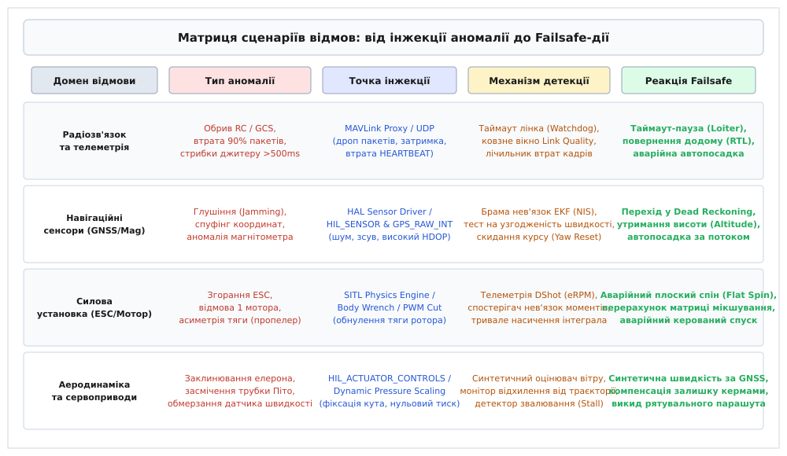
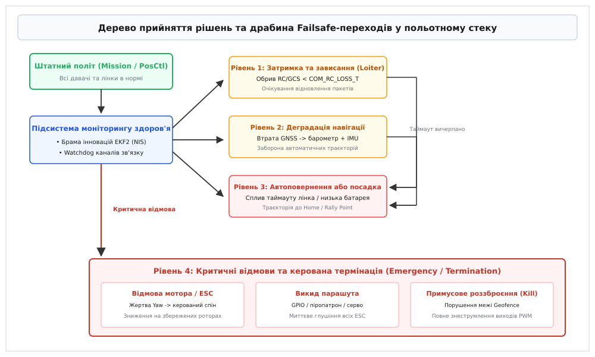

# Сценарії відмов у симуляторі: обрив лінка, глушіння GNSS, мертвий мотор

<preknowlist>
- [Failsafe в автопілоті](root:sys-dron/failsafe) — архітектура багаторівневого захисту, переходи в аварійні режими та пріоритети дій.
- [Розподіл керування (Actuator Allocation)](root:sys-dron/actuator-allocation) — матриця мікшування, десатурація моментів та динамічна компенсація відмов приводів.
- [Фільтр Калмана (EKF)](root:com-signal/kalman-ekf) — оцінка просторового стану, злиття сенсорних потоків, брами інновацій (NIS) та детекція розбіжностей.
- [Втрата зв'язку та надійність телеметрії](root:com-transport/latency-reliability) — таймаути Heartbeat, джитер, втрата пакетів та поведінка сторожових таймерів.
- [Режими failsafe RC](root:sys-dron/rc-failsafe-modes) — реакція приймача та польотного контролера на зникнення сигналу ручного керування.
</preknowlist>

Політний стек, перевірений лише в ідеальних погодних умовах симулятора, неминуче розіб'є апарат під час першого ж ускладнення в реальному польоті. У базовому лабораторному середовищі вітер завжди відсутній, віртуальний радіоканал доставляє кожен байт із мілісекундною точністю, супутниковий приймач транслює ідеальні координати без сантиметра похибки, а всі безколекторні мотори видають точну тягу строго за математичною моделлю. У реальному польоті безпілотник потрапляє під каскад взаємопов'язаних відмов: засоби радіоелектронної боротьби спотворюють сигнал супутникової навігації з раптовим зростанням геометричного фактора зниження точності HDOP понад 10.0, бортова електромагнітна інтерференція глушить понад 90% пакетів телеметрії, а на крутому розвороті перегрітий силовий транзистор регулятора обертів ESC випалює фазу двигуна, перетворюючи симетричний квадрокоптер на нелінійний некерований маятник.

Якщо алгоритми аварійних запобіжників failsafe та фільтри оцінки просторового стану не проходили систематичної верифікації на таких граничних режимах, автопілот реагує катастрофічно: спирається на скомпрометовані дані, входить у фазову розбіжність інтеграторів керування або розкручує вцілілі мотори до повного перевороту. Симуляція відмов у контрольованому середовищі є єдиним інженерним методом, який дозволяє відтворити критичні несправності, виміряти граничні пороги стійкості польотного стека та гарантувати безпечну поведінку бортових автоматів без ризику втрати фізичного обладнання.

## 1. Архітектура та методологія стрес-тестування у SITL та HITL

Стрес-тестування безпілотних систем у симуляторах будується на двох базових конфігураціях: суто програмному моделюванні контуру керування SITL (англ. *Software-In-The-Loop*) та апаратно-програмному моделюванні HITL (англ. *Hardware-In-The-Loop*). Обидва підходи мають чітко розмежовані сфери застосування, компроміси за швидкістю виконання та вимоги до детермінізму моделювання.

У конфігурації SITL увесь вихідний код польотного стека (наприклад, PX4 Autopilot або ArduPilot) компілюється як нативний двійковий файл для операційної системи хоста (Linux x86_64 або ARM64). Польотний контролер запускається як звичайний процес користувацького простору. Замість читання реальних апаратних регістрів шин SPI та I2C шар абстракції обладнання HAL (англ. *Hardware Abstraction Layer*) перенаправляє запити до віртуальних сокетів симулятора. Симулятор фізики (Gazebo, AirSim, jMAVSim або JSBSim) розраховує рух твердого тіла в просторі та повертає згенеровані пакети сенсорних вимірювань за протоколом MAVLink через локальні UDP-порти або спільну пам'ять (POSIX Shared Memory `shm_open`).

У конфігурації HITL код автопілота компілюється під цільовий мікроконтролер (наприклад, STM32H743 або STM32F765) і прошивається безпосередньо в кристал польотного контролера. Фізична плата підключається до комп'ютера через високошвидкісний міст UART/USB. Симулятор фізики транслює на плату синтетичні повідомлення `HIL_SENSOR` та `HIL_GPS`, а плата у відповідь повертає сигнали актуаторів `HIL_ACTUATOR_CONTROLS`. Конфігурація HITL є незамінною для виявлення апаратних затримок переривань, переповнення стека операційної системи реального часу NuttX або FreeRTOS, а також помилок у драйверах апаратних таймерів. Проте HITL жорстко прив'язаний до фізичного часу (Real-Time Factor строго дорівнює 1.0), тоді як SITL дозволяє прискорювати виконання тестів у 5–20 разів у режимі headless-контейнерів.

```
       ┌─────────────────────────────────────────────────────────┐
       │             ФІЗИЧНИЙ СИМУЛЯТОР (Gazebo / AirSim)        │
       │  • Динаміка твердого тіла (Body Wrench: 6 DoF)          │
       │  • Аеродинаміка поверхонь (Підйомна сила, Опір, Вітер)   │
       │  • Фізичні збої: відмова мотора, заклинювання серво     │
       └──────────────────────────┬──────────────────────────────┘
                                  │
     Пакет сенсорів (Lockstep dt) │  Керування актуаторами (PWM / DShot)
     HIL_SENSOR / GPS_RAW_INT     │  HIL_ACTUATOR_CONTROLS
                                  ▼
       ┌─────────────────────────────────────────────────────────┐
       │             ПРОМІЖНИЙ ШАР ІНЖЕКЦІЇ АНОМАЛІЙ             │
       │  • Моделювання шуму, зміщень, квантування датчиків      │
       │  • Штучне спотворення GNSS (Jamming / Spoofing)         │
       │  • Емуляція пошкодження лінка (Drop / Delay / Jitter)   │
       └──────────────────────────┬──────────────────────────────┘
                                  │
                                  ▼
       ┌─────────────────────────────────────────────────────────┐
       │             ПОЛЬОТНИЙ СТЕК (SITL / HITL Autopilot)      │
       │  • Розширений фільтр Калмана (EKF2 / EKF3)              │
       │  • Моніторинг здоров'я та брами інновацій (NIS)         │
       │  • Автомат Failsafe-переходів та безпечні процедури     │
       │  • Реконфігурація матриці розподілу тяги (Allocation)   │
       └─────────────────────────────────────────────────────────┘
```

### Математичний апарат динаміки 6 DoF у фізичному рушії

Фізичний симулятор моделює рух безпілотного апарата як просторову динаміку твердого тіла з 6 ступенями вільності (6 DoF). Стан апарата описується вектором положення `r = [x, y, z]ᵀ` у світовій системі координат NED (North-East-Down), лінійною швидкістю `v = [u, v, w]ᵀ` у зв'язаній системі координат апарата (Body Frame), вектором орієнтації у вигляді нормованого кватерніона `q = [q_0, q_1, q_2, q_3]ᵀ` та вектором кутових швидкостей `ω = [p, q, r]ᵀ`.

Рівняння поступального руху під дією сили тяжіння, сумарної тяги роторів `F_thrust` та аеродинамічного опору `F_drag` формулюються на основі законів Ньютона у формі:

```
m · v̇ = m · Rᵀ(q) · g_ned + F_thrust + F_drag(v_rel) - ω × (m · v)
```

де `R(q)` — матриця напрямних косинусів, яка перетворює вектори зі зв'язаної системи координат у світову систему NED:

```
R(q) = [ q0²+q1²-q2²-q3²   2(q1·q2 - q0·q3)   2(q1·q3 + q0·q2) ]
       [ 2(q1·q2 + q0·q3)   q0²-q1²+q2²-q3²   2(q2·q3 - q0·q1) ]
       [ 2(q1·q3 - q0·q2)   2(q2·q3 + q0·q1)   q0²-q1²-q2²+q3² ]
```

Динаміка обертального руху твердого тіла описується векторними динамічними рівняннями Ейлера через тензор інерції `J = diag(I_xx, I_yy, I_zz)`:

```
J · ω̇ + ω × (J · ω) = M_actuators + M_aero_damping + M_external + M_gyro_propellers
```

де `M_gyro_propellers` — сумарний гіроскопічний момент від високошвидкісного обертання роторів із моментом інерції `J_prop` навколо власних осей:

```
M_gyro = ∑ (J_prop · [0, 0, (-1)ⁱ · Ω_i]ᵀ × ω)
```

Кінематичне диференціальне рівняння еволюції просторової орієнтації у кватерніонній формі задається виразом:

```
q̇ = 0.5 · q ⊗ [0, p, q, r]ᵀ
```

Чисельне інтегрування цих рівнянь вимагає вибору методу з урахуванням жорсткості системи (Stiff Differential Equations). Оскільки динаміка електродвигунів має постійну часу близько `τ_motor ≈ 0.015–0.030` с, а частота обертання роторів досягає 300–500 Гц, явні методи інтегрування першого порядку (явний Ейлер) стають нестійкими вже при `dt > 0.002` с. Тому фізичні рушії використовують напівнеявний симплектичний метод Ейлера (Euler-Cromer) або класичний метод Рунге-Кутти 4-го порядку (RK4), які зберігають фазовий об'єм динамічної системи та запобігають штучному накопиченню кінетичної енергії.

### Фізичні рушії та моделі аеродинамічних збурень

У сучасній практиці розробки та стрес-тестування безпілотників застосовується декілька провідних фізичних рушіїв:
1. **Gazebo (Classic та сучасний GZ / Ignition)**: використовує модульні фізичні бібліотеки ODE (Open Dynamics Engine), Bullet або DART. Дозволяє розраховувати пружні сили контакту шасі з ґрунтом, нерівності рельєфу та аеродинамічні сили на базі плагінів елементів лопатей і крила.
2. **AirSim (на базі Unreal Engine)**: поєднує фотореалістичний рендеринг оточення для камер комп'ютерного зору (Visual Odometry, детекція перешкод нейромережами) із власним високочастотним фізичним рушієм FastPhysics (до 1000 Гц).
3. **JSBSim**: еталонний аеродинамічний симулятор літакових компоновок із 6 DoF, який базується на нелінійних таблицях аеродинамічних коефіцієнтів, залежних від кута атаки `α`, кута ковзання `β`, числа Маха та конфігурації механізації крила.

Для мультироторних систем підйомна сила `T_i` та реактивний момент `M_i` кожного пропелера розраховуються за рівняннями аеродинаміки ротора:

```
T_i = C_T · ρ · n_i² · D⁴
M_i = C_Q · ρ · n_i² · D⁵
```

де `C_T` та `C_Q` — безрозмірні коефіцієнти тяги та крутного моменту, `ρ` — густина навколишнього повітря, `n_i` — частота обертання вала двигуна (об/с), `D` — діаметр пропелера.

При моделюванні атмосферних збурень симулятор генерує просторове поле вітру за спектральною моделлю турбулентності Драйдена (Dryden Wind Turbulence Model). Спектральні густини поздовжніх, бічних та вертикальних поривів формуються за передатними функціями фільтрів, збуджених білим шумом:

```
H_u(s) = σ_u · √(2 · L_u / (π · V)) · ( 1 / (1 + (L_u / V) · s) )
H_v(s) = σ_v · √(L_v / (π · V)) · ( (1 + √3 · (L_v / V) · s) / (1 + (L_v / V) · s)² )
H_w(s) = σ_w · √(L_w / (π · V)) · ( (1 + √3 · (L_w / V) · s) / (1 + (L_v / V) · s)² )
```

де `L_u, L_v, L_w` — просторові масштаби турбулентності, а `σ_u, σ_v, σ_w` — середньоквадратичні інтенсивності поривів.

При швидкому вертикальному зниженні симулятор точно відтворює критичний аеродинамічний феномен вихрового кільця (англ. *Vortex Ring State*, VRS). У цьому режимі вертикальна швидкість спуску наближається до швидкості індукованого потоку під пропелером (`v_descend ≈ v_induced = √(T / (2·ρ·A))`). Повітряний потік замикається в тороїдальний вихор навколо кінців лопатей, викликаючи катастрофічну втрату до 60% підйомної сили при максимальних обертах двигунів та сильне хаотичне розгойдування апарата.

Взаємодія шасі з поверхнею землі моделюється через розрахунок сил пружності та демпфування контактної точки (Contact Surface Spring-Damper Model). Нормальна сила реакції опори розраховується з урахуванням глибини проникнення у ґрунт `δ_penetration` та швидкості деформації `δ̇`:

```
F_normal = k_ground · δ_penetration + c_ground · δ̇
```

Тангенціальна сила зчеплення обмежується конусом тертя Кулона `F_friction ≤ μ_static · F_normal`. Якщо колісне або лижне шасі торкається похилої поверхні під час екстреного приземлення без тяги двигунів, симулятор точно відтворює ефект ковзання або перекидання корпусу.

### Міжпроцесна взаємодія та механізм Lockstep-синхронізації часу

Для забезпечення взаємодії між симулятором та процесом автопілота у конфігурації SITL застосовуються різні мережеві та системні механізми. Найпоширенішим є обмін через локальні сокети UDP (порти 14560 для симулятора, 14550 для наземної станції керування, 14580 для offboard-контролерів). Проте при високих частотах моделювання (понад 500 Гц) системні виклики `sendto()` та `recvfrom()` створюють помітні накладні витрати ядра Linux на перемикання контексту.

У високопродуктивних стендах застосовують спільну пам'ять POSIX Shared Memory (`shm_open` та `mmap`), яка забезпечує субмікросекундну передачу структур даних безпосередньо між адресними просторами процесів. Обмін організовано через кільцевий буфер (Lock-Free Ring Buffer) із атомарними показчиками голівки та хвоста черги. Використання послідовної узгодженості пам'яті (Memory Fences) усуває будь-яку потребу в блокуючих системних м'ютексах, гарантуючи нульовий оверхед операційної системи на міжпроцесний трансфер. У процесі тестування інжектор може симулювати втрату сегментів спільної пам'яті або переповнення черги сенсорних повідомлень для стрес-тесту драйверів вводу-виводу польотного контролера.

При використанні багатоядерних процесорів критично важливо зафіксувати прив'язку потоків автопілота та фізичного симулятора до ізольованих ядер процесора (CPU Pinning / Thread Affinity через `pthread_setaffinity_np()`). Це запобігає міграції потоків між різними ядрами та мінімізує промахи в кеші L1/L2, гарантуючи стабільний час виконання кожного такту без джитера операційної системи. Для задач із жорстким детермінізмом у ядрі Linux активується патч реального часу PREEMPT_RT, а пріоритет потоку обчислення EKF підвищується до рівня `SCHED_FIFO` із максимальним значенням 99.

Головна небезпека під час моделювання аномалій у симуляторі полягає в розсинхронізації часу. У реальному світі фізичні процеси та мікроконтролер існують в єдиному неперервному часовому потоці. Якщо запустити симуляцію в асинхронному режимі вільного ходу (англ. *wall-clock asynchronous simulation*), будь-яка затримка у розрахунках фізичного рушія або штучно додана пауза для перевірки реакції сторожового таймера призведе до того, що фізичний рушій просунеться вперед у реальному часі комп'ютера, тоді як польотний стек пропустить такти інтегрування.

Внаслідок цього розширений фільтр Калмана EKF отримає синтетичний розрив часу `dt`, який спотворить матрицю коваріації шуму процесу `Q · dt`, породжуючи хибну розбіжність фільтра там, де її не повинно бути.

Щоб усунути цей артефакт, коректні інженерні стенди використовують покрокову синхронізацію (англ. *lockstep simulation*). У режимі lockstep фізичний симулятор та автопілот жорстко заблоковані на кожному кванті модельного часу (зазвичай `dt = 0.004` секунди, що відповідає частоті 250 Гц):

1. Симулятор обчислює сили, моменти та нові просторові координати твердого тіла за крок `dt`.
2. Симулятор формує пакет вимірювань сенсорів (наприклад, `HIL_SENSOR` та `HIL_GPS` у протоколі MAVLink) із позначкою модельного часу `time_usec` і відправляє його польотному стеку.
3. Фізичний рушій повністю зупиняє розрахунок часу і блокується.
4. Польотний стек зчитує пакет сенсорів, проганяє такт оцінювача EKF, обчислює керівні впливи регуляторів PID і відправляє симулятору пакет актуаторів `HIL_ACTUATOR_CONTROLS`.
5. Лише після отримання відповіді симулятор робить наступний крок фізики на `dt`.

Завдяки lockstep співвідношення між модельним і реальним часом (англ. *Real-Time Factor*, RTF) може вільно падати до 0.1 або прискорюватися до 10.0 без спотворення динаміки інтеграторів та сенсорних фільтрів. Це створює детерміністичну основу для точного відтворення складних відмов.

Для тестування розробляється комплексний інструмент інжекції аномалій. Повна програмна реалізація такого стенда представлена у вставці [Інжектор аномалій та відмов для SITL/MAVLink](root:sys-dron/stsenarii-vidmov-u-symuliatori/proj-sitl-failure-injector.md), де продемонстровано перехоплення, мутацію та валідацію пакетів на системному рівні.

### Стохастичні моделі сенсорних похибок і дисперсія Аллана

Моделювання сенсорного шуму в симуляторах відтворює фізичні процеси реальних напівпровідникових МЕМС-давачів (акселерометрів, гіроскопів, барометрів та магнітометрів). Сирий вимір сенсора `z(t)` описується сумою істинного фізичного значення `x(t)`, повільно дрейфуючого зміщення нуля (англ. *bias*) `b(t)`, високочастотного гаусового білого шуму `w(t)`, температурного градієнта та ефектів квантування АЦП:

```
z(t) = x(t) + b(t) + w(t) + K_temp · (T(t) - T_0)

де:
w(t) ~ N(0, σ_w²)                [гаусів білий шум із нульовим середнім]
ḃ(t) = w_b(t),  w_b ~ N(0, σ_b²)  [випадкове блукання зсуву нуля, bias random walk]
```

Для гіроскопів параметр `σ_w` визначає кутове випадкове блукання ARW (англ. *Angle Random Walk*, вимірюється в `град/√год` або `рад/√с`), а `σ_b` визначає нестабільність зміщення нуля (англ. *Bias Instability*).

Повна матрична модель тривісного МЕМС-сенсора враховує також неортогональність вимірювальних осей (Cross-Axis Sensitivity) та масштабні коефіцієнти (Scale Factor Errors):

```
z_measured = (I + S_scale) · T_ortho · x_true + b_bias + w_noise
```

де `S_scale = diag(s_x, s_y, s_z)` — діагональна матриця масштабних похибок (зазвичай 0.1–1.0%), а `T_ortho` — верхньотрикутна матриця перекосу осей через механічні допуски при пайці мікросхеми.

Окремим критичним фактором є вібраційне випрямлення похибок (англ. *Vibration Rectification Error*, VRE) в акселерометрах. Під дією високочастотної нелінійної вібрації від незбалансованих пропелерів на частотах 100–300 Гц внутрішні пружні підвіси МЕМС-елементів зміщуються несиметрично, породжуючи постійне фальшиве зміщення постійної складової прискорення (DC bias shift). Якщо це явище не змодельовано у симуляторі, налаштований у лабораторії EKF розійдеться в першому ж реальному польоті на високій тязі.

Барометричний висотомір у симуляторі моделюється на основі міжнародної стандартної атмосфери ISA (International Standard Atmosphere):

```
p_static(h) = p_0 · ( 1 - (L · h) / T_0 )^( (g · M) / (R_gas · L) )
```

де `p_0 = 101325` Па, `T_0 = 288.15` К, температурний градієнт `L = 0.0065` К/м, молярна маса повітря `M = 0.0289644` кг/моль, універсальна газова стала `R_gas = 8.31447` Дж/(моль·К). Симулятор додає ефект аеродинамічного підпору при швидкому горизонтальному польоті та динамічне підвищення тиску під корпусом при зависанні над землею на висоті менше 1 метра (Ground Effect).

Оптичні та лазерні далекоміри (LiDAR / Rangefinder) моделюються з урахуванням кута конуса розбіжності променя, коефіцієнта дифузного відбиття поверхні за законом Ламберта та дзеркального відбиття від водної гладі. При перевищенні критичного кута нахилу апарата (понад 30–45°) або польоті над поглинаючими матеріалами далекомір видає статус `Out of Range`, змушуючи оцінювач висоти плавно спиратися виключно на барометр та інтеграл вертикального акселерометра.

Модель акумуляторної батареї відтворює динаміку еквівалентної схеми Тевена: джерело напруги холостого ходу `V_oc(SoC)` (нелінійно залежне від ступеня заряду State of Charge), послідовний внутрішній опір `R_0` та паралельний RC-ланцюг `R_1, C_1`, що моделює процеси переносу заряду та дифузійної поляризації. При подачі стрибка струму напруга на клемах миттєво просідає на `I · R_0`, а потім експоненційно релаксує з постійною часу `τ_batt = R_1 · C_1 ≈ 5–15` секунд.

Для аналізу структури похибок застосовується метод дисперсії Аллана (англ. *Allan Variance* `σ²(τ)`):

```
σ²(τ) = 1 / (2 · (N - 1)) · ∑ (ȳ_{k+1} - ȳ_k)²
```

Графік Аллана у логарифмічних координатах дозволяє чітко розділити п'ять характерних ділянок шуму:
- Шум квантування АЦП (нахил лінії `-1`)
- Білий шум кутової швидкості / ARW (нахил лінії `-1/2`)
- Нестабільність зсуву нуля / флікер-шум 1/f (горизонтальне плато з нахилом `0`)
- Випадкове блукання зсуву нуля / Rate Random Walk (нахил лінії `+1/2`)
- Лінійний температурний дрейф (нахил лінії `+1`)

Під час звичайного польоту дисперсії шуму `σ_w` та `σ_b` відповідають паспорту виробника конкретного чипа (наприклад, акселерометра ICM-20689). Під час стрес-тестування інжектор аномалій динамічно збільшує дисперсію в 10–50 разів, додає раптові сходинкові зміщення (англ. *step bias*) або генерує гармонійну вібрацію високої амплітуди для симуляції механічного руйнування демпферів польотного контролера.


*Матриця чотирьох базових доменів відмов безпілотного комплексу: співвідношення типів інжектованих аномалій, точок внесення збоїв, внутрішніх алгоритмів детекції польотного стека та фінальних реакцій Failsafe.*

---

## 2. Сценарій 1: Деградація та повний обрив каналу зв'язку (RC & Telemetry Loss)

Втрата радіозв'язку є найпоширенішою нештатною ситуацією. Вона виникає через вихід апарата за межі прямої радіовидимості, затінення бортових антен елементами конструкції чи рельєфом, або під дією активного радіоелектронного придушення.

Польотний стек чітко розмежовує два типи каналів зв'язку:
1. **Канал ручного керування (RC Loss)**: зникнення пакетів пульта пілота (протоколи CRSF, SBUS, PPM).
2. **Канал наземної станції телеметрії (GCS Telemetry Loss)**: обрив двостороннього потоку пакетів MAVLink між автопілотом і програмою моніторингу (QGroundControl або Mission Planner).
3. **Канал бортового супутнього комп'ютера (Companion Link Loss)**: втрата зв'язку з обчислювачем комп'ютерного зору (ROS2 / Micro-XRCE-DDS / MAVROS), що керує апаратом в режимі Offboard.

### Порівняльний аналіз протоколів керування

Протоколи зв'язку кардинально різняться за своєю фізичною та логічною структурою:
- **SBUS**: послідовний протокол (UART 100 000 бод, 8E2, інвертований сигнал), що передає 16 пропорційних каналів у 25-байтовому фреймі кожні 9–14 мс. Протокол містить спеціальний біт `failsafe` та біт `frame_lost`. Якщо приймач втрачає зв'язок із передавачем, він самостійно виставляє біт `failsafe = 1` у вихідному потоці, що дозволяє автопілоту зафіксувати аварію миттєво, не чекаючи спливу таймера.
- **CRSF (Crossfire / ExpressLRS)**: сучасний високошвидкісний повнодуплексний пакетний протокол (UART до 420 000 або 2 000 000 бод). Окрім каналів керування, CRSF передає регулярні пакети телеметрії якості зв'язку `LINK_STATISTICS`, які містять прямі вимірювання потужності сигналу `RSSI`, співвідношення сигнал/шум `SNR` та відсоток успішних пакетів `Link Quality`. Це дає змогу автопілоту оцінювати наближення обриву лінка завчасно.
- **MAVLink (Telemetry Link)**: прикладний протокол обміну повідомленнями поверх UDP або прозорих радіомодемів (UART 57600/115200 бод). Передає складні структури даних (`HEARTBEAT`, `ATTITUDE`, `GLOBAL_POSITION_INT`, `COMMAND_LONG`).

Структура кадру CRSF містить заголовок пристрою призначення, довжину тіла, тип повідомлення, корисне навантаження та контрольну суму CRC8 (поліном DVB-S2 `x⁸ + x⁷ + x⁴ + x³ + x² + 1`):
```
[ Device Addr: 1B ] [ Frame Length: 1B ] [ Type: 1B ] [ Payload: N Bytes ] [ CRC8: 1B ]
```

У протоколі MAVLink v2 використовується механізм підпису пакета та розширений заголовок із полями несумісності та прапорцями сумісності. Кожне повідомлення верифікується двобайтовою контрольною сумою `CRC16-MCRF4XX`, яка ініціалізується магічним байтом CRC Extra. Цей байт обчислюється на основі схеми XML-дефініції структури полів і запобігає розбору повідомлень із несумісними версіями прошивок автопілота та наземної станції.

При роботі на великих швидкостях польоту літакових БПЛА (понад 40 м/с) виникає доплерівський зсув частоти радіонесучої `f_d = (v / c) · f_0`. Для діапазону 2.4 ГГц при швидкості 50 м/с зсув становить `f_d ≈ 400` Гц. Якщо радіомодем використовує вузькосмугову модуляцію FSK або LoRa без автоматичного підстроювання частоти AFC, цей зсув викликає різке падіння співвідношення сигнал/шум SNR і провокує пакетні втрати при зустрічних курсах.

Сучасні протоколи ExpressLRS та Crossfire використовують технологію псевдовипадкової перебудови робочої частоти FHSS (Frequency Hopping Spread Spectrum) зі швидкістю до 500 стрибків на секунду. У симуляторі моделюється взаємна інтерференція каналів та блокування окремих піддіапазонів: якщо з 80 доступних частотних каналів 60 заблоковано завадою, середня затримка доставки зростає пропорційно часу очікування вільного слота передачі.

### Моделювання мережевих порушень: джитер, втрати та затримки

У симуляторі моделювання деградації каналу зв'язку реалізується на рівні віртуального мережевого шлюзу або MAVLink-проксі через чотири параметричних механізми:
- **Штучна затримка пакетів (Latency)**: стаціонарне зміщення часу доставки кадрів від базових 10 мс до критичних 1500 мс.
- **Пакетовий джитер (Jitter)**: випадкова дисперсія затримки доставки кадрів, що розтягує інтервали між сусідніми пакетами та змушує буфери прийому переповнюватися. Затримка моделюється гаусовим або логнормальним розподілом:
  ```
  t_delay = t_base + Exp(λ)
  ```
- **Відсоток втрати пакетів (Packet Drop Rate)**: стохастичне відкидання пакетів від одиничних пропусків (5–10%) до практично повного глушіння (90–98%).
- **Пакетний сплеск втрат (Burst Drop)**: моделювання марковського процесу Гілберта-Елліота, де радіолінк перебуває або в стані якісного прийому, або раптово переходить у стан глибокого затухання на 3–8 секунд, повністю блокуючи трафік.

```
       [Генератор пакетів RC/GCS]
                  │
                  ▼
       ┌────────────────────────────────────────────────────────┐
       │   Модель каналу Гілберта-Елліота (Стани Good / Bad)    │
       │                                                        │
       │          ┌──────────┐   p (перехід у Bad)  ┌─────────┐ │
       │          │   GOOD   │ ───────────────────> │   BAD   │ │
       │          │ Втрати 2%│ <─────────────────── │Втрати95%│ │
       │          └──────────┘   r (повернення)     └─────────┘ │
       └──────────────────────────┬─────────────────────────────┘
                                  │
                                  ▼
       ┌────────────────────────────────────────────────────────┐
       │   Бортовий монітор лінка автопілота (Watchdog & LQ)    │
       │  1. Підрахунок ковзного вікна Link Quality (1000 мс)   │
       │  2. Таймер відсутності валідного кадру (dt > Timeout)  │
       │  3. Фільтрація коротких перешкод (Debounce Filter)     │
       └──────────────────────────┬─────────────────────────────┘
                                  │
                                  ▼
       ┌────────────────────────────────────────────────────────┐
       │   Виконання Failsafe: Loiter (пауза) ──> RTL / Land    │
       └────────────────────────────────────────────────────────┘
```

У моделі Гілберта-Елліота ймовірність випадання в стан глибоких втрат позначається як `p`, а ймовірність відновлення якісного зв'язку — як `r`. Стаціонарна ймовірність знаходження каналу в аварійному стані становить:

```
P_bad = p / (p + r)
```

При моделюванні радіозатінення поблизу землі враховується дворименева інтерференційна модель поширення радіохвиль (Two-Ray Ground Reflection Model), за якою потужність прийнятого сигналу спадає пропорційно четвертій степені відстані:

```
P_rx = P_tx · G_tx · G_rx · (h_tx · h_rx)² / d⁴
```

де `h_tx` та `h_rx` — висоти підвісу антен передавача і приймача над поверхнею землі.

### Детекція втрати зв'язку в польотному контролері

Для детекції обриву зв'язку автопілот використовує комбінацію сторожових таймерів і метрики якості каналу LQ (англ. *Link Quality*). Метрика LQ розраховується як відсоток успішно декодованих кадрів до загальної кількості очікуваних пакетів у ковзному вікні тривалістю 1000 мс:

```
LQ = (N_received / N_expected) · 100%
```

Якщо LQ падає нижче 20% або таймер із моменту прийому останнього коректного пакета перевищує встановлений поріг (у стеку PX4 за це відповідає параметр `COM_RC_LOSS_T`, за замовчуванням 0.5–1.0 с; у стеку ArduPilot — параметр `FS_THR_VALUE` або таймаут `FS_GCS_TIMEOUT`), автопілот переходить у стан втрати зв'язку.

Параметрична конфігурація поведінки при втраті зв'язку включає:
- `NAV_RCL_ACT`: дія при втраті пульта керування (0 = Disabled, 1 = Hold/Loiter, 2 = RTL, 3 = Land, 4 = Terminate).
- `NAV_DLL_ACT`: дія при втраті каналу передачі даних телеметрії GCS.
- `COM_OF_LOSS_T`: таймаут втрати потоку уставок від Offboard-комп'ютера (0.5 с).
- `COM_OBL_ACT`: дія при втраті Offboard-зв'язку (0 = Land, 1 = Hold, 2 = RTL, 3 = Position Control).
- `COM_RC_IN_MODE`: джерело керування (0 = тільки радіопульт, 1 = тільки джойстик MAVLink, 2 = автоматичний вибір із пріоритетом пульта).

Логіка реакції Failsafe не повинна бути миттєвою та різкою. Короткочасне затінення антени на 0.3 секунди під час агресивного віражу не повинно провокувати аварійний зрив місії. Тому в польотному стеку впроваджено багатоступеневу драбину дій:

1. **Фаза утримання (Debounce & Hold)**: автопілот фіксує поточні уставки, переходить у режим зависання або кружляння на поточній висоті (Loiter) на час конфігурованого таймера (наприклад, 2.0 секунди), очікуючи відновлення пакетів.
2. **Фаза виконання безпечного повернення (RTL / RTH)**: якщо після закінчення таймауту пакети не відновилися, активується режим повернення додому. Апарат піднімається на безпечну висоту `RTL_RETURN_ALT` (щоби гарантовано оминути верхівки дерев і лінії електропередач), розвертається на точку зльоту та летить за прямою лінією.
3. **Фаза автономного продовження місії**: якщо апарат виконує заздалегідь завантажену автономну політну програму і прапорець `NAV_RCL_ACT = 0` дозволяє політ без зв'язку, втрата пульта взагалі не перериває місію: дрон долітає до фінальної точки, скидає корисне навантаження або самостійно здійснює штатну посадку.

Нижче наведено практичну реалізацію модуля моніторингу каналу телеметрії та фільтрації дебаунсу для запобігання хибним спрацьовуванням Failsafe:

:::tabs
```c
#include <stdbool.h>
#include <stdint.h>

#define LINK_TIMEOUT_US       1500000ULL  // 1.5 секунди без пакетів = аварія
#define DEBOUNCE_HOLD_US      2000000ULL  // 2.0 секунди зависання перед RTL
#define RECOVERY_WINDOW_US    1000000ULL  // 1.0 секунда стабільного зв'язку для скидання

typedef enum {
    LINK_STATE_OK = 0,
    LINK_STATE_DEBOUNCE_HOLD,
    LINK_STATE_FAILSAFE_ACTIVE
} link_failsafe_state_t;

typedef struct {
    uint64_t last_packet_time_us;
    uint64_t loss_detected_time_us;
    uint64_t recovery_start_time_us;
    link_failsafe_state_t state;
    bool failsafe_triggered;
} link_watchdog_t;

void link_watchdog_init(link_watchdog_t *wd) {
    wd->last_packet_time_us = 0;
    wd->loss_detected_time_us = 0;
    wd->recovery_start_time_us = 0;
    wd->state = LINK_STATE_OK;
    wd->failsafe_triggered = false;
}

void link_watchdog_on_packet_received(link_watchdog_t *wd, uint64_t now_us) {
    wd->last_packet_time_us = now_us;
    if (wd->state == LINK_STATE_DEBOUNCE_HOLD) {
        if (wd->recovery_start_time_us == 0) {
            wd->recovery_start_time_us = now_us;
        } else if (now_us - wd->recovery_start_time_us >= RECOVERY_WINDOW_US) {
            wd->state = LINK_STATE_OK;
            wd->loss_detected_time_us = 0;
            wd->recovery_start_time_us = 0;
        }
    }
}

link_failsafe_state_t link_watchdog_update(link_watchdog_t *wd, uint64_t now_us) {
    uint64_t silence_duration = now_us - wd->last_packet_time_us;

    switch (wd->state) {
    case LINK_STATE_OK:
        if (silence_duration > LINK_TIMEOUT_US) {
            wd->state = LINK_STATE_DEBOUNCE_HOLD;
            wd->loss_detected_time_us = now_us;
            wd->recovery_start_time_us = 0;
        }
        break;

    case LINK_STATE_DEBOUNCE_HOLD:
        if (silence_duration <= LINK_TIMEOUT_US) {
            // Пакет прийшов, відновлення обробляється у callback
        } else if (now_us - wd->loss_detected_time_us >= DEBOUNCE_HOLD_US) {
            wd->state = LINK_STATE_FAILSAFE_ACTIVE;
            wd->failsafe_triggered = true;
        }
        break;

    case LINK_STATE_FAILSAFE_ACTIVE:
        // Вихід із активного Failsafe вимагає ручного підтвердження або тривалого лінка
        if (silence_duration <= LINK_TIMEOUT_US) {
            if (wd->recovery_start_time_us == 0) {
                wd->recovery_start_time_us = now_us;
            } else if (now_us - wd->recovery_start_time_us >= (RECOVERY_WINDOW_US * 3)) {
                wd->state = LINK_STATE_OK;
                wd->failsafe_triggered = false;
            }
        } else {
            wd->recovery_start_time_us = 0;
        }
        break;
    }

    return wd->state;
}
```
```cpp
#include <chrono>
#include <cstdint>
#include <optional>

class LinkWatchdog {
public:
    enum class State : uint8_t {
        Ok,
        DebounceHold,
        FailsafeActive
    };

    explicit LinkWatchdog(std::chrono::microseconds timeout = std::chrono::milliseconds(1500),
                         std::chrono::microseconds debounce = std::chrono::milliseconds(2000),
                         std::chrono::microseconds recovery = std::chrono::milliseconds(1000))
        : timeout_duration_(timeout),
          debounce_duration_(debounce),
          recovery_duration_(recovery),
          state_(State::Ok) {}

    void on_packet_received(std::chrono::microseconds now) noexcept {
        last_packet_time_ = now;
        if (state_ == State::DebounceHold) {
            if (!recovery_start_time_) {
                recovery_start_time_ = now;
            } else if (now - *recovery_start_time_ >= recovery_duration_) {
                state_ = State::Ok;
                loss_detected_time_.reset();
                recovery_start_time_.reset();
            }
        }
    }

    [[nodiscard]] State update(std::chrono::microseconds now) noexcept {
        const auto silence = now - last_packet_time_;

        switch (state_) {
        case State::Ok:
            if (silence > timeout_duration_) {
                state_ = State::DebounceHold;
                loss_detected_time_ = now;
                recovery_start_time_.reset();
            }
            break;

        case State::DebounceHold:
            if (silence > timeout_duration_) {
                if (loss_detected_time_ && (now - *loss_detected_time_ >= debounce_duration_)) {
                    state_ = State::FailsafeActive;
                }
            }
            break;

        case State::FailsafeActive:
            if (silence <= timeout_duration_) {
                if (!recovery_start_time_) {
                    recovery_start_time_ = now;
                } else if (now - *recovery_start_time_ >= recovery_duration_ * 3) {
                    state_ = State::Ok;
                    loss_detected_time_.reset();
                    recovery_start_time_.reset();
                }
            } else {
                recovery_start_time_.reset();
            }
            break;
        }

        return state_;
    }

    [[nodiscard]] bool is_failsafe_active() const noexcept {
        return state_ == State::FailsafeActive;
    }

private:
    std::chrono::microseconds timeout_duration_;
    std::chrono::microseconds debounce_duration_;
    std::chrono::microseconds recovery_duration_;

    std::chrono::microseconds last_packet_time_{0};
    std::optional<std::chrono::microseconds> loss_detected_time_;
    std::optional<std::chrono::microseconds> recovery_start_time_;
    State state_;
};
```
:::

---

## 3. Сценарій 2: Навігаційні аномалії — глушіння, спуфінг GNSS та збої компаса

Навігаційні збої становлять найбільшу небезпеку для автоматичних режимів польоту. На відміну від простого обриву зв'язку, при якому автопілот зберігає точне розуміння власного положення у просторі, аномалії сенсорів навігації атакують саме ядро просторової оцінки — розширений фільтр Калмана EKF.

### Фізика і моделювання глушіння (Jamming)

Широкосмугове шумове глушіння пригнічує слабкі сигнали супутникових угруповань GPS, GLONASS, Galileo (потужність корисного сигналу на поверхні Землі становить лише близько `-130` dBm). У симуляторі інжекція глушіння моделюється через поступову або миттєву деградацію полів повідомлення `GPS_RAW_INT`:

1. Співвідношення сигнал/шум `c_n0` на всіх каналах супутників опускається з номінальних 42–48 dB-Hz нижче порогу захоплення 25 dB-Hz.
2. Кількість супутників у рішенні `satellites_visible` падає з 18–24 до менш ніж 5.
3. Оцінка горизонтальної точності `eph` (horizontal position uncertainty) зростає від 0.6 м до 25.0 м.
4. Геометричний фактор погіршення точності `HDOP` стрибає від 0.8 до значень понад 8.0.
5. Поле `fix_type` деградує від `3D Fix / RTK Fixed` до `No Fix`.

Геометричний фактор HDOP пов'язаний із геометрією розташування супутників на небосхилі через коваріаційну матрицю направляючих векторів. Нехай `G` — матриця геометрії супутників розміру `N × 4`, де кожен рядок містить одиничний вектор на супутник `[-cos(el)·sin(az), -cos(el)·cos(az), -sin(el), 1]`. Тоді коваріаційна матриця навігаційного рішення `Q_cov = (Gᵀ · G)⁻¹`, а геометричні фактори визначаються через діагональні елементи:

```
HDOP = √( q_11 + q_22 )
VDOP = √( q_33 )
PDOP = √( q_11 + q_22 + q_33 )
```

Коли супутники глушаться і залишається кілька низьких над горизонтом апаратів, визначник матриці `Gᵀ · G` прямує до нуля, а HDOP стрімко зростає, сигналізуючи про повну втрату геометричної обумовленості навігаційної задачі.

### Моделювання супутникового спуфінгу (Spoofing)

Спуфінг значно підступніший за глушіння. Зловмисний передавач генерує фальшивий супутниковий сигнал, який змушує приймач повідомити, що сузір'я «ідеальне» (`fix_type = 3`, `HDOP = 0.7`, 20 супутників), проте координати починають когерентно зміщуватися вбік із постійною швидкістю дрейфу (наприклад, 5–10 м/с на схід) або раптово телепортуються на десятки кілометрів.

Якщо автопілот сліпо довіряє GNSS, контур положення побачить, ніби дрон «зносить вітром на захід», і для компенсації нахилить апарат на схід на максимальний кут, провокуючи некероване зіткнення з землею (англ. *flyaway*).

```
   Фізичний рух апарата (IMU)          Хибні координати спуфера (GNSS)
   [ a_x = 0, a_y = 0, v = 0 ]        [ v_fake = +10 м/с, x_fake зростає ]
                │                                       │
                ▼                                       ▼
       ┌────────────────────────────────────────────────────────┐
       │             РОЗШИРЕНИЙ ФІЛЬТР КАЛМАНА (EKF2)           │
       │                                                        │
       │  1. Прогноз стану за інтегруванням IMU (x̂⁻)           │
       │  2. Розрахунок нев'язки (інновації): y = z_gnss - x̂⁻   │
       │  3. Коваріація нев'язки: S = H P⁻ Hᵀ + R               │
       │  4. Тест узгодженості (NIS): yᵀ · S⁻¹ · y > χ²_thresh  │
       └──────────────────────────┬─────────────────────────────┘
                                  │
                                  ▼
       ┌────────────────────────────────────────────────────────┐
       │           БРАМА ІННОВАЦІЙ: ВІДХИЛЕННЯ ВИМІРУ           │
       │  • Заборона корекції позиції фальшивим GNSS            │
       │  • Інкремент лічильника тайм-ауту здорових даних       │
       │  • Перехід у Dead Reckoning / Altitude Hold            │
       └──────────────────────────┬─────────────────────────────┘
                                  │
                                  ▼
       ┌────────────────────────────────────────────────────────┐
       │             ЕКСТРЕНЕ СКИДАННЯ КУРСУ (Yaw Reset)        │
       │  • Виявлення розбіжності компаса з траєкторією         │
       │  • Вирівнювання осі Z фільтра за вектором швидкості    │
       └────────────────────────────────────────────────────────┘
```

Для детекції спуфінгу використовуються спеціальні критерії:
1. **Тест узгодженості доплерівської швидкості**: порівняння швидкості зміни псевдовідстаней `ρ̇_i` із проекцією інерціальної швидкості на промінь зору супутника `v_imu · e_i`.
2. **Мультисистемна крос-валідація**: порівняння незалежних навігаційних рішень GPS, Galileo та BeiDou.
3. **Моніторинг автоматичного регулювання підсилення AGC**: при спробі підміни сигналу зовнішнім генератором рівень AGC приймача різко просідає через високу потужність завади.

При наявності двох рознесених GNSS-антен (Dual-Antenna Heading) автопілот обчислює базову лінію між антенами через різниці фаз несучої хвилі. Це забезпечує абсолютну стійкість до магнітних завад, проте вимагає від фільтра детекції збоїв фазового захоплення (Carrier Phase Cycle Slip Detection) при інжекції радіозавад.

### Магнітометричні аномалії та калібрування еліпсоїда

Компас надзвичайно чутливий до зовнішнього магнітного середовища. У симуляторі відтворюються два класи збоїв:
- **Постійне спотворення твердого/м'якого заліза (Hard/Soft Iron)**: статичний вектор зміщення `b_mag`, викликаний прольотом поруч із металевими конструкціями, мостами, залізобетонними будівлями або контейнерами.
- **Струмове наведення (ESC Current Bias)**: динамічне магнітне поле, що генерується силовими кабелями живлення мотора і пропорційне миттєвому споживанню струму:

```
B_distorted = M_soft · B_earth + B_hard + K_current · I_battery
```

При виникненні раптового стрибка магнітного поля напрямок розрахованого курсу (Yaw) розходиться з інтегралом гіроскопа. Для калібрування магнітометра застосовується алгоритм апроксимації еліпсоїда методом найменших квадратів, що переводить виміряний еліпсоїд у сферичну поверхню з радіусом локальної напруженості геомагнітного поля `|B_earth|` (відповідно до моделі World Magnetic Model, WMM).

Якщо магнітні аномалії перевищують поріг інновацій EKF довше 2 секунд, польотний стек PX4 вимикає використання магнітометра (`EKF2_MAG_TYPE = 0` або `None`) і активує вирівнювання курсу за лінією шляхової швидкості GPS (Course Over Ground, COG Alignment). Ця процедура вимагає, щоб апарат рухався зі швидкістю `V_ground > 4.0` м/с по прямій лінії з прискоренням `a < 1.0` м/с², після чого фільтр скидає кватерніон орієнтації Yaw строго у напрямку вектора руху.

Математична процедура калібрування магнітометра полягає у компенсації зміщення твердого заліза (Hard Iron) та спотворення форми від м'якого заліза (Soft Iron). Сирі покази тривісного давача описують у тривимірному просторі зміщений та деформований еліпсоїд:

```
(z_raw - b_hard)ᵀ · M_softᵀ · M_soft · (z_raw - b_hard) = B_earth_norm²
```

Для знаходження параметрів центру еліпсоїда `b_hard` та матриці деформації `A = M_soft` у симуляторі використовується алгебраїчний метод найменших квадратів Сільвера-Шрівастави. Загальне рівняння квадрики зводиться до лінійної форми відносно 9 параметрів вектором вимірювань `[x², y², z², 2xy, 2xz, 2yz, 2x, 2y, 2z]ᵀ`. Після визначення коефіцієнтів матриця `A` витягується через факторизацію Холецького або сингулярний розклад (SVD), що гарантує додатну визначеність матриці перетворення, яка переводить довільний сплюснутий еліпсоїд у правильну сферу радіуса локального геомагнітного поля `B_earth`.

У разі використання двох рознесених GNSS-антен (Dual-Antenna Moving Baseline Heading) автопілот отримує абсолютний вектор курсу без використання магнітометра. Алгоритм базується на розрахунку подвійних різниць фаз несучих коливань супутників (Double-Differenced Carrier Phase):

```
Δ∇Φ = (1 / λ) · b_baseline · (s_i - s_j) + Δ∇N
```

де `λ` — довжина хвилі несучої L1/L2, `b_baseline` — фіксований вектор базової лінії між антенами, `s_i, s_j` — одиничні вектори на супутники `i` та `j`, а `Δ∇N` — цілочисельна фазова неоднозначність (Integer Ambiguity Resolution). Якщо під дією засобів РЕБ фазові контури ФАПЧ втрачають захоплення (Cycle Slip), оцінювач миттєво фіксує стрибок дисперсії курсу та сигналізує про втрату надійності кута наведення.

### Внутрішня математика розширеного фільтра Калмана (EKF2)

Повнорозмірний навігаційний фільтр EKF2 польотного стека PX4 оцінює 24-вимірний вектор стану `x`:
- `x[0..3]`: орієнтація у вигляді кватерніона `q = [q0, q1, q2, q3]ᵀ`
- `x[4..6]`: лінійна швидкість у системі NED `[v_north, v_east, v_down]ᵀ`
- `x[7..9]`: просторове положення у системі NED `[p_north, p_east, p_down]ᵀ`
- `x[10..12]`: зсуви вимірювання дельти кута гіроскопів `[d_ang_bias_x, y, z]ᵀ`
- `x[13..15]`: зсуви вимірювання дельти швидкості акселерометрів `[d_vel_bias_x, y, z]ᵀ`
- `x[16..18]`: вектор магнітного поля Землі в системі NED `[mag_N, mag_E, mag_D]ᵀ`
- `x[19..21]`: вектор магнітного зміщення корпусу апарата `[mag_B_x, y, z]ᵀ`
- `x[22..23]`: горизонтальний вектор швидкості вітру `[wind_N, wind_E]ᵀ`

Для уникнення сингулярності коваріаційної матриці кватерніона у фільтрі застосовується формулювання у векторі похибок стану ESKF (Error State Kalman Filter). Істинний кватерніон орієнтації представляється як композиція номінального стану та малого вектора похибки обертання `δθ = [δθ_x, δθ_y, δθ_z]ᵀ`:

```
q_true = q_nominal ⊗ [ 1, 0.5·δθ_x, 0.5·δθ_y, 0.5·δθ_z ]ᵀ
```

Завдяки цьому матриця коваріації похибок `P` має розмір `23 × 23`, що гарантує її строгу додатну визначеність.

На кроці прогнозування коваріаційна матриця стану `P` поширюється вперед за часом через лінеаризовану матрицю динаміки системи `F` та матрицю шуму процесу `Q`:

```
P⁻ = F · P · Fᵀ + Q
```

Щоразу, коли приходить новий вектор вимірювань `z` (наприклад, 3D координати GNSS), фільтр обчислює інновацію (нев'язку) `y` — різницю між фактичним вимірюванням та апріорним прогнозом:

```
y = z - H · x̂⁻
```

Коваріаційна матриця цієї інновації `S` відображає сумарну невизначеність прогнозу стану та власний шум вимірювача:

```
S = H · P⁻ · Hᵀ + R
```

Щоб перевірити, чи є вимірювання статистично достовірним, фільтр обчислює нормалізований квадрат інновації NIS (англ. *Normalized Innovation Squared*):

```
NIS = yᵀ · S⁻¹ · y
```

Для різних типів вимірювань кількість ступенів вільності `k` відрізняється, тому пороги розподілу хі-квадрат `χ²` при рівні довіри 99% налаштовуються індивідуально:
- Горизонтальна позиція GNSS (2 DoF, північ-схід): `χ²_0.99(2) = 9.21`
- 3D позиція GNSS (3 DoF): `χ²_0.99(3) = 11.34`
- 3D швидкість GNSS (3 DoF): `χ²_0.99(3) = 11.34`
- Висота за барометром (1 DoF): `χ²_0.99(1) = 6.63`
- 3D вектор магнітометра (3 DoF): `χ²_0.99(3) = 11.34`

1. Якщо `NIS ≤ χ²_threshold`: вимірювання вважається узгодженим із фізикою руху дрона, фільтр розраховує коефіцієнт підсилення Калмана `K = P⁻ · Hᵀ · S⁻¹` та оновлює вектор стану й коваріацію:
   ```
   x̂⁺ = x̂⁻ + K · y
   P⁺ = (I - K · H) · P⁻ · (I - K · H)ᵀ + K · R · Kᵀ
   ```
2. Якщо `NIS > χ²_threshold`: вимірювання відкидається (англ. *innovation gate rejection*). Фільтр ігнорує даний пакет GNSS і продовжує рух на «чистій інерціалці» (Dead Reckoning).
3. Якщо брама інновацій відкидає дані безперервно довше 1.0–1.5 секунди, EKF сигналізує про повну відмову джерела навігації.

У польотному стеку PX4 паралельно запускаються до трьох незалежних екземплярів фільтра EKF (`ekf2_0`, `ekf2_1`, `ekf2_2`), кожен із яких прив'язаний до окремого фізичного IMU та сенсора позиціонування. Модуль вибору оцінювача (EKF Selector) безперервно порівнює метрики здоров'я екземплярів (тестові коефіцієнти інновацій, дисперсію швидкості та кутів). Якщо перший екземпляр розходиться через спотворення IMU1, селектор безшовно перемикає активний контур керування на другий екземпляр за 20 мс без ривка в сервоприводах.

При роботі з оптичним потоком (Optical Flow) та лазерним далекоміром EKF обчислює швидкість руху дрона за кутовими швидкостями пікселів `ω_flow = [ω_fx, ω_fy]ᵀ`, вираховуючи кутову швидкість обертання корпусу від гіроскопів:

```
v_body_x = -(ω_fy - q_gyro) · h_ground
v_body_y =  (ω_fx - p_gyro) · h_ground
```

Ці розраховані швидкості подаються на браму інновацій і дозволяють безпілотнику утримувати точку в режимі оптичного зависання (Flow Hold) у закритих приміщеннях або під час повного придушення GNSS.

### Поведінка автопілота при навігаційній аварії

Коли EKF фіксує втрату або компрометацію позиції GNSS, польотний стек виконує каскадне аварійне перемикання режимів:

```
    ┌────────────────────────────────────────────────────────────┐
    │       ПОТОЧНИЙ РЕЖИМ: Mission / Offboard / Position        │
    │                   (Потребує 3D GNSS Fix)                   │
    └─────────────────────────────┬──────────────────────────────┘
                                  │
                 Втрата GNSS (EKF Timeout > 1.5 c)
                                  ▼
    ┌────────────────────────────────────────────────────────────┐
    │   АВАРІЙНА ДЕГРАДАЦІЯ: Dead Reckoning (Optical Flow / IMU) │
    │     (Горизонтальний дрейф накопичується з часом)           │
    └─────────────────────────────┬──────────────────────────────┘
                                  │
                 Немає оптичного потоку / Час > 5.0 c
                                  ▼
    ┌────────────────────────────────────────────────────────────┐
    │   РЕЖИМ БЕЗ ПОЗИЦІЇ: Altitude Control (Барометр + IMU)     │
    │  • Автопілот тримає висоту і горизонт (Roll/Pitch)         │
    │  • Заборонено горизонтальні траєкторії                     │
    │  • Автоматичний початок зниження (Land)                    │
    └────────────────────────────────────────────────────────────┘
```

Нижче наведено алгоритм перевірки брами інновацій та безпечного перемикання навігаційних режимів:

:::tabs
```c
#include <math.h>
#include <stdbool.h>
#include <stdint.h>

#define CHI2_3DOF_GATE_THRESHOLD    11.34f  // 99% довіри для 3D вектора
#define EKF_INNOVATION_TIMEOUT_US   1500000ULL

typedef struct {
    float x, y, z;
} vector3f_t;

typedef struct {
    float S[3][3];       // Коваріаційна матриця інновації 3x3
    float S_inv[3][3];   // Обернена матриця
    vector3f_t innov;    // Вектор нев'язки y = z - Hx
    uint64_t last_valid_time_us;
    bool gate_passed;
    bool navigation_lost;
} ekf_gate_checker_t;

// Обчислення оберненої матриці 3x3
static bool invert_matrix_3x3(const float m[3][3], float inv[3][3]) {
    float det = m[0][0]*(m[1][1]*m[2][2] - m[1][2]*m[2][1]) -
                m[0][1]*(m[1][0]*m[2][2] - m[1][2]*m[2][0]) +
                m[0][2]*(m[1][0]*m[2][1] - m[1][2]*m[2][0]);
    if (fabsf(det) < 1e-9f) return false;
    float invdet = 1.0f / det;

    inv[0][0] =  (m[1][1]*m[2][2] - m[1][2]*m[2][1]) * invdet;
    inv[0][1] = -(m[0][1]*m[2][2] - m[0][2]*m[2][1]) * invdet;
    inv[0][2] =  (m[0][1]*m[1][2] - m[0][2]*m[1][1]) * invdet;
    inv[1][0] = -(m[1][0]*m[2][2] - m[1][2]*m[2][0]) * invdet;
    inv[1][1] =  (m[0][0]*m[2][2] - m[0][2]*m[2][0]) * invdet;
    inv[1][2] = -(m[0][0]*m[1][2] - m[0][2]*m[1][0]) * invdet;
    inv[2][0] =  (m[1][0]*m[2][1] - m[1][2]*m[2][0]) * invdet;
    inv[2][1] = -(m[0][0]*m[2][1] - m[0][2]*m[2][0]) * invdet;
    inv[2][2] =  (m[0][0]*m[1][1] - m[0][1]*m[1][0]) * invdet;
    return true;
}

bool ekf_check_gnss_innovation(ekf_gate_checker_t *checker,
                               vector3f_t z_measurement,
                               vector3f_t predicted_state,
                               float cov_S[3][3],
                               uint64_t now_us) {
    checker->innov.x = z_measurement.x - predicted_state.x;
    checker->innov.y = z_measurement.y - predicted_state.y;
    checker->innov.z = z_measurement.z - predicted_state.z;

    for (int r = 0; r < 3; ++r)
        for (int c = 0; c < 3; ++c)
            checker->S[r][c] = cov_S[r][c];

    if (!invert_matrix_3x3(checker->S, checker->S_inv)) {
        checker->gate_passed = false;
        return false;
    }

    float y[3] = { checker->innov.x, checker->innov.y, checker->innov.z };
    float temp[3] = { 0.0f, 0.0f, 0.0f };

    for (int i = 0; i < 3; ++i) {
        for (int j = 0; j < 3; ++j) {
            temp[i] += y[j] * checker->S_inv[j][i];
        }
    }

    float nis = temp[0]*y[0] + temp[1]*y[1] + temp[2]*y[2];

    if (nis <= CHI2_3DOF_GATE_THRESHOLD) {
        checker->gate_passed = true;
        checker->last_valid_time_us = now_us;
        checker->navigation_lost = false;
        return true;
    } else {
        checker->gate_passed = false;
        if (now_us - checker->last_valid_time_us > EKF_INNOVATION_TIMEOUT_US) {
            checker->navigation_lost = true;
        }
        return false;
    }
}
```
```cpp
#include <array>
#include <chrono>
#include <cmath>
#include <optional>

struct Vector3f {
    float x{0.0f};
    float y{0.0f};
    float z{0.0f};

    constexpr Vector3f operator-(const Vector3f& rhs) const noexcept {
        return { x - rhs.x, y - rhs.y, z - rhs.z };
    }
};

class EkfGateChecker {
public:
    static constexpr float kChi2Threshold3D = 11.34f;
    static constexpr auto kDefaultTimeout = std::chrono::milliseconds(1500);

    explicit EkfGateChecker(std::chrono::microseconds timeout = kDefaultTimeout)
        : timeout_duration_(timeout) {}

    [[nodiscard]] bool check_innovation(const Vector3f& z_meas,
                                       const Vector3f& pred_state,
                                       const std::array<std::array<float, 3>, 3>& cov_s,
                                       std::chrono::microseconds now) noexcept {
        const Vector3f innov = z_meas - pred_state;
        const auto inv_s = invert_3x3(cov_s);

        if (!inv_s) {
            gate_passed_ = false;
            update_timeout(now);
            return false;
        }

        const std::array<float, 3> y = { innov.x, innov.y, innov.z };
        std::array<float, 3> temp = { 0.0f, 0.0f, 0.0f };

        for (size_t i = 0; i < 3; ++i) {
            for (size_t j = 0; j < 3; ++j) {
                temp[i] += y[j] * (*inv_s)[j][i];
            }
        }

        const float nis = temp[0]*y[0] + temp[1]*y[1] + temp[2]*y[2];

        if (nis <= kChi2Threshold3D) {
            gate_passed_ = true;
            last_valid_time_ = now;
            navigation_lost_ = false;
            return true;
        }

        gate_passed_ = false;
        update_timeout(now);
        return false;
    }

    [[nodiscard]] bool is_navigation_lost() const noexcept { return navigation_lost_; }
    [[nodiscard]] bool is_gate_passed() const noexcept { return gate_passed_; }

private:
    void update_timeout(std::chrono::microseconds now) noexcept {
        if (now - last_valid_time_ > timeout_duration_) {
            navigation_lost_ = true;
        }
    }

    static std::optional<std::array<std::array<float, 3>, 3>> invert_3x3(
        const std::array<std::array<float, 3>, 3>& m) noexcept {
        const float det = m[0][0]*(m[1][1]*m[2][2] - m[1][2]*m[2][1]) -
                          m[0][1]*(m[1][0]*m[2][2] - m[1][2]*m[2][0]) +
                          m[0][2]*(m[1][0]*m[2][1] - m[1][2]*m[2][0]);
        if (std::abs(det) < 1e-9f) return std::nullopt;

        const float invdet = 1.0f / det;
        std::array<std::array<float, 3>, 3> inv{};

        inv[0][0] =  (m[1][1]*m[2][2] - m[1][2]*m[2][1]) * invdet;
        inv[0][1] = -(m[0][1]*m[2][2] - m[0][2]*m[2][1]) * invdet;
        inv[0][2] =  (m[0][1]*m[1][2] - m[0][2]*m[1][1]) * invdet;
        inv[1][0] = -(m[1][0]*m[2][2] - m[1][2]*m[2][0]) * invdet;
        inv[1][1] =  (m[0][0]*m[2][2] - m[0][2]*m[2][0]) * invdet;
        inv[1][2] = -(m[0][0]*m[1][2] - m[0][2]*m[1][0]) * invdet;
        inv[2][0] =  (m[1][0]*m[2][1] - m[1][2]*m[2][0]) * invdet;
        inv[2][1] = -(m[0][0]*m[2][1] - m[0][2]*m[2][0]) * invdet;
        inv[2][2] =  (m[0][0]*m[1][1] - m[0][1]*m[1][0]) * invdet;

        return inv;
    }

    std::chrono::microseconds timeout_duration_;
    std::chrono::microseconds last_valid_time_{0};
    bool gate_passed_{false};
    bool navigation_lost_{false};
};
```
:::

---

## 4. Сценарій 3: Відмови силової установки — відмова мотора, асиметрія тяги та згорання ESC

Повна або часткова відмова одного з роторів — найбільш динамічна та руйнівна аварія для безпілотника мультироторного типу. Якщо помилки зв'язку чи GNSS залишають апарат у стабілізованому стані й дають кілька секунд на роздуми, відмова двигуна здатна перекинути дрон за 150–300 мілісекунд.

### Фізична динаміка мультиротора при втраті тяги

Керування кутовими моментами дрона забезпечується геометрією розташування двигунів та напрямком їхнього обертання. Вектор узагальнених зусиль `v = [τ_roll, τ_pitch, τ_yaw, T_thrust]ᵀ` пов'язаний із вектором тяг окремих роторів `u = [T_1, T_2, ..., T_n]ᵀ` через матрицю ефективності актуаторів `B` (англ. *Actuator Allocation Matrix*):

```
v = B · u
```

Для класичного квадрокоптера схеми «X» із довжиною плеча `d` та коефіцієнтом моменту пропелера `c_q` матриця `B` має розмір `4 × 4`:

```
B = [ -d·sin(45°)   d·sin(45°)   d·sin(45°)  -d·sin(45°) ]
    [  d·cos(45°)   d·cos(45°)  -d·cos(45°)  -d·cos(45°) ]
    [     c_q          -c_q          c_q          -c_q   ]
    [      1             1            1             1    ]
```

Кожен ротор створює як підйомну силу, так і реактивний крутний момент від обертання пропелера навколо осі `z`: `τ_yaw_i = (-1)ⁱ · c_q · T_i`.

```
       Мотор 1 (CW)          Мотор 2 (CCW)
             \                /
              \    ▲ Носик   /
               \   │        /
                ┌──┴────────┐
                │ Автопілот │
                └──┬────────┘
               /   │         \
              /    │          \
             /                 \
       Мотор 4 (CCW)         Мотор 3 (CW)
```

Якщо мотор 1 раптово згорає (`T_1 = 0`):
1. **Баланс Roll/Pitch руйнується**: виникає потужний перекидальний момент. Щоб не перекинутися, автопілот змушений різко зменшити тягу діагонально протилежного мотора 3 (`T_3 → 0`).
2. **Баланс Yaw стає неможливим**: мотори 2 і 4 обертаються проти годинникової стрілки (CCW) і генерують спільний реактивний момент за годинниковою стрілкою (CW). Мотори 1 і 3, які повинні були б компенсувати цей момент обертанням за годинниковою стрілкою, відключені або знеструмлені.
3. **Дефіцит тяги**: залишилося лише два мотори (2 і 4), сумарна тяга яких становить максимум 50% від номіналу. Якщо тяговооруженість апарата була меншою за 2.0, вертикальної сили `T_2 + T_4` недостатньо для подолання сили тяжіння `m · g`.

### Квадрокоптер проти гексакоптера та октокоптера

Для гексакоптера (6 роторів) та октокоптера (8 роторів) система є надлишковою (матриця `B` має розмір `4 × 6` або `4 × 8`). При відмові одного мотора алгоритм розподілу тяги динамічно виключає відповідну колонку матриці `B` і перераховує псевдоінверсну матрицю мікшування `B⁺ = Bᵀ · (B · Bᵀ)⁻¹`.

Для точного врахування насичення актуаторів сучасні польотні контролери використовують квадратичне програмування QP (англ. *Quadratic Programming*):

```
min ||W_v · (B · u - v_cmd)||² + γ · ||W_u · (u - u_nominal)||²
при обмеженнях: u_min ≤ u_i ≤ u_max
```

Алгоритм активного набору (Active Set Method) ітераційно шукає розв'язок: якщо розрахована тяга для двигуна виходить за межі `[u_min, u_max]`, цей двигун фіксується на граничному значенні, виключається з оптимізаційного вектора, а задача повторно розв'язується для підмножини вільних приводів.

Для коаксіальних октокоптерів (схема X8 із 4 парами співвісних двигунів) аеродинамічна взаємодія між верхнім і нижнім роторами описується коефіцієнтом перекриття струменів `κ_coax ≈ 0.85–0.90`. Якщо відмовляє верхній мотор, нижній двигун отримує чистий ламінарний потік повітря, внаслідок чого його індивідуальна тяга зростає на 12–18% при тих самих обертах. Це частково компенсує загальну втрату підйомної сили на промені, дозволяючи платформі зберігати плавний контрольований політ без втрати висоти.

Гексакоптер за достатнього запасу потужності зберігає повну керованість за всіма трьома осями (Roll, Pitch, Yaw) та здійснює безпечну посадку.

Для квадрокоптера зберегти контроль над усіма трьома осями одночасно математично неможливо — ранг системи падає до 2.

Єдиний науково обґрунтований алгоритм порятунку квадрокоптера — **аварійний режим керованого плоского обертання (Controlled Flat Spin)**:
1. Автопілот повністю жертвує керуванням по осі рискання (`τ_yaw` знімається з цілей регулятора).
2. Дрон починає неконтрольовано розкручуватися навколо вертикальної осі зі швидкістю 15–30 рад/с (900–1800 град/с) під дією нескомпенсованого моменту двох вцілілих двигунів.
3. Оскільки апарат швидко обертається, вектор нахилу будь-якого мотора постійно змінює напрямок у світовій системі координат.
4. Контролер модулює тягу моторів 2 і 4 синхронно з частотою власного обертання (фазова модуляція тяги), створюючи середній за оберт гіроскопічний момент, що утримує площину обертання строго горизонтально:
   ```
   T_i(t) = T_hover + A_mod · cos(ω_spin · t + φ_i)
   ```
5. За рахунок збереження горизонтального положення апарат переходить у стійкий парашутуючий керований спуск зі швидкістю 3–5 м/с замість безладного падіння шкереберть.

### Детекція відмови силового приводу

У сучасних автопілотах відмова мотора або регулятора детектується за двома контурами:
- **Апаратний моніторинг (DShot Telemetry)**: якщо використовується протокол DShot із телеметрією (eRPM), польотний контролер безпосередньо зчитує швидкість обертання магнітного ротора. Якщо команда газу становить 70%, а повертається 0 RPM — відмова фіксується миттєво за 10 мс.
- **Спостерігач нев'язок кутових моментів (Moment Residual Observer)**: якщо зворотного зв'язку немає (звичайний PWM-регулятор), автопілот порівнює теоретичний кутовий момент `M_expected = I · ω̇_cmd` із фактичним кутовим прискоренням, виміряним гіроскопами IMU `ω̇_gyro`. Накопичення нев'язки в інтеграторі регулятора швидкості (тривале насичення I-терму понад 95% протягом 150 мс) однозначно свідчить про втрату тяги на відповідному плечі.

Нижче наведено модуль спостерігача нев'язок моментів та детекції відмови двигуна:

:::tabs
```c
#include <math.h>
#include <stdbool.h>
#include <stdint.h>

#define NUM_MOTORS                4
#define RESIDUAL_THRESHOLD_RAD_S2 15.0f   // Поріг неузгодженості кутового прискорення
#define FAULT_ACCUMULATOR_MAX     100     // 100 мс стійкої аномалії для фіксації відмови

typedef struct {
    float roll_moment_cmd;
    float pitch_moment_cmd;
    float gyro_accel_roll;
    float gyro_accel_pitch;
    float inertia_xx;
    float inertia_yy;
    int fault_counter[NUM_MOTORS];
    bool motor_failed[NUM_MOTORS];
} motor_fault_detector_t;

void motor_fault_detector_init(motor_fault_detector_t *det, float i_xx, float i_yy) {
    det->inertia_xx = i_xx;
    det->inertia_yy = i_yy;
    for (int i = 0; i < NUM_MOTORS; ++i) {
        det->fault_counter[i] = 0;
        det->motor_failed[i] = false;
    }
}

void motor_fault_detector_update(motor_fault_detector_t *det,
                                 float tau_roll_cmd,
                                 float tau_pitch_cmd,
                                 float gyro_dot_roll,
                                 float gyro_dot_pitch,
                                 const float motor_thrusts[NUM_MOTORS],
                                 int dt_ms) {
    // Очікуване кутове прискорення від прикладеного моменту
    float alpha_roll_exp = tau_roll_cmd / det->inertia_xx;
    float alpha_pitch_exp = tau_pitch_cmd / det->inertia_yy;

    float err_roll = fabsf(alpha_roll_exp - gyro_dot_roll);
    float err_pitch = fabsf(alpha_pitch_exp - gyro_dot_pitch);

    // Квадрокоптер X-схеми:
    // Мотор 1: +Roll, -Pitch; Мотор 2: -Roll, -Pitch
    // Мотор 3: -Roll, +Pitch; Мотор 4: +Roll, +Pitch
    bool suspect[NUM_MOTORS] = { false };

    if (err_roll > RESIDUAL_THRESHOLD_RAD_S2 || err_pitch > RESIDUAL_THRESHOLD_RAD_S2) {
        if (gyro_dot_roll < alpha_roll_exp && gyro_dot_pitch > alpha_pitch_exp) suspect[0] = true; // Відмова М1
        if (gyro_dot_roll > alpha_roll_exp && gyro_dot_pitch > alpha_pitch_exp) suspect[1] = true; // Відмова М2
        if (gyro_dot_roll > alpha_roll_exp && gyro_dot_pitch < alpha_pitch_exp) suspect[2] = true; // Відмова М3
        if (gyro_dot_roll < alpha_roll_exp && gyro_dot_pitch < alpha_pitch_exp) suspect[3] = true; // Відмова М4
    }

    for (int i = 0; i < NUM_MOTORS; ++i) {
        if (suspect[i] && motor_thrusts[i] > 0.2f) {
            det->fault_counter[i] += dt_ms;
            if (det->fault_counter[i] >= FAULT_ACCUMULATOR_MAX) {
                det->motor_failed[i] = true;
            }
        } else {
            if (det->fault_counter[i] > 0) det->fault_counter[i] -= dt_ms;
        }
    }
}
```
```cpp
#include <array>
#include <chrono>
#include <cmath>
#include <span>

class MotorFaultDetector {
public:
    static constexpr size_t kNumMotors = 4;
    static constexpr float kResidualThreshold = 15.0f; // рад/с^2
    static constexpr std::chrono::milliseconds kFaultDurationThreshold{100};

    MotorFaultDetector(float inertia_xx, float inertia_yy)
        : inertia_xx_(inertia_xx), inertia_yy_(inertia_yy) {
        fault_counters_.fill(std::chrono::milliseconds::zero());
        motor_failed_.fill(false);
    }

    void update(float tau_roll_cmd,
                float tau_pitch_cmd,
                float gyro_dot_roll,
                float gyro_dot_pitch,
                std::span<const float, kNumMotors> motor_thrusts,
                std::chrono::milliseconds dt) noexcept {
        const float alpha_roll_exp = tau_roll_cmd / inertia_xx_;
        const float alpha_pitch_exp = tau_pitch_cmd / inertia_yy_;

        const float err_roll = std::abs(alpha_roll_exp - gyro_dot_roll);
        const float err_pitch = std::abs(alpha_pitch_exp - gyro_dot_pitch);

        std::array<bool, kNumMotors> suspect{ false, false, false, false };

        if (err_roll > kResidualThreshold || err_pitch > kResidualThreshold) {
            if (gyro_dot_roll < alpha_roll_exp && gyro_dot_pitch > alpha_pitch_exp) suspect[0] = true;
            if (gyro_dot_roll > alpha_roll_exp && gyro_dot_pitch > alpha_pitch_exp) suspect[1] = true;
            if (gyro_dot_roll > alpha_roll_exp && gyro_dot_pitch < alpha_pitch_exp) suspect[2] = true;
            if (gyro_dot_roll < alpha_roll_exp && gyro_dot_pitch < alpha_pitch_exp) suspect[3] = true;
        }

        for (size_t i = 0; i < kNumMotors; ++i) {
            if (suspect[i] && motor_thrusts[i] > 0.2f) {
                fault_counters_[i] += dt;
                if (fault_counters_[i] >= kFaultDurationThreshold) {
                    motor_failed_[i] = true;
                }
            } else {
                if (fault_counters_[i] > std::chrono::milliseconds::zero()) {
                    fault_counters_[i] -= dt;
                }
            }
        }
    }

    [[nodiscard]] bool is_motor_failed(size_t motor_idx) const noexcept {
        return motor_idx < kNumMotors ? motor_failed_[motor_idx] : false;
    }

    [[nodiscard]] bool has_any_failure() const noexcept {
        for (bool f : motor_failed_) if (f) return true;
        return false;
    }

private:
    float inertia_xx_;
    float inertia_yy_;
    std::array<std::chrono::milliseconds, kNumMotors> fault_counters_;
    std::array<bool, kNumMotors> motor_failed_;
};
```
:::

---

## 5. Сценарій 4: Аеродинамічні та механічні збої — заклинювання сервоприводів та засмічення трубки Піто

Для літакових компоновок (Fixed-Wing) та гібридних безпілотників (VTOL) критичними є відмови аеродинамічних керуючих поверхонь і датчиків набігаючого потоку повітря.

### Заклинювання сервоприводів (Actuator Jamming)

Сервоприводи елеронів, руля висоти або руля напрямку можуть заклинити у крайньому положенні через механічне пошкодження редуктора, вихід із ладу потенціометра зворотного зв'язку або обрив тяги.

У симуляторі такий збій моделюється фіксацією кута відхилення керма `δ(t) = δ_freeze`. Постійно відхилений елерон створює неперервний кренячий аеродинамічний момент:

```
L_aero = 0.5 · ρ · V² · S · b · C_l_delta · δ_freeze
```

де `ρ` — густина повітря, `V` — повітряна швидкість, `S` — площа крила, `b` — розмах крила, а `C_l_delta` — ефективність елерона.

Якщо алгоритм автопілота не вміє перерозподіляти навантаження між іншими рульовими поверхнями (наприклад, компенсувати крен рулем напрямку за рахунок похідної ковзання `C_l_beta · β` та диференціальним відхиленням закрилків), літак закрутить у некеровану спіраль.

При заклинюванні керма напрямку виникає небезпека збудження коливань «голландського кроку» (Dutch Roll) — слабозагасаючого коливального руху одночасно по крену та рисканню. Автопілот зобов'язаний динамічно перерахувати матрицю коефіцієнтів демпфера рискання (Yaw Damper) та активувати диференціальне керування елеронами для штучного збільшення фазового запасу стійкості.

У двомоторних літаках відмова одного з двигунів викликає потужний розвертальний момент від асиметрії тяги `N_thrust = T_engine · y_engine`. Якщо швидкість польоту падає нижче мінімальної швидкості еволютивного керування `V_mc` (Minimum Control Airspeed), аеродинамічної ефективності руля напрямку недостатньо для втримання прямолінійного польоту, і літак звалюється в некерований плоский штопор.

При заклинюванні руля висоти (Elevator Jamming / Trim Runaway) балансування поздовжнього каналу вирішується за рахунок зв'язку тяги двигунів із тангажем (Pitch-Thrust Coupling). Якщо вектор тяги двигунів розташований нижче центру мас апарата (`z_thrust > z_cg`), збільшення тяги створює кабруючий момент `M_thrust = T · (z_thrust - z_cg)`. Автопілот модулює оберти двигунів та кути випуску закрилків (Flaperons) як синтетичний руль висоти, що дозволяє утримувати заданий кут планування та виконати безпечну посадку на аеродром навіть при повністю заблокованому кермі висоти.

```
       [Засмічення трубки Піто] ──> Датчик Δp видає 0 Па (Airspeed = 0 м/с)
                                                │
                                                ▼
       ┌────────────────────────────────────────────────────────┐
       │     НЕБЕЗПЕЧНА РЕАКЦІЯ ПРИМІТИВНОГО РЕГУЛЯТОРА         │
       │  «Швидкість 0? Дати повний газ двигуна!»               │
       │  ──> Розгін до руйнування конструкції (V > VNE)        │
       └────────────────────────────────────────────────────────┘
                                   VS
       ┌────────────────────────────────────────────────────────┐
       │     РОЗУМНИЙ ОЦІНЮВАЧ EKF (Синтетична швидкість)       │
       │  1. V_ground від GNSS = 22 м/с                         │
       │  2. Оцінка вітру V_wind = 4 м/с                        │
       │  3. Синтетична швидкість = |V_ground - V_wind| = 18 м/с│
       │  4. Відхилення датчика > 10 м/с ──> ІЗОЛЯЦІЯ ДАТЧИКА   │
       │  5. Перехід у Pitot-less режим керування тягою         │
       └────────────────────────────────────────────────────────┘
```

### Засмічення та обмерзання трубки Піто (Pitot Tube Failure)

Трубка Піто вимірює динамічний тиск `q = p_total - p_static`, який пов'язаний з індикаторною повітряною швидкістю IAS формулою Бернуллі:

```
V_air = √( (2 · q) / ρ )
```

При швидкостях понад 150 км/год враховується стисливість повітря за рівнянням Сен-Венана-Ванцеля:

```
q = p_static · ( (1 + 0.2 · M²)^3.5 - 1 )
```

У разі потрапляння у трубку води, бруду або обмерзання диференціальний датчик тиску починає видавати нуль або фіксоване занижене значення.
- Якщо наївний автопілот повірить, що швидкість впала до нуля, він виведе двигун на 100% тяги, щоб «врятувати літак від звалювання». Літак розженеться до перевищення гранично допустимої швидкості `VNE` (англ. *Velocity Never Exceed*), що призведе до флатеру і руйнування крила.
- Якщо ж заклинить статичний порт або датчик зависне на високій швидкості, автопілот скине газ у нуль, і реальний літак зірветься у штопор через звалювання (Stall condition) при переході за критичний кут атаки `α_stall`.

### Синтетична оцінка повітряної швидкості (Synthetic Airspeed Fallback)

Сучасний польотний стек містить паралельний спостерігач вітру у складі EKF. Оцінювач використовує рівняння трикутника швидкостей, пов'язуючи шляхову швидкість від супутника `V_ground` із вектором вітру `V_wind` та просторовими кутами літака:

```
V_synthetic = V_ground - V_wind
```

Спостерігач використовує рівняння бічної сили при координованому розвороті: літак не ковзає боком (`β ≈ 0`), отже бічне прискорення `a_y_body` має точно відповідати доцентровому прискоренню від швидкості польоту `V_air · r_yaw`. Завдяки цьому EKF оцінює вектор вітру навіть за повної відсутності справної трубки Піто.

Якщо покази фізичного датчика швидкості відрізняються від `|V_synthetic|` більш ніж на 4–6 м/с протягом 2–3 секунд, EKF маркує трубку Піто як несправну, генерує попередження `Airspeed sensor failure, switching to synthetic airspeed` і переводить контур тяги в безпітотний режим (Pitot-less flight).

---

## 6. Архітектура та логіка Failsafe у польотному стеку

Аварійний захист польотного стека організований як сувора ієрархія пріоритетів. Аварії з вищим пріоритетом миттєво перебивають реакції на менш небезпечні події.

```
                  ┌─────────────────────────────────────┐
                  │ 1. CRITICAL HARDWARE / TERMINATION  │
                  │   • Руйнування конструкції / Kill   │
                  │   • Дія: знеструмлення / парашут    │
                  └──────────────────┬──────────────────┘
                                     │ перебиває
                                     ▼
                  ┌─────────────────────────────────────┐
                  │ 2. BATTERY CRITICAL (< 5%)          │
                  │   • Негайне аварійне зниження (Land)│
                  └──────────────────┬──────────────────┘
                                     │ перебиває
                                     ▼
                  ┌─────────────────────────────────────┐
                  │ 3. GEOFENCE BREACH (Межі польоту)   │
                  │   • Заборона вильоту за периметр    │
                  │   • Дія: RTL / Hold / Kill          │
                  └──────────────────┬──────────────────┘
                                     │ перебиває
                                     ▼
                  ┌─────────────────────────────────────┐
                  │ 4. NAVIGATION / EKF LOSS            │
                  │   • Втрата супутників / спуфінг     │
                  │   • Дія: Altitude Hold / Land       │
                  └──────────────────┬──────────────────┘
                                     │ перебиває
                                     ▼
                  ┌─────────────────────────────────────┐
                  │ 5. RC / TELEMETRY LINK LOSS         │
                  │   • Обрив зв'язку з оператором      │
                  │   • Дія: Loiter ──> RTL             │
                  └─────────────────────────────────────┘
```


*Ієрархія та блок-схема переходів Failsafe: від підсистеми діагностики через дебаунс-зависання та навігаційну деградацію до аварійного автоповернення або керованої термінації.*

### Моніторинг стану батареї та розрахунок енергетичної досяжності

Аварійний контур батареї (Battery Failsafe) використовує дворівневу модель оцінки енергетичного залишку:
1. **Інтегрування струму (Coulomb Counting)**: обчислення спожитої ємності у міліампер-годинах `Q(t) = ∫ I(t) dt`.
2. **Компенсація напруги за внутрішнім опором (Cell Resistance Compensation)**:
   ```
   V_cell_est = (V_battery_measured + I_load · R_internal) / N_cells
   ```

Якщо `V_cell_est` падає нижче 3.5 В (поріг розряду ~15%), активується процедура повернення додому RTL. Якщо напруга просідає нижче 3.3 В (поріг критичного розряду ~5%), автопілот забороняє будь-яке горизонтальне переміщення і негайно переходить в екстрене вертикальне зниження (Emergency Land), щоби не допустити раптового вимкнення живлення мікроконтролера в повітрі.

Крім того, алгоритм повернення динамічно розраховує енергетичну досяжність точки старту (Home Point) або аварійних майданчиків приземлення (Rally Points) з урахуванням поля вітру:

```
t_flight_remaining = Q_remaining / I_average_cruise
Dist_reachable = (V_cruise - V_wind_head) · t_flight_remaining
```

Якщо відстань до точки старту перевищує `Dist_reachable · 0.8` (із 20% коефіцієнтом запасу), автопілот обирає найближчу доступну точку Rally Point або починає завчасну контрольовану посадку на відкритій місцевості.

Для літакових БПЛА у разі повної зупинки двигуна автопілот переходить у режим планування на найкращій швидкості аеродинамічної якості (Best Glide Airspeed):

```
V_best_glide = √( (2 · m · g) / (ρ · S · √(C_D0 / K_induced)) )
```

де `C_D0` — коефіцієнт паразитного опору крила, `K_induced = 1 / (π · e · AR)` — коефіцієнт індукованого опору. Ця швидкість забезпечує максимальну дальність планування до аварійної смуги при нульовій тязі.

### Захист периметра (Geofence Protection)

Модуль Geofence контролює перебування апарата всередині дозволеного 3D-полігону (Inclusion Zone) та забороняє вхід у заборонені зони (Exclusion Zones). Алгоритм базується на методі перетину променів (Ray-Casting Algorithm): для поточної точки апарата випускається горизонтальний промінь на нескінченність і підраховується кількість перетинів із ребрами полігону. Непарна кількість означає перебування всередині зони.

Для завчасного запобігання порушенню периметра автопілот розраховує динамічну дистанцію гальмування `d_brake = v² / (2 · a_max)`. Якщо відстань до межі полігону стає меншою за `d_brake + v · t_response`, активується примусове гальмування та розворот від кордону, навіть якщо оператор продовжує тиснути стік пульта в бік забороненої зони.

### Кінцеві процедури Failsafe

Залежно від ступеня деградації системи автопілот обирає одну з кінцевих процедур порятунку:

1. **RTL до запасного майданчика (Rally Points)**: якщо точка старту (Home Point) знаходиться надто далеко і розрахованого залишку заряду батареї недостатньо проти зустрічного вітру, навігатор перебирає список аварійних майданчиків приземлення і обирає найближчий досяжний. Траєкторія повернення будується як гладка крива Дубінса з урахуванням мінімального радіуса розвороту літака `R_min = V² / (g · tan(φ_max))`.
2. **Аварійна посадка за оптичним потоком або барометром (Emergency Descent)**: вертикальний спуск із фіксованою швидкістю 1.0–1.5 м/с без використання координат GNSS, з використанням лазерного далекоміра (LiDAR) для плавного торкання землі та вимкнення двигунів.
3. **Викид рятувального парашута (Parachute Ejection)**: спрацьовує при перекиданні дрона (кути крену або тангажу перевищують `70°`), зупинці всіх моторів або за командою Geofence. При цьому автопілот негайно надсилає сигнал блокування PWM на регулятори ESC, щоб пропелери, що обертаються, не перерізали стропи парашута. Розрахунок мінімальної безпечної висоти розкриття купола `h_min` враховує час спрацьовування сервозамка `t_release`, час наповнення купола повітрям `t_inflation` та фазу аеродинамічного гальмування:
   ```
   h_min = v_z0 · (t_release + t_inflation) + 0.5 · g · (t_release + t_inflation)² + (v_terminal² - v_descent²) / (2 · a_drag)
   ```
   Якщо парашут викидається на висоті менше `h_min` (зазвичай 15–25 метрів), купол не встигає повністю наповнитися до контакту з поверхнею. Симулятор дозволяє оцінити ударне навантаження на силове кільце кріплення строп до карбонового фюзеляжу БПЛА.
4. **Керована термінація польоту (Flight Termination / Kill Switch)**: повне відключення імпульсів на виходах керування двигунами, перекриття паливних клапанів або активація піротехнічних розривних зарядів. Застосовується виключно тоді, коли некерований дрон загрожує життю людей або порушує критичну зону безпеки. Апаратна схема термінації реалізується на окремому виділеному компараторі або мікросхемі логіки CPLD, яка знеструмлює драйвери затворів силових транзисторів незалежно від працездатності основного мікроконтролера.

### Порівняльна таблиця конфігураційних параметрів Failsafe у стеках PX4 та ArduPilot

Для коректного налаштування симулятора інженери оперують ключовими параметрами бортових диспетчерів. У таблиці наведено зіставлення параметрів аварійного захисту для двох провідних польотних стеків:

| Функціональний контур | Параметр PX4 Autopilot | Параметр ArduPilot | Опис поведінки та типові межі |
|---|---|---|---|
| Втрата RC-лінка | `COM_RC_LOSS_T` (1.0 с) | `FS_THR_ENABLE` / `FS_THR_VALUE` | Таймаут відсутності пульту перед утриманням або RTL |
| Втрата телеметрії GCS | `NAV_DLL_ACT` (2 = RTL) | `FS_GCS_TIMEOUT` (5.0 с) | Дія автопілота при зникненні повідомлень Heartbeat GCS |
| Розряд батареї (Warning) | `BAT_LOW_THR` (0.15) | `BATT_LOW_VOLT` / `BATT_LOW_MAH` | Поріг активації планового повернення додому |
| Розряд батареї (Critical) | `BAT_CRIT_THR` (0.07) | `BATT_CRT_VOLT` / `BATT_CRT_MAH` | Поріг екстреного вертикального приземлення на місці |
| Брама інновацій EKF | `EKF2_GPS_CHECK` / `EKF2_GATE_X` | `EK3_CHECK_SCALE` / `EK3_POS_GATE` | Допуск узгодженості вимірювань сенсорів (NIS) |
| Заклинювання кута нахилу | `CBRK_FLIGHTTERM` | `FS_CRASH_CHECK` | Детекція перекидання та переходу кутів за 70–80° |

---

## 7. Автоматизація валідації відмов у CI/CD конвеєрах

Сучасна розробка авіоніки вимагає, щоб жодна зміна у вихідному коді польотного контролера чи модулів оцінки не потрапляла у реліз без проходження автоматизованої матриці стрес-тестів.

У конвеєрах неперервної інтеграції (CI/CD на базі GitHub Actions або GitLab CI) симуляційне середовище розгортається у безголових (англ. *headless*) Docker-контейнерах:

1. **Ініціалізація**: піднімається контейнер із SITL-бінарником автопілота та легким симулятором динаміки (наприклад, `gz-sim` без GUI або JSBSim).
2. **Виконання місії**: автоматичний тестовий сценарій озброює апарат, дає команду зльоту і направляє дрон за стандартним маршрутом довжиною 2000 метрів.
3. **Параметрична інжекція несправності**: у визначеній контрольній точці (наприклад, на 45-й секунді польоту на висоті 50 метрів) інжектор активує сценарій збою (глушіння GNSS, обрив пакетів RC, відключення мотора №3).
4. **Валідація поведінки (Pass/Fail criteria)**:
   - *Час реакції*: автопілот зобов'язаний зафіксувати аномалію і змінити стан польотного диспетчера `commander_state` не пізніше ніж через 1.5 секунди.
   - *Просторовий коридор*: дрон не повинен відхилитися від безпечного коридору більш ніж на 15 метрів під час перехідного процесу.
   - *Критерій збереження цілісності*: вертикальна швидкість у момент торкання землі не повинна перевищувати 2.0 м/с, а максимальне перевантаження на корпус під час розкриття аварійного парашута не повинно перевищувати допустимі 5.0 G для конструкції.
   - *Цілісність логу*: у бінарному лозі ULog або DataFlash повинен бути присутній відповідний прапорець помилки `failsafe: true` та повідомлення у топіку `vehicle_status`.

Для автоматизації аналізу логів після завершення кожного симуляційного прогону тестовий раннер запускає скрипт перевірки ULog-файлів:

```python
# Автоматизована перевірка Failsafe у CI конвеєрі
from pyulog import ULog
import numpy as np

def verify_simulation_log(ulog_path: str) -> bool:
    log = ULog(ulog_path)
    
    # 1. Перевірка прапорця Failsafe
    status = log.get_dataset('vehicle_status').data
    failsafe_indices = np.where(status['failsafe'] == 1)[0]
    if len(failsafe_indices) == 0:
        print("FAIL: Failsafe flag was never triggered")
        return False
        
    # 2. Перевірка брами інновацій EKF
    innov = log.get_dataset('estimator_innovations').data
    gps_gate = innov['gps_hpos_gate_exceeded']
    if not np.any(gps_gate):
        print("FAIL: Innovation gate did not reject corrupted GPS")
        return False
        
    # 3. Перевірка вертикальної швидкості при посадці
    local_pos = log.get_dataset('vehicle_local_position').data
    vz_landing = local_pos['vz'][-100:]  # Останні 100 відліків
    if np.max(np.abs(vz_landing)) > 2.2:
        print(f"FAIL: Hard landing detected, max vz = {np.max(np.abs(vz_landing))} m/s")
        return False
        
    print("PASS: All Failsafe assertions verified successfully")
    return True
```

Кожен коміт у репозиторій польотного стека автоматично запускає повну матрицю стрес-тестів, що складається з десятків комбінацій: одиночні відмови сенсорів, множинні одночасні відмови лінків та приводів, політ у зонах сильної турбулентності та динамічне скидання корисного навантаження. Лише після того, як бінарний образ пройде всі 100% параметричних тестів матриці відмов у симуляторі, прошивка допускається до завантаження на борт реального безпілотного апарата.
