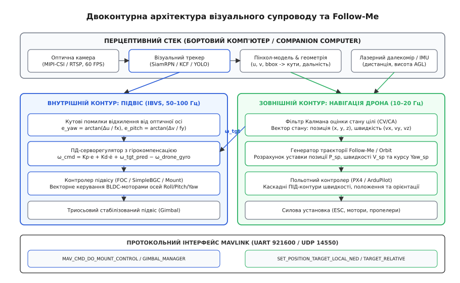
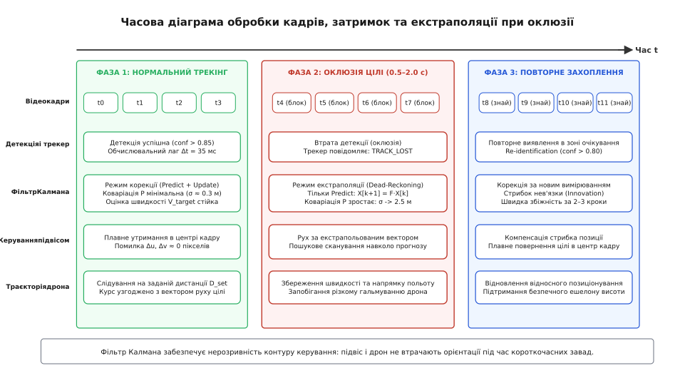

# Супровід цілі: follow-me й утримання в кадрі

<preknowlist>
- [Стабілізований підвіс](root:sys-dron/stabilizovanyi-pidvis) — кінематика триосьового підвісу, прямий безколекторний привод FOC та гіроскопічна стабілізація кутової швидкості.
- [Бортовий супровідний комп'ютер](root:sys-dron/companion-computer) — архітектура зв'язку з польотним контролером, конвеєр обробки відеопотоку та затримки обчислень.
- [Протоколи камери й підвісу MAVLink](root:sys-dron/mavlink-camera-gimbal) — команди наведення, режими стеження та телеметрія осей підвісу.
- [Режими зміни та утримання позиції](root:sys-dron/position-modes) — режими GUIDED, POSCTL та навігаційне керування уставками швидкості й положення.
- [Навігаційне переслідування](root:sys-dron/pure-pursuit-navigation) — метод чистого переслідування та генерація траєкторій зближення.
- [Наведення на рухому ціль](root:sys-dron/navedennia-na-rukhomu-tsil) — пропорційна навігація та кінематика перехоплення.
</preknowlist>

Коли безпілотний літальний апарат масою 3–5 кг здійснює політ зі швидкістю 18–22 м/с на висоті 50 м і намагається супроводжувати наземний автомобіль, що маневрує зі швидкістю 15 м/с із поперечними прискореннями до 3–4 м/с², система автоматичного наведення стикається з фізичним конфліктом динамічних діапазонів. Оптична камера з довгофокусним об'єктивом (фокусна відстань `f = 50` мм, кут огляду по діагоналі близько 12°) проектує рухомий автомобіль на цифрову матрицю у вигляді рамки розміром усього `80 × 40` пікселів. Будь-яке кутове відхилення оптичної осі всього на 0.5° миттєво зміщує проекцію об'єкта на 55 пікселів, викидаючи його за межі чутливої зони оптичного трекера менш ніж за 0.08 секунди. Одночасно нейромережевий детектора або кореляційний трекер на бортовому комп'ютері має непереборну затримку конвеєра обробки від 35 до 70 мс (захоплення кадру через інтерфейс MIPI-CSI, перенесення в пам'ять NPU/GPU, прямий прохід нейромережі та асоціація детекцій).

Якщо намагатися утримувати такий об'єкт у центрі кадру лише за рахунок маневрування самого безпілотника, система зазнає гарантованого зриву супроводу. Масивний дрон із чотирма чи шістьма гвинтами має власну аеродинамічну інерцію: для зміни вектора швидкості йому необхідно спершу нахилити корпус (змінити кут крену чи тангажу на 15–25°), що займає від 150 до 350 мс через обмеження кутового прискорення та реакції регуляторів обертів двигунів (ESC). За цей час автомобіль устигає змінити траєкторію або загальмувати, а сумарний фазовий зсув контуру керування призводить до наростаючих автоколивань і повної втрати прямої видимості (Line-of-Sight, LOS).

Єдине інженерне розв'язання цієї проблеми полягає в суворому розділенні системи супроводу на два ієрархічні контури з різними смугами пропускання: швидкий внутрішній контур візуального сервокерування підвісом (Image-Based Visual Servoing, IBVS) із частотою оновлення 50–100 Гц та повільний зовнішній навігаційний контур просторового позиціонування дрона (Follow-Me та Orbit) із частотою 10–20 Гц.

> 🔧 **Навіщо це.** Автоматичний супровід цілі (Visual Target Tracking) у поєднанні з режимом слідування (Follow-Me) є базовим інструментом для розвідувальних платформ, пошуково-рятувальних місій та інспекції інфраструктури. Операторові більше не потрібно вручну коригувати джойстиками нахил камери та траєкторію польоту дрона: оператор обирає об'єкт на екрані одним кліком, після чого бортовий супровідний комп'ютер утримує ціль у центрі кадру незалежно від вітрових збурень і самостійно веде дрон за вектором руху об'єкта на безпечній висоті та дистанції.


*Двоконтурна схема керування: перцептивний стек формує оцінку положення цілі, швидкий контур IBVS керує кутовою швидкістю підвісу камери, а зовнішній траєкторний контур позиціонує дрон у просторі через польотний контролер.*

## Перцептивний конвеєр і алгоритми оптичного трекінгу

Перцептивний конвеєр (англ. *perception pipeline*, від латинського *perceptio* — сприйняття) функціонує на бортовому комп'ютері (Companion Computer) класу Nvidia Jetson Orin NX, Raspberry Pi 5 або спеціалізованих процесорах обробки зору (VPU/NPU). Його завдання — приймати нестиснений відеопотік з роздільною здатністю 1080p або 4K із частотою 30–60 кадрів/с, ідентифікувати заданий об'єкт і видавати його просторові координати на матриці у вигляді обмежувальної рамки (англ. *bounding box*) `(u, v, w, h)`, де `(u, v)` — центр цілі в пікселях, а `w` та `h` — її ширина й висота.

У безпілотних системах використовують три основні класи оптичних трекерів, кожен з яких займає власну нішу за обчислювальною ціною та стійкістю:

```
+──────────────────────+──────────────────────────+─────────────────────────+
| Клас алгоритму       | Типові представники      | Обчислювальна складність|
+──────────────────────+──────────────────────────+─────────────────────────+
| Кореляційні фільтри  | MOSSE, KCF, DSST, BACF   | Низька (100–300 FPS CPU)|
| Сіамські нейромережі | SiamRPN, SiamRPN++, DaSiam| Середня (30–60 FPS GPU) |
| Детекція + Трекінг   | YOLOv8/v11 + ByteTrack   | Висока (25–45 FPS NPU)  |
+──────────────────────+──────────────────────────+─────────────────────────+
```

### 1. Кореляційні фільтри дискретного ядра (Kernelized Correlation Filters, KCF та MOSSE)

Алгоритми кореляційної фільтрації спираються на властивість циркулянтних матриць у частотній області. Будь-який двовимірний патч зображення `x` розміром `M × N` пікселів, що містить ціль, циклічно зсувається по вертикалі та горизонталі. У просторовій площині розв'язання задачі гребеневої регресії (Ridge Regression) вимагає мінімізації квадратичного функціонала похибки над усіма циклічними зсувами вектора вибірки:

```
min_w ∑_i | ⟨w, x_i⟩ - y_i |² + λ · ||w||²
```

Пряме розв'язання цього рівняння у просторовій області вимагає обернення матриці розмірності `(M·N) × (M·N)`, що для патча `128 × 128` пікселів відповідає матриці `16384 × 16384` і є нездійсненним у реальному часі. Проте циркулянтна матриця зсувів діагоналізується двовимірним дискретним перетворенням Фур'є (DFT). Відповідно до теореми про згортку, вектор ваг фільтра у дуальному просторі ядра `α̂` обчислюється аналітично у частотній площині за один крок без матричних ітерацій:

```
k_xx = exp( - (1/σ²) · ( ||x||² + ||x'||² - 2 · IFFT( FFT(x) ⊙ FFT̄(x') ) ) )  [гаусове ядро]
α̂ = ŷ / ( k̂_xx + λ )                                                          [навчання у частотах]
g = IFFT( k̂_xz ⊙ α̂ )                                                          [відгук на новому патчі]
(u_max, v_max) = argmax(g)                                                    [координати піку кореляції]
```

де `⊙` позначає поелементне множення Адамара, `ŷ` — перетворення Фур'є ідеального гаусового піка цільового відгуку з дисперсією `s`, а `λ` — коефіцієнт регуляризації Тіхонова (типово `λ = 10⁻⁴`), який запобігає діленню на нуль у високочастотних складових спектра.

Для формування багатовимірних дескрипторів ознак патч розбивають на просторові комірки розміром `4 × 4` або `8 × 8` пікселів і обчислюють 31-канальний градієнтний опис HOG (Histograms of Oriented Gradients) у поєднанні з 10 колірними каналами Color Names (CN). Багатоканальна кореляція обчислюється як сума відгуків по всіх каналах `d ∈ [1, D]`:

```
k_xx = exp( - (1/σ²) · ∑_d ( ||x^d||² + ||x'^d||² - 2 · IFFT( FFT(x^d) ⊙ FFT̄(x'^d) ) ) )
```

Для оцінки якості та надійності супроводу на кожному кадрі розраховують коефіцієнт відношення піка до бічних пелюсток (Peak-to-Sidelobe Ratio, PSR) та середню енергію піка кореляції (Average Peak-to-Correlation Energy, APCE):

```
PSR = ( g_max - μ_sidelobe ) / σ_sidelobe
APCE = | g_max - g_min |² / mean( ∑_{i,j} | g(i,j) - g_min |² )
```

де `μ_sidelobe` та `σ_sidelobe` — середнє значення та середньоквадратичне відхилення кореляційної площини за межами центрального вікна `11 × 11` пікселів навколо максимуму. Якщо значення PSR падає нижче порогу 7.0, а APCE зменшується більш ніж на 50% від середнього ковзного значення, трекер сигналізує про втрату контрасту або початок оклюзії об'єкта, блокуючи оновлення ваг фільтра `α̂`.

Головна перевага KCF — екстремальна швидкодія: на процесорі ARM Cortex-A76 обчислення займають лише 3–5 мс на кадр. Однак циркулянтне припущення створює так звані крайові артефакти (boundary effects), оскільки циклічний зсув з'єднує лівий край зображення з правим. Для зменшення цих артефактів на патч накладають вікно Ганна (Hann window):

```
w(m, n) = 0.5 · ( 1 - cos(2π·m / (M - 1)) ) · 0.5 · ( 1 - cos(2π·n / (N - 1)) )
```

Для подолання крайових артефактів без штучного затухання на краях використовують просторово-регуляризовані кореляційні фільтри (SRDCF) та фоно-орієнтовані фільтри (BACF — Background-Aware Correlation Filters). Вони навчаються на більшому патчі фону з матрицею просторового штрафу, яка примушує ваги фільтра за межами істинної межі об'єкта прямувати до нуля.

Водночас класичний KCF не здатний адаптуватися до швидкої зміни масштабу цілі (коли дрон наближається до автомобіля) і повністю втрачає об'єкт при його повороті на 90° (out-of-plane rotation) чи оклюзії. Для адаптації до зміни розмірів застосовують розширення DSST (Discriminative Scale Space Tracker), де поверх двовимірного фільтра позиції будується додатковий одновимірний кореляційний фільтр масштабу з 17–33 дискретними масштабними коефіцієнтами `a^n` (`a = 1.05`, `n ∈ [-16, 16]`).

### 2. Сіамські нейромережі пропонування регіонів (SiamRPN / SiamRPN++)

Сіамські трекери (англ. *Siamese Networks*, від назви сіамських близнюків) відмовляються від онлайн-навчання фільтра на кожному кадрі. Натомість вони використовують глибоку згорткову нейромережу (ResNet-50 або MobileNetV3), натреновану на мільйонах пар відеокадрів. Мережа складається з двох гілок з ідентичними вагами:

1. **Гілка шаблону (Exemplar Branch):** приймає вирізку цілі `Z` розміром `127 × 127` пікселів, зафіксовану в момент ініціалізації супроводу, та формує тензор просторових ознак `φ(Z)` розмірністю `C × H_z × W_z` (наприклад, `256 × 7 × 7`).
2. **Гілка пошуку (Search Branch):** приймає ширшу область поточного кадру `X` розміром `255 × 255` пікселів довкола попереднього положення об'єкта та формує тензор `φ(X)` розмірністю `C × H_x × W_x` (наприклад, `256 × 31 × 31`).

Тензори ознак пропускаються крізь шар глибинної крос-кореляції (Depthwise Cross-Correlation), після чого розгалужуються на дві паралельні підмережі:

```
Score_cls = Conv_cls( φ(X) ⋆ φ(Z) )    [класифікація: ймовірність присутності цілі]
Reg_bbox  = Conv_reg( φ(X) ⋆ φ(Z) )    [регресія: зміщення координат та масштабів dx, dy, dw, dh]
```

Підмережа класифікації видає карту ймовірностей розміром `2k × 25 × 25` (де `k` — кількість анкерних рамок різного співвідношення сторін), а підмережа регресії видає вектор зсувів `4k × 25 × 25`. Підсумкова функція втрат при тренуванні сіамської мережі поєднує крос-ентропію класифікації та згладжену функцію втрат Smooth L1:

```
Loss_total = L_cls(Score_cls, Y_true) + λ_reg · L_smooth_L1(Reg_bbox, Bbox_true)
```

де Smooth L1 для координат `x` визначається як:

```
Smooth_L1(x) = 0.5 · x²              при |x| < 1
Smooth_L1(x) = |x| - 0.5            при |x| ≥ 1
```

Сіамський підхід має високу стійкість до нежорстких деформацій (пішохід, що біжить), зміни фонового освітлення та обертання цілі в просторі. Якщо ціль тимчасово закривається дорожнім знаком, сіамська мережа не накопичує помилкових оновлень, оскільки ваги її моделі зафіксовані, а шаблон `Z` залишається незмінним.

### 3. Парадигма супроводу через детекцію (Tracking-by-Detection: YOLO + ByteTrack)

Найбільш надійний промисловий підхід полягає у поєднанні одностадійного детектора сімейства YOLO (You Only Look Once) та трекера асоціації детекцій ByteTrack. 

На кожному кадрі детектор знаходить усі об'єкти на зображенні з оцінкою класу та достовірності `conf`. Замість того, щоб відкидати низькодостовірні детекції (`conf < 0.5`), ByteTrack використовує двохетапне зіставлення:
1. **Перший етап:** надійні детекції (`conf ≥ 0.6`) зіставляються з існуючими треками за матрицею перекриття Intersection-over-Union (IoU) та угорським алгоритмом (Hungarian Algorithm).
2. **Другий етап:** треки, що залишилися без пари, зіставляються з невпевненими детекціями (`0.1 ≤ conf < 0.6`). Це дозволяє продовжувати неперервний супровід об'єктів, які зазнали часткового перекриття або сильного змазування (motion blur).

Матриця перекриття IoU між двома прямокутними рамками `A` та `B` обчислюється як:

```
IoU(A, B) = Площа(A ∩ B) / Площа(A ∪ B)
```

Для врахування просторової форми та відстані між центрами рамок застосовують узагальнену метрику Distance-IoU (DIoU):

```
DIoU(A, B) = IoU(A, B) - ( d_centers² / c_diag² )
```

де `d_centers` — евклідова відстань між геометричними центрами рамок, а `c_diag` — діагональ мінімального описового прямокутника, що охоплює обидві рамки одночасно.

Кожен трек у ByteTrack описується 8-вимірним вектором стану Калмана на площині зображення:

```
X_box = [ u,  v,  a_aspect,  h_height,  u̇,  v̇,  ȧ_aspect,  ḣ_height ]ᵀ
```

де `a_aspect = w / h` — співвідношення сторін прямокутника. Такий опис дозволяє передбачати положення рамки на наступному кадрі навіть за повної відсутності детекцій.

## Просторова геометрія та калібрувальна пінхол-модель

Щоб перетворити піксельні координати обмежувальної рамки на зображенні в кутові координати наведення стабілізованого підвісу, застосовують проекційну модель камери-обскури (пінхол-модель, від латинського *camera obscura* — темна кімната).

Нехай сенсор камери має роздільну здатність `W_img × H_img` пікселів. Внутрішні параметри камери задаються калібрувальною матрицею `K`:

```
    [ f_x   s   c_x ]
K = [  0   f_y  c_y ]
    [  0    0    1  ]
```

де `f_x` та `f_y` — фокусні відстані об'єктива у піксельних одиницях по осях `X` та `Y`, `s` — фактор перекосу пікселя (для сучасних КМОН-матриць `s = 0`), а `(c_x, c_y)` — координати головної точки (перетину оптичної осі з матрицею). Фізичний зв'язок із міліметрами об'єктива визначається через розмір одиничного пікселя матриці `(d_x, d_y)`:

```
f_x = F_lens_mm / d_x             [пікселі]
f_y = F_lens_mm / d_y             [пікселі]
```

Для врахування оптичних дисторсій лінзи об'єктива (бочкоподібної або подушкоподібної) ідеальні нормалізовані координати `(x_n, y_n)` коригуються радіальними `(k_1, k_2, k_3)` та тангенціальними `(p_1, p_2)` коефіцієнтами Брауна-Конраді:

```
r² = x_n² + y_n²
x_dist = x_n · (1 + k_1·r² + k_2·r⁴ + k_3·r⁶) + 2·p_1·x_n·y_n + p_2·(r² + 2·x_n²)
y_dist = y_n · (1 + k_1·r² + k_2·r⁴ + k_3·r⁶) + p_1·(r² + 2·y_n²) + 2·p_2·x_n·y_n
```

Будь-яка тривимірна точка простору `P_c = [X_c, Y_c, Z_c]ᵀ` у системі координат камери проектується на площину сенсора в однорідних координатах `[u_h, v_h, w_h]ᵀ = K · P_c`, звідки евклідові піксельні координати `(u, v)` дорівнюють:

```
u = f_x · (X_c / Z_c) + c_x       [горизонтальна піксельна координата]
v = f_y · (Y_c / Z_c) + c_y       [вертикальна піксельна координата]
```

```
           Z_c (Оптична вісь камери)
          ▲
         /
        /  Променевий вектор до цілі
       /  .
      /     .  P_target (X_c, Y_c, Z_c)
     /        .
    +───────────+ 
    │ (u, v)    │  Площина матриці камери
    │     *     │  Зсув від оптичного центру:
    │   (cx,cy) │  Δu = u - cx,  Δv = v - cy
    +───────────+
   /           \
  /             \
 /               \
X_c (Праворуч)    Y_c (Вниз)
```

Якщо трекер видає координати центру обмежувальної рамки цілі `(u, v)`, відхилення об'єкта від оптичної осі становить:

```
Δu = u - c_x                      [піксельне відхилення по горизонталі]
Δv = v - c_y                      [піксельне відхилення по вертикалі]
```

Одиничний променевий вектор візування прямої видимості (Line-of-Sight, LOS) у системі координат камери `v_los_c` формується через нормалізовані координати площини зображення:

```
x_n = Δu / f_x                    [нормалізована координата x]
y_n = Δv / f_y                    [нормалізована координата y]

v_los_c = (1 / √(x_n² + y_n² + 1)) · [ x_n,  y_n,  1 ]ᵀ
```

Кутові похибки прямої видимості по азимуту (Yaw) та куту місця / тангажу (Pitch) розраховуються як:

```
e_yaw = arctan(Δu / f_x)          [кутова помилка азимута камери]
e_pitch = arctan(Δv / f_y)        [кутова помилка тангажу камери]
```

Для малих кутів візування, коли об'єкт знаходиться неподалік центральної зони кадру (`|Δu| < 0.2 · f_x`), можна застосовувати лінеаризовані співвідношення `e_yaw ≈ Δu / f_x` та `e_pitch ≈ Δv / f_y`. При використанні ширококутних об'єктивів або при супроводі на краях кадру тригонометричний вираз `arctan` є обов'язковим для уникнення статичної похибки нелінійності.

## Швидкий внутрішній контур: візуальне сервокерування підвісом (IBVS)

Контур візуального сервокерування підвісом (Image-Based Visual Servoing, IBVS) забезпечує безперервне утримання оптичної осі камери на цілі шляхом формування команд кутової швидкості для безколекторних двигунів осей підвісу.

У робототехніці розрізняють дві парадигми візуального керування:
1. **Позиційне сервокерування (Position-Based Visual Servoing, PBVS):** система спершу реконструює повну тривимірну позу об'єкта в просторі, після чого регулятор формує траєкторію в декартових координатах. Головний недолік PBVS — надзвичайна чутливість до похибок калібрування матриці камери `K` та шуму оцінки дальності. Помилка у фокусній відстані всього на 5% спричиняє значні просторові спотворення і зрив контуру.
2. **Візуальне сервокерування на площині зображення (Image-Based Visual Servoing, IBVS):** регулятор мінімізує помилку безпосередньо в піксельному просторі матриці. IBVS володіє високою робастністю до похибок калібрування внутрішніх параметрів камери й не вимагає миттєвої реконструкції 3D-пози цілі для стабілізації оптичної осі.

### Матриця взаємодії (Image Jacobian)

Математичний зв'язок між рухом точки на площині зображення `[u̇, v̇]ᵀ` та вектором просторової швидкості камери `V_c = [v_x, v_y, v_z, ω_x, ω_y, ω_z]ᵀ` описується матрицею взаємодії (Image Jacobian) `L_s`:

```
[ u̇ ]       [ -f_x/Z   0     x_n/Z    x_n·y_n     -(1 + x_n²)   y_n  ] [ v_x ]
[   ] = L_s · V_c = [                                                        ] · [ ... ]
[ v̇ ]       [   0   -f_y/Z   y_n/Z   (1 + y_n²)    -x_n·y_n    -x_n  ] [ ω_z ]
```

Аналіз структури матриці `L_s` виявляє ключову фізичну властивість: перші три стовпці (трансляційні швидкості) залежать від глибини сцени `Z`, тоді як останні три стовпці (обертальні швидкості) повністю не залежать від дальності до об'єкта `Z`. 

Оскільки стабілізований підвіс закріплений на корпусі безпілотника і може змінювати лише кутову орієнтацію камери довкола власних осей (лінійні швидкості підвісу визначаються рухом самого дрона `v_x = v_y = v_z = 0`), диференціальні рівняння зв'язку між кутовими швидкостями підвісу `[ω_pitch, ω_yaw]ᵀ` та зміщенням пікселів спрощуються:

```
u̇ = f_x · ω_yaw - (Δu · Δv / f_y) · ω_pitch
v̇ = -f_y · ω_pitch + (Δu · Δv / f_x) · ω_yaw
```

Для приосьової зони кадру перехресні добутки `(Δu · Δv)` прямують до нуля, що дозволяє розв'язати контур сервокерування на два незалежні скалярні канали регулювання: канал панорамування (Yaw) та канал нахилу (Pitch).

Доведення асимптотичної стійкості контуру IBVS за Ляпуновим будується на скалярній функції енергії похибки `V = 0.5 · (e_yaw² + e_pitch²)`. Її повна похідна за часом становить:

```
V̇ = e_yaw · ė_yaw + e_pitch · ė_pitch = - K_p · (e_yaw² + e_pitch²) < 0
```

Оскільки `V > 0` для всіх `e ≠ 0` та `V̇ < 0`, замкнений контур візуального сервокерування є експоненціально стійким за Ляпуновим, що гарантує збіжність оптичної осі до центру цілі за відсутності некомпенсованих збурень.

### Пропорційно-диференціальне керування з прямим зв'язком

Класичний зворотний зв'язок реалізується через ПД-регулятор із фільтрацією похідної помилки:

```
ė_raw = (e[k] - e[k-1]) / dt
ė_filt[k] = α_d · ė_raw + (1 - α_d) · ė_filt[k-1]
```

де `α_d = dt / (dt + τ_d)` — коефіцієнт фільтра нижніх частот першого порядку (Low-Pass Filter) з постійною часу `τ_d = 0.015` с, який зрізає високочастотний піксельний шум дискретизації детектора.

Коефіцієнт `K_p` визначає жорсткість утримання цілі в центрі кадру. Проте за наявності фазової затримки конвеєра нейромережі `Δt_lat = 40` мс критичне значення пропорційного коефіцієнта за критерієм стійкості Найквіста обмежене величиною:

```
K_p_max < π / (2 · Δt_lat) ≈ 3.14 / (2 · 0.040) ≈ 39.2 рад/с / рад
```

На практиці для забезпечення запасу стійкості по амплітуді (Gain Margin ≥ 6 дБ) та фазі (Phase Margin ≥ 45°) значення `K_p` обирають у діапазоні від 2.5 до 5.5 с⁻¹.

Для усунення динамічного відставання підвісу від маневруючої цілі в контур додають два канали випередження (Feedforward):

```
ω_cmd_yaw   = K_p · e_yaw   + K_d · ė_yaw   + ω_target_yaw_pred   - ω_drone_gyro_yaw
ω_cmd_pitch = K_p · e_pitch + K_d · ė_pitch + ω_target_pitch_pred - ω_drone_gyro_pitch
```

```
+─────────────────────────────────────────────────────────────────────────────+
|               КОНТУР ВІЗУАЛЬНОГО СЕРВОКЕРУВАННЯ ПІДВІСОМ (IBVS)             |
|                                                                             |
|   Ціль (u, v)        e_yaw, e_pitch      +---------+                        |
|   ─────────► [ Пінхол ] ──────►( + )───► │ ПД-рег. │───────►( + )─────────┐ |
|                 ▲               ▲ −      +---------+         ▲ +          │ |
|                 │               │                            │            │ |
|            (cx, cy)             └───── [ Затримка dt ]       │            │ |
|                                                              │            │ |
|   Швидкість цілі (Фільтр Калмана) ───► [ ω_tgt_pred ] ───────┘            │ |
|                                                              ▲            │ |
|   Гіроскопи дрона (IMU 1000 Гц) ─────► [ −ω_drone_gyro ] ───┘             │ |
|                                                                           ▼ |
|   Команда кутової швидкості підвісу ◄─────────────────────────────────────── |
+─────────────────────────────────────────────────────────────────────────────+
```

1. **Гіроскопічна розв'язка носія (`-ω_drone_gyro`):**
   Високочастотні гіроскопи польотного контролера або власного контролера підвісу (FOC) вимірюють кутові швидкості рами безпілотника `ω_drone` з частотою 1000 Гц. Якщо дрон здійснює різкий маневр крену зі швидкістю 60°/с, підвіс миттєво відпрацьовує протилежну кутову швидкість, зберігаючи орієнтацію камери в інерційному просторі ще до того, як зміщення цілі проявиться на наступному кадрі відео.
2. **Випередження за прогнозом фільтра Калмана (`+ω_target_pred`):**
   Оцінка кутової швидкості руху об'єкта `ω_target_pred` розраховується на основі тривимірного вектора швидкості цілі у фільтрі Калмана. Це дозволяє підвісу рухатися синхронно з автомобілем навіть тоді, коли кутова помилка `e` дорівнює нулю.

## Фільтрація стану цілі: дискретний фільтр Калмана

Сирі детекції від нейромережі або оптичного трекера не можуть безпосередньо подаватися в контур навігації дрона через наявність високочастотного шуму, пропусків кадрів та затримок. Дискретний лінійний фільтр Калмана вирішує задачу оптимального оцінювання вектора стану цілі.

### Модель постійної швидкості (Constant Velocity, CV) у системі координат NED

Вектор стану системи описує положення та лінійну швидкість об'єкта в локальній географічній системі координат North-East-Down (NED):

```
X = [ N,  E,  D,  V_N,  V_E,  V_D ]ᵀ    [6-вимірний вектор стану цілі]
```

Неперервна стохастична модель руху цілі задається системою диференціальних рівнянь:

```
Ẋ(t) = A_c · X(t) + G_c · w(t)
```

де `w(t)` — тривимірний неперервний білий шум прискорення з матрицею спектральної густини `q_c · I₃`.

Дискретизація неперервної моделі з інтервалом дискретизації `dt` дає матрицю переходу стану `F`:

```
        [ I₃   dt·I₃ ]
F(dt) = [            ]
        [ 0      I₃  ]
```

Дискретна матриця коваріації шуму процесу `Q` обчислюється аналітично через інтеграл Дюамеля:

```
Q = ∫₀^{dt} F(τ) · G_c · (q_c · I₃) · G_cᵀ · Fᵀ(τ) dτ

    [ (dt³ / 3) · I₃    (dt² / 2) · I₃ ]
Q = [                                  ] · q_c
    [ (dt² / 2) · I₃        dt · I₃    ]
```

Параметр `q_c` (м²/с³) вибирається виходячи з максимальної динаміки маневру об'єкта. Для наземного транспорту типове значення становить `q_c = σ_a² · τ_maneuver ≈ (2.5 м/с²)² · 0.5 с ≈ 3.1 м²/с³`.

Для високомобільних повітряних або швидкісних надводних цілей, схильних до різких перевантажень (до 5–8 g), застосовують 9-вимірну модель постійного прискорення (Constant Acceleration, CA) зі станом `X = [N, E, D, V_N, V_E, V_D, a_N, a_E, a_D]ᵀ`:

```
        [ I₃   dt·I₃   (dt²/2)·I₃ ]
F_CA  = [ 0      I₃      dt·I₃    ]
        [ 0       0        I₃     ]
```

Для складних сценаріїв, де автомобіль чергує рівномірний прямолінійний рух по шосе з різкими гальмуваннями та розворотами на перехрестях, застосовують фільтрацію з інтерактивним набором моделей (Interacting Multiple Model, IMM). Фільтр IMM паралельно веде дві моделі (CV та CA), обчислюючи ймовірність кожної з них `μ_i` на основі правдоподібності нев'язок `Λ_i = N(ỹ_i; 0, S_i)`:

```
μ_i[k] = ( μ_i[k-1] · c_ij · Λ_i[k] ) / ∑_j ( μ_j[k-1] · c_ji · Λ_j[k] )
X̂_IMM = ∑_i μ_i · X̂_i
```

де `c_ij` — апріорна матриця ймовірностей переходів між режимами руху.

Матриця вимірювання `H` відображає вектор стану на тривимірні виміряні координати цілі `z = [N_meas, E_meas, D_meas]ᵀ`:

```
H = [ I₃   0₃ ]
```

Коваріаційна матриця шуму вимірювань `R` формується на основі поточної оцінки дистанції до цілі `r` та кутової роздільної здатності камери:

```
R = diag( σ_N²,  σ_E²,  σ_D² )
```

Похибка вимірювання координат пропорційна квадрату дальності: `σ_pos ≈ r · σ_angle + (r² / (f · H_real)) · σ_pixel`. На відстані 50 м типова дисперсія позиції становить `σ_N = σ_E ≈ 0.4` м, `σ_D ≈ 0.2` м.

### Алгоритм кроку передбачення та корекції

На кожному такті планувальника (наприклад, з частотою 50 Гц, `dt = 0.02` с) виконується фаза передбачення (Predict):

```
X̂[k|k-1] = F(dt) · X̂[k-1|k-1]                  [прогноз вектора стану]
P[k|k-1] = F(dt) · P[k-1|k-1] · Fᵀ(dt) + Q(dt)  [прогноз коваріації невизначеності]
```

Коли від перцептивного конвеєра надходить нова валідна детекція, виконується фаза корекції (Update):

```
ỹ[k] = z[k] - H · X̂[k|k-1]                      [вектор нев'язки (Innovation)]
S[k] = H · P[k|k-1] · Hᵀ + R[k]                 [коваріаційна матриця нев'язки]
K[k] = P[k|k-1] · Hᵀ · S⁻¹[k]                   [оптимальна матриця підсилення Калмана]

X̂[k|k] = X̂[k|k-1] + K[k] · ỹ[k]                 [апостеріорна оцінка стану]
P[k|k] = (I₆ - K[k] · H) · P[k|k-1]             [апостеріорна коваріація помилок]
```

Для забезпечення чисельної стійкості та збереження додатної визначеності коваріаційної матриці `P` в обчислювальному коді застосовують симетричну форму Джозефа:

```
P[k|k] = (I₆ - K·H) · P[k|k-1] · (I₆ - K·H)ᵀ + K · R · Kᵀ
```

### Статистична стробова фільтрація (Gating) та обробка оклюзій

Перед тим як застосувати вимірювання `z[k]` для оновлення стану, обчислюється відстань Махаланобіса:

```
d_M² = ỹᵀ[k] · S⁻¹[k] · ỹ[k]
```

Оскільки вектор вимірювання має розмірність 3, величина `d_M²` підпорядковується розподілу хі-квадрат `χ²(3)`. Якщо `d_M² > 11.34` (відповідає ймовірності помилкового відкидання істинної детекції менше 1%), вимірювання класифікується як аномалія (наприклад, детекція іншого автомобіля або хибне спрацювання на тінь) і відкидається.

У разі повної відсутності детекцій (автомобіль заїхав під міст або за густі дерева) фільтр функціонує виключно в режимі екстраполяції (Dead-Reckoning):
- Вектор стану `X̂` оновлюється лише за рівнянням `X̂[k] = F · X̂[k-1]`, продовжуючи рух з раніше оціненою швидкістю `V_tgt`;
- Коваріаційна матриця `P` монотонно зростає на кожному кроці за рахунок додавання матриці `Q`;
- Радіус невизначеності положення цілі `r_search = 3 · √(P_11 + P_22)` збільшується, сигналізуючи оптичному трекеру про необхідність розширення зони пошуку (Search ROI) на наступних кадрах.


*Часова діаграма обробки оклюзії: оптичний трекер сигналізує про втрату детекцій, фільтр Калмана екстраполює координати за моделлю Constant Velocity зі зростанням коваріаційного еліпса пошуку, а контур IBVS утримує орієнтацію камери на прогнозованій точці виїзду об'єкта.*

## Зовнішній траєкторний контур позиціонування дрона

Зовнішній контур навігації формує просторову траєкторію польоту безпілотника відносно оціненого положення цілі `P_tgt = [N_tgt, E_tgt, D_tgt]ᵀ`.

### Просторові системи координат і геодезичні перетворення

Для точного проектування променя візування у глобальну систему координат використовують ланцюг систем координат:

```
[ Камера (C) ] ──(R_c_to_g)──► [ Головка підвісу (G) ] ──(R_g_to_b)──► [ Корпус дрона (B) ] ──(R_b_to_ned)──► [ Навігаційна NED ]
```

1. **Система координат камери (C):** вісь `X_c` спрямована праворуч по матриці, вісь `Y_c` — вниз, вісь `Z_c` — вздовж оптичної осі вперед;
2. **Система координат підвісу (G):** враховує механічні кути енкодерів осей Roll та Pitch;
3. **Зв'язана система координат дрона (B, FRD):** `X_b` вперед, `Y_b` праворуч, `Z_b` вниз;
4. **Локальна навігаційна система (NED):** `X_ned` на Північ, `Y_ned` на Схід, `Z_ned` вертикально вниз до центру Землі.

Для перерахунку глобальних геодезичних координат WGS-84 `(Lat, Lon, Alt)` у локальну декартову систему відліку NED відносно базової точки старту `(Lat_0, Lon_0, Alt_0)` застосовують проекцію плоскої Землі (Flat Earth Projection) з радіусами кривизни еліпсоїда WGS-84 (велика піввісь `a = 6378137.0` м, ексцентриситет `e² = 0.00669437999`):

```
R_M = a · (1 - e²) / (1 - e² · sin²(Lat_0))^{1.5}    [радіус кривизни меридіана]
R_N = a / √(1 - e² · sin²(Lat_0))                  [радіус кривизни першого вертикала]

N = (Lat - Lat_0) · R_M
E = (Lon - Lon_0) · R_N · cos(Lat_0)
D = -(Alt - Alt_0)
```

Повна матриця просторової орієнтації камери відносно Землі `R_c_to_ned` формується перемноженням матриць обертання:

```
R_c_to_ned = R_b_to_ned(Roll_b, Pitch_b, Yaw_b) · R_g_to_b(Yaw_g) · R_c_to_g(Pitch_g, Roll_g)
```

де матриця повороту літака `R_b_to_ned` обчислюється через кватерніон орієнтації дрона `q = [q_w, q_x, q_y, q_z]`, отриманий від EKF автопілота:

```
              [ 1 - 2(q_y² + q_z²)    2(q_x·q_y - q_w·q_z)    2(q_x·q_z + q_w·q_y) ]
R_b_to_ned =  [ 2(q_x·q_y + q_w·q_z)    1 - 2(q_x² + q_z²)    2(q_y·q_z - q_w·q_x) ]
              [ 2(q_x·q_z - q_w·q_y)    2(q_y·q_z + q_w·q_x)    1 - 2(q_x² + q_y²) ]
```

### Оцінка похилої дальності через перетин променя з цифровою моделлю рельєфу

Якщо далекомір відсутній, горизонтальна дистанція `d_horiz` розраховується з урахуванням висоти польоту над землею `h_agl = Z_drone - Z_terrain` та поточного сумарного кута нахилу камери в інерційному просторі `θ_pitch_global = θ_gimbal_pitch + θ_drone_pitch`:

```
d_horiz = h_agl / tan(|θ_pitch_global|)
r_slant = h_agl / sin(|θ_pitch_global|)
```

Потім вектор прямої видимості перетворюється з системи координат камери в систему координат NED за допомогою матриці просторового обертання підвісу `R_c_to_ned`:

```
P_target_ned = P_drone_ned + R_c_to_ned · [ 0,  0,  r_slant ]ᵀ
```

У гористій або пересіченій місцевості припущення про плоску Землю призводить до неприпустимих помилок (похибка визначення координат до 50–100 м при нахилі схилу 15°). У таких умовах застосовують алгоритм трасування променя (Ray-Marching) вздовж цифрової карти висот DEM (Digital Elevation Model з кроком сітки 10–30 м):

```
P_ray(s) = P_drone_ned + s · v_los_ned,      s > 0
s_intersect = argmin_s | P_ray_Z(s) - Elevation_DEM( P_ray_N(s), P_ray_E(s) ) |
```

### Режим слідування за ціллю (Follow-Me) та векторні поля напрямку (Vector Field Guidance)

У режимі Follow-Me оператор задає бажану горизонтальну дистанцію `D_set`, висоту над ціллю `H_set` та відносний кут візування `ψ_rel` (наприклад, `ψ_rel = π` для слідування строго позаду, `ψ_rel = 0` для польоту назустріч перед ціллю, `ψ_rel = π/2` для слідування з правого борту).

Вектор курсу руху цілі визначається через її швидкість у площині:

```
ψ_tgt_heading = arctan2( V_E_tgt,  V_N_tgt )
ψ_drone_azimuth = ψ_tgt_heading + ψ_rel
```

Бажана позиція дрона в просторі:

```
N_desired = N_tgt - D_set · cos(ψ_drone_azimuth)
E_desired = E_tgt - D_set · sin(ψ_drone_azimuth)
D_desired = D_tgt - H_set
```

Для забезпечення плавного руху без різких ривків (Jerk Limiting) уставка швидкості формується як суперпозиція швидкості руху цілі (feedforward) та пропорційно-інтегрального регулятора позиційної помилки:

```
e_pos_N = N_desired - N_drone
e_pos_E = E_desired - E_drone
e_pos_D = D_desired - D_drone

V_cmd_N = V_N_tgt + K_p_pos · e_pos_N + K_i_pos · ∫ e_pos_N dt
V_cmd_E = V_E_tgt + K_p_pos · e_pos_E + K_i_pos · ∫ e_pos_E dt
V_cmd_D = V_D_tgt + K_p_pos_z · e_pos_D
```

Для літакових БПЛА (Fixed-Wing), які не можуть зависати на місці й мають мінімальну швидкість звалювання `V_stall`, застосовують алгоритм нелінійного наведення L1 (L1 Guidance Law) або векторні поля напрямку (Vector Field Guidance, VFG). Бажаний курс польоту `χ_d` генерується як нелінійна функція бічного відхилення від лінії шляху цілі `e_py`:

```
χ_d = χ_path - χ_inf · ( 2 / π ) · arctan( k_path · e_py )
```

де `χ_inf ∈ (0, π/2]` — граничний кут виходу на лінію переслідування на великих дистанціях, а `k_path` — коефіцієнт крутизни збіжності.

Для запобігання різкому смиканню камери під час інтенсивних маневрів у траєкторний планувальник інтегрують профіль швидкості S-кривої (S-Curve Trajectory Profile) з обмеженням третьої похідної положення — ривка (Jerk):

```
| d³P / dt³ | ≤ Jerk_max ≈ 5.0 ... 10.0 м/с³
| d²P / dt² | ≤ Acc_max  ≈ 2.5 ... 4.0 м/с²
```

Для врахування аеродинамічного знесення вітром (Wind Drift Compensation) польотний контролер безперервно оцінює вектор вітру `[W_N, W_E]` через фільтр EKF і додає кут упередження (Crab Angle) до курсу дрона:

```
β_crab = arcsin( (W_E · cos(Course) - W_N · sin(Course)) / V_airspeed )
```

### Режим кругового динамічного обльоту (Dynamic Orbit Around Moving Target)

У режимі динамічної орбіти точка прив'язки безперервно переміщується слідом за ціллю зі швидкістю `V_tgt`, а дрон обертається довкола неї з радіусом `R_orbit` та заданою тангенціальною швидкістю `V_tan`.

Поточний кут положення дрона на колі `φ_orbit(t)` змінюється за законом:

```
φ̇_orbit = V_tan / R_orbit                 [кутова швидкість обльоту, рад/с]
φ_orbit[k] = φ_orbit[k-1] + φ̇_orbit · dt  [інтегрування кута положення]

N_orbit_sp = N_tgt + R_orbit · cos(φ_orbit)
E_orbit_sp = E_tgt + R_orbit · sin(φ_orbit)
D_orbit_sp = D_tgt - H_set
```

Тангенціальна складова швидкості обльоту:

```
V_tan_N = -V_tan · sin(φ_orbit)
V_tan_E =  V_tan · cos(φ_orbit)
```

Повна уставка швидкості польоту дрона:

```
V_cmd_total_N = V_N_tgt + V_tan_N + K_p_pos · (N_orbit_sp - N_drone)
V_cmd_total_E = V_E_tgt + V_tan_E + K_p_pos · (E_orbit_sp - E_drone)
V_cmd_total_D = V_D_tgt + K_p_pos_z · (D_orbit_sp - D_drone)
```

Одночасно обчислюється уставка курсу дрона (Yaw Setpoint), щоб ніс безпілотника був завжди орієнтований на автомобіль:

```
Yaw_cmd = arctan2( E_tgt - E_drone,  N_tgt - N_drone )
Yaw_rate_feedforward = φ̇_orbit
```

Під час кругового обльоту безпілотник летить із постійним бічним прискоренням (доцентровим прискоренням) `a_centripetal = V_tan² / R_orbit`. Це вимагає від польотного контролера створення постійного кута крену `Roll_bank = arctan(V_tan² / (g · R_orbit))`, де `g = 9.81` м/с² — прискорення вільного падіння.

## MAVLink-інтерфейс взаємодії з польотним стеком

Взаємодія між супровідним комп'ютером зору та автопілотом (PX4 Autopilot або ArduPilot) базується на стандартизованому протоколі MAVLink v2.

```
+─────────────────────────────────────────────────────────────────────────────+
|                         БОРТОВИЙ КОМП'ЮТЕР (Linux)                          |
|  [Камера] -> [Optical Tracker] -> [Kalman Filter] -> [Follow Controller]    |
+──────────────────────────────────────┬──────────────────────────────────────+
                                       │ MAVLink v2 потік
                                       ▼ (UART 921600 / UDP 14550)
+─────────────────────────────────────────────────────────────────────────────+
|                     ПОЛЬОТНИЙ КОНТРОЛЕР (PX4 / ArduPilot)                   |
|  [Gimbal Manager] <─── MAV_CMD_DO_MOUNT_CONTROL / GIMBAL_MANAGER_SET_ATTITUDE|
|  [Navigator/Offboard] <─── SET_POSITION_TARGET_LOCAL_NED (V_x, V_y, V_z, Yaw)|
|  [EKF3 / Telemetry] ────► ATTITUDE, LOCAL_POSITION_NED, GLOBAL_POSITION_INT |
+─────────────────────────────────────────────────────────────────────────────+
```

### 1. Керування підвісом через Gimbal Protocol v2

Для високої плавності та виключення проміжних перетворень на автопілоті бортовий комп'ютер передає уставки орієнтації підвісу повідомленням `GIMBAL_MANAGER_SET_ATTITUDE` (Msg ID 282) або командою `MAV_CMD_DO_MOUNT_CONTROL` (Command ID 205):

- Повідомлення транслює одиничний кватерніон цільової просторової орієнтації `q = [w, x, y, z]` та вектор кутових швидкостей `(pitch_rate, yaw_rate)` у радіанах за секунду;
- Прапорець `GIMBAL_MANAGER_FLAGS_ROLL_LOCK` фіксує горизонт камери відносно площини Землі;
- Прапорець `GIMBAL_MANAGER_FLAGS_YAW_LOCK` визначає, чи задається азимут підвісу відносно істинного Півночі (Earth-frame), чи відносно поздовжньої осі корпусу дрона (Body-frame).

### 2. Керування траєкторією в режимі Offboard / Guided

Позиціонування безпілотника здійснюється відправкою повідомлення `SET_POSITION_TARGET_LOCAL_NED` (Msg ID 84) з частотою 20–50 Гц:

```
Поле структура:
  - time_boot_ms: мітка бортового часу;
  - target_system: ID польотного контролера (типово 1);
  - target_component: ID навігаційного модуля (типово 1);
  - coordinate_frame: MAV_FRAME_LOCAL_NED;
  - type_mask: бітова маска активних каналів керування.
```

Бітова маска `type_mask` дозволяє конфігурувати комбіновані режими керування:

```
Маска для повного керування швидкістю з прямим зв'язком за прискоренням:
type_mask = POSITION_IGNORE | (0 << 3) | (0 << 6) | YAW_RATE_IGNORE
  - Ігнорувати координати позиції: дрон не намагається зупинитися на точці, а рухається вектором швидкості;
  - Використовувати Vx, Vy, Vz: задає вектор швидкості зближення;
  - Використовувати Afx, Afy, Afz: задає доцентрове прискорення для обльоту.
```

Для передачі відносних просторових координат об'єкта в польотний контролер використовують повідомлення `TARGET_RELATIVE` (Msg ID 511), що містить мітку часу сенсора, відносні декартові координати `(x, y, z)` у системі відліку дрона та оцінку коваріаційної невизначеності. Якщо ж на борту безпілотника реалізовано алгоритм візуальної одометрії (VIO), супровідний комп'ютер передає оцінку власного зміщення повідомленням `VISION_POSITION_ESTIMATE` (Msg ID 102) або `ODOMETRY` (Msg ID 331), що дозволяє навігаційному EKF продовжувати стійкий політ навіть в умовах радіоелектронного придушення супутникової навігації GNSS.

Під час ініціалізації бортовий комп'ютер налаштовує частоту потоку телеметрії командою `MAV_CMD_SET_MESSAGE_INTERVAL` (Command ID 511), задаючи період опитування повідомлень `ATTITUDE` та `LOCAL_POSITION_NED` рівним 20000 мкс (50 Гц), що забезпечує мінімальний часовий зсув при обчисленні матриць повороту.

### 3. Апаратна синхронізація часу та бюджет затримок

Сумарний замкнений цикл керування від моменту експозиції сенсора камери до реакції моторів дрона складається з послідовних часових інтервалів:

```
+──────────────────────────────────────────────────────────+─────────────+
| Стадія конвеєра                                          | Час (мс)    |
+──────────────────────────────────────────────────────────+─────────────+
| Експозиція КМОН-матриці та зчитування рядків (Rolling Shutter) | 8–16 мс     |
| Передача кадру по шині MIPI-CSI у відеопам'ять SoC       | 3–5 мс      |
| Препроцесинг (RGB перетворення, масштабування до 640x640)| 2–4 мс      |
| Прямий прохід нейромережі детектора (NPU / GPU TensorRT) | 15–28 мс    |
| Асоціація треків ByteTrack та крок фільтра Калмана       | 1–2 мс      |
| Серіалізація та відправка MAVLink-повідомлення по UART   | 1–2 мс      |
| Обробка уставки в EKF2/EKF3 польотного контролера        | 2–4 мс      |
| Розрахунок мікшера двигунів та реакція ESC/моторів       | 15–30 мс    |
+──────────────────────────────────────────────────────────+─────────────+
| Загальна затримка контуру супроводу (End-to-End Latency) | 47–91 мс    |
+──────────────────────────────────────────────────────────+─────────────+
```

Для виключення часового джиттера (Jitter), викликаного затримками операційної системи Linux (5–15 мс), застосовують апаратну строб-синхронізацію (Hardware Trigger): імпульс виходу `STROBE` КМОН-матриці в момент середини експозиції з'єднується з вхідним піном таймерного захоплення (Capture Pin) польотного контролера. Польотний контролер фіксує точну мітку часу `time_boot_ms` з похибкою менше 5 мкс і передає її назад на бортовий комп'ютер у повідомленні `CAMERA_TRIGGER`.

Завдяки наявності швидкого каналу гірокомпенсації безпосередньо всередині контролера підвісу (затримка менше 2 мс), високочастотні коливання апарата гасяться миттєво, а загальна затримка 50–90 мс компенсується фільтром Калмана екстраполяцією вектора стану.

Для забезпечення безперебійного зв'язку частота послідовного порту UART конфігурується на 921600 біт/с. При такій швидкості передача 50-байтового бінарного кадру MAVLink займає лише 0.54 мс (на відміну від застарілої швидкості 115200 біт/с, де передача триває 4.34 мс, що з'їдає майже 25% усього часового вікна циклу керування 50 Гц). Бортовий комп'ютер транслює повідомлення `HEARTBEAT` з частотою 2 Гц, а польотний стек PX4 контролює сторожовий таймер (Watchdog): якщо потік команд `SET_POSITION_TARGET_LOCAL_NED` переривається більш ніж на 500 мс, автопілот автоматично переводить дрон у режим зависання (POSHOLD/LOITER) для запобігання неконтрольованому польоту.

## Апаратна архітектура Zero-Copy та оптимізація відеоконвеєра

Критичним фактором для збереження реального часу на бортовому комп'ютері є організація передачі відеокадрів між сенсором, пам'яттю та нейромережевим прискорювачем без зайвого копіювання даних через оперативну пам'ять процесора (Zero-Copy Architecture).

У класичному наївному підході відеокадр 4K (розмір одного буфера у форматі RGB888 становить `3840 × 2160 × 3 ≈ 24.8` Мбайт) копіюється з драйвера V4L2 в пам'ять користувача, потім конвертується в BGR, після чого знову копіюється у відеопам'ять GPU/NPU. При частоті 60 FPS це створює гігантський потік даних понад 4.5 Гбайт/с, що повністю насичує пропускну здатність шини LPDDR5 і додає від 15 до 25 мс непотрібної затримки.

У промислових системах конвеєр організують на базі механізму дескрипторів виділеної пам'яті Linux DMA-BUF та медіа-фреймворку GStreamer:

```
[ Сенсор MIPI-CSI ] ──(DMA)──► [ Апаратний ISP / NVMM ] ──(DMA-BUF)──► [ NPU TensorRT Engine ]
```

1. Драйвер камери виділяє кільцевий буфер у фізично неперервній пам'яті ядра через механізм CMA (Contiguous Memory Allocator);
2. Апаратний сигнальний процесор зображення (ISP) виконує дебайєризацію, автоекспозицію (AE) та баланс білого (AWB) без участі центрального процесора;
3. Блок апаратного масштабування перетворює повнорозмірний кадр у вхідний формат нейромережі (`640 × 640 × 3` FP16) прямо під час трансляції в пам'ять NPU;
4. Нейромережа читає тензор безпосередньо з виділеного дескриптора DMA-BUF, скорочуючи латентність попередньої обробки до 1.5–2.5 мс.

## Практична реалізація контурів керування

Нижче наведено практичну реалізацію модуля розрахунку кутових похибок камери та формування векторних уставок швидкості для протоколу MAVLink двома мовами програмування: процедурному стандарті C99 та об'єктно-орієнтованому стандарті C++20. Для досягнення максимальної продуктивності на мікропроцесорах ARM Cortex усі структури даних вирівнюються по 16-байтній межі для прямої підтримки векторних інструкцій SIMD NEON.

:::tabs
```c
#include <math.h>
#include <stdint.h>
#include <stdbool.h>

#define DEG_TO_RAD (0.017453292519943295f)
#define RAD_TO_DEG (57.29577951308232f)

/* Структура внутрішніх параметрів камери */
typedef struct {
    float fx;          /* Фокусна відстань по осі X (пікселі) */
    float fy;          /* Фокусна відстань по осі Y (пікселі) */
    float cx;          /* Головна точка кадру по осі X (пікселі) */
    float cy;          /* Головна точка кадру по осі Y (пікселі) */
} camera_intrinsics_t;

/* Обмежувальна рамка цілі на зображенні */
typedef struct {
    float u;           /* Центр рамки X (пікселі) */
    float v;           /* Центр рамки Y (пікселі) */
    float width;       /* Ширина рамки (пікселі) */
    float height;      /* Висота рамки (пікселі) */
    float confidence;  /* Достовірність детекції [0.0 ... 1.0] */
} target_bbox_t;

/* Розрахунок кутових похибок відхилення від оптичної осі */
bool compute_camera_angular_errors(const camera_intrinsics_t *cam,
                                   const target_bbox_t *bbox,
                                   float *err_yaw_rad,
                                   float *err_pitch_rad) {
    if (!cam || !bbox || !err_yaw_rad || !err_pitch_rad) {
        return false;
    }
    if (bbox->confidence < 0.5f) {
        return false;
    }

    float delta_u = bbox->u - cam->cx;
    float delta_v = bbox->v - cam->cy;

    /* Пінхол-модель: розрахунок кутових координат променя */
    *err_yaw_rad = atan2f(delta_u, cam->fx);
    *err_pitch_rad = atan2f(delta_v, cam->fy);

    return true;
}

/* Формування команди швидкості підвісу з ПД-регулятором та гірокомпенсацією */
void compute_gimbal_rate_command(float err_yaw, float err_pitch,
                                 float prev_err_yaw, float prev_err_pitch,
                                 float dt, float kp, float kd,
                                 float drone_gyro_yaw, float drone_gyro_pitch,
                                 float *cmd_yaw_rate, float *cmd_pitch_rate) {
    if (dt <= 0.0001f) {
        dt = 0.0333f;
    }

    float d_err_yaw = (err_yaw - prev_err_yaw) / dt;
    float d_err_pitch = (err_pitch - prev_err_pitch) / dt;

    /* ПД-керування з прямою компенсацією кутової швидкості носія */
    *cmd_yaw_rate = (kp * err_yaw + kd * d_err_yaw) - drone_gyro_yaw;
    *cmd_pitch_rate = (kp * err_pitch + kd * d_err_pitch) - drone_gyro_pitch;
}
```
```cpp
#include <cmath>
#include <cstdint>
#include <optional>
#include <numbers>
#include <algorithm>

struct CameraIntrinsics {
    float fx{1000.0f};
    float fy{1000.0f};
    float cx{960.0f};
    float cy{540.0f};
};

struct TargetBoundingBox {
    float u{0.0f};
    float v{0.0f};
    float width{0.0f};
    float height{0.0f};
    float confidence{0.0f};
};

struct AngularError {
    float yaw_rad{0.0f};
    float pitch_rad{0.0f};
};

struct GimbalRateCommand {
    float yaw_rate_rad_s{0.0f};
    float pitch_rate_rad_s{0.0f};
};

class VisualServoController {
public:
    explicit VisualServoController(CameraIntrinsics intrinsics, float kp = 3.5f, float kd = 0.08f)
        : cam_(intrinsics), kp_(kp), kd_(kd) {}

    [[nodiscard]] std::optional<AngularError> computeErrors(const TargetBoundingBox& bbox) const noexcept {
        if (bbox.confidence < 0.5f) {
            return std::nullopt;
        }

        const float delta_u = bbox.u - cam_.cx;
        const float delta_v = bbox.v - cam_.cy;

        return AngularError{
            .yaw_rad = std::atan2(delta_u, cam_.fx),
            .pitch_rad = std::atan2(delta_v, cam_.fy)
        };
    }

    [[nodiscard]] GimbalRateCommand updateRates(const AngularError& err,
                                               float dt,
                                               float drone_gyro_yaw = 0.0f,
                                               float drone_gyro_pitch = 0.0f) noexcept {
        const float valid_dt = (dt > 0.0001f) ? dt : 0.0333f;

        const float d_yaw = (err.yaw_rad - prev_err_.yaw_rad) / valid_dt;
        const float d_pitch = (err.pitch_rad - prev_err_.pitch_rad) / valid_dt;
        prev_err_ = err;

        return GimbalRateCommand{
            .yaw_rate_rad_s = (kp_ * err.yaw_rad + kd_ * d_yaw) - drone_gyro_yaw,
            .pitch_rate_rad_s = (kp_ * err.pitch_rad + kd_ * d_pitch) - drone_gyro_pitch
        };
    }

    void reset() noexcept {
        prev_err_ = AngularError{};
    }

private:
    CameraIntrinsics cam_;
    float kp_{3.5f};
    float kd_{0.08f};
    AngularError prev_err_{};
};
```
:::

Повна архітектура контролера візуального супроводу з 6-вимірним фільтром Калмана оцінки швидкості цілі, генератором траєкторій Follow-Me / Orbit та формуванням MAVLink-пакетів для польотного стека PX4 / ArduPilot детально реалізована в окремій вставці [модуль візуального сервокерування та супроводу цілі](root:sys-dron/suprovid-tsili/proj-visual-follow-controller.md).

## Крайові випадки, сингулярності та відмовостійкість

У реальних польотних умовах система автоматичного супроводу стикається з фізичними, оптичними та алгоритмічними аномаліями, які потребують спеціальних захисних механізмів:

### 1. Кінематична сингулярність підвісу (Gimbal Lock у надирі)

Коли безпілотник пролітає безпосередньо над супроводжуваним автомобілем, камера спрямовується строго вниз у надир (`Pitch = -90°`). У цій точці вісь крену (Roll) та вісь курсу (Yaw) підвісу виявляються колінеарними (спрямованими вздовж однієї прямої в просторі). Триосьовий механізм миттєво втрачає один ступінь вільності. Спроба обчислити кутові швидкості через класичні кути Ейлера призводить до ділення на нуль (`1 / cos(-90°) = ∞`), внаслідок чого двигун Yaw починає неконтрольовано обертатися з максимальною швидкістю, закручуючи шлейфи сигнальних кабелів.

*Інженерне розв'язання:*
- Повний перехід математичного ядра контролера підвісу на одиничні кватерніони Гамільтона `q = [q0, q1, q2, q3]`;
- Програмне обмеження мінімального кута нахилу осі тангажу значенням `Pitch_min = -85°` (Dead-zone проти сингулярності);
- Якщо ціль заходить у конус надиру під кутом більше 85°, контролер тимчасово заморожує вісь курсу підвісу (Yaw Lock) і повертає весь корпус безпілотника курсовим кермом або мікшером гвинтів.

### 2. Зміна масштабу та адаптивне підсилення регулятора (Gain Scheduling)

При використанні камер з оптичним трансфокатором (Zoom) фокусна відстань може змінюватися від 4.5 мм (широкий кут, `FOV = 70°`) до 135 мм (30-кратне наближення, `FOV = 2.5°`).

Якщо коефіцієнт пропорційного підсилення `K_p` зафіксований, то при максимальному наближенні зміщення цілі всього на 10 пікселів відповідає мізерному кутовому відхиленню в 0.004°, що робить реакцію підвісу млявою. Якщо ж налаштувати регулятор під вузький кут огляду, то при переході на широкий кут контур миттєво втратить стійкість і ввійде в автоколивання.

*Інженерне розв'язання:* Адаптивне масштабування коефіцієнтів підсилення:

```
K_p_adapted = K_p_base · (f_base / f_current)
K_d_adapted = K_d_base · (f_base / f_current)
```

### 3. Автомат відновлення після втрати цілі (Target Loss FSM)

При перекритті цілі рельєфом або рослинністю система керується ієрархічним автоматом станів:

```
    [ TRACKING ] ──(Оклюзія > 0.05 с)──► [ OCCLUDED (Dead-Reckoning) ]
         ▲                                          │
         │ (Реідентифікація conf > 0.8)             │ (Таймаут > 2.0 с)
         ├──────────────────────────────────────────┴────────┐
         │                                                   ▼
    [ REACQUIRING ] ◄──(Виявлено кандидата)─── [ SEARCH_PATTERN (Спіраль) ]
                                                             │
                                                             │ (Таймаут > 10.0 с)
                                                             ▼
                                                    [ HOLD / RTL FAILSAFE ]
```

1. **Стан TRACKING:** Нормальний двоконтурний супровід за детекціями трекера;
2. **Стан OCCLUDED (до 2.0 с):** Екстраполяція траєкторії фільтром Калмана, підвіс супроводжує віртуальну точку прогнозу, дрон зберігає швидкість;
3. **Стан SEARCH_PATTERN (2.0–10.0 с):** Дрон переходить у режим зависання (Loiter), а камера виконує логарифмічне спіральне сканування навколо останньої відомої точки екстраполяції з поступовим зменшенням оптичного збільшення (Zoom Out) для розширення поля зору;
4. **Стан HOLD / RTL FAILSAFE (понад 10.0 с):** Ціль визнається остаточно втраченою. Дрон припиняє автономний рух, сповіщає наземну станцію керування (GCS) через повідомлення `STATUSTEXT` і переходить у зависання або повернення на точку старту (Return-to-Launch).

### 4. Теплове перехрестя (Thermal Crossover) у тепловізійних каналах

При нічному супроводі з використанням довгохвильових інфрачервоних камер (LWIR, 8–14 мкм) двічі на добу (на світанку та заході сонця) спостерігається фізичне явище теплового перехрестя (англ. *thermal crossover*). У цей період радіаційна температура поверхні автомобіля вирівнюється з температурою навколишнього асфальту чи ґрунту. Контрастність теплового силуету падає практично до нуля, а інфрачервоний трекер втрачає градієнтні межі об'єкта.

*Інженерне розв'язання:*
- Комплексування каналів (Sensor Fusion): комбінування тепловізора з високочутливою нічною камерою видимого діапазону (Low-light CMOS) або підсвічування лазерним інфрачервоним освітлювачем (850/940 нм);
- Автоматичний перехід на режим екстраполяції фільтра Калмана за попередньо накопиченим вектором швидкості до моменту виходу з зони теплової інверсії.

### 5. Вібраційна ізоляція та цифрова фільтрація

Високочастотні вібрації рами безпілотника (100–300 Гц), що генеруються обертанням несучих гвинтів, передаються на платформу камери, спричиняючи стробоскопічний ефект змазування (Rolling Shutter Jello). Це руйнує роботу алгоритмів обчислення оптичного потоку та кореляційних фільтрів.

*Інженерне розв'язання:*
- Двоступенева механічна розв'язка: силіконові демпфери розрахованої жорсткості відсікають частоти вище 40 Гц;
- Цифрова фільтрація сигналів гіроскопів підвісу за допомогою режекторних фільтрів (Notch Filters), налаштованих на поточну частоту обертання моторів дрона, що транслюється через телеметрію ESC (DShot RPM Telemetry).

### 6. Обмеження геозон та уникнення зіткнень під час слідування

Під час автономного слідування за автомобілем існує ризик того, що наземна ціль заїде у вузьку лісову просіку, наблизиться до лінії високовольтних електропередач або перетне межу закритого повітряного простору (No-Fly Zone). Якщо контур Follow-Me сліпо слідуватиме за уставкою положення, безпілотник зазнає аварії.

*Інженерне розв'язання:*
- Навігаційний стек автопілота накладає на вихідний вектор швидкості `V_cmd` потенційні поля відштовхування від перешкод, отриманих з бортового лідара чи карти зайнятості (Occupancy Grid);
- Якщо вектор слідування перетинає віртуальний паркан геозони (Geofence), автопілот обмежує рух дрона вздовж кордону геозони, дозволяючи підвісу продовжувати оптичний супровід на максимальній дальності прямої видимості.

## Верифікація та налагодження в середовищі SITL-симуляції

Перед виконанням реальних польотів усі алгоритми двоконтурного супроводу проходять обов'язкову верифікацію в симуляційному середовищі програмно-апаратного моделювання Software-in-the-Loop (SITL).

Для цього створюють цифрову модель безпілотника у середовищі Gazebo або AirSim:
- Синтетична камера генерує віртуальний відеопотік зі штучним додаванням затримки експозиції (30 мс) та шуму Гауса;
- Модель триосьового підвісу відтворює момент інерції камери та обмеження кутових швидкостей безколекторних приводів (до 180°/с);
- Наземний об'єкт рухається за випадковою S-подібною траєкторією зі змінною швидкістю від 0 до 25 м/с та штучно заїжджає під віртуальні мости для перевірки оклюзійної екстраполяції фільтра Калмана;
- Модель турбулентної атмосфери Драйдена (Dryden Wind Turbulence Model) зі швидкістю поривів вітру до 5 м/с перевіряє стійкість системи проти вітрового знесення.

Якість налаштування регуляторів кількісно оцінюють інтегральним критерієм зваженої за часом абсолютної похибки (ITAE — Integral of Time-weighted Absolute Error):

```
ITAE = ∫₀ᵀ t · ( |e_yaw(t)| + |e_pitch(t)| ) dt
```

Основним критерієм успішності налагодження є перехідна характеристика контуру IBVS при східчастому відхиленні цілі на 5°: час регулювання `t_settle` повинен становити менше 120 мс, а перерегулювання `σ` не повинно перевищувати 8%.

Під час польотних випробувань уся телеметрія записується у форматі ULog (PX4) або DataFlash (ArduPilot). Аналіз журналів утилітами PlotJuggler або FlightPlot дозволяє верифікувати взаємні фазові зсуви між темами `vehicle_attitude`, `gimbal_controls` та `target_relative`, гарантуючи відсутність прихованих автоколивань на критичних режимах польоту.

Двоконтурна ієрархія з розділенням частотних діапазонів, алгоритми візуального сервокерування IBVS та фільтрація Калмана забезпечують автономним безпілотним комплексам високу точність супроводу динамічних наземних та надводних об'єктів навіть у складних умовах завад і маневрування.
