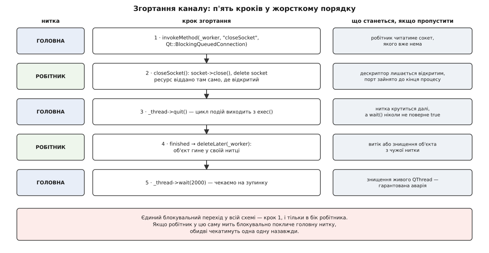
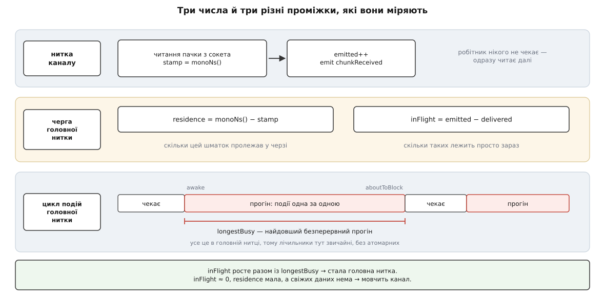

# ⚙️ Мінімальний канал на робочій нитці: двісті рядків без жодного замка

Тут зібрано повний код каналу, збудованого за тією ж схемою, що й канали QGroundControl — обгортка в головній нитці, робітник у власній нитці, через межу тільки сирі байти, — а до нього два прилади, які під час налагодження за секунду відрізняють застряглу головну нитку від втрат у самому каналі. Код розрахований на Qt 6 і запускається без жодного заліза: на тому боці досить п'яти рядків на Python.

## Умова

Треба клас, який поводиться назовні як звичайний об'єкт головної нитки:

- створили — канал сам відкрився й почав приймати;
- прийшли байти — вилетів сигнал у головній нитці;
- покликали `send()` з будь-якого місця головної нитки — байти пішли в сокет;
- знищили — жодного падіння й жодного витоку, скільки б даних не було в дорозі.

І дві жорсткі умови всередині: головна нитка ніколи не чекає на мережу, а через межу ниток не проходить нічого, крім значень.

Канал буде на UDP — не тому, що це найпростіше, а тому, що це один із двох найчастіших каналів станції й водночас єдиний, який можна запустити без радіомодема. Заміна на послідовний порт — три рядки: інший клас сокета, інший виклик відкриття, `readAll()` замість читання датаграм; уся конструкція навколо лишається дослівно тією самою.

## Ідея: п'ять правил, з яких випливає весь код

1. Робітник створюється в головній нитці й одразу переселяється у свою — а отже, не має батька: переселити об'єкт із батьком Qt відмовляється.
2. Ресурс відкривається не в конструкторі, а в обробнику сигналу «нитка почалася» — тобто вже всередині цієї нитки.
3. Назад через межу йде тільки значення: пачка байтів і мітка часу.
4. Уперед через межу — тільки постановка в чергу, ніколи прямий виклик.
5. Згортання — рівно одна блокувальна зустріч, і тільки в бік робітника.

Решта — наслідки. Ні замків, ні атомарних змінних у логіці каналу не буде: за побудовою немає жодних даних, до яких дві нитки дотягуються одночасно. Виняток буде один, навмисний, і саме про нього — прилади.

## Що перетинає межу

:::code proj-link-worker/cpp/shcho-peretynaie-mezhu.hpp

Мітка часу подорожує **разом із байтами**, і це не оздоба. Час, який пачка пролежала в черзі, можна виміряти лише як різницю двох моментів у двох різних нитках; той бік, що приймає, сам по собі не знає, коли байти прийшли з дроту. Тому мітка ставиться там, де читання, і їде далі як частина вантажу.

Годинник тут обов'язково монотонний: настінний час стрибає від синхронізації з сервером і від переходу на літній, і одна така поправка перетворює виміряну затримку на години або на від'ємне число. Різниця між двома шкалами часу й те, чому для тривалостей годиться лише одна з них, розібрана в [монотонному й настінному часі](root:sf-apps/monotonic-vs-wall-time).

## Спільний блок лічильників — єдиний навмисний виняток

Спробуймо звичайне рішення: нехай робітник надсилає лічильники сигналом. Воно не працює, і причина показова — сигнал поїде **тією самою чергою**, довжину якої ми міряємо. Число прибуде рівно тоді, коли черга нарешті розійдеться, тобто якраз тоді, коли воно вже нікому не потрібне. Прилад не може користуватися тим механізмом, за яким він стежить.

Отже, лічильники — це та єдина пам'ять, яку обидві нитки бачать разом:

:::code proj-link-worker/cpp/spilnyi-blok-lichylnykiv.hpp

Два рішення в цих рядках варті пояснення.

**Чому найслабша впорядкованість.** Розслаблений режим гарантує рівно одне: значення лічильника ніколи не буде «розірваним» — ви прочитаєте те, що хтось записав, а не суміш двох записів. Нічого більшого нам і не треба: на цих числах ми не будуємо жодного висновку про **інші** дані, ми просто рахуємо. Саме за суворішу гарантію — «якщо ти бачиш мій лічильник, ти бачиш і все, що я записав до нього» — платять бар'єрами й простоєм конвеєра; докладно про те, що саме купують суворіші режими, — в [упорядкованості пам'яті](root:sf-tasks/memory-ordering-barriers).

**Чому порядок читання не байдужий.** Робітник збільшує `emitted` **перед** випуском сигналу, головна нитка збільшує `delivered` в обробнику. Обидва лічильники ростуть і ніколи не спадають. Якщо прочитати спершу `emitted` (значення *e*), а потім `delivered` (значення *d*), то між двома читаннями головна нитка встигає обробити ще кілька пачок — і `d` виявиться більшим за `e`, а різниця — від'ємною. Прочитаємо в зворотному порядку — і все сходиться: `d` знято раніше, `e` пізніше, а що `emitted` не спадає, то `e` не менше за справжнє значення `emitted` у ту саму мить, коли ми знімали `d`. Різниця не може стати від'ємною ніколи.

Це не педантизм: від'ємна глибина черги в журналі змушує шукати помилку в каналі там, де її нема, — а помилка в самому приладі. Загальний випадок цієї пастки — коли кілька окремо-атомарних читань разом уже не атомарні — розібраний у [перегонах даних](root:sf-tasks/data-races-locks).

Блок лічильників живе в `shared_ptr`, бо ним справді володіють двоє: обгортка створює його першою і віддає робітникові в конструкторі, а робітник переживає обгортку на кілька мілісекунд — рівно доти, доки не завершиться його нитка. Прив'язати час життя до останнього власника, а не до порядку рядків у деструкторі, — звичайне застосування [RAII](root:sf-lang/raii).

> 🔧 **Навіщо це.** Прилад, який їде тією ж чергою, що й дані, показує стан черги із запізненням на глибину цієї черги — тобто бреше саме в тій ситуації, заради якої його ставили. Правило загальне: те, чим міряють, має бути незалежним від того, що міряють. Тут ціна незалежності — шість атомарних лічильників і одна вимога до порядку читання; це справді все, що в цій конструкції поділене між нитками.

## Робітник: усе, що вміє чекати

:::code proj-link-worker/cpp/robitnyk-use-shcho-vmiie.hpp

Реалізація. Зверніть увагу на порожній конструктор — це не недоробка, а половина всієї конструкції:

:::code proj-link-worker/cpp/LinkWorker.cpp

`Q_ASSERT` тут не декорація, а найдешевший спосіб зловити найпоширенішу помилку в цьому коді. `thread()` — це нитка, до якої **приписаний** об'єкт; `QThread::currentThread()` — нитка, у якій ми зараз **виконуємось**. Якби `openSocket` покликали напряму з головної нитки замість того, щоб дати сигналові про старт покликати його самому, перевірка спрацювала б одразу, а не через тиждень — падінням при від'єднанні кабелю.

Читання:

:::code proj-link-worker/cpp/robitnyk-use-shcho-vmiie.cpp

Цикл `while` обов'язковий, і не з міркувань економії. Сигнал про готові дані Qt випускає **тоді, коли прийшли нові** дані, а не тоді, коли в буфері щось лишилося: в документації прямо сказано не випускати його лише через те, що в буферах ще є непрочитане. Обробник, який забирає одну датаграму й виходить, лишає решту в буфері ядра до наступного пакета — і черга наростає зовні застосунку, там, де її не видно жодним лічильником, аж поки буфер ядра не переповниться й датаграми не почнуть тихо зникати. Симптом виходить особливо підступний: лічильник втрат росте, а радіоканал бездоганний.

Другий вибір у цьому обробнику — **одна пачка на спрацювання, а не на датаграму**. Межі датаграм для розбирача байтового потоку нічого не означають, тож склеювання нічого не псує, а платимо ми за перехід межі, не за байт. Тому лічильник переходів (`emitted`) і лічильник датаграм (`datagrams`) — різні числа, і їхнє відношення само собою показує, наскільки густо приходить трафік.

Запис дзеркальний і тривіальний:

```cpp
void LinkWorker::writeData(const QByteArray &data)
{
    if (!_socket || _peerPort == 0) return;      // ще не знаємо, кому писати
    _socket->writeDatagram(data, _peerAddr, _peerPort);
}
```

## Обгортка: усе, що має сенс

:::code proj-link-worker/cpp/obhortka-use-shcho-maie.hpp

Конструктор — п'ять рядків, і кожен відповідає за окрему помилку, якої тепер не буде:

:::code proj-link-worker/cpp/obhortka-use-shcho-maie-2.hpp

Пара `_worker` без батька / `_thread` з батьком спершу виглядає непослідовно, а насправді інакше не буває. Робітник батька мати не може, бо переселення об'єкта з батьком заборонене. Об'єкт нитки, навпаки, лишається жити в тій нитці, де його створили, — він **не** переїжджає в нитку, яку сам запускає, — тож звичайне батьківство для нього цілком доречне.

Обробник у головній нитці закриває обидва виміри черги:

:::code proj-link-worker/cpp/obhortka-use-shcho-maie.cpp

Читання-порівняння-запис максимуму тут не потребує ані замка, ані обміну-порівняння: у цей лічильник пише **лише** головна нитка, а всі інші його тільки читають. Пише один — і найгірше, що загрожує читачеві, це побачити значення, застаріле на мить.

Надсилання:

```cpp
void DemoLink::send(const QByteArray &data)
{
    QMetaObject::invokeMethod(_worker, "writeData", Qt::QueuedConnection,
                              Q_ARG(QByteArray, data));
}
```

Форма з рядковою назвою методу зручна, але помилку в цьому рядку компілятор не побачить: імена й типи звіряються під час виконання, і одруківка перетворюється на попередження в журналі та мовчазне зникнення відправлень. Типізована форма коштує стільки ж і перевіряється компілятором:

```cpp
QMetaObject::invokeMethod(_worker, [w = _worker, data] { w->writeData(data); },
                          Qt::QueuedConnection);
```

Лямбда виконається в нитці об'єкта-контексту, тобто в нитці робітника, і копію масиву вона забирає із собою.

## Згортання: п'ять кроків у жорсткому порядку



*Кожен крок робить безпечним наступний; переставлені місцями, вони перетворюються на падіння або на зайнятий назавжди порт.*

:::code proj-link-worker/cpp/zhortannia-piat-krokiv-u.cpp

Останній коментар вимагає доказу, бо ланцюг тут не очевидний. Сигнал «нитка завершилася» випускається **з тієї нитки, що завершується**, а тип з'єднання Qt обирає в мить випуску, порівнюючи нитку відправника з припискою отримувача. Отримувач — робітник, приписаний саме до цієї нитки, отже виклик буде прямим, і `deleteLater()` спрацює всередині робочої нитки. Цикл подій там уже вийшов, тож відкладене знищення нікуди не поїде — і саме на цей випадок документація Qt дає окрему обіцянку: об'єкт, який живе в нитці без запущеного циклу подій, буде знищений, коли нитка завершиться. Тобто робітник гине рівно там, де народився його сокет, і рівно тоді, коли в тій нитці вже точно нічого не виконується.

Обмеження часу в кроці 3 — не «про всяк випадок». Якщо вона спрацювала, це означає, що робітник висить у блокувальному виклику, який не переривається, і жоден із варіантів дій уже не безпечний: примусове припинення нитки документація Qt називає небезпечним і не радить (нитку зупиняють у довільній точці, деструктори не виконуються, замки лишаються захопленими), а просто піти й лишити нитку жити не вийде — знищення живого об'єкта нитки документовано веде до аварії. Правильна відповідь лежить не тут, а вище за течією: у робітника не повинно бути блокувальних викликів без стелі. Це та сама вимога, з якої виріс увесь поділ на нитки, — просто застосована до самого робітника.

## Другий прилад: чи не стала сама головна нитка

Глибина черги каже, що дані **чекають**. Вона не каже, **чому**: чи головна нитка стоїть, чи вона встигає за кожною окремою пачкою, але їх приносять швидше, ніж вона розбирає. Друге число розділяє ці два випадки — найдовший безперервний прогін циклу подій.

Довжини черги подій Qt назовні не показує (метод, який щось таке обіцяв, у Qt 6 прибрали як внутрішню деталь), зате диспетчер подій випускає два сигнали: «прокинувся» — коли цикл повернувся з очікування, і «зараз заблокуюся» — коли він знову збирається чекати. Проміжок між ними і є один суцільний прогін циклу: усе, що він виконав, не перериваючись і не віддаючи керування системі.

:::code proj-link-worker/cpp/druhyi-prylad-chy-ne-stala.hpp

Жодного атомарного лічильника тут нема — і це не недогляд, а видима вигода моделі: обидва обробники, і читач результату, виконуються в одній нитці, тому синхронізувати нема чого. Порівняйте з попереднім блоком, де кожне поле мусило бути атомарним: різницю створює не складність коду, а те, скільки ниток його бачать.

Одне застереження. Прилад міряє прогони, а не «зависання» в побутовому сенсі: вкладений цикл подій — скажімо, модальне вікно — теж чекає на події, тому сигнали далі чергуються, і найдовший прогін лишається малим. Це правильно: поки цикл дихає, інтерфейс живий, а телеметрія розбирається. Натомість синхронне читання файлу, важкий обхід дерева або довга дія в обробнику потрапляють у прогін цілком — саме те, що ми шукаємо.

## Як читати три числа разом



*Глибина черги, час у черзі й довжина прогону циклу міряють різні відрізки одного маршруту — тому їхні комбінації й розрізняють причини.*

Звіт раз на секунду:

:::code proj-link-worker/cpp/iak-chytaty-try-chysla.hpp

Джерело трафіку, щоб було що читати:

```python
# 50 датаграм за секунду по 120 байтів у наш порт
import socket, time
sock = socket.socket(socket.AF_INET, socket.SOCK_DGRAM)
while True:
    sock.sendto(b"\xfd" + bytes(119), ("127.0.0.1", 14550))
    time.sleep(0.02)
```

І керована несправність — рядок у будь-якому обробнику головної нитки, який імітує застряглу нитку:

```cpp
QThread::msleep(700);        // «важкий діалог», «синхронне читання файлу»
```

Далі всі чотири комбінації читаються однозначно:

- **Черга росте, найдовший прогін великий.** Стала головна нитка. Час у черзі росте разом із нею, бо кожна наступна пачка чекає довше за попередню. Щойно нитка звільниться, черга зійде за один прогін, а показники стрибнуть до поточних — жодного байта не втрачено.
- **Черга стабільно велика, а найдовший прогін малий.** Головна нитка не стоїть — вона просто не встигає: кожна окрема пачка обробляється швидко, але їх приносять частіше, ніж вона їх забирає. Це вже не затримка, а брак пропускної здатності, і лікується він не пришвидшенням обробника, а зменшенням кількості переходів.
- **Черга порожня, час у черзі мікросекунди, свіжих даних нема.** Мовчить канал. Дивитися треба на `datagrams`: якщо він не росте — до застосунку не долітає нічого, і причина поза ним.
- **Черга порожня, дані йдуть, а екран стоїть.** Головна нитка ні до чого; шукати треба в тому, що малює.

Ще одне спостереження варте того, щоб його зробити навмисне. Черга подій не має верхньої межі й нічого не викидає: усе, що робітник встиг випустити, чекатиме стільки, скільки треба. Тому глибина черги — це готовий сигнал [протитиску](root:sf-tasks/backpressure), єдиний, який у цій конструкції взагалі є: якщо `inFlight()` перевищила стелю, розумно почати склеювати або відкидати самому, бо Qt цього не зробить ніколи, а виросте натомість спожита пам'ять.

І застереження про статистику: максимум — груба міра. Один прогін на 300 мс за годину рівної роботи дасть той самий максимум, що й безперервні ривки, хоча це різні хвороби. Щойно з приладу треба буде робити висновки, а не просто ловити грубе, максимум варто замінити на [перцентилі](root:math-probability/percentiles-quantiles).

## Скільки це коштує

Прикиньмо чесно, за що ми платимо на кожному переході межі.

**Пачка байтів, покладена в чергу як аргумент сигналу.**

```
копія масиву байтів     — лічильник посилань +1, самі байти НЕ копіюються
виділення пам'яті       — один об'єкт-подія на перехід
замок черги отримувача  — коротке захоплення
пробудження нитки       — один системний виклик, якщо нитка спала
```

Найдорожчий рядок тут — не перший, як зазвичай думають. Масив байтів у Qt має неявне спільне володіння: копія — це атомарний інкремент лічильника, а не пробіг по пам'яті ([підрахунок посилань](root:sf-lang/reference-counting), [копіювання при записі](root:sf-algorithms/copy-on-write-structures)). Реальне копіювання в нашому коді одне — з буфера ядра в масив під час читання, і його не уникнути ніяк. А от виділення події, замок і пробудження нікуди не діваються й від розміру пачки не залежать зовсім.

Звідси й арифметика, і те, чим її крутити:

```
вартість секунди = (переходів за секунду) × (вартість переходу)
                 = emitted/с × ≈одиниці мікросекунд

50 пачок/с   × 3 мкс = 150 мкс/с   ≈ 0.015 % часу головної нитки
20 000/с     × 3 мкс = 60 мс/с     ≈ 6 %     — уже видно на кадрах
```

Число «≈3 мкс» тут — оцінка порядку, не факт: воно залежить від системи, розподільника пам'яті й того, чи спала нитка. Своє міряється за хвилину — робітникові додається метод, який випускає порожні пачки суцільним потоком, а головна нитка засікає час до тієї миті, коли `delivered` дійде до потрібного числа:

```cpp
void LinkWorker::benchmark(int n)        // кликати через invokeMethod
{
    for (int i = 0; i < n; ++i) {
        _stats->emitted.fetch_add(1, std::memory_order_relaxed);
        emit chunkReceived(Chunk{ QByteArray(), monoNs() });
    }
}
```

Побічний ефект цього вимірювання повчальніший за саме число. Поки робітник у циклі, головна нитка не встигає нічого забрати, і всі `n` подій лежать у черзі одночасно: за `n` у сто тисяч спожита пам'ять процесу підскочить на десятки мегабайтів, а `inFlight()` покаже рівно `n`. Це і є та сама відсутність верхньої межі, тільки в лабораторних умовах — на живому каналі вона проявиться так само, просто повільніше.

Головний важіль, який із цього випливає, — **кількість переходів, а не обсяг даних**. Склеювання всієї пачки в одне спрацювання, яке ми зробили в обробнику читання, на щільному трафіку зменшує число переходів на порядок і при цьому не коштує нічого. Розширювати той самий важіль далі — накопичувати пачки за кілька мілісекунд перед випуском — уже не безкоштовно: ви прямо міняєте затримку на пропускну здатність, і на телеметрії керування ця обмінна ставка зазвичай невигідна.

## Пастки

**Ресурс у конструкторі.** Найпоширеніша й найгірше зрозуміла. Всупереч поширеній думці, приписка тут не ламається: переселення переносить об'єкт **разом із його дітьми**, тож сокет, створений у конструкторі як дитина робітника, поїхав би в нову нитку теж. Ламається інше, і воно важливіше. По-перше, `bind()` — це системний виклик, який виконається в головній нитці; для послідовного порту відкриття ще й перебирає пристрої. Тобто блокування опиняється рівно там, звідки вся ця конструкція його й виносила. По-друге, з конструктора нікуди повідомити про невдачу: сигнал, випущений до того, як хтось встиг під'єднатися, не почує ніхто. Обробник старту нитки не має жодної з цих вад — він виконується вже в потрібній нитці й уже після того, як усі з'єднання зроблено.

**Забутий явний тип з'єднання.** Тут корисно знати, чого боятися насправді. Типовий вибір Qt робить **у мить випуску сигналу**, порівнюючи нитку відправника з припискою отримувача, — не в мить `connect`. Отже, явно виписаний тип нічого не змінює сьогодні: без нього з'єднання все одно було б черговим. Він захищає від правки завтра, і небезпечна правка одна — заміна на пряме з'єднання «щоб не робити зайвий стрибок». Після неї обробник головної нитки почне виконуватися в нитці робітника, а за ним і розбір, і оновлення моделі. Qt не скаже нічого: прямий виклик через межу — це звичайний виклик функції на C++. Із одним каналом усе працюватиме бездоганно; ламатися почне на другому, коли два розбирачі зайдуть у спільний стан.

**Знищення робітника з чужої нитки.** `delete _worker` у деструкторі обгортки виглядає природно й майже завжди спрацьовує — а десь раз на сотню закриттів робітник саме в цю мить усередині читання, і застосунок падає в чужому стеку. Документація однозначна: знищувати об'єкт із нитки, відмінної від його власної, безпечно лише тоді, коли ви можете гарантувати, що він зараз не обробляє подій, — а гарантувати цього ви не можете. Звідси зв'язка «завершилася нитка → відкладене знищення», яка перекладає роботу на саму нитку. Те саме стосується об'єкта нитки: знищити його, поки нитка біжить, — документована аварія, тому `wait()` стоїть перед виходом із деструктора, а не після.

**Блокувальний перехід у обидва боки.** Правило звучить просто: рівно один блокувальний перехід, тільки при згортанні, тільки від власника до робітника. Порушується воно трьома способами. Перший очевидний: робітник у відповідь блокувально кличе головну нитку — обидві стають назавжди, і це класичний [дедлок](root:sf-tasks/deadlock) на двох учасниках. Другий трапляється під час переробок: блокувальний перехід виявляється всередині однієї нитки, коли отримувач насправді живе там само, звідки його кличуть; Qt це помічає, друкує попередження про виявлений дедлок — і все одно блокується. Третій найтихіший: блокувальний виклик лягає **в кінець** черги робітника, а не попереду неї, тому чекати доведеться не тільки на свій обробник, а й на все, що робітник уже мав у роботі. Якщо він у цю мить пише в перевантажений інтерфейс, ваші дві секунди очікування спливуть — і ви опинитеся в тій самій розвилці без хороших виходів.

**Незареєстрований тип, що їде через межу.** `Q_DECLARE_METATYPE` оголошує тип, але для чергового з'єднання цього замало: у документації Qt 6 прямо сказано, що `qRegisterMetaType<T>()` має бути викликаний до встановлення першого з'єднання. Забули — і чергове з'єднання не має чим скопіювати аргумент у подію: Qt один раз друкує попередження з назвою типу, а обробник не викликається жодного разу. Симптом на екрані ідеально імітує мертвий радіоканал — з'єднання відкрите, байти рахуються, на екрані нічого. Розрізняє ці дві ситуації якраз наш прилад: `emitted` росте, `delivered` стоїть на нулі, глибина черги росте безмежно — а це неможливо, якщо винен ефір.
