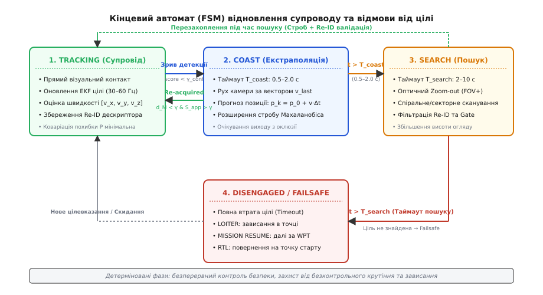
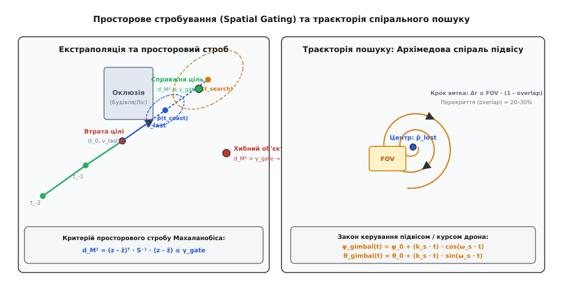

# Ціль загублена: пошук, таймаут, відмова від супроводу

<preknowlist>
- [Супровід цілі: follow-me й утримання в кадрі](root:sys-dron/suprovid-tsili) — алгоритми оптичного супроводу та контури утримання об'єкта в полі зору камери.
- [Наведення на рухому ціль](root:sys-dron/navedennia-na-rukhomu-tsil) — оцінка швидкості цілі, пропорційна навігація та кінематика лінії візування.
- [Автомат цілей: стани, переходи, охоронні умови](root:sys-dron/avtomat-tsilei) — стани високорівневої логіки місії та охоронні умови переходів.
- [Таймаут на кожну поведінку: скільки чекати, перш ніж здатися](root:sys-dron/taimaut-na-kozhnu-povedinku) — сторожові таймери, детерміновані ліміти очікування та правила переривання дій.
- [Повернення додому](root:sys-dron/povernennia-dodomu) — аварійні фази Return-to-Launch, висотні ешелони та навігаційні процедури відступу.
</preknowlist>

Коли мультироторний безпілотник на швидкості 12 м/с супроводжує автомобіль за допомогою оптичної нейромережі на бортовому комп'ютері, в'їзд машини під бетонний міст або густу крону дерев миттєво обриває потік рамок детекції. Якщо контур керування сприйме відсутність детектора як раптову зупинку або заморозить підвіс в останньому виміряному положенні, затримка реакції у пів секунди призведе до того, що автомобіль подолає 6 метрів, вийде за межі кадру, а дрон пролетить вперед по прямій або почне хаотично обертатися. За відсутності структурованого алгоритму обробки втрати контакту оптичний супровід зривається безповоротно, а автопілот зависає в невизначеному стані або перемикається на перший ліпший сторонній об'єкт — дерево, дорожній стовп чи сусідній транспортний засіб.

Ця проблема виникає тому, що будь-який візуальний трекер є сенсором прямої видимості. Обрив вимірювань є не аварією сенсора, а штатним крайовим станом динамічної системи. Щоб надійно утримувати ціль в умовах міської забудови, лісу та складного рельєфу, бортовий польотний стек повинен реалізувати багаторівневу стратегію: короткочасну екстраполяцію руху за інерцією, систематичний просторовий пошук підвісом і камерою за траєкторією Архімедової спіралі та жорстку просторово-візуальну фільтрацію кандидатів для запобігання підміні цілі.

---

### Анатомія крайового стану втрати візуального контакту

Втрата об'єкта оптичним трекером (Target Lost State) виникає під впливом трьох фундаментальних фізичних факторів, кожен з яких накладає власний часовий та геометричний відбиток на поведінку системи.

```
┌─────────────────────────────────────────────────────────────────────────────┐
│                 Фізичні причини втрати візуального контакту                │
├───────────────────────┬─────────────────────────────────────────────────────┤
│ Оклюзія (Occlusion)   │ Перекриття прямої видимості перешкодами (мости,     │
│                       │ дерева, будинки, складки рельєфу).                   │
├───────────────────────┼─────────────────────────────────────────────────────┤
│ Вихід із поля зору    │ Кутова швидкість лінії візування перевищує кутове   │
│ (Out of FOV)          │ прискорення підвісу камери або рами безпілотника.   │
├───────────────────────┼─────────────────────────────────────────────────────┤
│ Сенсорний зрив        │ Різка зміна освітлення (тінь, контрове сонце),       │
│ (Optical Degradation) │ відблиски фар, змазування кадру (motion blur).       │
└───────────────────────┴─────────────────────────────────────────────────────┘
```

1. **Оклюзія (Occlusion):**
   Повне або часткове перекриття цілі статичними чи рухомими перешкодами. При короткочасній оклюзії (проїзд за стовпом або поодиноким деревом) об'єкт зникає на 0.1–0.4 с. При тривалій оклюзії (рух у тунелі, під мостом або всередині лісового масиву) ціль може бути прихована протягом 2–10 с і вийти з перешкоди у несподіваній точці зі зміненим вектором швидкості.

2. **Вихід за межі поля зору камери (Out of Field of View, FOV):**
   Виникає тоді, коли ціль здійснює різкий маневр (наприклад, екстрене гальмування чи поворот на 90°), а кутове прискорення сервоприводів стабілізованого підвісу або власна кутова швидкість дрона не встигають компенсувати швидкість обертання лінії візування. Об'єкт зміщується до краю матриці та перетинає межу кадру.

3. **Сенсорний зрив та оптична деградація:**
   Різкі оптичні перепади — заїзд у глибоку тінь високих будівель, спалах контрового сонячного світла (Solar Flare / Glare), засвітка фарами зустрічного транспорту або розмиття зображення через високочастотну вібрацію підвісу при сильному пориві вітру. За таких умов нейромережевий детектор перестає формувати рамку цілі, хоча геометрія лінії візування залишається незмінною.

На рівні програмної архітектури факт переходу в стан втрати фіксується за сукупністю трьох критеріїв:
- Падіння скору впевненості детектора (Detection Confidence) нижче встановленого порогу `score < γ_conf` (зазвичай `γ_conf ≈ 0.35–0.45`);
- Відсутність вимірювань для оновлення фільтра Калмана протягом `N_miss` послідовних кадрів (за частоти камери 30 Гц це відповідає 3–5 тактам або 100–160 мс);
- Перевищення порогу інновації фільтра стану, коли знайдена рамка розташована за межами фізично можливого маневру цілі.

---

### Трифазний протокол відновлення стеження

Для гарантування безпеки польоту та максимізації ймовірності відновлення супроводу процес обробки втрати розбивається на три послідовні детерміновані фази: кінематичну екстраполяцію, розширений просторовий пошук та керовану відмову від супроводу.


*Схема переходів станів кінцевого автомата відновлення супроводу: послідовна еволюція від короткочасної екстраполяції Coast до систематичного пошуку Search та аварійного завершення Disengaged.*

#### Фаза 1: Короткочасна кінематична екстраполяція (Coast Phase, 0.5–2.0 с)

Щойно візуальний контакт обривається, система переходить у фазу екстраполяції (англ. *Coast Phase* або *Dead Reckoning*). Мета цієї фази — провести безпілотник і камеру за прогнозованою траєкторією об'єкта, розраховуючи на те, що ціль за 1–2 секунди з'явиться з іншого боку перешкоди.

Прогнозування положення цілі здійснюється за моделлю руху з постійною швидкістю та врахуванням останнього оціненого вектора прискорення:

```
p_pred(t + Δt) = p_last + v_last · Δt + (1/2) · a_last · Δt²
```

Під час екстраполяції контур керування підвісом продовжує спрямовувати оптичну вісь камери у точку прогнозованого положення `p_pred(t)`. Автопілот дрона утримує швидкість і курс, необхідні для збереження ракурсу та дистанції до розрахованої точки.

Паралельно з рухом зростає просторова невизначеність положення цілі. Оскільки прямі вимірювання відсутні, матриця коваріації похибки фільтра стану `P` збільшується на кожному такті за рахунок шуму процесу `Q`:

```
P_{k|k-1} = F · P_{k-1} · Fᵀ + Q · Δt
```

Діагональні елементи коваріаційної матриці позиції зростають пропорційно квадрату часу екстраполяції `(Δt)²`. Геометрично це означає, що область ймовірного знаходження об'єкта розширюється від компактної точки до витягнутого еліпсоїда невизначеності вздовж вектора швидкості.

Якщо протягом інтервалу `T_coast` (типово 1.0–1.5 с) детектор виявляє об'єкт, який проходить стробування за положенням і зовнішнім виглядом, система миттєво повертається у стан `TRACKING`, оновлює матрицю стану і скидає таймери. Якщо ж час `T_coast` вичерпано, а контакт не відновлено, автомат перемикається у фазу розширеного пошуку.

---

#### Фаза 2: Розширений просторовий пошук (Search Pattern, 2–10 с)

Якщо ціль не з'явилася на виході з передбачуваної зони, це свідчить про те, що об'єкт або змінив вектор руху (здійснив поворот чи зупинився під час оклюзії), або з'їхав з дороги. Просте утримання курсу більше не дає результату — система повинна розпочати активне сканування простору.

Фаза розширеного пошуку використовує комплекс оптичних та механічних маневрів:

1. **Оптичне розширення кута огляду (Zoom-out):**
   Якщо камера обладнана трансфокатором (оптичним зумом), обчислювальний блок негайно подає команду зменшення фокусної відстані до мінімального значення. Розширення миттєвого кута огляду (FOV) у 2–3 рази збільшує площу кадру на місцевості, що пропорційно підвищує ймовірність захоплення цілі без необхідності швидкого обертання підвісу.

2. **Сканування підвісом за спіраллю Архімеда (Archimedean Spiral Scan):**
   Оптична вісь камери починає описувати витки спіралі навколо центру екстрапольованої зони `p_pred`. Закон зміни кутів панорамування `ψ` (pan) та нахилу `θ` (tilt) задається рівнянням:

```
ψ_cmd(t) = ψ_center + (a + b · ω_s · t) · cos(ω_s · t)
θ_cmd(t) = θ_center + (a + b · ω_s · t) · sin(ω_s · t)
```

де `ω_s` — кутова швидкість обходу спіралі (рад/с), `a` — початковий радіус, а `b` — радіальний крок приросту радіуса за один радіан повороту.


*Геометрія просторового стробування та Архімедової спіралі: розширення еліпсоїда Махаланобіса, сканування зони підвісом із перекриттям поля зору та відсікання хибних кандидатів.*

Крок витка `b` вибирається таким чином, щоб відстань між сусідніми кільцями спіралі `Δr` не перевищувала кутового розміру поля зору з урахуванням обов'язкового 20–30% перекриття:

```
Δr = 2 · π · b ≤ FOV_min · (1 - k_overlap)
```

де `FOV_min = min(FOV_horizontal, FOV_vertical)`, а `k_overlap ≈ 0.25`. Це гарантує відсутність «дірок» у зоні огляду, крізь які об'єкт міг би вислизнути непоміченим.

3. **Секторне сканування за курсом (Sector Sweep):**
   Якщо дрон переслідує автомобіль на швидкісній магістралі або річковий катер, маневри цілі обмежені руслом або коридором дороги. Замість кругової спіралі підвіс виконує гармонійне секторне коливання вздовж напрямку дороги: `ψ_cmd(t) = ψ_road + A_sector · sin(ω_sector · t)`.

4. **Висотний маневр безпілотника (Altitude Step):**
   Якщо дозволяє тактична обстановка та запас висоти до хмарності, автопілот збільшує висоту польоту на 15–30 метрів. Це збільшує геометричну пляму огляду камери на землі (Ground Footprint) пропорційно квадрату висоти `S_footprint ∝ h²`, проте зменшує просторову роздільну здатність детектора (Ground Sample Distance, GSD).

Бюджет часу на розширений пошук `T_search` суворо лімітований (від 2 до 10 секунд). Тривалий безрезультатний пошук неприпустимий, оскільки веде до непродуктивної витрати заряду акумулятора та ризику зіткнення з висотними перешкодами під час неконтрольованого маневрування.

---

#### Фаза 3: Відмова від супроводу та безпечні режими (Disengagement / Failsafe)

Якщо час `t > T_coast + T_search` вичерпано, а ціль не виявлена, супровід визнається остаточно зірваним. Контур наведення деактивується, і автопілот виконує одну з трьох попередньо налаштованих безпечних дій (Disengagement Failsafe Actions):

1. **Зависання в точці (Loiter / Position Hold):**
   Дрон плавно гальмує до повної зупинки, зависає над центром останнього відомого положення цілі на безпечній висоті та повертає камеру в горизонт. Цей режим дає змогу оператору взяти керування на себе або вручну вказати нову ціль через інтерфейс наземної станції (QGroundControl / Mission Planner). Якщо протягом 15–30 секунд вказівок від оператора не надходить, автопілот ініціює повернення на базу.

2. **Відновлення базового польотного завдання (Mission Resume):**
   Якщо супровід виконувався в межах ширшої розвідувальної або моніторингової місії, апарат припиняє пошук, повертається на точку маршруту, на якій його було перервано (Break-off Waypoint), та продовжує політ за планом місії.

3. **Аварійне повернення додому (Return to Launch, RTL):**
   Дрон набирає встановлену безпечну висоту ешелону (RTL Clearance Altitude) та здійснює політ по прямій до стартової точки з наступною автоматичною посадкою. Ця стратегія обирається як обов'язкова, якщо під час супроводу було втрачено канал радіозв'язку з наземною станцією або рівень заряду акумулятора наблизився до критичного порогу повернення.

---

### Захист від помилкового перезахоплення (ID Switch / False Re-acquisition)

Найбільш небезпечна помилка алгоритму пошуку — хибне перезахоплення (ID Switch). Коли після оклюзії в кадр потрапляє інший об'єкт того ж класу (наприклад, інший білий седан, що їде зустрічною смугою, або випадковий пішохід), спрощений трекер миттєво захоплює його і спрямовує дрон у хибному напрямку.

Для запобігання підміні цілі застосовується двофакторна верифікація кожного знайденого детектора: просторове стробування та зіставлення дескрипторів зовнішнього вигляду (Re-ID Feature Matching).

```
┌─────────────────────────────────────────────────────────────────────────────┐
│                    Двофакторна верифікація кандидата                        │
├───────────────────────────────────────┬─────────────────────────────────────┤
│ 1. Просторовий строб (Spatial Gate)   │ Відстань Махаланобіса d_M² ≤ γ_gate │
│                                       │ (відсікання за положенням)          │
├───────────────────────────────────────┼─────────────────────────────────────┤
│ 2. Дескриптор вигляду (Re-ID Vector)  │ Косинусна подібність S_app ≥ γ_app  │
│                                       │ (відсікання за зовнішністю)         │
└───────────────────────────────────────┴─────────────────────────────────────┘
```

#### 1. Просторове стробування за Махаланобісом (Spatial Gating)

Просторовий строб визначає геометричні межі простору, всередині яких об'єкт міг опинитися фізично з урахуванням граничних динамічних характеристик цілі (максимального прискорення та швидкості).

Нехай `z_meas` — просторові координати кандидата, зафіксовані камерою, а `z_pred` — екстрапольована позиція цілі. Відстань Махаланобіса між спостереженням та прогнозом обчислюється через матрицю коваріації інновації `S = H · P · Hᵀ + R_cov`:

```
d_M² = (z_meas - z_pred)ᵀ · S⁻¹ · (z_meas - z_pred)
```

Кандидат допускається до розгляду лише тоді, коли квадратична відстань не перевищує поріг `γ_gate`:

```
d_M² ≤ γ_gate
```

Величина `γ_gate` обирається за розподілом хі-квадрат (`χ²`) для відповідної кількості ступенів вільності. Для тривимірних координат (ступенів вільності `k = 3`) значення `γ_gate = 7.81` відповідає 95% довірчому інтервалу, а `γ_gate = 9.21` — 99% інтервалу. Усі детекції за межами цього еліпсоїда відсікаються як фізично неможливі.

#### 2. Порівняння нейромережевих дескрипторів зовнішності (Re-ID Matching)

Об'єкти, що пройшли просторовий строб, перевіряються на візуальну ідентичність. Бортова компактна нейромережа (наприклад, MobileNet-ReID або OSNet) витягує з рамки кожного кандидата нормалізований вектор ознак `f_cand ∈ ℝ¹²⁸`.

Косинусна подібність між вектором кандидата та збереженим еталоном цілі `f_ref` розраховується як скалярний добуток:

```
S_app = (f_cand · f_ref) / (||f_cand|| · ||f_ref||)
```

Кандидат визнається справжньою ціллю за виконання умови `S_app ≥ γ_app` (де поріг `γ_app ≈ 0.60–0.70`). 

Еталонний дескриптор `f_ref` не є статичним: під час стабільного супроводу у фазі `TRACKING` він плавно адаптується через експоненційне згладжування (`f_ref = α · f_ref + (1 - α) · f_cand`, де `α = 0.90–0.95`), що дає змогу алгоритму враховувати повільну зміну освітлення та кута спостереження без накопичення випадкових шумів.

---

### Програмна реалізація валідатора кандидатів та просторового стробу

Нижче наведено модуль просторового стробування та розрахунку подібності кандидатів на мовах C та C++.

:::tabs
@tab c
```c
#include <stdbool.h>
#include <stdint.h>
#include <math.h>

#define EMBED_DIM 128

typedef struct {
    float x;
    float y;
    float z;
} point3d_t;

typedef struct {
    point3d_t pos;
    float cov[3];                   /* діагональні дисперсії за осями X, Y, Z */
    float descriptor[EMBED_DIM];    /* нормалізований вектор ознак Re-ID */
} target_candidate_t;

typedef struct {
    float mahalanobis_threshold;    /* поріг квадрата відстані Махаланобіса */
    float appearance_threshold;     /* поріг косинусної схожості */
    float weight_spatial;           /* вага просторової близькості (0.0..1.0) */
    float weight_appearance;        /* вага візуальної схожості (0.0..1.0) */
} gating_config_t;

/* Обчислення косинусної схожості нормалізованих дескрипторів */
static float appearance_similarity(const float *a, const float *b, uint16_t dim) {
    float dot = 0.0f;
    float norm_a = 0.0f;
    float norm_b = 0.0f;
    for (uint16_t i = 0; i < dim; ++i) {
        dot += a[i] * b[i];
        norm_a += a[i] * a[i];
        norm_b += b[i] * b[i];
    }
    float denom = sqrtf(norm_a) * sqrtf(norm_b);
    return (denom > 1e-6f) ? (dot / denom) : 0.0f;
}

/* Перевірка просторового стробу та обчислення комбінованого скору відповідності */
bool validate_reacquisition_candidate(
    const target_candidate_t *cand,
    const point3d_t *pred_pos,
    const float pred_cov[3],
    const float ref_desc[EMBED_DIM],
    const gating_config_t *cfg,
    float *out_match_score)
{
    float dx = cand->pos.x - pred_pos->x;
    float dy = cand->pos.y - pred_pos->y;
    float dz = cand->pos.z - pred_pos->z;

    /* Сумарна дисперсія інновації S = P_pred + R_meas */
    float var_x = (pred_cov[0] + cand->cov[0] > 1e-4f) ? (pred_cov[0] + cand->cov[0]) : 1e-4f;
    float var_y = (pred_cov[1] + cand->cov[1] > 1e-4f) ? (pred_cov[1] + cand->cov[1]) : 1e-4f;
    float var_z = (pred_cov[2] + cand->cov[2] > 1e-4f) ? (pred_cov[2] + cand->cov[2]) : 1e-4f;

    /* Квадрат відстані Махаланобіса */
    float d_mahalanobis_sq = (dx * dx) / var_x + (dy * dy) / var_y + (dz * dz) / var_z;

    /* Перевірка просторового критерію */
    if (d_mahalanobis_sq > cfg->mahalanobis_threshold) {
        return false;
    }

    /* Перевірка візуального дескриптора */
    float app_sim = appearance_similarity(cand->descriptor, ref_desc, EMBED_DIM);
    if (app_sim < cfg->appearance_threshold) {
        return false;
    }

    /* Нормалізований просторовий скор: 1.0 при d=0, спадає до 0 при межі стробу */
    float spatial_score = 1.0f - (d_mahalanobis_sq / cfg->mahalanobis_threshold);
    if (spatial_score < 0.0f) spatial_score = 0.0f;

    /* Зважений комбінований скор кандидата */
    if (out_match_score != NULL) {
        *out_match_score = cfg->weight_spatial * spatial_score + cfg->weight_appearance * app_sim;
    }

    return true;
}
```
@tab c++
```cpp
#include <array>
#include <cmath>
#include <cstdint>
#include <optional>
#include <span>

namespace drone::tracking {

inline constexpr std::size_t kEmbeddingDim = 128;

struct Point3D {
    float x{0.0F};
    float y{0.0F};
    float z{0.0F};
};

struct TargetCandidate {
    Point3D pos{};
    std::array<float, 3> cov{0.1F, 0.1F, 0.1F};
    std::array<float, kEmbeddingDim> descriptor{};
};

struct GatingConfig {
    float mahalanobis_threshold{9.21F}; // 99% квантиль хі-квадрат (3 DoF)
    float appearance_threshold{0.65F};  // Поріг косинусної близькості
    float weight_spatial{0.4F};
    float weight_appearance{0.6F};
};

class CandidateValidator {
public:
    explicit CandidateValidator(const GatingConfig& config) noexcept
        : config_{config} {}

    [[nodiscard]] std::optional<float> evaluate_candidate(
        const TargetCandidate& cand,
        const Point3D& pred_pos,
        std::span<const float, 3> pred_cov,
        std::span<const float, kEmbeddingDim> ref_descriptor) const noexcept
    {
        const float dx = cand.pos.x - pred_pos.x;
        const float dy = cand.pos.y - pred_pos.y;
        const float dz = cand.pos.z - pred_pos.z;

        const float var_x = std::max(pred_cov[0] + cand.cov[0], 1e-4F);
        const float var_y = std::max(pred_cov[1] + cand.cov[1], 1e-4F);
        const float var_z = std::max(pred_cov[2] + cand.cov[2], 1e-4F);

        const float d_mahalanobis_sq = (dx * dx) / var_x + (dy * dy) / var_y + (dz * dz) / var_z;
        if (d_mahalanobis_sq > config_.mahalanobis_threshold) {
            return std::nullopt;
        }

        const float app_sim = compute_cosine_similarity(cand.descriptor, ref_descriptor);
        if (app_sim < config_.appearance_threshold) {
            return std::nullopt;
        }

        const float spatial_score = std::max(0.0F, 1.0F - (d_mahalanobis_sq / config_.mahalanobis_threshold));
        const float total_score = config_.weight_spatial * spatial_score + config_.weight_appearance * app_sim;

        return total_score;
    }

private:
    [[nodiscard]] static float compute_cosine_similarity(
        std::span<const float, kEmbeddingDim> a,
        std::span<const float, kEmbeddingDim> b) noexcept
    {
        float dot = 0.0F;
        float norm_a = 0.0F;
        float norm_b = 0.0F;
        for (std::size_t i = 0; i < kEmbeddingDim; ++i) {
            dot += a[i] * b[i];
            norm_a += a[i] * a[i];
            norm_b += b[i] * b[i];
        }
        const float denom = std::sqrt(norm_a) * std::sqrt(norm_b);
        return (denom > 1e-6F) ? (dot / denom) : 0.0F;
    }

    GatingConfig config_{};
};

} // namespace drone::tracking
```
:::

Повну архітектуру та вихідний код компактного автомата станів, таймерів екстраполяції та генератора пошукових траєкторій для бортових контролерів наведено в практичній вставці [автомат станів обробки втрати цілі та генератор пошукових траєкторій](root:sys-dron/tsil-zahublena/proj-target-lost-fsm.md).

---

### Практичні компроміси та налаштування параметрів

Налаштування часових лімітів та просторових порогів автомата відновлення цілі вимагає збалансування трьох суперечливих факторів: динаміки апарата, складності середовища та енергетичного бюджету.

```
┌─────────────────────────────────────────────────────────────────────────────┐
│                    Компроміси вибору часових інтервалів                     │
├───────────────────────┬─────────────────────────────────────────────────────┤
│ Малий T_coast (<0.5с) │ Передчасний зрив у пошук при коротких оклюзіях     │
│                       │ (тремтіння підвісу, втрата плавності).              │
├───────────────────────┼─────────────────────────────────────────────────────┤
│ Великий T_coast (>2с) │ Розмазування коваріації, високий ризик прольоту повз│
│                       │ ціль при маневрі під час перекриття.                │
├───────────────────────┼─────────────────────────────────────────────────────┤
│ Малий T_search (<2с)  │ Недостатній час для обходу перших кілець спіралі.   │
├───────────────────────┼─────────────────────────────────────────────────────┤
│ Великий T_search (>8с)│ Невиправдана витрата батареї та дрейф від зони      │
│                       │ виконання місії за вітром.                          │
└───────────────────────┴─────────────────────────────────────────────────────┘
```

1. **Баланс між екстраполяцією та пошуком:**
   В умовах щільної забудови або лісистої місцевості інтервал `T_coast` доцільно зменшувати до 0.8–1.0 с, оскільки ймовірність того, що об'єкт рухається строго прямолінійно, є низькою. Навпаки, при супроводі на відкритих шосе час `T_coast` збільшують до 2.0 с, оскільки транспортні засоби утримують смугу руху з постійною швидкістю.

2. **Захист від накопичення помилки коваріації:**
   При сильному боковому вітрі шляхова швидкість дрона відрізняється від повітряної, через що власна інерційна навігаційна система автопілота накопичує дрейф. Якщо коваріація `P` зростає швидше за швидкість сканування підвісу, алгоритм повинен автоматично активувати набір висоти для прискореного охоплення зони невизначеності.
