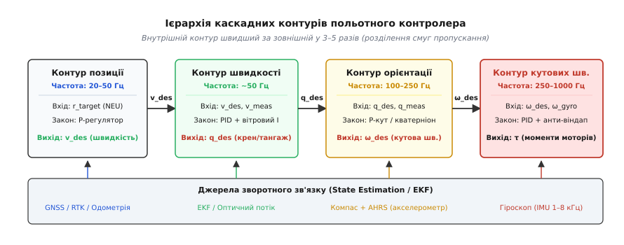
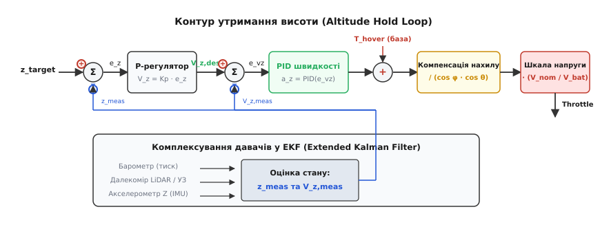
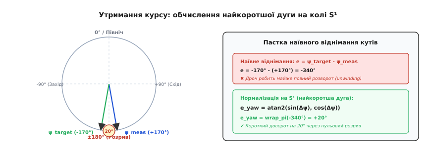
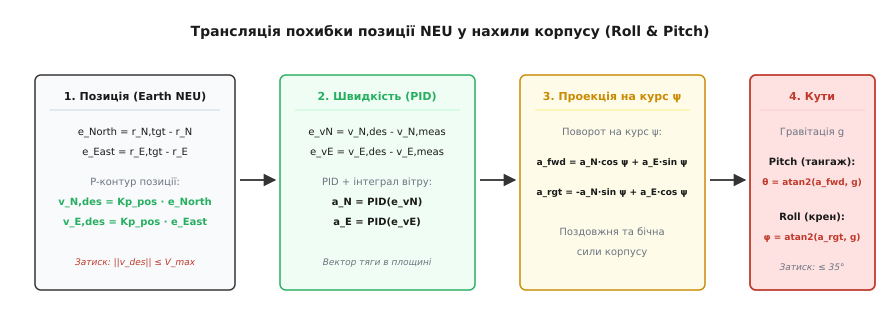

# Утримання курсу, висоти й позиції

<preknowlist>
- [Фільтр стану (EKF)](root:com-signal/kalman-ekf) — злиття зашумлених вимірів давачів у неперервну оцінку координат, швидкостей та орієнтації.
- [Керування крен-тангаж-нишпорення](root:sys-dron/roll-pitch-yaw-control) — три осі просторової орієнтації та формування керуючих моментів.
- [Режими з позицією](root:sys-dron/position-modes) — логіка перемикання та сходинки автономності польотних режимів Loiter, PosHold і Auto.
- [Дискретний ПІД-регулятор](root:com-signal/discrete-pid) — пропорційно-інтегрально-диференційне регулювання в дискретному часі з захистом від насичення.
- [Моторний мікшер](root:sys-dron/motor-mixer) — перетворення віртуальних сил і моментів у конкретні сигнали швидкості обертання моторів.
</preknowlist>

Коптер завис над заданою точкою на висоті двадцяти метрів. Раптовий порив бокового вітру зі швидкістю 8 м/с штовхає корпус праворуч, нахиляє раму й одночасно створює спадний повітряний потік. За кілька мікросекунд автопілот мусить виконати цілий ланцюг взаємопов'язаних дій: розпізнати горизонтальне зміщення, нахилити апарат назустріч вітру під суворо розрахованим кутом, збільшити сумарну тягу гвинтів для компенсації втрати вертикальної сили в нахилі, придушити паразитне обертання по курсу й плавно повернутися у вихідні координати без перельотів і розгойдування.

Спроба розв'язати цю задачу «в лоб» — подати різницю супутникових координат безпосередньо на вхід єдиного регулятора моторів — неминуче завершується аварією. Літальний апарат є неповнопривідною механічною системою (англ. *underactuated system*): у нього немає окремих горизонтальних двигунів для переміщення ліворуч чи праворуч, тому будь-який рух у площині можливий лише через поворот усього корпусу та спрямування сумарного вектора тяги. Окрім того, координати від супутника оновлюються із затримкою у 100–200 мілісекунд, тоді як аеродинамічний зрив гвинта розвивається за лічені мілісекунди. Зв'язати настільки різні фізичні процеси докупи дозволяє **каскадна архітектура керування** (фр. *cascade* від італ. *cascata* — водоспад, послідовне перетікання), де швидкі внутрішні контури підпорядковуються повільним зовнішнім.

## Чому прямий регулятор ламається і як виникає каскад

Щоб зрозуміти необхідність каскаду, простежмо шлях сигналу від виникнення просторової похибки до реакції приводів. Квадрокоптер має шість ступенів свободи: три лінійні координати `(X, Y, Z)` і три кути просторової орієнтації `(Roll, Pitch, Yaw)`. При цьому виконавчими органами слугують лише чотири мотори. Кожен мотор створює тягу вздовж власної осі обертання, жорстко зафіксованої на рамі.

Якщо надіслати команду «зміститися на 2 метри на північ» прямо на мотори, регулятор спробує збільшити оберти задніх гвинтів. Апарат нахилиться вперед і почне прискорюватися. Але якщо зворотний зв'язок замкнений лише по позиції, регулятор триматиме нахил доти, доки дрон не перетне цільову позначку. У момент перетину координатна похибка стане нульовою, проте апарат летітиме на повній швидкості, проскочить ціль на десятки метрів і почне хаотично гальмувати, переходячи в наростаючі коливання.

Причина цієї нестійкості полягає у змішуванні динаміки різної природи:
1. **Динаміка моменту та кутового прискорення** визначається інерцією рами й аеродинамічним опором гвинтів; її характерний час реакції становить 5–20 мілісекунд.
2. **Кінематика просторового переміщення** визначається масою апарата та накопиченням швидкості; її час реакції вимірюється секундами.

Виходом із цієї пастки є **принцип розділення смуг пропускання за частотою** (англ. *frequency separation*). Систему розбивають на вкладені замкнені контури, де кожен внутрішній контур працює значно швидше за зовнішній.


*Ієрархія каскаду: контур позиції генерує цільову швидкість, контур швидкості обчислює необхідне прискорення та нахил корпусу, контур орієнтації перетворює кути на бажані кутові швидкості, а контур кутових швидкостей керує моментами моторів. Кожен внутрішній контур швидший за зовнішній щонайменше в 3–5 разів.*

### Теоретичне обґрунтування розділення смуг пропускання

З погляду частотного аналізу в просторі Лапласа, кожен замкнений внутрішній контур можна наблизити аперіодичною ланкою першого порядку з передавальною функцією:

```
W_inner(s) = 1 / (1 + s · T_inner)
```

Де `T_inner = 1 / ω_inner` — постійна часу внутрішнього контуру. Якщо зовнішній контур має власну частоту зрізу `ω_outer`, то фазовий зсув `Δφ`, який вносить внутрішній контур у зовнішню петлю, визначається як:

```
Δφ = −arctan(ω_outer / ω_inner)
```

Якщо внутрішній контур швидший за зовнішній у 5 разів (`ω_inner = 5 · ω_outer`), фазове запізнення становить лише `arctan(0.2) ≈ 11.3°`. Такий малий фазовий зсув практично не впливає на запас стійкості по фазі (англ. *phase margin*), що дозволяє зовнішньому контуру розглядати внутрішній як практично безінерційний підсилювач із одиничним коефіцієнтом передачі. Але якщо співвідношення частот впаде нижче 2.5, фазове запізнення перевищить `25°–35°`, запас стійкості впаде нижче критичних 30°, і система увійде в автоколивальний режим.

У сучасних автопілотах (зокрема ArduPilot та PX4) каскад ділиться на чотири рівні:
- **Контур позиції (Position Loop, 20–50 Гц):** приймає цільові та виміряні координати в місцевій системі координат NEU (North-East-Up, «Північ-Схід-Вгору»). Працює як пропорційний P-регулятор і видає вектор бажаної лінійної швидкості `v_des`.
- **Контур швидкості (Velocity Loop, ~50 Гц):** порівнює `v_des` із поточною швидкістю від фільтра стану [EKF](root:com-signal/kalman-ekf). Працює за законом ПІД (з інтегратором для компенсації вітру) і формує вектор бажаного прискорення `a_des`, який проектується в кути нахилу корпусу `(Roll, Pitch)` та вертикальну тягу.
- **Контур орієнтації (Attitude Loop, 100–250 Гц):** приймає бажані кути `(Roll, Pitch, Yaw)` або цільовий кватерніон орієнтації. Порівнює їх із поточною оцінкою від [AHRS](root:sys-dron/roll-pitch-yaw-control) і за пропорційним законом обчислює цільові кутові швидкості `ω_des = (P, Q, R)`.
- **Контур кутових швидкостей (Rate Loop, 250–1000 Гц):** отримує дані безпосередньо з гіроскопа [IMU](root:hw-sensing/imu) на максимальній частоті. За допомогою ПІД-регулятора з анти-віндапом формує віртуальні моменти обертання `τ = (Mx, My, Mz)`, які надходять у [моторний мікшер](root:sys-dron/motor-mixer).

Завдяки такій побудові зовнішній контур позиції «не знає» про мотори, вібрації чи аеродинамічний опір лопатей — він вважає, що апарат миттєво набуває замовленої швидкості. Своєю чергою, контур швидкості оперує лише віртуальним вектором сили, повністю довіряючи контуру орієнтації задачу стабілізації нахилу.

## Утримання висоти: вертикальний канал і компенсація нахилу

Утримання заданої висоти (режим Altitude Hold) на перший погляд здається найпростішим: треба лише регулювати спільну тягу моторів. Проте в польоті вертикальний канал зазнає сильного нелінійного впливу маневрів у горизонтальній площині, аеродинамічних спотворень тиску та деградації джерела живлення.

### Злиття даних давачів для вертикального каналу

Висоту неможливо якісно виміряти одним єдиним давачем:
- **Барометр** (барометричний датчик тиску) вимірює абсолютний статичний тиск атмосфери за барометричною формулою `h ≈ 44330 · (1 − (P/P₀)^0.1903)`. Він незамінний для оцінки великих висот, проте має дрейф через нагрівання плати, шум до 0.3–0.5 м, а також страждає від динамічного підпору повітря (ефект Бернуллі) під час швидкого руху.
- **Екранний ефект землі (Ground Effect):** коли дрон зависає на висоті, меншій за два діаметри пропелера (`h < 2R`), потік від гвинтів гальмується об поверхню землі, створюючи повітряну подушку з підвищеним статичним тиском (+10..+30 Па). Барометр сприймає це підвищення тиску як раптове зниження висоти на 1–2 метри й змушує регулятор невиправдано скидати тягу, внаслідок чого дрон грубо б'ється об землю при посадці.
- **Далекомір** (лазерний LiDAR, ультразвуковий або радарний сонар) дає надточну відстань до підстильної поверхні (похибка менше 1 см), але діє лише на малих висотах (0.1–20 м) і показує перепади трави, чагарників чи пагорбів замість висоти польоту.
- **Акселерометр по осі Z** вимірює вертикальне прискорення з мікросекундною реакцією, але через подвійне інтегрування навіть крихітне зміщення нуля (англ. *bias*) за кілька секунд перетворюється на десятки метрів фатальної похибки.

Розширений фільтр стану [EKF](root:com-signal/kalman-ekf) об'єднує ці джерела: швидкі акселерометричні дані інтегруються між тактами вимірів для усунення запізнення, а повільні покази барометра та далекоміра безперервно калібрують зміщення нуля акселерометра. На виході формуються два узгоджені сигнали: оцінка висоти `z_meas` та оцінка вертикальної швидкості `v_z_meas`.


*Архітектура каналу висоти: похибка положення через P-регулятор задає вертикальну швидкість V_z,des. Контур швидкості через PID формує добавку до базової тяги зависання. Підсумковий сигнал множиться на коефіцієнт нахилу рами та коефіцієнт просідання напруги батареї.*

### Каскадне керування висотою

Вертикальний канал організовано як каскад двох ланок:
1. **Зовнішній P-контур висоти:**
   ```
   e_z = z_target − z_meas
   v_z_des = clamp(Kp_z · e_z, −V_descend_max, +V_climb_max)
   ```
   Де `V_climb_max` (зазвичай 2.5–5.0 м/с) та `V_descend_max` (зазвичай 1.5–3.0 м/с) захищають дрон від потрапляння у власний завихрений потік при надто швидкому спуску (явище вихрового кільця, англ. *vortex ring state*).

2. **Внутрішній ПІД-контур вертикальної швидкості:**
   ```
   e_vz = v_z_des − v_z_meas
   a_z_des = Kp_vz · e_vz + Ki_vz · ∫ e_vz dt + Kd_vz · (−da_z / dt)
   ```

Виходом контуру швидкості є необхідне вертикальне прискорення `a_z_des`. Щоб перетворити його на реальний сигнал газу (англ. *throttle* у діапазоні `0.0 .. 1.0`), до нього додають базову тягу зависання `Thr_hover` (тягу, за якої сумарна сила моторів точно врівноважує силу тяжіння `m·g`):

```
Thr_raw = Thr_hover + (a_z_des / g) · Thr_hover
```

### Геометрична компенсація нахилу (Tilt Compensation)

Коли дрон висить горизонтально, уся тяга гвинтів `T` спрямована строго вгору. Але коли апарат нахиляється на кут крену `φ` (Roll) і тангажу `θ` (Pitch), вектор повної тяги повертається разом із рамою. Вертикальна складова сили, що тримає висоту, зменшується пропорційно косинусам кутів нахилу:

```
T_vertical = T · cos(φ) · cos(θ)
```

Якщо автопілот не відреагує миттєво, апарат під час будь-якого розгону втратить висоту й почне «просідати» до землі. Регулятор швидкості з часом помітить це через зворотний зв'язок по барометру, але поки інтегратор накопичить похибку, дрон встигне втратити кілька метрів.

Щоб запобігти просіданню, застосовують пряме геометричне масштабування тяги (англ. *feed-forward tilt compensation*):

```
Thr_compensated = Thr_raw / (cos(φ) · cos(θ))
```

При нахилі в `30°` косинус дорівнює `0.866`, отже тягу треба збільшити на `15.5%`. При нахилі в `45°` (`cos = 0.707`) тяга має зрости вже на `41.4%`. При нахилі понад `60°` коефіцієнт перевищує `2.0`, що стрімко веде до повного насичення моторів (`100% Throttle`), після чого апарат остаточно втрачає керування кутами. Тому кут нахилу в режимах утримання висоти й позиції апаратно обмежують значенням `max_tilt_angle` (зазвичай 30°–45°).

### Компенсація розряду та просідання напруги батареї

Тяга безколекторного двигуна пропорційна квадрату напруги, що надходить на обмотки через ESC (Electronic Speed Controller):

```
Thrust ∝ (V_battery · PWM)²
```

Під час польоту літій-полімерний акумулятор поступово розряджається (для 4S батареї напруга падає від 16.8 В до 14.0 В під навантаженням). Окрім цього, при різких ривках виникає динамічне просідання напруги на внутрішньому опорі акумулятора `R_int`:

```
V_battery = V_ocv − I_total · R_int
```

Без компенсації напруги базова точка зависання `Thr_hover` плаватиме: на свіжому акумуляторі дрон зависатиме на 40% газу, а наприкінці розряду — на 55%. Для стабілізації контуру автопілот вимірює напругу датчиком струму й напруги (Power Module) і динамічно масштабує підсумковий вихід газу:

```
Throttle_out = Thr_compensated · (V_nominal / V_battery)
```

Сигнал виміряної напруги обов'язково фільтрують фільтром низьких частот (1–2 Гц), щоб уникнути паразитного позитивного зворотного зв'язку: без фільтрації різке збільшення газу викликає просідання напруги, що змушує компенсатор ще сильніше збільшувати газ, викликаючи лавиноподібне перенасичення.

> 🔧 **Навіщо це.** Якщо під час агресивного маневрування або польоту проти вітру коптер починає помітно втрачати висоту, причина майже завжди криється у відсутності або неправильному налаштуванні `Thr_hover` та компенсатора `cos(tilt)`. Якщо базова тяга зависання занижена, інтегратор вертикальної швидкості постійно перебуває в напруженому стані й не встигає компенсувати швидкі нахили рами.

## Утримання курсу: нишпорення, магнітні завади та захист від розкручування

Утримання курсу (англ. *heading hold* або *yaw hold*) відповідає за збереження кута повороту апарата відносно сторін світу. Це принципово відмінна вісь від крену й тангажу як за фізикою створення моменту, так і за математичною топологією кутового простору.

### Фізична асиметрія осі рискання

Крен (Roll) і тангаж (Pitch) мультикоптера керуються безпосередньою **різницею підйомної сили** протилежних моторів. Плече сили дорівнює довжині променя рами `L` (20–40 см), що дозволяє створювати потужні керуючі моменти:

```
M_pitch = (F_rear − F_front) · L
```

Керування по курсу (Yaw) влаштоване інакше. Воно спирається на третій закон Ньютона: коли гвинт розкручується мотором в один бік, повітря створює аеродинамічний опір обертанню лопатей, породжуючи реактивний крутний момент (англ. *drag torque*), спрямований у протилежний бік:

```
Q_drag = c_m · ω_rotor²
```

Де `c_m` — аеродинамічний коефіцієнт опору профілю гвинта, а `ω_rotor` — кутова швидкість обертання. У квадрокоптера два мотори обертаються за годинниковою стрілкою (CW), а два — проти (CCW). Сумарний крутний момент по осі Z у рамі Quad-X дорівнює:

```
M_yaw = c_m · (ω₁² − ω₂² + ω₃² − ω₄²)
```

Оскільки коефіцієнт реактивного моменту `c_m` на порядок менший за коефіцієнт тяги `c_t`, запас керованості по осі Yaw є найслабшим місцем будь-якого коптера. Окрім того, при закручуванні по курсу прискорення однієї діагоналі моторів неминуче супроводжується гальмуванням іншої. Якщо загальний газ уже близький до 100%, автопілот не може прискорити першу діагональ, і керування курсом повністю втрачається.

Звідси випливає важливе правило проектування автопілота: коефіцієнти підсилення контуру Yaw завжди встановлюють значно м'якшими, ніж для Roll/Pitch, а інтегратор кутової швидкості Yaw суворо обмежують.

### Джерела вимірювання курсу та магнітні аномалії

Курс у просторі визначають за двома взаємодоповнюючими давачами:
1. **Гіроскоп осі Z:** миттєво відстежує динаміку обертання, не боїться магнітних полів, проте інтегрує зміщення нуля і неминуче «пливе» зі швидкістю 0.5–2.0 градуси за хвилину.
2. **Магнетометр (електронний компас):** вимірює вектор геомагнітного поля Землі, задаючи абсолютний напрямок на магнітну північ.

Головна загроза для компаса на борту БПЛА — це сильні струми силових ліній живлення моторів (десятки й сотні ампер), які генерують потужні змінні магнітні поля прямо біля польотного контролера. Окрім цього, залізобетонні будівлі, металеві мости та високовольтні лінії електропередач створюють локальні геомагнітні аномалії.

Тому магнетометр завжди виносять на окрему винесену стійку, а фільтр стану [EKF](root:com-signal/kalman-ekf) застосовує алгоритм інноваційної селекції (англ. *innovation gate*): якщо вектор магнітного поля раптово відхиляється від очікуваного на величину, більшу за `3σ`, EKF тимчасово відкидає покази компаса й переходить на чисте інтегрування гіроскопа.

### Пастка розриву 360° та захист від розкручування

Кут курсу `ψ` лежить на колі `S¹` у діапазоні `[-π, +π]` (або `[-180°, +180°]`). Точки `-180°` та `+180°` відповідають півдню й позначають абсолютно ідентичне фізичне положення. Проте в лінійній арифметиці між ними лежить розрив у `360°`.

Уявімо типову ситуацію: дрон спрямований курсом `+175°`, а пілот задає уставку `-175°` (поворот на 10° праворуч). Якщо обчислити похибку звичайним відніманням:

```
e_yaw_naive = target − meas = −175° − (+175°) = −350°
```


*Коло кутів S¹: наївне віднімання цільового і виміряного курсів дає хибну похибку −350°, змушуючи дрон крутитися майже на повне коло. Нормалізація через функцію wrap_pi дає істинну найкоротшу дугу +20°.*

Побачивши похибку `-350°`, автопілот різко викрутить мотори й почне крутити дрон на 350° у зворотний бік. Це явище називають **розкручуванням** (англ. *unwinding*).

Щоб керування діяло строго по найкоротшій дузі, похибку курсу завжди проектують на інтервал `[-π, +π]` за допомогою нормалізації:

```
error_yaw = wrap_pi(target_yaw − meas_yaw)
```

Аналітично та математично строге виведення формули найкоротшої дуги на колі `S¹`, перетворення через `atan2` та двійкову кутову шкалу детально розібрано у вставці [обчислення найкоротшої кутової дуги на колі S¹](root:sys-dron/utrymannia-kursu-vysoty-i-pozytsii/math-heading-unwrap.md).

## Утримання позиції (Loiter/PosHold): від площини координат до нахилу апарата

Утримання позиції над заданою точкою (режими Loiter та Position Hold) об'єднує всі попередні контури. Головна задача цього модуля — перетворити похибку двовимірних координат на поверхні Землі у відповідні кути нахилу рами дрона.

### Системи координат і розрахунок бажаної швидкості

Координати цілі та поточного положення задають у місцевій площині NEU (North, East, Up — «Північ, Схід, Вгору») відносно точки старту (Home Position):

```
e_North = Target_North − Current_North
e_East  = Target_East  − Current_East
```

Зовнішній контур позиції обчислює вектор бажаної горизонтальної швидкості через пропорційний коефіцієнт `Kp_pos`:

```
v_North_des = Kp_pos · e_North
v_East_des  = Kp_pos · e_East
```

Отриманий вектор обов'язково обмежують за модулем, щоб апарат не розганявся вище встановленої безпечної швидкості `V_max` (наприклад, 12 м/с):

```
Speed_des = √(v_North_des² + v_East_des²)
if Speed_des > V_max:
    v_North_des = v_North_des · (V_max / Speed_des)
    v_East_des  = v_East_des  · (V_max / Speed_des)
```

### Контур швидкості та інтегрування вітру

Отримані уставки швидкості надходять у контур швидкості, де порівнюються з оцінкою від EKF:

```
e_vN = v_North_des − v_North_meas
e_vE = v_East_des  − v_East_meas
```

Контур швидкості працює за повноцінним ПІД-законом і формує бажані прискорення в системі координат Землі:

```
a_North_des = Kp_v · e_vN + Ki_v · ∫ e_vN dt + Kd_v · (−d v_North / dt)
a_East_des  = Kp_v · e_vE + Ki_v · ∫ e_vE dt + Kd_v · (−d v_East / dt)
```

Під час польоту по запланованій траєкторії (наприклад, у режимі Auto) до виходу ПІД додають пряме випереджальне прискорення (Feed-Forward Acceleration `a_ff`), що дозволяє дрону точно проходити складні криволінійні траєкторії без запізнення:

```
a_North_total = a_North_ff + a_North_des
a_East_total  = a_East_ff  + a_East_des
```

Інтегральна складова `Ki_v` тут відіграє критичну роль: саме вона накопичує постійне зусилля, необхідне для протидії постійному вітру. Завдяки цьому дрон утримує координати в сильний вітер, заздалегідь нахилившись на постійний кут тримінгування `θ_trim`, без залишкового зсуву позиції.

### Проекція прискорень на курс корпусу (Body Frame Rotation)

Апарат не має поняття про «північ» чи «схід» у своїй внутрішній конструкції — він може нахилятися лише вперед/назад (Pitch) та вправо/вліво (Roll) відносно власного носа.

Щоб транслювати прискорення Землі `[a_North, a_East]` у поздовжнє `a_fwd` та бокове `a_right` прискорення корпусу, застосовують двовимірну матрицю повороту на поточний кут курсу `ψ` (Yaw):

```
[ a_fwd   ]   [  cos(ψ)   sin(ψ) ] [ a_North_total ]
[ a_right ] = [ −sin(ψ)   cos(ψ) ] [ a_East_total  ]
```


*Конвеєр перетворення координат: просторова похибка NEU перетворюється на швидкість, далі на горизонтальні прискорення, повертається на поточний курс апарата і через гравітаційний базис перетворюється на кути крену й тангажу.*

### Перетворення прискорень на кути нахилу

Щоб корпус апарата створив прискорення `a_fwd`, сумарний вектор тяги повинен відхилитися від вертикалі. Сила тяжіння створює постійне вертикальне прискорення `g = 9.80665 м/с²`.

З трикутника сил отримуємо точний зв'язок між кутом нахилу та бажаним прискоренням:

```
tan(θ_des) = a_fwd / g    ⇒   θ_des = atan2(a_fwd, g)     [тангаж / Pitch]
tan(φ_des) = a_right / g  ⇒   φ_des = atan2(a_right, g)   [крен / Roll]
```

Для малих кутів нахилу (до 15°) справедливе спрощене наближення `θ ≈ a_fwd / g`, проте використання функції `atan2` забезпечує строгу коректність і стійкість при великих кутах маневрування. Отримані значення `θ_des` та `φ_des` затискають у межі `±max_tilt_angle` і передають на вхід контуру орієнтації.

## Архітектура коду: повна реалізація каскадного контролера

Об'єднаємо всі ланки в єдину програмну структуру. Реалізація розділена на швидку та повільну петлі таймера й містить повний захист від накопичення інтегральної похибки (Anti-Windup).

:::tabs
:::code utrymannia-kursu-vysoty-i-pozytsii-d/c/main.c
:::code utrymannia-kursu-vysoty-i-pozytsii-d/cpp/main.cpp
:::

Повний симуляційний модуль автопілота з тестовим циклом відгуку на стрибок уставки та компенсацією зносу міститься у вставці [модуль каскадного автопілота з симулятором](root:sys-dron/utrymannia-kursu-vysoty-i-pozytsii/proj-cascaded-autopilot.md).

## Практичні пастки, налаштування та межі застосування

Каскадна структура спрощує розуміння поведінки дрона, але створює суворі обмеження для процесу налаштування (тюнінгу) коефіцієнтів.

### Порядок налаштування каскаду: зсередини назовні

Найпоширеніша помилка інженерів-початківців — спроба налаштувати контур утримання позиції або швидкості на дроні з розхитаним контуром кутових швидкостей. Це фізично неможливо: якщо внутрішній контур орієнтації коливається чи запізнюється на 50 мс, зовнішній регулятор швидкості почне розгойдувати всю раму, намагаючись встигнути за фазовим зсувом.

Налаштування завжди виконують строго в напрямку **зсередини назовні** (англ. *inside-out tuning*):
1. **Контур кутових швидкостей (Rate Loop):** налаштовується в ручному режимі (Acro). Добиваються чіткого відгуку на гіроскоп без високочастотного тремтіння (ознака завищеного `D`) та повільного плавання (нестача `P` і `I`).
2. **Контур орієнтації (Attitude Loop):** налаштовується в режимі стабілізації горизонту (Stabilize / Angle). Підбирають коефіцієнт `Kp_angle`, щоб апарат швидко повертався в горизонт без перельотів.
3. **Контур швидкості (Velocity Loop):** налаштовується в режимі висоти та позиції. Підбирають `Kp_vel` для чіткого гальмування та `Ki_vel` для тримання вітру.
4. **Контур позиції (Position Loop):** налаштовується останнім. Підбирають `Kp_pos`, що визначає «жорсткість» утримання точки в просторі.

У сучасних прошивках для цього використовують процедуру автоматичного підбору коефіцієнтів (AutoTune). Вона збуджує апарат короткими імпульсами моменту (англ. *relay chirp excitation*), вимірює амплітудно-фазовий відгук і розраховує граничний коефіцієнт підсилення за методом Ціглера-Ніколса з гарантованим запасом стійкості.

### Насичення приводів та пріоритети керування

Коли коптер здійснює агресивне гальмування на максимальній швидкості, виходи контурів крену, тангажу, курсу й газу одночасно досягають граничних меж ESC. Якщо мікшер спробує просто додати всі команди, сумарний сигнал на мотор вийде за діапазон `0..100%`.

У такій ситуації автопілот застосовує жорстку **ієрархію збереження керованості**:
- **Пріоритет 1 (Крен і Тангаж):** кутова стабілізація ніколи не обмежується, оскільки її втрата веде до миттєвого перекидання апарата.
- **Пріоритет 2 (Тяга):** вертикальна тяга зміщується вниз або вгору, щоб вивільнити діапазон під моменти крену й тангажу (краще просісти на метр, ніж упасти).
- **Пріоритет 3 (Курс):** момент по осі Yaw за потреби масштабується або обнуляється, доки мотори не вийдуть із насичення.

### Втрата супутникового сигналу та аварійні переходи

Якщо під час польоту в режимі утримання позиції (Loiter) супутниковий сигнал зникає (наприклад, через РЕБ або затінення мостом), фільтр EKF фіксує перевищення порогу нев'язки (HDOP > 2.0). Автопілот не може залишатися в контурі позиції, оскільки похибка координат почне дрейфувати з наростаючою швидкістю.

У цей момент спрацьовує аварійний автомат станів (Failsafe State Machine):
1. Контур позиції та контур швидкості **миттєво вимикаються**.
2. Автопілот автоматично деградує в режим **Altitude Hold**: дрон переходить на керування виключно по барометру та IMU, вирівнює раму в нульовий горизонт і утримує висоту, повертаючи горизонтальне керування оператору.
3. Якщо протягом 5–10 секунд супутниковий фікс не відновлюється, активується процедура аварійної вертикальної посадки (Emergency Land).

Розуміння каскадної взаємодії контурів перетворює складну динаміку автопілота на прозорий і передбачуваний інженерний конвеєр: позиція замовляє швидкість, швидкість замовляє нахил, нахил замовляє кутову швидкість, а кутова швидкість керує фізичним струмом у моторах.
