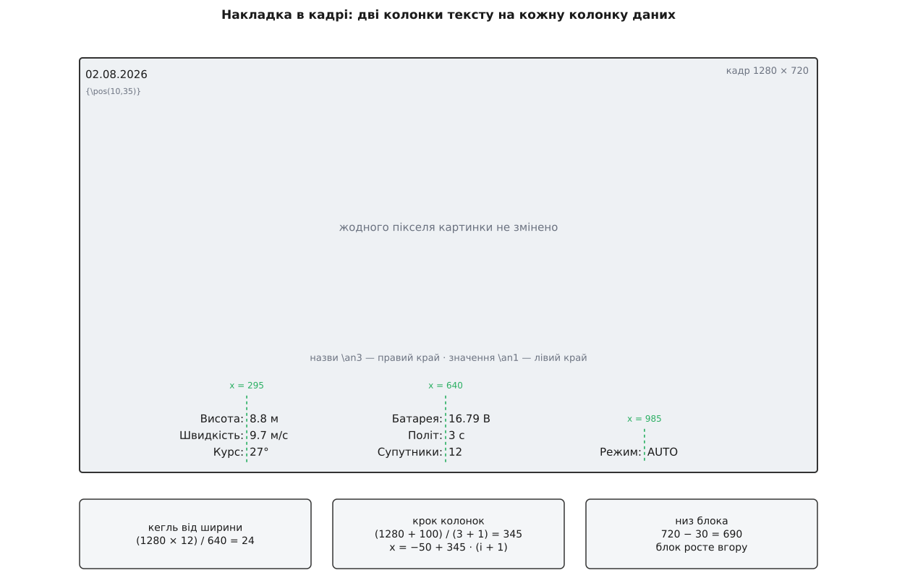
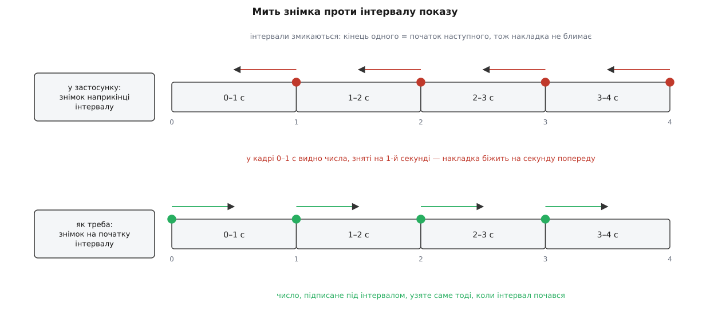

# ⚙️ Супутній файл субтитрів: телеметрія поруч із кадром, а не в кадрі

Числа висоти й заряду можна покласти на записане відео двома способами: перемалювати кожен кадр — або написати поруч із відеофайлом маленький текстовий файл, який програвач сам підхопить і намалює зверху. Другий спосіб коштує майже нічого, лишає картинку недоторканою й вимикається одним рухом; тут розібрано, з чого він складається, і написано програму, яка робить такий файл із нуля.

## Задача

Написати самостійну програму, яка з потоку показів телеметрії робить файл субтитрів у форматі ASS, придатний до негайного показу:

1. заголовок сценарію, з якого програвач дізнається розмір полотна й стиль напису;
2. кегль, прив'язаний до ширини кадру, щоб напис займав однакову частку картинки на 640 і на 1920 пікселях;
3. розкладка в три колонки, де назви притиснуто правим краєм, а значення лівим, тож двокрапки стоять рівним стовпчиком;
4. інтервали часу, що змикаються, — жоден кадр не лишається без напису;
5. частота знімання, за якої програвачі поводяться передбачувано.

І щоб результат перевірявся без апарата, без польоту й без станції — на синтетичному відео, зробленому однією командою.

## Чому поруч, а не в кадрі

Вкарбувати числа в зображення — це не «намалювати текст». Стиснений кадр не має пікселів, які можна взяти й підмалювати: щоб дістатися до пікселів, потік треба розтиснути, поверх розтиснутого намалювати напис, а потім стиснути назад. Три дії, кожна з ціною.

Розтиснення й стиснення 1080p30 на звичайному ноутбуковому процесорі йде швидше за реальний час у півтора-три рази, тож двадцятип'ятихвилинний політ обробляється хвилин десять. Але дорожча за час друга ціна: повторне стиснення — це друге покоління втрат. Те, що [кодек](root:com-signal/h264-hardware-codec) на борту вже викинув як непомітне, кодек на землі викине ще раз, і ця втрата вже незворотна. Третя ціна найтихіша: числа вросли в пікселі назавжди. Вимкнути накладку, виправити помилку в підписі, показати те саме відео без телеметрії — неможливо, є лише перезбирання з оригіналу, якого може вже й не бути.

Аналогове відео іншого вибору не має: там [телеметрію домальовують у сам сигнал](root:com-modulation/osd-overlay), бо окремої доріжки для тексту в композитному сигналі просто нема. У цифрового запису вибір є, і він очевидний.

Супутній файл — це кількасот байтів тексту на секунду. Числа лежать окремо від картинки, картинка лишається байт у байт тією, що прийшла з ефіру, а програвач малює напис уже на екрані, у момент показу. Захотів без телеметрії — вимкнув доріжку субтитрів. Захотів вкарбувати для звіту — вкарбував потім, з тих самих даних, і скільки завгодно разів. Захотів покласти все в один файл — узяв [контейнер](root:com-signal/media-container), який уміє тримати текстову доріжку поруч із відеодоріжкою, і поклав.



*Дві колонки тексту на кожну колонку даних: назви притиснуто правим краєм до однієї лінії, значення — лівим до тієї самої лінії, зсунутої на просвіт.*

## Формат: що саме треба написати

ASS — це Advanced SubStation Alpha, розширена версія формату SubStation Alpha. Сам SSA, за узгодженими описами формату, написав програміст CS Low на прізвисько Kotus близько 1996 року для спільноти аматорського перекладу аніме; розширена версія з'явилася приблизно 2002-го й додала шари, прозорість і обертання. Точна дата тут менш важлива за походження, і воно пояснює все подальше: формат робився не для даних, а для художніх написів, і всі його сильні й слабкі місця звідти.

Файл — звичайний текст у трьох іменованих розділах.

**`[Script Info]`** описує полотно. Дві його величини вирішальні:

```
PlayResX: 1280
PlayResY: 720
```

Це не «розмір відео», а система координат, у якій написані всі подальші числа. Програвач бере намальовану на цьому полотні накладку й розтягує її на справжнє вікно цілком, пропорційно. Тому найпростіше оголосити полотно рівним кадру: тоді координата в файлі — це піксель кадру, і всю розкладку можна рахувати в тих числах, які вже відомі.

Але з цього одразу випливає наслідок, який ловить кожного, хто пише такий файл уперше. Кегль у стилі теж вимірюється в одиницях полотна — тобто, коли полотно дорівнює кадру, у пікселях кадру. Отже, стала цифра дасть на різних записах різний напис: кегль 12 при ширині 640 займає приблизно одну п'ятдесяту ширини, а при 1920 — одну сто шістдесяту, тобто перетворюється на нечитний волосок. Кегль мусить рости разом із кадром:

```
кегль = ширина × 12 / 640

640  → 12
1280 → 24
1920 → 36
```

Дванадцять при 640 — це не магія, а зафіксований смак: така частка ширини читається й не заступає картинку. Прив'язка саме до ширини, а не до висоти, має свій перекіс — на широкому кадрі напис виходить трохи більшим відносно висоти, ніж на квадратнішому, — але для відео з апарата, де співвідношення сторін майже завжди 16:9, різниця непомітна.

**`[V4+ Styles]`** задає, чим малювати. Рядок `Format:` перелічує поля, рядок `Style:` — їхні значення, у тому самому порядку. Найцікавіше в ньому — кольори:

```
&H00FFFFFF   білий, повністю непрозорий
&H80000000   чорний, наполовину прозорий
```

Тут два підступи одразу. Порядок байтів — не звичний RGB, а `AABBGGRR`: спершу прозорість, далі синій, зелений, червоний. І прозорість **перевернута**: `00` означає повністю непрозорий, `FF` — повністю прозорий. Число, яке виглядає як «нуль альфи, значить нічого не видно», насправді дає найщільніший колір, який формат уміє.

Решта полів стилю — шрифт (моноширинний, щоб числа не танцювали по горизонталі при зміні цифр), товщина обведення й тіні, і поля `MarginL/R/V`. Останні варто згадати саме тому, що в нашому файлі вони мертві: поля діють лише на події, які програвач розставляє сам, а всі наші події позиційовані вручну.

**`[Events]`** — власне написи. Знову рядок `Format:` із переліком полів, і далі рядки `Dialogue:`. Порядок полів має одну корисну властивість: `Text` стоїть останнім, тому коми всередині тексту нікого не бентежать — розбирач відрахував свої дев'ять комів і решту рядка бере як є.

Керування розкладкою живе просто в тексті події, у фігурних дужках на початку:

```
{\an3\pos(285,690)}Висота:\NШвидкість:\NКурс:
```

`\pos(x,y)` ставить блок тексту в точку полотна. Яким саме місцем блок торкається цієї точки, вирішує вирівнювання: `\an3` — правим нижнім кутом, `\an1` — лівим нижнім (нумерація як на цифровій клавіатурі: 1–3 низ, 4–6 середина, 7–9 верх). `\N` — жорсткий перенос рядка всередині події.

## Розкладка: чому дві події на одну колонку

У формату нема ані таблиць, ані табуляції, ані способу спитати «а якої ширини вийде цей напис». Єдиний інструмент вирівнювання — точка прив'язки. Саме з неї й будується таблиця.

Хитрість проста до незручності: одну колонку даних пишуть **двома** подіями. Перша тримає лише назви, прив'язана правим краєм і росте вліво. Друга тримає лише значення, прив'язана лівим краєм і росте вправо. Обидві стоять на тій самій висоті, з просвітом у десяток пікселів між лініями прив'язки. Назви різної довжини вирівнюються по двокрапці самі собою, значення починаються з однієї вертикалі — і все це без жодного вимірювання тексту.

Прив'язка знизу теж не випадкова. Блок із трьох рядків, притиснутий низом, росте **вгору**: скільки б рядків у ньому не було, нижній лишається на своєму місці, і напис ніколи не виповзе за нижній край кадру. Якби блок притискався верхом, кожен новий показник зсував би всю накладку вниз, у нікуди.

Лишається розкидати колонки по ширині. Крок беруть діленням кадру на кількість колонок плюс одну — так між колонками й краями виходять рівні проміжки:

```
крок  = (ширина + розсув) / (колонок + 1)
x(i)  = −розсув/2 + крок · (i + 1)

1280, розсув 100, три колонки:
крок  = (1280 + 100) / 4 = 345
x     = 295, 640, 985
```

Доданок `розсув` робить одну річ: розсуває крайні колонки далі до країв, звужуючи порожні поля з боків. Без нього колонки стали б на 320, 640, 960 — з полями по 320 пікселів обабіч; із ним крайні відсуваються на двадцять п'ять пікселів кожна, і накладка займає кадр рівномірніше. Середня колонка при цьому не рухається взагалі, бо вона і є середина.

> 🔧 **Навіщо це.** Прийом «дві прив'язки замість вимірювання» переноситься на будь-яке середовище, де можна поставити текст у точку, але не можна спитати про його розмір, — від такої самої накладки в іншому форматі субтитрів до підписів у SVG чи на канві. Щойно вам захотілося порахувати ширину рядка, щоб щось вирівняти, спитайте себе, чи не вирішується та сама задача другою точкою прив'язки з протилежного боку. Здебільшого вирішується — і тоді розкладка перестає залежати від шрифту, який ви не контролюєте.

## Час: інтервали, що змикаються

Мітка часу в ASS має жорсткий вигляд `H:MM:SS.cc`: години однією цифрою без нуля попереду, хвилини й секунди двома, і рівно дві цифри сотих. Не мілісекунди, не одна цифра — саме сотих і саме дві.

Кожна подія має початок і кінець, і накладка з телеметрією влаштована так, що кінець одного запису дорівнює початку наступного. Це не оздоба: якби між подіями лишалася хоч мить порожнечі, накладка блимала б на кожній секунді. Змикання дає постійний напис, який просто змінює числа.

Знімати частіше за раз на секунду не варто, і не через файл, а через програвачі. Формат робився для реплік — кількох подій на хвилину, — і рушії малювання це припущення використовують: намальований образ події тримається в пам'яті доти, доки подія на екрані, і на всі її кадри перемальовування не потрібне. При одному герці кожна подія накриває три десятки кадрів, і кеш працює. Піднявши частоту до частоти кадрів, ви викидаєте кеш щокадру, а деякі програвачі до того ж просто не показують подій, коротших за кадр. У самому коді станції це записано як спостереження — «більшість програвачів починають дивно поводитися вище за 1 Гц»; механізм за спостереженням саме такий.

І остання річ про час, найтихіша. Мітку інтервалу спокусливо накопичувати: тримати «кінець попереднього» і щоразу додавати секунду. Так роблять, і так робити не варто, бо тоді час у файлі — це **кількість спрацювань таймера**, а не тривалість. Таймер на завантаженій машині спрацьовує пізніше, ніж просили, і за двадцять п'ять хвилин накопичена похибка стає видимою: субтитри поволі відстають від картинки. Мітку треба рахувати від **номера** інтервалу — `t = k / частота`, — і тоді жодне спізнення таймера в файл не потрапляє. Різницю між «скільки разів мене покликали» і «скільки часу минуло» розібрано в [монотонному й настінному часі](root:sf-apps/monotonic-vs-wall-time); тут вона обертається саме дрейфом накладки.

Поруч ховається помилка того ж роду, але помітніша. Інтервал `[t, t+1)` треба підписувати показами, знятими **на початку** цього інтервалу. Якщо таймер спрацьовує раз на секунду й ви пишете подію в момент спрацювання, підписуючи її щойно закінченим інтервалом, — числа в кадрі випереджають картинку рівно на секунду. Помилка не падає, не ловиться тестом і роками живе непоміченою, доки хтось не почне звіряти висоту на записі з висотою в журналі польоту.



*Обидва варіанти дають файл, який грається без нарікань. Різниця видна лише тоді, коли числа з відео порівнюють із незалежним джерелом.*

## Код

Одна програма без залежностей: приймає розмір кадру, тривалість і частоту, а показники бере з підставленого джерела. Демонстраційне джерело малює правдоподібний зліт, тож файл виходить одразу, без апарата; у станції на його місце стає поточний набір показників із панелі телеметрії.

:::tabs

:::code proj-telemetry-subtitles/cpp/assgen.cpp

:::code proj-telemetry-subtitles/py/assgen.py

:::

Один інтервал із того, що виходить при `1280 720` — шість подій, три пари колонок:

```
Dialogue: 0,0:00:03.00,0:00:04.00,Default,,0,0,0,,{\an3\pos(285,690)}Висота:\NШвидкість:\NКурс:
Dialogue: 0,0:00:03.00,0:00:04.00,Default,,0,0,0,,{\an1\pos(295,690)}8.8 м\N9.7 м/с\N27°
Dialogue: 0,0:00:03.00,0:00:04.00,Default,,0,0,0,,{\an3\pos(630,690)}Батарея:\NПоліт:\NСупутники:
Dialogue: 0,0:00:03.00,0:00:04.00,Default,,0,0,0,,{\an1\pos(640,690)}16.79 В\N3 с\N12
```

Кодування файлу — UTF-8 без винятків: у показах живуть «м/с», «°», «В» і кирилиця, а в форматі нема поля, яким можна оголосити щось інше. Поле `Encoding` наприкінці стилю до кодування файлу стосунку не має — воно означає набір символів шрифту в термінах старого Windows API. Про те, чому побайтова обробка тексту вище безпечна, — у [ASCII і UTF-8](root:sf-data/ascii-utf8): службові знаки формату лежать у першій половині таблиці, а другі байти багатобайтових літер туди ніколи не потрапляють.

## Як перевірити без польоту

Потрібне відео, і його роблять однією командою — синтетичний рухомий візерунок потрібної роздільности:

```
ffmpeg -f lavfi -i testsrc2=size=1280x720:rate=30 -t 30 -pix_fmt yuv420p flight.mp4
./assgen 1280 720 30 > flight.ass
```

Імена збігаються з точністю до розширення, і цього досить: програвачі підхоплюють файл субтитрів із таким самим базовим іменем у тій самій теці самі, без жодного налаштування. Саме тому в станції ім'я `.ass` походить від імени відеофайлу, а не вигадується окремо.

```
mpv flight.mp4
```

Око — не єдиний і не найкращий перевіряч. Три перевірки не потребують дивитися взагалі.

**Кількість подій.** Тридцять секунд, три колонки, по дві події на колонку — має бути рівно 180 рядків:

```
grep -c '^Dialogue:' flight.ass
```

**Змикання інтервалів.** Витягніть пари «початок — кінець» без повторів: їх має бути рівно стільки, скільки інтервалів (тридцять), і кінець кожної мусить дорівнювати початку наступної — сходинки без жодного пропуску.

```
awk -F, '/^Dialogue:/ {print $2, $3}' flight.ass | sort -u
```

**Розкладка в конкретному кадрі.** Замість дивитися відео очима, попросіть намалювати один кадр із уже накладеним написом і подивіться на картинку:

```
ffmpeg -i flight.mp4 -ss 12 -vf "ass=flight.ass" -frames:v 1 check.png
```

Це найцінніша перевірка з трьох, бо вона рахує розкладку тим самим рушієм, що й програвач, і показує наслідок відразу: чи не наліз стовпчик на стовпчик, чи не завеликий кегль, чи видно напис на світлому тлі.

Коли все зійшлося, файл можна покласти всередину контейнера — і тоді політ роздається одним файлом, у якому накладка лишається доріжкою, що вмикається й вимикається:

```
ffmpeg -i flight.mp4 -i flight.ass -c copy -c:s ass flight.mkv
```

Тут `mkv`, а не `mp4`, і не з примхи: MP4 із текстових доріжок знає лише свій власний, простіший формат, у якому ані позиціювання, ані нашого стилю нема; Матроска бере ASS як є, з усіма командами.

## Скільки це коштує

```
одна подія               ≈ 95 байтів
подій на секунду          = 3 колонки × 2 = 6
на секунду               ≈ 575 байтів
на 25-хвилинний політ    ≈ 575 × 1500 = 862 500 ≈ 840 КБ

відео 1080p, 6 Мбіт/с
на 25-хвилинний політ    ≈ 1125 МБ

частка накладки          ≈ 840 КБ / 1125 МБ ≈ 0.07 %
```

Обчислювальна ціна ще менша: раз на секунду відформатувати сім чисел і зшити кількасот байтів — це десятки мікросекунд, тобто нуль на тлі всього, що робить станція. Для порівняння, вкарбовування тієї самої накладки в кадр коштувало б повного розтиснення й повторного стиснення потоку — від кількох хвилин процесорного часу на кожен політ і незворотної втрати якости.

Саме це співвідношення — сім сотих відсотка місця й десятки мікросекунд проти хвилин процесора й другого покоління втрат — і є вся відповідь на питання «чому поруч, а не в кадрі».

## Де воно ламається

**Розкладка, порахована один раз.** Величини, що залежать від розміру кадру, спокусливо порахувати при першому виклику й запам'ятати — виглядає як безкоштовна економія. У станції крок колонок саме так і обчислюється, статичною змінною всередині функції, тож він фіксується на першому ж записі за сеанс. Записали політ у 720p, перемкнулися на 1080p, записали ще раз — розмір полотна в заголовку новий, а координати колонок лишилися старі, і три стовпчики збилися в ліву половину кадру. Ознака характерна: перший запис за запуск завжди гарний, кожен наступний з іншою роздільністю — ні.

**Ціле ділення при розбитті на колонки.** Сім показників на три колонки — це `7/3`. У цілих числах вийде два, три колонки заберуть шість показників, сьомий зникне без сліду й без попередження. Лікується або стелею (`(n + k − 1) / k`, як у коді вище), або дійсним діленням із округленням угору — у станції для цього кількість колонок навмисно оголошено дійсним числом, що працює, але тримає міну: варто комусь «прибрати зайвий float», і показники почнуть губитися.

**Нерівні колонки.** Стеля розкладає сім показників як 3 + 3 + 1, і остання колонка виглядає обірваною. Це не поломка, але й не те, чого хочеться. Рівна розкладка коштує двох рядків: `база = n / k`, `решта = n % k`, і перші `решта` колонок беруть на один більше — 3 + 2 + 2.

**Набір показників, заморожений на старті.** Список того, що писати, збирається один раз, у момент відкриття файлу, і далі не переглядається. Зміна розкладки панелі телеметрії посеред запису в файл не потрапить. Гірший бік тієї самої медалі — час життя: у списку лежать посилання на показники **конкретного** апарата, і перевірка «а чи є взагалі активний апарат» стереже наявність, а не тотожність. Перемикання на інший апарат посеред запису лишає письменника з посиланнями в те, чого вже може не бути.

**Мітка часу не тієї точности.** Формат хоче дві цифри сотих. Час у програмі зазвичай є в мілісекундах, тобто трьома цифрами, і спокуса «відрізати зайве» приводить до відрізання двох знаків замість одного — виходить одна цифра десятих. При одному герці дробова частина завжди нульова, тому не помічає ніхто; підніміть частоту — і мітки почнуть означати не те, що написано. Форматуйте з числа, а не ріжте рядок.

**Локальний формат дати.** Дату в кутку кадру природно взяти в короткому вигляді, прийнятому в системі. Наслідок: той самий запис у різних країнах читається як різні дати — `03.04.2026` це або третє квітня, або четверте березня, залежно від того, чия машина його зробила. Для запису польоту, який житиме в архіві й читатиметься чужими людьми, це неприпустимо; підпис мусить бути однозначним за [ISO 8601](root:sf-data/iso-8601).

**Занадто багато показників.** Блок притиснуто низом і він росте вгору, тож нижній край у безпеці — а верхній ні. Рядок з'їдає приблизно кегль на 1.2, тобто 29 пікселів при кеглі 24; десять рядків у колонці — це вже 290 пікселів із семисот двадцяти, добра третина кадру знизу. Стеля рахується наперед — `(висота − відступ) / (кегль × 1.2)` рядків на колонку, — і якщо показників більше, ніж стеля помножена на кількість колонок, треба або додати колонку, або зменшити кегль, або чесно обрізати список. Мовчазне переповзання на картинку — найгірший з варіантів, бо накладка існує, щоб не заважати дивитися.

**Незакритий файл.** Письменник тримає файл відкритим весь запис і дописує до нього щосекунди. Якщо кожен запис виштовхується на диск одразу, раптовий обрив живлення коштує щонайбільше останньої секунди накладки — і це та сама властивість, заради якої відеоконтейнер змушують освіжати службові дані на ходу. Якщо ж збирати все в буфері й записати наприкінці, обрив забере весь файл цілком, а найцікавіші польоти — саме ті, що обірвалися.
