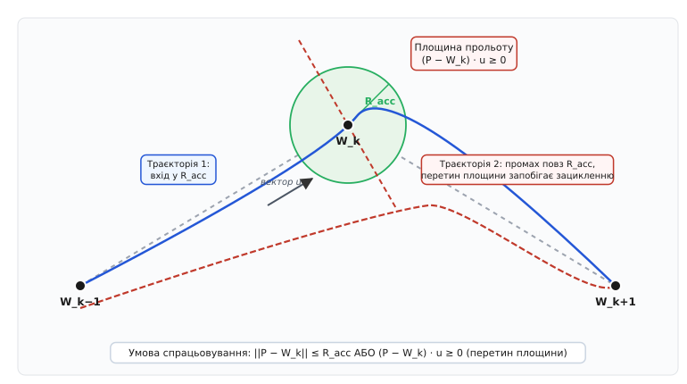
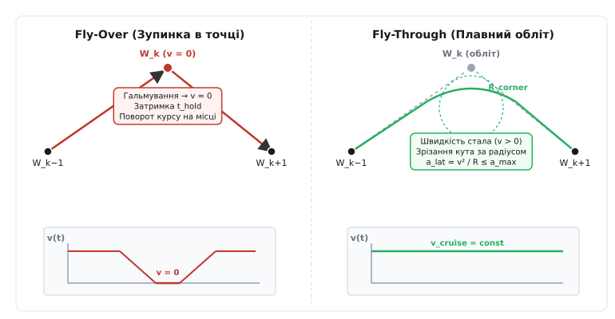
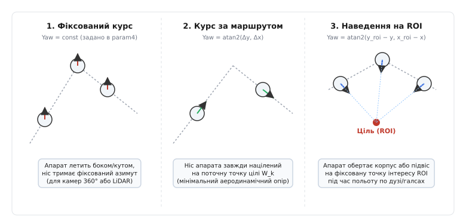
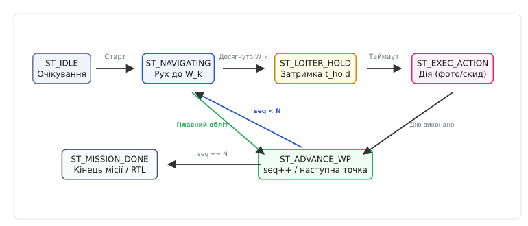

# Навігація за маршрутними точками

<preknowlist>
- [Елементи місії й команди](root:sys-dron/mission-items) — як задаються параметри точок у MAVLink: координати, радіус, час зависання, кут курсу.
- [Протокол місій MAVLink](root:sys-dron/mavlink-mission-protocol) — завантаження, підтвердження та перемикання активної точки через протокол зв'язку.
- [Відхилення від лінії шляху (cross-track)](root:sys-dron/vidkhylennia-vid-linii-shliakhu-cross-track) — розрахунок бокового зміщення та утримання коридору між двома точками.
- [Навігація pure pursuit](root:sys-dron/pure-pursuit-navigation) — ведення апарата по кривій за точкою випередження на маршруті.
- [Модель плану](root:sys-dron/plan-model) — структура плану польоту: місії, геозони та точки збору.
</preknowlist>

Якщо автопілот просто видаватиме тягу двигунів у бік координат кінцевого пункту, політ перетвориться на серію невдалих маневрів: апарат проскакуватиме точки на великій швидкості, зупинятиметься до нуля на кожному плавному вигині, розгойдуватиметься від вітру або вийде на нескінченне кружляння навколо пропущеної цілі. Автономне виконання місії вимагає окремого навігаційного прошарку — **секвенсера маршрутних точок** (англ. *waypoint route sequencer*, від лат. *sequi* — іти слідом). Цей модуль перетворює статичний масив польотних завдань на неперервний потік просторових цілей (setpoints) для регуляторів швидкості, положення та курсу, контролюючи точні геодезичні критерії завершення кожного відрізка.

Секвенсер є містком між стратегічним рівнем (глобальним планом польоту, отриманим від наземної станції керування) та тактичним рівнем (контурами відстеження ліній шляху та стабілізації просторової орієнтації). Він не керує моторами безпосередньо, але саме він вирішує, яка просторова точка є актуальною в поточний момент часу, коли вважати сегмент виконаним, як плавно спрямувати ніс апарата чи підвіс камери та за якою траєкторією переходити між сусідніми галсами.

## Анатомія місії: послідовність шляхових точок

План польоту в пам'яті автопілота зберігається як упорядкований масив структур-дескрипторів. Кожна шляхова точка (англ. *waypoint*) містить просторові координати цілі, кінематичні обмеження прольоту та накази для корисного навантаження.

У загальному вигляді навігаційний стан точки описується вектором:

```text
W[i] = [lat, lon, alt, v_cruise, R_acc, t_hold, yaw_target, action_id, flags]
```

Компоненти цього вектора визначають поведінку апарата на сегменті:

1. `lat, lon` — географічна широта й довгота у системі WGS-84 (десяткові градуси, що масштабуються до цілих чисел `10⁻⁷` градуса для уникнення втрати точності дробових чисел одинарної точності).
2. `alt` — висота цілі у метрах. Залежно від системи відліку (frame), вона може бути абсолютною над середнім рівнем моря (AMSL), відносною до точки зльоту (Relative Home) або над рівнем рельєфу (Terrain AGL).
3. `v_cruise` — бажана швидкість руху вздовж сегмента (м/с). Якщо поле не задане (або дорівнює нулю чи `NaN`), автопілот використовує системну круїзну швидкість із глобальних параметрів.
4. `R_acc` — радіус кулі або циліндра досягнення точки (Acceptance Radius) у метрах.
5. `t_hold` — час обов'язкової затримки (зависання/очікування) у точці після її досягнення (секунди).
6. `yaw_target` — бажаний кут рискання апарата (градуси чи радіани) або спеціальний прапорець автоматичного розрахунку курсу (`NaN` або `YAW_MODE_ALONG_TRACK`).
7. `action_id` — команда для виконання корисним навантаженням (спуск затвора камери, скидання вантажу через сервопривід, увімкнення реле, запуск вимірювального сканера).
8. `flags` — бітова маска конфігурації: прапорець плавного прольоту без зупинки (Fly-Through), автопродовження до наступного елемента (`autocontinue`), блокування зміни висоти до досягнення горизонтальних координат.

Навігаційний модуль працює з трьома індексами масиву:

- `seq_prev` — індекс точки початку поточного відрізка `W[k-1]`;
- `seq_curr` — індекс поточної цільової точки `W[k]`;
- `seq_next` — індекс наступної точки `W[k+1]`, потрібний для попереднього планування радіуса повороту та згладжування швидкості.

### Системи відліку висоти та перетворення координат

Висота в автопілотах є багатозначним поняттям, і помилка у виборі системи відліку призводить до зіткнення з пагорбами або польоту на неприпустимо низькому ешелоні. MAVLink та бортові прошивки підтримують три основні системи відліку висоти:

1. `MAV_FRAME_GLOBAL` — абсолютна висота AMSL (Above Mean Sea Level) відносно гравітаційного геоїда Землі (моделі WGS-84 / EGM96). Це значення видають барометричні висотоміри з поправкою тиску QNH та геодезичні GNSS-приймачі.
2. `MAV_FRAME_GLOBAL_RELATIVE_ALT` — висота над точкою армування (Home Position). Приймається за нуль у мить зльоту дрона. Найпопулярніший режим для місій на рівнинній місцевості.
3. `MAV_FRAME_GLOBAL_TERRAIN_ALT` — висота AGL (Above Ground Level) над поверхнею землі. Автопілот бере цифрову карту висот рельєфу (SRTM або DEM-тайли, завантажені на SD-карту або трансльовані зі станції керування) або дані далекоміра (радарного чи лідарного) і постійно додає висоту рельєфу `h_terrain(lat, lon)` до заданої відносної висоти:

```text
alt_target_msl = h_terrain(lat, lon) + alt_agl
```

Перш ніж виконувати векторні обчислення навігації, глобальні геодезичні координати (WGS-84) переводять у локальну декартову систему координат NED (North-East-Down), початок відліку якої фіксується в точці старту апарата (Home Position). Для відстаней у межах десятків кілометрів застосовують проєкцію еквідистантної циліндричної моделі (Equirectangular Approximation):

```text
x_ned = (lat − lat_0) · (π / 180) · R_earth
y_ned = (lon − lon_0) · (π / 180) · R_earth · cos(lat_0 · π / 180)
z_ned = −(alt − alt_0)
```

де `R_earth ≈ 6 371 000 м` — середній радіус Землі. Знак мінус для `z_ned` відповідає авіаційному стандарту NED, де вісь Down спрямована до центру Землі.

> 🔧 **Навіщо це.** Декартова система координат NED позбавляє контури керування від важких тригонометричних функцій на кожному такті 50–400 Гц. Усі відстані, швидкості, скалярні та векторні добутки обчислюються у простих метрах, що критично для бортових мікроконтролерів реального часу без надлишкової обчислювальної потужності.

## Умова проходження точки: куля досягнення проти площини прольоту

Найпростіший спосіб визначити, чи досяг апарат призначеної точки, — перевірити евклідову відстань від поточної позиції `P = [x, y, z]ᵀ` до цілі `W[k] = [x_k, y_k, z_k]ᵀ`.

Для мультикоптерів та наземних роботів перевірка здійснюється за радіусом кулі або циліндра досягнення (Acceptance Radius `R_acc`):

```text
d_horizontal = √((x − x_k)² + (y − y_k)²)
d_vertical   = |z − z_k|

is_inside_acceptance = (d_horizontal ≤ R_acc) AND (d_vertical ≤ R_acc_z)
```

де `R_acc_z` — допустима вертикальна похибка (зазвичай `0.5–2.0 м`).


*Геометрія критеріїв проходження шляхової точки. Траєкторія 1 потрапляє в кулю досягнення R_acc. Траєкторія 2 зноситься вітром або проходить повз кулю через високу швидкість: перетин ортогональної площини (Passing Plane) своєчасно перемикає ціль на наступну точку W_k+1, запобігаючи нескінченному кружлянню.*

### Пастка пропущеної точки (Missed Waypoint Loiter Trap)

Покладання виключно на умову `d_horizontal ≤ R_acc` є фундаментальною інженерною помилкою, здатною призвести до аварії. Розгляньмо, що відбувається, коли літак, крило або швидкісний дрон летить зі швидкістю `v = 20 м/с` при бічному вітрі `8 м/с`, а радіус досягнення налаштовано як `R_acc = 5 м`:

1. Через бічний знос або затримку контуру стабілізації апарат проходить повз точку `W[k]` на відстані `6.5 м` (тобто `d > R_acc`).
2. Оскільки умова `d ≤ R_acc` не виконана, секвенсер вважає точку недосягнутою і продовжує видавати команду на рух до `W[k]`.
3. Апарат уже пролетів точку вперед. Контур навігації формує команду максимального розвороту назад.
4. Фізичний мінімальний радіус розвороту апарата на цій швидкості становить `R_min = v² / (g · tan(φ_max)) ≈ 35 м` (за кута крену `φ = 30°`).
5. Здійснюючи віраж радіусом `35 м`, літак фізично не може потрапити в коло радіусом `5 м`, розташоване в центрі його кола обертання.
6. Апарат виходить на нескінченну орбітальну траєкторію довкола точки, спалює все пальне чи заряд акумулятора і падає через аварійне виснаження живлення.

### Детектор перетину площини прольоту (Passing Plane Detection)

Для подолання цієї вразливості автопілоти використовують комбінований критерій: точку визнають пройденою, якщо апарат увійшов у сферу `R_acc` **АБО** перетнув ортогональну площину прольоту (Passing Plane).

Площина прольоту проходить через цільову точку `W[k]` перпендикулярно до вектора сегмента наближення `u_in = (W[k] − W[k-1]) / ||W[k] − W[k-1]||`.

Вектор положення апарата відносно цілі:

```text
d_target = P − W[k]
```

Скалярний добуток вектора зміщення на одиничний вектор відрізка дає знак проходження площини:

```text
s_pass = d_target · u_in = (P − W[k]) · u_in
```

Якщо `s_pass < 0`, апарат перебуває на підльоті до точки.
Щойно `s_pass ≥ 0`, апарат перетнув нормальну площину точки `W[k]`.

Щоб площина не спрацьовувала, коли дрон летить паралельним курсом за сотні метрів від траєкторії, перетин площини валідується допустимим коридором бічного відхилення:

```text
is_waypoint_passed = (||P − W[k]|| ≤ R_acc) OR ((d_target · u_in ≥ 0) AND (|e_ct| ≤ R_max_cross))
```

де `e_ct` — лінійна поперечна похибка (Cross-Track Error) відносно сегмента `W[k-1] → W[k]`.

Повний математичний апарат із векторними виведеннями для бісекторної площини на довільних кутах зламу та строгий аналіз дискретних кроків інтегрування наведено у вставці [Геометричне виведення площини прольоту](root:sys-dron/waypoint-route-sequencing/math-passing-plane.md).

## Зупинка в точці проти плавного обльоту

У практичних місіях точки маршруту поділяють на два принципово різні типи за динамікою проходження:

1. **Fly-Over (Stop-at-Waypoint)** — точка обов'язкової зупинки;
2. **Fly-Through (Spline / S-Curve Waypoint)** — точка безперервного транзитного прольоту зі збереженням швидкості.


*Порівняння динаміки руху. Ліворуч: режим Fly-Over із повним гальмуванням до v = 0, витримкою часу t_hold та розворотом на місці. Праворуч: режим Fly-Through із постійною круїзною швидкістю та плавним зрізанням кута по дузі радіуса R_corner з контролем бічного прискорення.*

### Режим Fly-Over (Зупинка та дія)

Режим Fly-Over призначений для задач, які вимагають прецизійної фіксації апарата в просторі: точкове скидання вантажу, отримання високоякісного фотокадру без змазування (motion blur), лазерне далекомірне сканування, інспекція конструкцій чи посадка.

Динамічний профіль Fly-Over складається з чотирьох послідовних фаз:

1. **Гальмування (Deceleration):** За наближення до точки на гальмівну відстань `d_brake = v² / (2 · a_max)` профіль швидкості знижується за S-подібною кривою з обмеженням ривка (jerk-limited braking), зводячи швидкість у точці `W[k]` строго до нуля.
2. **Захоплення положення (Position Hold):** Після зупинки в межах радіуса `R_acc` запускається таймер витримки `t_hold`.
3. **Виконання дії (Payload Action):** Секвенсер надсилає команду на спрацьування корисного навантаження (імпульс на затвор камери, команда по шині CAN чи PWM-сигнал сервоприводу).
4. **Розворот на місці та розгін:** Апарат повертає корпус у напрямку наступного сегмента `W[k] → W[k+1]` і починає плавне прискорення з темпом `a_accel`.

Ціна такого режиму — підвищене енергоспоживання (витрати енергії на постійні гальмування й розгони) та суттєве збільшення загального часу місії.

### Траєкторії з обмеженням ривка (Jerk-Limited S-Curves)

У сучасних автопілотах (PX4, ArduPilot) профіль гальмування та розгону будується не за простою трапецією (де прискорення змінюється східчасто), а за 7-фазною S-кривою, де обмежено похідну прискорення — ривок `j(t) = da/dt`:

```text
j(t) ≤ j_max
a(t) = ∫ j(t) dt ≤ a_max
v(t) = ∫ a(t) dt ≤ v_cruise
s(t) = ∫ v(t) dt
```

Східчаста зміна прискорення у звичайних трапецеїдальних регуляторах створює миттєвий нескінченний ривок `j = ∞`. Це викликає різкі сплески струму в силових регуляторах обертів (ESC), паразитні вібрації рами дрона, зрив потоку на кінцях пропелерів і тремтіння підвісу камери. Обмеження ривка `j_max` гарантує плавне наростання струмів і високу якість відеозйомки навіть при різких змінах польотного завдання.

### Режим Fly-Through (Плавний обліт за сплайном)

Для задач картографування площ галсами (Survey), патрулювання периметра чи транзитного перельоту зупинятися на кожному проміжному зламі маршруту неефективно. Режим Fly-Through забезпечує проходження поворотів на незмінній круїзній швидкості за рахунок завчасного зрізання кутів (Corner Cutting).

Точка переходу розраховується геометрично. Нехай кут між відрізками становить `θ`. Радіус дуги розвороту `R_corner` обирається з обмеження максимального допустимого бічного прискорення `a_lat_max` (для коптерів це відповідає обмеженню кута крену `tan(φ_max) = a_lat / g`):

```text
R_corner = v_cruise² / a_lat_max
```

Відстань початку маневру до точки зламу `W[k]`:

```text
d_transition = R_corner · tan(θ / 2)
```

Коли відстань до точки `W[k]` стає меншою або рівною `d_transition`, секвенсер автоматично перемикає активний цільовий сегмент на `W[k] → W[k+1]`. Поточна ціль для контуру слідування генерується за кубічним ермітовим сплайном (Cubic Hermite Spline) або кривою Безьє, зшиваючи позицію, вектор швидкості та вектор прискорення на стику двох відрізків без розривів.

## Керування кутом рискання (Yaw Coordination)

На відміну від літаків, де напрямок носа жорстко пов'язаний із вектором повітряної швидкості через аеродинаміку кіля та кут ковзання, мультикоптер володіє повною кінематичною розв'язкою між вектором лінійної швидкості `V = [v_x, v_y, v_z]` та кутом рискання `ψ` (Yaw). Дрон може летіти на північ зі швидкістю 15 м/с, маючи ніс, повернутий на схід, захід чи південь.

Секвенсер маршруту підтримує три основні режими координації курсу:


*Режими узгодження курсу: 1) Фіксований курс для кругових сенсорів. 2) Курс за вектором маршруту для мінімізації аеродинамічного опору. 3) Неперервне наведення на фіксовану точку інтересу (ROI) під час польоту складним контуром.*

### 1. Фіксований курс (Fixed Heading)

Кут рискання задається параметром `param4` конкретної шляхової точки і залишається незмінним протягом усього сегмента польоту:

```text
ψ_cmd(t) = ψ_fixed = const
```

Цей режим необхідний під час роботи з лідарами кругового огляду 360°, магнітометричної зйомки (де обертання корпусу вносить фазові спотворення у вимірювання власного магнітного поля) або під час польотів в умовах вузьких інспекційних коридорів поблизу ліній електропередач.

### 2. Курс за напрямком маршруту (Facing Next Waypoint / Along Track)

Ніс апарата автоматично розгортається вздовж вектора поточного або наступного сегмента:

```text
Δx = x[k] − x(t)
Δy = y[k] − y(t)

ψ_cmd(t) = atan2(Δy, Δx)
```

Для запобігання різким стрибкам курсу, якщо точка знаходиться майже вертикально над апаратом або на відстані менше 1 метра, обчислення `atan2` блокується, і дрон зберігає попередній курс.

Цей режим забезпечує:
- Мінімальний лобовий аеродинамічний опір конструкції;
- Правильний огляд курсової FPV-камери пілота;
- Захист сенсорів переднього огляду (Stereo Vision, далекоміри оптичного потоку) від сліпих зон під час маневрування.

### 3. Наведення на точку інтересу (Region of Interest / ROI)

Команда `MAV_CMD_DO_SET_ROI` задає фіксовану або динамічну координату в просторі `T_roi = [x_roi, y_roi, z_roi]ᵀ`. Під час руху за будь-якою складною ламаною траєкторією секвенсер неперервно оновлює цільовий кут рискання корпусу дрона (або 3-осьового гіростабілізованого підвісу камери):

```text
Δx_roi = x_roi − x(t)
Δy_roi = y_roi − y(t)
Δz_roi = z_roi − z(t)

ψ_cmd(t) = atan2(Δy_roi, Δx_roi)
```

Для підвісу камери додатково обчислюється кут тангажу (Pitch):

```text
d_ground = √(Δx_roi² + Δy_roi²)
θ_gimbal(t) = atan2(Δz_roi, d_ground)
```

Швидкість повороту за рисканням лімітується параметром максимальної кутової швидкості `ω_yaw_max` (наприклад, `45°/с` для плавного відеокадру):

```text
e_yaw = wrap_pi(ψ_cmd − ψ_curr)
ψ_rate_cmd = clamp(k_p_yaw · e_yaw, −ω_yaw_max, +ω_yaw_max)
```

де `wrap_pi(α)` зводить кутову похибку до діапазону `[−π, +π]`.

## Вертикальне профілювання та обробка висоти (3D Waypoint Sequencing)

У тривимірному просторі зміна висоти між точками `W[k-1]` та `W[k]` може відбуватися за двома різними стратегіями:

1. **Одночасне просторове наведення (3D Vector Steer):** Апарат одночасно змінює горизонтальні координати й висоту, рухаючись строго похилим тривимірним вектором:

```text
v_xy = v_cruise · cos(γ)
v_z  = v_cruise · sin(γ)
```

де `γ = arctan((z[k] − z[k-1]) / L_xy)` — кут нахилу траєкторії. Цей режим є основним для зйомок та картографування.

2. **Ступінчастий підйом (Climb-First Waypoints):** Застосовується під час польотів у гірській місцевості або при виході з лісових просік. Якщо прапорець `NAV_ALT_HOLD` або параметр `param1` вимагає спочатку набрати безпечну висоту, секвенсер блокує горизонтальний рух (`v_xy = 0`), доки висота не досягне `|z(t) − z[k]| ≤ R_acc_z`, і лише після цього дозволяє рух до цілі. Це гарантує, що апарат не вріжеться у верхівки дерев під час набору висоти на старті галса.

## Взаємодія секвенсера з контурами стеження за лінією

Секвенсер не веде дрон по лінії самостійно: його завдання — своєчасно перемикати активний відрізок `W[k-1] → W[k]` і передавати параметри сегмента в контур бічного наведення.

В автопілотах використовують два основні сімейства алгоритмів стеження:

1. **Нелінійне наведення L1 / NPFG (Nonlinear Path Following Guidance):** Контур обирає віртуальну точку наведення на відрізку маршруту на відстані випередження `L_1 = 2 · ζ · v / ω_n` (де `ζ` — коефіцієнт демпфування, `ω_n` — власна частота) і формує бажане бічне прискорення `a_cmd = 2 · (v² / L_1) · sin(η)`, де `η` — кут між вектором швидкості дрона та вектором на точку наведення.
2. **Алгоритм прямої видимості з інтегратором (ILOS / Pure Pursuit):** Розраховує кут випередження `χ_los = χ_path + arctan(−e_ct / Δ + σ_int)`, де `e_ct` — бічне відхилення, `Δ` — відстань погляду вперед, а `σ_int` — інтегратор зносу вітром.

Щоб запобігти високочастотному брязкоту перемикання (Switching Chatter), коли алгоритм перестрибує між сусідніми сегментами, відстань випередження `L_1` та радіус кулі `R_acc` узгоджують за правилом:

```text
L_1 ≥ 1.5 · R_acc
```

Це гарантує, що контур наведення плавно «підхоплює» наступний відрізок ще до того, як апарат досягне фізичної точки зламу.

## Архітектура автомата станів секвенсера

Керування місією реалізується як кінцевий автомат (Finite State Machine, FSM), який виконується з фіксованою частотою навігаційного циклу (зазвичай `50 Гц`).


*Діаграма станів навігаційного секвенсера: обробка навігаційного наближення, таймерів очікування, команд корисного навантаження та перемикання індексів.*

Автомат підтримує шість базових станів:

1. `ST_IDLE` — місія не активна або стоїть на паузі. Регулятори виконують команди ручного керування чи утримання позиції.
2. `ST_NAVIGATING` — активний рух до точки `W[k]`. Контур навігації генерує цілі швидкості та курсу. Щотакту перевіряється комбінована умова досягнення точки (Acceptance Sphere + Passing Plane).
3. `ST_LOITER_HOLD` — апарат досяг координат точки `W[k]`. Швидкість скинуто до нуля, запущено зворотний відлік таймера `t_hold`.
4. `ST_EXEC_ACTION` — таймер `t_hold` вичерпано. Виконується наказ корисного навантаження (спуск затвора камери, скидання вантажу).
5. `ST_ADVANCE_WP` — інкремент індексу `seq_curr++`. Оновлення векторів сегментів `u_in`, `u_out`, завантаження нових обмежень швидкості. Якщо активна точка була останньою (`seq_curr >= N`), автомат ініціює завершення місії.
6. `ST_MISSION_DONE` — виконання плану завершено. Секвенсер передає керування модулю повернення додому (RTL) або автопосадці (Land).

## Телеметрія та протокольний обмін MAVLink

Під час автономного польоту секвенсер маршруту постійно повідомляє наземній станції керування (QGroundControl чи Mission Planner) про стан виконання місії:

- `MISSION_CURRENT` (повідомлення #42) — транслює індекс поточної активної точки `seq`. Станція підсвічує активний галс жовтим кольором.
- `NAV_CONTROLLER_OUTPUT` (повідомлення #62) — передає розрахунковий кут курсу на ціль `nav_bearing`, кут бажаного курсу `target_bearing`, дистанцію до активної точки `wp_dist` (метри) та миттєву бічну похибку відхилення від лінії `xtrack_error` (метри).
- `POSITION_TARGET_LOCAL_NED` (повідомлення #85) — транслює миттєві просторові цілі (позиція, швидкість, прискорення, рискання), які секвенсер видає внутрішньому контуру регуляторів.

## Реалізація модуля секвенсера на C та C++

Нижче наведено повний промисловий модуль секвенсера маршрутних точок. Він містить конвертацію геодезичних координат у NED, перевірку кулі та площини прольоту, розрахунок цілей курсу (Fixed, Track, ROI), обробку затримок та перемикання станів.

:::tabs
:::code waypoint-route-sequencing-d/c/main.c
:::code waypoint-route-sequencing-d/cpp/main.cpp
:::

## Крайові випадки та виробничі пастки

Під час експлуатації автономних комплексів розробники стикаються з набором критичних граничних умов, які вимагають окремого захисту в коді секвенсера:

### 1. Модифікація плану на льоту (Dynamic Mission Update)
Оператор станції може передати команду `MAV_CMD_DO_SET_MISSION_CURRENT` або завантажити новий план просто посеред виконання відрізка. Якщо секвенсер зберігає старі локальні вектори сегмента, перехід на нову точку спричинить стрибок цільового прискорення. Правильне опрацювання вимагає повного скидання попередньої точки на поточну позицію апарата: `prev_wp_ned = vehicle_pos` та миттєвого перерахунку нормалей.

### 2. Зациклення через цикли переходів (`MAV_CMD_DO_JUMP`)
Команда переходу дозволяє організувати циклічний прохід групи точок `k` разів. Секвенсер зобов'язаний тримати локальний лічильник ітерацій для кожного джампа в масиві. Якщо лічильник не декрементується або відсутній захист від нульової кількості повторів, прошивка зависає в нескінченному переході без можливості дійти до команди посадки.

### 3. Стрибок оцінки стану EKF (Position Jump)
За раптового перемикання супутникових сузір'їв або відновлення сигналу GPS після глушіння фільтр Калмана (EKF) може змістити поточну оцінку координат `P` на десятки метрів за один такт. Якщо в цей момент дрон був на підльоті до точки, стрибок може штучно перекинути його за площину прольоту `s_pass > 0`, спричинивши помилкове передчасне зарахування точки. Для захисту запроваджують фільтрацію інновацій або перевірку неперервності швидкості.

### 4. Пріоритет геозон (Geofence Breach)
Якщо траєкторія між точками `W[k-1]` та `W[k]` внаслідок зносу вітром перетинає межу циліндричної чи полігональної забороненої зони, модуль безпеки Geofence зобов'язаний негайно перехопити керування у секвенсера місії, перевівши дрон у режим зависання (Hold/Brake) або повернення (RTL), заблокувавши подальший перехід по масиву точок.

### 5. Сингулярність прямовисного прольоту над ROI
Коли дрон у режимі наведення на точку інтересу пролітає безпосередньо над самою точкою `T_roi`, горизонтальна відстань `d_ground = √(Δx² + Δy²)` прямує до нуля. Розрахунок кута рискання `atan2(Δy, Δx)` стає чисельно нестійким, а підвіс камери намагається миттєво розвернутися на 180° при переході через точку надиру (Nadir Point). Секвенсер захищає систему, заморожуючи курс за умови `d_ground < 2.0 м` та плавно переходячи на утримання останнього валідного кута.

### 6. Відновлення місії після переривання (Mission Resume)
Якщо місія була перервана оператором у ручному режимі (наприклад, для обльоту раптової перешкоди) або спрацював короткочасний Failsafe, повернення до місії не повинно вести дрон на початок уже виконаного багатометрового відрізка. Алгоритм відновлення проєктує поточне положення дрона ортогонально на активний відрізок `W[k-1] → W[k]` і підключає наведення з найближчої точки прямої, зберігаючи цілісність плану без зайвих перельотів.
