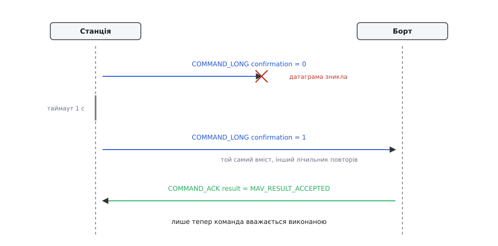
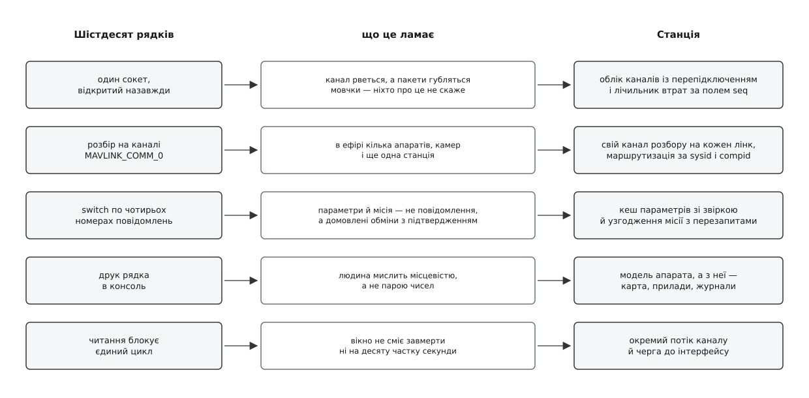

# ⚙️ Мінімальна наземна станція за шістдесят рядків

Ось робочий код станції, зведеної до кістяка: відкрити канал, розібрати потік MAVLink, показати живий стан апарата й надіслати одну команду з підтвердженням. Писати його варто не щоб замінити готову станцію, а щоб намацати межу — те саме місце, де шістдесят рядків перестають працювати й починається справжній застосунок.

### Задача

Нехай апарат уже говорить: на столі — плата з USB-кабелем, або радіомодем, або симулятор, що шле телеметрію на UDP-порт 14550. Наша програма мусить зробити рівно п'ять речей.

Відкрити канал і почати читати з нього байти. З потоку байтів дістати окремі повідомлення. З повідомлень зібрати картину: чи живий борт, у якому він режимі, чи зброєні двигуни, скільки в акумуляторі, де апарат і на якій висоті. Показати цю картину рядком у консолі, що оновлюється раз на секунду. І, нарешті, надіслати одну команду — та не «випустити й забути», а дочекатися, поки борт її підтвердить.

П'ята вимога виглядає дрібницею на тлі решти. Насправді саме вона задає форму всієї програми: через неї цикл мусить прокидатися й тоді, коли нічого не прийшло, мати під рукою годинник і пам'ятати, скільки разів уже пробував.

### Задум: чотири речі, яких у звичайному вводі-виводі немає

**Байти — не повідомлення.** Серійний потік меж не має взагалі: він просто тече. UDP-датаграма межі має, але свої, а не ті, що в MAVLink: в одній датаграмі може приїхати три повідомлення, а четверте обірватися посередині й доїхати наступною. Тому читати треба не «пакет», а байт за байтом, тримаючи стан розбору між викликами: де початок кадру, скільки байтів корисного навантаження ще чекати, чи зійшлася [контрольна сума](root:com-modulation/crc). Обидві бібліотеки, які ми візьмемо, влаштовані саме так — про будову самого кадру є окрема розмова в темі [«Пакет MAVLink»](root:sys-dron/mavlink-packet).

**Ми не питаємо — ми слухаємо.** Тут немає запиту «дай висоту» й відповіді на нього. Борт сам, без прохання, шле потік повідомлень, кожне зі своїм темпом: серцебиття раз на секунду, позиція кілька разів на секунду, стан системи — ще з якоюсь своєю частотою. Тому в програмі мусить бути **знімок останнього відомого**, у якому кожне поле оновлюється незалежно від решти й має власну давність. Це не оптимізація, а єдина можлива форма: іншого джерела правди в нас нема.

**Темп потоків задає борт, і його можна попросити.** Що саме й як часто транслюється, вирішує прошивка; для конкретного повідомлення частота може виявитися малою або й нульовою. Загальний спосіб втрутитися — команда `MAV_CMD_SET_MESSAGE_INTERVAL` (номер 511): у першому параметрі номер повідомлення, у другому — період у мікросекундах, причому `−1` вимикає потік, а `0` повертає стандартний темп. Її ми й надішлемо. Вибір навмисний: команда безпечна, вона однаково потрібна для повного показу позиції, і йде вона рівно тим самим шляхом, що й «зброїти двигуни». Замінити в коді номер 511 на 400 (`MAV_CMD_COMPONENT_ARM_DISARM`) — це один символ; змінюється не програма, а наслідки, тож хай спершу все запрацює на нешкідливому.

**Команда — не виклик функції.** Надіслати `COMMAND_LONG` означає кинути датаграму в канал, який може її з'їсти. Тому команда завжди пара: посилка й очікування `COMMAND_ACK`, а між ними таймаут і повтор. У повторі те саме повідомлення, але поле `confirmation` більше на одиницю — так борт відрізняє «та сама команда вдруге» від «нова команда». У відповідь приходить `result` зі значенням `MAV_RESULT`: `0` — прийнято, `1` — тимчасово відхилено (варто спробувати згодом), `2` — заборонено, `3` — команда невідома, `4` — не вдалося, `5` — виконання триває, і остаточна відповідь буде пізніше.


*Дві сторони й ненадійний канал між ними. Загублену команду ніхто не повідомить — про втрату станція довідується лише з мовчання, тож повтор веде вона сама, збільшуючи лічильник `confirmation`. Команда вважається виконаною не тоді, коли її надіслали, а тоді, коли прийшло підтвердження.*

### Код

Дві версії роблять те саме. Перша — на C зі згенерованими заголовками MAVLink: це та сама бібліотека, з якою працює прошивка й сама станція, тож видно кожен байт і кожен перехід автомата розбору. Друга — на Python із `pymavlink`: коротша, бо частину чорнової роботи бібліотека вже зробила, зате видно, яку саме.

Спершу канал. Він відкривається один раз, і далі з нього читають до кінця роботи.

:::tabs
:::code proj-minimal-gcs/c/gcs.c
:::code proj-minimal-gcs/py/kod.py
:::

Дротове з'єднання міняє в цій програмі рівно один шматок — той, що відкриває канал. У C замість сокета буде `open("/dev/ttyACM0", O_RDWR | O_NOCTTY)`, далі `termios`: сирий режим (щоб драйвер не чіпав байти, які випадково збіглися з керівними символами), швидкість — типово 57600 для радіомодема й 115200 для USB-кабелю, а роль `SO_RCVTIMEO` беруть на себе поля `VMIN = 0` і `VTIME = 2`: «віддай, що назбиралося, але не чекай довше двох десятих секунди». У Python зміниться лише рядок з'єднання. Увесь інший код — і розбір, і цикл — лишається без жодної правки, і це не збіг: парсер їсть байти, а звідки вони взялися, його не обходить.

Далі — розбір. Тут між версіями найбільша різниця: у C ми самі згодовуємо парсерові кожен байт і самі розкодовуємо повідомлення в структуру, у Python бібліотека вже віддає готовий об'єкт із названими полями. Спільним лишається головне — `switch` (чи ланцюжок `if`) по номеру повідомлення, який оновлює знімок стану.

:::tabs
:::code proj-minimal-gcs/c/kod.c
:::code proj-minimal-gcs/py/kod-2.py
:::

Лишився цикл: читати, оновлювати, раз на секунду друкувати й — доки нема підтвердження — щосекунди повторювати команду. Зверни увагу, що команду не можна надіслати одразу: доки не прийшло перше серцебиття, ми не знаємо `sysid` апарата, а без адресата `COMMAND_LONG` нікуди слати.

:::tabs
:::code proj-minimal-gcs/c/kod-2.c
:::code proj-minimal-gcs/py/kod-3.py
:::

Python-версія — трохи більше за шістдесят рядків, C-версія — приблизно вдвічі довша, бо в ній видно розбір і пакування. Обидві дають той самий рядок у консолі, що оновлюється щосекунди й показує живий апарат.

> 🔧 **Навіщо це.** Такий скрипт вартий місця в теці з інструментами. Коли готова станція «нічого не показує», він за пів хвилини ділить проблему навпіл: якщо рядок оновлюється — байти доходять, і винна станція або її налаштування; якщо мовчить — питання до кабелю, порту, швидкості чи самої прошивки. Тим самим прийомом перевіряють і власне повідомлення: додав `case` на свій номер — і одразу видно, чи борт його взагалі шле.

### Що зламається наступним

Далі найцікавіше. Кожен пункт нижче — не забаганка й не «додаткова функція»: це наслідок однієї конкретної властивості каналу або апарата, який мінімальний код просто не помітив.

**Втрачені пакети — і ніхто про них не скаже.** У заголовку кожного пакета є однобайтове поле `seq`, яке відправник збільшує на одиницю з кожним повідомленням і яке перевертається через 255. Дірка в цій послідовності — єдиний слід загубленого пакета; більше слідів немає. Наш код на `seq` навіть не дивиться, тож для нього втрати не існують. Справжня станція мусить рахувати їх окремо для кожного відправника, бо свою нумерацію веде кожен: змішай автопілот із камерою в одну послідовність — і звичайне чергування двох потоків само́ виглядатиме як суцільна діра. У QGroundControl очікуваний наступний номер лежить у тривимірній таблиці «канал × `sysid` × `compid`», а різниця між отриманим і очікуваним — з поправкою `+256` на переверт — додається до підсумку втрат, який ведуть уже на канал загалом; відсоток на екрані ще й згладжують, усереднюючи з попереднім значенням, щоб цифра не смикалася від кожного пакета. Із цієї ж властивості росте й друга половина роботи — повтори. Наше `tries < 5` наївне: після `MAV_RESULT_IN_PROGRESS` таймаут треба різко збільшити, бо борт узявся за довгу справу й відповість пізніше; `TEMPORARILY_REJECTED` означає «спробуй за мить», а `DENIED` — «не пробуй узагалі». Про це й решту гострих кутів — [граблі MAVLink](root:sys-dron/mavlink-pitfalls) і [команди MAVLink](root:sys-dron/mavlink-commands).

**Тисяча параметрів і дірки в таблиці.** Щойно станція захоче показати налаштування, вона попросить `PARAM_REQUEST_LIST` — і борт почне сипати `PARAM_VALUE`, по одному на кожен параметр, із загальною кількістю та індексом у кожному. Тут ненадійність каналу дає новий рахунок.

**Умова: 1200 параметрів, втрати 2 %, час обміну «туди-назад» ≈ 150 мс.**

```
Дірок після першого проходу:
  1200 · 0.02        = 24 параметри не доїхали

Кожну дірку добирають окремим запитом за індексом:
  24 · 0.15 с        ≈ 3.6 с зверху — і то якщо запити йдуть підряд

Але й перезапит губиться з тією самою ймовірністю:
  24 · 0.02          ≈ 0.5 нової дірки на цикл
  → приблизно кожен другий прохід тягне за собою ще один
```

Тому механізм тут не «прочитати список», а облік: відмітити, які індекси вже прийшли, добрати відсутні поіменно, повторити, доки таблиця не зімкнеться. Далі — кеш на диску, прив'язаний до версії прошивки, щоб наступного разу не читати все спочатку. І окремо — запис: надіслане значення станція перечитує назад і порівнює, бо «надіслав» через ненадійний канал не дорівнює «записалося». Усе це живе в [менеджері параметрів](root:sys-dron/parameter-manager), а сам протокольний бік — у темі про [параметри MAVLink](root:sys-dron/mavlink-param-protocol-model).

**Кілька відправників на одному каналі.** Наш код припустив, що перше серцебиття від компонента-автопілота — це «той самий апарат», і склав усе в одну структуру. У реальному ефірі тим самим каналом ідуть повідомлення від автопілота, камери, підвісу, приймача повітряної обстановки, бортового комп'ютера, ще однієї наземної станції — і, буває, від двох апаратів через один радіомодем. Наслідків три, і всі неприємні.

Перший: стан треба тримати не глобально, а на пару `sysid` + `compid`, інакше показники двох апаратів змішаються в кашу. Другий: підтвердження не завжди можна привласнити. Поля `target_system` і `target_component` у `COMMAND_ACK` — **розширення** формату, додані пізніше; відправник має право їх не заповнювати, і тоді вони приїдуть нулями. А оскільки станції за домовленістю беруть `sysid` 255, дві станції поруч виявляться однією адресою — і чуже підтвердження зарахується як своє. Третій наслідок суто технічний і найпідступніший: у C-бібліотеці стан розбору лежить у статичному масиві, індексованому **каналом**. Розбирати два фізичні з'єднання через `MAVLINK_COMM_0` не можна — байти двох потоків перемішаються всередині одного автомата й знищать кадри одне одного. Тому QGroundControl видає кожному лінку власний номер каналу, а настільна збірка бібліотеки заздалегідь піднімає кількість буферів до шістнадцяти (на мікроконтролері їх лише чотири). Хто саме кому пише й куди це переслати — тема про [маршрутизацію за sysid і compid](root:sys-dron/message-routing), а кілька апаратів в одному вікні — [окрема робота застосунку](root:sys-dron/multi-vehicle).

**Місія — не повідомлення, а перемовини.** Здається природним: набив точки, послав. Насправді вивантаження плану — впорядкований обмін. Станція оголошує `MISSION_COUNT`, борт починає питати елементи по одному через `MISSION_REQUEST_INT`, станція на кожен запит відповідає `MISSION_ITEM_INT`, і наприкінці борт каже `MISSION_ACK`. Темп задає борт, кожен крок може загубитися, а обірваний посередині обмін лишає в пам'яті апарата половину маршруту — стан, у якому злітати не можна. Тож це справжній автомат станів із таймаутами, повторами й скасуванням, а після нього станція ще й пропонує прочитати план назад для звірки. Протокольний бік описано в [протоколі місій MAVLink](root:sys-dron/mavlink-mission-protocol), станційний — в [обміні планом із апаратом](root:sys-dron/plan-exchange).

**Блокувальне читання й вікно, яке не сміє завмерти.** Наш цикл спокійно висить на `recvfrom` із таймаутом 200 мс, бо йому більше нічого робити. У застосунку з вікном той самий рядок коду — катастрофа: інтерфейс мусить перемальовуватися десятки разів на секунду, а виклик читання затримує потік на весь таймаут. Гірше з серійним портом: якщо USB-кабель висмикнули, читання може застрягти всередині драйвера на секунди. Тому в станції канал живе у власному потоці — читає, розбирає, і вже готові повідомлення передає до інтерфейсу чергою, а потік вікна лише оновлює модель і малює. Звідси одразу тягнеться наступний клубок: модель тепер пишуть з одного потоку, а читають з іншого, і межу між ними доводиться робити явною. Загальний бік цього — [блокуючий і неблокуючий ввід-вивід](root:sf-tasks/blocking-vs-nonblocking-io) та [цикл подій](root:sf-tasks/event-loop); те, як межу проведено в QGroundControl, — [модель потоків](root:sys-dron/threading-model).

**Режим — це просто число.** Наш C-код чесно друкує `custom_mode` як цифру, бо більшого з `HEARTBEAT` не витягнеш: поле `base_mode` каже лише, чи ввімкнено власний режим прошивки, а що означає число 4, стандарт не визначає взагалі. Python-версія показує назву тільки тому, що `pymavlink` возить із собою таблиці назв на кожен політний стек — і в них треба ще вгадати, чи це PX4, чи ArduPilot. Станція розв'язує це так само: спільний код працює з абстрактним апаратом, а назви режимів, особливості калібрування й дрібні відхилення живуть у [розширенні під конкретну прошивку](root:sys-dron/firmware-plugin). Той самий корінь має й [словник повідомлень](root:sys-dron/mavlink-message-dictionary): спільна мова покриває багато, але не все.


*Кожен рядок мінімального коду має свого супротивника — і саме супротивник, а не чиясь фантазія, визначає, у що цей рядок виросте. Один сокет стає обліком каналів, бо канал рветься; `switch` стає кешем і узгодженням, бо параметри й місія — це обміни; блокувальне читання переїжджає в окремий потік, бо вікно мусить жити.*

### Чому з цього виростає застосунок

Мінімальна станція працює — і саме тому вона корисна. Вона показує, що читати телеметрію легко, а решта важка не через обсяг коду, а через одну властивість: між станцією й апаратом лежить канал, який губить, плутає й обриває, а по той бік каналу — не один співрозмовник, а кілька.

Кожна велика підсистема, яку тут перелічено, — це відповідь на конкретну втрату. Прибери облік втрат — і не буде видно, що зв'язок гине. Прибери кеш параметрів — і кожне під'єднання коштуватиме десятки секунд. Прибери маршрутизацію — і два апарати зіллються в один. Прибери узгодження місії — і на борт поїде півмаршруту. Прибери окремий потік — і вікно замерзне на першому ж висмикнутому кабелі. Жодну з них не додали «для повноти»: усі п'ять уже сидять у цих шістдесяти рядках — у вигляді припущень, яких поки що просто ніхто не порушив.
