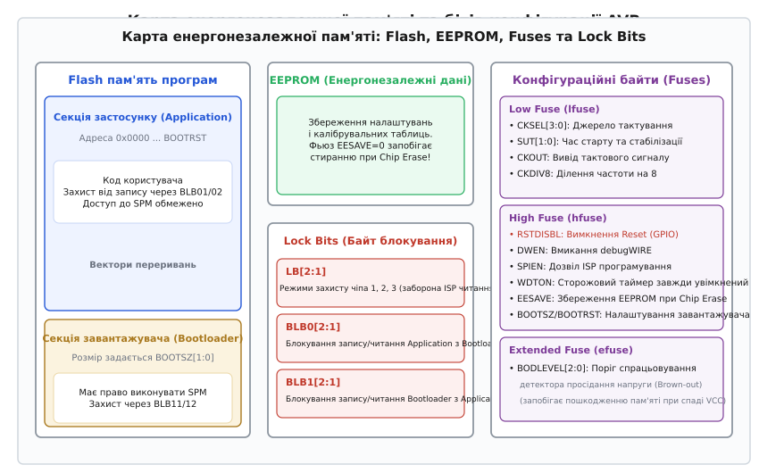
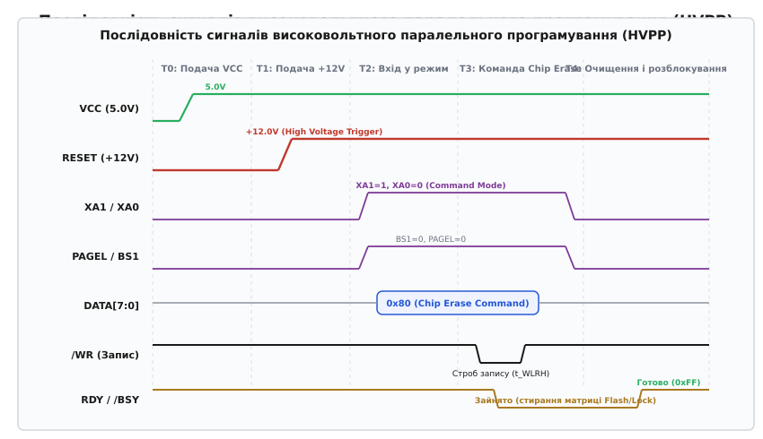

# Замкнути зневаджувач: фьюзи й рівні захисту читання

<preknowlist>
- [Прошивка у Flash: як код потрапляє в чіп](root:sys-ide/flashing) — послідовне завантаження образу, перемикання режимів та взаємодія завантажувача з пам'яттю.
- [SWD і JTAG зсередини](root:sys-ide/swd-jtag-internals) — апаратні лінії зневадження, регістри TAP-контролера та доступ до пам'яті через налагоджувальний порт.
- [Кроком по коду](root:sys-ide/step-debugging) — робота апаратних брейкпоінтів та керування станом ядра процесора.
</preknowlist>

Коли серійний пристрій залишає лабораторію і потрапляє у відкритий світ, відкритий зневаджувальний порт перетворюється на пряму загрозу безпеці. Якщо конфігураційна пам'ять мікроконтролера залишена у заводському стані, будь-який сторонній спостерігач із кишеньковим програматором за лічені секунди підключається до виводів ISP або SWD, вичитує весь двійковий образ Flash і EEPROM, копіює закриті криптографічні ключі та клонує комерційний виріб. Зворотний бік тієї самої проблеми спіткає розробника під час налаштування тактування або спроби вивільнити зайву ніжку введення-виведення: один випадково скинутий біт конфігурації вимикає зовнішній вивід апаратного скидання чи перемикає ядро на неіснуючий кварцовий резонатор, повністю блокуючи звичайний послідовний канал прошивки й перетворюючи мікроконтролер на нерухому «цеглину».

Керування цими режимами покладено на спеціалізовані енергонезалежні регістри, які в архітектурі AVR називають конфігураційними комірками або **фьюзами** (від англ. *fuse* — плавка вставка, плавкий запобіжник, за аналогією з першими одноразовими мікросхемами ПЗП), а в родинах ARM Cortex-M — **байтами опцій** (англ. *option bytes*) та регістрами рівнів захисту від читання (*Readout Protection*, RDP). На відміну від звичайної Flash-пам'яті програм, ці біти керують фізичною поведінкою кремнію ще до того, як процесор виконає свою найпершу інструкцію: вони визначають джерело тактової частоти, поріг детектора просідання напруги, розподіл векторів скидання, режим роботи апаратного зневаджувача та права зовнішніх інтерфейсів на читання й запис комірок пам'яті.


*Організація енергонезалежної пам'яті мікроконтролера AVR: відокремлені масиви Flash-пам'яті програм, EEPROM даних, конфігураційних байтів Fuses та бітів апаратного блокування Lock Bits.*

---

### Фізична природа та інверсна логіка конфігураційних бітів

Конфігураційні біти AVR реалізовані на базі енергонезалежних транзисторів із плаваючим затвором (*floating gate*) або пасткою заряду (*charge trap*), електрично відокремлених від основного адресного простору Flash і SRAM. Їхня фізична структура ідентична коміркам Flash та EEPROM, проте логіка адресації та декодування виконана повністю незалежною: під час апаратного скидання логічна матриця мікроконтролера зчитує стан фьюзів паралельно за допомогою внутрішнього автомата ініціалізації ще до зняття сигналу скидання з внутрішніх шин процесорного ядра.

Кожна така комірка пам'яті є польовим МОН-транзистором, у структуру якого інтегровано ізольований провідний острівець полікремнію, оточений діелектриком із діоксиду кремнію (SiO₂) товщиною менше 10 нанометрів. Коли на плаваючий затвор інжектуються електрони, вони створюють від'ємний потенціал, який екранує керівний затвор, зміщуючи порогову напругу відкриття транзистора `V_th`. Якщо затвор заряджений електронами, транзистор не відкривається при нормальній напрузі зчитування; коли затвор розряджений, транзистор проводить струм.

Найперша концептуальна пастка конфігураційних бітів мікроконтролерів полягає в їхній **інверсній полярності**:

* **Логічний `0` (Запрограмовано, *Programmed*):** на плаваючий затвор транзистора інжектовано заряд (електрони). Транзистор відкривається при робочій напрузі зчитування, створюючи провідний канал, що апаратно інтерпретується внутрішньою логікою як активний стан прапорця.
* **Логічний `1` (Стерто / Незапрограмовано, *Unprogrammed*):** плаваючий затвор розряджений. Канал перекритий, струм не тече, що відповідає пасивному (заводському після повного стирання) стану біта.

Ця полярність випливає з фізики напівпровідникового тунелювання електронів Фаулера-Нордгейма (*Fowler-Nordheim tunneling*). Операція повного стирання мікросхеми (*Chip Erase*) скидає абсолютно всі комірки матриці у високовольтний непровідний стан — тобто у шістнадцяткове значення `0xFF`. Програмування окремого біта означає вибіркове тунелювання заряду для переводу конкретного розряду з одиниці в нуль. Повернути окремий нульовий біт назад в одиницю без стирання всього блоку неможливо через фізичну відсутність індивідуальних високовольтних ліній стирання для кожної окремої комірки.

```
Стирання кристала (Chip Erase):
Комірка Flash / Fuse → Стан розрядженого затвора = 1 (Unprogrammed, 0xFF)

Вибірковий запис (Programming):
Інжекція електронів на затвор → Стан накопиченого заряду = 0 (Programmed)
```

Через це в технічній документації Atmel/Microchip використовується позначення: `0 = Programmed` (увімкнено), `1 = Unprogrammed` (вимкнено). Якщо інженер у конфігураційній утиліті бачить прапорець «Enable Clock Output» і ставить біля нього галочку, у відповідний розряд шістнадцяткового байта має бути записаний саме двійковий `0`. Плутанина між цими станами є головним джерелом помилок при самостійному розрахунку байтів конфігурації.

Енергонезалежні комірки конфігурації володіють високим ресурсом зберігання заряду (типово понад 100 років при температурі +25 °C та понад 20 років при +85 °C), проте їхній ресурс циклів перезапису зазвичай нормується на рівні 10 000 – 100 000 циклів. Втім, на практиці конфігураційні байти змінюються лише під час виробництва або глибокої модернізації пристрою, тому вичерпати їхній фізичний ресурс зносу майже неможливо, на відміну від комірок EEPROM із частим оновленням журналів подій.

---

### Внутрішній автомат ініціалізації при скиданні (Reset Sequence)

Щоб зрозуміти, чому неправильні конфігураційні біти здатні заблокувати мікроконтролер ще до старту програми, розгляньмо покрокову роботу внутрішнього апаратного автомата скидання (*Reset Controller*).

Мікроконтролер AVR має п'ять незалежних джерел скидання:
1. **Power-on Reset (POR):** апаратний компаратор фіксує наростання напруги живлення від нуля до робочого порогу (близько 1.4–1.6V).
2. **External Reset (EXTR):** низький логічний рівень на фізичному виводі `RESET`.
3. **Brown-out Reset (BOR):** аналоговий детектор просідання напруги фіксує падіння `V_CC` нижче порогу `BODLEVEL`.
4. **Watchdog Reset (WDR):** сторожовий таймер закінчив відлік таймауту без отримання скидання від програми.
5. **debugWIRE Reset:** команда програмного скидання від апаратного емулятора через однопровідну шину.

Коли виникає будь-яка з цих подій, внутрішнє ядро AVR переходить у стан блокування. Щойно умова скидання зникає (наприклад, напруга живлення піднялася вище порогу POR), запускається ланцюг затримок:

```
Подача живлення VCC
      │
      ▼
Компаратор POR фіксує VCC > 1.4V
      │
      ▼
Автомат зчитування зчитує Fuses у тіньові регістри (Shadow Registers)
      │
      ▼
Мультиплексор тактування підключає джерело згідно з CKSEL
      │
      ▼
Таймер затримки відраховує SUT тактових періодів для стабілізації генератора
      │
      ▼
Зняття внутрішнього скидання ядра → Лічильник команд PC = 0x0000 або BOOTRST
```

З цієї послідовності стає очевидним ключовий принцип: **зчитування конфігураційних бітів відбувається апаратно і повністю автономно**, ще до того, як тактовий генератор подасть перший імпульс на лічильник команд. Якщо біти `CKSEL` вказують на зовнішнє тактове джерело, таймер затримки `SUT` не зможе виконати відлік, бо в системі немає тактових імпульсів. У результаті внутрішнє скидання ядра ніколи не буде знято, процесор зависне на початковій стадії ініціалізації, а лінії шини SPI залишаться відключеними від логіки послідовного програмування.

---

### Анатомія конфігураційних байтів AVR

У класичних 8-бітних мікроконтролерах родини AVR (на прикладі масових чипів ATmega328P, ATtiny85 та ATmega2560) конфігураційний простір поділено на три окремі байти: **Low Fuse Byte** (`lfuse`), **High Fuse Byte** (`hfuse`) та **Extended Fuse Byte** (`efuse`), доповнені байтом бітів блокування **Lock Bits** (`lock`).

| Байт | Призначення | Ключові біти керування |
| :--- | :--- | :--- |
| **`lfuse` (Low)** | Тактування та часові затримки запуску | `CKSEL[3:0]`, `SUT[1:0]`, `CKOUT`, `CKDIV8` |
| **`hfuse` (High)** | Системні інтерфейси, скидання, завантажувач | `RSTDISBL`, `DWEN`, `SPIEN`, `WDTON`, `EESAVE`, `BOOTSZ[1:0]`, `BOOTRST` |
| **`efuse` (Extended)** | Апаратний моніторинг живлення | `BODLEVEL[2:0]` |
| **`lock` (Lock Bits)** | Рівні захисту від читання та запису | `LB[2:1]`, `BLB0[2:1]`, `BLB1[2:1]` |

Розгляньмо внутрішній механізм дії кожного розряду цих регістрів.

---

### Молодший байт конфігурації: Low Fuse Byte (`lfuse`)

Молодший байт відповідає за генерацію та поділ системної тактової частоти, визначаючи поведінку внутрішніх генераторів і буферів стабілізації.

```
lfuse: [ CKDIV8 | CKOUT | SUT1 | SUT0 | CKSEL3 | CKSEL2 | CKSEL1 | CKSEL0 ]
  Біт      7       6      5      4       3        2        1        0
```

#### 1. Біти вибору джерела тактування: `CKSEL[3:0]` (*Clock Select*)
Ці чотири розряди комутують внутрішній мультиплексор тактового дерева ядра, підключаючи процесор до одного з чотирьох фізичних джерел:
- **`0000` — Зовнішній тактовий сигнал (*External Clock*):** мікроконтролер очікує прямокутні імпульси логічного рівня на виводі `XTAL1`. Вивід `XTAL2` залишається вільним для використання як порт або високоомний вхід.
- **`0010` — Внутрішній калібрований RC-генератор на 8.0 МГц:** робота від інтегрованої в кремній RC-пари без зовнішніх радіокомпонентів. Точність генератора за замовчуванням становить близько ±10%, проте за допомогою калібрувального регістра `OSCCAL` вона може бути підтягнута до ±1% за фіксованої напруги й температури.
- **`0100` — Внутрішній низькочастотний генератор на 128 кГц:** режим ультранизького споживання для автономних давачів та систем з автономним батарейним живленням.
- **`0110` — Низькочастотний кварцовий генератор на 32.768 кГц (*Watch Crystal*):** підключення часового кварцу між `XTAL1` та `XTAL2` для побудови годинників реального часу (RTC) або прецизійних асинхронних таймерів.
- **`1111` .. `1000` — Низькоспоживаючий або повноамплітудний кварцовий резонатор (*Low Power / Full Swing Crystal Oscillator*):** робота з зовнішнім кварцом високої частоти (від 0.4 до 16–20 МГц). У режимі Full Swing вивід `XTAL2` коливається з повним розмахом напруги живлення від 0 до `V_CC`, що забезпечує максимальну завадостійкість в умовах промислових електромагнітних шумів ціною підвищеного струму споживання.

> ⚠️ **Пастка конфігурації CKSEL:** Якщо прошити біти `CKSEL` у значення `1111` (зовнішній кварц), але мікроконтролер встановлено на макетній платі без фізичного кварцового резонатора та керамічних навантажувальних конденсаторів, внутрішнє тактове дерево залишається знеструмленим. Процесорне ядро та блок інтерфейсу SPI не отримають жодного тактового імпульсу, внаслідок чого чип повністю перестане відповідати на будь-які команди стандартного ISP-програматора.

#### 2. Біти часу старту: `SUT[1:0]` (*Start-up Time*)
Кварцовий резонатор після подачі напруги живлення починає генерувати коливання не миттєво: через високу добротність п'єзокристала амплітуда коливань наростає плавно впродовж кількох мілісекунд. Біти `SUT` задають кількість тактових періодів і додаткову мілісекундну затримку від моменту стабілізації напруги до відпускання внутрішньої лінії скидання:
- `SUT = 00`: мінімальна затримка (застосовується лише для стабільних зовнішніх генераторів, де амплітуда з'являється миттєво).
- `SUT = 10`: середня затримка (для швидко наростаючого живлення).
- `SUT = 11`: максимальна затримка (16K тактових імпульсів + 65 мс). Гарантує, що процесор не почне вибірку перших інструкцій з Flash за умов дрижання амплітуди або повільного наростання напруги на виході стабілізатора.

#### 3. Вивід тактового сигналу: `CKOUT` (*Clock Output*)
Коли біт `CKOUT` запрограмовано (`0`), внутрішній тактовий сигнал ядра транслюється на фізичний вивід мікросхеми (порт `PB0` / `CLKO`). Це дозволяє знімати точну системну частоту осцилографом без внесення паразитної ємності щупа в лінію чутливого кварцового резонатора `XTAL1/XTAL2`, а також тактувати від одного кварцу сусідні цифрові мікросхеми на друкованій платі.

#### 4. Ділення тактової частоти на вісім: `CKDIV8` (*Clock Divide by 8*)
Якщо `CKDIV8 = 0`, внутрішній апаратний переддільник системного генератора активується під час скидання. Заводські мікроконтролери надходять із фабрики з комбінацією `lfuse = 0x62`: внутрішній RC-генератор на 8.0 МГц із активованим `CKDIV8`, що дає результуючу частоту ядра 1.0 МГц. Це робиться для того, щоб гарантувати стабільну роботу мікросхеми у всьому діапазоні допустимої напруги живлення (від 1.8V до 5.5V), оскільки на напрузі 1.8V ядро AVR фізично не здатне працювати на частоті 8 МГц.

---

### Старший байт конфігурації: High Fuse Byte (`hfuse`)

Старший байт конфігурації керує критичними системними службами, апаратними інтерфейсами доступу до Flash та режимом початкового завантаження.

```
hfuse: [ RSTDISBL | DWEN | SPIEN | WDTON | EESAVE | BOOTSZ1 | BOOTSZ0 | BOOTRST ]
  Біт       7        6       5       4        3        2         1         0
```

#### 1. Вимкнення виводу апаратного скидання: `RSTDISBL` (*External Reset Disable*)
У компактних корпусах (наприклад, 8-вивідний ATtiny85 або 28-вивідний ATmega328P) кількість доступних портів суворо обмежена. За замовчуванням вивід `RESET` зарезервовано виключно для перезапуску мікроконтролера та переведення його в режим програмування.

Якщо запрограмувати `RSTDISBL = 0`:
- Внутрішня лінія апаратного скидання від'єднується від фізичної ніжки.
- Ніжка перетворюється на звичайний порт загального призначення GPIO (порт `PB5` у ATtiny85, `PC6` у ATmega328P).
- **Наслідок:** Звичайне ISP-програмування стає неможливим, оскільки протокол ISP вимагає притискання лінії `RESET` до потенціалу `GND` для перехоплення керування шиною SPI. Чіп більше не реагує на послідовний програматор.

#### 2. Дозвіл інтерфейсу debugWIRE: `DWEN` (*debugWIRE Enable*)
Апаратний інтерфейс зневадження debugWIRE розроблений для чипів із малою кількістю виводів. Він використовує лінію `RESET` як двонаправлену асинхронну однопровідну лінію зв'язку з апаратним емулятором.

Коли `DWEN = 0`:
- Під час подачі живлення мікроконтролер конфігурує буфер виводу `RESET` як відкритий колектор (*open-drain*) з внутрішнім підтягуючим резистором.
- Вивід `RESET` більше не генерує апаратне скидання при короткому імпульсі нуля, а очікує спеціальної послідовності ініціалізації debugWIRE (швидкість передачі визначається внутрішнім калібруванням за часом спаду фронту).
- **Конфлікт:** Поки `DWEN` активний, стандартний ISP-програматор видає помилку `Device Signature Not Found`, оскільки SPI-периферія чипа не ініціалізується. Для повернення до звичайного програмування середовище розробки повинно надіслати через протокол debugWIRE команду програмного відключення `DWEN` і виконати цикл перезапуску живлення.

#### 3. Дозвіл послідовного програмування: `SPIEN` (*Serial Program and Data Downloading Enable*)
Цей біт є апаратним бар'єром послідовного інтерфейсу ISP:
- `SPIEN = 0`: програмування Flash, EEPROM і читання конфігурації через лінії `MOSI`, `MISO`, `SCK` дозволено.
- `SPIEN = 1`: блок обробки команд ISP повністю відключено.
- **Особливість безпеки:** Протокол ISP апаратно заблокований від можливості зміни власного біта `SPIEN`. Тобто, надсилаючи команди через ISP, неможливо випадково або навмисно стерти `SPIEN` в одиницю — цей біт доступний для модифікації виключно через режим високовольтного паралельного програмування (HVPP).

#### 4. Апаратний сторожовий таймер: `WDTON` (*Watchdog Timer Always On*)
- `WDTON = 1`: сторожовий таймер WDT керується програмно через регістр `WDTCSR`. Програма може вмикати, вимикати таймер та змінювати його період.
- `WDTON = 0`: сторожовий таймер апаратно ввімкнено завжди з моменту подачі живлення. Програмне відключення блокується. Це обов'язкова вимога для промислових стандартів функціональної безпеки (наприклад, IEC 61508 / ISO 26262), щоб збійний код не міг вимкнути захист від зависання.

#### 5. Збереження пам'яті даних при стиранні: `EESAVE` (*EEPROM Memory is Preserved through the Chip Erase Cycle*)
- `EESAVE = 1`: команда `Chip Erase` (яка обов'язково передує кожній прошивці нового коду) стирає і Flash-пам'ять програм, і внутрішню EEPROM.
- `EESAVE = 0`: команда `Chip Erase` стирає виключно Flash-пам'ять, залишаючи вміст EEPROM недоторканим. Це критично для серійного оновлення прошивки на виробництві, коли в EEPROM уже записано індивідуальні калібрувальні коефіцієнти, серійні номери чи MAC-адреси пристрою.

#### 6. Налаштування апаратного завантажувача: `BOOTSZ[1:0]` та `BOOTRST`
Ці біти реалізують апаратну підтримку завантажувачів (*bootloaders*):
- `BOOTSZ[1:0]`: задають обсяг та базову адресу секції завантажувача у верхній частині Flash-пам'яті (наприклад, для ATmega328P: 256, 512, 1024 або 2048 слів інструкцій, тобто 512 байтів .. 4 КБ).
- `BOOTRST = 0` (*Boot Reset Vector Enabled*): після подачі живлення або сигналу скидання лічильник команд процесора (PC) встановлюється не на нульову адресу `0x0000`, а на стартову адресу завантажувача (наприклад, `0x7E00` для завантажувача Optiboot). Завантажувач перевіряє наявність нових даних у UART; якщо оновлення немає — здійснює перехід за адресою `0x0000` на виконання основного коду.
- `BOOTRST = 1`: лічильник команд завжди стартує з адреси `0x0000` (прямий запуск програми користувача).

---

### Розширений байт конфігурації: Extended Fuse Byte (`efuse`)

Розширений байт відповідає за роботу внутрішнього аналогового детектора просідання напруги живлення — **Brown-out Detector** (BOD).

```
efuse: [ – | – | – | – | – | BODLEVEL2 | BODLEVEL1 | BODLEVEL0 ]
  Біт     7   6   5   4   3       2           1           0
```

#### Фізична небезпека ефекту Brown-out та роль `BODLEVEL[2:0]`
Ефектом просідання живлення (*brown-out*) називають стан, коли напруга живлення `V_CC` падає нижче мінімально допустимого робочого рівня цифрової логіки, але не спадає до повного нуля.

У цьому проміжному стані (наприклад, при падінні з 5.0V до 2.2V при роботі на частоті 16 МГц):
1. Тактовий генератор продовжує постачати імпульси.
2. Проте час поширення сигналу через логічні вентилі АЛП зростає, перевищуючи тривалість тактового періоду.
3. Процесор починає виконувати «фантомні» інструкції, спотворює значення лічильника команд `PC` та регістра покажчика стека `SP`.
4. Якщо покажчик команд потрапить на випадкову послідовність байтів, яка інтерпретується як інструкція `SPM` (самопрограмування Flash), процесор може хаотично перезаписати сторінки коду програми або комірки EEPROM.

Апаратний компаратор BOD безперервно порівнює напругу живлення `V_CC` із внутрішнім джерелом опорної напруги на базі ширини забороненої зони кремнію (*Bandgap Reference*), температурний коефіцієнт якого не перевищує кількох десятків мікровольтів на градус Цельсія. Щоб уникнути брязкоту й частих хибних спрацьовувань при роботі на межі порогу, компаратор має вбудований апаратний гістерезис `V_HYST ≈ 50 мВ`. Як тільки `V_CC` опускається нижче порогу відключення `V_BOT-`, компаратор миттєво утримує мікроконтролер у стані глибокого апаратного скидання, блокуючи виконання будь-яких інструкцій, і відпускає скидання лише після стабільного підйому напруги вище верхнього порогу `V_BOT+ = V_BOT- + V_HYST`.

Для ATmega328P встановлені такі типові пороги спрацьовування:
- `BODLEVEL = 111`: BOD вимкнено (небезпечний режим для польових пристроїв!).
- `BODLEVEL = 110`: Поріг `V_BOT ≈ 1.8 В` (номінально 1.7–2.0 В, для низьковольтних батарейних систем).
- `BODLEVEL = 101`: Поріг `V_BOT ≈ 2.7 В` (номінально 2.5–2.9 В, типово для живлення 3.3V).
- `BODLEVEL = 100`: Поріг `V_BOT ≈ 4.3 В` (номінально 4.1–4.5 В, для стабільних систем 5.0V, що працюють на максимальній частоті 16–20 МГц).

Варто враховувати відмінності між родинами: у мікроконтролерах ATtiny (наприклад, ATtiny13A чи ATtiny85) розширений байт конфігурації відсутній як окрема сутність, а біти `BODLEVEL` інтегровано безпосередньо у старший або молодший конфігураційний байт. Натомість у новіших чипах покоління megaAVR 0-series та tinyAVR 1-series (таких як ATmega4809 чи ATtiny1616) архітектуру конфігурації було суттєво перероблено: фьюзи перетворено на структурований масив пам'яті `FUSE`, де кожен параметр (FUSE_OSCCFG, FUSE_SYSCFG0, FUSE_BOOTEND) отримав власну байтову адресу в просторі вводу-виводу, доступну для прямого читання ядром як звичайна пам'ять констант.

---

### Біти блокування: Lock Bits та апаратний захист прошивки

Байт **Lock Bits** реалізує матрицю дозволів доступу, що регулює операції читання та запису пам'яті через зовнішні інтерфейси (ISP, HVPP) та внутрішні інструкції самопрограмування (`SPM` / `LPM`).

```
lock: [ – | – | BLB12 | BLB11 | BLB02 | BLB01 | LB2 | LB1 ]
  Біт    7   6     5       4       3       2     1     0
```

#### 1. Загальні біти блокування кристала: `LB[2:1]`
Ці два біти задають загальний режим захисту від зовнішнього зчитування та модифікації прошивки:

| Режим | `LB2` | `LB1` | Рівень захисту пам'яті |
| :---: | :---: | :---: | :--- |
| **Mode 1** | `1` | `1` | **Без захисту.** Повний доступ: пам'ять Flash і EEPROM можна вільно програмувати та верифікувати (зчитувати) через послідовний ISP або паралельний програматор. Заводський стан. |
| **Mode 2** | `1` | `0` | **Заборона запису.** Подальше програмування Flash і EEPROM через зовнішні інтерфейси заблоковано. Зчитування (верифікація) прошивки залишається доступним. Конфігураційні байти Fuses зафіксовані від змін. |
| **Mode 3** | `0` | `0` | **Повний захист (Lockout).** Заборонено як програмування, так і зчитування Flash та EEPROM через будь-які зовнішні інтерфейси. При спробі верифікації програматор зчитує лічильник адрес замість даних або суцільні фіктивні байти (`0x00` чи `0xFF`). Зміна фьюзів заблокована. |

#### 2. Біти блокування секції застосунку: `BLB0[2:1]` (*Boot Lock Bits 0*)
Регулюють права коду, що виконується в секції завантажувача (*Bootloader*), на модифікацію секції застосунку (*Application Section*):
- `BLB0 = 11`: обмежень немає.
- `BLB0 = 10`: інструкціям `SPM`, викликаним із секції завантажувача, заборонено записувати сторінки в секцію застосунку.
- `BLB0 = 00`: заборонено як запис через `SPM`, так і зчитування констант через `LPM` із секції завантажувача в секцію застосунку.

#### 3. Біти блокування секції завантажувача: `BLB1[2:1]` (*Boot Lock Bits 1*)
Захищають сам завантажувач від коду користувача:
- `BLB1 = 11`: обмежень немає.
- `BLB1 = 10`: коду заборонено виконувати `SPM` всередині секції завантажувача (захист завантажувача від саморуйнування при збої).
- `BLB1 = 00`: повна ізоляція. Програма користувача не може навіть прочитати бінарний код завантажувача через інструкції `LPM`. Це використовується для захисту комерційної інтелектуальної власності, закладеної в алгоритми пропрієтарних завантажувачів (наприклад, алгоритмів дешифрування прошивки «на льоту»).

> 🔒 **Принцип безповоротного розблокування:** Записати біти блокування в нуль можна через ISP-програматор у будь-який момент. Проте повернути їх назад у стан одиниць (`Mode 1`) без виконання повної команди `Chip Erase` **апаратно неможливо**. Логіка контролера пам'яті спроектована так, що лінія стирання Lock Bits фізично об'єднана з масивом стирання всієї Flash-пам'яті. Таким чином, зловмисник не може зняти біти захисту, не знищивши сам бінарний код, який він намагається викрасти.

---

### Низькорівневий протокол ISP: Формат команд та часові вимоги

Зв'язок між ПК-програматором та мікроконтролером у режимі ISP відбувається через синхронний 4-байтний протокол поверх шини SPI (лінії `MOSI`, `MISO`, `SCK` та `RESET`).

Кожна команда складається з фіксованого пакета розміром 4 байти. Нижче наведено базові інструкції для взаємодії з конфігураційною пам'яттю та матрицею захисту:

```
1. Вхід у режим програмування (Programming Enable):
   MOSI: [ 0xAC ] [ 0x53 ] [ 0x00 ] [ 0x00 ]
   MISO: [ 0xXX ] [ 0xXX ] [ 0x53 ] [ 0xXX ]  ← Ехо-байт 0x53 підтверджує готовність

2. Читання молодшого байта фьюзів (Read Low Fuse):
   MOSI: [ 0x50 ] [ 0x00 ] [ 0x00 ] [ 0x00 ]
   MISO: [ 0xXX ] [ 0xXX ] [ 0xXX ] [ lfuse ]

3. Читання старшого байта фьюзів (Read High Fuse):
   MOSI: [ 0x58 ] [ 0x08 ] [ 0x00 ] [ 0x00 ]
   MISO: [ 0xXX ] [ 0xXX ] [ 0xXX ] [ hfuse ]

4. Читання розширеного байта фьюзів (Read Extended Fuse):
   MOSI: [ 0x50 ] [ 0x08 ] [ 0x00 ] [ 0x00 ]
   MISO: [ 0xXX ] [ 0xXX ] [ 0xXX ] [ efuse ]

5. Читання бітів блокування (Read Lock Bits):
   MOSI: [ 0x58 ] [ 0x00 ] [ 0x00 ] [ 0x00 ]
   MISO: [ 0xXX ] [ 0xXX ] [ 0xXX ] [ lock ]

6. Запис молодшого байта фьюзів (Write Low Fuse):
   MOSI: [ 0xAC ] [ 0xA0 ] [ 0x00 ] [ data ]
   (Потрібна часова пауза t_WD_FUSE >= 4.5 мс для завершення запису)

7. Запис старшого байта фьюзів (Write High Fuse):
   MOSI: [ 0xAC ] [ 0xA8 ] [ 0x00 ] [ data ]
   (Потрібна часова пауза t_WD_FUSE >= 4.5 мс)

8. Запис розширеного байта фьюзів (Write Extended Fuse):
   MOSI: [ 0xAC ] [ 0xA4 ] [ 0x00 ] [ data ]
   (Потрібна часова пауза t_WD_FUSE >= 4.5 мс)

9. Запис бітів блокування (Write Lock Bits):
   MOSI: [ 0xAC ] [ 0xE0 ] [ 0x00 ] [ data ]
   (Потрібна часова пауза t_WD_FUSE >= 4.5 мс)

10. Повне стирання кристала (Chip Erase):
    MOSI: [ 0xAC ] [ 0x80 ] [ 0x00 ] [ 0x00 ]
    (Потрібна часова пауза t_WD_ERASE >= 9.0 мс)
```

Зверніть увагу на обов'язкові часові затримки запису: внутрішній високовольтний генератор підкачки заряду (*Charge Pump*) потребує від 4.5 до 9.0 мілісекунд для завершення тунелювання електронів у комірки Flash/EEPROM/Fuses. Якщо програматор надішле наступну команду до завершення інтервалу `t_WD_FUSE`, операція запису буде зірвана, а комірка залишиться в невизначеному напівзарядженому стані.

---

### Порівняння: Захист читання у 32-бітних мікроконтролерах (STM32 Option Bytes та RDP)

Концепція захисту конфігурації у сучасних 32-бітних мікроконтролерах архітектури ARM Cortex-M (зокрема родини STM32 від STMicroelectronics) розвиває ті самі базові принципи, але переносить їх на рівень керування системною шиною і комутатором інтерфейсів SWD/JTAG.

Замість трьох байтів фьюзів у STM32 виділено спеціалізовану сторінку енергонезалежної пам'яті — **Option Bytes** (байти опцій). Вона містить конфігурацію сторожового таймера, вибір банків пам'яті та рівень захисту від зчитування — **Readout Protection (RDP)**.

```
RDP у STM32 (регістр FLASH_OPTR / FLASH_OBR):
  Level 0 (0xAA) → Повний доступ (Debug відкритий)
  Level 1 (будь-яке інше значення, напр. 0x00) → Flash захищено, доступний Mass Erase
  Level 2 (0xCC) → Незворотне апаратне блокування (SWD/JTAG знищено)
```

| Рівень захисту RDP | Значення байта | Доступ через SWD / JTAG | Можливість регресії | Наслідки зміни |
| :--- | :---: | :--- | :---: | :--- |
| **RDP Level 0** | `0xAA` | Повний доступ до Flash, SRAM та периферії | — | Заводський стан без обмежень. |
| **RDP Level 1** | Будь-яке `!= 0xAA` і `!= 0xCC` | Доступ до Flash та SRAM заблоковано під час завантаження з Flash. | **Так** (перехід у Level 0) | Зміна байта назад на `0xAA` призводить до автоматичного **Mass Erase** (повного стирання) Flash та оперативної пам'яті SRAM. |
| **RDP Level 2** | `0xCC` | **Повністю заблоковано.** Порт налагодження SWD/JTAG фізично від'єднується від внутрішньої шини кристала. | **НІ** (Незворотно) | Кристал назавжди втрачає здатність до перепрограмування через SWD. Дозволено виконання лише вже записаного коду. |

Поведінка рівнів захисту STM32 має прямі фундаментальні паралелі з концепцією Lock Bits у мікроконтролерах AVR:
1. **RDP Level 1 аналогічний AVR Lock Mode 3:** при підключенні зневаджувача апаратний блок DAP (*Debug Access Port*) отримує відмову в доступі (*Fault Response*) при спробі прочитати будь-яку адресу в просторі Flash або SRAM.
2. **Апаратне очищення при регресії:** повернення з Level 1 у Level 0 стирає всю Flash-пам'ять і обнуляє всю внутрішню SRAM, що унеможливлює викрадення секретних ключів, які могли залишитися в оперативній пам'яті після перезапуску.
3. **RDP Level 2 — термінальний захист:** це апаратний захисний режим для фінальних комерційних виробів. Внутрішні електричні запобіжники або захищені тригери перекривають доступ до логіки налагодження назавжди. Навіть заводський завантажувач у системній ROM-пам'яті блокується від виконання команд запису, залишаючи можливість оновлення прошивки виключно через власний завантажувач розробника, якщо такий був заздалегідь реалізований у коді програми.

Крім RDP, сучасні контролери STM32 підтримують додаткові механізми захисту пам'яті:
- **WRP (Write Protection):** посекторний апаратний захист від запису окремих сторінок Flash, що унеможливлює випадкове модифікування системного завантажувача навіть зловмисним кодом, запущеним на рівні застосунку.
- **PCROP (Proprietary Code Read-Out Protection):** захист виділених секторів Flash, що дозволяє виконувати інструкції процесором (Execute-Only), але повністю блокує читання даних через інструкції завантаження констант з пам'яті, запобігаючи зворотному інжинірингу бібліотек через сторонній софт.

---

### Вимкнення та ізоляція інтерфейсів зневадження (JTAG, debugWIRE, SWD)

Зневаджувальні інтерфейси за своєю природою надають прямий контроль над регістрами процесора, покроковим виконанням інструкцій і вмістом оперативної пам'яті. У бойовому пристрої кожен відкритий тестовий вивід є вразливістю.

#### 1. Вимкнення інтерфейсу JTAG в AVR
У мікроконтролерах із великою кількістю виводів (ATmega16, ATmega32, ATmega128, ATmega2560) інтегровано інтерфейс JTAG (IEEE 1149.1), який займає чотири спеціалізовані лінії порту: `TCK`, `TMS`, `TDI`, `TDO` (зазвичай суміщені з аналоговим портом `PORTF` або `PORTC`).

За замовчуванням у нових мікроконтролерах біт `JTAGEN` у старшому байті конфігурації запрограмований (`JTAGEN = 0`). Це призводить до двох небажаних наслідків:
- Чотири відповідні виводи мікроконтролера заблоковані для використання як звичайні порти вводу-виводу (цифрові сигнали або канали АЦП).
- Зловмисник через Boundary Scan може сканувати стан виводів друкованої плати та перехоплювати керування ядром.

Вимкнути JTAG можна двома шляхами:
1. **Апаратно через фьюзи:** встановити `JTAGEN = 1` (Unprogrammed). Порт JTAG вимикається повністю ще до запуску коду.
2. **Програмно «на льоту» з коду прошивки:** за допомогою регістра `MCUCR` (біт `JTD` — *JTAG Disable*). Для захисту від випадкового перезапису архітектура AVR вимагає виконання спеціальної часової послідовності: біт `JTD` має бути записаний двічі впродовж чотирьох тактових циклів процесора:

:::tabs
```c
#include <avr/io.h>
#include <avr/interrupt.h>

void disable_jtag_runtime(void) {
    uint8_t sreg = SREG;
    cli(); // Забороняємо переривання, щоб не порушити 4-тактове вікно
    
    // Запис 1 у біт JTD двічі поспіль протягом 4 тактів
    MCUCR |= (1 << JTD);
    MCUCR |= (1 << JTD);
    
    SREG = sreg; // Відновлюємо стан переривань
}
```
```cpp
#include <avr/io.h>
#include <avr/interrupt.h>
#include <cstdint>

void disable_jtag_runtime() noexcept {
    const uint8_t sreg = SREG;
    cli();
    
    // Атомарна часова послідовність запису в регістр MCUCR
    const uint8_t mcucr_val = MCUCR | static_cast<uint8_t>(1 << JTD);
    MCUCR = mcucr_val;
    MCUCR = mcucr_val;
    
    SREG = sreg;
}
```
:::

#### 2. Програмне відключення SWD / JTAG на ARM Cortex-M
У мікроконтролерах STM32 лінії зневадження `SWDIO` (PA13) та `SWCLK` (PA14) після скидання належать периферійному блоку зневаги. Якщо в компактному корпусі ці виводи потрібні для керування навантаженням або зчитування кнопок, їх перепризначають у режим звичайних GPIO через блок конфігурації виводів AFIO / SYSCFG:

:::tabs
```c
#include "stm32f10x.h"

void release_swd_pins_to_gpio(void) {
    // Вмикаємо тактування альтернативних функцій
    RCC->APB2ENR |= RCC_APB2ENR_AFIOEN;
    
    // SWJ_CFG = 0b100: Повне вимкнення JTAG-DP та SW-DP
    // Усі виводи (PA13, PA14, PA15, PB3, PB4) звільняються під GPIO
    AFIO->MAPR = (AFIO->MAPR & ~AFIO_MAPR_SWJ_CFG) | AFIO_MAPR_SWJ_CFG_DISABLE;
}
```
```cpp
#include <cstdint>

struct AfioMapr {
    static constexpr std::uint32_t swj_cfg_mask    = 0x07000000U;
    static constexpr std::uint32_t swj_cfg_disable = 0x04000000U;
};

void release_swd_pins_to_gpio() noexcept {
    // Пряма безпечна модифікація регістрів конфігурації альтернативних функцій
    volatile std::uint32_t* const rcc_apb2enr = reinterpret_cast<std::uint32_t*>(0x40021018U);
    volatile std::uint32_t* const afio_mapr   = reinterpret_cast<std::uint32_t*>(0x40010004U);
    
    *rcc_apb2enr |= (1U << 0); // AFIOEN
    
    std::uint32_t val = *afio_mapr;
    val &= ~AfioMapr::swj_cfg_mask;
    val |= AfioMapr::swj_cfg_disable;
    *afio_mapr = val;
}
```
:::

> ⚠️ **Пастка втрати зневаджувача (SWD Lockout):** Якщо прошити такий код у чип, зневаджувач втратить зв'язок із ядром рівно за кілька мікросекунд після старту програми. Спроба виконати повторну прошивку через IDE завершиться помилкою `Cannot connect to target`. Єдиний спосіб підключитися до такого мікроконтролера — використання апаратної лінії скидання `NRST` у режимі **«Connect Under Reset»**: програматор апаратно притискає вивід `NRST` до нуля, ініціалізує протокол SWD у момент утримання скидання (до того, як процесор встигне виконати інструкцію вимкнення AFIO), і надсилає команду зупинки ядра (*Halt*).

---

### Механіка «оцеглинення» мікроконтролера та сценарії відмови

Стан «оцеглинення» (*bricking*) мікроконтролера виникає, коли його конфігураційні регістри переведено в комбінацію, що блокує роботу стандартного низьковольтного послідовного інтерфейсу прошивки.

```
Сценарії блокування ISP:
1. Помилка тактування (CKSEL)   → Ядро знеструмлене по тактах → SPI не відповідає
2. Вимкнення Reset (RSTDISBL)  → Вивід RESET став GPIO       → ISP не перехоплює шину
3. Режим debugWIRE (DWEN)       → Вивід RESET став open-drain → ISP не синхронізується
4. Вимкнення SPI (SPIEN)        → Блок ISP відключено        → Відповідь: 0x000000
```

Розгляньмо фізику та часові вимоги чотирьох головних сценаріїв блокування:

#### 1. Помилка тактування (`CKSEL`) та порушення співвідношення частот
Для успішної ініціалізації режиму ISP внутрішній логічний автомат послідовного програмування AVR має синхронізувати вхідні дані на лінії `MOSI` з власним тактовим доменом ядра.
Згідно з офіційною специфікацією Atmel, максимальна частота тактового сигналу шини програмування `f_SCK` обмежена співвідношенням:

```text
f_SCK < f_CPU / 4
```

Якщо мікроконтролер помилково налаштовано на роботу від внутрішнього дільника на 128 кГц (`f_CPU = 128 кГц`), максимальна допустима частота програматора становить лише 32 кГц. Якщо програматор (наприклад, стандартний USBASP) намагається спілкуватися на своїй дефолтній швидкості 375 кГц або 1.5 МГц, тригери інтерфейсу SPI чипа просто не встигають зафіксувати фронти сигналів. Програматор зчитує сигнатуру пристрою як `0x000000` або `0xFFFFFF`.

Якщо ж встановлено значення `CKSEL` для зовнішнього кварцу на платі без резонатора, `f_CPU = 0`, і спілкування стає неможливим на будь-якій швидкості.

#### 2. Випадкове встановлення `RSTDISBL = 0`
Процедура входу в режим послідовного програмування (ISP SPI) вимагає суворої часової діаграми:
1. Подати живлення `V_CC`.
2. Встановити лінію `SCK` у низький рівень.
3. Притиснути лінію `RESET` до нуля (рівень `GND`) щонайменше на 20 мілісекунд.
4. Надіслати 4-байтну команду синхронізації: `0xAC, 0x53, 0x00, 0x00`.
5. Чіп повинен відповісти ехо-байтом `0x53` під час передачі третього байта.

Коли `RSTDISBL = 0`, рівень `0` на виводі `RESET` сприймається програмою як логічний нуль на вході відповідного порту введення-виведення. Процесор продовжує виконувати користувацький код, не перемикаючи мультиплексор шини SPI в режим програмування.

---

### Апаратні методи відновлення та реанімації чіпів

Для відновлення працездатності заблокованих мікроконтролерів застосовують два фундаментальні інженерні методи: інжекцію зовнішнього тактування та високовольтне паралельне/послідовне програмування.

#### Метод 1: Реанімація інжекцією тактового сигналу (Clock Injection)
Застосовується у випадках, коли блокування викликане виключно помилкою в бітах `CKSEL` або `CKDIV8`.

```
[ Генератор меандру ] ──── 1..8 МГц ───→ [ XTAL1 ] (Ніжка 9 ATmega328P)
[ ISP Програматор   ] ──── SCK / MOSI / MISO / RESET ───→ [ ISP Порт ]
                           (Швидкість ISP знижена: -B 250)
```

**Порядок дій:**
1. Від зовнішнього джерела (генератора сигналів, виводу ШІМ іншого мікроконтролера Arduino/STM32 на частоті від 1 до 8 МГц) подають стабільний логічний меандр з розмахом 5.0V на вивід `XTAL1`.
2. Швидкість ISP-програматора в утиліті `avrdude` примусово занижують за допомогою прапорця `-B 250` (період тактування SCK = 250 мкс, тобто частота 4 кГц).
3. Зчитують поточний стан фьюзів та записують безпечні заводські значення (наприклад, для ATmega328P: `lfuse = 0x62` або `0xFF`).

#### Метод 2: Високовольтне паралельне програмування (HVPP — High Voltage Parallel Programming)
Це ультимативний апаратний режим, здатний відновити мікроконтролер незалежно від стану бітів `RSTDISBL`, `SPIEN`, `DWEN` або `CKSEL`.


*Послідовність керуючих сигналів та часові співвідношення під час виконання циклу Chip Erase у режимі високовольтного паралельного програмування (HVPP).*

**Фізичний принцип HVPP:**
1. На вивід `RESET` мікроконтролера подається висока напруга +12.0 В (допустимий діапазон від +11.5 В до +12.5 В).
2. Ця напруга відкриває спеціалізований високовольтний детекторний стабілітрон у кремнієвій структурі вхідного буфера, повністю оминаючи стандартну цифрову логіку порту.
3. Внутрішній апаратний кінцевий автомат мікроконтролера примусово конфігурує порти `PORTB` та `PORTD` як 8-бітну паралельну шину даних `DATA[7:0]`, а виводи порту `PORTC` — як цифрові лінії стробування керування (`XA1`, `XA0`, `BS1`, `BS2`, `PAGEL`, `/WR`, `/OE`, `RDY/BSY`).
4. Тактування під час HVPP здійснюється подачею зовнішніх тактових імпульсів на вивід `XTAL1` від програматора, незалежно від будь-яких налаштувань внутрішніх фьюзів.

**Повна таблиця розподілу виводів під час HVPP для ATmega328P (28-вивідний DIP корпус):**

| Вивід MCU | Назва ніжки | Функція в режимі HVPP | Опис операції |
| :--- | :--- | :--- | :--- |
| **Pin 1** | `PC6 / RESET` | **`+12V`** | Вхід активації високовольтного режиму |
| **Pin 7** | `VCC` | **`+5.0V`** | Основне живлення цифрової логіки |
| **Pin 8** | `GND` | **`0V`** | Спільний провід живлення |
| **Pin 9** | `PB6 / XTAL1` | **`XTAL1`** | Вхід тактового сигналу від програматора |
| **Pin 11** | `PD5` | **`XA0`** | Розряд 0 вибору типу операції (адреса/дані/команда) |
| **Pin 12** | `PD6` | **`XA1`** | Розряд 1 вибору типу операції |
| **Pin 13** | `PD7` | **`PAGEL`** | Строб завантаження сторінки Flash/EEPROM |
| **Pin 14** | `PB0` | **`BS1`** | Вибір байта (Byte Select 1: молодший/старший байт) |
| **Pin 15** | `PB1` | **`BS2`** | Вибір байта (Byte Select 2: для розширених регістрів) |
| **Pin 16** | `PB2` | **`/RDY/BSY`** | Вихід прапорця готовності чіпа (0 = Busy, 1 = Ready) |
| **Pin 17** | `PB3` | **`/OE`** | Дозвіл виходу даних (Output Enable, активний нуль) |
| **Pin 18** | `PB4` | **`/WR`** | Строб запису даних у комірку (Write Pulse, активний нуль) |
| **Pins 2–6, 19, 23–26** | `PD0..PD4, PB5, PC0..PC3` | **`DATA[7:0]`** | 8-бітна паралельна шина даних |

**Послідовність виконання апаратного стирання та розблокування (Chip Erase) через HVPP:**

1. **Фаза T0:** Встановити всі керуючі лінії в нуль (`PROG_ENABLE = 0`), подати напругу живлення `V_CC = 5.0 В`.
2. **Фаза T1:** Витримати паузу стабілізації живлення ≥ 100 мкс. Подати на вивід `RESET` напругу +12.0 В.
3. **Фаза T2:** Встановити режим завантаження команди: виставити лінії керування `XA1 = 1`, `XA0 = 0`, `BS1 = 0`.
4. **Фаза T3:** Виставити на паралельну шину `DATA[7:0]` шістнадцятковий код команди повного стирання `0x80` (*Chip Erase*). Подати позитивний тактовий імпульс на лінію `XTAL1`.
5. **Фаза T4:** Сформувати строб запису: опустити лінію `/WR` у низький рівень на час `t_WLRH ≥ 250 нс` і підняти назад в одиницю.
6. **Фаза T5:** Вивід `RDY/BSY` опускається в нуль, сигналізуючи про внутрішнє стирання матриці Flash, EEPROM та бітів Lock Bits. Програматор очікує повернення лінії `RDY/BSY` у високий рівень (типово 3–10 мс).
7. Після цього біти блокування Lock Bits гарантовано скинуті у стан `0xFF` (відкритий доступ), що дозволяє прямою командою HVPP записати коректні байти `lfuse`, `hfuse` та `efuse`.

#### Метод 3: Високовольтне послідовне програмування (HVSP)
Для 8-вивідних мікроконтролерів (родини ATtiny13, ATtiny25/45/85), які фізично не мають достатньої кількості ніжок для організації 8-бітної паралельної шини, компанія Atmel розробила спеціалізований режим **High Voltage Serial Programming (HVSP)**.

У режимі HVSP використовується лише 6 виводів:
- `RESET`: подається імпульс +12.0 В.
- `VCC` та `GND`: живлення 5.0 В.
- `SCI` (Serial Clock Input, вивід `PB2`): тактування послідовної передачі.
- `SDI` (Serial Data Input, вивід `PB0`): вхід послідовних даних.
- `SII` (Serial Instruction Input, вивід `PB1`): вхід послідовних інструкцій керування.
- `SDO` (Serial Data Output, вивід `PB3`): вихід даних та прапорця `RDY/BSY`.

HVSP дозволяє виконувати ті самі операції реанімації та повного очищення чіпа, що й HVPP, але з мінімальною кількістю комутованих дротів, що робить його ідеальним для побудови кишенькових апаратних «докторів фьюзів» (*Fusebit Doctor*).

---

### Апаратні атаки на біти конфігурації та сучасні методи протидії

У сфері захисту вбудованих систем існує хибна думка, що встановлення бітів блокування `Lock Bits = 0x00` або `RDP Level 2` гарантує абсолютну безпеку прошивки. У практичному аналізі захищеності мікросхем існують фізичні методи обходу апаратних обмежень:

#### 1. Атаки оптичного введення несправностей (Optical Fault Injection / Laser Decapping)
Зловмисник хімічно розчиняє пластиковий корпус мікросхеми за допомогою гарячої димлячої азотної кислоти (*fuming nitric acid*), оголюючи поверхню кремнієвого кристала під мікроскопом.

За допомогою інфрачервоного лазерного мікроскопа здійснюється точкове опромінення ділянки кристала, де розташовані комірки регістра Lock Bits або схема компаратора RDP. Фотоелектричний ефект генерує локальні струми іонізації в напівпровіднику, вибиваючи електрони з плаваючого затвора або тимчасово перекидаючи вихідний тригер блокування в одиничний стан (Unlocked) безпосередньо під час опитування шини зневаджувача.

#### 2. Атаки збоєм живлення (Voltage Glitching)
Під час завантаження ядра процесора після скидання контролер Option Bytes зчитує рівень RDP / Lock Bits у внутрішні тіньові регістри. Якщо в точний момент опитування (з точністю до одиниць наносекунд) короткочасно просадити напругу живлення ядра `V_DD` до нуля на 10–50 нс, логічний вентиль не встигне зафіксувати нульовий рівень біта блокування, прочитавши значення за замовчуванням `0xFF` (Unlocked). У результаті порт зневадження залишається відкритим, дозволяючи вичитати повний образ Flash.

#### 3. Сучасні апаратні контрзаходи
У сучасних мікроконтролерах підвищеного захисту (наприклад, STM32L5/U5 з підтримкою ARM TrustZone, мікросхемах смарт-карт та апаратних криптомодулях ATECC608):
- Конфігураційні біти дублюються у комплементарній формі (Bit та /Bit). Будь-який збій або невідповідність між прямим та інверсним значенням викликає негайне апаратне самознищення ключів шифрування (*Tamper Erase*).
- Поверхня кристала вкривається активною захисною сіткою (*Active Shield*) з провідників субмікронної товщини, обрив або замикання яких лазером призводить до апаратного скидання.
- Вбудовані апаратні генератори випадкових затримок (*Jitter Generators*) спотворюють часові інтервали опитування конфігурації, роблячи атаки збоєм живлення математично неефективними.

---

### Низькорівневий інженерний розбір: Розрахунок та верифікація фьюзів на C99 та C++20

Розробка надійного вбудованого програмного забезпечення або систем автоматизованого тестування на виробничій лінії вимагає наявності програмних модулів для перевірки безпеки конфігураційних бітів перед їхнім фізичним записом у мікроконтролер.

Нижче наведено повнофункціональні реалізації аналізатора безпеки фьюзів AVR двома мовами: C99 (для інтеграції в драйвери програматорів та вбудовані утиліти) та сучасним стандартом C++20 (із використанням концептів, строгих типів і бібліотеки `std::expected`).

:::tabs
```c
#include <stdint.h>
#include <stdbool.h>
#include <stdio.h>
#include <string.h>

// Бітові маски байтів конфігурації ATmega328P
#define FUSE_LOW_CKDIV8_MASK    (1U << 7)
#define FUSE_LOW_CKOUT_MASK     (1U << 6)
#define FUSE_LOW_SUT_MASK       (0x3U << 4)
#define FUSE_LOW_CKSEL_MASK     (0x0FU)

#define FUSE_HIGH_RSTDISBL_MASK (1U << 7)
#define FUSE_HIGH_DWEN_MASK     (1U << 6)
#define FUSE_HIGH_SPIEN_MASK    (1U << 5)
#define FUSE_HIGH_WDTON_MASK    (1U << 4)
#define FUSE_HIGH_EESAVE_MASK   (1U << 3)
#define FUSE_HIGH_BOOTSZ_MASK   (0x3U << 1)
#define FUSE_HIGH_BOOTRST_MASK  (1U << 0)

#define FUSE_EXT_BODLEVEL_MASK  (0x07U)

typedef struct {
    uint8_t lfuse;
    uint8_t hfuse;
    uint8_t efuse;
    uint8_t lock;
} avr_fuses_t;

typedef enum {
    SEVERITY_INFO,
    SEVERITY_WARNING,
    SEVERITY_CRITICAL_BRICK_RISK
} fuse_severity_t;

typedef struct {
    fuse_severity_t severity;
    const char* message;
} fuse_issue_t;

typedef struct {
    bool is_safe_for_isp;
    size_t issue_count;
    fuse_issue_t issues[8];
} fuse_audit_report_t;

// Аналізатор безпеки конфігурації фьюзів
fuse_audit_report_t avr_audit_fuses(avr_fuses_t fuses) {
    fuse_audit_report_t report;
    memset(&report, 0, sizeof(report));
    report.is_safe_for_isp = true;

    // 1. Перевірка відключення виводу RESET (RSTDISBL == 0 -> Programmed)
    if ((fuses.hfuse & FUSE_HIGH_RSTDISBL_MASK) == 0) {
        report.is_safe_for_isp = false;
        report.issues[report.issue_count++] = (fuse_issue_t){
            .severity = SEVERITY_CRITICAL_BRICK_RISK,
            .message = "КРИТИЧНО: RSTDISBL запрограмовано! Вивід Reset перетворено на GPIO. ISP-програмування буде повністю заблоковано."
        };
    }

    // 2. Перевірка відключення інтерфейсу ISP (SPIEN == 1 -> Unprogrammed)
    if ((fuses.hfuse & FUSE_HIGH_SPIEN_MASK) != 0) {
        report.is_safe_for_isp = false;
        report.issues[report.issue_count++] = (fuse_issue_t){
            .severity = SEVERITY_CRITICAL_BRICK_RISK,
            .message = "КРИТИЧНО: SPIEN стерто! Послідовний інтерфейс ISP вимкнено. Відновлення можливе лише через HVPP."
        };
    }

    // 3. Перевірка активного режиму debugWIRE (DWEN == 0)
    if ((fuses.hfuse & FUSE_HIGH_DWEN_MASK) == 0) {
        report.issues[report.issue_count++] = (fuse_issue_t){
            .severity = SEVERITY_WARNING,
            .message = "УВАГА: debugWIRE активовано (DWEN=0). Звичайний ISP не відповідатиме, поки debugWIRE не буде програмно зупинено."
        };
    }

    // 4. Перевірка джерела тактування (CKSEL == 0b0000 -> Зовнішній генератор)
    uint8_t cksel = fuses.lfuse & FUSE_LOW_CKSEL_MASK;
    if (cksel == 0x00) {
        report.issues[report.issue_count++] = (fuse_issue_t){
            .severity = SEVERITY_WARNING,
            .message = "УВАГА: Обрано зовнішній тактовий сигнал (External Clock). Чип перестане відповідати без зовнішнього генератора на XTAL1."
        };
    }

    // 5. Перевірка вимкненого Brown-out детектора (BODLEVEL == 0b111)
    if ((fuses.efuse & FUSE_EXT_BODLEVEL_MASK) == 0x07) {
        report.issues[report.issue_count++] = (fuse_issue_t){
            .severity = SEVERITY_WARNING,
            .message = "ПОПЕРЕДЖЕННЯ: Brown-out Detector вимкнено. Ризик спотворення пам'яті Flash/EEPROM при нестабільному живленні."
        };
    }

    return report;
}

// Генератор команд для CLI утиліти AVRDUDE
void avrdude_print_cmd(avr_fuses_t fuses, const char* mcu) {
    printf("avrdude -c usbasp -p %s -U lfuse:w:0x%02X:m -U hfuse:w:0x%02X:m -U efuse:w:0x%02X:m -U lock:w:0x%02X:m\n",
           mcu, fuses.lfuse, fuses.hfuse, fuses.efuse, fuses.lock);
}
```
```cpp
#include <cstdint>
#include <string_view>
#include <vector>
#include <expected>
#include <format>
#include <span>

namespace avr::fuses {

enum class Severity {
    Info,
    Warning,
    CriticalBrickRisk
};

struct FuseIssue {
    Severity severity;
    std::string_view message;
};

struct FuseConfig {
    std::uint8_t low{0x62};
    std::uint8_t high{0xD9};
    std::uint8_t extended{0xFF};
    std::uint8_t lock{0xFF};

    // Маски старшого байта
    static constexpr std::uint8_t rstdisbl_mask = 1U << 7;
    static constexpr std::uint8_t dwen_mask     = 1U << 6;
    static constexpr std::uint8_t spien_mask    = 1U << 5;
    static constexpr std::uint8_t wdton_mask    = 1U << 4;
    
    // Маски молодшого та розширеного байтів
    static constexpr std::uint8_t cksel_mask    = 0x0FU;
    static constexpr std::uint8_t bodlevel_mask = 0x07U;

    [[nodiscard]] constexpr bool is_reset_disabled() const noexcept {
        return (high & rstdisbl_mask) == 0;
    }

    [[nodiscard]] constexpr bool is_isp_disabled() const noexcept {
        return (high & spien_mask) != 0;
    }

    [[nodiscard]] constexpr bool is_debugwire_enabled() const noexcept {
        return (high & dwen_mask) == 0;
    }

    [[nodiscard]] constexpr bool is_bod_disabled() const noexcept {
        return (extended & bodlevel_mask) == 0x07U;
    }
};

class FuseAuditor {
public:
    [[nodiscard]] static std::expected<std::vector<FuseIssue>, std::string_view> 
    audit(const FuseConfig& config) noexcept {
        std::vector<FuseIssue> issues;

        if (config.is_reset_disabled()) {
            issues.push_back({
                Severity::CriticalBrickRisk,
                "КРИТИЧНО: RSTDISBL активний. Пін Reset переведено в GPIO. ISP доступ буде втрачено."
            });
        }

        if (config.is_isp_disabled()) {
            issues.push_back({
                Severity::CriticalBrickRisk,
                "КРИТИЧНО: SPIEN не встановлений. Послідовне програмування вимкнено (потрібен HVPP)."
            });
        }

        if (config.is_debugwire_enabled()) {
            issues.push_back({
                Severity::Warning,
                "УВАГА: debugWIRE активовано (DWEN=0). Потрібен апаратний емулятор для скидання."
            });
        }

        if ((config.low & FuseConfig::cksel_mask) == 0x00U) {
            issues.push_back({
                Severity::Warning,
                "УВАГА: Режим External Clock. Потребує активного тактового сигналу на вході XTAL1."
            });
        }

        if (config.is_bod_disabled()) {
            issues.push_back({
                Severity::Warning,
                "ПОПЕРЕДЖЕННЯ: BOD деактивовано. Можливе пошкодження Flash при падінні напруги."
            });
        }

        return issues;
    }

    [[nodiscard]] static std::string generate_avrdude_args(const FuseConfig& config, std::string_view part) {
        return std::format("-c usbasp -p {} -U lfuse:w:0x{:02X}:m -U hfuse:w:0x{:02X}:m -U efuse:w:0x{:02X}:m -U lock:w:0x{:02X}:m",
                           part, config.low, config.high, config.extended, config.lock);
    }
};

} // namespace avr::fuses
```
:::

---

### Типові інженерні конфігурації для ATmega328P

Нижче наведено еталонні набори байтів конфігурації для найпоширеніших режимів експлуатації мікроконтролера ATmega328P (платформи Arduino Uno, автономні сенсорні вузли, промислові захищені контролери).

#### 1. Заводська конфігурація за замовчуванням (Новий чип із фабрики)
- **`lfuse = 0x62`**: Внутрішній RC-генератор на 8.0 МГц із активованим дільником на 8 (`CKDIV8 = 0`). Результуюча тактова частота — 1.0 МГц.
- **`hfuse = 0xD9`**: `SPIEN` увімкнено (`0`), `BOOTSZ = 2048 слів` (`00`), `BOOTRST` вимкнено (`1` — старт із `0x0000`).
- **`efuse = 0xFF`**: Brown-out Detector вимкнено (`BODLEVEL = 111`).
- **`lock = 0xFF`**: Повний відкритий доступ без обмежень.

#### 2. Конфігурація Arduino Uno (Зовнішній кварц 16 МГц + Завантажувач Optiboot)
- **`lfuse = 0xFF`**: Низькоспоживаючий кристал 16 МГц (`CKSEL = 1111`), максимальний час стабілізації (`SUT = 11`), дільник вимкнено (`CKDIV8 = 1`).
- **`hfuse = 0xDE`**: `SPIEN` увімкнено (`0`), розмір завантажувача 512 байтів (256 слів, `BOOTSZ = 11`), вектор скидання спрямовано на завантажувач (`BOOTRST = 0`, адреса `0x7E00`).
- **`efuse = 0xFD`** (або `0x05` залежно від маски невикористаних бітів): Brown-out Detector встановлено на поріг 2.7V (`BODLEVEL = 101`).
- **`lock = 0x0F`**: Захист секції завантажувача від випадкового перезапису з боку користувацького застосунку (`BLB1 = 00`).

#### 3. Фінальний захищений реліз (Максимальний рівень безпеки комерційного пристрою)
- **`lfuse = 0xFF`**: Зовнішній кристал 16 МГц.
- **`hfuse = 0xC9`**: Завантажувач відсутній, прямий старт програми з адреси `0x0000`, сторожовий таймер `WDTON` активовано апаратно (`біт 4 = 0`).
- **`efuse = 0xFC`** (поріг 4.3V): Захист від роботи на заниженій напрузі при 16 МГц.
- **`lock = 0x00`** (`Mode 3` + `BLB0/BLB1 = 00`): Повна заборона читання та верифікації Flash і EEPROM через зовнішні програматори.

---

### Діагностика та маскування нереалізованих бітів утилітою AVRDUDE

Під час практичної роботи з утилітою `avrdude` розробники часто стикаються з помилкою верифікації розширеного байта: наприклад, команда записує значення `0x05` у `efuse`, а під час зворотного зчитування утиліта отримує `0xFD` і повідомляє про невідповідність `verification error, first mismatch at byte 0x0000: 0x05 != 0xfd`.

Причина полягає у фізичній реалізації старших розрядів регістра:
У мікроконтролері ATmega328P у розширеному байті `efuse` реально використовуються лише три молодші біти `BODLEVEL[2:0]` (біти 0, 1, 2). Старші п'ять бітів (3, 4, 5, 6, 7) фізично не мають транзисторів у матриці й при читанні шина підтягує їх до логічної одиниці (`1`). Таким чином:
- Записане значення `0x05` у двійковому вигляді: `0b00000101`.
- Зчитане апаратне значення з маскою невикористаних розрядів: `0b11111101` (`0xFD`).
- Обидва значення функціонально абсолютно ідентичні, оскільки конфігурують однаковий поріг `BODLEVEL = 0b101` (2.7V). Сучасні версії `avrdude` застосовують бітову маску `0x07` для ігнорування нереалізованих бітів, проте в самописних скриптах автоматизації слід завжди враховувати маскування.

Для оперативної діагностики підозрілих чіпів утиліта `avrdude` підтримує інтерактивний термінальний режим (`-t`):

```bash
avrdude -c usbasp -p m328p -t

avrdude> read lfuse
>>> read lfuse
0x0000  62                                                |.       |

avrdude> read hfuse
>>> read hfuse
0x0000  d9                                                |.       |

avrdude> read efuse
>>> read efuse
0x0000  ff                                                |.       |

avrdude> read lock
>>> read lock
0x0000  ff                                                |.       |

avrdude> part
>>> part
AVR Part                      : ATmega328P
Chip Erase delay              : 9000 us
PAGEL                         : PD7
BS2                           : PC2
RESET Disposition             : dedicated
```

Цей режим дозволяє безпосередньо надсилати низькорівневі команди до мікроконтролера, зчитувати підпис кристала (*Device Signature*), перевіряти стан ліній та покроково змінювати окремі байти конфігурації без ризику випадкового перезапису основного масиву Flash-пам'яті.

> ⚙️ **Практична реалізація:** Детальний розбір алгоритмів безпечної генерації, крос-валідації параметрів тактування та створення повноцінної консольної утиліти для розрахунку конфігурації фьюзів представлено у практичній вставці [Калькулятор і верифікатор фьюзів AVR на C99 та C++20](root:sys-ide/avr-fuses/proj-avr-fuse-calculator.md).

---

### Підсумкова інженерна настанова

Робота з енергонезалежними конфігураційними бітами вимагає суворої виробничої дисципліни:
1. **Ніколи не прошивайте неперевірені шістнадцяткові значення фьюзів наосліп.** Будь-який розрахунок повинен проходити валідацію через автоматизовані інструменти перевірки критичних бітів (`RSTDISBL`, `SPIEN`, `CKSEL`).
2. **Блокування зчитування (Lock Bits / RDP Level 1/2) повинно бути фінальним етапом виробничого конвеєра.** Запис бітів блокування здійснюється після успішної прошивки Flash, верифікації контрольної суми та запису калібрувальних даних у EEPROM.
3. **На етапі проектування друкованої плати завжди залишайте апаратну можливість підключення до ліній скидання та тактування.** Навіть якщо інтерфейс зневадження буде заблоковано в серійній прошивці, наявність тестових майданчиків під лінію `RESET` (+12V для HVPP) та вивід `XTAL1` (для інжекції аварійного тактового сигналу) є страховкою від браку на виробничій лінії.
