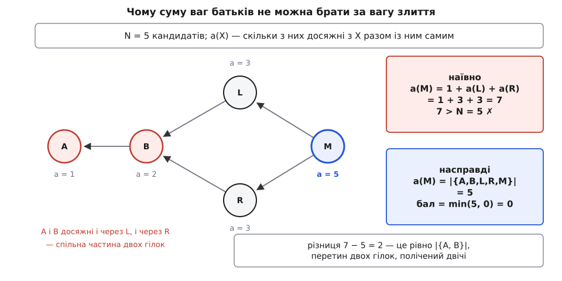
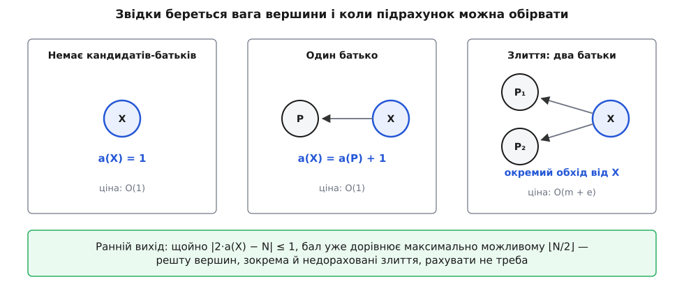

# ⚙️ Крок bisect у коді: від графа комітів до наступної перевірки

Один крок пошуку регресії — чиста графова задача: дано орієнтований ациклічний граф комітів, один коміт, у якому вже зламано, і кілька, у яких ще працювало; назвати треба той коміт, перевірка якого відітне найбільше кандидатів, хай якою буде відповідь. Тут ця задача доведена до робочого коду — разом із пасткою, на якій ламається перша-ліпша реалізація, і з розрахунком, скільки вона насправді коштує.

## Що саме має порахувати один крок

Вхід:

- **граф** — на кожен коміт список його батьків; ребро веде від дитини до батька, циклів немає (коміт не може бути своїм предком, бо його ім'я — хеш вмісту, у якому вже є імена батьків);
- **поганий коміт** — тест там падає;
- **добрі коміти** — там тест проходить;
- **пропущені** — коміти, які взагалі не вдалося перевірити (не збираються), тож відповіді про них немає.

Вихід: коміт, який перевіряти наступним, і скільки кандидатів гарантовано відпаде після відповіді.

Крок самодостатній. Людина (або скрипт) відповідає «добрий» чи «поганий», відповідь дописується до входу, і та сама функція викликається знову. Ніякого стану між викликами немає, і це не дрібниця: саме тому `git bisect` переживає перезапуск, перемикання гілки й вимкнений на ніч комп'ютер — увесь стан лежить у списку відповідей, а не в пам'яті процесу.

Дві величини, навколо яких усе крутиться:

```
N     — скільки всього кандидатів лишилося
a(X)  — скільки кандидатів досяжні з X разом із самим X
бал(X) = min( a(X), N − a(X) )
```

Якщо X виявиться поганим, відпаде все, що з нього **не** досяжне, — N − a(X) комітів. Якщо добрим — відпаде вся його історія, тобто a(X). Наперед не знаємо, який випадок настане, тому оцінюємо гірший і беремо максимум цієї оцінки. Уся робота кроку — чесно порахувати a(X) для кожного кандидата.

## Граф на масивах

Природне подання графа — вузол із покажчиками на батьків — тут програє. За один крок граф обходять щонайменше тричі, а самих кроків близько десятка; на репозиторії в кілька сотень тисяч комітів це сотні мільйонів переходів за покажчиками, і кожен такий перехід із великою ймовірністю не влучає в [кеш процесора](root:hw-arch/cache) — швидку пам'ять поруч із ядром, яка тримає нещодавно читані ділянки й віддає їх за одиниці тактів замість сотень. Тому граф кладемо у два суцільні масиви: усі списки батьків підряд і масив зсувів, де починається список кожної вершини.

:::code proj-bisect-scoring/cpp/hraf-na-masyvakh.cpp

Такий граф будується одним проходом по виводу `git rev-list --all --parents`, де кожен рядок — коміт і його батьки; хеші замінюються на цілі номери через хеш-таблицю. Далі жодних хешів у гарячому коді немає — тільки індекси, і всі допоміжні масиви адресуються тим самим індексом.

## Множина кандидатів

Кандидати — це не «коміти між двома датами» і не «те, що показує `git log`». Кандидат — коміт, досяжний із поганого й **не досяжний** із жодного доброго. Друга умова робить половину роботи: якщо коміт входить в історію доброго, він уже перевірений — добрий коміт містить у собі всю його роботу, і тест при цьому проходить.

Тож спершу помічаємо все, що досяжне з добрих, а потім обходимо предків поганого, не заходячи в помічене.

:::code proj-bisect-scoring/cpp/mnozhyna-kandydativ.cpp

Обидва обходи — [пошук у глибину](root:sf-algorithms/depth-first-search) зі своїм стеком замість рекурсії: історія в кілька сотень тисяч комітів дає такі довгі ланцюжки, що рекурсивний обхід просто переповнить стек процесу.

Найважливіше тут — не сам обхід, а `local`. Це перенумерація: кандидати дістають щільні номери 0…N−1, і всі подальші масиви (ваги, лічильники, мітки) мають довжину N, а не довжину всього репозиторію. Різниця між 800 і 400 000 елементів на масив — це різниця між «усе в кеші» й «кожне звертання в оперативну пам'ять». Заразом `local[v] < 0` стає єдиною перевіркою «ця вершина поза множиною», яка далі знадобиться в кожному циклі: **ребра, що ведуть із множини кандидатів назовні, просто обрізаються**. Вершина за межами множини вже перевірена або недосяжна — рахувати її не можна ні як кандидата, ні як частину чиєїсь історії, бо N і всі бали рахуються всередині множини.

Обидва обходи разом коштують O(V + E) — один прохід по всьому графу.

## Пастка: сума ваг батьків

Тепер ваги. Спокуса очевидна: вершина без батьків має a = 1, а взагалі

```
a(X) = 1 + Σ a(P)   по всіх батьках P
```

Для ланцюжка це працює. Для злиття — брехня. Візьмімо мінімальний приклад: коміт **B** над **A**, від B розходяться дві гілки **L** і **R**, і **M** зливає їх назад.


*Наївна сума додає історії обох батьків, а вони перетинаються: A і B лежать в історії і L, і R, тож ідуть у підсумок двічі. Похибка 7 − 5 дорівнює саме розміру перетину.*

Наївна формула дає a(M) = 1 + 3 + 3 = 7, тимчасом як кандидатів усього п'ять. Число, більше за N, — це подарунок: помилка сама себе показує, бо бал min(7, 5 − 7) виходить від'ємний. У справжньому репозиторії перетин гілок — це не два коміти, а вся історія до точки розходження, тобто майже все; похибка виходить величезною, але вже не такою помітною, бо N теж велике.

Причина проста й важлива: **a(X) — це потужність об'єднання, а не сума**. Сума дорівнює об'єднанню лише тоді, коли множини не перетинаються, а історії двох батьків злиття перетинаються завжди — на тому вони й батьки одного коміта, що колись розійшлися з однієї точки.

> 🔧 **Навіщо це.** Помилка в a() не ламає нічого видимого: код не падає, bisect далі щось пропонує й зрештою знаходить-таки перший поганий коміт — просто перевірок буде помітно більше, бо кожен вибір робиться за перекрученими числами. Роздута вага злиття ще й успадковується вниз: усі коміти над ним дістають a(P) + 1 від уже неправильного P. При тесті на хвилину це зайві чверть години на кожен пошук регресії, і ніхто не здогадається, що винен подвійний облік предків, бо симптом має вигляд «ну, історія складна». Саме тому цю величину рахують точно, хоч це й дорожче.

## Правильний підрахунок: топологічний порядок і два режими

Точна вага вимагає двох речей.

Перша: коли рахуємо вершину, ваги всіх її батьків-кандидатів мають бути вже готові. Це [топологічний порядок](root:sf-algorithms/topological-sort) — лінійне впорядкування вершин DAG, у якому кожна вершина стоїть після всіх, від яких залежить. Будуємо його лічильниками: кожній вершині записуємо, скільки в неї батьків **усередині множини**; черга починається з тих, у кого їх нуль; опрацювавши вершину, зменшуємо лічильник у кожної її дитини й ставимо в чергу ту, у якої лічильник упав до нуля. Для цього потрібен зворотний бік ребер — списки дітей, яких у графі комітів немає, тож будуємо їх тим самим стисненим поданням.

:::code proj-bisect-scoring/cpp/pravylnyi-pidrakhunok.cpp

Два проходи й часткові суми замість вектора векторів — та сама причина, що й раніше: одне суцільне виділення пам'яті замість N дрібних.

Друга річ — власне підрахунок, і він має два режими.


*Ланцюжок дає вагу задарма, злиття — тільки повним обходом. Ранній вихід рятує від того, щоб рахувати всі злиття підряд.*

У вершини **один** батько-кандидат — жодного перетину немає, `a(X) = a(P) + 1`, ціна O(1). У вершини **два або більше** — перетин є, і чесно порахувати можна лише обійшовши всю досяжну частину множини й полічивши різні вершини. Саме так це зроблено і в самому git: у `bisect.c` лінійні ділянки протягуються дешево, а на кожне злиття викликається окремий обхід `count_distance()`.

:::code proj-bisect-scoring/cpp/pravylnyi-pidrakhunok-2.cpp

Мітка-номер замість прапорця, який довелося б скидати після кожного злиття, — дрібниця, але вона прибирає прохід по всьому масиву на кожне злиття. Кожна вершина стає `start` щонайбільше раз, тому мітки різних обходів не сплутуються.

## Бал, ранній вихід і повний крок

Лишилося з'єднати. Ідемо топологічним порядком, для кожної вершини беремо один із двох режимів, рахуємо бал і стежимо за найкращим.

Ранній вихід випливає з форми балу. min(a, N − a) не може перевищити ⌊N/2⌋, і рівність настає рівно тоді, коли |2a − N| ≤ 1: при парному N це a = N/2, при непарному — a = (N ± 1)/2, і третього не дано через парність. Тому щойно трапилася вершина з |2a − N| ≤ 1, шукати далі нема сенсу — кращого балу не буває, і всі недораховані злиття можна не рахувати зовсім.

:::code proj-bisect-scoring/cpp/bal-rannii-vykhid-i-povnyi.cpp

Умова `!skipped[v]` навколо раннього виходу — не оптимізація, а виправлення помилки: обірвати підрахунок можна лише на вершині, яку ми справді збираємося повернути. У самому git цю думку записано коментарем над відповідною перевіркою — «не зрізай шлях до того, чого не збираєшся повертати».

Git тут іде на ще один компроміс. Точна рівність |2a − N| ≤ 1 трапляється не завжди, а поки її нема, доводиться рахувати всі злиття підряд. Тому при великих N git приймає за половину все, що відхиляється менш ніж на N/1024, тобто на 0.1 %: для десяти тисяч кандидатів «половиною» вважається будь-що від 4996 до 5004. Оптимальність утрачено, але на такому відхиленні зайвий крок практично не виникає, а дорогий прохід по злиттях обривається раніше.

## Пропущені коміти

`git bisect skip` каже: цей коміт перевірити не вдалося. Не «добрий» і не «поганий» — **невідомо**. Звідси відразу випливає, чого з ним робити не можна: викидати з множини. Невідомий коміт лишається кандидатом на роль першого поганого, лишається в N і в чужих історіях; забрати його з множини означало б збрехати самим собі про розмір задачі. Пропущений вилучається тільки **з добору** — його не можна запропонувати для перевірки, бо він однаково не перевіряється.

Код вище робить найпростіше: бере найкращий бал серед непропущених. Це працює, але має ваду. Збирання ламається не на одному коміті, а смугою: якщо його зламали й полагодили через десять комітів, то й сусіди пропущеного майже напевно не зберуться. А сусід у графі — це якраз наступний за балом. Тож проста стратегія кілька разів поспіль запропонує коміти з тієї самої зламаної смуги.

Git на це відповідає стрибком: коли найкращий кандидат пропущений, він не бере другого за балом, а вибирає з непропущених за псевдовипадковим індексом, зміщеним до початку списку.

:::code proj-bisect-scoring/cpp/propushcheni-komity.cpp

У цьому «псевдовипадково» найважливіше слово — **псевдо**. Зерно генератора — не час і не стан системи, а кількість кандидатів. Той самий репозиторій із тим самим списком відповідей завжди дасть той самий наступний коміт, тож `git bisect log` можна відтворити крок у крок, а звіт про баг із чужої машини повторюється в себе. Випадковість тут потрібна лише для того, щоб розкидати спроби по графу, а не щоб бути непередбачуваною.

## Ціна кроку й кількість кроків

Порахуймо чесно, з двох боків.

**Умова: у репозиторії V = 40 000 комітів і E = 42 000 ребер; кандидатів N = 800, серед них 12 злиттів, ребер у підграфі кандидатів e = 812; збирання плюс відтворення бага — 65 с на коміт.**

```
множина кандидатів (два обходи всього графа)   V + E      ≈ 8.2·10⁴
підграф: лічильники, зсуви, списки дітей       2(N + e)   ≈ 3.2·10³
ланцюжки: 788 вершин по O(1)                              ≈ 8·10²
злиття, гірший випадок: 12 обходів по (N + e)  12·1612    ≈ 1.9·10⁴
──────────────────────────────────────────────────────────────────
разом на крок                                             ≈ 1.05·10⁵
кроків                                         log₂ 800   ≈ 9.6 → 10
```

Сто тисяч простих операцій — це частки мілісекунди; десять кроків — одиниці мілісекунд обчислень проти десяти на шістдесят п'ять секунд, тобто одинадцяти хвилин перевірок. **Уся тривалість пошуку — це тест, обчислення в ній не видно взагалі.** Звідси два висновки, які й пояснюють форму коду: за зменшення кількості кроків варто платити майже будь-якою кількістю тактів (тому вагу злиття рахують точно, а не наближено), і водночас точність, яка не змінює кількості кроків, нічого не варта (тому git спокійно приймає відхилення в 0.1 % і обриває підрахунок).

Формально: O(V + E) на побудову множини, O(N + e) на підграф і лінійні ділянки, плюс O(N + e) на **кожне** злиття, яке довелося порахувати точно, — разом O(V + E + q·(N + e)), де q — кількість таких злиттів. У теорії q може дійти до N і дати квадрат; на практиці злиття — одиниці відсотків комітів, а ранній вихід зазвичай спрацьовує раніше, ніж черга дійде до більшості з них.

Квадрат прибирається бітовими масками: якщо для кожного кандидата тримати N-бітну маску досяжних, то маска вершини — це об'єднання масок батьків плюс власний біт, а a — кількість одиниць у ній.

:::code proj-bisect-scoring/cpp/tsina-kroku-i-kilkist.cpp

Об'єднання множин стає порозрядним `|`, потужність — підрахунком одиниць (`std::popcount`, одна інструкція на сучасному процесорі). Час — O((N + e)·N/64) без жодних особливих випадків, зате пам'ять N²/8 байтів: при N = 4096 це 2 МіБ і кількадесят мікросекунд, при N = 10⁵ — 1.2 ГіБ, тобто нездійсненно. Git обрав обхід на злиттях саме тому, що межа за пам'яттю там не виникає ніколи, а квадрат за часом — майже ніколи.

Тепер друге число — кількість кроків. **≈ log₂ N справедливе для ланцюжка, а не для будь-якого графа.** Контрприклад будується одразу: хай у поганий коміт зливається k незалежних гілок по L комітів кожна (хоч одним восьминогом, хоч ланцюжком звичайних двобатьківських злиттів), N ≈ kL. Будь-який кандидат усередині гілки накриває щонайбільше L комітів, тобто бал не перевищує L, хай яке велике N. Відповідь «добрий» відтинає тільки ці L — і щоб дійти до кінця, доведеться пройтися по гілках, а це порядку k кроків замість log₂(kL). Провини алгоритму тут немає: жодна стратегія не впорається швидше, бо доки всі гілки відповідають «добрий», кожна відповідь несе інформацію лише про свою гілку. Форма історії задає нижню межу, і жоден вибір коміта її не обійде.

А от там, де форма історії межі не задає, жадібний вибір за max min(a, N − a) таки програє оптимальному, і програє серйозно. Жульєн Курт'єль, Поль Дорбек і Ромен Лекок [довели](https://arxiv.org/abs/2312.13644) (*Theoretical analysis of git bisect*, Algorithmica), що на довільних DAG-ах git bisect може вимагати експоненційно більше перевірок за оптимальний алгоритм, а сама задача пошуку регресії на графі — NP-повна, тож оптимуму все одно ніхто не порахує. Але вони ж довели й те, заради чого цей код лишається таким, як є: коли в кожного коміта не більше двох батьків — тобто на звичайних злиттях, — жадібний вибір гарантовано вкладається в 1/log₂(3/2) ≈ 1.71 раза від оптимуму, і ця межа точна. Заплатити щонайбільше сімдесятьма відсотками зайвих перевірок за алгоритм, який рахується за частки мілісекунди й не потребує знати наперед нічого про форму історії, — обмін, який досі ніхто не переграв.

## Пастки одним списком

- **Сума ваг батьків на злитті** — найпоширеніша й найтихіша помилка: a — це потужність об'єднання, історії батьків перетинаються завжди.
- **Вершини поза множиною кандидатів** не рахуються ніде: ні в N, ні в чиємусь a. Перевірка `local[v] < 0` має стояти в кожному циклі по батьках, інакше обхід виповзе в уже перевірену історію й усі бали поїдуть.
- **Порядок обробки.** Вагу вершини можна брати лише тоді, коли готові ваги **всіх** її батьків-кандидатів; лічильник `pending` саме про це, і зменшувати його треба один раз на ребро.
- **Пропущені коміти** лишаються в множині й у підрахунках; вилучаються тільки з добору. Викинути їх із N — означає порахувати не ту задачу.
- **Ранній вихід не сміє спрацювати на коміті, якого не повернемо** — на пропущеному або на будь-якому іншому відфільтрованому.
- **Порожній результат — не помилка.** Коли всі кандидати пропущені, чесна відповідь — «перший поганий десь серед оцих, точніше не скажу», і код має вміти її віддати, а не впасти.
