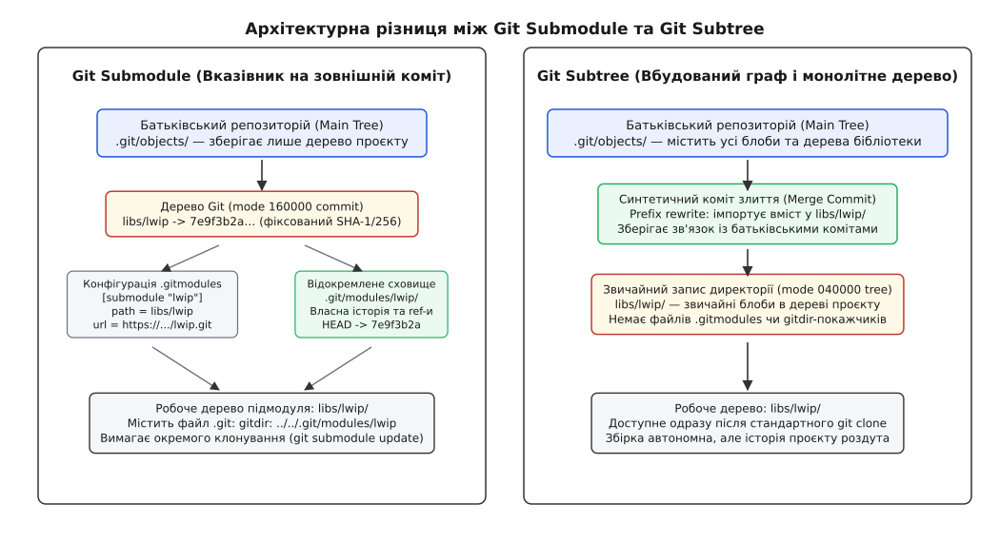
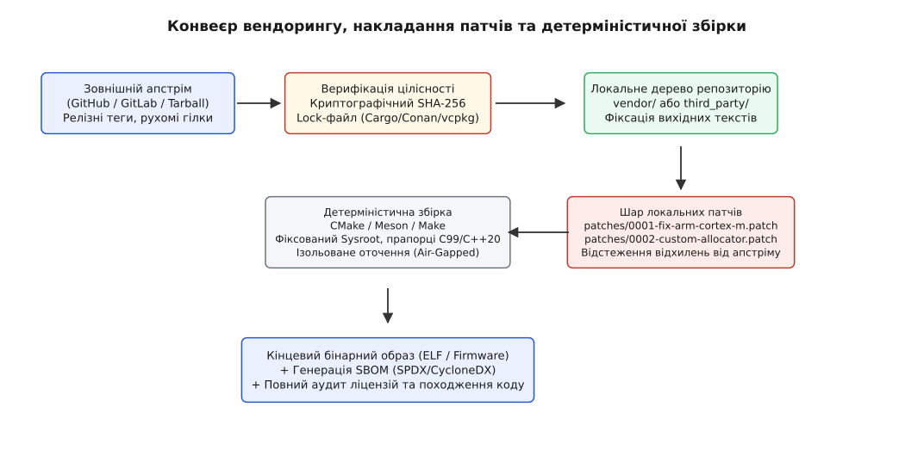

# Звідки в образі чужий код: підмодуль, вендоринг, менеджер пакетів

<preknowlist>
- [Гілки та граф комітів](root:sys-ide/git-branching-and-history) — структура об'єктів Git, коміти, дерева та вказівники посилань.
- [Відтворюваність бінарних збірок](root:sys-bsystem/reproducible-builds) — детермінізм бінарних артефактів, фіксація версій та бінарна ідентичність.
- [Моделі менеджерів залежностей](root:sys-bsystem/dependency-manager-model) — семантичне версіонування, графовий дозвіл залежностей і конфлікти версій.
- [Підпроекти через FetchContent у CMake](root:sys-bsystem/fetchcontent-subprojects) — затягування зовнішнього сирцевого коду під час конфігурації збірки.
</preknowlist>

Коли компілятор формує бінарний образ прошивки промислового контролера чи системного демона, фінальний файл розміром у два мегабайти лише на п'ять-десять відсотків складається з коду, написаного командою безпосередньо в цьому репозиторії. Решта дев'яносто відсотків машинного коду — це мережевий стек lwIP, криптографічні примітиви mbedTLS, драйвери периферії виробника мікроконтролера, шар абстракції операційної системи реального часу FreeRTOS та синтаксичний парсер JSON. Якщо розробник затягує ці бібліотеки наосліп через плаваючі гілки зовнішніх сховищ або нефіксовані мережеві архіви, бінарна збірка стає випадковою подією: нічний релігійний патч у сторонньому репозиторії змінює внутрішнє вирівнювання структур пам'яті, ламає двійкову сумісність інтерфейсів або відкриває вразливість нульового дня, яку неможливо відстежити за власною історією комітів.

Керування стороннім кодом у системному проектуванні лежить на стику двох протилежних вимог. З одного боку, зовнішня бібліотека має розвиватися автономно у власному життєвому циклі, отримувати виправлення дефектів від авторів і не засмічувати повсякденну історію розробки прикладного коду тисячами чужих ревізій. З іншого боку, збірка бінарного образу вимагає абсолютної криптографічної фіксації кожного стороннього байта, повної відтворюваності бінарного артефакту через п'ять років після зняття виробу з виробництва та суворого аудиту ліцензійних обмежень кожного модуля.

## Анатомія Git Submodules: режим 160000 та розв'язані репозиторії

Система контролю версій Git зберігає файли як об'єкти-блоби (`blob`), а каталогу — як дерева (`tree`). У стандартному записі дерева каталогу кожен елемент має атрибут прав доступу POSIX: звичайний файл позначається маскою `100644`, виконуваний бінарний файл — `100755`, а символьне посилання — `120000`. Коли розробник додає підмодуль через команду `git submodule add`, Git створює в дереві об'єкт особливого типу — `gitlink` (англ. *git link* — посилання на коміт стороннього репозиторію), який маркується спеціальним режимом файлової системи `160000`.

Режим `160000` принципово відрізняється від звичайної каталогу. Замість того, щоб посилатися на SHA-хеш іншого дерева об'єктів всередині власної бази `.git/objects/`, цей запис містить сорокасимвольний SHA-1 (або 64-символьний SHA-256) ідентифікатор конкретного коміту в абсолютно незалежному сховищі. Сам батьківський репозиторій не зберігає жодного файлу з кодової бази підмодуля, жодного рядка його коду і жодного дерева його каталогів. Батьківський проект фіксує лише точну числову адресу точки в чужому графі історії.

```
100644 blob e69de29bb2d1d6434b8b29ae775ad8c2e48c5391    CMakeLists.txt
100644 blob 4b825dc642cb6eb9a060e54bf8d69288fbee4904    main.c
040000 tree d8329fc1cc938780ffdd9f94e0d364e0ea74f579    src
160000 commit 7e9f3b2a1c0d55e82931a742b683ef91d904721a    libs/lwip
```

У двійковому представленні об'єкта дерева Git (об'єкт типу `tree` у сховищі `.git/objects/`) кожен запис формується як послідовність байтів: режим доступу у вісімковому коді ASCII, пробіл, ім'я файлу або каталогу у кодуванні UTF-8, нульовий байт-роздільник `\0` та рівно 20 байтів двійкового хешу SHA-1 (або 32 байти SHA-256). Для підмодуля рядок режиму записується як `160000`, а наступні 20 байтів містять сирий двійковий хеш коміту підмодуля.

Криптографічний ланцюг Меркла (англ. *Merkle tree*) забезпечує абсолютну незмінність цієї структури. Якщо у вкладеному репозиторії розробник змінює хоча б один символ у коментарі, це породжує новий блоб, нове дерево підмодуля і новий хеш коміту підмодуля. Батьківський репозиторій бачить зміну двійкового 20-байтного значення у своєму дереві `tree`, що викликає лавиноподібну зміну кореневого SHA-хешу батьківського репозиторію. Жодна зміна стороннього коду не може проникнути в систему непоміченою для системи контролю версій.

У двійковому файлі індексу Git (`.git/index`) запис `gitlink` має чітко визначену структуру заголовка `struct cache_entry`. Поле режиму файлу `ce_mode` містить бітове значення `0b1110000000000000` (вісімковий код `0160000`, константа `S_IFGITLINK`), а розмір файлу `ce_size` завжди дорівнює нулю. Замість хешу вмісту файлу в 20-байтному полі `sha1` записується прямий хеш коміту підмодуля.

Метадані про те, звідки саме брати вміст для шляху `libs/lwip`, виносяться у спеціальний текстовий файл `.gitmodules`, розташований у корені робочого дерева батьківського репозиторію. Цей файл є версіонованим артефактом, відстежується як звичайний текстовий blob і має структуру, ідентичну формату `git-config`:

```ini
[submodule "libs/lwip"]
    path = libs/lwip
    url = https://github.com/lwip-tcpip/lwip.git
    branch = master
    update = checkout
    shallow = true
```

Параметр `path` задає точку монтування підмодуля відносно кореня репозиторію, `url` визначає віддалену адресу для клонування, а `branch` є лише підказкою для інструментів оновлення й не впливає на те, який саме коміт монтується за замовчуванням. Головний інваріант підмодуля — жорстка фіксація: робоче дерево підмодуля завжди розгортається на той SHA-хеш, який записаний у `gitlink` режиму `160000` поточного коміту батьківського репозиторію, незалежно від стану віддаленої гілки `master` чи нових релізів.


*Архітектурне порівняння: підмодуль зберігає лише вказівник на зовнішній коміт і відокремлює сховище, тоді як піддерево вбудовує повний вміст і граф комітів у монолітне дерево проєкту.*

У ранніх версіях Git (до версії 1.7.8) всередині каталогу підмодуля створювалася повноцінна каталог `.git/`. Це спричиняло критичні збої: якщо розробник перемикав гілку в батьківському проекті, де підмодуль видалявся або перейменовувався, рекурсивне очищення робочого каталогу безповоротно знищувало локальну історію та незбережені коміти у вкладеному репозиторії.

Сучасний Git використовує decoupled storage (відокремлене сховище). Справжня база об'єктів та службові файли підмодуля зберігаються у глибинах батьківської каталогу за адресою `.git/modules/<ім'я_підмодуля>/`. У робочій каталогу підмодуля створюється звичайний однорядковий текстовий файл `.git`, який містить директиву перенаправлення `gitdir`:

```
gitdir: ../../.git/modules/libs/lwip
```

Завдяки цьому перемикання гілок чи видалення робочої папки в головному проекті не зачіпає історію підмодуля: при повторній ініціалізації Git просто знову зв'язує робочу копію з уже завантаженою базою об'єктів у `.git/modules/`.

> 🔧 **Навіщо це.** Відокремлене сховище `.git/modules/` дозволяє безболісно очищати робочу копію командою `git clean -ffdx`, не ризикуючи втратити локальні гілки, stash чи конфігурацію вкладених підмодулів.

## Відносні URL та ізольовані корпоративні контури

У промислових проектах публічні абсолютні URL (`https://github.com/...`) у файлі `.gitmodules` є джерелом постійних збоїв. Якщо організація веде розробку в ізольованому корпоративному контурі (GitLab, Gitea) або розробники використовують різні протоколи аутентифікації (одні працюють через `ssh://git@...`, інші через `https://`), абсолютне посилання ламає автоматизацію.

Стандартом корпоративного проектування є використання **відносних URL** (англ. *relative submodule URLs*):

```ini
[submodule "libs/driver-hal"]
    path = libs/driver-hal
    url = ../../firmware-components/driver-hal.git
```

Коли у файлі `.gitmodules` вказано відносний шлях, Git вираховує цільову адресу підмодуля динамічно, спираючись на значення `remote.origin.url` батьківського репозиторію:
1. **Автоматичне наслідування протоколу**: якщо батьківський проект було схилено через SSH (`git@gitlab.internal.corp:project/main.git`), Git автоматично сформує SSH-адресу для підмодуля (`git@gitlab.internal.corp:firmware-components/driver-hal.git`).
2. **Підтримка персональних форків**: якщо інженер робить форк усієї групи проектів у власний простір імен (`gitlab.internal.corp/ivanov/main.git` та `gitlab.internal.corp/ivanov/driver-hal.git`), відносний шлях автоматично підтягне вкладений репозиторій із персонального форка розробника без необхідності змінювати версіонований файл `.gitmodules`.

## Життєвий цикл та пастки робочого стану підмодуля

Типова помилка початківця при роботі з репозиторіями зі складною структурою — виконання звичайного клонування `git clone <url>` з наступною спробою скомпілювати проект. Оскільки батьківське дерево зберігає лише сорокабайтові записи `gitlink`, звичайний клон залишає каталог `libs/lwip/` абсолютно порожньою. Компільований проект падає на першому ж заголовку `#include "lwip/opt.h"`.

Щоб підмодуль перейшов у робочий стан, процес розгортання повинен пройти чотири дискретні фази:

```
[Неініціалізований (Uninitialized)]
        │  git submodule init (копіює URL з .gitmodules у .git/config)
        ▼
[Зареєстрований у конфігурації (Configured)]
        │  git submodule update (клонує об'єкти в .git/modules/ і робить checkout)
        ▼
[Від'єднаний HEAD (Detached HEAD)]
        │  розробник змінює файли та робить локальний commit
        ▼
[Змінений стан (Dirty Submodule) + Новий SHA]
        │  git add libs/lwip у батьківському проєкті
        ▼
[Оновлений Gitlink у батьківському дереві]
```

Перша команда `git submodule init` виконує реєстрацію: вона читає секції з файлу `.gitmodules` і записує їх у локальний конфігураційний файл `.git/config`. Це дає розробнику можливість перевизначити URL підмодуля (наприклад, замінити публічний GitHub URL на внутрішній дзеркальний сервер компанії) без модифікації версіонованого файлу `.gitmodules`.

Друга команда `git submodule update` звертається до `.git/config`, клонує відсутні об'єкти в каталог `.git/modules/<ім'я>/` і переводить робоче дерево підмодуля у стан **від'єднаного покажчика HEAD** (англ. *detached HEAD*). У цьому стані вкладений репозиторій перебуває на конкретному коміті SHA, не належачи до жодної локальної гілки.

Якщо розробник вносить зміни у сирцеві коди підмодуля, будучи у стані detached HEAD, і виконує команду `git commit` всередині підмодуля, створюється новий коміт, на який не посилається жодна гілка. Після цього у батьківському репозиторії команда `git status` показує зміну:

```
Changes not staged for commit:
  (use "git add <file>..." to update what will be committed)
  (use "git checkout -- <file>..." to discard changes in working directory)

	modified:   libs/lwip (new commits)
```

Батьківський проект фіксує зміну значення `gitlink` з попереднього SHA на новий щойно згенерований хеш. Тут виникає критична пастка розробки: якщо розробник робить `git commit` і `git push` у батьківському репозиторії, але забуває виштовхнути створений коміт із вкладеного підмодуля у віддалений апстрім, збірка ламається для всієї решти команди. Будь-який інший інженер або сервер безперервної інтеграції (CI), отримавши новий коміт головного проекту, спробує виконати `git submodule update` і впаде з фатальною помилкою: `fatal: reference is not a tree: <sha>`. Батьківський репозиторій посилається на об'єкт, який існує виключно на SSD одного конкретного розробника.

Для запобігання такій ситуації Git надає захисний прапорець під час публікації змін:

```bash
git push --recurse-submodules=check
```

Цей прапорець інструктує Git перевірити всі оновлені `gitlink` перед відправкою головної гілки. Якщо хоча б один коміт підмодуля відсутній на віддаленому сервері, команда блокує push батьківського проекту. Прапорець `--recurse-submodules=on-demand` автоматично намагається виштовхнути локальні коміти кожного підмодуля перед пушем головного репозиторію.

### Стратегії оновлення підмодулів (Update Strategies)

У файлі `.gitmodules` директива `update` визначає, як саме Git повинен оновлювати робоче дерево підмодуля під час виклику `git submodule update`:
1. `checkout` (за замовчуванням): робоче дерево перемикається на точний коміт SHA у стан detached HEAD. Усі локальні незбережені зміни, що конфліктують із цільовим комітом, блокують операцію.
2. `rebase`: Git бере локальну гілку підмодуля і намагається перебазувати локальні коміти розробника поверх нового зафіксованого коміту SHA. Якщо виникають конфлікти злиття, процес оновлення зупиняється для ручного розв'язання.
3. `merge`: виконується звичайне тристороннє злиття нового зафіксованого коміту в поточну локальну гілку підмодуля.
4. `none`: команда `git submodule update` повністю ігнорує цей підмодуль, залишаючи керування його станом стороннім скриптам або ручним діям розробника.
5. `!custom_command`: Git викликає довільну користувацьку утиліту для розгортання вмісту підмодуля.

### Колізії злиття на рівні Gitlink (Submodule Merge Conflicts)

Коли двоє розробників паралельно оновлюють той самий підмодуль у різних гілках, при злитті гілок виникає конфлікт запису режиму `160000`. На відміну від звичайного текстового файлу, де Git вставляє маркери конфлікту `<<<<<<<`, `=======`, `>>>>>>>`, конфлікт у підмодулі не має текстового представлення у файловій системі.

У файлі індексу `.git/index` з'являються три записи для того самого шляху на різних стадіях злиття:
- Стадія 1 (Stage 1 — Спільний предок / Merge Base): хеш коміту підмодуля на момент розгалуження гілок.
- Стадія 2 (Stage 2 — Наша гілка / Ours): хеш коміту підмодуля у поточній гілці.
- Стадія 3 (Stage 3 — Чужа гілка / Theirs): хеш коміту підмодуля у гілці, яку ми вливаємо.

Розв'язання такого конфлікту вимагає від системного інженера розуміння графу комітів підмодуля. Інженер повинен перейти в каталог підмодуля, визначити, який із двох комітів є новішим (або створити новий інтеграційний коміт всередині підмодуля), виконати `git checkout <обраний_sha>`, повернутися у батьківський проект і виконати `git add libs/lwip`. Лише після цього конфлікт вважається вичерпаним.

## Протокол транспорту, рекурсивні структури та оптимізація трафіку

У великих вбудованих проектах дерево залежностей рідко буває пласким. Типова операційна система реального часу (наприклад, Zephyr RTOS або ESP-IDF) сама містить десятки підмодулів: криптографічні бібліотеки, стеки Bluetooth, файлові системи та HAL виробників мікроконтролерів. Виникає структура **транзитивних рекурсивних підмодулів** (англ. *transitive recursive submodules*).

Команда розгортання всього графу вимагає рекурсивного обходу:

```bash
git submodule update --init --recursive --jobs 8
```

Прапорець `--jobs 8` вмикає паралельне завантаження незалежних підмодулів у вісім потоків. Без цього прапорця послідовний клон 50 підмодулів через встановлення окремих SSH- або TLS-сесій може займати десятки хвилин.

Для мінімізації мережевого навантаження та економії дискового простору на вузлах CI застосовуються дві ключові техніки оптимізації:

### 1. Неглибоке клонування (Shallow Cloning)
Директива `shallow = true` у файлі `.gitmodules` або прапорець `--depth 1` під час ініціалізації вказує Git завантажувати лише один конкретний коміт без його історичного графу:

```bash
git submodule update --init --recursive --depth 1
```

Це скорочує обсяг завантажуваних даних для таких масивних проектів, як LLVM або Linux Kernel, з декількох гігабайтів до десятків мегабайтів.

### 2. Часткове клонування (Partial / Blobless Clone)
Якщо системі потрібна історія комітів для виконання операцій `git log` або `git blame`, але не потрібні історичні версії великих бінарних файлів, застосовується фільтрація блобів:

```bash
git submodule update --init --recursive --filter=blob:none
```

У цьому режимі Git завантажує дерева та коміти, а вміст файлів (блоби) підтягує динамічно на вимогу лише для поточного робочого зрізу.

### Синхронізація віддалених адрес через `git submodule sync`

Якщо адміністратор репозиторію змінює URL підмодуля у файлі `.gitmodules` (наприклад, проект мігрує з GitHub на внутрішній корпоративний GitLab), звичайний `git pull` не оновлює налаштування локального репозиторію розробника. Локальний конфіг `.git/config` та `.git/modules/<name>/config` зберігає старий URL, закешований під час першої ініціалізації.

Для поширення змін адрес застосовується команда:

```bash
git submodule sync --recursive
```

Вона рекурсивно вичитує нові адреси з `.gitmodules` і перезаписує конфігураційні параметри `remote.origin.url` у всіх локальних базах `.git/modules/`.

## Крайові випадки життєвого циклу та системні аварії підмодулів

Робота з підмодулями у довгоживучих проектах супроводжується специфічними крайовими ситуаціями, які при некоректному виконанні команд призводять до пошкодження репозиторію.

### 1. Перейменування та переміщення підмодуля
Якщо розробник виконує команду `git mv libs/lwip third_party/network/lwip`, Git виконує комплексне оновлення:
- У файлі `.gitmodules` змінюється поле `path = third_party/network/lwip`, але ім'я секції `[submodule "libs/lwip"]` часто залишається старим для збереження спадкоємності конфігурації.
- Однорядковий файл `.git` у новій робочій каталогу оновлюється новим відносним шляхом до сховища: `gitdir: ../../../.git/modules/libs/lwip`.
- У базі `.git/modules/libs/lwip/config` оновлюється параметр `core.worktree = ../../../third_party/network/lwip`.

Якщо розробник помилково переміщує каталог стандартною утилітою файлової системи `mv libs/lwip third_party/network/lwip` без участі Git, відносні шляхи `gitdir` та `core.worktree` стають битими. Будь-яка подальша спроба виклику `git status` у підмодулі падає з фатальною помилкою: `fatal: core.worktree and GIT_WORK_TREE disagree`. Відновлення працездатності вимагає ручного виправлення шляхів у текстових конфігах.

### 2. Безпечне повне видалення підмодуля
Пряме видалення робочої каталогу через `rm -rf libs/lwip` залишає сміття у трьох різних місцях репозиторію: у файлі індексу, у файлі `.gitmodules` та у конфігурації `.git/config`. Регламент коректного видалення підмодуля складається з трьох послідовних кроків:

```bash
# Крок 1: Деініціалізація (очищення .git/config та видалення робочого дерева)
git submodule deinit -f libs/lwip

# Крок 2: Видалення gitlink з індексу та секції з .gitmodules
git rm -f libs/lwip

# Крок 3: Фізичне видалення збережених об'єктів з бази модулів
rm -rf .git/modules/libs/lwip
```

Лише після виконання цих трьох кроків і створення коміту в батьківському проекті репозиторій повністю звільняється від слідів стороннього коду.

### 3. Циклічні транзитивні підмодулі та запобігання зацикленню
У складних мікросервісних або вбудованих архітектурах трапляється ситуація, коли бібліотека A включає як підмодуль тестовий стенд B, а стенд B у своїх залежностях містить бібліотеку A. Якщо розробник запускає `git submodule update --init --recursive` на застарілих версіях Git, білд-сервер входив у нескінченний цикл створення вкладених каталогів `libs/A/libs/B/libs/A/libs/B...`, доки не вичерпувався ліміт довжини шляху файлової системи (`PATH_MAX`).

Сучасний Git відстежує унікальні хеші та шляхи сховищ у процесі рекурсії, зупиняючи повторне розгортання вже ініціалізованого сховища. Проте найкращою практикою проектування є категорична заборона циклічних посилань на рівні архітектурного аудиту.

## Простеження та діагностика через змінні середовища Git

Коли автоматизований скрипт збірки зависає на операціях оновлення підмодулів або падає з незрозумілою мережевою помилкою, системний інженер має можливість активувати внутрішні трасувальні канали ядра Git через змінні середовища POSIX:

- `GIT_TRACE=1`: виводить у потік `stderr` повну послідовність внутрішніх викликів підпроцесів, виконання хуків та звернень до файлів конфігурації.
- `GIT_TRACE_SETUP=1`: показує, як Git визначає кореневий каталог репозиторію, резолвить шлях `gitdir` та зв'язує робоче дерево підмодуля з базою `.git/modules/`.
- `GIT_TRACE_PERFORMANCE=1`: фіксує точний час виконання кожної внутрішньої фази (читання індексу, парсинг дерев, обчислення дельт).
- `GIT_CURL_VERBOSE=1`: вмикає детальний дамп HTTP/HTTPS та TLS заголовків під час клонування через Smart HTTP протокол, дозволяючи миттєво локалізувати проблеми з проксі-серверами чи корпоративними сертифікатами.

Для аналізу структурного здоров'я сховища використовується утиліта `git-sizer`, яка сканує граф об'єктів і сигналізує про небезпечне розростання бази (завелику кількість вкладених дерев, гігантські блоби чи надмірну довжину шляхів у підмодулях). Крім того, перевірка криптографічної цілісності бази об'єктів виконується командою `git fsck --full --strict`, яка виявляє пошкоджені зв'язки Merkle tree, бінарні колізії та некоректні вказівники gitlink. Вмикання системних прапорців `fetch.fsckObjects = true` та `transfer.fsckObjects = true` у глобальному конфігу Git примушує ядро перевіряти кожен отриманий сторонній об'єкт на валідність заголовків перед записом на диск, що захищає конвеєр збірки від експлойтів переповнення буфера в синтаксичних парсерах дерев Git.

## Конфігураційні заголовки та прокидання прапорців компілятора

У системному програмуванні на C та C++ сторонній код майже ніколи не компілюється як незмінний чорний ящик. Системні компоненти (мережевий стек lwIP, операційна система FreeRTOS, криптографічна бібліотека mbedTLS) спеціально спроектовані так, щоб їхній внутрішній функціонал, розміри буферів та вирівнювання структур визначалися користувацькими заголовками конфігурації: `lwipopts.h`, `FreeRTOSConfig.h`, `mbedtls_config.h`.

Тут криється класична пастка компіляції: **конфлікт порядку пошуку заголовків**.
Якщо в CMake включити каталогу сторонньої бібліотеки через стандартний прапорець `target_include_directories(app PRIVATE libs/lwip/src/include)`, а користувацький конфігураційний файл покласти в `src/config/lwipopts.h`, компілятор може спочатку прочитати дефолтний файл `libs/lwip/src/include/lwip/opt.h`. Бібліотека скомпілюється з невірними системними налаштуваннями: без підтримки апаратного контролю чексум, з мінімальним пулом дескрипторів сокетів та без синхронізації м'ютексів.

Для гарантування коректної поведінки системні інженери застосовують розподіл прапорців компілятора:
1. Каталог із конфігураційними заголовками проекту підключається першим через звичайний `-I` або `-iquote`.
2. Шляхи до вихідних заголовків підмодулів підключаються через прапорець **системних інклюдів** `-isystem` (у CMake це задається директивою `SYSTEM` у `target_include_directories`).

Застосування `-isystem` дає дві фундаментальні переваги:
- Компілятор (GCC або Clang) шукає користувацькі файли конфігурації раніше системних бібліотечних заголовків.
- Компілятор повністю пригнічує вивід попереджень (warnings) для стороннього коду. Це дозволяє компілювати власний прикладний код із максимально суворими прапорцями `-Wall -Wextra -Werror -Wpedantic`, не ризикуючи отримати зупинку збірки через застарілий стиль коду всередині чужої бібліотеки.

## Git Subtree: злиття історій без відокремлених сховищ

Через психологічну та операційну складність підмодулів інженери часто звертаються до механізму `git subtree` (піддерево). На відміну від підмодулів, які ізолюють репозиторії на рівні файлової системи та протоколу, Git Subtree — це спосіб об'єднання двох незалежних історій комітів всередині одного єдиного сховища об'єктів.

Під час виконання команди додавання піддерева:

```bash
git subtree add --prefix=libs/lwip https://github.com/lwip-tcpip/lwip.git master --squash
```

відбуваються наступні низькорівневі операції:
1. Git клонує зовнішні об'єкти безпосередньо у власну базу `.git/objects/`.
2. Створюється синтетичний коміт, який бере дерево об'єктів зовнішнього проекту і виконує операцію **префіксного переписування** (англ. *prefix rewriting*), зміщуючи всі файли у віртуальний підкаталог `libs/lwip/`.
3. Створюється спеціальний коміт злиття (merge commit), який має двох батьків: поточний коміт головного проекту та імпортований коміт зовнішньої бібліотеки (або один сплющений коміт у разі прапорця `--squash`).

У дереві батьківського репозиторію запис `libs/lwip` отримує стандартний режим каталогу `040000 tree`, а всі файли всередині — звичайні режими `100644` чи `100755`. Ніяких файлів `.gitmodules`, ніяких покажчиків `.git` і ніяких специфічних режимів `160000` не існує.

Головна перевага Subtree — абсолютна прозорість для кінцевого споживача репозиторію. Будь-який інженер або автоматизований конвеєр збірки виконує стандартний `git clone <url>` без додаткових прапорців і миттєво отримує повне, готове до компіляції дерево вихідних текстів. Збірка працює в повністю ізольованому від мережі оточенні (air-gapped environment) без необхідності підключення до сторонніх серверів.

Проте платою за цю простоту є роздування бази об'єктів і складність синхронізації. Оскільки весь вміст сторонньої бібліотеки фізично вшивається у спільний граф комітів, розмір каталогу `.git` зростає на повний обсяг імпортованого коду. Якщо сторонній проект містить великі бінарні тестові файли або багату десятирічну історію, ці дані назавжди стають тягарем для кожного клонування.

Виштовхування локально внесених правок назад у зовнішній репозиторій через `git subtree push` вимагає від Git повного сканування всієї історії головного репозиторію через внутрішній алгоритм `git subtree split`. Алгоритм аналізує кожен коміт батьківського репозиторію, виділяє зміни за префіксом `libs/lwip/` і синтезує нову незалежну лінійну гілку комітів, яку відправляє на зовнішній сервер. При великих графах розробки (десятки тисяч комітів) ця операція займає значний час і нерідко призводить до конфліктів ідентифікаторів дерев об'єктів.

## Вендоринг (Vendoring): повна автономність ціною втрати історії

Вендоринг (від англ. *vendor* — постачальник) — це інженерна практика прямого включення стороннього коду в дерево репозиторію шляхом фізичного копіювання файлів без збереження метаданих системи контролю версій. Каталог `vendor/`, `third_party/` або `extern/` наповнюється чистим зрізом вихідних текстів бібліотеки, а зв'язок з оригінальним Git-репозиторієм розривається.

Такий підхід є стандартом де-факто в аерокосмічній галузі (зокрема, в архітектурі NASA core Flight System), розробці ядер операційних систем (Linux, FreeBSD) та великих монорепозиторіях (Chromium, Go toolchain). Причина — вимога абсолютної стабільності ланцюга постачання.

```
project-root/
├── CMakeLists.txt
├── src/
│   └── main.c
├── patches/
│   ├── 0001-mbedtls-disable-dynamic-alloc.patch
│   └── 0002-lwip-custom-pbuf-pool.patch
└── third_party/
    ├── lwip/           (чистий вендорений код без .git)
    └── mbedtls/        (чистий вендорений код без .git)
```

Головна перевага вендорингу — **герметичність збірки**. Вихідний код проекту є повністю самодостатнім:
- Збірка не залежить від доступності GitHub, GitLab чи корпоративних серверів.
- Виключено ризик раптового видалення репозиторію автором або заміни релізного тегу.
- Усі інструменти пошуку коду (`grep`, LSP, ctags) бачать проект як єдине ціле без додаткових конфігурацій.

Ціною вендорингу є складність підтримки дельти — локальних модифікацій. Якщо системний інженер виправляє дефект вирівнювання пам'яті під конкретну мікроконтролерну архітектуру безпосередньо у вендореному файлі `third_party/lwip/src/core/pbuf.c`, ці правки змішуються з чужим кодом. Під час наступного оновлення бібліотеки до нової версії відрізнити локальні архітектурні патчі від змін самого апстріму стає вкрай важко.

Тому вендоринг професійного рівня завжди супроводжується **конвеєром патчів**. Вихідний код сторонньої бібліотеки тримається абсолютно недоторканим, а всі специфічні для проекту правки зберігаються у вигляді уніфікованих диференціалів (файлів `.patch`) у каталогу `patches/`. Процес оновлення описується детерміністичним скриптом:

```bash
#!/usr/bin/env bash
set -euo pipefail

UPSTREAM_TAG="v2.2.0"
TARGET_DIR="third_party/lwip"

rm -rf "${TARGET_DIR}"
git clone --depth 1 --branch "${UPSTREAM_TAG}" https://github.com/lwip-tcpip/lwip.git "${TARGET_DIR}"
rm -rf "${TARGET_DIR}/.git"

# Накладання обов'язкових локальних патчів
git apply --directory="${TARGET_DIR}" patches/0001-lwip-custom-pbuf-pool.patch
```


*Конвеєр постачання стороннього коду: від верифікації криптографічного хешу апстріму до накладання локального шару патчів та детерміністичної генерації кінцевого бінарного образу.*

У спеціалізованих вбудованих дистрибутивах (таких як Yocto Project або OpenWrt) концепція вендорингу з шаром патчів доведена до автоматизму через систему рецептів `BitBake`. У рецепті `.bb` розробник вказує:

```bitbake
SRC_URI = "git://github.com/lwip-tcpip/lwip.git;protocol=https;branch=master \
           file://0001-lwip-custom-pbuf-pool.patch \
           file://0002-fix-cortex-m-alignment.patch"
SRCREV = "7e9f3b2a1c0d55e82931a742b683ef91d904721a"
```

Білд-система самостійно завантажує точний коміт `SRCREV`, перевіряє його цілісність, накладає локальні патчі через утиліту `quilt` і компілює бінарний артефакт у строго ізольованій пісочниці.

У екосистемі Zephyr RTOS керування сотнями модулів реалізовано через утиліту `west` та мета-маніфест `west.yml`. Інструмент `west` вирішує задачу складеного репозиторію, комбінуючи переваги підмодулів та вендорингу: маніфест фіксує точні SHA-хеші всіх зовнішніх HAL-репозиторіїв виробників NXP, STMicroelectronics, Nordic Semiconductor, клонуючи їх у визначену структуру каталогів `modules/hal/`, не засмічуючи основний репозиторій ядра Zephyr.

## Менеджери пакетів та детермінізм Lock-файлів

Сучасні системні мови програмування (C++ з Conan та vcpkg, Rust із Cargo, Zig із Zig Package Manager) виробили іншу модель керування зовнішнім кодом — **декларативні маніфести у поєднанні з Lock-файлами**.

У цій моделі інженер описує бажані залежності у декларативному файлі конфігурації (наприклад, `vcpkg.json`, `conanfile.py` чи `Cargo.toml`), вказуючи допустимі версійні діапазони або семантичні обмеження (SemVer). Під час першого запуску інструмент вирішує граф залежностей і створює строго детерміністичний файл блокування (Lock-файл — `conan.lock`, `vcpkg.lock`, `Cargo.lock`).

Критична різниця між маніфестом і Lock-файлом полягає в рівні фіксації:
1. **Маніфест (`Cargo.toml`, `vcpkg.json`)** — задає логічні бізнес-вимоги проекту: «мені потрібна бібліотека `zlib` версії `>=1.2.11`».
2. **Lock-файл (`Cargo.lock`, `conan.lock`)** — фіксує фізичну ідентичність: «бібліотека `zlib` версії `1.2.13`, завантажена з конкретного URL, двійковий архів якої має контрольний хеш SHA-256 `b3a24de97a8f...`».

```toml
# Cargo.lock (фрагмент детерміністичної фіксації)
[[package]]
name = "embedded-hal"
version = "1.0.0"
source = "registry+https://github.com/rust-lang/crates.io-index"
checksum = "3614cb9f9c0f993f538074b37ac27394d1433e77778588ceb3fe3f0df4944453"
dependencies = [
    "void",
]
```

У середовищі C та C++ розробки менеджер пакетів Conan 2.x вирішує проблему сумісності бінарних ABI за допомогою концепції `package_id`. `package_id` — це SHA-1 хеш, що обчислюється на основі конфігурації компілятора, цільової архітектури процесора (ARM Cortex-M4, RISC-V RV32IMAC), версії стандарту C++ (`-std=c++20`), прапорців оптимізації та режиму винятків/RTTI. Файл блокування `conan.lock` фіксує не лише ревізію рецепту (Recipe Revision — RREV), але й точну ревізію згенерованого бінарного пакету (Package Revision — PREV).

Для C та C++ проектів на базі CMake потужною альтернативою є менеджер `vcpkg` у режимі маніфесту (Manifest Mode). Файл `vcpkg.json` описує залежності та їхні версії, а механізм `builtin-baseline` фіксує точний коміт реєстру портів `vcpkg`, гарантуючи, що всі залежності збиратимуться з узгодженого зрізу екосистеми:

```json
{
  "$schema": "https://raw.githubusercontent.com/microsoft/vcpkg-tool/main/docs/vcpkg.schema.json",
  "name": "firmware-gateway",
  "version": "1.0.0",
  "builtin-baseline": "5039f6057a66cd14309a47ddacdb7e2c9cf0ab12",
  "dependencies": [
    "fmt",
    "mbedtls",
    "freertos"
  ]
}
```

У разі використання легковика CMake `FetchContent` або `CPM.cmake` системний інженер повинен уникати небезпечної практики вказування Git-тегів:

```cmake
# Небезпечна практика (плаваючий тег або нефіксований репозиторій)
FetchContent_Declare(
    mbedtls
    GIT_REPOSITORY https://github.com/Mbed-TLS/mbedtls.git
    GIT_TAG        v3.5.0  # Увага: Git-тег не є криптографічним інваріантом!
)
```

Тег Git — це лише символічне посилання (ref) у віддаленому репозиторії. Власник репозиторію має технічну можливість виконати примусове переміщення тегу (`git tag -f v3.5.0 <новий_коміт>`), замінивши код без зміни назви версії. Якщо білд-система затягує код по тегу без перевірки криптографічного хешу, збірка перестає бути детерміністичною.

Правильний підхід для `FetchContent` та сторонніх менеджерів вимагає або використання повного незмінного сорокасимвольного хешу коміту (`GIT_TAG 8b9f1d...`), або обов'язкової верифікації криптографічного хешу архіву через директиву `URL_HASH`:

```cmake
# Безпечна детерміністична декларація з фіксацією хешу вмісту
FetchContent_Declare(
    mbedtls
    URL      https://github.com/Mbed-TLS/mbedtls/archive/refs/tags/v3.5.0.tar.gz
    URL_HASH SHA256=d9f4e24021319b222384a6b2...
)
```

Такий підхід поєднує зручність централізованого кешування з абсолютною гарантією того, що на машині розробника та сервері CI збиратиметься бінарно ідентичний сирцевий код.

## Інтеграція в білд-систему: In-Tree Targets проти Isolated Builds

Коли сторонній код потрапляє в робоче дерево проекту, постає питання його компіляції всередині загальної системи збірки (CMake чи Meson). Існують дві протилежні моделі інтеграції:

### 1. Пряме включення таргетів (In-Tree Direct Targets)
При використанні команди `add_subdirectory(libs/lwip)` або `FetchContent_MakeAvailable(lwip)` CMake читає `CMakeLists.txt` сторонньої бібліотеки безпосередньо в спільний контекст збірки.
- **Переваги**: проект отримує єдиний граф компіляції. Таргети автоматично успадковують властивості компіляції (`target_include_directories`, `target_compile_definitions`), а компілятор отримує можливість виконати наскрізну оптимізацію часу лінкування (Link-Time Optimization / Whole Program Optimization — LTO) між твоїм кодом і функціями бібліотеки, відсікаючи невикористаний код (Dead Code Elimination).
- **Недоліки**: забруднення глобального простору імен таргетів. Якщо стороння бібліотека створює таргети із загальними іменами на кшталт `tests`, `docs` або `utils`, це викликає фатальну колізію з власними таргетами проекту. Крім того, глобальні суворі прапорці попереджень компілятора (`-Wall -Wextra -Werror -Wpedantic`) починають застосовуватися до старого чужого коду, викликаючи падіння компіляції через чужі попередження.

### 2. Ізольована підзбірка (Isolated ExternalProject Builds)
Модуль CMake `ExternalProject_Add` виконує конфігурацію, компіляцію та інсталяцію сторонньої бібліотеки як абсолютно автономного процесу на етапі виконання `make` чи `ninja`.
- **Переваги**: повна ізоляція контекстів. Сторонній проект може мати власні прапорці, власну систему збірки (наприклад, Autotools чи чистий Makefile) і не конфліктувати з таргетами батьківського проекту.
- **Недоліки**: ускладнення передачі параметрів крос-компіляції (необхідно вручну прокидати значення `CMAKE_TOOLCHAIN_FILE`, `SYSROOT`, прапорці архітектури `CFLAGS`), а також неможливість виконання наскрізної оптимізації LTO через бар'єр ізольованих бінарних об'єктів.

## Системне порівняння стратегій інтеграції коду

Вибір конкретного методу інтеграції залежить від обмежень інфраструктури, вимог до автономності та політики безпеки підприємства. Порівняємо всі чотири підходи за ключовими технічними критеріями:

| Критерій оцінки | Git Submodule | Git Subtree | Вендоринг (Vendoring) | Менеджер пакетів + Lock |
|---|---|---|---|---|
| **Розмір батьківського `.git`** | Мінімальний (лише 40 байт `gitlink`) | Зростає на весь обсяг історії бібліотеки | Зростає на обсяг вихідних текстів (без чужого `.git`) | Нульовий (файли поза репозиторієм проекту) |
| **Автономність при первинному клонуванні** | Потрібен доступ до зовнішніх серверів (`--recurse`) | Повна (усе всередині одного репо) | Повна (усе всередині одного репо) | Потрібен доступ до пакетного репозиторію / кешу |
| **Складність локального патчингу** | Середня (робота у вкладеному репозиторії) | Висока (ризик конфліктів синтетичних комітів) | Низька при наявності каталогу `patches/` | Залежить від інструменту (patch-файли в маніфесті) |
| **Транзитивні залежності** | Вимагають ручної рекурсивної конфігурації | Не підтримуються автоматично | Керуються вручну | Автоматично вирішуються графовим рушієм |
| **Ризик розсинхронізації в команді** | Високий (забутий push підмодуля ламає CI) | Нульовий | Нульовий | Низький (контролюється спільним Lock-файлом) |
| **Аудит походження (Supply Chain)** | Прямий зв'язок з Git-комітом стороннього репо | Заплутаний у спільній історії комітів | Вимагає окремих файлів метаданих | Високий (наявність точних SHA-256 хешів у lock-файлі) |

З інженерної точки зору, для розробки прошивок та системного низькорівневого ПЗ найвищу надійність демонструє гібридна модель:
- Великі базові підсистеми (RTOS, HAL виробника чипа) інтегруються через **Git Submodule з обов'язковим дзеркалюванням на внутрішньому сервері**.
- Невеликі критичні алгоритмічні бібліотеки (криптографія, парсери) **вендоряться з набором атомарних патчів**.
- Загальносистемні прикладні бібліотеки підтягуються через **менеджер пакетів із жорстко зафіксованим Lock-файлом**.

## Ризики відтворюваності збірки та атаки на ланцюг постачання

Невідтворюваність бінарного образу (коли компіляція того самого вихідного коду в різний час або на різних комп'ютерах дає відмінний двійковий результат) у 80% випадків виникає через недбале керування сторонніми залежностями.

Розглянемо фундаментальні механізми, через які сторонній код компрометує бінарну збірку:

### 1. Пастка плаваючих посилань та підміна тегів (Tag Shadowing)
Якщо проект посилається на зовнішній репозиторій за назвою гілки (наприклад, `master` чи `v1.x`) або нефіксованим тегом, збірка стає залежною від стану віддаленого сервера. Зловмисник, отримавши доступ до облікового запису мейнтейнера зовнішньої бібліотеки, може перепризначити тег `v1.2.0` на скомпрометований коміт, що містить бекдор. Батьківський проект під час чергової збірки стягне шкідливий код, навіть якщо у власному репозиторії не було зроблено жодної зміни.

### 2. Залежності типу «Dependency Confusion» та підміна URL
У файлі `.gitmodules` URL підмодуля може вказувати на публічний хостинг. Якщо організація використовує внутрішній сервер для приватних бібліотек, але конфігурація збірки дозволяє fallback на публічний реєстр, зловмисник може зареєструвати пакет з ідентичним іменем у публічному просторі з завищеною версією (наприклад, `99.0.0`). Менеджер пакетів автоматично вибере шкідливий публічний пакет замість внутрішнього. Для повного захисту в конфігураціях пакетних менеджерів відключається дефолтний публічний реєстр (`default-registry: null` у `vcpkg-configuration.json`), а всі внутрішні пакунки ізолюються в строго контрольованих корпоративних просторах імен (scopes).

### 3. Маніпуляція часовими мітками (Timestamps) та шляхами компіляції
Компілятори C та C++ (GCC, Clang) за замовчуванням записують у налагоджувальні секції DWARF або бінарні таблиці символів абсолютні шляхи до вихідних файлів (`__FILE__`) та мітки часу компіляції (`__DATE__`, `__TIME__`). Якщо підмодуль клонується у довільні каталогу на різних вузлах збірки (наприклад, `/home/jenkins/workspace/proj/libs/lwip` проти `/builds/runner-1/proj/libs/lwip`), бінарні образи матимуть різні контрольні суми.

Для забезпечення відтворюваності системний інженер зобов'язаний застосовувати прапорці нормалізації шляхів:

```bash
-fdebug-prefix-map=$(pwd)=. -fmacro-prefix-map=$(pwd)=.
```

а також фіксувати змінну середовища `SOURCE_DATE_EPOCH` значенням дати останнього Git-коміту, щоб макроси часу повертали детерміністичні значення.

### 4. Атака через ін'єкцію в релізні архіви (Tarball vs Git Tag Injection)
Класичний вектор атак на ланцюг постачання (яскравий приклад — вразливість бекдору `xz/liblzma` CVE-2024-3094) полягає у навмисному внесенні шкідливого коду не у публічний Git-репозиторій, а виключно у скомпільований релізний архів (tarball), що викладається на сторінці релізів.

У репозиторії скрипти збірки виглядають чисто, проте підготовлений релізний tarball містить модифікований M4-макрос або скрипт `configure`, який під час збірки витягує обфускований шкідливий об'єктний код і вбудовує його у фінальну бібліотеку. Захистом від такої загрози є суворе правило збірки: **компілювати виключно з перевірених джерельних Git-комітів із криптографічним підписом мейнтейнера**, уникаючи непрозорих прекомпільованих релізних архівів.

### 5. Підписування комітів та тегів (GPG/SSH Verification)
Для захисту від підміни авторства комітів у системних підмодулях Git підтримує криптографічну верифікацію підписів через GPG або SSH-ключі. Команда:

```bash
git submodule foreach --recursive "git verify-commit HEAD || git verify-tag HEAD"
```

дозволяє автоматично обійти всі вкладені репозиторії та перевірити, чи підписаний поточний коміт довіреним ключем інженера з відкритого списку ключів проекту.

## Ліцензійний аудит та генерація SBOM

Кожен сторонній файл, що потрапляє у бінарний образ прошивки, несе юридичні зобов'язання. У практиці системної розробки найнебезпечнішими є ліцензійні колізії:
- **Вірусні ліцензії (GPLv2, GPLv3, AGPL)**: якщо прошивка статично лінкується з бібліотекою під ліцензією GPLv3, весь вихідний код прошивки (включно з пропрієтарними бізнес-алгоритмами компанії) повинен бути відкритий під ліцензією GPLv3 на вимогу будь-якого власника пристрою.
- **Обмеження статичної лінковки LGPL на мікроконтролерах**: ліцензія LGPL дозволяє тримати основний код закритим за умови, що користувач має технічну можливість замінити LGPL-бібліотеку та перекомпонувати бінарний образ. На мікроконтролері без динамічного лінкувальника (`dlopen` / `.so`) це вимагає надання кінцевому користувачу об'єктних файлів (`.o`) власного закритого коду для самостійної перелінковки, що часто є неприйнятним для комерційного продукту.
- **Несумісність ліцензій Apache 2.0 та чистий GPLv2**: пункт про патентні права в Apache 2.0 вважається несумісним з суворими обмеженнями класичної ліцензії GPL версії 2 без застереження «or any later version».

Для запобігання юридичним катастрофам автоматизований конвеєр збірки повинен формувати **SBOM** (англ. *Software Bill of Materials* — специфікація програмного забезпечення) у стандартизованих форматах SPDX або CycloneDX.

Основою аудиту є виявлення стандартизованих заголовків `SPDX-License-Identifier` безпосередньо у вихідних текстах підмодулів:

```text
/* SPDX-License-Identifier: BSD-3-Clause */
/*
 * Copyright (c) 2001-2004 Swedish Institute of Computer Science.
 * All rights reserved.
 */
```

У сучасному регламенті кібербезпеки (зокрема, директивах EU Cyber Resilience Act та US Executive Order 14028) бінарний образ не допускається до комерційного розгортання без цифрового SBOM-паспорта. Маніфест описує всі скомпільовані модулі, їхніх постачальників, контрольні суми SHA-256 та ліцензійні вердикти у машиночитному форматі JSON:

```json
{
  "spdxVersion": "SPDX-2.3",
  "dataLicense": "CC0-1.0",
  "SPDXID": "SPDXRef-DOCUMENT",
  "name": "firmware-gateway-v1.0.0",
  "packages": [
    {
      "name": "lwip",
      "SPDXID": "SPDXRef-Package-lwip",
      "versionInfo": "2.2.0",
      "downloadLocation": "git+https://github.com/lwip-tcpip/lwip.git@7e9f3b2a",
      "licenseConcluded": "BSD-3-Clause",
      "checksums": [
        {
          "algorithm": "SHA256",
          "checksumValue": "e3b0c44298fc1c149afbf4c8996fb92427ae41e4649b934ca495991b7852b855"
        }
      ]
    }
  ],
  "relationships": [
    {
      "spdxElementId": "SPDXRef-DOCUMENT",
      "relatedSpdxElement": "SPDXRef-Package-lwip",
      "relationshipType": "CONTAINS"
    }
  ]
}
```

Для глибокого практичного розбору побудови автоматизованого конвеєра перевірки цілісності та ліцензій зверніться до вставки [Аудитор дерева підмодулів та ліцензійних метаданих](root:sys-ide/git-submodules/proj-submodule-tree-auditor.md), де розроблено повноцінну системну утиліту аналізу на C99 та C++20.

## Низькорівневий аналіз бінарного індексу `.git/index`

Щоб інструменти аудиту могли верифікувати стан складеного репозиторію без повільних викликів зовнішнього процесу `git`, утиліта має читати двійковий індекс репозиторію напряму.

Файл `.git/index` починається з 12-байтового заголовка:
1. 4 байти магічного підпису: `DIRC` (`0x44 0x49 0x52 0x43` — *Directory Cache*).
2. 4 байти версії індексу (зазвичай версія 2, 3 або 4 у форматі Big-Endian).
3. 4 байти кількості записів у таблиці індексу (32-бітне ціле Big-Endian).

За заголовком слідує масив структур `cache_entry`. Кожен запис вирівнюється по межі 8 байтів і містить наступні бінарні поля:

```
00..07: ctime (секунди та наносекунди зміни метаданих)
08..15: mtime (секунди та наносекунди зміни вмісту файлу)
16..19: dev (ідентифікатор пристрою POSIX)
20..23: ino (номер іноду файлу)
24..27: mode (права доступу та тип файлу POSIX: 0160000 для gitlink)
28..31: uid (ідентифікатор користувача)
32..35: gid (ідентифікатор групи)
36..39: file_size (розмір файлу на диску; для gitlink = 0)
40..59: sha1 (20-байтний хеш об'єкта)
60..61: flags (бітові прапорці стадії злиття та довжини імені)
62..  : path (ім'я файлу або шляху підмодуля, завершене нульовим байтом)
```

Нижче наведено повноцінну інженерну реалізацію двійкового сканера індексу Git та парсера файлу `.gitmodules`. Програма вичитує індекс, знаходить усі об'єкти з режимом `160000`, зіставляє їх із записами конфігурації `.gitmodules` і виявляє невідповідності комітів (Commit Drift).

:::tabs
```c
/* git_index_submodule_auditor.c — Прямий двійковий парсер .git/index та .gitmodules на C99 */
#define _POSIX_C_SOURCE 200809L
#include <stdio.h>
#include <stdlib.h>
#include <string.h>
#include <stdint.h>
#include <stdbool.h>
#include <ctype.h>

#define DIRC_MAGIC 0x44495243
#define MODE_GITLINK 0160000

typedef struct {
    char path[1024];
    char url[2048];
    char index_sha[41];
    char head_sha[41];
    bool in_gitmodules;
    bool in_index;
    bool is_clean;
} submodule_audit_record_t;

typedef struct {
    submodule_audit_record_t *records;
    size_t count;
    size_t capacity;
} audit_table_t;

static uint32_t read_be32(const uint8_t *buf) {
    return ((uint32_t)buf[0] << 24) |
           ((uint32_t)buf[1] << 16) |
           ((uint32_t)buf[2] << 8)  |
           ((uint32_t)buf[3]);
}

static void sha_to_hex(const uint8_t *sha, char *out) {
    static const char hex[] = "0123456789abcdef";
    for (int i = 0; i < 20; i++) {
        out[i * 2]     = hex[(sha[i] >> 4) & 0x0F];
        out[i * 2 + 1] = hex[sha[i] & 0x0F];
    }
    out[40] = '\0';
}

static char *trim_str(char *s) {
    while (isspace((unsigned char)*s)) s++;
    if (*s == 0) return s;
    char *end = s + strlen(s) - 1;
    while (end > s && isspace((unsigned char)*end)) end--;
    end[1] = '\0';
    return s;
}

bool audit_table_init(audit_table_t *table) {
    table->capacity = 16;
    table->count = 0;
    table->records = calloc(table->capacity, sizeof(submodule_audit_record_t));
    return table->records != NULL;
}

void audit_table_free(audit_table_t *table) {
    if (table->records) {
        free(table->records);
        table->records = NULL;
    }
    table->count = 0;
    table->capacity = 0;
}

submodule_audit_record_t *audit_table_find_or_add(audit_table_t *table, const char *path) {
    for (size_t i = 0; i < table->count; i++) {
        if (strcmp(table->records[i].path, path) == 0) {
            return &table->records[i];
        }
    }
    if (table->count >= table->capacity) {
        size_t new_cap = table->capacity * 2;
        submodule_audit_record_t *new_rec = realloc(table->records, new_cap * sizeof(submodule_audit_record_t));
        if (!new_rec) return NULL;
        table->records = new_rec;
        table->capacity = new_cap;
    }
    submodule_audit_record_t *rec = &table->records[table->count++];
    memset(rec, 0, sizeof(*rec));
    strncpy(rec->path, path, sizeof(rec->path) - 1);
    return rec;
}

bool scan_git_index(const char *index_file_path, audit_table_t *table) {
    FILE *f = fopen(index_file_path, "rb");
    if (!f) return false;

    uint8_t header[12];
    if (fread(header, 1, 12, f) != 12) {
        fclose(f);
        return false;
    }

    uint32_t magic = read_be32(header);
    uint32_t version = read_be32(header + 4);
    uint32_t num_entries = read_be32(header + 8);

    if (magic != DIRC_MAGIC || version < 2 || version > 4) {
        fclose(f);
        return false;
    }

    for (uint32_t i = 0; i < num_entries; i++) {
        uint8_t entry_fixed[62];
        if (fread(entry_fixed, 1, 62, f) != 62) break;

        uint32_t mode = read_be32(entry_fixed + 24);
        const uint8_t *sha = entry_fixed + 40;
        uint16_t flags = ((uint16_t)entry_fixed[60] << 8) | entry_fixed[61];
        uint16_t name_len = flags & 0x0FFF;

        char path_buf[1024];
        size_t path_bytes = 0;

        if (name_len < 0x0FFF) {
            if (fread(path_buf, 1, name_len, f) != name_len) break;
            path_buf[name_len] = '\0';
            path_bytes = name_len;
        } else {
            int c;
            while ((c = fgetc(f)) != EOF && c != '\0' && path_bytes < sizeof(path_buf) - 1) {
                path_buf[path_bytes++] = (char)c;
            }
            path_buf[path_bytes] = '\0';
        }

        /* Облік нульових байтів вирівнювання (8-байтова межа) */
        size_t total_len = 62 + path_bytes;
        size_t pad = 8 - (total_len % 8);
        if (pad == 0) pad = 8;
        for (size_t p = 0; p < pad; p++) fgetc(f);

        if ((mode & 0170000) == MODE_GITLINK) {
            submodule_audit_record_t *rec = audit_table_find_or_add(table, path_buf);
            if (rec) {
                sha_to_hex(sha, rec->index_sha);
                rec->in_index = true;
            }
        }
    }

    fclose(f);
    return true;
}

bool scan_gitmodules(const char *gitmodules_path, audit_table_t *table) {
    FILE *f = fopen(gitmodules_path, "r");
    if (!f) return false;

    char line_buf[4096];
    char current_path[1024] = {0};
    char current_url[2048] = {0};

    while (fgets(line_buf, sizeof(line_buf), f)) {
        char *line = trim_str(line_buf);
        if (line[0] == '\0' || line[0] == '#' || line[0] == ';') continue;

        if (line[0] == '[') {
            if (current_path[0] != '\0') {
                submodule_audit_record_t *rec = audit_table_find_or_add(table, current_path);
                if (rec) {
                    strncpy(rec->url, current_url, sizeof(rec->url) - 1);
                    rec->in_gitmodules = true;
                }
                current_path[0] = '\0';
                current_url[0] = '\0';
            }
            continue;
        }

        char *eq = strchr(line, '=');
        if (!eq) continue;
        *eq = '\0';
        char *k = trim_str(line);
        char *v = trim_str(eq + 1);

        if (strcmp(k, "path") == 0) {
            strncpy(current_path, v, sizeof(current_path) - 1);
        } else if (strcmp(k, "url") == 0) {
            strncpy(current_url, v, sizeof(current_url) - 1);
        }
    }

    if (current_path[0] != '\0') {
        submodule_audit_record_t *rec = audit_table_find_or_add(table, current_path);
        if (rec) {
            strncpy(rec->url, current_url, sizeof(rec->url) - 1);
            rec->in_gitmodules = true;
        }
    }

    fclose(f);
    return true;
}

void verify_head_states(const char *repo_root, audit_table_t *table) {
    char path_buf[2048];
    for (size_t i = 0; i < table->count; i++) {
        submodule_audit_record_t *rec = &table->records[i];
        snprintf(path_buf, sizeof(path_buf), "%s/.git/modules/%s/HEAD", repo_root, rec->path);

        FILE *f = fopen(path_buf, "r");
        if (f) {
            char head_buf[128];
            if (fgets(head_buf, sizeof(head_buf), f)) {
                char *trimmed = trim_str(head_buf);
                strncpy(rec->head_sha, trimmed, sizeof(rec->head_sha) - 1);
            }
            fclose(f);
        } else {
            strncpy(rec->head_sha, "MISSING_HEAD", sizeof(rec->head_sha) - 1);
        }

        rec->is_clean = (strcmp(rec->index_sha, rec->head_sha) == 0);
    }
}
```
```cpp
// git_index_submodule_auditor.cpp — Прямий двійковий парсер .git/index та .gitmodules на C++20
#include <iostream>
#include <fstream>
#include <vector>
#include <string>
#include <string_view>
#include <filesystem>
#include <expected>
#include <span>
#include <cstdint>
#include <format>
#include <algorithm>

namespace fs = std::filesystem;

namespace git_binary {

constexpr uint32_t DIRC_MAGIC = 0x44495243;
constexpr uint32_t MODE_GITLINK = 0160000;

struct SubmoduleAuditEntry {
    std::string path;
    std::string url;
    std::string index_sha;
    std::string head_sha;
    bool in_gitmodules{false};
    bool in_index{false};
    bool is_synchronized{false};
};

enum class AuditError {
    FileNotFound,
    InvalidMagic,
    UnsupportedVersion,
    CorruptedData
};

class IndexAuditor {
public:
    static uint32_t parse_be32(std::span<const uint8_t, 4> bytes) noexcept {
        return (static_cast<uint32_t>(bytes[0]) << 24) |
               (static_cast<uint32_t>(bytes[1]) << 16) |
               (static_cast<uint32_t>(bytes[2]) << 8)  |
               (static_cast<uint32_t>(bytes[3]));
    }

    static std::string format_hex_sha(std::span<const uint8_t, 20> sha) {
        std::string hex;
        hex.reserve(40);
        for (uint8_t byte : sha) {
            hex += std::format("{:02x}", byte);
        }
        return hex;
    }

    static std::expected<std::vector<SubmoduleAuditEntry>, AuditError>
    audit_repository(const fs::path& repo_root) {
        const auto index_path = repo_root / ".git" / "index";
        const auto modules_path = repo_root / ".gitmodules";

        if (!fs::exists(index_path)) {
            return std::unexpected(AuditError::FileNotFound);
        }

        std::ifstream file(index_path, std::ios::binary);
        if (!file.is_open()) {
            return std::unexpected(AuditError::FileNotFound);
        }

        uint8_t hdr[12];
        if (!file.read(reinterpret_cast<char*>(hdr), 12)) {
            return std::unexpected(AuditError::CorruptedData);
        }

        uint32_t magic = parse_be32(std::span<const uint8_t, 4>(hdr, 4));
        uint32_t version = parse_be32(std::span<const uint8_t, 4>(hdr + 4, 4));
        uint32_t entries_count = parse_be32(std::span<const uint8_t, 4>(hdr + 8, 4));

        if (magic != DIRC_MAGIC) return std::unexpected(AuditError::InvalidMagic);
        if (version < 2 || version > 4) return std::unexpected(AuditError::UnsupportedVersion);

        std::vector<SubmoduleAuditEntry> results;

        for (uint32_t i = 0; i < entries_count; ++i) {
            uint8_t fixed[62];
            if (!file.read(reinterpret_cast<char*>(fixed), 62)) break;

            uint32_t mode = parse_be32(std::span<const uint8_t, 4>(fixed + 24, 4));
            uint16_t flags = (static_cast<uint16_t>(fixed[60]) << 8) | fixed[61];
            uint16_t name_len = flags & 0x0FFF;

            std::string entry_path;
            if (name_len < 0x0FFF) {
                entry_path.resize(name_len);
                file.read(entry_path.data(), name_len);
            } else {
                std::getline(file, entry_path, '\0');
            }

            size_t total = 62 + entry_path.size();
            size_t pad = 8 - (total % 8);
            if (pad == 0) pad = 8;
            file.seekg(pad, std::ios::cur);

            if ((mode & 0170000) == MODE_GITLINK) {
                SubmoduleAuditEntry entry;
                entry.path = std::move(entry_path);
                entry.index_sha = format_hex_sha(std::span<const uint8_t, 20>(fixed + 40, 20));
                entry.in_index = true;
                results.push_back(std::move(entry));
            }
        }

        // Парсинг .gitmodules та зіставлення з HEAD
        if (fs::exists(modules_path)) {
            parse_modules_config(modules_path, results);
        }

        verify_local_heads(repo_root, results);
        return results;
    }

private:
    static void parse_modules_config(const fs::path& modules_path, std::vector<SubmoduleAuditEntry>& entries) {
        std::ifstream file(modules_path);
        std::string line;
        std::string cur_path, cur_url;

        auto apply_record = [&]() {
            if (!cur_path.empty()) {
                auto it = std::find_if(entries.begin(), entries.end(),
                                       [&](const auto& e) { return e.path == cur_path; });
                if (it != entries.end()) {
                    it->url = cur_url;
                    it->in_gitmodules = true;
                } else {
                    SubmoduleAuditEntry new_e;
                    new_e.path = cur_path;
                    new_e.url = cur_url;
                    new_e.in_gitmodules = true;
                    entries.push_back(std::move(new_e));
                }
                cur_path.clear();
                cur_url.clear();
            }
        };

        while (std::getline(file, line)) {
            auto trimmed = trim(line);
            if (trimmed.empty() || trimmed.starts_with('#')) continue;

            if (trimmed.starts_with('[')) {
                apply_record();
                continue;
            }

            auto eq = trimmed.find('=');
            if (eq == std::string_view::npos) continue;

            auto key = trim(trimmed.substr(0, eq));
            auto val = trim(trimmed.substr(eq + 1));

            if (key == "path") cur_path = std::string(val);
            else if (key == "url") cur_url = std::string(val);
        }
        apply_record();
    }

    static void verify_local_heads(const fs::path& repo_root, std::vector<SubmoduleAuditEntry>& entries) {
        for (auto& entry : entries) {
            const auto head_file_path = repo_root / ".git" / "modules" / entry.path / "HEAD";
            std::error_code ec;
            if (fs::exists(head_file_path, ec)) {
                std::ifstream head_file(head_file_path);
                std::string head_line;
                if (std::getline(head_file, head_line)) {
                    entry.head_sha = std::string(trim(head_line));
                }
            } else {
                entry.head_sha = "UNINITIALIZED";
            }
            entry.is_synchronized = (!entry.index_sha.empty() && entry.index_sha == entry.head_sha);
        }
    }

    static std::string_view trim(std::string_view s) noexcept {
        auto start = s.find_first_not_of(" \t\r\n");
        if (start == std::string_view::npos) return {};
        auto end = s.find_last_not_of(" \t\r\n");
        return s.substr(start, end - start + 1);
    }
};

} // namespace git_binary
```
:::

## Практичний регламент надійної роботи зі складеними репозиторіями

Для гарантії стабільності складеного системного проекту рекомендується дотримуватися наступного інженерного протоколу:

1. **Завжди клонувати з ініціалізацією та багатопотоковістю**:
   ```bash
   git clone --recurse-submodules -j8 <url-репозиторію>
   ```
   Прапорець `-j8` вмикає паралельне завантаження підмодулів у вісім потоків, скорочуючи час розгортання робочого місця.

2. **Захищати CI-пайплайн від сторонніх мережевих збоїв**:
   Сервери автоматизованої збірки не повинні здійснювати прямі звернення до публічного інтернету. Усі зовнішні URL підмодулів у конфігурації `.gitmodules` повинні відображатися на внутрішні дзеркала (Internal Mirror Registry) за допомогою системних правил Git:
   ```bash
   git config --global url."https://git.internal.corp/mirrors/".insteadOf "https://github.com/"
   ```

3. **Атомарно фіксувати оновлення**:
   Оновлення будь-якого підмодуля має відбуватися окремим ізольованим комітом, у тілі якого фіксується повний журнал змін (changelog) сторонньої бібліотеки:
   ```bash
   git submodule update --remote libs/lwip
   git add libs/lwip
   git commit -m "build(deps): update lwip to v2.2.0 (commit 7e9f3b2a)"
   ```

4. **Автоматизувати локальні перевірки через клієнтські Git Hooks**:
   Щоб людський фактор не спричиняв розсинхронізації в команді, репозиторій налаштовується на версіоновані клієнтські хуки через директиву `git config core.hooksPath .githooks`. У хуку `post-checkout` прописується автоматичний виклик `git submodule update --init --recursive`, що виключає стан розбіжності при перемиканні робочих гілок. У хуку `pre-push` активується блокування відправки, якщо поточний коміт підмодуля ще не опубліковано у віддаленому репозиторії.

5. **Проводити автоматизований ліцензійний та хеш-аудит**:
   Вбудовувати у конвеєр перевірки `pre-commit` та CI виклик аудитора цілісності, що блокує збірку при виявленні неініціалізованих модулів, підміни хешів комітів або появи вірусних ліцензій у дереві залежностей:
   ```bash
   # Перевірка чистоти робочих дерев усіх підмодулів перед релізною збіркою
   git submodule foreach --recursive '
     if [ -n "$(git status --porcelain)" ]; then
       echo "FATAL: Submodule $name has uncommitted changes!" >&2
       exit 1
     fi
   '
   ```
   Комплексне дотримання цих правил перетворює збірку системного образу з ризикованої рулетки зовнішніх залежностей на повністю контрольований, криптографічно захищений та юридично чистий інженерний процес.
