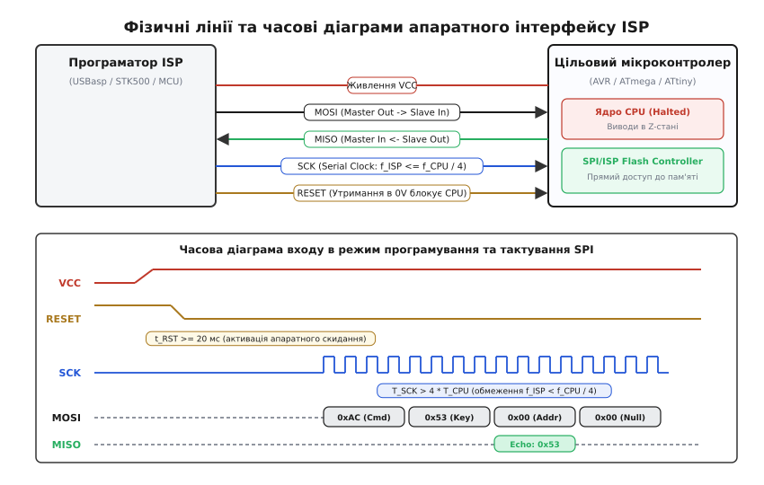
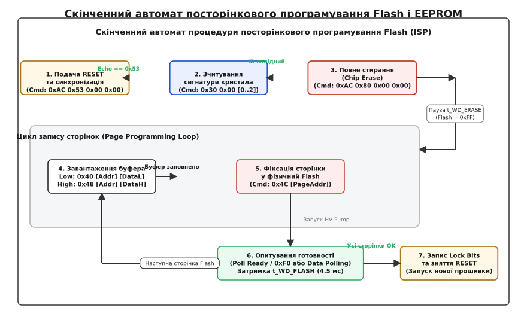

# ISP-програмування мікроконтролерів

<preknowlist>
- [Прошивка у Flash: як код потрапляє в чіп](root:sys-ide/flashing) — послідовне завантаження образу через завантажувач у ROM та перемикання режимів.
- [SWD і JTAG зсередини](root:sys-ide/swd-jtag-internals) — апаратні інтерфейси налагодження та прямий доступ до внутрішньої шини ядра.
- [Асинхронний послідовний інтерфейс UART](root:com-devices/async-serial) — фізичні рівні та передача байтів по послідовній лінії.
- [Fuse-біти AVR](root:sys-ide/avr-fuses) — конфігураційні комірки мікроконтролера та керування лінією апаратного скидання.
</preknowlist>

Коли мікроконтролер щойно зійшов із конвеєра напівпровідникової фабрики, увесь масив його вбудованої пам'яті програм Flash заповнений стертим станом `0xFF`, лічильник команд містить неініціалізоване значення, а в постійній пам'яті кристала немає жодного попередньо прошитого завантажувача для зв'язку по UART чи USB. Якщо ж у процесі розробки пошкоджена прошивка випадково перетирає таблицю векторів переривань, вимикає генератор тактової частоти або вводить процесорне ядро в нескінченний циклічний збій, жоден високорівневий програмний завантажувач не здатний виконати навіть першу інструкцію для відновлення зв'язку. У такій ситуації єдиним надійним способом отримання повного контролю над фізичною пам'яттю мікросхеми без її випоювання з друкованої плати стає виділений апаратний канал прямого доступу.

Цю технологію запису образу безпосередньо у змонтований на платі кристал називають **внутрішньосхемним програмуванням** (англ. *In-System Programming*, ISP, від слів *in-system* — «всередині системи», без демонтажу мікросхеми, та *programming* — «запис бінарного коду в пам'ять»). Замість використання складних високовольтних паралельних програматорів із десятками ліній, ISP використовує компактний послідовний інтерфейс, який апаратно перехоплює шини Flash та EEPROM, поки процесорне ядро мікроконтролера перебуває в стані примусового апаратного скидання.


*Апаратний інтерфейс ISP: програматор утримує процесорне ядро цільового мікроконтролера в стані апаратного скидання (RESET = 0V), ізолюючи виводи введення-виведення в Z-стан і здійснюючи повнодуплексний обмін командами через послідовну шину SPI.*

---

### Фізична природа та ізоляція ядра в режимі ISP

Історично перші мікроконтролери з ультрафіолетовим стиранням (EPROM) та ранні мікросхеми з електрично стираною пам'яттю (EEPROM) вимагали для свого програмування спеціалізованих стендів — паралельних програматорів високої напруги (*Parallel High-Voltage Programming*, HVPP). Для запису коду на мікроконтролер подавалася напруга +12V на спеціальний вивід скидання, а для адресації та передачі даних задіювалися паралельні порти: від 16 до 24 фізичних ліній зв'язку одночасно. Це вимагало встановлення мікросхеми у знімні DIP-панелі (ZIF-сокети) або багаторазового випоювання SMD-корпусів гарячим повітрям для кожного оновлення прошивки, що унеможливлювало масове заводське складання та калібрування готових електронних блоків у зібраному корпусі.

Концепція In-System Programming розв'язала цю проблему шляхом інтеграції спеціалізованого апаратного автомата програмування безпосередньо на кремнієвий кристал мікроконтролера. Цей внутрішній автомат працює на низьковольтних логічних рівнях живлення схеми (від 1.8V до 5.0V) і потребує всього чотирьох керівних ліній: трьох ліній послідовної передачі даних і однієї лінії апаратного скидання `RESET`.

Головний фізичний принцип переходу в режим ISP полягає у **повній апаратній ізоляції обчислювального ядра**:

1. **Заморожування ядра процесора:** програматор притискає вивід `RESET` цільового мікроконтролера до логічного нуля (0V, GND). Низький рівень на внутрішній шині скидання зупиняє генерацію внутрішніх стробів виконання інструкцій, скидає програмний лічильник `PC` у нуль і повністю блокує доступ центрального процесора (CPU) до системної шини.
2. **Переведення виводів у стан високого імпедансу (Hi-Z):** апаратний блок введення-виведення мікроконтролера відключає внутрішні вихідні транзистори push-pull каскадів на всіх ніжках загального призначення (GPIO). Завдяки цьому периферійні мікросхеми, реле, ключі двигунів та сенсори, підключені до плати, не отримують випадкових сигналів керування і не пошкоджують силові ланцюги пристрою під час прошивки.
3. **Активація внутрішнього SPI-контролера пам'яті:** тривале утримання `RESET` у нулі перемикає внутрішній мультиплексор шини адреси та даних Flash/EEPROM на периферійний апаратний зсувний регістр послідовного програмування. Лінії `MOSI`, `MISO` та `SCK` перестають бути звичайними цифровими виводами і перетворюються на прямий порт командного керування матрицею пам'яті.

```
Звичайний режим роботи (Normal Run):
  [CPU Ядро] ── (Системна шина) ──> [Flash-пам'ять]
  RESET = VCC (Високий рівень)
  GPIO: Активні виходи / входи програми

Режим внутрішньосхемного програмування (ISP Mode):
  RESET = 0V (Примусове скидання ядра)
  [CPU Ядро] ── (Заблоковано в Reset, виводи в Hi-Z)
  [Програматор] ── (MOSI/MISO/SCK) ──> [ISP Controller] ──> [Flash / EEPROM / Fuses]
```

Оскільки процесорне ядро вимкнене, внутрішньосхемне програмування не залежить від стану програмного коду у Flash. Навіть якщо прошивка містила фатальний дефект, що зациклював ядро або переводив його в режим глибокого сну (*Deep Sleep*), подача низького рівня на `RESET` гарантовано повертає контроль над пам'яттю мікросхеми.

---

### Фізика тунелювання електронів та внутрішня помпа напруги (Charge Pump)

Щоб зрозуміти, чому Flash-пам'ять вимагає суворого дотримання таймінгів запису та рівнів напруги живлення, необхідно звернутися до фізики напівпровідникової комірки.

Flash-пам'ять мікроконтролерів побудована на базі польових транзисторів із плаваючим затвором (*Floating-Gate MOSFET*) або нітридною пасткою заряду (*Charge Trap Flash*). У такій комірці між керівним затвором і напівпровідниковим каналом розташований повністю ізольований провідний острівець із полікремнію, оточений діелектриком із діоксиду кремнію (SiO₂) товщиною менше 10 нанометрів.

```
Фізична структура комірки Flash-пам'яті:
         [Керівний затвор (Control Gate)]
         ────────────────────────────────
         [Верхній діелектрик (SiO2)]
         ────────────────────────────────
         [Плавайний затвор (Floating Gate) - Накопичувач електронів]
         ────────────────────────────────
         [Тунельний оксид (Tunnel Oxide < 10nm)]
         ────────────────────────────────
         [Витік (Source)]   [Канал]   [Стік (Drain)]
```

1. **Стирання комірки (Erasing):** для очищення комірки до керівного затвора прикладається сильне від'ємне електричне поле відносно підкладки, або на підкладку подається позитивний потенціал +12V...+15V. Електрони завдяки квантовомеханічному тунелюванню Фаулера-Нордгейма (*Fowler-Nordheim Tunneling*) проходять крізь потенційний бар'єр тонкого тунельного оксиду і залишають плаваючий затвор. Комірка переходить у розряджений стан, що зчитується цифровою логікою як логічна одиниця `1` (байт `0xFF`).
2. **Програмування комірки (Programming):** для запису логічного нуля `0` на керівний затвор подається висока позитивна напруга +12V. Електрони інжектуються з каналу на плаваючий затвор, де залишаються заблокованими потенційним бар'єром діелектрика. Накопичений від'ємний заряд екранує електричне поле затвора, зміщуючи порогову напругу відкриття транзистора `V_th`. При звичайній робочій напрузі читання транзистор залишається закритим (струм не тече), що інтерпретується як логічний нуль `0`.

Оскільки мікроконтролер живиться від стандартної низьковольтної шини (3.3V або 5.0V), всередині кристала інтегровано спеціалізований помповий перетворювач напруги — **помпу заряду Діксона (Charge Pump)**. Під час виконання команд `Chip Erase` або `Write Flash Page` внутрішній осцилятор помпи перемикає каскади конденсаторів і діодів, множачи напругу живлення до рівня +12V...+15V.

Саме робота помпи заряду визначає необхідність обов'язкових апаратних затримок `t_WD_FLASH ≈ 4.5 мс` та `t_WD_ERASE ≈ 9.0 мс`. Якщо під час високовольтного імпульсу напруга живлення `V_CC` просяде нижче допустимого порогу (наприклад, через відсутність блокувальних конденсаторів на платі), помпа не зможе розвинути необхідну напругу тунелювання, і комірки зафіксують неповний заряд. Це призведе до так званого «маргінального запису» (*Marginal Programming*), коли пам'ять успішно проходить верифікацію при кімнатній температурі, але втрачає біти при нагріванні або охолодженні пристрою.

---

### Сімейство фізичних інтерфейсів: SPI, debugWIRE, PDI, TPI та UPDI

Хоча класичне поняття ISP у 8-бітній архітектурі AVR асоціюється з 4-провідною шиною SPI, еволюція мікроконтролерів породила ціле дерево спеціалізованих інтерфейсів внутрішньосхемного програмування, оптимізованих під різну кількість ніжок корпусу та потреби суміщення зневадження з прошивкою.

```
                            Еволюція інтерфейсів програмування
                                             │
         ┌───────────────────────────────────┼───────────────────────────────────┐
         ▼                                   ▼                                   ▼
   SPI-ISP (4 дроти)                 debugWIRE (1 дріт)                  PDI / TPI / UPDI
  (ATmega, ATtiny)                  (Z-стан / Open-Drain)               (XMEGA / Tiny / modern AVR)
   MOSI, MISO, SCK, RESET            RESET лінія як UART                 PDI: CLK + DATA
                                                                         TPI: 6-пінові ATtiny (12V)
                                                                         UPDI: 1-провідний UART на RESET
```

#### 1. Класичний 4-провідний SPI-ISP
Найбільш поширений інтерфейс для класичних мікроконтролерів сімейства ATmega (наприклад, ATmega328P, ATmega2560, ATmega32U4) та більшості ATtiny:
* **MOSI (Master Out Slave In):** лінія односпрямованої передачі даних від програматора (Master) до мікроконтролера (Slave). Передає коди операцій (opcodes), адреси пам'яті та байти для запису.
* **MISO (Master In Slave Out):** лінія передачі даних від мікроконтролера до програматора. Використовується для зчитування сигнатури чипа, верифікації Flash/EEPROM, читання конфігураційних бітів та отримання відлуння команд синхронізації.
* **SCK (Serial Clock):** тактовий сигнал, який формує виключно програматор. Забезпечує синхронізацію передачі кожного біта даних.
* **RESET:** лінія вибору веденого пристрою та активації режиму ISP. Працює аналогічно сигналу Chip Select (`CS`/`SS`) у звичайному SPI, але додатково утримує внутрішню цифрову логіку ядра в стані апаратного скидання.

#### 2. debugWIRE
Розроблений для компактних мікроконтролерів із малою кількістю виводів (ATtiny25/45/85, ATmega88/168/328 у маловивідних корпусах), де виділення 4 окремих ніжок під SPI було неприпустимим марнотратством. debugWIRE використовує **єдиний фізичний вивід `RESET`** як двонаправлену асинхронну лінію передачі даних із відкритим колектором (*Open-Drain*). Для активації debugWIRE мікроконтролер спочатку прошивають по стандартному SPI-ISP, встановлюючи конфігураційний біт `DWEN` (debugWIRE Enable). Після цього вивід `RESET` перестає реагувати на звичайне скидання і перетворюється на послідовний канал напівдуплексного UART зі швидкістю `f_CPU / 128`, через який емулятор може як читати/писати пам'ять, так і керувати покроковим виконанням коду.

#### 3. PDI (Program and Debug Interface)
Застосовується в мікроконтролерах сімейства ATxmega. PDI оптимізований для високошвидкісного програмування великих обсягів Flash (до 384 КБ) та повноцінного апаратного зневадження без зайвих виводів. Складається з двох ліній:
* `PDI_CLK`: тактовий синхросигнал від програматора;
* `PDI_DATA`: двонаправлена синхронна лінія даних із відкритим стоком.
Протокол PDI передає дані кадрами з бітами старту, парності та стопу, підтримуючи фізичні швидкості до кількох мегагерц.

#### 4. TPI (Tiny Programming Interface)
Створений спеціально для надкомпактних 6-вивідних мікроконтролерів (ATtiny4, ATtiny5, ATtiny9, ATtiny10, ATtiny20). Через брак ніжок звичайний SPI-ISP не поміщався у корпус. TPI використовує 3 лінії: `TPICLK`, `TPIDATA` та `RESET`. Якщо вивід `RESET` у конфігурації відключено для використання як порт GPIO, TPI вимагає подачі короткочасного високовольтного імпульсу +12V на лінію скидання для входу в режим програмування.

#### 5. UPDI (Unified Program and Debug Interface)
Сучасний стандарт Microchip для нових поколінь AVR (родина megaAVR 0-series, tinyAVR 1-series та 2-series, AVR-DA, AVR-DB, AVR-DD). UPDI об'єднує функції TPI, PDI та debugWIRE в один надзвичайно простий та надійний **однопровідний асинхронний інтерфейс**, підключений до виводу `RESET/UPDI`. Обмін ведеться за стандартним протоколом UART (8 біт даних, 2 стоп-біти, парність Even) на швидкостях від кількох десятків кілобод до 1 Мбод поверх однієї двонаправленої лінії зв'язку.

| Інтерфейс | Кількість ліній | Фізичні сигнали | Підтримувані сімейства | Можливість зневадження |
|---|---|---|---|---|
| **SPI-ISP** | 4 (або 6 із VCC/GND) | `MOSI`, `MISO`, `SCK`, `RESET` | ATmega, AT90, класичні ATtiny | Тільки прошивка та конфігурація |
| **debugWIRE** | 1 (плюс GND) | `RESET` (Open-Drain UART) | ATtiny24..85, ATmega48..328 | Прошивка, брейкпоінти, регістри |
| **PDI** | 2 (плюс GND) | `PDI_CLK`, `PDI_DATA` | ATxmega A, AU, B, C, D | Повношвидкісне зневадження і прошивка |
| **TPI** | 3 (плюс GND) | `TPICLK`, `TPIDATA`, `RESET` (12V) | ATtiny4 / 5 / 9 / 10 / 20 / 40 | Тільки низькорівнева прошивка |
| **UPDI** | 1 (плюс GND) | `UPDI` (Asynchronous UART) | megaAVR 0, tinyAVR 0/1/2, AVR-Dx | Прошивка, зневадження, трасування |
| **ARM SWD** | 2 (плюс GND) | `SWCLK`, `SWDIO` | ARM Cortex-M (STM32, NXP, SAM) | Прошивка, пам'ять, ITM-трасування |

---

### Фізика синхронізації та бар'єр тактової частоти (f_ISP < f_CPU / 4)

Найбільш підступна апаратна проблема при роботі з класичним SPI-ISP полягає в непорозумінні щодо джерела тактування внутрішньої логіки програмування. Програміст-початківець часто припускає, що оскільки програматор сам генерує сигнал `SCK`, швидкість прошивки можна піднімати до будь-якої межі, яку витримує дріт шлейфа (наприклад, 4–8 МГц). Однак спроба запустити SPI-ISP на частоті понад декілька сотень кілогерц на щойно розпаяному чипі неминуче призводить до помилки зв'язку та неможливості вичитати сигнатуру пристрою.

Причина криється у **внутрішній архітектурі асинхронної вибірки SPI-контролера** мікроконтролера AVR.

Внутрішній апаратний блок програмування ISP не є повністю асинхронною схемою: він не передає фронти сигналу `SCK` безпосередньо на зсувний регістр. Натомість мікроконтролер використовує тактовий сигнал свого **власного системного генератора** `f_CPU` (внутрішній RC-генератор або зовнішній кварцовий резонатор) для періодичного опитування (*sampling*) фізичного стану лінії `SCK`.

```
Сигнал SCK (від програматора):
  ────────┐               ┌───────────────┐               ┌────────
          │               │               │               │
          └───────────────┘               └───────────────┘

Тактові імпульси ядра f_CPU (внутрішній генератор кристала):
  ┌─┐ ┌─┐ ┌─┐ ┌─┐ ┌─┐ ┌─┐ ┌─┐ ┌─┐ ┌─┐ ┌─┐ ┌─┐ ┌─┐ ┌─┐ ┌─┐ ┌─┐ ┌─┐
  └─┘ └─┘ └─┘ └─┘ └─┘ └─┘ └─┘ └─┘ └─┘ └─┘ └─┘ └─┘ └─┘ └─┘ └─┘ └─┘
   ^   ^   ^   ^   ^   ^   ^   ^   ^   ^   ^   ^   ^   ^   ^   ^
   Дискретизація рівня лінії SCK за допомогою системних тактів CPU
```

Для надійної фіксації логічного рівня та запобігання явищу метастабільності (*metastability*) вхідних D-тригерів синхронізатора, внутрішній автомат мікроконтролера повинен зафіксувати стабільний стан лінії `SCK` протягом щонайменше **двох послідовних тактів системної частоти** `f_CPU`:
1. Щонайменше 2 такти `f_CPU` для фіксації високого рівня напівперіоду `SCK` (`t_HIGH > 2 * T_CPU`);
2. Щонайменше 2 такти `f_CPU` для фіксації низького рівня напівперіоду `SCK` (`t_LOW > 2 * T_CPU`).

Звідси виводиться фундаментальне часове обмеження періоду сигналу послідовного програмування:

```
T_SCK = t_HIGH + t_LOW
      > 2·T_CPU + 2·T_CPU      [мінімум 2 такти на кожен напівперіод]
      = 4·T_CPU                [сумарний період такту SCK]

f_ISP = 1 / T_SCK
      < 1 / (4·T_CPU)          [підстановка частоти замість періоду]
      = f_CPU / 4              [максимальна теоретична межа частоти ISP]
```

З урахуванням похибок фронтів передачі, ємнісного навантаження шлейфа програматора та теплового дрейфу внутрішнього RC-генератора цільового мікроконтролера, інженерна норма Microchip/Atmel встановлює практичне співвідношення з обов'язковим коефіцієнтом запасу:

```
f_ISP <= f_CPU / 6
```

#### Розрахунок граничних швидкостей для типових конфігурацій

1. **Заводський стан нового мікроконтролера (наприклад, ATmega328P / ATmega16):**
   За замовчуванням мікроконтролер налаштований на роботу від внутрішнього каліброваного RC-генератора з частотою 8.0 МГц і увімкненим дільником на 8 (фьюз `CKDIV8` запрограмований у `0`).
   * Реальна робоча частота ядра після скидання: `f_CPU = 8.0 МГц / 8 = 1.0 МГц`.
   * Максимальна теоретична частота ISP: `f_ISP_max = 1.0 МГц / 4 = 250 кГц`.
   * Рекомендована надійна частота програматора: `f_ISP = 1.0 МГц / 6 ≈ 166 кГц` (на практиці в утиліті `avrdude` обирають опцію `-B 8` або фіксовану частоту `125 кГц`).
   Якщо програматор спробує передавати команди на стандартній для USBasp швидкості 375 кГц або 1.5 МГц, внутрішній синхронізатор чіпа пропустить більшість тактів `SCK`, і зв'язок не встановиться.

2. **Мікроконтролер із низькочастотним годинниковим тактуванням (Low-Power Watch Crystal):**
   Якщо конфігураційні фьюзи перемикають чіп на роботу від часового кварцу 32.768 кГц або низькочастотного внутрішнього генератора 128 кГц:
   * `f_CPU = 32.768 кГц`.
   * `f_ISP_max = 32768 / 4 = 8.192 кГц`.
   * Рекомендована частота ISP: `f_ISP <= 4 кГц` (опція `-B 250` у `avrdude`).
   На такій низькій частоті прошивка Flash-пам'яті обсягом 32 КБ триває кілька хвилин замість двох секунд, проте це єдиний спосіб достукатися до чіпа без заміни тактового джерела.

3. **Робота від зовнішнього високочастотного кварцового резонатора 16 МГц:**
   * `f_CPU = 16.0 МГц`.
   * `f_ISP_max = 16.0 МГц / 4 = 4.0 МГц`.
   * Рекомендована частота ISP: `f_ISP = 1.5–2.0 МГц`.

```
Таблиця залежності допустимої частоти f_ISP від джерела тактування:
┌───────────────────────────────┬────────────┬─────────────┬─────────────────┐
│ Джерело тактування ядра CPU   │ Частота    │ f_ISP (Max) │ Рекомендована   │
├───────────────────────────────┼────────────┼─────────────┼─────────────────┤
│ Внутрішній RC + CKDIV8        │ 1.0 МГц    │ 250 кГц     │ 125 кГц (-B 8)  │
│ Внутрішній RC (без дільника)  │ 8.0 МГц    │ 2.0 МГц     │ 750 кГц (-B 1.5)│
│ Зовнішній кварц (Arduino Uno) │ 16.0 МГц   │ 4.0 МГц     │ 1.5 МГц (-B 0.5)│
│ Низькочастотний RC генератор  │ 128 кГц    │ 32 кГц      │ 16 кГц  (-B 64) │
│ Годинниковий кварц (RTC)      │ 32.768 кГц │ 8.192 кГц   │ 4 кГц   (-B 250)│
└───────────────────────────────┴────────────┴─────────────┴─────────────────┘
```

#### Часові параметри перехідних процесів та ініціалізації
Крім частоти тактування `SCK`, стандарт ISP нормує суворі часові інтервали для початкового скидання:
* **`t_RST` (Мінімальна тривалість імпульсу скидання):** перед початком передачі будь-яких тактових імпульсів лінія `RESET` повинна утримуватися в низькому рівні щонайменше 2 системні такти процесора плюс час розряду зовнішніх ємностей фільтрації скидання (на практиці витримують затримку не менше 20–25 мс);
* **`t_PROG_START` (Затримка до першої команди):** після подачі напруги живлення `V_CC` та встановлення `RESET = 0` необхідно зачекати щонайменше 20 мс до початку формування першого такту `SCK`, щоб внутрішнє джерело опорної напруги Bandgap та схема POR (Power-On Reset) повністю стабілізувалися;
* **`t_P_PULSE` (Ширина стробу SCK):** високий та низький рівні сигналу `SCK` повинні бути абсолютно симетричними зі шпаруватістю близько 50%, без тривалих завалів фронтів.

> 🔧 **Навіщо це.** Якщо ви придбали новий мікроконтролер у магазині і при спробі його прошивки утиліта `avrdude` видає помилку `initialization failed, rc=-1` або `Device signature = 0x000000`, у 95% випадків причина не в несправності плати чи кабелю, а у занадто високій швидкості програматора. Заводський чіп завжди стартує на частоті 1 МГц. Додавання прапорця уповільнення тактування `-B 10` (або встановлення джампера повільного режиму «Slow SCK» на платі USBasp) негайно розв'язує проблему.

---

### Низькорівневий послідовний протокол команд (Serial Programming Protocol)

Обмін даними між програматором і внутрішнім контролером ISP мікроконтролера AVR здійснюється за допомогою фіксованих **4-байтних командних пакетів** (32 біти на кожну транзакцію). Передача ведеться за стандартом SPI Mode 0: дані на лінії `MOSI` виставляються програматором по спадному фронту `SCK` і фіксуються мікроконтролером по наростаючому фронту; дані на лінії `MISO` оновлюються мікроконтролером по спадному фронту і зчитуються програматором по наростаючому фронту.

Кожен 4-байтний фрейм має уніфіковану структуру:
`[Байт 1: Код операції] [Байт 2: Адреса High / Параметр] [Байт 3: Адреса Low] [Байт 4: Дані / Опитування]`

```
Формат транзакції ISP (Master -> Slave по MOSI / Slave -> Master по MISO):
Байт:        1               2               3               4
MOSI: ┌───────────────┬───────────────┬───────────────┬───────────────┐
      │ Opcode (0xAC) │ Param / AddrH │ AddrL / Data  │ Data / Dummy  │
      └───────────────┴───────────────┴───────────────┴───────────────┘
MISO: ┌───────────────┬───────────────┬───────────────┬───────────────┐
      │  0x00 (Dummy) │  0x00 (Dummy) │ Echo / Ret_H  │ Return_Data   │
      └───────────────┴───────────────┴───────────────┴───────────────┘
```

#### 1. Команда синхронізації та входу в режим програмування (Programming Enable)
Найперша і найважливіша транзакція. Вона перевіряє готовність мікросхеми до прийому інструкцій пам'яті.

* **Команда MOSI:** `0xAC, 0x53, 0x00, 0x00`
* **Очікувана відповідь MISO:** `0x00, 0x00, 0x53, 0x00`

```
Часова послідовність відлуння Programming Enable:
Таймслот:      1-й байт       2-й байт       3-й байт       4-й байт
MOSI:        0xAC (Cmd)     0x53 (Key)     0x00 (Null)    0x00 (Null)
MISO:        0xXX (Ignore)  0xXX (Ignore)  0x53 (ECHO!)   0xXX (Ignore)
```

Зверніть увагу на зміщення відлуння: байт-ключ `0x53`, переданий програматором у 2-му байті, повертається мікроконтролером на лінію `MISO` рівно **у 3-му байті транзакції**. Це пов'язано з внутрішньою однобайтовою конвеєризацією зсувного регістра ISP: мікроконтролер спочатку приймає і декодує код операції `0xAC` (1-й байт), потім приймає ключ `0x53` (2-й байт), і лише під час тактування 3-го байта виштовхує підтверджений ключ на лінію `MISO`.

**Алгоритм відновлення синхронізації при втраті бітової фази:**
Якщо дріт шлейфа зловив паразитну електромагнітну заваду, внутрішній лічильник бітів чіпа міг зсунутися (наприклад, прийняти 7 бітів замість 8). У такому разі на команду `0xAC 0x53 0x00 0x00` мікроконтролер поверне у 3-му байті випадковий шум замість `0x53`. Специфікація Microchip описує чіткий алгоритм відновлення фази:
1. Подати позитивний імпульс на лінію `RESET` тривалістю щонайменше 100 мкс і знову притиснути її до нуля;
2. Зачекати щонайменше 20 мс;
3. Повторити команду `0xAC 0x53 0x00 0x00`;
4. Якщо відлуння не збіглося — видати один додатковий тактовий імпульс на лінію `SCK` для зсуву фази на 1 біт і спробувати знову (до 32 спроб циклічного зсуву).

#### 2. Зчитування сигнатури мікросхеми (Read Device Signature)
Кожен оригінальний мікроконтролер містить у постійній заводській пам'яті 3 байти унікальної сигнатури (*Device Signature*), що визначає виробника, родину та конкретну модель кристала з обсягом Flash:
* Байт 0 (Адреса `0x00`): ідентифікатор виробника (`0x1E` — Atmel / Microchip);
* Байт 1 (Адреса `0x01`): ідентифікатор сімейства та архітектури (наприклад, `0x95` — родина megaAVR з 32 КБ пам'яті);
* Байт 2 (Адреса `0x02`): точна модель кристала (`0x0F` — ATmega328P, `0x14` — ATmega328PB, `0x0A` — ATmega88A).

* **Команда MOSI:** `0x30, 0x00, [Address: 0x00..0x02], 0x00`
* **Відповідь MISO:** `0xXX, 0xXX, 0xXX, [Signature_Byte]`

```
Приклад зчитування сигнатури ATmega328P:
1. MOSI: 0x30 0x00 0x00 0x00  ──> MISO: 0x00 0x00 0x00 0x1E (Виробник Atmel)
2. MOSI: 0x30 0x00 0x01 0x00  ──> MISO: 0x00 0x00 0x00 0x95 (Обсяг Flash 32KB)
3. MOSI: 0x30 0x00 0x02 0x00  ──> MISO: 0x00 0x00 0x00 0x0F (Модель ATmega328P)
```

Зчитування сигнатури — обов'язковий етап безпеки перед будь-якою операцією запису. Програма прошивки (наприклад, `avrdude`) звіряє сигнатуру кристала з цільовим файлом конфігурації. Це унеможливлює випадкове заливання прошивки від ATmega2560 у мікроконтролер ATmega328P, що призвело б до некоректного конфігурування апаратної периферії.

#### 3. Повне стирання кристала (Chip Erase)
Оскільки фізична комірка Flash-пам'яті базується на технології інжекції заряду на плаваючий затвор, операція програмування вміє лише змінювати біти з одиниці в нуль (`1 -> 0`). Записати новий двійковий образ поверх старого без попереднього стирання неможливо: будь-який нуль у старій прошивці залишиться нулем, що спотворить нові байти.

* **Команда MOSI:** `0xAC, 0x80, 0x00, 0x00`
* **Дія:** запускає внутрішній апаратний високовольтний таймер стирання. Усі комірки матриці Flash і EEPROM (якщо не активовано захисний фьюз `EESAVE`) переходять у стан `0xFF`. Біти апаратного блокування `Lock Bits` скидаються у відкритий стан.
* **Час виконання (`t_WD_ERASE`):** апаратна затримка триває від 8.5 до 10.5 мс. Протягом цього часу програматор повинен призупинити передачу будь-яких наступних команд.

```
Стирання кристала (Chip Erase):
[Вхідний стан Flash] ──(Команда 0xAC 0x80 0x00 0x00)──> [Високовольтний імпульс 10мс] ──> [Flash = 0xFF..FF]
                                                                                       └──> [Lock Bits = 0xFF (Open)]
```

#### 4. Читання та запис конфігураційних бітів (Fuses)
Конфігураційні комірки мікроконтролера визначають критичні параметри запуску (джерело тактування, напругу детектора BOD, використання виводу скидання). Детальний фізичний устрій цих бітів описано в темі [Fuse-біти AVR](root:sys-ide/avr-fuses). Протокол ISP надає окремі команди для прямого читання і запису кожного конфігураційного байта:

* **Зчитування Low Fuse:** MOSI `0x58, 0x00, 0x00, 0x00` → MISO повертає значення у 4-му байті.
* **Зчитування High Fuse:** MOSI `0x58, 0x08, 0x00, 0x00` → MISO повертає значення у 4-му байті.
* **Зчитування Extended Fuse:** MOSI `0x50, 0x08, 0x00, 0x00` → MISO повертає значення у 4-му байті.
* **Запис Low Fuse:** MOSI `0xAC, 0xA0, 0x00, [Data_Byte]` (потрібна пауза `t_WD_FUSE ≈ 4.5 мс`).
* **Запис High Fuse:** MOSI `0xAC, 0xA8, 0x00, [Data_Byte]` (пауза 4.5 мс).
* **Запис Extended Fuse:** MOSI `0xAC, 0xA4, 0x00, [Data_Byte]` (пауза 4.5 мс).

#### 5. Читання пам'яті Flash та EEPROM
Для верифікації прошивки використовуються команди побайтового вичитування пам'яті:
* **Читання молодшого байта Flash (Read Low Byte):** `0x20, [Addr_High], [Addr_Low], 0x00` → MISO повертає байт у 4-й позиції;
* **Читання старшого байта Flash (Read High Byte):** `0x28, [Addr_High], [Addr_Low], 0x00` → MISO повертає байт у 4-й позиції;
* **Читання байта EEPROM:** `0xA0, [Addr_High], [Addr_Low], 0x00` → MISO повертає значення байта;
* **Запис байта EEPROM:** `0xC0, [Addr_High], [Addr_Low], [Data]` → вимагає високовольтної паузи `t_WD_EEPROM ≈ 3.6 мс`.

---

### Посторінковий запис Flash: буферизація та високовольтна фіксація

У ранніх мікроконтролерах запис Flash здійснювався побайтово: на кожен байт подавався високовольтний імпульс тривалістю 4.5 мс. Прошивка чіпа на 32 КБ вимагала `32768 * 4.5 мс ≈ 147 секунд` (понад дві хвилини). Сучасні мікроконтролери використовують **посторінковий запис** (*Page Programming*), що скорочує час прошивки до кількох секунд.


*Скінченний автомат процедури посторінкового запису: заповнення тимчасового буфера сторінки командами 0x40/0x48 із подальшою високовольтною фіксацією у фізичний Flash командою 0x4C та опитуванням готовності.*

Flash-пам'ять мікроконтролера розбита на однакові блоки — **сторінки** (*Pages*). Розмір сторінки залежить від кристала і становить:
* 32 слова (64 байти) для ATmega8, ATtiny85;
* 64 слова (128 байтів) для ATmega328P;
* 128 слів (256 байтів) для ATmega2560.

Оскільки інструкція AVR має розрядність 16 біт (одне машинне слово), адресація Flash ведеться не в байтах, а в **словах** (*16-bit Words*). Кожне слово складається з молодшого байта (*Low Byte*, біти 0..7) та старшого байта (*High Byte*, біти 8..15).

#### Двоетапний алгоритм посторінкового запису:

```
Етап 1: Заповнення тимчасового буфера сторінки (SRAM Latch Buffer):
  Слово 0: [Load Low Byte (0x40)] -> [Load High Byte (0x48)]
  Слово 1: [Load Low Byte (0x40)] -> [Load High Byte (0x48)]
  ...
  Слово N: [Load Low Byte (0x40)] -> [Load High Byte (0x48)]

Етап 2: Фізичний запис сторінки у масив Flash (High-Voltage Write):
  [Команда Write Page (0x4C, PageAddr)] ──> [Запуск Charge Pump (12-15V)] ──> [Пауза 4.5мс]
```

1. **Завантаження тимчасового буфера сторінки (Page Buffer):**
   Буфер сторінки являє собою масив швидких тригерів SRAM, що не вимагають високої напруги для запису. Програматор заповнює цей буфер побайтово:
   * Запис молодшого байта слова: `0x40, [Addr_H], [Addr_L], [Data_Low]`
   * Запис старшого байта слова: `0x48, [Addr_H], [Addr_L], [Data_High]`
   Ця операція виконується на повній швидкості шини SPI без будь-яких часових затримок на високовольтне тунелювання заряду.

2. **Фіксація сторінки у фізичну пам'ять Flash:**
   Щойно буфер сторінки повністю заповнений, програматор відправляє команду запису сторінки у фізичну матрицю Flash:
   * **Команда MOSI:** `0x4C, [Page_Address_H], [Page_Address_L], 0x00`
   Внутрішній автомат мікроконтролера вмикає внутрішній помповий перетворювач напруги (*Charge Pump*), формуючи високовольтний потенціал (близько 12–15V), і одночасно паралельно інжектує заряд у всі комірки поточної сторінки Flash.

#### Методи контролю завершення запису сторінки

Поки триває високовольтний цикл запису (`t_WD_FLASH ≈ 3.6–4.5 мс`), матриця Flash заблокована і не здатна приймати нові команди. Програматор використовує один із трьох методів контролю готовності:

1. **Апаратне опитування готовності (Poll Ready/Busy):**
   * Програматор циклічно шле команду `0xF0, 0x00, 0x00, 0x00`.
   * Якщо мікроконтролер зайнятий внутрішнім записом, лінія `MISO` повертає значення `0x01` (Busy).
   * Щойно високовольтний цикл завершено, MISO повертає `0x00` (Ready).
2. **Метод опитування даних (Data Polling):**
   * Програматор читає останній записаний байт сторінки за допомогою команди читання Flash (`0x20` або `0x28`).
   * Поки триває фізичний запис, контролер ISP апаратно повертає на лінію `MISO` значення, у якому старший розряд **MSB інвертовано** відносно справжнього значення байта.
   * Щойно біт MSB вичитаного байта збігся зі справжнім записаним значенням — запис сторінки успішно завершено.
3. **Фіксована часова затримка (Timed Delay):**
   * Програматор просто витримує жорстку паузу 5.0 мс за допомогою таймера хоста перед початком завантаження наступної сторінки. Це найбільш стійкий до апаратних шумів метод, хоча й трохи повільніший.

---

### Високорівневі протоколи взаємодії програматорів: STK500 v1 / v2 та AVR ISP

У реальній практиці розробки комп'ютер інженера (на якому працює утиліта `avrdude` або IDE) рідко підключається ніжками безпосередньо до ліній SPI цільового чіпа. Між операційною системою ПК та мікроконтролером завжди стоїть спеціалізований проміжний міст — **програматор** (наприклад, USBasp, Atmel STK500, AVRISP mkII, Arduino як ISP).

```
Стек протоколів програмування:
[ПК / avrdude] ──(USB / Virtual COM Port)──> [Програматор / MCU Bridge] ──(Фізичний SPI)──> [Цільовий MCU]
                Протокол STK500 v1/v2 / USBasp                      Низькорівневий SPI-ISP
```

Комп'ютер спілкується з програматором через послідовний порт за допомогою протоколів високого рівня. Найвідомішим галузевим стандартом є протокол **Atmel STK500** у двох його ревізіях: v1 та v2.

#### Порівняння популярних апаратних архітектур програматорів:
* **USBasp (Thomas Fischl):** класичний відкритий програматор на базі ATmega8/ATmega88. Використовує програмну емуляцію низькошвидкісного порту USB 1.1 (бібліотека V-USB) без спеціалізованих апаратних USB-контролерів. Працює за власним спрощеним набором USB Control Transfers;
* **ArduinoISP:** скетч для перетворення будь-якої стандартної плати Arduino (на базі ATmega328P або ATmega2560) на повноцінний ISP-програматор. Працює по протоколу STK500 v1 через віртуальний COM-порт мікросхеми USB-UART;
* **AVRISP mkII / STK500 v2:** фірмові апаратні програматори Atmel з апаратним USB (на базі AT90USB64/128 або контролерів FTDI). Працюють по захищеному пакетному протоколу STK500 v2, підтримуючи точне програмне регулювання напруги та частоти `f_ISP` від 2 кГц до 8 МГц.

#### Протокол STK500 v1
Простий байт-орієнтований протокол, оптимізований для повільних послідовних ліній RS-232. Кожна команда складається з послідовності байтів, що завершується символом синхронізації `Sync_CRC_EOP` (`0x20` — пробіл у таблиці ASCII):

```
Запит від ПК:     [Код команди] [Параметри...] [0x20 (Sync_CRC_EOP)]
Відповідь стенда: [0x14 (RESP_STK_INSYNC)] [Дані відповіді...] [0x10 (RESP_STK_OK)]
```

Якщо програматор коректно прийняв команду, він завжди повертає на початку байт `0x14` (`RESP_STK_INSYNC` — синхронізацію збережено), а наприкінці — байт `0x10` (`RESP_STK_OK` — операцію виконано). Якщо замість `0x14` приходить `0x15` (`RESP_STK_NOSYNC`), зв'язок розірвано.

#### Протокол STK500 v2
Повноцінний пакетний бінарний протокол із захистом від спотворень контрольною сумою XOR, розроблений для програматорів AVRISP mkII та налагоджувальних плат STK500:

```
Структура пакету STK500 v2:
┌──────┬───────────┬────────────┬────────────┬───────┬─────────────────┬──────────┐
│ START│  SEQ_NUM  │ MSG_SIZE_H │ MSG_SIZE_L │ TOKEN │ PAYLOAD (Дані)  │ CHECKSUM │
│ 0x1B │ (1 байт)  │  (1 байт)  │  (1 байт)  │ 0x0E  │ (MSG_SIZE байт) │ (1 байт) │
└──────┴───────────┴────────────┴────────────┴───────┴─────────────────┴──────────┘
```

1. `MESSAGE_START` (`0x1B` / ESC): початковий маркер початку кадру;
2. `SEQUENCE_NUMBER`: інкрементний лічильник номеру пакета від 0 до 255 для виявлення втрачених кадрів;
3. `MESSAGE_SIZE_H / MSG_SIZE_L`: 16-бітний розмір корисного навантаження в байтах;
4. `TOKEN` (`0x0E`): постійний роздільник заголовка та даних;
5. `PAYLOAD`: байт коду команди та її аргументи;
6. `CHECKSUM`: побайтова операція XOR від першого байта `MESSAGE_START` до останнього байта корисного навантаження включно:

```
CHECKSUM = START ⊕ SEQ_NUM ⊕ MSG_SIZE_H ⊕ MSG_SIZE_L ⊕ TOKEN ⊕ PAYLOAD[0] ⊕ ... ⊕ PAYLOAD[N-1]
```

#### Ключові команди STK500 v2:
* `CMD_SIGN_ON` (`0x01`): перевірка зв'язку з програматором, повертає текстовий рядок назви обладнання (наприклад, `AVRISP_2`);
* `CMD_SET_PARAMETER` (`0x02`): налаштування тривалості такту `SCK` (`PARAM_SCK_DURATION`), що задає фізичну частоту шини ISP;
* `CMD_GET_PARAMETER` (`0x03`): зчитування поточних апаратних налаштувань програматора;
* `CMD_ENTER_PROGMODE_ISP` (`0x10`): передає програматору часові параметри скидання, таймаути стирання та 4 байти команди `0xAC 0x53 0x00 0x00` для апаратного захоплення цільового кристала;
* `CMD_CHIP_ERASE_ISP` (`0x12`): виконання повного стирання цільового чипа з урахуванням таймаутів;
* `CMD_PROGRAM_FLASH_ISP` (`0x13`): передає цілий блок сторінки Flash для запису;
* `CMD_READ_FLASH_ISP` (`0x14`): зчитує блок пам'яті Flash заданого розміру;
* `CMD_PROGRAM_EEPROM_ISP` (`0x15`): запис блоку даних в енергонезалежну пам'ять EEPROM;
* `CMD_READ_EEPROM_ISP` (`0x16`): читання блоку даних EEPROM;
* `CMD_PROGRAM_FUSE_ISP` (`0x17`): прямий запис байта Fuses;
* `CMD_READ_FUSE_ISP` (`0x18`): пряме читання байта Fuses;
* `CMD_SPI_MULTI` (`0x1D`): низькорівнева передача довільного 4-байтного SPI-пакета напряму на кристал;
* `CMD_LEAVE_PROGMODE_ISP` (`0x11`): знімає низький рівень із лінії `RESET`, дозволяючи мікроконтролеру запустити щойно прошитий код.

---

### Робота утиліти avrdude та конфігураційний файл avrdude.conf

Основним консольним інструментом взаємодії з програматорами у світі з відкритим кодом є утиліта **avrdude** (*AVR Downloader/Uploader*). Вона містить у собі реалізацію всіх відомих протоколів (STK500v1, STK500v2, USBasp, JTAG, debugWIRE, UPDI) та базу даних параметрів мікроконтролерів.

Конфігураційний файл `avrdude.conf` описує фізичні властивості кожного мікроконтролера. Розгляньмо типовий фрагмент конфігурації для ATmega328P:

```
# Фрагмент опису пам'яті ATmega328P в avrdude.conf
part
    id               = "m328p";
    desc             = "ATmega328P";
    signature        = 0x1e 0x95 0x0f;
    chip_erase_delay = 9000;              # Таймаут стирання 9мс
    
    memory "flash"
        size            = 32768;          # 32 КБ Flash
        paged           = yes;            # Посторінковий запис
        page_size       = 128;            # Розмір сторінки 128 байтів (64 слова)
        num_pages       = 256;            # 256 сторінок
        min_write_delay = 4500;           # Затримка запису сторінки 4.5мс
        max_write_delay = 4500;
        
        # Шаблони 4-байтних команд ISP для Flash:
        read            = "0 0 1 0  0 0 0 0   0 0 0 a11 a10 a9 a8   a7 a6 a5 a4 a3 a2 a1 a0   o o o o o o o o"; # 0x20
        loadpage_lo     = "0 1 0 0  0 0 0 0   0 0 0 0   0   0  0 0   0  0  a5 a4 a3 a2 a1 a0   i i i i i i i i"; # 0x40
        loadpage_hi     = "0 1 0 0  1 0 0 0   0 0 0 0   0   0  0 0   0  0  a5 a4 a3 a2 a1 a0   i i i i i i i i"; # 0x48
        writepage       = "0 1 0 0  1 1 0 0   0 0 0 a11 a10 a9 a8   a7 a6 x  x  x  x  x  x    x x x x x x x x"; # 0x4C
    ;
;
```

Утиліта підставляє реальні біти адреси `a11..a0` та даних `i7..i0` у відповідні позиції шаблону перед відправкою команд по SPI. Завдяки такій модульній структурі додавання підтримки нового мікроконтролера в `avrdude` не вимагає перекомпіляції програми — достатньо описати розмір сторінок і коди операцій у конфігураційному файлі.

---

### Апаратний захист, біти блокування (Lock Bits) та безпека прошивки

Для захисту комерційної інтелектуальної власності від несанкціонованого копіювання чи зворотного реверс-інжинірингу в мікроконтролерах передбачено спеціальні енергонезалежні комірки пам'яті — **біти блокування** (*Lock Bits*).

Матриця захисту складається з трьох рівнів загального блокування пам'яті:

```
Таблиця рівнів захисту пам'яті (Memory Lock Modes):
┌──────────┬────────┬────────┬──────────────────────────────────────────────────────┐
│ Рівень   │  LB2   │  LB1   │ Рівень доступу до Flash та EEPROM                    │
├──────────┼────────┼────────┼──────────────────────────────────────────────────────┤
│ Mode 1   │   1    │   1    │ Захист відсутній: повний доступ на читання і запис   │
│ Mode 2   │   1    │   0    │ Заборона подальшого запису по ISP (Flash/EEPROM Lock)│
│ Mode 3   │   0    │   0    │ Повне блокування: заборона запису ТА ЧИТАННЯ по ISP  │
└──────────┴────────┴────────┴──────────────────────────────────────────────────────┘
(Примітка: як і у фьюзах, 0 = Запрограмовано, 1 = Стерто/Вимкнено).
```

* **Mode 1 (Заводський стан `LB = 0xFF`):** програматор може вільно зчитувати, верифікувати та записувати Flash і EEPROM.
* **Mode 2 (Захист від модифікації `LB = 0xFE`):** читання пам'яті дозволено, але подальше програмування Flash і EEPROM через ISP заблоковано. Також заборонено зміну конфігураційних бітів Fuses.
* **Mode 3 (Повний захист від клонування `LB = 0xFC`):** будь-яка спроба зчитати або верифікувати вміст Flash і EEPROM через ISP повертає суцільні фіктивні байти (зазвичай циклічний лічильник адрес або `0x00`/`0xFF`). Запис також повністю заблоковано.

#### Додатковий захист секції завантажувача (Boot Loader Protection Bits)
У мікроконтролерах із виділеною секцією завантажувача (наприклад, ATmega328P) передбачено дві додаткові пари бітів захисту:
* `BLB0 (BLB02 / BLB01)`: керують правами коду завантажувача на читання та запис основної секції додатку (*Application Section*);
* `BLB1 (BLB12 / BLB11)`: керують правами коду програми на модифікацію секції завантажувача (*Boot Loader Section*).

Це дозволяє реалізувати захищений сценарій: користувацька програма не може випадково затерти завантажувач, а завантажувач може бути надійно заблокований від читання ззовні.

#### Фізичний механізм розблокування захищеного чіпа
Якщо мікроконтролер заблоковано в **Mode 3**, єдиною командою ISP, яку він продовжує приймати, є **Chip Erase** (`0xAC 0x80 0x00 0x00`). 

Кремнієва топологія чіпа спроектована таким чином, що високовольтна лінія очищення бітів `Lock Bits` фізично об'єднана з масивом Flash-пам'яті: зняти захисні біти `LB` (перевести їх з `0` у `1`) неможливо без одночасного повного фізичного стирання всіх комірок Flash і EEPROM. Таким чином, зловмисник може очистити кристал для повторного використання, але ніколи не зможе отримати бінарний код захищеної прошивки.

---

### Схемотехніка вузла ISP на друкованій платі (PCB Design Guidelines)

Для забезпечення безвідмовної прошивки пристроїв у лабораторії та на виробничому конвеєрі розробник електронної апаратури повинен дотримуватися жорстких правил трасування та схемотехнічного обв'язування ліній ISP.

```
Класичні розпіновки роз'ємів ISP (Вигляд зверху):

Стандарт Atmel 6-pin ISP:        Стандарт Atmel 10-pin ISP:
    ┌───┬───┐                         ┌───┬───┐
MISO│ 1 │ 2 │VCC                  MOSI│ 1 │ 2 │VCC
    ├───┼───┤                         ├───┼───┤
 SCK│ 3 │ 4 │MOSI                   NC│ 3 │ 4 │GND
    ├───┼───┤                         ├───┼───┤
 RST│ 5 │ 6 │GND                   RST│ 5 │ 6 │GND
    └───┴───┘                         ├───┼───┤
                                   SCK│ 7 │ 8 │GND
                                      ├───┼───┤
                                  MISO│ 9 │ 10│GND
                                      └───┴───┘
```

#### Правила проектування вузла скидання (RESET Circuitry):
1. **Підтягувальний резистор (Pull-Up):** вивід `RESET` повинен бути підтягнутий до шини живлення `V_CC` через зовнішній резистор номіналом **4.7–10 кОм**. Використання занадто низького опору (наприклад, 1 кОм) призведе до того, що слабкий вихідний транзистор програматора не зможе притиснути лінію до напруги нижче порогу логічного нуля (`V_IL ≤ 0.2 · V_CC ≈ 0.6–1.0V`).
2. **Фільтрувальний конденсатор:** для захисту від випадкових електростатичних перешкод паралельно виводу скидання часто ставлять керамічний конденсатор на землю. Його ємність **не повинна перевищувати 10–100 нФ**. Занадто великий конденсатор (наприклад, 10 мкФ) затягує фронт наростання і спаду напруги скидання, через що програматор не встигає вчасно захопити кристал у режим ISP.
3. **Захисний діод:** при роботі в промислових умовах із високим рівнем завад паралельно резистору підтяжки анодом до `RESET` і катодом до `V_CC` встановлюють діод Шотткі (наприклад, BAT54). Він зрізає паразитні викиди напруги вище `V_CC`, що виникають під час комутації індуктивних навантажень.

```
Схемотехнічне обв'язування виводу RESET:
           VCC
            │
           ┌┴┐
           │ │ 10 кОм (Pull-Up)
           └┬┘
            ├───────────────┐
            │               │
      RESET │             ┌─┴─┐ BAT54 (Захист від викидів)
   до МК ───┼──[100 Ом]───┤ ▲ │
            │             └─┬─┘
            │               │
           ┌┴┐             VCC
      10нФ ───
           │
          GND
```

#### Ізоляція ліній SPI від користувацької периферії:
Оскільки лінії `MOSI`, `MISO` та `SCK` одночасно служать портами вводу-виводу загального призначення, до них часто підключають периферійні компоненти схеми (світлодіоди, кнопки, сенсори). Щоб уникнути взаємного блокування:
* **Послідовні резистори розв'язки:** між виводами мікроконтролера та периферією встановлюють резистори номіналом **1 кОм – 4.7 кОм**, тоді як роз'єм ISP підключається безпосередньо до ніжок кристала. У такому разі вихідний струм програматора без перешкод домінує над сигналами периферії.
* **Заборона важких навантажень на лінії SCK:** неприпустимо вішати на лінію `SCK` світлодіодні індикатори без буферного транзистора або великі ємнісні фільтри. Будь-яка додаткова паразитна ємність понад 50 пФ спотворює прямокутні фронти тактового сигналу, руйнуючи повнодуплексну передачу.

---

### Виробниче програмування та тестові стенди (Production Flashing Rigs)

На етапі масового серійного виробництва електронних виробів встановлення повноцінних пластикових роз'ємів ISP (типу IDC або штирьових 2.54 мм) збільшує собівартість плати та займає дорогоцінну площу друкованого монтажу.

Для оптимізації процесу заводської прошивки застосовують технологію **тестових майданчиків (Test Points)** та пружних голчастих контактів (**Pogo-Pins**).

```
Автоматизований тестовий адаптер (Bed-of-Nails Tester):
       [Пневматичний притиск]
                 │
                 ▼
       ┌──────────────────┐
       │ Змонтована плата │ (Друковані майданчики TP1..TP6)
       └──────────────────┘
                 ▲
                 │
    [Пружні голки Pogo-Pins] ─── (VCC, GND, MOSI, MISO, SCK, RST)
                 │
                 ▼
      [Заводський ISP-стенд] ─── (Автоматичний запис прошивки + калібрування)
```

1. **Голчасті адаптери (Bed-of-Nails Fixture):** друкована плата містить круглі позолочені майданчики діаметром 0.8–1.2 мм із нижнього боку монтажу. Під час тестування пневматичний або важільний прес притискає плату до масиву пружних контактів, одночасно подаючи живлення, вимірюючи споживання струму та прошиваючи кристал за 2–3 секунди.
2. **Паралельне гангове програмування (Gang Programming):** промислові програматори використовують спільні шини `MOSI` та `SCK` для одночасного завантаження коду в панель із 8, 16 або 32 плат, керуючи кожним мікроконтролером через індивідуальні лінії `RESET` та аналізуючи індивідуальні сигнали `MISO` для паралельної верифікації.
3. **Запис індивідуальних калібрувальних даних:** під час заводської прошивки стенд не лише заливає основний код Flash, але й автоматично генерує унікальний серійний номер пристрою, MAC-адресу, криптографічні ключі автентифікації та коефіцієнти калібрування аналогових датчиків, записуючи їх у захищену область пам'яті EEPROM.

---

### Типові апаратні збої, діагностика та аварійне відновлення

При роботі з ISP інженери регулярно стикаються з критичними відмовами каналу прошивки. Розгляньмо фізику основних збоїв та алгоритми їх діагностики.

```
Схема пошуку та усунення несправностей ISP:
  Помилка ініціалізації ISP
           │
           ├─► Сигнатура 0x000000 ──► Перевірити живлення VCC, дріт GND, лінію SCK, КЗ на лініях
           │
           ├─► Сигнатура 0xFFFFFF ──► Обрив лінії MISO/MOSI, завищена швидкість SCK (> f_CPU / 4)
           │
           ├─► Сигнатура не збігається ──► Нестабільний контакт, завади шлейфа, перемаркований кристал
           │
           └─► Чіп взагалі не відповідає ──► Скинуто фьюз RSTDISBL або помилкове джерело тактування
```

#### 1. Помилкова сигнатура `0x000000`
* **Фізична причина:** лінія `MISO` або `MOSI` замкнута на землю (GND), мікроконтролер не отримує напруги живлення `VCC`, або на платі відсутня тактова частота `f_CPU` (внутрішній генератор зупинено).
* **Метод діагностики:** виміряти вольтметром напругу живлення безпосередньо на ніжках `VCC` і `GND` мікросхеми (має бути 3.3V або 5.0V). Перевірити осцилографом наявність сигналу `SCK` під час спроби підключення.

#### 2. Помилкова сигнатура `0xFFFFFF`
* **Фізична причина:** лінія `MISO` відірвана або перебуває в стані підтяжки до живлення (Pull-Up), програматор слухає порожній дріт. Інша часта причина — занадто висока частота програматора `f_ISP > f_CPU / 4`, через що мікроконтролер не встигає відповісти.
* **Метод усунення:** знизити тактову частоту програматора прапорцем `-B 10` у `avrdude`. Перевірити цілісність доріжок друкованої плати та правильність підключення роз'єму ISP (6-pin або 10-pin).

#### 3. Аварія тактування: помилково обрано зовнішній кварц
Якщо у процесі конфігурації фьюзів інженер випадково вимкнув внутрішній RC-генератор і обрав тактування від зовнішнього резонатора, але кварц на платі не розпаяний (або розпаяний кварц не тієї частоти), ядро процесора повністю зупиняється (`f_CPU = 0`). Оскільки внутрішня схема ISP вимагає наявності `f_CPU` для дискретизації `SCK`, кристал перестає відповідати на будь-які команди програматора.
* **Спосіб відновлення:** підключити зовнішній генератор прямокутних імпульсів (меандр амплітудою 3.3–5V і частотою 1.0–8.0 МГц, який можна згенерувати іншою робочою платою Arduino) до вхідного виводу `XTAL1` заблокованого мікроконтролера. Після подачі зовнішнього тактування чіп оживе, що дозволить по ISP повернути правильні значення фьюзів.

#### 4. Заблокований вивід скидання: скинутий фьюз `RSTDISBL`
У мікроконтролерах із малою кількістю виводів (наприклад, ATtiny85) є спокуса використати ніжку `RESET` як додатковий пін введення-виведення `PB5`. Якщо скинути фьюз `RSTDISBL` (Reset Disable), вивід перестає працювати як апаратне скидання. Після цього звичайний низьковольтний ISP стає фізично неможливим, оскільки програматор більше не може ввести ядро в стан скидання.
* **Спосіб відновлення:** застосувати високовольтне послідовне програмування (**HVSP** — *High-Voltage Serial Programming*). На вивід `RESET` через транзисторний ключ подається короткочасний імпульс високої напруги **+12V**, який апаратно ігнорує фьюз `RSTDISBL` і відкриває доступ до конфігураційних регістрів для відновлення заводських параметрів.

#### 5. Дрейф калібрувального байта внутрішнього RC-генератора (`OSCCAL`)
Внутрішній RC-генератор калібрується на заводі записом початкового значення в спеціальний регістр `OSCCAL`. При зміні температури від -40°C до +85°C або просіданні напруги живлення частота може «поплисти» на 10–15%. Якщо програма налаштовує `OSCCAL` некоректно, внутрішня частота ядра може впасти нижче 500 кГц, що призведе до збою зв'язку на стандартних швидкостях ISP. Для відновлення стабільної роботи необхідно або знизити швидкість програматора до 10–32 кГц, або скинути чіп повною операцією `Chip Erase`.

---

### Практична реалізація: програмний драйвер низькорівневого SPI-ISP

Розгляньмо еталонну низькорівневу реалізацію програмного SPI Master (метод *Bit-Banging*) для керування лініями ISP. Приклад демонструє строгу генерацію часових діаграм відповідно до обмеження `f_ISP ≤ f_CPU / 4`, включаючи передачу 4-байтних команд та обробку відлуння.

:::tabs
:::code isp-programming-d/c/praktychna-realizatsiia.c
:::code isp-programming-d/cpp/praktychna-realizatsiia.cpp
:::

---

### Декодування пакетів протоколу STK500 v2

Для забезпечення повної сумісності з інструментами комп'ютера розробника розгляньмо обробник вхідних двійкових пакетів стандарту STK500 v2. Алгоритм виконує потокове розпізнавання кадру, валідацію контрольної суми XOR та декодування команд програмування Flash.

:::tabs
:::code isp-programming-d/c/dekoduvannia-paketiv.c
:::code isp-programming-d/cpp/dekoduvannia-paketiv.cpp
:::

> ⚙️ **Програмний рушій емулятора ISP-програматора.** Повний вихідний код рушія емулятора програматора STK500v2 з віртуалізацією пам'яті цільового чіпа, валідацією сигнатур та емуляцією апаратних обмежень частоти на C99 та C++20 наведено у вставці [Рушій емулятора ISP-програматора](root:sys-ide/isp-programming/proj-isp-programmer-engine.md).

---

### Підсумкова архітектура та вибір інструментів

Внутрішньосхемне програмування In-System Programming залишається базовим фундаментом виробництва, верифікації та відновлення вбудованих систем. Розуміння його фізичних обмежень — від апаратної ізоляції ядра за допомогою лінії `RESET` до закону внутрішньої дискретизації `f_ISP < f_CPU / 4` — дозволяє інженеру проектувати надійні друковані плати, діагностувати будь-які помилки зв'язку та безпечно конфігурувати енергонезалежні комірки пам'яті мікроконтролерів.
