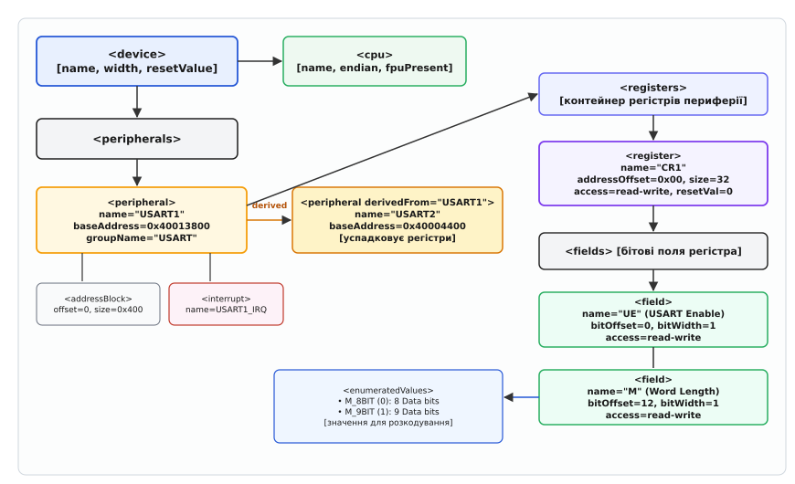
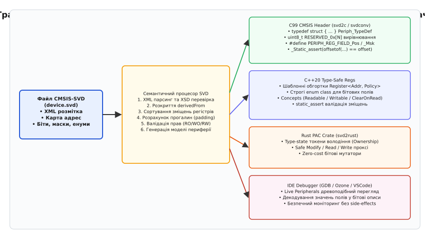

# Формат SVD і згенеровані заголовки регістрів

<preknowlist>
- [Memory-mapped IO](root:hw-arch/memory-mapped-io) — периферія відображається у єдиний адресний простір, а доступ до регістрів виконується через числові адреси пам'яті.
- [Стандарт CMSIS](root:sf-devices/cmsis) — апаратно-програмний рівень абстракції ARM Cortex, базові угоди іменування та структура системних заголовків.
- [Відлагоджувач і керування ядром](root:sys-ide/why-debugger) — принципи читання та візуалізації внутрішнього стану чипа через апаратний порт налагодження.
</preknowlist>

Коли сучасний 32-бітний або 64-бітний мікроконтролер має на кристалі понад вісімдесят периферійних модулів — таймери різної розрядності, універсальні синхронно-асинхронні приймачі-передавачі, контролери прямого доступу до пам'яті, шини I2C, SPI, CAN, USB, апаратні криптографічні блоки та багатоканальні аналого-цифрові перетворювачі — сукупна кількість апаратних регістрів, розкладених у системному адресному просторі, легко перевищує півтори-дві тисячі. Кожен такий регістр займає строго визначене зміщення відносно базової адреси свого модуля, вимагає точного вирівнювання за межами слів, містить індивідуальні бітові поля різної ширини, підпорядковується окремим правилам доступу для читання й запису та має специфічну апаратну реакцію на спробу модифікації окремих бітів.

Якщо інженер чи команда розробників намагається описати цю велетенську топологію пам'яті вручну через заголовочні файли мови C — створюючи сотні макросів або структур даних із полями на кшталт `volatile uint32_t` — виникнення помилок стає неминучою статистичною закономірністю. Один випадково пропущений 4-байтний зарезервований регістр у структурі C неминуче зміщує абсолютні адреси всіх наступних полів; один друкарський огріх у шістнадцятковому зсуві маски записує конфігурацію дільника частоти в біт дозволу переривання; оголошення апаратного регістра скидання прапорців як звичайного поля для операцій «читання-модифікація-запис» призводить до спонтанного стирання статусів усього модуля при спробі змінити один сусідній біт.

Паралельно з компілятором ту саму проблему розв'язує апаратний відлагоджувач (англ. *debugger*, від лат. *de-* — усунення та англ. *bug* — дефект). Коли відлагоджувальний зонд підключається до ядра через інтерфейс SWD або JTAG і зчитує 32-бітне слово з комірки пам'яті `0x40013804`, він бачить лише сирий масив бітів `0x000000C0`. Щоб показати інженеру в графічному вікні IDE древоподібну структуру периферійного модуля `USART1`, підписати назву регістра `CR1`, розкласти його на іменовані прапорці `UE=1` (модуль увімкнено), `TE=1` (передавач активний), `RE=1` (приймач активний) і повідомити, що двійкова комбінація бітів `M0=0, M1=0` відповідає формату «8 бітів даних», відлагоджувачу потрібен машиннозчитуваний паспорт мікроконтролера.

Саме для усунення розриву між кремнієвою топологією чипа, заголовочними файлами системних драйверів і словниками апаратних відлагоджувачів консорціум ARM розробив єдиний відкритий стандарт **CMSIS-SVD** (англ. *Cortex Microcontroller Software Interface Standard — System View Description*, від лат. *describere* — описувати). Специфікація SVD фіксує єдиний формальний XML-документ, який описує повну апаратну архітектуру пристрою: від властивостей процесорного ядра та таблиці векторів переривань до кожного бітового поля та константних переліків режимів роботи окремих регістрів. З цього єдиного джерела істини автоматично генеруються заголовочні файли для C99, сучасні типізовані абстракції для C++20, бібліотеки доступу до периферії для Rust, а також інтерактивні візуалізатори регістрів для VSCode, SEGGER Ozone, Keil MDK та GDB.

## Архітектура стандарту CMSIS-SVD: XML-схема та деревоподібна модель

Специфікація CMSIS-SVD версії 1.3 базується на формальній схемі XSD (англ. *XML Schema Definition*), що забезпечує автоматичну валідацію цілісності файлу перед будь-якою програмною обробкою. Вибір XML як базового синтаксису був зумовлений потребою в суворій ієрархічній структурі, широкій підтримці валідаторів у промислових інструментах розробки та можливості декларувати вкладені простори імен і спадкування властивостей.

Корінь будь-якого коректного SVD-файлу формує елемент `<device>`. Він інкапсулює як загальну паспортизацію чипа (назва, версія ревізії, опис сімейства, адресація пам'яті), так і системні налаштування за замовчуванням, які поширюються вниз по всьому дереву дочірніх вузлів, якщо вони не перевизначені явно на рівні конкретного модуля чи регістра.

```xml
<?xml version="1.0" encoding="utf-8"?>
<device schemaVersion="1.3" xmlns:xs="http://www.w3.org/2001/XMLSchema-instance" xs:noNamespaceSchemaLocation="CMSIS-SVD.xsd">
  <vendor>STMicroelectronics</vendor>
  <vendorID>ST</vendorID>
  <name>STM32F407</name>
  <series>STM32F4</series>
  <version>1.2</version>
  <description>ARM 32-bit Cortex-M4 Microcontroller with FPU and DSP</description>
  <licenseText>
    Arm Limited (or its affiliates) Supply Agreement for CMSIS-SVD.
  </licenseText>
  <headerSystemFilename>stm32f4xx</headerSystemFilename>
  <headerDefinitionsPrefix>STM32F407_</headerDefinitionsPrefix>
  <addressUnitBits>8</addressUnitBits>
  <width>32</width>
  <size>32</size>
  <access>read-write</access>
  <resetValue>0x00000000</resetValue>
  <resetMask>0xFFFFFFFF</resetMask>

  <cpu>
    <name>CM4</name>
    <revision>r0p1</revision>
    <endian>little</endian>
    <mpuPresent>true</mpuPresent>
    <fpuPresent>true</fpuPresent>
    <fpuDP>false</fpuDP>
    <dspPresent>true</dspPresent>
    <icachePresent>false</icachePresent>
    <dcachePresent>false</dcachePresent>
    <itcmPresent>false</itcmPresent>
    <dtcmPresent>false</dtcmPresent>
    <vtorPresent>true</vtorPresent>
    <nvicPrioBits>4</nvicPrioBits>
    <vendorSystickConfig>false</vendorSystickConfig>
    <deviceNumInterrupts>82</deviceNumInterrupts>
  </cpu>

  <peripherals>
    <!-- Перелік периферійних модулів -->
  </peripherals>
</device>
```

На кореневому рівні конфігуруються параметри шини та розрядності пам'яті:
* `<addressUnitBits>`: визначає розмір мінімальної адресовної комірки в бітах. Для архітектур ARM Cortex та більшості сучасних процесорів це значення дорівнює `8` (байтова адресація).
* `<width>`: визначає ширину базової шини даних процесора в бітах (для 32-бітних мікроконтролерів — `32`).
* `<size>`, `<access>`, `<resetValue>`, `<resetMask>`: встановлюють глобальні значення за замовчуванням для регістрів чипа. Якщо окремий регістр не оголошує власний розмір чи тип доступу, генератор використовує ці кореневі параметри.
* `<headerSystemFilename>` та `<headerDefinitionsPrefix>`: задають базове ім'я генерованого заголовка та префікс констант препроцесора.
* Вузол `<cpu>`: декларує апаратний профіль обчислювального ядра. Значення `<name>` ідентифікує тип процесора (наприклад, `CM4`, `CM7`, `CM33`, `CM0PLUS`, `Cortex-M55`), `<endian>` вказує порядок байтів (`little` для молодшого байта за меншою адресою або `big` для старшого), `<nvicPrioBits>` визначає кількість реалізованих бітів пріоритету в контролері переривань NVIC (наприклад, 4 біти забезпечують 16 рівнів пріоритету), а булеві прапорці `<mpuPresent>`, `<fpuPresent>`, `<dspPresent>` та `<vtorPresent>` повідомляють генератору заголовків про необхідність підключення відповідних системних структур MPU (Memory Protection Unit), FPU (Floating Point Unit) та підтримки зміщення таблиці векторів через регістр VTOR.


*Ієрархічна модель CMSIS-SVD 1.3: від метаданих пристрою та процесора до конкретних бітових полів, переліків значень і зв'язків успадкування.*

Вся периферія мікроконтролера групується всередині вузла `<peripherals>`. Кожен окремий модуль описується власним блоком `<peripheral>`, який представляє автономний апаратний вузол зі своєю базовою адресою, лініями переривань та картою внутрішніх регістрів.

### Модель синтаксичного аналізу: DOM проти потокових парсерів

Файли SVD для великих багатоядерних процесорів (наприклад, STM32H7, NXP i.MX RT або TI Sitara) досягають обсягу від 5 до 25 мегабайтів і містять понад сто п'ятдесят тисяч XML-вузлів. Завантаження такого масиву через стандартну об'єктну модель документа DOM (англ. *Document Object Model*) створює відчутні накладні витрати оперативної пам'яті (до 300–500 МБ через службові покажчики кожного вузла).

Тому промислові генератори коду та ядра налагоджувачів застосовують комбінований двоетапний підхід:
1. **Перший прохід (Індексація та топологічне сортування):** легковагий потоковий парсер (на базі SAX або StAX) сканує верхній рівень `<peripherals>`, збирає список імен модулів, фіксує їхні базові адреси `<baseAddress>` та будує орієнтований граф залежностей `derivedFrom`. На цьому етапі алгоритм топологічного сортування (наприклад, алгоритм Тар'яна або Кана) перевіряє граф на відсутність циклічних посилань (`A derivedFrom B`, а `B derivedFrom A`).
2. **Другий прохід (Семантична матеріалізація):** модулі розгортаються в порядку топологічної черги: спершу повністю обробляються базові модулі (батьки), їхні карти регістрів розраховуються й перевіряються, після чого дочірні модулі клонують уже валідовані внутрішні дерева властивостей, підставляючи власні базові адреси та переривання.

## Анатомія вузла `<peripheral>`: адресні блоки, переривання та успадкування

Вузол `<peripheral>` зв'язує логічну сутність апаратного блоку з фізичним адресним простором мікроконтролера. Коректний опис периферії вимагає визначення її імені, базової адреси, діапазону займаної пам'яті та ліній переривань, заведених на таблицю векторів.

```xml
<peripheral>
  <name>USART1</name>
  <version>1.0</version>
  <description>Universal Synchronous Asynchronous Receiver Transmitter</description>
  <groupName>USART</groupName>
  <headerStructName>USART_TypeDef</headerStructName>
  <baseAddress>0x40013800</baseAddress>
  
  <addressBlock>
    <offset>0x0</offset>
    <size>0x400</size>
    <usage>registers</usage>
  </addressBlock>

  <interrupt>
    <name>USART1</name>
    <description>USART1 global interrupt</description>
    <value>37</value>
  </interrupt>

  <registers>
    <!-- Регістри периферійного модуля -->
  </registers>
</peripheral>
```

Розгляньмо ключові складові цього вузла:

1. `<baseAddress>`: абсолютна 32-бітна або 64-бітна адреса в системному просторі пам'яті, де починається карта регістрів цього блоку. Для модуля `USART1` у наведеному фрагменті це `0x40013800` (шина APB2).
2. `<addressBlock>`: окреслює неперервний діапазон адрес, закріплений за периферійним модулем у системній мапі адрес. Поле `<offset>` задає зсув від `<baseAddress>` (зазвичай `0x0`), `<size>` визначає розмір адресного вікна в байтах (наприклад, `0x400` = 1024 байти), а `<usage>` вказує призначення блоку: `registers` (простір керуючих регістрів), `buffer` (пам'ять буферів пакетів або FIFO) чи `reserved` (зарезервована зона, доступ до якої заборонено). Наявність кількох вузлів `<addressBlock>` дозволяє описувати периферію з розірваною адресацією (наприклад, окремий блок регістрів керування та окреме вікно буферної пам'яті дескрипторів Ethernet).
3. `<interrupt>`: пов'язує модуль із контролером векторних переривань процесора. Поле `<name>` задає мнемоніку переривання (наприклад, `USART1`), а числове поле `<value>` визначає позицію вхідної лінії в таблиці векторів NVIC (`37`). Генератор системних заголовків транслює ці вузли у строгий перелік кодів переривань `IRQn_Type` (наприклад, `USART1_IRQn = 37`), гарантуючи точну відповідність номерів ліній обробникам у коді `void USART1_IRQHandler(void)`.
4. `<headerStructName>`: дозволяє явно вказати ім'я структури C, яка повинна представляти цей периферійний блок (наприклад, `USART_TypeDef`). Це дозволяє кільком периферійним модулям із різними іменами використовувати єдине визначення типу.

> 🔧 **Навіщо це.** Автоматична генерація переліку `IRQn_Type` з вузлів `<interrupt>` файлу SVD унеможливлює типову помилку ручного кодування, коли розробник зміщує позицію переривання на 1 пункт через неуважне врахування 16 системних винятків ядра Cortex-M (Reset, NMI, HardFault, SysTick тощо), внаслідок чого виклик `NVIC_EnableIRQ(USART1_IRQn)` вмикає зовсім інше переривання (наприклад, `TIM1_CC_IRQn`).

### Топологія шинних інтерконектів і затримки мостів

Базові адреси периферійних модулів у SVD відображають фізичне підключення блоків до внутрішніх системних шин мікроконтролера. У типовій архітектурі ARM Cortex-M використовуються багаторівневі комутаційні матриці шин:
* **AHB (Advanced High-performance Bus):** швидкісна системна шина, до якої підключені ядро процесора, контролер пам'яті Flash, контролер SRAM та блоки прямого доступу DMA. Звернення за адресами AHB (наприклад, `0x40020000` для GPIO на STM32) виконуються з мінімальною затримкою в 1 такт процесора.
* **APB1 / APB2 (Advanced Peripheral Bus):** енергоефективні периферійні шини, підключені до AHB через спеціальні асинхронні мости (AHB-to-APB Bridge). Периферія на шині APB1 (наприклад, таймери загального призначення, шини I2C/SPI) працює на зниженій тактовій частоті.

Через наявність шинного моста запис у регістр на шині APB займає від 2 до 4 тактів ядра процесора. Це породжує відомий апаратний ефект «гонки шини» (Bus Hazard): якщо код прошивки вмикає тактування модуля в регістрі `RCC_APB1ENR` і наступною ж інструкцією записує значення в регістр конфігурації `TIM2_CR1`, операція запису в таймер може прийти на блок APB раніше, ніж шинний міст зафіксує подачу тактового сигналу, викликаючи апаратне зависання або виключення `BusFault`. Розуміння прив'язки базових адрес SVD до конкретних шинних доменів дозволяє розробникам вчасно вставляти інструкції бар'єрів пам'яті (`__DSB()`) або фіктивне читання регістра RCC перед зверненням до периферії.

### Асиметрія гетерогенних багатоядерних систем

У сучасних гетерогенних кристалах (наприклад, чипи з парою ядер Cortex-M7 та Cortex-M4 або процесори з ядрами Cortex-A53 та Cortex-M4) різні ядра мають різні карти адрес та різні права доступу до периферії. Деякі блоки апаратних семафорів (HSEM), поштових скриньок міжпроцесорної взаємодії (IPCC) або спільної оперативної пам'яті SRAM мають відмінні базові адреси для кожного з ядер.

Стандарт SVD 1.3 підтримує опис таких систем через використання декількох блоків `<cpu>` та прив'язку окремих периферійних модулів до конкретних процесорних ядер за допомогою атрибута `<cpuName>`. Це дозволяє генератору створювати окремі заголовочні файли для кожного з ядер у складі єдиного проєкту мікроконтролера.

### Механізм успадкування через `derivedFrom`

Мікроконтролери часто містять кілька однакових екземплярів одного периферійного пристрою. Наприклад, у чипі може бути шість однакових каналів UART, чотири однакові таймери загального призначення та вісім портів вводу-виводу GPIO. Повний дубльований опис усіх регістрів, полів та переліків значень для кожного з них роздув би розмір XML-файлу SVD до десятків мегабайтів і створив би ризик розсинхронізації описів.

Для вирішення цієї проблеми SVD надає механізм успадкування за допомогою атрибута `derivedFrom`:

```xml
<peripheral derivedFrom="USART1">
  <name>USART2</name>
  <description>Universal Synchronous Asynchronous Receiver Transmitter 2</description>
  <baseAddress>0x40004400</baseAddress>
  
  <interrupt>
    <name>USART2</name>
    <description>USART2 global interrupt</description>
    <value>38</value>
  </interrupt>
</peripheral>
```

Коли парсер зустрічає атрибут `derivedFrom="USART1"`, він копіює весь складний внутрішній вміст батьківського вузла (контейнер `<registers>`, усі регістри, кластери, бітові поля та довідники значень) у новий периферійний модуль `USART2`. При цьому дочірній модуль перевизначає лише власні унікальні атрибути: нову базову адресу `0x40004400` та свій індивідуальний номер вектора переривання `38`.

Генератори коду використовують цю інформацію для оптимізації структур C/C++: замість створення окремих структур `USART1_TypeDef` та `USART2_TypeDef` створюється один єдиний базовий тип `USART_TypeDef`, а екземпляри периферії отримують покажчики на власні базові адреси:

:::tabs
:::code svd-format-d/c/mekhanizm-uspadkuvannia.c
:::code svd-format-d/cpp/mekhanizm-uspadkuvannia.hpp
:::

## Регістри та кластери: `<registers>`, `<register>` і `<cluster>`

Вузол `<registers>` містить послідовність описів окремих регістрів (`<register>`) або згрупованих повторюваних блоків регістрів (`<cluster>`). Регістр є базовою одиницею доступу на апаратній шині мікроконтролера.

```xml
<register>
  <name>CR1</name>
  <displayName>USART_CR1</displayName>
  <description>Control register 1</description>
  <addressOffset>0x0C</addressOffset>
  <size>32</size>
  <access>read-write</access>
  <resetValue>0x00000000</resetValue>
  <resetMask>0xFFFFFFFF</resetMask>
  <modifiedWriteValues>modify</modifiedWriteValues>
  <readAction>modifyExternal</readAction>
  
  <fields>
    <!-- Опис бітових полів -->
  </fields>
</register>
```

Параметри регістра мають суворе призначення:
* `<addressOffset>`: відносне зміщення адреси регістра в байтах від `<baseAddress>` периферійного модуля. Регістр з адресою `0x4001380C` при базі `0x40013800` має зміщення `0x0C`.
* `<size>`: розрядність регістра в бітах (`8`, `16`, `32` або `64`). Визначає, яку інструкцію асемблера компілятор має використовувати для доступу: байтову (`LDRB`/`STRB`), напівсловну (`LDRH`/`STRH`) чи повну 32-бітну машинну команду (`LDR`/`STR`).
* `<access>`: тип дозволених операцій. Стандарт фіксує п'ять допустимих значень:
  * `read-only`: регістр містить апаратний стан чи виміряні дані. Будь-який запис заборонено (у заголовках C поле отримує тип `volatile const uint32_t`).
  * `write-only`: регістр запуску операцій, запис команди. Спроба читання повертає нуль або сміття.
  * `read-write`: регістр повної конфігурації.
  * `writeOnce`: запис дозволено лише один раз після системного скидання (типово для конфігурації сторожового таймера WDT або конфігурації захисту флеш-пам'яті).
  * `read-writeOnce`: дозволено вільне читання, але запис дозволено лише один раз.

### Значення скидання: `<resetValue>` та `<resetMask>`

Кожен апаратний регістр після сигналу апаратного скидання (Power-On Reset або System Reset) переходить у строго детермінований початковий стан:
* `<resetValue>`: шістнадцяткове число, яке з'являється в регістрі одразу після скидання (наприклад, `0x00000000` або для регістрів конфігурації GPIO на STM32 `0x0C000000`).
* `<resetMask>`: бітова маска, яка визначає, які саме біти мають фіксований стан після скидання (наприклад, `0xFFFFFFFF` для повного 32-бітного слова або `0x0000FFFF` для 16-бітного регістра в 32-бітному адресному слові).

Ці параметри активно використовуються в автоматизованих тестах апаратної верифікації (HIL — Hardware-in-the-Loop): тестовий сценарій зчитує всі адреси мікроконтролера одразу після зняття сигналу Reset і зіставляє отримані байти з формулою `ActualValue & resetMask == resetValue`. Будь-яка розбіжність сигналізує про дефект виготовлення кристала або невідповідність документації.

### Повна типологія семантики запису (`modifiedWriteValues`)

Апаратні регістри дуже часто мають поведінку, відмінну від звичайної комірки пам'яті ОЗП. Для точного моделювання апаратної логіки SVD декларує розширену типологію поля `<modifiedWriteValues>`:

| Значення тегу | Апаратна дія при записі | Типовий приклад у мікроконтролері |
|---|---|---|
| `oneToClear` | Запис `1` скидає відповідний біт у `0`; запис `0` не змінює біт | Прапорці переривань і помилок (`USART_SR`, `TIM_SR`) |
| `oneToSet` | Запис `1` встановлює відповідний біт в `1`; запис `0` не змінює біт | Регістри атомарного встановлення бітів (`GPIO_BSRR`) |
| `oneToToggle` | Запис `1` інвертує стан біта; запис `0` не змінює біт | Регістри інверсії виходів GPIO (`GPIO_TOGGLE`) |
| `zeroToClear` | Запис `0` скидає біт; запис `1` не змінює біт | Апаратні лічильники скидання за нулем |
| `zeroToSet` | Запис `0` встановлює біт в `1`; запис `1` не змінює біт | Інверсні конфігураційні регістри |
| `zeroToToggle` | Запис `0` інвертує стан біта; запис `1` не змінює біт | Інверсні перемикачі стану |
| `clear` | Будь-який запис обнуляє весь вміст регістра | Регістри загального скидання підсистем |
| `set` | Будь-який запис встановлює всі біти регістра в `1` | Регістри масового блокування |
| `modify` | Звичайне збереження записаного значення | Стандартні регістри конфігурації |

> ⚠️ **Чому це критично для коду.** Якщо статусний регістр має тип `oneToClear`, наївна операція `SR |= FLAG` призведе до катастрофічної помилки. Компілятор прочитає `SR` (де, наприклад, встановлені прапорці помилки кадру `FE=1` та готовності прийому `RXNE=1`), виконає операцію АБО з бітом `RXNEIE` і запише `0x00000060` назад. Оскільки біт `FE` був одиницею, його повторний запис **скине прапорець помилки `FE`** ще до того, як драйвер встигне його зафіксувати й обробити!

### Повна типологія побічних ефектів читання (`readAction`)

Поле `<readAction>` описує побічну дію, яка відбувається всередині кремнію в момент читання регістра процесором чи відлагоджувальним зондом:
* `clear`: читання автоматично обнуляє регістр (наприклад, читання з регістра прийому `DR` очищає прапорець `RXNE` та видаляє елемент з апаратного FIFO).
* `set`: читання автоматично встановлює всі біти регістра.
* `modify`: читання змінює внутрішній стан кінцевого автомата модуля.
* `modifyExternal`: читання генерує строб на внутрішній системній шині, змінюючи стан зовнішнього периферійного блоку (наприклад, підтверджуючи транзакцію в контролері DMA).

### Багатовимірні масиви регістрів: `<dim>`, `<dimIncrement>` та `<dimIndex>`

Якщо периферійний модуль містить масив однотипних регістрів (наприклад, шістнадцять регістрів фільтрів CAN `F0R`..`F15R` або 8 регістрів захоплення/порівняння таймера `CCR1`..`CCR8`), стандарт SVD дозволяє описати їх однією компактною конструкцією за допомогою тегів виміру:

```xml
<register>
  <dim>4</dim>
  <dimIncrement>4</dimIncrement>
  <dimIndex>1-4</dimIndex>
  <name>CCR%s</name>
  <description>Capture/Compare register %s</description>
  <addressOffset>0x34</addressOffset>
  <size>32</size>
  <access>read-write</access>
</register>
```

* `<dim>`: кількість елементів у масиві (тут `4`).
* `<dimIncrement>`: крок адреси між сусідніми регістрами масиву в байтах (тут `4`, тобто `0x34`, `0x38`, `0x3C`, `0x40`).
* `<dimIndex>`: діапазон індексів для підстановки (наприклад, `1-4` або перелік через кому `A,B,C,D`).
* Шаблон `%s` в імені `<name>` та описі замінюється відповідним індексом. У результаті парсер розгортає цей опис у чотири окремі регістри `CCR1`, `CCR2`, `CCR3`, `CCR4`, або генерує в заголовочному файлі масив `__IO uint32_t CCR[4];`.

### Кластеризація регістрів: елемент `<cluster>`

Коли повторюється не окремий регістр, а ціла група пов'язаних регістрів (наприклад, канал DMA містить регістри конфігурації `CCR`, кількості даних `CNDTR`, адреси периферії `CPAR` та адреси пам'яті `CMAR`, і вся ця четвірка повторюється 8 разів), використовується вузол `<cluster>`:

```xml
<cluster>
  <dim>8</dim>
  <dimIncrement>0x14</dimIncrement>
  <dimIndex>0-7</dimIndex>
  <name>CH[%s]</name>
  <description>DMA Channel %s cluster</description>
  <addressOffset>0x08</addressOffset>

  <register>
    <name>CCR</name>
    <description>Channel configuration register</description>
    <addressOffset>0x00</addressOffset>
    <size>32</size>
  </register>
  <register>
    <name>CNDTR</name>
    <description>Number of data register</description>
    <addressOffset>0x04</addressOffset>
    <size>32</size>
  </register>
  <register>
    <name>CPAR</name>
    <description>Peripheral address register</description>
    <addressOffset>0x08</addressOffset>
    <size>32</size>
  </register>
  <register>
    <name>CMAR</name>
    <description>Memory address register</description>
    <addressOffset>0x0C</addressOffset>
    <size>32</size>
  </register>
</cluster>
```

У мові C така конструкція транслюється у вкладену структуру або масив підструктур:

:::tabs
:::code svd-format-d/c/klasteryzatsiia-rehistriv.c
:::code svd-format-d/cpp/klasteryzatsiia-rehistriv.cpp
:::

## Бітові поля та переліки: `<fields>`, `<field>` і `<enumeratedValues>`

Кожен регістр складається з окремих бітів або багатобітових полів. Вузол `<fields>` містить перелік елементів `<field>`, які деталізують внутрішню бітову структуру машинного слова.

```xml
<fields>
  <field>
    <name>UE</name>
    <description>USART Enable</description>
    <bitOffset>0</bitOffset>
    <bitWidth>1</bitWidth>
    <access>read-write</access>
  </field>

  <field>
    <name>M</name>
    <description>Word length</description>
    <bitOffset>12</bitOffset>
    <bitWidth>1</bitWidth>
    <access>read-write</access>
    
    <enumeratedValues>
      <enumeratedValue>
        <name>M_8BIT</name>
        <description>1 Start bit, 8 Data bits, n Stop bits</description>
        <value>0</value>
      </enumeratedValue>
      <enumeratedValue>
        <name>M_9BIT</name>
        <description>1 Start bit, 9 Data bits, n Stop bits</description>
        <value>1</value>
      </enumeratedValue>
    </enumeratedValues>
  </field>
</fields>
```

### Способи визначення меж бітового поля

Специфікація SVD допускає три формати завдання положення бітів:
1. `<bitOffset>` та `<bitWidth>`: рекомендований базовий спосіб. Позиція молодшого біта поля та його протяжність (наприклад, зміщення 12 і ширина 1 позначають біт 12).
2. `<lsb>` та `<msb>`: пряме зазначення індексів молодшого та старшого бітів (наприклад, `<lsb>12</lsb>` та `<msb>12</msb>`).
3. `<bitRange>[msb:lsb]</bitRange>`: текстовий запис меж у стилі мов Verilog/VHDL (наприклад, `[12:12]` або для 4-бітного поля дільника `[15:12]`).

Парсер нормалізує будь-який із цих форматів до пари чисел `(offset, width)`. З цих чисел обчислюється бітова позиція `_Pos` та шістнадцяткова бітова маска `_Msk`:

```
_Pos = bitOffset
_Msk = ((1 << bitWidth) - 1) << _Pos
```

Для поля `M` зі зміщенням 12 і шириною 1:
```
USART_CR1_M_Pos = 12
USART_CR1_M_Msk = (0x01U << 12) = 0x00001000U
```

### Роль вузла `<enumeratedValues>`

Вузол `<enumeratedValues>` перетворює абстрактні числові конфігурації у строго іменовані переліки. Якщо поле конфігурації таймера `CMS` (Center-aligned mode selection) займає 2 біти, його можливі значення `00`, `01`, `10`, `11` описуються переліком:

```xml
<enumeratedValues>
  <enumeratedValue>
    <name>EdgeAligned</name>
    <description>Edge-aligned mode. The counter counts up or down depending on the DIR bit.</description>
    <value>0</value>
  </enumeratedValue>
  <enumeratedValue>
    <name>CenterAligned1</name>
    <description>Center-aligned mode 1. Output compare interrupt flags are set only when counting down.</description>
    <value>1</value>
  </enumeratedValue>
  <enumeratedValue>
    <name>CenterAligned2</name>
    <description>Center-aligned mode 2. Output compare interrupt flags are set only when counting up.</description>
    <value>2</value>
  </enumeratedValue>
  <enumeratedValue>
    <name>CenterAligned3</name>
    <description>Center-aligned mode 3. Output compare flags are set both when counting up and down.</description>
    <value>3</value>
  </enumeratedValue>
</enumeratedValues>
```

Ці дані мають подвійне застосування:
* У заголовочних файлах C/C++ вони породжують іменовані константи (наприклад, `TIM_CR1_CMS_EDGEALIGNED (0x00U << TIM_CR1_CMS_Pos)`), усуваючи необхідність заглядати в даташит за числовими константами.
* У відлагоджувачах (GDB/VSCode/Ozone) вони дозволяють випадаючим спискам GUI замість числа `2` показувати зрозумілий текст `CenterAligned2`, миттєво пояснюючи інженеру поточний апаратний режим чипа.

## Розбір реальних периферійних модулів: Таймери та GPIO

Щоб побачити, як SVD моделює складні кремнієві блоки, розберімо два типові випадки: розширений таймер керування двигунами (`TIM1`) та порт вводу-виводу загального призначення (`GPIOA`).

### Анатомія таймера керування двигунами (TIM1)

Розширений таймер містить понад двадцять регістрів, розташованих із фіксованим кроком за зміщеннями від `0x00` до `0x4C`:

```
Зміщення  Регістр  Призначення                        Тип доступу
0x00      CR1      Керування рахунком, напрям, поділ  read-write
0x04      CR2      Керування виходами та тригерами    read-write
0x08      SMCR     Синхронізація веденого режиму      read-write
0x0C      DIER     Дозвіл переривань та DMA запитів   read-write
0x10      SR       Статус подій і прапорці            read-write (oneToClear)
0x14      EGR      Генерація програмних подій         write-only (oneToSet)
0x18      CCMR1    Режим захоплення/порівняння 1-2    read-write
0x1C      CCMR2    Режим захоплення/порівняння 3-4    read-write
0x20      CCER     Дозвіл виходів і полярність        read-write
0x24      CNT      Поточний стан лічильника           read-write
0x28      PSC      Попередній дільник частоти         read-write
0x2C      ARR      Регістр автоперезавантаження       read-write
0x30      RCR      Лічильник повторень періодів       read-write
0x34..40  CCR1..4  Значення захоплення/порівняння     read-write
0x44      BDTR     Час паузи (Dead-Time) та аварія    read-write
0x48      DCR      Конфігурація пакетного DMA         read-write
0x4C      DMAR     Адреса передачі пакетного DMA      read-write
```

Особливий інтерес тут представляє регістр `CCMR1` (Capture/Compare Mode Register 1). В апаратній схемі той самий 32-бітний регістр має **дві абсолютно різні бітові карти**:
* Якщо біти `CC1S[1:0]` дорівнюють `00`, канал працює в режимі виходу (Output Compare), і біти 6:4 визначають режим генерації ШІМ (`OC1M`).
* Якщо біти `CC1S[1:0]` відмінні від нуля, канал працює в режимі входу (Input Capture), і ті самі біти 6:4 перетворюються на налаштування цифрового вхідного фільтра `IC1F`.

Стандарт SVD дозволяє описувати альтернативні інтерпретації регістра за допомогою механізму вибору або кількох описів полів з відповідними коментарями, що дозволяє генераторам коду та візуалізаторам IDE динамічно підлаштовувати назви прапорців відповідно до значення бітів режиму `CC1S`.

### Анатомія порту вводу-виводу (GPIOA)

Порт GPIO демонструє класичну роботу з атомарними масками та парними бітами:
* `MODER` (Offset `0x00`): конфігурація режиму ніжок. Містить 16 двохбітних полів `MODER0`..`MODER15` (00=Вхід, 01=Вихід, 10=Альтернативна функція, 11=Аналоговий режим).
* `OTYPER` (Offset `0x04`): вибір типу вихідного каскаду (0=Двотактний Push-Pull, 1=Відкритий стік Open-Drain).
* `OSPEEDR` (Offset `0x08`): швидкість наростання фронту сигналу (2 біти на ніжку).
* `PUPDR` (Offset `0x0C`): підтягувальні резистори (00=Без підтяжки, 01=Pull-up, 10=Pull-down).
* `IDR` (Offset `0x10`): вхідний стан пінів, доступний лише для читання (`read-only`).
* `ODR` (Offset `0x14`): вихідний регістр засувки, доступний для читання й запису.
* `BSRR` (Offset `0x18`): 32-бітний регістр атомарного встановлення та скидання. Молодші 16 бітів `BS0`..`BS15` встановлюють ніжки в 1, а старші 16 бітів `BR0`..`BR15` скидають ніжки в 0. Цей регістр має тип `write-only` із модифікатором `oneToSet`. Запис одиниці в біт `BS5` перемикає пін 5 у високий рівень за один такт шини без необхідності виконувати повільне та вразливе до переривань читання-модифікацію-запис.
* `AFR[2]` (Offset `0x20`, `0x24`): два 32-бітних регістри вибору альтернативних функцій (`AFRL` для пінів 0–7 та `AFRH` для пінів 8–15), де кожен пін отримує 4-бітний селектор периферійного сигналу (UART, SPI, I2C, CAN, Timer).

## Трансформація SVD у CMSIS C99 заголовки (`svd2c` / `svdconv`)

Перетворення сирого XML-файлу SVD у надійний C99 заголовок виконується спеціалізованими генераторами, такими як офіційна утиліта ARM `svdconv`, генератор `svd2c` або спеціалізовані генератори на базі Python ([генератор заголовків регістрів](root:sys-ide/svd-format/proj-svd-header-generator.md)).


*Конвеєр трансформації SVD: парсинг, валідація, розрахунок прогалин адрес і генерація цільових системних заголовків та метаданих відлагодження.*

Цей процес складається з кількох строгих математичних кроків:

### 1. Сортування регістрів та розрахунок зміщень

Оскільки в XML-файлі вузли `<register>` можуть бути розташовані в довільному порядку, генератор спершу сортує всі регістри периферійного модуля за зростанням їхнього поля `<addressOffset>`.

### 2. Виявлення прогалин (Address Gaps) та вставка заповнювачів (Padding)

Якщо між сусідніми регістрами є незайняті адреси (наприклад, регістр `A` знаходиться за зміщенням `0x04` і має розмір 4 байти, а наступний регістр `B` розташований за зміщенням `0x14`), пряме оголошення полів у структурі C призведе до фатальної помилки: поле `B` опиниться за зміщенням `0x08`.

Генератор аналізує різницю адрес:
```
gap_start = prev_offset + (prev_size / 8)
gap_end   = current_offset
gap_bytes = gap_end - gap_start
```

У нашому випадку:
```
gap_start = 0x04 + 4 = 0x08
gap_end   = 0x14
gap_bytes = 0x14 - 0x08 = 0x0C (12 байтів)
```

Щоб зберегти фізичну топологію пам'яті, генератор автоматично генерує фіктивне поле вирівнювання: `uint8_t RESERVED0[12];` або `uint32_t RESERVED0[3];`.

### 3. Кваліфікація доступу через макроси CMSIS

Для збереження сумісності зі стандартом CMSIS кожен тип регістра обгортається у спеціальний макрос кваліфікатора доступу:
* `__IO`: для регістрів `read-write` — розгортається у `volatile uint32_t`. Кваліфікатор `volatile` наказує компілятору генерувати чесні інструкції звернення до пам'яті (`LDR`/`STR`) при кожному читанні чи записі змінної, блокуючи оптимізації кешування значень у регістрах загального призначення процесора.
* `__I`: для регістрів `read-only` — розгортається у `volatile const uint32_t`. Додавання `const` у сигнатуру гарантує, що спроба запису в такий регістр у коді прошивки буде зупинена компілятором ще на етапі синтаксичного аналізу як помилка типізації.
* `__O`: для регістрів `write-only` — розгортається у `volatile uint32_t`.

### 4. Автоматична генерація перевірок `_Static_assert`

Щоб захистити прошивку від розбіжностей ABI, викликаних нестандартними прапорцями вирівнювання компілятора (наприклад, `#pragma pack` або прапорцями компілятора `-fpack-struct`), згенерований заголовок обов'язково включає статичні перевірки зміщень на етапі компіляції (C11 `_Static_assert` або C++ `static_assert`):

:::tabs
:::code svd-format-d/c/stddef.h
:::code svd-format-d/cpp/4-avtomatychna-heneratsiia.hpp
:::

Якщо через помилку компілятора чи випадкову правку заголовка розмір структури або положення хоча б одного регістра зміститься бодай на 1 байт, компіляція аварійно зупиниться з точним повідомленням про помилку ще до генерації бінарного файлу.

## Строга типізація: C99 проти сучасного C++20 та Rust

Класичні CMSIS-заголовки мови C99 спираються на макроси бітових масок та ручні операції бітової арифметики:

:::tabs
```c
/* Увімкнення передавача USART та дозволу переривання за прийомом у C99 */
USART1->CR1 |= (USART_CR1_TE_Msk | USART_CR1_RXNEIE_Msk);
```
```cpp
// Еквівалентний виклик у C++20 через простір імен периферії
USART1->CR1 |= (USART_CR1_TE_Msk | USART_CR1_RXNEIE_Msk);
```
:::

Цей підхід має низку фундаментальних вад:
1. **Відсутність контролю типів:** ніщо не заважає передати маску таймера `TIM_CR1_CEN_Msk` у регістр `USART1->CR1`. Компілятор C сприймає обидва макроси як звичайні беззнакові цілі числа `uint32_t` і мовчки генерує код із критичною помилкою конфігурації.
2. **Небезпека бітових полів C (C Bitfields):** спроба описати регістри через бітові поля структур (`struct { uint32_t TE:1; uint32_t RE:1; ... }`) є небезпечним антипатерном для системного програмування. За стандартом C/C++ порядок упакування бітових полів (від молодшого до старшого чи навпаки) є залежним від реалізації компілятора (Implementation-Defined). Крім того, компілятор має право замінити запис окремого бітового поля на байтову операцію `STRB`, тоді як системні шини мікроконтролера (наприклад, AHB/APB) часто апаратно вимагають виключно 32-бітних транзакцій `STR`, викликаючи апаратне виключення `BusFault` або `HardFault`.
3. **Побічні ефекти операції Read-Modify-Write:** конструкція `REG |= Msk` спершу зчитує весь 32-бітний регістр, накладає бітове АБО та записує результат назад. Якщо регістр містить апаратні біти зі специфікою `oneToClear` (наприклад, прапорці помилок чи завершення передачі), читання одиниці в цьому біті призведе до того, що під час зворотного запису ця сама одиниця буде записана назад у регістр, що ненавмисно скине прапорець апаратної події, яку прошивка ще навіть не встигла обробити.

### Типобезпечні абстракції в C++20

Сучасний C++20 дозволяє будувати генератори SVD, які створюють нульові за накладними витратами (Zero-Overhead), але абсолютно безпечні за типізацією абстракції регістрів. За допомогою концептів (Concepts), строго типізованих переліків `enum class` та шаблонів із параметрами `constexpr` адрес перевірка прав доступу та допустимих масок повністю переноситься на етап компіляції:

:::code svd-format-d/cpp/typobezpechni-abstraktsii.cpp

У наведеному C++20 коді відсутні будь-які накладні витрати пам'яті (відсутні поля екземплярів і віртуальні таблиці), усі зміщення та маски обчислюються під час збирання, а оптимізатор компілятора генерує точно такий самий компактний асемблерний код з інструкціями `LDR`/`STR`, як і ручний C99 код, але з повною гарантією типобезпеки.

### Порівняння асемблерного коду GCC/Clang

Перевіримо твердження про нульові накладні витрати (Zero-Cost Abstraction). Зіставимо машинний код ARM Thumb-2, згенерований компілятором GCC з оптимізацією `-O2`, для обох підходів:

:::tabs
```c
/* Класичний C99 виклик */
USART1->CR1 = (1U << 13) | (1U << 3) | (1U << 2);
```
```cpp
// Шаблонний C++20 виклик
hal::Usart1Cr1::write_raw(0x200C);
```
:::

Компілятор генерує три ідентичні машинні інструкції асемблера ARM Thumb-2:
```asm
ldr  r3, =0x4001380C    ; Пряма абсолютна адреса регістра CR1
movw r2, #0x200C        ; Значення маски конфігурації UE | TE | RE
str  r2, [r3]           ; Атомарний 32-бітний запис у пам'ять регістра
```

Усі абстракції класів `HardwareRegister`, концептів `Readable`/`Writable` та переліків `enum class` повністю розчиняються під час статичного аналізу коду, не залишаючи в бінарному образі прошивки жодного зайвого байта чи виклику підпрограм.

### Порівняння з екосистемою Rust (`svd2rust`)

В екосистемі мови Rust утиліта `svd2rust` є стандартом де-факто для створення так званих пакетів периферійного доступу PAC (англ. *Peripheral Access Crate*). 

`svd2rust` доводить безпеку роботи з SVD до найвищого рівня завдяки моделі володіння (Ownership) та паттерну типових станів (Type-State):
* **Ексклюзивне володіння периферією:** екземпляри периферійних модулів можна отримати лише через виклик `Peripherals::take()`, який повертає об'єкт модулів в єдиному екземплярі (Singleton). Це гарантує на етапі компіляції, що два незалежні потоки чи модулі драйверів не зможуть одночасно захопити та переконфігурувати той самий апаратний порт `USART1`.
* **Замикання для модифікації регістрів:** зміна бітових полів реалізується через проксі-об'єкти у формі замикань:
```rust
dp.USART1.cr1.modify(|r, w| {
    w.ue().set_bit()
     .m().bit8()
     .te().set_bit()
});
```
Замикання гарантує, що операція «читання-модифікація-запис» виконується за один неподільний крок над тимчасовим словом без проміжних несинхронізованих станів.

## Безпека в архітектурі ARMv8-M: теги захисту та TrustZone

З появою архітектури ARMv8-M (процесори Cortex-M23, Cortex-M33, Cortex-M55, Cortex-M85) мікроконтролери отримали апаратне розділення адресного простору на безпечний (Secure) та небезпечний (Non-Secure) домени на базі технології ARM TrustZone. Специфікація CMSIS-SVD 1.3.3+ ввела підтримку атрибутів безпеки для точного опису привілеїв доступу до апаратних блоків.

У SVD з'явився атрибут `<protection>`, який може набувати таких значень:
* `s` (Secure): регістр або периферійний модуль доступний виключно з безпечного світу виконання (Secure World). Спроба звернення з небезпечного домену викликає апаратне виключення `SecureFault`.
* `n` (Non-Secure): доступ дозволено з небезпечного коду застосунку.
* `p` (Privileged): доступ вимагає привілейованого режиму виконання процесора (Handler Mode або привілейований Thread Mode).

Крім того, на рівні блоку `<cpu>` підтримується опис конфігурації блоку атрибутів безпеки SAU (англ. *Security Attribution Unit*):

```xml
<cpu>
  <name>CM33</name>
  <sauNumRegions>8</sauNumRegions>
  <sauRegionsConfig>
    <region enabled="true" name="NS_PERIPHERALS">
      <base>0x40000000</base>
      <limit>0x4FFFFFFF</limit>
      <access>n</access>
    </region>
  </sauRegionsConfig>
</cpu>
```

Ці дані дозволяють генераторам створювати розділені заголовочні файли: `device_s.h` для безпечного ядра захищеної операційної системи та `device_ns.h` для небезпечного користувацького коду, усуваючи з останнього визначення критичних регістрів криптографічних ключів чи контролера конфігурації безпеки MPC/PPC.

## SVD у просторі налагодження: GDB, OpenOCD, SEGGER Ozone, VSCode

Окрім генерації заголовочних файлів для компілятора, файл SVD виконує критично важливу функцію в процесі інтерактивного налагодження вбудованих систем.

Коли розробник зупиняє виконання програми на точці зупину (англ. *breakpoint*) у середовищі VSCode із плагіном *Cortex-Debug*, Eclipse, CLion або професійному відлагоджувачі *SEGGER Ozone*, IDE завантажує SVD-файл відповідного мікроконтролера. 

Налагоджувач виконує такі кроки:
1. Будує інтерактивне дерево периферії: у вкладці «Peripherals» або «XPeripherals» інженер бачить повний список доступних модулів (`GPIOA`, `TIM1`, `ADC1`, `USART1`).
2. Читає поточні значення з пам'яті через апаратний зонд (J-Link, ST-Link, CMSIS-DAP) за адресою `baseAddress + addressOffset`.
3. Виконує автоматичне декодування бітових полів: накладає бітові маски `_Msk`, зсуває значення на `_Pos` і зіставляє отримані числа з вузлами `<enumeratedValues>`, виводячи людинозрозумілий текстовий статус для кожного прапорця.
4. Дозволяє інтерактивне редагування: розробник може змінити значення одного біта безпосередньо у графічному вікні (наприклад, встановити галочку біля прапорця `SWTRG` запуску перетворення АЦП), і відлагоджувач автоматично сформує правильну маску та запише слово в пам'ять чипа.

> 🔧 **Навіщо це.** Без SVD-файлу інженер змушений у вікні консолі GDB вручну виконувати команду `x/xw 0x40013800`, отримувати шістнадцяткове число `0x000000C0`, відкривати PDF-документ опису мікроконтролера на 1500 сторінок, шукати таблицю регістра `USART_SR`, переводити число `0xC0` у двійкову систему `11000000_2` і вручну рахувати, що встановлені біти 7 і 6 відповідають прапорцям `TXE` (буфер передачі порожній) та `TC` (передачу завершено). SVD робить це миттєво й автоматично для кожного регістра в системі.

### Захист від побічних ефектів при налагодженні

Коректно сформований SVD-файл захищає відлагоджувач від деструктивного впливу на роботу програми. 

Якщо відлагоджувач намагатиметься фоново прочитати всі регістри підряд для оновлення GUI, він може випадково звернутися до регістра приймального буфера FIFO UART, який має властивість `<readAction>clear</readAction>`. У результаті такого фонового читання апаратний контролер UART вважатиме, що процесор уже вичитав байт, і видалить його з черги, через що основний код прошивки втратить дані. Професійні відлагоджувачі аналізують теги `<readAction>` та `<access>` у SVD і автоматично пропускають або вимагають явного запиту від користувача для читання таких сенситивних регістрів.

### Кешування значень і оптимізація трафіку SWD/JTAG

Пропускна здатність відлагоджувального інтерфейсу SWD зазвичай обмежена частотою тактування лінії SWCLK (від 1 до 10 МГц). Одне читання 32-бітного слова через транзакцію DAP займає близько 45 тактів. Якщо вікно відлагоджувача намагатиметься оновити всі 1500 регістрів чипа одночасно, це вимагатиме передачі понад 67 000 бітів, створюючи затримку оновлення інтерфейсу до 100–200 мілісекунд при кожному кроці налагодження `Step Over`.

SVD-сумісні відлагоджувачі застосовують інтелектуальне кешування:
* **Тільки видимі вузли:** опитуються виключно ті периферійні модулі та регістри, які розгорнуті користувачем у дереві GUI в поточний момент.
* **Блочне читання через автоінкремент TAR:** замість надсилання окремої команди на кожен регістр відлагоджувач читає суміжний блок пам'яті периферійного модуля однією неперервною пакетною транзакцією SWD.
* **Ігнорування статичних регістрів:** регістри ідентифікації чипа (`UID`, `CPUID`, константи версій) зчитуються лише один раз під час підключення сесії налагодження.

## Підводні камені, типові помилки виробників та автоматизоване латання SVD

Попри те, що SVD є офіційним стандартом ARM, реальні SVD-файли, які постачаються виробниками мікроконтролерів (STMicroelectronics, NXP, Microchip, Silicon Labs, Espressif), дуже часто містять грубі системні дефекти. Причина полягає в тому, що виробники генерують SVD-файли автоматично зі своїх внутрішніх інженерних баз даних проектування кристалів (RTL/IP-XACT), де назви сигналів і права доступу не завжди адаптовані під вимоги CMSIS.

Розгляньмо найтиповіші дефекти фабричних SVD-файлів:

1. **Пропущені регістри та розриви адрес:** у SVD-файлі виробник випадково забуває описати зарезервоване адресне вікно між регістрами або зазначає зміщення наступного регістра з помилкою. Наївний генератор коду без перевірки прогалин створить структуру C без вирівнювальних байтів `RESERVED`, змістивши доступ до всіх наступних регістрів у пам'яті.
2. **Накладання бітових полів (Overlapping Fields):** два різних бітових поля всередині одного регістра мають діапазони, що перекриваються (наприклад, одне поле займає біти `[3:0]`, а друге — `[2:1]`). Це виникає, коли для одного регістра в XML записують альтернативні конфігурації для різних режимів роботи без зазначення спеціальних груп або масок.
3. **Помилкові права доступу:** статусний регістр апаратних помилок містить біти скидання `oneToClear`, але в SVD виробник вказує для всього регістра загальне значення `<access>read-write</access>` без тегу `<modifiedWriteValues>`. Генератори створюють код із небезпечним макросом модифікації, що провокує розробників писати `REG |= FLAG`, скидаючи сусідні прапорці подій.
4. **Зламані ланцюжки `derivedFrom`:** модуль `USART3` оголошує `derivedFrom="USART1"`, але сам `USART1` описаний у файлі нижче за текстом, ніж `USART3`. Однопрохідні XML-парсери завершують роботу з критичною помилкою «Батьківський модуль не знайдено». В інших випадках дочірній модуль посилається на ім'я неіснуючого периферійного пристрою через помилку в назві серії чипа.
5. **Несумісність регістру символів та назв:** в одному сімействі чипів той самий регістр керування називається `CR1`, а в іншому — `CTRL1` або `CTL0`. Це ламає кросплатформні драйвери, змушуючи розробників писати умовні блоки препроцесора `#ifdef`.

### Автоматизований аудит якості SVD: Вісім правил верифікації

Щоб запобігти потраплянню дефектних файлів SVD у конвеєр генерації коду, використовується набір строгих автоматичних правил валідації:
1. **Схемна відповідність (XSD Compliance):** документ зобов'язаний проходити сувору перевірку схемою `CMSIS-SVD.xsd` без відхилень у структурі тегів.
2. **Монотонність зміщень:** кожне наступне зміщення регістра повинно задовольняти нерівність `offset[i+1] >= offset[i] + (size[i]/8)`.
3. **Вирівнювання за межами слів:** зміщення 32-бітних регістрів повинні бути кратні 4, 16-бітних — кратні 2.
4. **Відсутність накладання бітів:** сума бітових масок полів регістра повинна дорівнювати операції побітового АБО над ними (жоден біт не може належати двом полям одночасно, крім спеціальних альянсів).
5. **Валідація переліків:** кожне значення `<enumeratedValue>` зобов'язане вкладатися в діапазон `value < (1 << bitWidth)`.
6. **Замкненість успадкування:** усі посилання `derivedFrom` повинні вказувати на існуючі модулі у межах того самого документа.
7. **Коректність таблиці NVIC:** номери переривань `<interrupt>` у межах одного чипа не можуть дублюватися між незалежними лініями.
8. **Явна декларація семантики запису:** будь-який регістр із суфіксом `SR` або назвою `STATUS` повинен мати явно визначений атрибут `modifiedWriteValues`.

### Екосистема автоматизованого виправлення: `svdtools`

Для боротьби з дефектами вендорських файлів у відкритій інженерній спільноті (зокрема в рамках проекту *stm32-rs*) було створено спеціальний інструмент **svdtools**. Він дозволяє підтримувати декларативні YAML-патчі, які накладаються на оригінальний SVD-файл виробника перед запуском генераторів коду:

```yaml
# Приклад патчу svdtools для виправлення SVD таймера
TIM1:
  _modify:
    # Виправлення прав доступу до регістра статусу
    SR:
      access: "read-write"
      modifiedWriteValues: "oneToClear"

  _delete:
    # Видалення застарілого або дубльованого бітового поля
    - CR1.RESERVED_BIT_7

  _add:
    # Додавання пропущеного в документації бітового поля
    CR2:
      MMS2:
        description: "Master mode selection 2"
        bitOffset: 20
        bitWidth: 3
```

Застосування інструментів латання гарантує, що оригінальний паспортний файл виробника приводиться до суворого математичного стандарту, перш ніж із нього будуть скомпільовані критично важливі системні заголовки прошивки.

Практичну реалізацію повнофункціонального автономного генератора системних заголовочних файлів C99 та C++20 з перевіркою адресних прогалин, статичними асертами та підтримкою повної моделі SVD 1.3 наведено у практичній вставці: [генератор типізованих заголовків регістрів з XML SVD](root:sys-ide/svd-format/proj-svd-header-generator.md).

---

## Інженерний синтез

Формат CMSIS-SVD є фундаментальним містком, що поєднує світ розробки кремнієвих інтегральних схем із програмною екосистемою вбудованих систем. Завдяки стандартизованій деревоподібній XML-структурі він усуває хаос ручного опису тисяч апаратних регістрів, надаючи єдине верифіковане джерело істини для компіляторів, аналізаторів коду та відлагоджувальних комплексів.

Автоматична генерація заголовочних файлів C99 з використанням структур зі строгим вирівнюванням, явними масивами прогалин `RESERVED` та обов'язковими перевірками `_Static_assert` гарантує стовідсоткову точність накладання структур на фізичну пам'ять мікроконтролера. Водночас перехід до сучасних мовних можливостей C++20 та Rust дозволяє перетворити паспортні дані SVD на строгі системи типів, що унеможливлюють випадкові помилки накладання бітових масок, спроби запису в регістри тільки для читання чи небезпечні операції модифікації на етапі компіляції прошивки.
