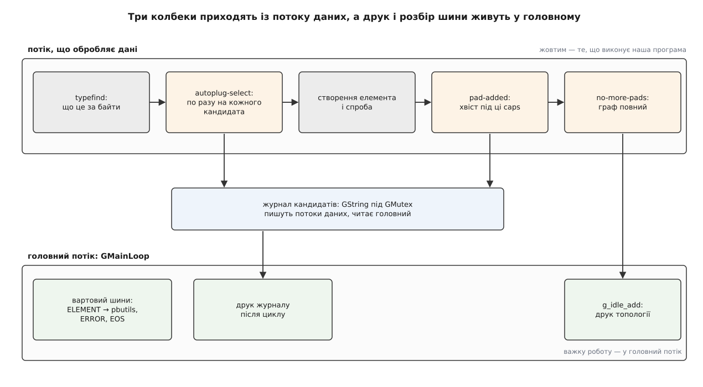

# ⚙️ Керований автодобір: журнал кандидатів і вето на декодер

Ця програма стає між `decodebin` і реєстром: перед кожною спробою вона встигає сказати «пробуй» або «пропусти», записує в журнал ім'я, ранг і клас кожного кандидата, доживає до першого кадру й друкує граф, який зрештою побудувався. Головна мова — C, бо сигнали GStreamer із їхніми підписами й типами повернення є саме C-інтерфейсом; другою вкладкою — рівноцінний Python через PyGObject: той самий інтерфейс, але крізь інтроспекцію, і на ньому добре видно, що з C-API переїжджає не все.

## Задача

Той самий файл на трьох машинах декодують три різні елементи, і жодне з їхніх імен ніде не написано. Доки все працює, це не турбує. Турбувати починає в трьох ситуаціях, і саме вони задають вимоги до програми.

**Перша.** Користувач надсилає скаргу «відео сиплеться», і ви не знаєте навіть, який декодер у нього став. Потрібен **журнал**: хто був кандидатом на кожному кроці, з яким рангом, до якого класу належить і що ми з ним зробили.

**Друга.** Ви підозрюєте конкретний апаратний декодер — на цій платі він 10-бітний профіль не тягне. Змінити його ранг у реєстрі можна, але ранг — річ **системна**: він діє на всі процеси, які цією збіркою користуються ([модель плагінів і реєстр елементів](root:sys-media/plugin-model) — фабрики з рангами лежать у спільному реєстрі, і `gst_plugin_feature_set_rank` править саме його). Потрібне вето рівнем нижче: **лише для цього конвеєра**, прапорцем командного рядка, без сліду в системі.

**Третя.** У файлі кодек, якого в системі немає. За замовчуванням користувач отримує `internal data stream error` — рядок, з якого не випливає нічого. Потрібен людський опис на кшталт «H.265 decoder», а до нього рядок для встановлювача пакунків.

Звідси вжиток:

```sh
./autoplug кіно.mkv --skip=vah264dec        # заборонити один елемент за іменем
./autoplug кіно.mkv --no-hw                 # заборонити всі апаратні декодери
./autoplug https://приклад.org/кіно.webm    # те саме, але через uridecodebin
```

## Ідея: три точки й один замок

Ключова річ, яку варто зрозуміти перед кодом: **програма нічого не обирає**. Список кандидатів на кожному кроці складає й упорядковує сам `decodebin` — за шаблонними caps із реєстру й рангами. Наш колбек викликають **по разу на кожного кандидата зі списку**, і єдине, що ми повертаємо, — вирок про цього одного: `TRY`, `SKIP` або `EXPOSE`. Це фільтр над чужим упорядкуванням, а не власний вибір; тому програма лишається коректною й тоді, коли на новій машині список зовсім інший.

Точок втручання рівно три, і кожна відповідає на своє питання.

`autoplug-select` — **«цього пробувати?»**. Дає пад, caps на ньому й фабрику-кандидата. Тут журнал і вето.

`pad-added` — **«гілку доведено до сирих даних, що з нею робити?»**. Дає готовий пад; за його caps ми вирішуємо, який хвіст добудувати ([пади і з'єднання елементів](root:sys-media/pads-and-linking) — саме той сигнал, яким елемент оголошує пад, що з'явився під час роботи).

`no-more-pads` — **«більше нічого не буде»**. Момент, коли граф можна вважати повним і є що друкувати.

Тепер неприємне. Усі три колбеки прилітають **не з головного потоку програми**, а з того потоку, який зараз тягне дані крізь конвеєр ([потоки виконання й черги](root:sys-media/threads-and-queues) — конвеєр міняє потік на кожному елементі з власною чергою, і колбек виконується в тому потоці, де стався виклик). Наслідків два, і обидва вкладено в код. Спільний журнал пишуть із кількох потоків одразу — отже, під замком. А все, що не є миттєвою відповіддю на питання, з колбека **передають у головний потік**: друк топології ставимо в чергу головного циклу й повертаємось, бо доки ми в колбеці, дані в цій гілці не рухаються.



*Верхня смуга — те, що виконується в потоці даних і має відповідати швидко; нижня — головний цикл, куди віддають усе довге.*

## Кістяк: конвеєр, що ще не знає своєї форми

Складати наперед тут майже нічого: нижня половина конвеєра з'явиться потім. Тому в `main` лишається розбір аргументів, вибір джерела й підписки.

Вибір між `filesrc ! decodebin` і `uridecodebin` — не питання смаку: якщо аргумент є коректним URI, локального файлу може й не бути, і джерело треба добирати теж. `gst_uri_is_valid` розрізняє ці два випадки, а сигнали автодобору `uridecodebin` віддає ті самі — він проксіює їх від свого внутрішнього `decodebin`.

На початку файлу є оголошення, якого в звичайній програмі не буває: тип, що його повертає наш колбек, доводиться описати власноруч. Причина не в недбалості, і за хвилину до неї дійдемо — разом із самим колбеком.

:::tabs
:::code proj-autoplug-select/c/autoplug.c
:::code proj-autoplug-select/py/autoplug.py
:::

## Вето: колбек, який бачить кожного кандидата

Тепер серце програми. Колбек отримує фабрику — не елемент: **нічого ще не створено**, драйвер не відкривався, пам'ять не виділялася. Усе, що можна спитати у фабрики, лежить у реєстрі й дістається без завантаження коду плагіна: ім'я, ранг і рядок класу на кшталт `Codec/Decoder/Video/Hardware`.

Саме на цьому рядку тримається прапорець `--no-hw`. Апаратні елементи позначають словом `Hardware` у класі, а перевіряти це руками не треба: з версії 1.18 є прапорець типу `GST_ELEMENT_FACTORY_TYPE_HARDWARE`, і вбудована властивість `force-sw-decoders` фільтрує кандидатів рівно за ним. Наш `--no-hw` робить те саме, але власними руками — щоб було видно, як це працює, і щоб поруч жило вето за іменем, якого у властивості немає ([апаратне декодування](root:sys-media/hardware-decode-elements) — сімейства VA-API, NVDEC і V4L2 дають різні елементи, спільне в них саме позначення класу).

Тепер обіцяне пояснення про тип повернення. `GstAutoplugSelectResult` оголошено у файлі `gstplay-enum.h`, а той лежить **усередині плагіна** `playback`, і заголовків плагінів не встановлюють. Тому застосунок переписує три значення до себе — це не хитрість, а офіційна порада розробників GStreamer: перелічення є частиною зовнішнього інтерфейсу й несумісно не змінюється. Друга можливість — дістати значення під час роботи через реєстроване перелічення GObject ([GObject](root:sys-media/gobject-basics) — об'єктна система, у якій сигнали, властивості й типи описано так, що їх можна питати під час роботи).

:::tabs
:::code proj-autoplug-select/c/veto-kolbek-iakyi-bachyt.c
:::code proj-autoplug-select/py/veto-kolbek-iakyi-bachyt.py
:::

Тепер про те, чому вето взагалі має сенс, — бо на перший погляд різниці немає: пропустимо ми кандидата чи він сам відмовиться, результат однаковий. Різниця в ціні.

**Умова: файл H.264 High 10, апаратний декодер цього профілю не тягне і з'ясовує це аж на переході в PAUSED. Порівнюємо два способи його не використати.**

```
вето в колбеці (SKIP):
  порівняння рядка з коротким списком                 ≈ 0.001 мс

спроба (TRY), яка згодом провалиться:
  створити елемент, відкрити пристрій                 ≈ 40 мс
  злінкувати, перевести в PAUSED → відмова            ≈ 15 мс
  знищити елемент, закрити пристрій                   ≈  8 мс
  ─────────────────────────────────────────────────────────────
  разом                                    = 40+15+8  ≈ 63 мс

різниця на одному кандидаті                           ≈ 63 мс
на реєстраторі з чотирма камерами, які стартують разом ≈ 0.25 с
```

Числа — порядок величини для типової збірки, а не виміряна константа; але відношення від точності не залежить: **вето коштує порівняння рядка, спроба коштує створення справжнього об'єкта з драйвером усередині**. Саме тому `autoplug-select` вигідно тримати навіть тоді, коли жодного вето не ввімкнено: журнал за нього платить нічим, а прапорець `--skip` знімає з кожного запуску десятки мілісекунд.

> 🔧 **Навіщо це.** Журнал кандидатів варто лишати в готовому продукті — за прапорцем чи змінною середовища. Коли з чужого пристрою приходить скарга «відео не грає», цей десяток рядків відповідає одразу на два питання, на які інакше немає відповіді взагалі: чи потрапив потрібний елемент у реєстр (немає рядка — немає фабрики, тобто не встановлено плагін або не відкрився драйвер) і хто його випередив за рангом.

## Пад з'явився — добудувати хвіст

Коли гілку доведено до сирих даних, `decodebin` виставляє пад. Що до нього чіпляти, каже перша структура його caps: назва `video/x-raw` чи `audio/x-raw` і визначає хвіст ([узгодження caps](root:sys-media/caps-negotiation) — caps є множиною форматів, і в цій точці вона вже зафіксована, бо по гілці пройшов справжній буфер).

Кожен хвіст роблять окремим біном із одним привидним падом. Причина суто практична: гілка будь-якої довжини стає **одним об'єктом з одним входом**, який додають, синхронізують і лінкують одним викликом кожної дії, а не списком елементів, які треба обійти в правильному порядку.

Порядок трьох дій усередині обробника має значення й помилятися тут легко. Спершу бін додають у конвеєр — доти він нічий. Далі `gst_element_sync_state_with_parent` доганяє стан батька: конвеєр уже грає, а свіжий бін лежить у NULL і жодного буфера не прийме. І лише потім лінкують пад — коли по той бік уже є кому приймати.

:::tabs
:::code proj-autoplug-select/c/pad-ziavyvsia-dobuduvaty.c
:::code proj-autoplug-select/py/pad-ziavyvsia-dobuduvaty.py
:::

## Кінець складання: топологія й розмова з шиною

`no-more-pads` — момент, коли граф остаточний. Друкувати його прямо тут не можна: обхід конвеєра з друком — робота довга й чужа для потоку, який зараз мав би тягнути дані. Тому колбек робить одну дію — ставить завдання в чергу головного циклу через `g_idle_add` — і повертається.

Обхід рекурсивний, бо `decodebin` сам є біном, і всередині нього лежить те, заради чого все затівалося. `gst_bin_iterate_sorted` віддає елементи впорядковано, від приймачів до джерел, тож граф читається знизу вгору.

Друга половина цього блоку — шина. Повідомлення від конвеєра приходять окремим каналом, і вартовий розбирає їх у головному потоці ([шина повідомлень](root:sys-media/bus-and-messages) — асинхронний канал саме для того, щоб потоки обробки ніколи не чекали на застосунок). Нас цікавить рідкісний тип: `ELEMENT` із структурою, яку впізнає `pbutils`. Саме там лежить людський опис на кшталт «H.265 decoder» і готовий рядок для встановлювача пакунків — той, який показують користувачеві замість `internal data stream error`.

:::tabs
:::code proj-autoplug-select/c/kinets-skladannia.c
:::code proj-autoplug-select/py/kinets-skladannia.py
:::

## Що воно друкує

Запуск C-варіанта на файлі MP4 із доріжками H.264 та AAC, з вимкненим апаратним шляхом:

```
── топологія після no-more-pads ─────────────
  bin1  (bin)
    autoaudiosink0  (autoaudiosink)
      autoaudiosink0-actual-sink-pulse  (pulsesink)
    audioresample0  (audioresample)
    audioconvert0  (audioconvert)
    queue1  (queue)
  bin0  (bin)
    autovideosink0  (autovideosink)
      autovideosink0-actual-sink-xvimage  (xvimagesink)
    videoconvert0  (videoconvert)
    queue0  (queue)
  dec  (decodebin)
    avdec_aac0  (avdec_aac)
    aacparse0  (aacparse)
    avdec_h264-0  (avdec_h264)
    h264parse0  (h264parse)
    multiqueue0  (multiqueue)
    qtdemux0  (qtdemux)
    typefind  (typefindelement)
  filesrc0  (filesrc)

── журнал автодобору ────────────────────────
video/quicktime        qtdemux        ранг 256   Codec/Demuxer                  спроба
video/x-h264           h264parse      ранг 256   Codec/Parser/Converter/Video   спроба
video/x-h264           vah264dec      ранг 257   Codec/Decoder/Video/Hardware   ПРОПУСК — апаратний (--no-hw)
video/x-h264           avdec_h264     ранг 256   Codec/Decoder/Video            спроба
audio/mpeg             aacparse       ранг 256   Codec/Parser/Converter/Audio   спроба
audio/mpeg             avdec_aac      ранг 256   Codec/Decoder/Audio            спроба
пад src_0: video/x-raw → хвіст із 3 елементів
пад src_1: audio/x-raw → хвіст із 4 елементів
спроб дозволено: 5, пропущено: 1, гілок під'єднано: 2
```

Три речі в цьому виводі варто прочитати уважно.

**Кандидати — не лише декодери.** У журналі є демультиплексор і розбирачі: автодобір однаково добирає все, що потрібне, щоб дійти від байтів файлу до цільових caps. Вето за іменем діє на них так само — і це спосіб вистрелити собі в ногу, заборонивши `h264parse`.

**Ранги у вашому запуску будуть інші.** Числа залежать від збірки, від змінної `GST_PLUGIN_FEATURE_RANK` і від того, чи взагалі відкрився пристрій під час сканування реєстру. Друкувати їх варто саме тому: це не довідкова інформація, а знімок конкретної системи.

**Імена екземплярів генеруються автоматично** (`queue0`, `avdec_h264-0`) і не збігатимуться з вашими. Читати треба другу колонку — імена фабрик; саме вони відповідають на питання «а хто ж це зрештою декодував».

## Ціна й пастки

Складність тут не в алгоритмі: колбек викликають по разу на кожну пару «пад — кандидат», тобто одиниці-десятки разів за весь запуск, і кожен виклик — це порівняння рядків. Уся ціна ховається в дрібницях реалізації, і кожна з них уже наступала комусь на ногу.

**Колбек виконується в потоці даних.** Доки ми в ньому, гілка стоїть. Мережевий запит, читання конфігурації з диска, а тим паче виклик у графічний інтерфейс — усе це перетворюється на паузу перед першим кадром. Вирішення одне: у колбеці лише швидка відповідь, решта — через `g_idle_add` у головний цикл.

**Конвеєром із колбека не керують.** Викликати `gst_element_set_state` на конвеєрі з потоку даних — надійний спосіб отримати взаємне блокування. Зупиняти головний цикл (`g_main_loop_quit`) звідти можна: сам цикл до потоків байдужий, а конвеєр розбирають уже після його завершення, у `main`.

**Журнал і лічильники — спільні дані.** Гілок кілька, потоків теж, і колбеки прилітають одночасно. У C це `GString` під `GMutex` і атомарні лічильники. У Python замок теж потрібен, хоч інтерпретатор і робить окремий `append` неподільним: наш запис — це кілька дій підряд (додати рядок і збільшити лічильники), а між ними перемикання потоку цілком можливе, і `+=` губить оновлення.

**`caps` і `factory` в колбеці позичені.** Їх не звільняють — і на них не тримають вказівника після повернення. Треба щось із них пережити виклик — беріть **значення**, а не об'єкт: `g_strdup` на ім'я, `gst_caps_ref` на caps, який справді потрібен далі.

**`G_CONNECT_AFTER` до `autoplug-select` не чіпляють.** Такий обробник не викличуть ніколи — це прямо сказано в документації. Там же друга особливість накопичувача: якщо обробників кілька, наступного викличуть **лише** тоді, коли попередній повернув `TRY`. Тобто перший, хто сказав `SKIP` чи `EXPOSE`, закриває питання — і бібліотека, що тихо підписалася на цей сигнал усередині вашого застосунку, може мовчки скасувати ваше рішення.

**`EXPOSE` — не «швидший скіп».** Він виставляє пад **із тими caps, які на ньому зараз**, тобто ваш `pad-added` отримає не `video/x-raw`, а щось на кшталт `video/x-h264`. Якщо мета — забрати потік до декодування, чесніший важіль — властивість `caps` самого `decodebin`: вона задає цільову множину, і зупинка стає частиною моделі, а не наслідком вироку в колбеці.

**Заборонити все — не помилка, а `unknown-type`.** Якщо вето зрізало останнього кандидата, ланцюг просто обривається: спершу на шину піде `ELEMENT` із описом того, чого бракує, потім сигнал `unknown-type`, і лише потім — звичайна помилка. Програма, яка чекає лише на помилку, губить найкорисніше повідомлення з трьох.

**У `decodebin3` цього сигналу немає.** Там інший інтерфейс: конвеєр виставляє на шину колекцію потоків, застосунок відповідає подією `select-streams`, а з сигналів лишилися тільки `about-to-finish` і `select-stream`. Тому програма, побудована навколо `autoplug-select`, на `decodebin3` не переїжджає механічно — і єдиний важіль, який працює однаково в обох, це ранг фабрики.
