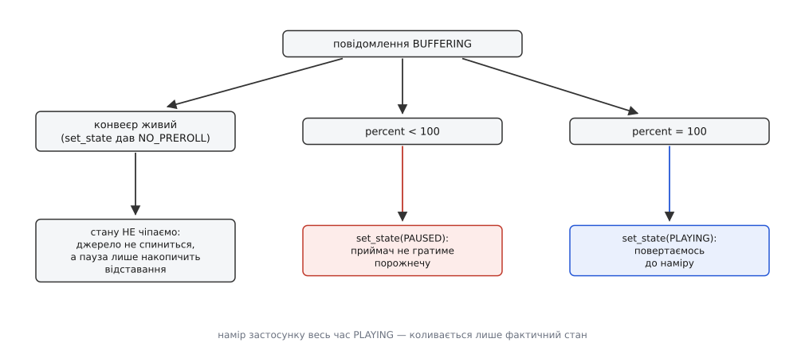
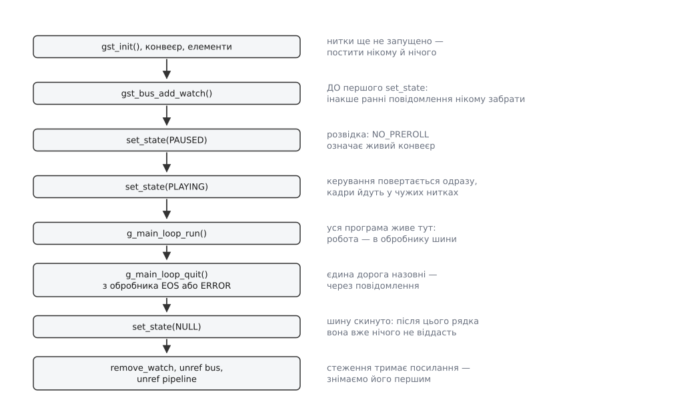

# ⚙️ Робочий цикл шини: програвач від першого елемента до чистої зупинки

Це повна програма — програвач одного посилання, байдуже, файл це чи мережа, — у якій шина не декорація, а несуча конструкція: тільки через неї програма дізнається, що потік скінчився, що декодер здався, що мережа не встигає й що затримку треба перерахувати. Приклади на десять рядків, де в обробнику стоять лише `ERROR` і `EOS`, працюють рівно доти, доки джерело локальне й справне; усе решта починається на першому ж `rtsp://`.

Основою беремо `uridecodebin` — джерело плюс декодер в одному елементі, який сам вибирає, чим читати `file://`, `http://` чи `rtsp://`, і сам знаходить потрібний декодер. Приймачі дописуємо ми, коли елемент повідомить, які потоки в матеріалі знайшлися. Далі весь код програми, окрім двох десятків рядків запуску, живе в колбеках.

## Шість подій, які мусить пережити програма

Перелічимо їх наперед, бо саме з них виростає структура коду.

**Помилка.** Файлу немає, сокет закрився, декодера в системі не встановлено. Розібрати треба обидві частини: `GError` — для людини, зневаджувальний рядок — для журналу. І перевести конвеєр у `NULL`, бо сам він не зупиниться.

**Кінець потоку.** Приймачі відзвітували всі до одного, конвеєр звів їхні звіти в один `EOS` — можна виходити.

**Зміна стану.** Корисна для журналу й для розуміння, де саме програма застрягла. Пастка тут у тому, що `STATE_CHANGED` постить **кожен** елемент на кожному переході: на десятку елементів це сорок повідомлень за один пуск. Нам потрібні лише ті, де джерело — сам конвеєр.

**Буферизація.** Мережеве джерело набирає запас і доповідає відсоток. Поки відсоток менший за сто, грати нічого — конвеєр треба тримати в `PAUSED`. Але живого джерела це не стосується: камера не зачекає, доки ми надолужимо.

**Затримка.** Елемент усередині перерахував свою латентність і просить розіслати нову спільну. Це прохання, і виконати його має застосунок.

**Попередження.** Щось пішло не так, але робота триває. Зупиняти конвеєр через `WARNING` — найдешевший спосіб зробити програму, яка падає на кожному подряпаному файлі.

## Стан застосунку: намір окремо, факт окремо

Найважливіше рішення в цій програмі — не в обробнику, а в структурі даних. Буферизація змушує нас перемикати конвеєр між `PAUSED` і `PLAYING` за чужою командою, і після кількох таких перемикань питання «а в якому стані ми зараз мали б бути?» стає невідповідним. Тому **намір** застосунку зберігається окремо від фактичного стану конвеєра: поле `target` каже, чого ми хочемо, і воно не змінюється від того, що джерело на секунду попросило паузи.

Поруч живуть ще два прапорці: `is_live` — чи конвеєр живий (з'ясуємо це під час пуску) і `buffering` — чи ми **зараз** усередині набору запасу, щоб не ставити паузу двічі й не знімати її, коли її ніхто не ставив.

Усе це разом одна структура, вказівник на яку ми передаємо в кожен колбек. Колбеки шини виконуються всі в одній нитці — тій, що крутить головний цикл, — тому замок їм не потрібен; про це варто пам'ятати, бо `pad-added` нижче виконується вже **не** в ній.

:::tabs
:::code proj-bus-loop/c/stan-zastosunku-namir.c
:::code proj-bus-loop/py/stan-zastosunku-namir.py
:::

Одна деталь у налаштуванні `uridecodebin` варта окремої згадки: `use-buffering` типово **вимкнено**. Без нього мережеве джерело мовчки набиратиме запас, і жодного `BUFFERING` ви не побачите — а потім здивуєтеся, чому картинка починається з ривка. Увімкнули — і елемент постить відсоток, поки набирає.

## Гілки на вимогу: `pad-added` приходить у чужій нитці

`uridecodebin` не знає наперед, що всередині матеріалу. Він відкриває джерело, розбирає контейнер, запускає декодери — і аж тоді, для кожного знайденого потоку, віддає назовні готовий pad із сигналом `pad-added`. Наше діло — подивитися на формат і добудувати відповідний хвіст.

Тут криється перша нагода все зіпсувати. `pad-added` — це **сигнал**, а не повідомлення з шини: він приходить не через чергу, а прямим викликом, у тій самій нитці, яка щойно розібрала контейнер. Малювати з нього щось на екрані не можна; довго думати в ньому теж не варто — доки ми думаємо, декодер стоїть. Робота з елементами конвеєра з цієї нитки, натомість, цілком дозволена, і саме її ми й робимо.

Друга нагода — порядок дій. Елемент, доданий у конвеєр, треба **спершу з'єднати й тільки потім** підтягнути його стан під конвеєр. Навпаки не виходить: запущений у порожнечу `queue` одразу впаде помилкою про непід'єднаний pad, і програма зупиниться на порожньому місці.

:::tabs
:::code proj-bus-loop/c/hilky-na-vymohu-pad-added.c
:::code proj-bus-loop/py/hilky-na-vymohu-pad-added.py
:::

`queue` на початку кожної гілки — не прикраса. Він розриває ланцюг і додає власну нитку, тож відео й звук перестають чекати одне на одного, а повільний приймач не гальмує декодер. Без нього дві гілки з одного демультиплексора рано чи пізно взаємно заблокуються.

> 🔧 **Навіщо це.** Якщо ви бачите «конвеєр запустився, стан `PLAYING`, а вікна немає» — перше, що треба перевірити, це чи взагалі приходив `pad-added`. Найчастіша причина мовчання — джерело не відкрилося, і тоді на шині вже лежить `ERROR`, який нікому забрати. Друга за частотою — гілка побудована, але `sync_state_with_parent` не викликано, і вся вона так і лишилася в `NULL`, поки решта конвеєра грає.

## Обробник шини — серце програми

Тепер власне те, заради чого все затівалося. Одна функція, один `switch`, і в кожній гілці — рішення, а не просто друк.

:::tabs
:::code proj-bus-loop/c/obrobnyk-shyny-sertse.c
:::code proj-bus-loop/py/obrobnyk-shyny-sertse.py
:::

Три рядки в цьому коді варті окремого погляду.

Порівняння `GST_MESSAGE_SRC (msg) != GST_OBJECT (app->pipeline)` — той самий фільтр, без якого журнал перетворюється на кашу. Кожен елемент звітує про свій перехід, і на звичайному відеофайлі це три-чотири десятки рядків на пуск; нас цікавить лише перехід конвеєра як цілого, бо саме він означає «усе всередині вже перейшло». Що насправді відбувається на кожному з переходів — розписано у статті про [стани конвеєра](root:sys-media/states-lifecycle).

`gst_bin_recalculate_latency()` на `LATENCY` — рівно те, що робить `gst-launch-1.0`, коли друкує своє «Redistribute latency…». Повідомлення означає, що якийсь елемент (майже завжди це буфер джитера на мережевому вході) змінив свою затримку, і спільну треба зібрати заново та розіслати всім. Не зробити цього означає розсинхронізацію відео зі звуком, яка з'являється через хвилину після старту й на яку нічого не вказує; звідки береться сама затримка, розібрано у статті про [затримку й буферизацію](root:sys-media/latency-and-buffering).

`return TRUE` наприкінці — це «лишити стеження підключеним». Повернене `FALSE` знімає джерело подій із циклу, і далі шина мовчить назавжди. Помилитися тут легко, бо ця функція виглядає як звичайний обробник, у якому повернене значення нічого не важить.

## Буферизація: чому паузу ставить застосунок

Найтонше місце програми — саме тут, і воно тонке не через код, а через те, що правильна поведінка залежить від виду джерела.



*Реакція на BUFFERING: намір застосунку весь час лишається `PLAYING`, а фактичний стан конвеєра коливається під нього.*

Для джерела із запасом — файл через мережу, потік по HTTP — логіка проста. Відсоток менший за сто означає, що даних наразі мало; якщо не спинитися, приймач догляне до кінця наявного й гратиме тишу з застиглим кадром. Тому: перший `BUFFERING` із неповним відсотком → `PAUSED`; сотий відсоток → назад у `PLAYING`. Прапорець `buffering` тут потрібен, щоб не ставити паузу на кожному з десятків повідомлень і не знімати її, коли ми її не ставили.

Для **живого** джерела те саме означало б протилежне. Камера не спиняється від того, що ми поставили паузу: вона й далі віддає кадри в реальному часі, а ми їх не забираємо. Через п'ять секунд паузи ми відстанемо на п'ять секунд і вже ніколи не наздоженемо — запас перетвориться на постійну затримку. Тому для живого конвеєра `BUFFERING` — суто відомість: показати смужку в інтерфейсі можна, чіпати стан не можна.

Розпізнати живий конвеєр можна двома незалежними способами. Основний — відповідь на перший перехід у `PAUSED` (про це нижче). Додатковий — саме повідомлення: `gst_message_parse_buffering_stats()` віддає режим, і `GST_BUFFERING_LIVE` серед його значень означає рівно те, що написано. Другий спосіб зручний, коли в одному застосунку живі й неживі джерела перемішані; чому мережеві джерела майже завжди живі, а `http://` — ні, розібрано у статті про [мережеві джерела](root:sys-media/network-sources).

## Пуск: `PAUSED` як розвідка

Запустити конвеєр можна одним викликом одразу в `PLAYING`. Ми робимо це у два кроки — і не з обережності, а тому, що перший крок **повертає відповідь на питання, чи конвеєр живий**.

Перехід у `PAUSED` змушує конвеєр домовитися про формати й підготувати перший кадр. Звичайне джерело це вміє, і виклик повертає `GST_STATE_CHANGE_ASYNC` — «роблю, скажу згодом». Живе джерело підготувати кадр наперед не може принципово: кадру ще не існує, він з'явиться, коли камера його зніме. Саме тому воно відповідає окремим значенням `GST_STATE_CHANGE_NO_PREROLL`, і це найнадійніший наявний спосіб дізнатися вид конвеєра.

:::tabs
:::code proj-bus-loop/c/pusk-paused-iak-rozvidka.c
:::code proj-bus-loop/py/pusk-paused-iak-rozvidka.py
:::

Гілка `FAILURE` — місце, де більшість прикладів обриваються рядком «не вдалося запустити конвеєр», і саме через неї найчастіше не видно причини. Помилка на шині вже лежить: елемент устиг її запостити просто всередині `set_state()`. Але головний цикл іще не крутиться, і стеження, хоч і підключене, не спрацює ніколи — програма ж зараз піде у вихід. Тому ми дістаємо повідомлення руками, тим самим `gst_bus_timed_pop_filtered()` із нульовою витримкою, і віддаємо в **ту саму** функцію розбору. Ціна цього кроку — один рядок і обов'язок звільнити, про який далі.

Збирається все звичайно:

```
# gstreamer-video-1.0 знадобиться синхронному обробникові нижче
gcc player.c -o player $(pkg-config --cflags --libs gstreamer-1.0 gstreamer-video-1.0)

./player file:///шлях/до/файлу.mp4
./player rtsp://camera.local/stream
```

## Хто звільняє повідомлення

Одне й те саме `GstMessage` в цій програмі проходить трьома різними дорогами, і власник у кожної свій. Плутанина тут дає або подвійне звільнення (аварія одразу), або витік (аварія за кілька годин).

**Колбек стеження.** Повідомлення позичене. Шина зробить `unref` сама, щойно ваша функція поверне керування. Викликати `gst_message_unref()` тут — помилка, і виявиться вона не на цьому рядку, а десь у надрах наступного повідомлення.

**Ручний `pop`.** `gst_bus_pop()` і `gst_bus_timed_pop_filtered()` передають повідомлення **у власність**. Не звільнити — витік; у програмі, що опитує шину в циклі, це витік із рівномірним зростанням пам'яті.

**Синхронний обробник, що повернув `GST_BUS_DROP`.** Повідомлення з дороги зникло, у чергу не потрапить, більше про нього не згадає ніхто — крім вас. `gst_message_unref()` обов'язковий. `GST_BUS_PASS` і `GST_BUS_ASYNC`, навпаки, нічого не забирають: повідомлення йде далі своїм шляхом і звільниться там.

У Python усі три випадки виглядають однаково — обгортка тримає посилання й відпускає його разом зі збиранням сміття. Це зручно рівно доти, доки ви не переносите готовий алгоритм із Python у C: там `pop` без `unref` компілюється мовчки. Механіка, за якою це працює, — звичайний [підрахунок посилань](root:sf-lang/reference-counting).

## Синхронний обробник: вікно потрібне негайно

Черга дає спокій, але забирає час, і є одна обставина, у якій часу немає. Відеоприймач, дійшовши до першого кадру, мусить знати, у яке вікно малювати. Якщо не сказати йому цього **до** того, як він продовжить, він створить власне вікно — і замість картинки всередині вашого інтерфейсу на екрані вискочить окрема рамка. Прочитати повідомлення з черги вже запізно: до того моменту зайве вікно існує.

Тому обробник тут окремий, синхронний — його шина кличе негайно, у нитці, що постила, ще до всякої черги:

:::tabs
:::code proj-bus-loop/c/synkhronnyi-obrobnyk-vikno.c
:::code proj-bus-loop/py/synkhronnyi-obrobnyk-vikno.py
:::

Три правила для такого обробника. Він мусить бути коротким — доки він працює, нитка потоку стоїть. Він не має права ходити у віджети — він **не** в головній нитці. І він не має права питати конвеєр про стан чи міняти його — це прохання до нитки зачекати на саму себе. Усе, що не стосується вікна, він відпускає з `GST_BUS_PASS`, і воно доходить до звичайного обробника як завжди.

## Чиста зупинка



*Порядок кроків: кожен на своєму місці не з естетики — переставлені місцями, вони дають або втрачені повідомлення, або звернення до звільненої пам'яті.*

Вихід у цій програмі один — і після `EOS`, і після `ERROR` керування повертається з `g_main_loop_run()` в те саме місце. Це навмисно: два різні шляхи виходу означали б два різні набори звільнень, і один із них рано чи пізно виявився б неповним. Такий єдиний шлях згортання — те саме, що загальне [штатне вимкнення](root:sf-release/graceful-shutdown), тільки в мініатюрі.

Порядок кроків у ньому не довільний.

`set_state(NULL)` **перший**, бо доти нитки потоку ще працюють, і розбирати з-під них щось — гарантована аварія. Цей перехід синхронний: коли виклик повернувся, усередині вже нічого не рухається й ресурси віддано.

Одразу з цим переходом конвеєр **скидає шину**: усе, що в черзі, викидається, усе нове відхиляється. Це навмисне — під час розбирання елементи ще встигають напостити купу вже нікому не потрібного. Побічний ефект: після цього рядка з шини не прочитати нічого. Якщо останні повідомлення вам таки потрібні, вимкніть властивість конвеєра `auto-flush-bus` — і тоді скидати шину стане вашим обов'язком, інакше повідомлення від попереднього пуску прилетять під час наступного.

`gst_bus_remove_watch()` **другий**, до `unref` шини: стеження — це джерело подій у головному циклі, яке тримає власне посилання на шину. Не знявши його, ви лишаєте в циклі джерело, що вказує на об'єкт, який ви щойно збиралися звільнити.

І тільки після цього — `unref` шини, `unref` конвеєра (він потягне за собою всі елементи всередині), `unref` циклу.

## Три пастки, на яких програма мовчить

Усі три виглядають однаково — конвеєр начебто працює, а програма не реагує ні на що, — і всі три видає один рядок у журналі, той, що починається словами «queue overflows with». Він з'являється, коли довжина черги перетинає 1024, і потім на кожній наступній тисячі. Пишеться на рівні попереджень, тобто видно його вже за `GST_DEBUG=2`; за типового мовчазного налаштування — не видно взагалі, і саме тому пам'ять «росте без причини».

**Стеження не приєднано.** Конвеєр створено, `set_state` викликано, `gst_bus_add_watch()` забуто — або викликано вдруге. Шина тримає рівно **одне** стеження, і другий виклик поверне 0, нічого не приєднавши; те саме стосується пари `add_watch` і `add_signal_watch` разом. Перевірка на нуль тут — рядок, який економить годину.

**Головний цикл ніхто не крутить.** Стеження приєднується до типового головного контексту GLib, і якщо в застосунку свій цикл подій — чужого набору віджетів, власного сервера, чого завгодно, — цей контекст не обертається ніколи. Виходів два. Перший: підняти `GMainLoop` в окремій нитці. Другий, простіший: не приєднувати стеження взагалі, а вичерпувати шину з таймера свого циклу — і тоді власником повідомлень стаєте ви:

:::code proj-bus-loop/c/try-pastky-na-iakykh.c

**Обробник працює довго.** Цикл є, крутиться, обробник викликається — але всередині нього похід у мережу, запис у базу або перемальовування всього інтерфейсу. Повідомлення надходять швидше, ніж ви їх розбираєте, і черга росте. Найшвидше її набивають `QOS` і `STATE_CHANGED`: на живому відео це десятки повідомлень за секунду. Правило просте — усе, що триває довше за мить, кладеться у власну чергу задач і виконується поза обробником. Спіймати порушення можна дешево:

```c
    gint64 t0 = g_get_monotonic_time ();
    /* … тіло switch … */
    gint64 dt = g_get_monotonic_time () - t0;
    if (dt > 2000)     /* понад 2 мс у колбеку шини — вже погано */
      g_warning ("обробник шини витратив %" G_GINT64_FORMAT " мкс на %s",
                 dt, GST_MESSAGE_TYPE_NAME (msg));
```

Спільне в цих трьох пастках одне, і воно ж — головна думка всієї програми: шина нічого не робить сама. Вона доповідає факт і чекає, доки хтось його забере й вирішить, що з ним робити. Конвеєр, у якому ніхто не забирає, працює бездоганно й безглуздо.

## Що це коштує і чого тут немає

Ціна всієї конструкції — одна нитка (та, що крутить цикл), одне виділення пам'яті на повідомлення й приблизно нуль накладних витрат на кадр: шина в дорозі даних не стоїть узагалі. Обробник із десятком гілок `switch` при десятках повідомлень на секунду не помітний на тлі декодування навіть на слабкому процесорі — за умови, що в ньому справді нічого довгого.

Чого тут навмисно немає: перемотування (воно тягне за собою розчистку конвеєра й окрему обробку `ASYNC_DONE`), перебудови конвеєра на льоту й видачі кадрів у власний код. Останнє додається дешевше за все — заміною `autovideosink` на [appsink](root:sys-media/appsink-appsrc), після чого весь наведений код лишається без жодної зміни, а кадри починають приходити у ваш колбек. Коли ж програма поводиться незрозуміло попри правильно оброблену шину, наступний інструмент — граф конвеєра й рівні журналу, про які йдеться в статті про [діагностику конвеєра](root:sys-media/pipeline-debugging).
